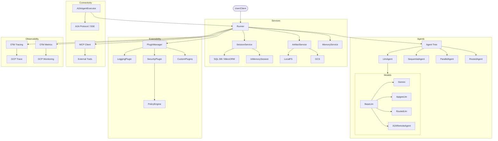

I will read the instructions in `.prompt.md` to understand the task.
I will read the beginning of `.input.adk-js.xml` to understand its structure and get the project name and last commit date.
I will search for `<git_log_commit>` in `.input.adk-js.xml` to get the project name and last commit date.
I will read the first few `git_log_commit` entries in `.input.adk-js.xml`.
I'll look at `core/README.md` and `README.md` to get a better overview of the project and write the description.
I will read the `core/src/models` and `core/src/agents` directories to learn more about the agents and models.
I will search for `core/src/models` in the full file.
I will read the `core/src/models/` and `core/src/agents/` directories to learn more about the models and agents.
I will read the `core/src/agents/` directory to learn more about the different types of agents supported.
I will check the `core/src/skills` directory to see what's there.
I will search for `core/src/skills` in the full file.
I will read the `core/src/skills/` directory.
I will read the `core/src/runner/` and `core/src/sessions/` directories to understand the execution flow and data storage.
I will check the `dev/samples` directory to identify some use cases.
I will search for the `dev/samples/` directory in the full file.
I will read the `dev/samples/` directory to understand the use cases.
I will check the `core/src/telemetry/` and `core/src/utils/` directories for more technical details.
I will search for `core/src/telemetry/` and `core/src/utils/` in the full file.
I will read the `core/src/telemetry/` and `core/src/utils/` directories.
I will check the `core/src/common.ts` and `core/src/index.ts` files to see what is exported as the public API.
I will search for `core/src/index.ts`.
I will read the `core/src/index.ts` file.
I will find the exact line for `core/src/index.ts` in `.input.adk-js.xml`.
I will check if `core/src/common.ts` exists.
I will read the `core/src/common.ts` file.
I will check the `core/src/common.ts` file at line 7960.
# ADK-JS Project Analysis Report

## 1. Project Information
*   **Project Name:** adk-js (Agent Development Kit for JavaScript)
*   **Last Commit Date:** 2026-04-10 11:42:19 -0700
*   **Latest Commit Message:** `feat: skills: define skills interface (#251)`

## 2. Description
The `adk-js` project is a comprehensive Agent Development Kit for JavaScript and TypeScript, designed to build, run, and orchestrate sophisticated AI agents. It provides a robust framework that supports multiple agent architectures, including LLM-based agents, loops, parallel execution, and sequential workflows. The kit is built with extensibility in mind, allowing developers to integrate various LLM providers, tools, and custom plugins to enhance agent behavior.

A core strength of the project is its focus on interoperability and standard protocols. It implements the A2A (Agent-to-Agent) protocol, enabling seamless communication between different agents, potentially across different languages (matching Python and Java ADK implementations). It also supports the Model Context Protocol (MCP), allowing agents to interact with a wide ecosystem of tools and data sources.

The architecture is highly modular, featuring a separation of concerns between agent logic, session management, artifact storage, and telemetry. It includes advanced features like context compaction (token-based or truncating), human-in-the-loop tool confirmation, and comprehensive OpenTelemetry integration for monitoring and debugging. This makes it suitable for both simple prototypes and complex, production-ready multi-agent systems.

## 3. Supported Platforms and Deployments
*   **Platforms:**
    *   **Node.js:** Primary environment for running agents, servers, and CLI tools. (`core/package.json`)
    *   **Web/Browser:** Supports bundled versions for client-side execution or interaction. (`core/src/index_web.ts`, `dev/src/browser/`)
    *   **Cloud (GCP):** Deep integration with Google Cloud services for storage, monitoring, and tracing. (`core/src/telemetry/google_cloud.ts`, `core/src/artifacts/gcs_artifact_service.ts`)
    *   **Cloudflare Workers:** Mentioned as a potential target for communication and lightweight agent hosting.
*   **Requirements:**
    *   **Runtime:** Node.js (likely v18+ given modern features).
    *   **Package Manager:** npm (uses `package-lock.json`).
    *   **Languages:** TypeScript (primary development) and JavaScript.
    *   **Database:** Supports various SQL databases via MikroORM (SQLite, PostgreSQL, MySQL, MariaDB, MSSQL). (`core/package.json`)

## 4. Supported Connectors
*   **A2A (Agent-to-Agent):** Enables inter-agent communication and remote agent execution.
    *   `core/src/a2a/`
*   **MCP (Model Context Protocol):** Connects to MCP servers for tools and resources.
    *   `core/src/tools/mcp/`
*   **Google Search:** Integrated tool for web searching.
    *   `dev/samples/google_search_agent.ts`
*   **Google Cloud Storage (GCS):** For persistent artifact storage.
    *   `core/src/artifacts/gcs_artifact_service.ts`
*   **OpenTelemetry:** For exporting traces, metrics, and logs to OTLP-compatible backends (e.g., Google Cloud Monitoring/Trace).
    *   `core/src/telemetry/`
*   **Express:** Integration for serving agents as API endpoints.
    *   `core/src/a2a/agent_to_a2a.ts`

## 5. Supported Models and Agents
*   **Models:**
    *   **Google Gemini:** Integration with Gemini models via `@google/genai`. (`core/src/models/google_llm.ts`)
    *   **Apigee LLM:** Accessing models through Apigee proxies. (`core/src/models/apigee_llm.ts`)
    *   **Routed LLM:** Dynamically selecting models based on requests. (`core/src/models/routed_llm.ts`)
    *   **A2A Remote Agent:** Executing models hosted on other A2A-compliant servers. (`core/src/a2a/a2a_remote_agent.ts`)
*   **Agents:**
    *   **LlmAgent:** Basic agent driven by LLM instructions and tools. (`core/src/agents/llm_agent.ts`)
    *   **LoopAgent:** Iterative agent for repetitive tasks or refinement. (`core/src/agents/loop_agent.ts`)
    *   **ParallelAgent:** Executes multiple sub-agents in parallel. (`core/src/agents/parallel_agent.ts`)
    *   **SequentialAgent:** Executes sub-agents in a fixed sequence. (`core/src/agents/sequential_agent.ts`)
    *   **RoutedAgent:** Selects sub-agents based on context or routing logic. (`core/src/agents/routed_agent.ts`)

## 6. Top 5 Use Cases
1.  **Multi-Agent Collaborative Workflows:** Using `SequentialAgent` or `ParallelAgent` to coordinate complex tasks across specialized agents (e.g., a researcher agent followed by a writer agent).
2.  **External Tool Integration (MCP):** Connecting agents to enterprise data or specialized APIs via the Model Context Protocol.
3.  **Human-in-the-Loop Processes:** Implementing `SecurityPlugin` for tool call confirmation, ensuring high-stakes actions are approved by users.
4.  **Persistent Conversational AI:** Utilizing `DatabaseSessionService` to maintain long-term state and memory across multiple interactions and users.
5.  **Cross-Language Agent Interaction:** Hosting a TypeScript-based agent that communicates with Python or Java agents via the A2A protocol.

## 7. Top 20 Features
1.  **A2A Protocol Implementation:** Full support for inter-agent communication. (`core/src/a2a/`)
2.  **MCP Integration:** Seamless connection to Model Context Protocol ecosystem. (`core/src/tools/mcp/`)
3.  **Advanced Context Compaction:** Token-based and truncating strategies to handle long conversations. (`core/src/context/`)
4.  **Flexible Session Management:** Support for In-Memory and Database-backed (MikroORM) sessions. (`core/src/sessions/`)
5.  **Multi-Modal Support:** Handling text, audio, and video in agents. (`core/src/agents/run_config.ts`)
6.  **Plugin System:** Extensible hook system for logging, security, and custom logic. (`core/src/plugins/`)
7.  **Routed LLMs and Agents:** Dynamic selection of the best model or agent for a task. (`core/src/models/routed_llm.ts`, `core/src/agents/routed_agent.ts`)
8.  **Tool Confirmation Flow:** Built-in mechanism for human-in-the-loop approvals. (`core/src/plugins/security_plugin.ts`)
9.  **Artifact Service:** Structured storage for files generated or used by agents (Local, GCS, In-Memory). (`core/src/artifacts/`)
10. **OpenTelemetry Integration:** Industrial-grade observability for agent traces and metrics. (`core/src/telemetry/`)
11. **Code Execution:** Support for executing code within agent workflows. (`core/src/code_executors/`)
12. **Streaming API:** Support for SSE and BiDi streaming for real-time interactions. (`core/src/agents/run_config.ts`)
13. **Agent-as-a-Tool:** Ability to wrap any agent and use it as a tool for another agent. (`core/src/tools/agent_tool.ts`)
14. **Customizable Logging:** Comprehensive logging via `LoggingPlugin`. (`core/src/plugins/logging_plugin.ts`)
15. **OAuth2 and Auth Handling:** Robust support for managing API credentials and user auth. (`core/src/auth/`)
16. **Environment Awareness:** Utilities for cross-environment compatibility (Node, Browser). (`core/src/utils/env_aware_utils.ts`)
17. **Zod Integration:** Strong typing and validation for tool inputs/outputs. (`core/src/utils/simple_zod_to_json.ts`)
18. **LLM Registry:** Centralized management and resolution of LLM providers. (`core/src/models/registry.ts`)
19. **Failover and Failback:** Support for model and agent routing with error handling. (`core/src/utils/failover_utils.ts`)
20. **Skill Interface:** A new way to define and share agent capabilities. (`core/src/skills/`)

## 8. Top 20 Smart Patterns
1.  **Context Injection:** Injecting session state and grounding information into LLM prompts. (`core/src/agents/instructions.ts`)
2.  **Early Exit Plugins:** Using plugins to short-circuit agent execution (e.g., for caching). (`core/src/plugins/plugin_manager.ts`)
3.  **Recursive Agent Trees:** Building complex hierarchies where agents can call other agents. (`core/src/agents/base_agent.ts`)
4.  **Implicit Tool Selection:** LLMs deciding which tools to call based on their declarations. (`core/src/agents/functions.ts`)
5.  **Token-Aware Compaction:** Compacting history only when reaching specific token thresholds to maintain context. (`core/src/context/token_based_context_compactor.ts`)
6.  **Agent Transfer:** Handing off the conversation from one agent to another within the same session. (`core/src/agents/processors/agent_transfer_llm_request_processor.ts`)
7.  **Human-in-the-loop (HITL):** Pattern for pausing execution until a user provides confirmation or input. (`core/src/plugins/security_plugin.ts`)
8.  **A2A Remote Delegation:** Pattern for offloading heavy tasks to a remote specialized agent. (`core/src/a2a/a2a_remote_agent.ts`)
9.  **Routed Fallback:** Pattern for trying a cheaper model first and falling back to a more capable one. (`core/src/models/routed_llm.ts`)
10. **State-Driven Workflow:** Using the session state to guide agent decisions across multiple turns. (`core/src/sessions/state.ts`)
11. **Artifact Referencing:** Replacing large file data with small placeholders in prompts. (`core/src/runner/runner.ts`)
12. **Custom Policy Enforcement:** Using `SecurityPlugin` with custom `PolicyEngine` to validate tool calls. (`core/src/plugins/security_plugin.ts`)
13. **OTel Propagation:** Propagating trace context across async boundaries and remote calls. (`core/src/telemetry/tracing.ts`)
14. **Lazy Loading DB Drivers:** Optimizing startup by loading only the necessary MikroORM drivers. (`core/src/sessions/database_session_service.ts`)
15. **Standardized Event Log:** Treating all interactions as a series of events for easy replay and auditing. (`core/src/events/event.ts`)
16. **Metadata Decorators:** Attaching custom labels and metadata to events for tracking and filtering. (`core/src/a2a/metadata_converter_utils.ts`)
17. **Few-Shot Prompting via Examples:** Integrating structured examples into LLM requests. (`core/src/examples/`)
18. **Instruction Processors:** Modular components that prepare instructions before sending them to the LLM. (`core/src/agents/processors/instructions_llm_request_processor.ts`)
19. **Session Resumption:** Determining the correct agent to continue a workflow after a long pause or interruption. (`core/src/runner/runner.ts`)
20. **Skill Serialization:** Packaging agent logic and metadata into a shareable "Skill" format. (`core/src/skills/`)

## 9. Top 20 Development Trends (Latest Commits)
1.  **Skill System Evolution:** Defining standardized interfaces for sharing agent capabilities.
2.  **A2A Deepening:** Enhancements to Remote Agent handling and part conversion.
3.  **Context Management:** Shift towards token-based compaction for better efficiency.
4.  **Storage Scalability:** Moving towards robust SQL storage via MikroORM.
5.  **Performance Optimization:** Replacing `yaml` with `js-yaml` for faster config reads.
6.  **Security Rigor:** Implementing path traversal checks and secret scanning.
7.  **Cross-Language Support:** Adding Go-TS integration tests for A2A.
8.  **Tooling Improvements:** Enhancing MCP support (handling array types).
9.  **Modality Expansion:** Support for video metadata in A2A conversion.
10. **Reliability:** Fixing session state persistence issues.
11. **Developer Experience:** Simplifying READMEs and improving error messages.
12. **Automation:** Heavy use of `release-please` and GitHub actions for validation.
13. **Architecture Cleanup:** Moving away from `instanceof` to type guards for better bundling.
14. **ESM Transition:** CLI and core moving towards native ESM support.
15. **Telemetry Refinement:** Fine-tuning OTel span attributes for GenAI.
16. **Artifact Versioning:** Introducing support for versioning saved artifacts.
17. **Routing Sophistication:** Introducing planning mode and AB testing for routing.
18. **Code Execution Safety:** Isolating and securing built-in code executors.
19. **LLM Parameter Standardization:** Unifying parameters across Gemini and Apigee.
20. **Conformance Testing:** Aligning with a cross-platform ADK conformance suite.

## 10. Top 10 Advantages
1.  **Multi-Agent Native:** Built from the ground up for agent orchestration, not just simple LLM calls.
2.  **Interoperability:** A2A and MCP support makes it highly connectable.
3.  **Observability:** Industrial-grade telemetry built-in.
4.  **Extensibility:** Plugin and agent subclassing system is very powerful.
5.  **Environment Agnostic:** Runs in Node, Browser, and likely edge runtimes.
6.  **Advanced Memory/Context:** Sophisticated tools for handling long-running conversations.
7.  **Human-in-the-Loop:** First-class support for safety and human oversight.
8.  **Typed Ecosystem:** Leverages TypeScript for safety and better DX.
9.  **Flexible Storage:** Decoupled storage allows using any major database.
10. **Google Ecosystem Synergy:** Excellent integration with Gemini and Google Cloud.

## 11. Top 10 Limitations
1.  **Complexity:** High barrier to entry for beginners due to modular architecture.
2.  **Experimental Features:** Many advanced features (CFC, thinking_config) are still experimental.
3.  **Documentation Gap:** Deep features like A2A require more comprehensive guides.
4.  **Mobile Support:** No explicit mention of React Native or Flutter (though JS core might work).
5.  **Model Bias:** Strongly optimized for Google Gemini; other providers might require more work.
6.  **Dependency Weight:** Large dependency tree due to MikroORM and OTel.
7.  **Cold Start:** Complex initialization of OTel and DB might affect serverless performance.
8.  **State Management Overhead:** Handling state transitions in complex multi-agent trees can be tricky.
9.  **LRO Implementation:** Long-running operations support is still being generalized.
10. **Visual Tooling:** Lacks a built-in UI for agent monitoring (though `adk-devtools` exists).

## 12. Top 5 AI Skills
*   **Provided Skills:**
    1.  **Skill Interface:** `core/src/skills/skill.ts` (Core definition)
    2.  **Prompt Skill:** `core/src/skills/prompt.ts` (Handling prompt-based skills)
    3.  **Agent-as-Tool Skill:** Ability to expose agents as capabilities to others.
    4.  **Context Compaction Skill:** Automatic history management.
    5.  **Code Execution Skill:** Ability to run dynamic logic.
*   **Used Skills (by Agents):**
    1.  **Google Search:** Used by samples.
    2.  **Weather/Time:** Used in integration tests.
    3.  **MCP Tool Discovery:** Automatically discovering tools from MCP servers.
    4.  **Routing/Planning:** Used by `RoutedAgent` to plan tasks.
    5.  **Summarization:** Used by `LlmSummarizer` for context.

## 13. Data Inputs, Outputs, and Storage
*   **Inputs:** Text prompts, audio chunks, video frames, files (as artifacts), tool results.
    *   `core/src/models/llm_request.ts`
*   **Outputs:** Text responses, function calls, audio/video streams, generated files (artifacts).
    *   `core/src/models/llm_response.ts`, `core/src/events/event.ts`
*   **Storage:**
    *   **Sessions:** In-memory or SQL (SQLite, PostgreSQL, etc.) via MikroORM.
        *   `core/src/sessions/`
    *   **Artifacts:** Local filesystem, GCS, or In-memory.
        *   `core/src/artifacts/`
    *   **Memory:** Context-aware search (likely vector-based or similar, mentioned in `BaseMemoryService`).
        *   `core/src/memory/`

## 14. Detailed Architecture Review
1.  **Runner:** The main orchestrator that manages sessions, agents, and plugins. (`core/src/runner/runner.ts`)
2.  **BaseAgent:** The foundation for all agent types. (`core/src/agents/base_agent.ts`)
3.  **LlmAgent:** Bridges LLM models with agent logic and tool execution. (`core/src/agents/llm_agent.ts`)
4.  **SessionService:** Manages conversation history and state persistence. (`core/src/sessions/base_session_service.ts`)
5.  **LLMRegistry:** Manages and resolves different LLM model implementations. (`core/src/models/registry.ts`)
6.  **BaseLlm:** Abstract interface for interacting with LLMs. (`core/src/models/base_llm.ts`)
7.  **PluginManager:** Coordinates execution of global hooks. (`core/src/plugins/plugin_manager.ts`)
8.  **A2AAgentExecutor:** Adapts the Runner to the A2A protocol. (`core/src/a2a/agent_executor.ts`)
9.  **A2ARemoteAgent:** Delegate agent that communicates with a remote A2A server. (`core/src/a2a/a2a_remote_agent.ts`)
10. **ArtifactService:** Handles storage of files and large data. (`core/src/artifacts/base_artifact_service.ts`)
11. **ContextCompactor:** Logic for shrinking session history. (`core/src/context/base_context_compactor.ts`)
12. **ToolSet:** Groups related tools for easy management. (`core/src/tools/base_toolset.ts`)
13. **SecurityPlugin:** Implements policies and tool call confirmations. (`core/src/plugins/security_plugin.ts`)
14. **AuthHandler:** Manages authentication flows for tools. (`core/src/auth/auth_handler.ts`)
15. **CodeExecutor:** Logic for running code generated by agents. (`core/src/code_executors/`)
16. **EventBus (A2A):** Handles event propagation in A2A server. (`core/src/a2a/agent_executor.ts`)
17. **Telemetry Setup:** Configures OTel providers and exporters. (`core/src/telemetry/setup.ts`)
18. **InvocationContext:** Ephemeral state for a single agent run. (`core/src/agents/invocation_context.ts`)
19. **State:** Persistent key-value storage for a session. (`core/src/sessions/state.ts`)
20. **Registry (Global):** Centralized discovery for agents, models, and services.

## 15. Mermaid Architecture Graph

## 16. Maturity and Stability Review
*   **Maturity:** Mid-stage. The project has a solid architectural core and supports enterprise features like OTel and SQL storage. Versioning (0.6.1) suggests it's pre-1.0 but nearing stability.
*   **Stability:** High on core features (LLM agents, basic tools). Newer features like A2A and complex context compaction are still evolving. Comprehensive test suite and CI (cross-platform, cross-language) indicate a high focus on reliability.
*   **Security:** Strong. Includes secret scanning, path traversal protection, and a structured policy engine for tool calls. Human-in-the-loop patterns are baked into the core.
*   **Performance:** Good. Use of efficient libraries (`js-yaml`), lazy loading of heavy dependencies (DB drivers), and streaming support show attention to performance.

## 17. Project Review
*   **Tests:** Extensive coverage with `vitest`. Includes unit, integration, e2e, and cross-language (TS-Go) tests.
*   **CI Pipelines:** Robust workflows for validation (Lint, Format, Secret check, Tests, Coverage), Cross-Language integration, License checking, and automated releases.
*   **Documentation:** Growing. TSDocs are used for API documentation. READMEs are concise.
*   **AI Skills:** Well-defined skill interface allows for modular extension and reuse of agent logic.

## 18. Possible Improvements or Fixes
1.  **Generalize LRO:** Implement a common Long-Running Operation pattern across all agent types. (`core/src/runner/runner.ts` TODO)
2.  **Native Vector Search:** Integrate a standard vector DB interface for the Memory service. (`core/src/memory/base_memory_service.ts`)
3.  **UI Components:** Provide React/Angular components for common agent interactions (chat UI, artifact viewer).
4.  **Local Model Support:** Explicit integration with local LLM runners like Ollama or LM Studio.
5.  **Performance in Serverless:** Further optimize cold starts for Cloudflare Workers/Lambda.
6.  **Better Planning Tools:** Enhance routing with more sophisticated multi-step planning logic.
7.  **Auto-Documentation:** Automatic generation of agent "manuals" based on instructions and tools.
8.  **Tool conflict resolution:** Better handling of name collisions across multiple toolsets. (`core/src/tools/base_toolset.ts`)
9.  **Enhanced Debugging:** A visual debugger for the agent event log.
10. **Standardized Knowledge Graph:** Integrate a graph-based knowledge base as a primary memory source.
11. **Browser-Native Tools:** More tools specialized for browser environments (DOM manipulation, etc.).
12. **Native Mobile SDKs:** Provide lightweight SDKs for Android/iOS that communicate with the core via A2A.
13. **Cost Tracking:** Integrate token cost calculation and budgeting into the telemetry.
14. **Fine-tuning Support:** Tools to prepare data and initiate fine-tuning for Gemini/Vertex.
15. **Collaborative Multi-user State:** Better primitives for shared state in multi-user environments.
16. **Voice/Audio Primitives:** Higher-level abstractions for voice-controlled agents.
17. **Workflow Visualization:** Export agent trees and flows to formats like BPMN or Mermaid automatically.
18. **Agent Sandboxing:** More robust isolation for code execution tools.
19. **Policy DSL:** A simpler language for defining tool call policies.
20. **Template Gallery:** A collection of pre-configured agent templates for common tasks.

## 19. Reuse for Agent Swarm (Debating Solutions)
1.  **RoutedAgent:** For selecting the best specialist agent to join the debate. (`core/src/agents/routed_agent.ts`)
2.  **ParallelAgent:** To run multiple solution generators simultaneously. (`core/src/agents/parallel_agent.ts`)
3.  **LlmSummarizer:** To synthesize the debate into a final implementation plan. (`core/src/context/summarizers/llm_summarizer.ts`)
4.  **BaseTool (Agent-as-Tool):** To allow agents to "consult" each other as tools. (`core/src/tools/agent_tool.ts`)
5.  **RoutedLlm:** To use the best model for evaluating the proposed solutions. (`core/src/models/routed_llm.ts`)
6.  **State Management:** To keep track of the debate's progress and the different solution versions. (`core/src/sessions/state.ts`)
7.  **Event Log:** To audit the reasoning process of the swarm. (`core/src/events/event.ts`)
8.  **A2A Protocol:** For high-fidelity communication between swarm members. (`core/src/a2a/`)
9.  **PolicyEngine:** To ensure the debated solutions adhere to specific constraints. (`core/src/plugins/security_plugin.ts`)
10. **LLMRegistry:** To quickly swap models for different parts of the debate. (`core/src/models/registry.ts`)

## 20. Reuse for Shared Knowledge Base (Multi-user/Multi-agent)
1.  **DatabaseSessionService:** Central repository for all interaction history. (`core/src/sessions/database_session_service.ts`)
2.  **StorageUserState:** For maintaining user-specific knowledge. (`core/src/sessions/db/schema.ts`)
3.  **StorageAppState:** For global shared knowledge. (`core/src/sessions/db/schema.ts`)
4.  **BaseMemoryService:** Interface for semantic search over shared data. (`core/src/memory/base_memory_service.ts`)
5.  **ArtifactService (GCS):** For sharing large documents and datasets across agents/users. (`core/src/artifacts/gcs_artifact_service.ts`)
6.  **Skill Interface:** For packaging and sharing learned capabilities. (`core/src/skills/skill.ts`)
7.  **OpenTelemetry Tracing:** To visualize how shared knowledge evolves over time. (`core/src/telemetry/tracing.ts`)
8.  **AuthHandler:** For managing access control to the shared knowledge base. (`core/src/auth/auth_handler.ts`)
9.  **Event Metadata:** To label knowledge updates with their source (agent/user). (`core/src/a2a/metadata_converter_utils.ts`)
10. **PluginManager:** To implement validation or filtering on shared knowledge updates. (`core/src/plugins/plugin_manager.ts`)

## 21. Reuse for Own Hardware/Cloud & Messenger/Web/Native
1.  **A2AAgentExecutor:** The bridge to various transport protocols (HTTP, SSE, RPC). (`core/src/a2a/agent_executor.ts`)
2.  **RemoteA2AAgent:** For running lightweight clients that delegate to home/cloud servers. (`core/src/a2a/a2a_remote_agent.ts`)
3.  **Express Integration (toA2a):** Quickly exposing agents as web services. (`core/src/a2a/agent_to_a2a.ts`)
4.  **RunConfig (Multi-modal):** Support for audio (voice control) and video (visual navigation). (`core/src/agents/run_config.ts`)
5.  **FileArtifactService:** Local storage for agents running on own hardware. (`core/src/artifacts/file_artifact_service.ts`)
6.  **Telemetry Setup:** Exporting local metrics to cloud dashboards. (`core/src/telemetry/setup.ts`)
7.  **OAuth2Auth:** Securely connecting to messenger APIs (Telegram, etc.). (`core/src/auth/auth_credential.ts`)
8.  **MCP Session Manager:** Connecting to local hardware tools (e.g., smart home, CLI). (`core/src/tools/mcp/`)
9.  **RoutedAgent:** Choosing between local or cloud execution based on hardware capability. (`core/src/agents/routed_agent.ts`)
10. **LoggingPlugin:** Terminal-friendly logging for CLI-based interaction. (`core/src/plugins/logging_plugin.ts`)

## 22. Reuse for Team Agents (Cooperative Human/Agent)
1.  **SecurityPlugin (HITL):** Core pattern for human oversight and tool approval. (`core/src/plugins/security_plugin.ts`)
2.  **ToolConfirmation:** Structured data for humans to approve/reject agent actions. (`core/src/tools/tool_confirmation.ts`)
3.  **SequentialAgent:** Designing hand-offs between human and agent tasks. (`core/src/agents/sequential_agent.ts`)
4.  **InvocationContext:** Carrying context across cooperative turns. (`core/src/agents/invocation_context.ts`)
5.  **A2A Event System:** Real-time updates for team members on agent status. (`core/src/a2a/a2a_event.ts`)
6.  **BasePlugin:** Implementing team-specific business rules. (`core/src/plugins/base_plugin.ts`)
7.  **Artifact Versioning:** Collaboration on documents with a shared history. (`core/src/artifacts/base_artifact_service.ts`)
8.  **AuthPreprocessor:** Handling team-level credentials. (`core/src/auth/auth_preprocessor.ts`)
9.  **Session Resumption:** Letting humans pick up where an agent left off (or vice versa). (`core/src/runner/runner.ts`)
10. **Skill Serialization:** Documenting and sharing team "SOPs" as agent skills. (`core/src/skills/`)
