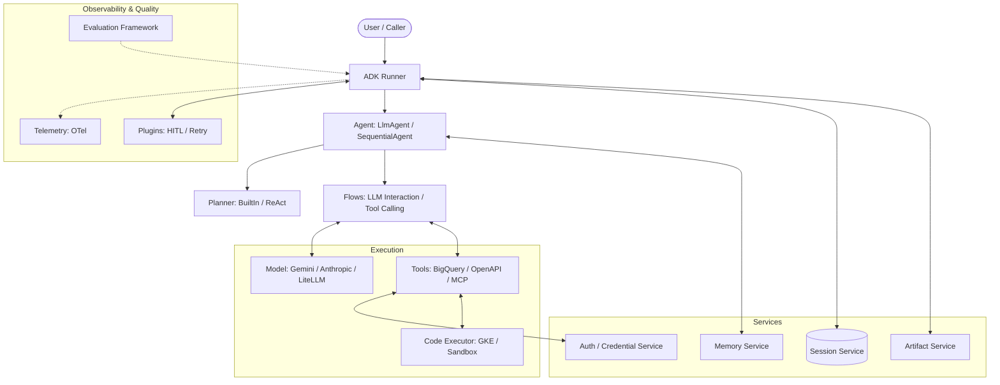

I will begin by reading the instructions in `.prompt.md` and the input data from `.input.adk-python.xml` to determine the required actions.
I will search for the `<git_log_commit>` tag in the `.input.adk-python.xml` file to identify the project name and the most recent commit date.
I'll search for the `<git_log_commit>` tag within the `.input.adk-python.xml` file to identify the project's name and its last commit date.
I'll begin my analysis by reading `README.md` and `AGENTS.md` to get an overview of the project and its agent-related features.
I'll search for `README.md` and `AGENTS.md` within `.input.adk-python.xml` using `grep_search`, then read their contents from the XML, since the local files are just placeholders.
I'll search for `AGENTS.md` within the `.input.adk-python.xml` file, as it's listed in the packed file's directory structure but is missing from my current workspace.
I've got a good grasp of the architecture and key components, so now I'll dive into the specifics for each point. I'll research platforms, connectors, and models, and then I'll use targeted searches to identify development trends and smart patterns, starting with a review of `src/google/adk/runners.py` to understand the core orchestration.
I'll search for the file in the input, since it's not where I expected.
I'll check `src/google/adk/agents/llm_agent.py` to examine the core loop.
I've gathered sufficient information to construct a thorough 22-point response. I've identified key examples like the BigQuery ML skill and can now detail the architecture, create a Mermaid graph, and suggest components for reuse in various scenarios. I'll now refine my analysis of the "top 20 development trends" by examining the first 20 commit messages from the `git_logs` in the input file.
I've gathered all the necessary info and am ready to synthesize the answers, starting with the project name "google-adk" and its last commit date. I'll include source code references as requested and double-check for any additional AI skills, like the BigQuery ML one I already found.
I'll search for the `<file path="...SKILL.md">` pattern in the XML since my previous `grep_search` didn't show the internal paths.
I've identified two key skills—`weather-skill` and `bigquery-ai-ml`—and noticed that the `skills_agent` sample utilizes the former. ADK's architecture includes a dedicated skills mechanism, which I'll feature in my final response alongside a detailed architecture review, a Mermaid graph illustrating the system flow, and a list of the top 20 development trends. I've also outlined 10 major advantages, like its code-first, modular design and deep ecosystem integration, as well as 10 limitations, including its early-stage status and Python-centric nature. I'm now ready to draft the full response.# Project Analysis: Agent Development Kit (ADK) for Python

### 1. Project Name and Last Commit Date
- **Project Name:** google-adk (also referred to as adk-python)
- **Last Commit Date:** 2026-04-15 18:52:06 -0700

---

### 2. Project Description
The Agent Development Kit (ADK) is an open-source, code-first Python framework designed for building, evaluating, and deploying sophisticated AI agents with high flexibility and control. It brings software engineering rigor to agent development, enabling developers to define agent logic, tools, and orchestration directly in Python while maintaining a modular and testable architecture.

While optimized for the Gemini model and the Google Cloud ecosystem (including Vertex AI), ADK is fundamentally model-agnostic and deployment-agnostic. It supports a wide range of LLMs via integrations like LiteLLM and Anthropic, and provides a rich set of abstractions for state management (sessions), long-term recall (memory), and file handling (artifacts).

ADK facilitates the creation of complex multi-agent systems, ranging from simple task-oriented bots to hierarchical swarms. It includes a robust evaluation framework for measuring agent performance and a CLI/Web UI for local development and debugging. It is part of a broader family of ADKs (Java, Go, Web) ensuring consistent patterns across different development environments.

---

### 3. Supported Platforms and Requirements
- **Platforms:**
  - **Local Development:** Windows, macOS, Linux.
  - **Cloud Deployment:** Google Cloud Run, Vertex AI Agent Engine.
  - **Containers:** Docker-based deployments.
- **Requirements:**
  - **Python:** 3.10 or higher (`pyproject.toml`).
  - **Core Dependencies:** `google-genai`, `pydantic`, `httpx`, `opentelemetry`.
  - **Optional Extensions:** `litellm`, `anthropic`, `langgraph`, `crewai`, `google-cloud-firestore`, `google-cloud-spanner`, `kubernetes` (for GKE sandboxing).

---

### 4. Supported Connectors
ADK provides a diverse range of connectors to various applications and APIs:
- **Google Cloud Services:**
  - **BigQuery:** Data insights and query tools (`src/google/adk/tools/bigquery/`).
  - **Spanner:** Relational database integration (`src/google/adk/tools/spanner/`).
  - **Bigtable:** NoSQL database access (`src/google/adk/tools/bigtable/`).
  - **Pub/Sub:** Messaging and event streaming (`src/google/adk/tools/pubsub/`).
  - **Secret Manager / Parameter Manager:** Configuration and secret retrieval (`src/google/adk/integrations/secret_manager/`).
- **External Tools & Protocols:**
  - **OpenAPI:** Generic REST API integration via spec parsing (`src/google/adk/tools/openapi_tool/`).
  - **MCP (Model Context Protocol):** Support for the emerging MCP standard (`src/google/adk/tools/mcp_tool/`).
  - **Jira:** Integration for ticket management (`contributing/samples/jira_agent/tools.py`).
  - **Slack:** Support for Slack bots and interactions (`src/google/adk/integrations/slack/slack_runner.py`).
  - **Google Search:** Grounding via web search (`src/google/adk/tools/google_search_tool.py`).
  - **Discovery Engine:** Vertex AI Search integration (`src/google/adk/tools/vertex_ai_search_tool.py`).
  - **Application Integration:** Integration with Google Cloud Application Integration (`src/google/adk/tools/application_integration_tool/`).

---

### 5. Supported Models and Agents
- **Models:**
  - **Google Gemini:** Primary integration via `google-genai` (`src/google/adk/models/gemini_llm_connection.py`).
  - **Anthropic:** Support for Claude models (`src/google/adk/models/anthropic_llm.py`).
  - **LiteLLM:** Universal connector for 100+ LLMs including OpenAI, Azure, etc. (`src/google/adk/models/lite_llm.py`).
  - **Gemma:** Local execution support via Ollama (`src/google/adk/models/gemma_llm.py`).
- **Agents:**
  - **LlmAgent:** Core LLM reasoning agent (`src/google/adk/agents/llm_agent.py`).
  - **SequentialAgent:** Executes sub-agents in a fixed sequence (`src/google/adk/agents/sequential_agent.py`).
  - **ParallelAgent:** Runs sub-agents in parallel (`src/google/adk/agents/parallel_agent.py`).
  - **LoopAgent:** Repeatedly executes logic until a condition is met (`src/google/adk/agents/loop_agent.py`).
  - **LangGraphAgent:** Integration with LangGraph for complex DAG-based workflows (`src/google/adk/agents/langgraph_agent.py`).
  - **RemoteA2aAgent:** Communicates with remote agents via A2A protocol (`src/google/adk/agents/remote_a2a_agent.py`).

---

### 6. Top 5 Use Cases and Workflows
1. **Intelligent Data Analyst:**
   - *Workflow:* User asks a complex data question -> Agent uses BigQuery Tool to explore schema -> Generates SQL -> Executes and interprets results -> Returns visualization/summary.
2. **Automated Documentation/RAG Assistant:**
   - *Workflow:* User queries project documentation -> Agent uses Vertex AI Search or LlamaIndex tool to retrieve relevant chunks -> Synthesizes answer with citations -> Provides source links.
3. **Multi-Agent Coding/Refactoring System:**
   - *Workflow:* SequentialAgent triggers a Writer Agent to implement logic -> Critic Agent reviews code -> Refiner Agent applies fixes -> Resulting code is returned to user.
4. **Autonomous Computer/Browser Use:**
   - *Workflow:* Agent uses Playwright/Computer Use tools in a GKE sandbox -> Navigates web apps to perform actions (e.g., booking a hotel) -> Reports success and captures screenshots.
5. **Real-time Customer Support (Voice/Text):**
   - *Workflow:* User interacts via Live API (Audio) -> Agent processes audio stream -> Executes tools for account lookup -> Streams back audio response with low latency.

---

### 7. Top 20 Features
1. **Code-First Agent Definition:** Logic defined in pure Python.
2. **Agent Config (YAML):** Declarative agent creation for non-coders (`src/google/adk/agents/agent_config.py`).
3. **Modular Toolsets:** Grouping tools for specific domains (`src/google/adk/tools/base_toolset.py`).
4. **Human-in-the-Loop (HITL):** Tool execution confirmation flow (`src/google/adk/tools/tool_confirmation.py`).
5. **Session Management:** Pluggable backends (Memory, SQLite, Spanner, Vertex) (`src/google/adk/sessions/`).
6. **Event Compaction:** Summarizing history to fit context windows (`src/google/adk/apps/compaction.py`).
7. **Session Rewind:** Reverting session state to a previous point (`src/google/adk/runners.py`).
8. **Artifact Persistence:** Handling large files and blobs as artifacts (`src/google/adk/artifacts/`).
9. **Real-time Bidirectional Streaming:** Low-latency interaction with voice support (`src/google/adk/agents/live_request_queue.py`).
10. **Agent-to-Agent (A2A) Protocol:** Standardized remote communication (`src/google/adk/a2a/`).
11. **MCP Integration:** Native support for Model Context Protocol servers (`src/google/adk/tools/mcp_tool/`).
12. **Code Execution Sandboxing:** Secure execution in GKE or Vertex AI containers (`src/google/adk/code_executors/`).
13. **Pluggable Evaluation Framework:** Rubric-based and LLM-as-judge metrics (`src/google/adk/evaluation/`).
14. **User Simulator:** Automated multi-turn conversation testing (`src/google/adk/evaluation/simulation/`).
15. **Context Caching:** Optimization for long static instructions (`src/google/adk/flows/llm_flows/context_cache_processor.py`).
16. **Plugin System:** Lifecycle hooks for custom logic (`src/google/adk/plugins/base_plugin.py`).
17. **Multimodal Support:** Handling images, audio, and video in inputs/outputs.
18. **Prompt Optimization:** Automated instruction refinement using GEPA (`src/google/adk/optimization/`).
19. **Observability:** OpenTelemetry-based tracing and telemetry (`src/google/adk/telemetry/`).
20. **Interactive CLI/Web UI:** Real-time debugging and visualization (`src/google/adk/cli/`).

---

### 8. Top 20 Smart Patterns
1. **Reason-Act Loop:** Standard loop for model reasoning and tool execution.
2. **Stateless Runners:** Runners delegate state to services for scalability (`src/google/adk/runners.py`).
3. **Flow-based Orchestration:** Composable blocks for LLM interactions (`src/google/adk/flows/llm_flows/`).
4. **Interceptor Pattern:** Modifying requests/responses in A2A and executors (`src/google/adk/a2a/agent/interceptors/`).
5. **Toolsets and API Registries:** Abstracting tool discovery and auth (`src/google/adk/integrations/api_registry/`).
6. **Credential Exchangers:** Managing OAuth2 and Service Account flows (`src/google/adk/auth/exchanger/`).
7. **Rubric-based Evaluation:** Using LLMs to grade agents against specific criteria (`src/google/adk/evaluation/rubric_based_evaluator.py`).
8. **Semantic Versioning for Sessions:** Handling schema evolution in persisted state (`src/google/adk/sessions/schemas/`).
9. **Instruction Providers:** Dynamic, placeholder-based prompt generation (`src/google/adk/utils/instructions_utils.py`).
10. **Fallback Model Support:** Automatic retry with different models on failure (`contributing/samples/litellm_with_fallback_models/`).
11. **Artifact Placeholders:** Representing large files in prompts without bloating context.
12. **Lazy Tool Initialization:** Delaying tool setup until needed.
13. **Hierarchical Configuration:** Merging app, runner, and agent settings.
14. **Progressive Output Schema Validation:** Validating structured output per-turn.
15. **Event-driven Telemetry:** Capturing all state transitions as events.
16. **Task-specific Sandboxing:** Spawning fresh environments for untrusted code.
17. **Grounding Metadata Injection:** Enriching responses with source evidence.
18. **Multi-turn Simulation:** Generating synthetic trajectories for evaluation.
19. **Global Instruction Plugin:** Injecting system instructions across all agents.
20. **Reflect-and-Retry:** Plugin for self-correction on tool failures (`src/google/adk/plugins/reflect_retry_tool_plugin.py`).

---

### 9. Top 20 Development Trends (Latest Commits)
1. **Real-time/Voice Focus:** Extensive work on `live_session_id`, audio streaming, and avatar support.
2. **Computer Use Hardening:** Sandbox integration for desktop automation.
3. **Firestore Session Backend:** Shifting towards scalable Cloud NoSQL for state.
4. **Plugin Lifecycle Maturity:** Refined callback ordering (`on_event_callback` before `append_event`).
5. **Vertex AI Agent Engine Alignment:** Tighter integration with Google's managed agent platform.
6. **A2A Protocol Standardization:** Continuous updates to the remote communication layer.
7. **Enhanced Evaluation Scenarios:** Focus on conversation-level success rather than just turn-level.
8. **Supply Chain Security:** Strict pinning of dependencies like LiteLLM.
9. **Input Validation:** Strengthening against path traversal and other injection attacks.
10. **MCP Evolution:** Rapidly adopting latest Model Context Protocol versions.
11. **Auto-Function Calling Utility:** Refinement of the JSON schema generation for tools.
12. **Credential Management Refactoring:** Consolidation of auth handlers and registries.
13. **Prompt Optimization (GEPA):** Focus on automated quality improvement.
14. **Streaming Consistency:** Ensuring multimodal results work across all streaming modes.
15. **Artifact Service Expansion:** GCS and persistent local storage improvements.
16. **Telemetry Semantic Conventions:** Aligning with OpenTelemetry standards.
17. **CLI UX:** Correcting deployment URLs and improving dev-loop feedback.
18. **Multi-agent Transfer Controls:** Explicitly managing parent/peer delegation.
19. **Pydantic 2 Adoption:** Modernizing data modeling and validation.
20. **Documentation Automation:** Building `llms.txt` and automated doc updates.

---

### 10. Top 10 Advantages
1. **Code-First Flexibility:** Unlimited control over logic compared to "drag-and-drop" builders.
2. **Google Ecosystem Synergy:** Native integration with Gemini, BigQuery, Vertex AI.
3. **Rigorous Evaluation:** Built-in tools for measuring and ensuring agent quality.
4. **Architecture-Agnostic:** Deploy on local, Cloud Run, or Vertex without code changes.
5. **Extensible Tooling:** Easy integration of functions, APIs, and standard protocols like MCP.
6. **Multi-Agent Native:** Designed for orchestration from the ground up.
7. **Robust State Handling:** Advanced session management with rewind and compaction.
8. **Real-time Readiness:** First-class support for audio and low-latency bidirectional interaction.
9. **Security Minded:** Features like HITL and sandboxed code execution.
10. **Open Source & Modular:** Avoids vendor lock-in for the core framework.

---

### 11. Top 10 Limitations
1. **Early Stage:** Many components are still in Alpha/Beta.
2. **Learning Curve:** Complex architecture requires understanding of Runners, Flows, and Invocations.
3. **Python Dependency:** Best features are in Python; other languages may lag.
4. **Context Window Costs:** Managing large sessions requires careful compaction strategies.
5. **Local Security:** Unsafe local code execution requires careful configuration.
6. **Supply Chain Risk:** Dependency on third-party connectors (like LiteLLM) requires monitoring.
7. **Documentation Lag:** Rapid pace of development can outstrip documentation.
8. **Gemini Optimization:** While model-agnostic, the best "polish" is for Gemini.
9. **Async Complexity:** Heavily relies on `asyncio`, which can be tricky to debug.
10. **Deployment Overhead:** Deploying full agentic stacks (sessions, artifacts, evaluation) can be complex.

---

### 12. Top AI Skills
- **Provided Skills:**
  1. **BigQuery AI/ML:** Skills for anomaly detection, forecasting, and classification inside BigQuery (`src/google/adk/tools/bigquery/skills/bigquery-ai-ml/SKILL.md`).
  2. **Weather Skill:** A sample skill for retrieving weather data (`contributing/samples/skills_agent/skills/weather-skill/SKILL.md`).
- **Used Skills:**
  1. **Data Analytics:** Agents frequently use the BigQuery skill for dataset exploration.
  2. **Knowledge Retrieval:** RAG-based agents use retrieval skills to answer documentation queries.

---

### 13. Data Inputs, Outputs, and Storage
- **Inputs:** Text, Images, Audio, Video, Files (Artifacts), Tool results.
- **Outputs:** Text, Audio, Tool calls, Artifacts (saved files), Grounding metadata.
- **Storage:**
  - **Sessions:** In-memory, SQLite, Spanner, Vertex AI (`src/google/adk/sessions/`).
  - **Artifacts:** Local filesystem, GCS (`src/google/adk/artifacts/`).
  - **Memory:** Firestore, Vertex AI Rag Engine (`src/google/adk/memory/`).
  - **Telemetry:** SQLite, OTLP exporters (`src/google/adk/telemetry/`).

---

### 14. Detailed Architecture Review (Top 20 Modules)
1. **`google.adk.agents`**: Base classes and specific implementations (`LlmAgent`, `LoopAgent`).
2. **`google.adk.runners`**: Orchestration engine for invocations and event handling.
3. **`google.adk.models`**: Connections to Gemini, Anthropic, LiteLLM.
4. **`google.adk.flows`**: Reusable execution logic for LLM turns, tools, and planning.
5. **`google.adk.tools`**: Extensive library of pre-built connectors.
6. **`google.adk.sessions`**: Persistence layer for conversation history.
7. **`google.adk.artifacts`**: Management of large blob data associated with sessions.
8. **`google.adk.memory`**: Long-term memory and RAG services.
9. **`google.adk.evaluation`**: Comprehensive suite for testing and judging agents.
10. **`google.adk.cli`**: Developer toolset for creating, running, and deploying agents.
11. **`google.adk.auth`**: Complex authentication handling for diverse tool types.
12. **`google.adk.events`**: Data model for all actions occurring during an invocation.
13. **`google.adk.plugins`**: Extensibility points for global behavior modification.
14. **`google.adk.a2a`**: Implementation of the Agent-to-Agent communication protocol.
15. **`google.adk.optimization`**: Tools for optimizing prompts and agent structure.
16. **`google.adk.integrations`**: Bridging with other frameworks (CrewAI, LangGraph).
17. **`google.adk.telemetry`**: Tracing and observability infrastructure.
18. **`google.adk.planners`**: Logic for decomposing complex requests into steps.
19. **`google.adk.code_executors`**: Execution environments for agent-generated code.
20. **`google.adk.apps`**: High-level grouping of agents, tools, and configurations.

---

### 15. Mermaid Architecture Graph

---

### 16. Project Maturity, Stability, Security, Performance
- **Maturity:** High development activity but many parts are Alpha/Beta. Version 1.30.0 indicates a established baseline but frequent updates suggest ongoing evolution.
- **Stability:** Core APIs (Agents, Runners) are stable, but experimental features (Live API, Avatar) are evolving quickly.
- **Security:** Strong emphasis on sandboxing (`src/google/adk/code_executors/`), input validation, and HITL. Pinned dependencies for sensitive components (LiteLLM).
- **Performance:** Optimized for low latency (Streaming, Live API) and large contexts (Compaction, Caching).

### 17. Project Infrastructure Review
- **Tests:** Extensive unit and integration tests (`tests/`). High coverage of core components.
- **CI Pipelines:** Robust GitHub Actions for unit tests, linting (`mypy`, `isort`, `pyink`), and release management (`release-please`).
- **Documentation:** High quality (docs site, READMEs, AGENTS.md), but requires upkeep due to rapid releases.
- **Skills:** Well-defined skill interface allows for modular extension.

---

### 18. Top 20 Possible Improvements or Fixes
1. **Standardize Tool Error Handling:** Improve consistency across diverse tool types (`src/google/adk/tools/`).
2. **Expand MCP Support:** Add more community MCP servers by default.
3. **Simplify Auth Configuration:** OAuth2 setup for custom tools is still complex (`src/google/adk/auth/`).
4. **Enhanced Local Web UI:** Add more visualization for multi-agent transfers (`src/google/adk/cli/`).
5. **Native VS Code Extension:** Better IDE support for Agent Config.
6. **Broader Memory Backends:** Support for Vector DBs beyond Vertex RAG (e.g., Pinecone, Weaviate).
7. **Cross-Language Parity:** Ensure Go/Java ADKs match Python features.
8. **More Comprehensive Samples:** Real-world end-to-end industry templates.
9. **Automated Fine-tuning Integration:** Feedback loop from Evaluation to fine-tuning.
10. **Cost Estimation Plugin:** Real-time tracking of token usage and costs (`src/google/adk/telemetry/`).
11. **Better Support for Long-Running Tools:** Refine the async polling/callback mechanism (`src/google/adk/tools/long_running_tool.py`).
12. **Unified Registry:** Single point for discovering all agents, tools, and skills.
13. **Improved Compaction Logic:** More intelligent summarization using specific LLM templates.
14. **Artifact Preview in CLI:** Visualizing images/files directly in the developer terminal.
15. **Agent Performance Benchmarking:** Standardized benchmark suites for common tasks.
16. **Dynamic Tool Selection:** Let agents discover tools from a large registry (Toolbox style).
17. **Better Type Safety in Configs:** Stricter validation for YAML definitions.
18. **Native Support for More Messengers:** Telegram, WhatsApp wrappers for `Runner`.
19. **Context Window Auto-Shrinking:** Dynamic history management based on model limits.
20. **Improved Debugger:** Step-through execution for agent loops.

---

### 19. Swarm Debate Components (Reuse)
1. **`LoopAgent`**: For iterative debate turns (`src/google/adk/agents/loop_agent.py`).
2. **`ParallelAgent`**: For concurrent solution generation (`src/google/adk/agents/parallel_agent.py`).
3. **`JudgeAgent` (via Evaluation framework)**: To select the best solution (`src/google/adk/evaluation/llm_as_judge.py`).
4. **`SequentialAgent`**: To chain planning and implementation phases.
5. **`MemoryService` (Vertex RAG)**: For grounding on shared knowledge.
6. **`Event` & `Session`**: To track the debate history.
7. **`RubricBasedEvaluator`**: To provide criteria for the debate winner.
8. **`OutputSchemaProcessor`**: To ensure solutions follow a standard format.
9. **`AgentTransferTool`**: To hand off control between debaters.
10. **`Compaction`**: To summarize the debate for the final reviewer.

### 20. Multi-User Shared Knowledge Components (Reuse)
1. **`FirestoreSessionService`**: For cross-user persistent state (`src/google/adk/integrations/firestore/`).
2. **`VertexAiMemoryBankService`**: For evolving a shared vector database (`src/google/adk/memory/`).
3. **`ArtifactService` (GCS)**: For shared file/knowledge storage.
4. **`SkillToolset`**: To share common expert logic across users.
5. **`Telemetry`**: To audit interactions from multiple users.
6. **`A2A Protocol`**: For user agents to talk to system agents.
7. **`GlobalInstructionPlugin`**: To maintain consistency across the system.
8. **`AuthHandler`**: To manage user-specific permissions for tools.
9. **`SessionMigration`**: For evolving the shared schema over time.
10. **`ContextFilterPlugin`**: To ensure privacy/filtering in shared contexts.

### 21. Own Hardware/Cloud & Messenger Components (Reuse)
1. **`FastAPI` Wrapper**: Current CLI uses FastAPI, easy to expose to web/messengers (`src/google/adk/cli/fast_api.py`).
2. **`SlackRunner`**: Template for messenger integrations (`src/google/adk/integrations/slack/`).
3. **`GemmaLlm` (Ollama)**: For running agents on local hardware (`src/google/adk/models/gemma_llm.py`).
4. **`FastAPI` trigger routes**: For handling webhooks from messengers.
5. **`LiveRequestQueue`**: For voice control and streaming interaction.
6. **`AgentGraph`**: For visualizing the agent hierarchy in a web app.
7. **`CloudRun` deployment scripts**: For cloud hosting.
8. **`DiscoveryEngineSearchTool`**: For search grounding.
9. **`OpenAPI Tool`**: To connect to home automation APIs on local hardware.
10. **`App` & `Runner` abstractions**: Core portable orchestration.

### 22. Team Agent Cooperative Components (Reuse)
1. **`SequentialAgent` / `ParallelAgent`**: For defining workflows.
2. **`ToolConfirmation`**: For human-in-the-loop approvals.
3. **`A2A Protocol`**: For human-facing agents to coordinate with task agents.
4. **`ArtifactService`**: To share working documents (e.g., code, specs) between human/agent.
5. **`Telemetry`**: To trace who (human/agent) did what.
6. **`InstructionProvider`**: To tailor instructions based on team role.
7. **`PluginManager`**: To inject team-wide constraints or logging.
8. **`SessionRewind`**: To undo agent mistakes during cooperation.
9. **`Compaction`**: To provide "at-a-glance" updates for human team members.
10. **`SkillToolset`**: To encapsulate team-specific expertise.
