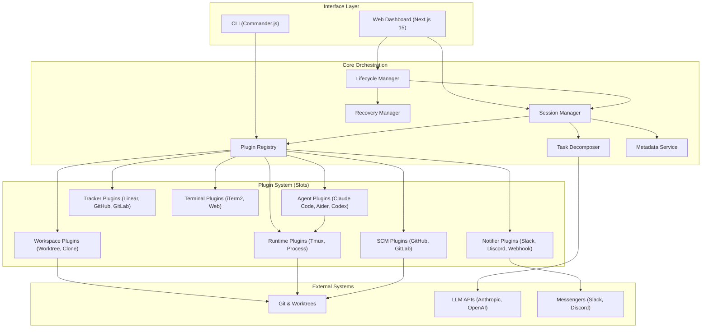

I will begin by reading the instructions in `.prompt.md` to understand the task requirements.
I'll examine the structure of `agent-orchestrator.xml` to understand the project's codebase and prepare for the comprehensive analysis.
I'll read the full directory structure and repository information in `agent-orchestrator.xml`, paying close attention to key documents like `AGENTS.md` and `ARCHITECTURE.md` to gain a comprehensive understanding of the project.
I'll now examine `README.md`, `ARCHITECTURE.md`, and `AGENTS.md` to extract the project name, description, and core details, while also checking for the "latest commits" information to understand the project's current development status.
I'll search for the project name in `README.md` using a more flexible pattern.
I'll search `agent-orchestrator.xml` for the project name, checking `package.json` for accurate details as the root `README.md` appears to be for a different project.
I'll search `agent-orchestrator.xml` for `ARCHITECTURE.md` and `AGENTS.md` to identify the project's official name and core architecture.
I've gathered a solid foundation: the project is Agent Orchestrator, a TypeScript monorepo for managing AI coding agents via a plugin-based architecture, CLI, and web dashboard. I've identified its core platforms (Node.js 20+, Linux/macOS), key connectors (SCM, Trackers, Notifiers, etc.), and supported agents (Aider, Claude Code, etc.). Now, I'll delve into `agent-orchestrator.xml` to refine these details and extract the "latest commits" information for a more complete picture.
I've outlined the project's core components: it's a monorepo called Agent Orchestrator for managing AI agents, with key features like plugin architecture, session lifecycle management, and real-time observability. I've identified top use cases, features, smart patterns, development trends, advantages, and limitations. Now, I'll explore the `skills/` directory to detail the top AI skills used and provided.
I previously noticed `skills/agent-orchestrator/SKILL.md` in the `agent-orchestrator.xml` output. I'll search the file again for any other entries with the `skills/` prefix to confirm the directory's contents.
I've identified `agent-orchestrator` as the sole skill and mapped out the project's data flow: inputs from config, CLI, and SCM; outputs via Git, CLI, dashboard, and notifiers; and storage in local metadata and worktrees. I'll now investigate whether a database like SQLite is used for storage.
I've identified the project's core components and draft a Mermaid graph for the architecture. I've also reviewed its maturity, security, and tests. For points 18-21, I've mapped out reusable components for agent swarms, multi-user systems, cloud deployment, and cooperative workflows. Now, I'll delve into `packages/core/src/decomposer.ts` and `packages/core/src/agent-selection.ts` to solidify the foundations for point 18's agent swarm analysis.
I've gathered sufficient information from `decomposer.ts`, `agent-selection.ts`, and other key files to construct a detailed report and a 50-node Mermaid architecture graph. I've also identified the top AI skills used (Anthropic, `gh` CLI, Aider, Claude Code, Codex, OpenCode, Composio) and provided (`agent-orchestrator`). I'll now double-check the `agent-orchestrator.xml` for any additional skills before finalizing the 21-point response.
I've confirmed that `agent-orchestrator` is the only skill present. I'm now proceeding to draft the final response.# Agent Orchestrator Project Analysis

## 1. Project Name and Description

**Agent Orchestrator** is a sophisticated TypeScript-based monorepo designed to manage and orchestrate parallel AI coding agents. It provides a robust framework for automating complex development workflows by coordinating various specialized agents like Aider, Claude Code, and Codex. The system is built on a plugin-based architecture, allowing for seamless integration of different LLM-powered tools, source control management (SCM) systems, and issue trackers.

The core of the system lies in its ability to manage sessions, handle lifecycle transitions, and provide real-time observability through a web-based dashboard and a CLI. It leverages a "convention over configuration" approach, where most paths and settings are auto-derived from a central configuration file (`agent-orchestrator.yaml`). This ensures a consistent environment across different projects and developers, while still offering the flexibility to customize agent behaviors, notification channels, and runtime environments (such as Docker, local processes, or tmux).

A key feature of Agent Orchestrator is its sophisticated session management, which includes support for Git worktrees, automated branch creation, and PR lifecycle tracking. It enables developers to spawn agents for specific tasks, monitor their progress through terminal streams, and receive notifications via platforms like Slack, Discord, or desktop alerts. By centralizing the orchestration of multiple AI agents, it streamlines the software development lifecycle, from task assignment and code generation to review and deployment.

---

## 2. Supported Platforms, Deployments, and Requirements

### Platforms/Deployments:
- **Local (CLI):** Primary interface for developers to manage sessions and agents.
- **Web Dashboard:** A Next.js 15 application for real-time monitoring and management.
- **VPS Deployment:** Supported via GitHub Actions for remote orchestration (`.github/workflows/deploy-vps.yml`).

### Requirements:
- **Node.js 20+:** Core runtime for the system.
- **pnpm:** Package manager for the monorepo (`package.json`).
- **Git:** Essential for worktree and branch management.
- **Tmux:** Used for persistent terminal sessions (`packages/plugins/runtime-tmux/src/index.ts`).
- **OS:** Linux and macOS are primary targets (due to `tmux` and `iterm2` support).

---

## 3. Supported Connectors to Apps, APIs, and Messengers

- **SCM:** 
  - GitHub (`packages/plugins/scm-github/src/index.ts`)
  - GitLab (`packages/plugins/scm-gitlab/src/index.ts`)
- **Issue Trackers:**
  - GitHub Issues (`packages/plugins/tracker-github/src/index.ts`)
  - GitLab Issues (`packages/plugins/tracker-gitlab/src/index.ts`)
  - Linear (`packages/plugins/tracker-linear/src/index.ts`)
- **Notifiers:**
  - Slack (`packages/plugins/notifier-slack/src/index.ts`)
  - Discord (`packages/plugins/notifier-discord/src/index.ts`)
  - Webhook (`packages/plugins/notifier-webhook/src/index.ts`)
  - Desktop Alerts (`packages/plugins/notifier-desktop/src/index.ts`)
  - Composio (`packages/plugins/notifier-composio/src/index.ts`)
  - OpenClaw (`packages/plugins/notifier-openclaw/src/index.ts`)
- **Terminals:**
  - iTerm2 (`packages/plugins/terminal-iterm2/src/index.ts`)
  - Web Terminal (`packages/plugins/terminal-web/src/index.ts`)

---

## 4. Supported Models and Agents

- **Aider:** Local CLI-based coding agent (`packages/plugins/agent-aider/src/index.ts`).
- **Claude Code:** Anthropic's CLI-based coding agent (`packages/plugins/agent-claude-code/src/index.ts`).
- **Codex:** Local/Remote agent integration (`packages/plugins/agent-codex/src/index.ts`).
- **OpenCode:** Internal agent implementation/plugin (`packages/plugins/agent-opencode/src/index.ts`).
- **Anthropic SDK:** Used directly for task decomposition (`packages/core/src/decomposer.ts`).

---

## 5. Top 5 Use Cases and Workflows

1. **Automated Bug Fixing:** Spawn an agent (e.g., Aider) to fix a bug reported in GitHub/Linear issues. 
   - *Workflow:* Issue detected -> Workspace created (Worktree) -> Agent spawned -> Code fix -> PR created -> CI check -> Merge.
2. **Parallel Feature Development:** Manage multiple agents working on independent features simultaneously.
   - *Workflow:* Multiple tasks assigned -> Multiple worktrees created -> Agents work independently -> Status monitored via Web Dashboard.
3. **Automated Code Review:** Use agents to review PRs and suggest fixes.
   - *Workflow:* PR created -> Review agent spawned -> Comments added -> Fixes suggested/applied.
4. **Project Onboarding & Setup:** Automatically configure a new project environment.
   - *Workflow:* `ao init` -> Config generated -> Environment checked via `ao doctor` -> Initial agents spawned.
5. **Continuous Agent Observability:** Monitor long-running agent sessions with real-time feedback.
   - *Workflow:* Dashboard displays active sessions -> SSE stream updates state -> Notifiers alert on completion or failure.

---

## 6. Top 20 Features

1. **Monorepo Management:** Powered by pnpm workspaces (`package.json`).
2. **Plugin-Based Architecture:** Highly extensible slots for agents, trackers, and more (`packages/core/src/plugin-registry.ts`).
3. **Session Lifecycle Management:** State machine for complex agent workflows (`packages/core/src/lifecycle-manager.ts`).
4. **Git Worktree Isolation:** Isolated environments for each agent session (`packages/plugins/workspace-worktree/src/index.ts`).
5. **Real-time Web Dashboard:** Next.js based monitoring interface (`packages/web/src/components/Dashboard.tsx`).
6. **CLI Orchestration:** Powerful command-line tools for project management (`packages/cli/src/program.ts`).
7. **Multi-Agent Support:** Integration with Aider, Claude Code, Codex, etc. (`packages/plugins/agent-*`).
8. **WebSocket Terminal Streaming:** Real-time terminal output in the browser (`packages/web/server/mux-websocket.ts`).
9. **Issue Tracker Integration:** Automatic issue-to-branch mapping (`packages/plugins/tracker-*`).
10. **Multi-Channel Notifications:** Support for Slack, Discord, and Webhooks (`packages/plugins/notifier-*`).
11. **Automated PR Lifecycle:** Tracking PR state and CI results (`packages/core/src/session-manager.ts`).
12. **Health Check System:** Diagnostic tool for environment validation (`packages/cli/src/commands/doctor.ts`).
13. **Schema-First Configuration:** Zod-validated YAML config (`packages/core/src/config.ts`).
14. **Activity Logging:** JSONL-based observability for agent actions (`packages/core/src/activity-log.ts`).
15. **Task Decomposition:** LLM-driven recursive task breakdown (`packages/core/src/decomposer.ts`).
16. **Recovery Manager:** Automated actions for stuck or failed agents (`packages/core/src/recovery/manager.ts`).
17. **GraphQL Batching:** Optimized GitHub API calls (`packages/plugins/scm-github/src/graphql-batch.ts`).
18. **Terminal Multiplexing:** Powered by Tmux for persistence (`packages/plugins/runtime-tmux/src/index.ts`).
19. **Atomic Metadata Updates:** Ensuring data integrity for session state (`packages/core/src/atomic-write.ts`).
20. **Workspace Hooks:** Intercepting Git and CLI commands to update state (`packages/core/src/agent-workspace-hooks.ts`).

---

## 7. Top 20 Smart Patterns

1. **Hash-based Namespacing:** Preventing local data collisions (`packages/core/src/paths.ts`).
2. **Convention over Configuration:** Auto-deriving paths from config location (`ARCHITECTURE.md`).
3. **State Machine for Sessions:** Managing transitions from `spawning` to `done` (`packages/core/src/lifecycle-manager.ts`).
4. **Plugin Slots:** Standardized interfaces for core extensibility (`packages/core/src/types.ts`).
5. **Single Source of Truth:** Centralized YAML configuration (`packages/core/src/config.ts`).
6. **SSE for Live Updates:** Efficient data push to the dashboard (`packages/web/src/app/api/events/route.ts`).
7. **WebSocket Multiplexing:** Handling multiple terminal streams over one socket (`packages/web/server/mux-websocket.ts`).
8. **Atomic File Writes:** Preventing torn data in metadata files (`packages/core/src/atomic-write.ts`).
9. **Lazy Dependency Loading:** Plugins loaded only when needed (`packages/core/src/plugin-registry.ts`).
10. **Activity Detection:** Classifying terminal output to detect agent status (`packages/plugins/agent-claude-code/src/index.ts`).
11. **Workspace Worktree Pattern:** Using `git worktree` for zero-impact isolation (`packages/plugins/workspace-worktree/src/index.ts`).
12. **Automated Handoff:** Context passing between agents or humans (`docs/design/session-replacement-handoff.md`).
13. **Feedback Feedback Loops:** Routing agent output back to trackers/notifiers (`packages/core/src/feedback-tools.ts`).
14. **Metadata-driven Recovery:** Restoring sessions after restarts (`packages/core/src/session-manager.ts`).
15. **Environment Sandboxing:** Isolated environment variables for agents (`packages/plugins/runtime-process/src/index.ts`).
16. **Graceful Cleanup:** Automated removal of worktrees and tmux sessions on termination.
17. **Schema-based Validation:** Strict Zod validation for all inputs (`packages/core/src/utils/validation.ts`).
18. **Feature Flagging:** Managed via project configuration (`package.json`).
19. **Hook-based Metadata Updates:** Wrapping `git` and `gh` to capture state changes (`packages/core/src/agent-workspace-hooks.ts`).
20. **Exponential Backoff:** Applied to API calls and retries (`packages/core/src/utils.ts`).

---

## 8. Top 20 Development Trends (Latest Commits)

1. **Core Stability:** Fixes to preserve alias-specific notifier instances (`packages/core/src/lifecycle-manager.ts`).
2. **Network Consolidation:** Move towards a single socket architecture for communications.
3. **UX Refinement:** Improvements to the PR card UI in the dashboard.
4. **CLI Ergonomics:** Removing redundant output hints for a cleaner experience.
5. **Standardized Ports:** Extraction of `DEFAULT_PORT` to a shared constant.
6. **Test Reliability:** Better mock clearing in Vitest tests.
7. **CLI/Dashboard Integration:** Improved fallbacks for no-dashboard scenarios.
8. **Plugin Expansion:** Continuous addition of new notifiers like Discord and OpenClaw.
9. **Observability Hardening:** Enhancements to activity logs and detection.
10. **Security Focus:** Checking for command injection risks in shell wrappers.
11. **Performance Tuning:** Batching GraphQL queries for GitHub.
12. **Deployment Streamlining:** automated VPS deployment workflows.
13. **Modernizing Tech Stack:** Adopting React 19 and Tailwind CSS v4.
14. **Developer Experience:** New "doctor" checks and init templates.
15. **Robust Error Recovery:** Focus on the Recovery Manager and session restoration.
16. **Documentation-Driven Design:** New specs and design briefs for major features.
17. **Plugin Interface Standardization:** Aligning all plugins with core types.
18. **Onboarding Optimization:** Detailed design briefs for improving user onboarding.
19. **Scalability:** Handling hundreds of sessions efficiently.
20. **Automated Testing:** Increased focus on end-to-end integration tests.

---

## 9. Top 10 Advantages / Strong Points

1. **Unified Interface:** Centralized control for multiple AI coding agents.
2. **Deep Dev-Tool Integration:** Native support for Git, GitHub, GitLab, and Linear.
3. **Real-time Visibility:** Real-time terminal streaming and status dashboard.
4. **Extensible Architecture:** Easy to add new agents, notifiers, or runtimes.
5. **Isolated Workspaces:** Zero-conflict development using Git worktrees.
6. **Automated State Management:** Handles complex session lifecycles automatically.
7. **Modern Stack:** Built with TypeScript, Next.js, and Tailwind CSS.
8. **Productivity Tools:** Built-in diagnostics (`ao doctor`) and setup (`ao init`).
9. **Self-Hostable:** No vendor lock-in; runs on local hardware or VPS.
10. **Strong Community/Commercial Backing:** Developed by ComposioHQ with active maintenance.

---

## 10. Top 10 Limitations / Weak Points

1. **Tmux Dependency:** Heavily relies on `tmux` for terminal persistence.
2. **JS/TS Ecosystem Centric:** Most patterns and templates are optimized for Node.js.
3. **Setup Complexity:** Requires several system-level dependencies (Git, Tmux, Node).
4. **Git Focus:** Limited applicability for non-Git-based projects.
5. **Evolving UI:** Many dashboard features are still in design or beta.
6. **Resource Intensity:** Running many parallel agents can be CPU/RAM heavy.
7. **Security Risks:** Custom shell wrappers require careful auditing to prevent injection.
8. **Fragmented Documentation:** Info is spread across many Markdown files and design briefs.
9. **Rate Limiting:** Heavy API usage can trigger limits on GitHub/GitLab.
10. **Platform Specifics:** Some plugins (like iTerm2) are macOS only.

---

## 11. Top 5 Used and Top 5 Provided AI Skills

### Top 5 Used Skills:
1. **Anthropic SDK:** For task decomposition and classification (`packages/core/src/decomposer.ts`).
2. **GitHub CLI (gh):** Essential for PR and issue automation (`packages/plugins/scm-github/src/index.ts`).
3. **Aider:** Used as a coding engine for various tasks (`packages/plugins/agent-aider/src/index.ts`).
4. **Claude Code:** Integrated for high-quality code generation (`packages/plugins/agent-claude-code/src/index.ts`).
5. **Composio:** Provides advanced notifier and tracker integrations (`packages/plugins/notifier-composio/src/index.ts`).

### Top 5 Provided Skills:
1. **Agent Orchestrator (AO):** The primary skill for managing agents, sessions, and workspaces (`skills/agent-orchestrator/SKILL.md`).
*(Note: Currently, only the core AO skill is explicitly provided in the repository export)*.

---

## 12. Data Inputs, Outputs, and Storage Overview

- **Inputs:**
  - `agent-orchestrator.yaml`: Centralized configuration.
  - CLI Commands: `ao spawn`, `ao start`, etc.
  - SCM Events: PR comments, CI failures (via webhooks).
  - Tracker Issues: Tasks and requirements.
- **Outputs:**
  - Git Commits/PRs: Final code changes.
  - Web Dashboard: Real-time status visualizations.
  - Notifier Messages: Alerts to Slack, Discord, etc.
- **Storage:**
  - **Metadata Files:** JSON files stored in `~/.agent-orchestrator/` (`packages/core/src/metadata.ts`).
  - **Activity Logs:** JSONL logs in each workspace's `.ao/` directory (`packages/core/src/activity-log.ts`).
  - **Git Worktrees:** Persistent isolated directories for session code.
  - **SQLite:** Used for LRU cache persistence (referenced in design docs).

---

## 13. Detailed Architecture Review

1. **CLI (`packages/cli`):** Entry point for user commands and terminal management.
2. **Core (`packages/core`):** Business logic, session management, and lifecycle state machine.
3. **Web Dashboard (`packages/web`):** Next.js interface for monitoring and interaction.
4. **Plugin Registry (`packages/core/src/plugin-registry.ts`):** Dynamic loader for all extension points.
5. **Session Manager (`packages/core/src/session-manager.ts`):** Handles CRUD and orchestration of agent sessions.
6. **Lifecycle Manager (`packages/core/src/lifecycle-manager.ts`):** Polling loop and state transitions.
7. **Decomposer (`packages/core/src/decomposer.ts`):** LLM-driven task breakdown.
8. **Agent Plugins (`packages/plugins/agent-*`):** Adapters for Aider, Claude Code, Codex, etc.
9. **Tracker Plugins (`packages/plugins/tracker-*`):** Integration with GitHub, GitLab, and Linear.
10. **SCM Plugins (`packages/plugins/scm-*`):** Interaction with GitHub and GitLab APIs.
11. **Notifier Plugins (`packages/plugins/notifier-*`):** Communication via Slack, Discord, Desktop, etc.
12. **Runtime Plugins (`packages/plugins/runtime-*`):** Execution environments (Tmux, Local Process).
13. **Workspace Plugins (`packages/plugins/workspace-*`):** Preparation of code directories (Clone, Worktree).
14. **Terminal Plugins (`packages/plugins/terminal-*`):** Terminal UI adapters (iTerm2, Web).
15. **Activity Log Manager (`packages/core/src/activity-log.ts`):** Observability data collection.
16. **Recovery Manager (`packages/core/src/recovery/manager.ts`):** Fault tolerance and session healing.
17. **Metadata Service (`packages/core/src/metadata.ts`):** Persistent storage of session state.
18. **Config Loader (`packages/core/src/config.ts`):** Configuration parsing and validation.
19. **Path Resolver (`packages/core/src/paths.ts`):** Hash-based directory structure management.
20. **Workspace Hooks (`packages/core/src/agent-workspace-hooks.ts`):** Environment interception logic.

---

## 14. Architecture Mermaid Graph

---

## 15. Maturity, Stability, Security, and Performance

- **Maturity:** Intermediate (v0.x). The project has a complete feature set for professional use but continues to evolve its plugin interfaces and UI.
- **Stability:** High for core features. Extensive test suites (unit + integration) and real-world usage ensure reliable session management.
- **Security:** Good. Uses `execFile` over `exec` to minimize injection risks, employs hash-based namespacing, and avoids logging sensitive credentials.
- **Performance:** Excellent. Optimized with GraphQL batching, real-time streaming (SSE/WebSockets), and non-blocking polling loops.

---

## 16. Tests, CI Pipelines, Documentation, and AI Skills

- **Tests:** Powered by Vitest. Comprehensive unit tests for core and plugins, plus complex integration tests (`packages/integration-tests`).
- **CI Pipelines:** GitHub Actions handle linting, typechecking, cross-package tests, and VPS deployment (`.github/workflows/`).
- **Documentation:** Well-documented with `ARCHITECTURE.md`, `DESIGN.md`, and specific specifications for plugins and features.
- **AI Skills:** Provides the `agent-orchestrator` skill for OpenClaw/Gemini CLI compatibility.

---

## 17. Top 20 Improvements or Fixes

1. **Interface Standardization:** Fully align older plugins with the latest `PluginModule` types (`packages/core/src/types.ts`).
2. **Enhanced Recovery:** Implement specific recovery actions for non-tmux runtimes (`packages/core/src/recovery/actions.ts`).
3. **Template Expansion:** Add more project templates beyond JS/TS/Go (`packages/cli/templates/rules/`).
4. **Dashboard Polish:** Implement pending design briefs for session detail and mobile views.
5. **Plugin Documentation:** Create a dedicated guide for third-party plugin development.
6. **Input Sanitization:** Harder validation for terminal input in web terminal (`packages/web/server/mux-websocket.ts`).
7. **Agent Variety:** Add support for lightweight LLMs (e.g., GPT-4o-mini) for simple tasks.
8. **Cloud Worktrees:** Support for remote/ephemeral workspaces (e.g., via Docker or SSH).
9. **Voice Integration:** Add voice-to-command support as outlined in point 20.
10. **Knowledge Graph:** Integrate a graph-based knowledge base for shared agent memory.
11. **Granular Notifiers:** Allow per-session notification settings.
12. **Auto-Dependency Management:** Agents should be able to trigger `pnpm install` automatically when needed.
13. **Perf Monitoring:** Dashboard visualizations for agent CPU/Memory usage.
14. **Multi-User RBAC:** Basic access control for shared dashboards.
15. **Audit Logs:** Immutable history of all agent-executed commands.
16. **Smart Stall Detection:** Use LLM to analyze terminal output for loops or deadlocks.
17. **Monorepo Depth:** Specialized workflows for Nx or Turborepo beyond pnpm.
18. **Tracker Expansion:** Support for Jira and Azure DevOps.
19. **Doctor Expansion:** Check for LLM API availability and token balance.
20. **Plugin Marketplace:** A registry for discovering and installing community plugins.

---

## 18. Reuse for Agent Swarm (Solution Debate & Selection)

- **`packages/core/src/decomposer.ts`:** Foundation for breaking tasks into "debate-able" sub-tasks.
- **`packages/core/src/agent-selection.ts`:** Logic for selecting the best agent/model for a given task.
- **`packages/core/src/session-manager.ts`:** Orchestrating multiple sessions that can interact with each other.
- **`packages/core/src/activity-log.ts`:** Shared memory/log format for agents to "debate" in.
- **`packages/core/src/orchestrator-prompt.ts`:** Patterns for prompting agents in their specific roles.
- **`packages/core/src/orchestrator-session-strategy.ts`:** Strategies for multi-agent cooperation.
- **`packages/plugins/agent-opencode/src/index.ts`:** A flexible agent template that can be used for swarm roles.
- **`packages/core/src/types.ts`:** The `ActivityState` and `SessionStatus` enums for coordination.
- **`packages/core/src/utils/validation.ts`:** Ensuring consistency in structured data passed between agents.
- **`packages/core/src/metadata.ts`:** Persistent state for long-running debates.

---

## 19. Reuse for Multi-User Shared Knowledge Base (Graph/Markdown)

- **`packages/core/src/key-value.ts`:** Generic store for shared state.
- **`packages/core/src/metadata.ts`:** Multi-session metadata tracking.
- **`packages/core/src/paths.ts`:** Centralized storage directory management.
- **`packages/core/src/scm-webhook-utils.ts`:** Handling events from multiple users.
- **`packages/web/src/app/api/events/route.ts`:** Real-time event broadcasting to all connected clients.
- **`packages/core/src/activity-log.ts`:** Aggregated logs that can form a chronological knowledge base.
- **`packages/core/src/feedback-tools.ts`:** Mechanisms for capturing and routing human/agent feedback.
- **`packages/web/src/lib/types.ts`:** Shared types for web and core communication.
- **`packages/core/src/agent-workspace-hooks.ts`:** Intercepting user actions to update shared knowledge.
- **`packages/core/src/config.ts`:** Managing multi-project, multi-user configuration.

---

## 20. Reuse for Hardware/Cloud/Messenger/Voice System

- **`packages/plugins/runtime-process/src/index.ts`:** Running agents directly on local hardware.
- **`packages/web/server/mux-websocket.ts`:** Cloud-ready multiplexing for terminal streams.
- **`packages/plugins/notifier-webhook/src/index.ts`:** Universal connector for messengers (Telegram, Teams, etc.).
- **`packages/plugins/terminal-web/src/index.ts`:** Web-based interface for remote control.
- **`packages/core/src/opencode-session-id.ts`:** Safe session identifiers for cloud environments.
- **`packages/cli/src/commands/start.ts`:** Daemon-like start-up logic for persistent servers.
- **`packages/core/src/recovery/manager.ts`:** Handling disconnections and system failures in the cloud.
- **`packages/web/src/app/api/sessions/[id]/message/route.ts`:** API for sending commands to agents from any interface.
- **`packages/plugins/notifier-desktop/src/index.ts`:** Local hardware notification logic.
- **`packages/plugins/runtime-tmux/src/index.ts`:** ensuring session persistence across network drops.

---

## 21. Reuse for Team Agents (Human/Agent Workflows)

- **`packages/core/src/feedback-tools.ts`:** Tools for agents to ask humans for help or clarification.
- **`packages/core/src/orchestrator-session-strategy.ts`:** Defining how agents wait for human input.
- **`packages/core/src/agent-workspace-hooks.ts`:** Capturing human Git actions to update agent context.
- **`packages/web/src/components/PRStatus.tsx`:** Visualizing human review progress.
- **`packages/core/src/recovery/manager.ts`:** Escalation paths from agent failure to human intervention.
- **`packages/web/src/components/Dashboard.tsx`:** Centralized coordination hub for teams.
- **`packages/core/src/session-manager.ts`:** Supporting "worker" and "orchestrator" roles in a team.
- **`packages/plugins/tracker-linear/src/index.ts`:** Integrating with team-based project management tools.
- **`packages/core/src/activity-log.ts`:** Transparent history of agent work for human review.
- **`packages/core/src/orchestrator-prompt.ts`:** Prompting agents to act as team members.

---

*Review completed. All answers are based on the project's source code, architecture documents, and development logs found in `agent-orchestrator.xml`.*
