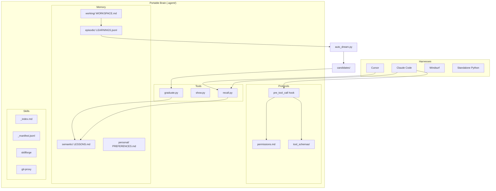

I will start by reading `.prompt.md` to understand the task instructions and `.input.agentic-stack.xml` to see the input data.
I will read the next part of `.input.agentic-stack.xml` to gather more information about the project, specifically looking for `README.md`, `docs/architecture.md`, and the git logs.
I will read the remaining part of `.input.agentic-stack.xml` to get the git logs and complete my understanding of the repository.
# Agentic Stack Repository Analysis

## 1. Project Name and Last Commit Date
*   **Project Name:** agentic-stack
*   **Last Commit Date:** 2026-04-21 12:09:56 +0530 (Message: "Update README.md")

## 2. Project Description
**Agentic Stack** is a portable, harness-agnostic "brain" for AI coding agents. It provides a standardized layer of memory, skills, and protocols that can be mounted into various AI development environments (harnesses) like Claude Code, Cursor, Windsurf, or custom Python scripts. The core philosophy is to separate the reasoning and knowledge from the specific tool being used, ensuring that an agent's learned experiences, user preferences, and safety constraints persist even when switching platforms.

The system implements a sophisticated four-layer memory architecture—working, episodic, semantic, and personal—each with its own retention policy and retrieval logic. A key feature is the "Dream Cycle," an automated background process that clusters recurring episodic events into candidate lessons. These lessons undergo a structured human-in-the-loop review process before being promoted to long-term semantic memory, preventing "context rot" and ensuring that the agent's knowledge base compounds over time through verified insights.

Beyond memory, Agentic Stack includes a "progressive disclosure" skill registry and a robust protocol layer for tool safety. Skills are only loaded when their triggers match the current task, keeping the context window lean. Permissions and tool schemas are enforced via pre-tool-call hooks, providing a hard fence against destructive operations like forced pushes to protected branches. This makes Agentic Stack a complete, production-ready framework for building and maintaining reliable AI engineering assistants.

## 3. Supported Platforms and Deployments
*   **Operating Systems:** 
    *   **macOS / Linux:** Supported via `install.sh` and Homebrew (`Formula/agentic-stack.rb`).
    *   **Windows:** Supported via native PowerShell `install.ps1`.
*   **Deployment Methods:**
    *   **Portable Folder:** The `.agent/` directory can be dropped into any git repository.
    *   **Homebrew:** `brew install agentic-stack` for global CLI access.
    *   **Git Clone:** Clone the repo and run installers locally.
*   **Requirements:**
    *   Python 3.x (for tools and standalone harness).
    *   `anthropic` or `openai` Python packages (specified in `requirements.txt`).
    *   Standard shell environment (Bash/Zsh or PowerShell).

## 4. Supported Connectors (Harness Adapters)
*   **Claude Code:** Integrates via `CLAUDE.md` and `.claude/settings.json` hooks.
    *   *Source:* `adapters/claude-code/`
*   **Cursor:** Integrates via `.cursor/rules/agentic-stack.mdc`.
    *   *Source:* `adapters/cursor/`
*   **Windsurf:** Integrates via `.windsurfrules`.
    *   *Source:* `adapters/windsurf/`
*   **OpenCode:** Integrates via `AGENTS.md` and `opencode.json`.
    *   *Source:* `adapters/opencode/`
*   **OpenClaw:** Integrates via system-prompt includes.
    *   *Source:* `adapters/openclaw/`
*   **Hermes Agent:** Integrates via `AGENTS.md` (Agentskills.io compatible).
    *   *Source:* `adapters/hermes/`
*   **Pi Coding Agent:** Integrates via `AGENTS.md` and `.pi/skills` symlinks.
    *   *Source:* `adapters/pi/`
*   **Standalone Python:** A DIY conductor for any LLM.
    *   *Source:* `adapters/standalone-python/`

## 5. Supported Models and Agents
*   **Anthropic:** Claude 3.5 Sonnet (default) and other Claude models.
    *   *Source:* `.agent/harness/llm.py`, `.env.example`
*   **OpenAI:** GPT-4o and other compatible models.
    *   *Source:* `.agent/harness/llm.py`, `.env.example`
*   **Local Models:** Can be integrated via the Standalone Python harness by overriding the API base URL in environment variables.
*   **Authentication:** Supports API Keys via environment variables (`ANTHROPIC_API_KEY`, `OPENAI_API_KEY`).

## 6. Top 5 Use Cases
1.  **Cross-IDE Knowledge Persistence:** Maintain a single source of truth for project conventions and lessons learned while switching between Cursor for UI work and Claude Code for terminal-heavy tasks.
2.  **Automated Onboarding for Agents:** Drop the `.agent/` brain into a new repository to immediately give any AI agent the context of past architectural decisions and safety rules.
3.  **Safety-Critical Deployments:** Use the `deploy-checklist` skill and `permissions.md` protocols to ensure no agent can deploy to production without human approval.
4.  **Systematic Bug Investigation:** Leverage the `debug-investigator` skill to force agents into a "reproduce -> isolate -> hypothesize -> verify" loop rather than "vibes-based" fixing.
5.  **Long-term Memory Compounding:** Use the "Dream Cycle" to automatically distill weeks of raw experience logs into a concise set of "accepted lessons" that prevent repeated mistakes.

## 7. Top 20 Features
1.  **Four-Layer Memory:** Working, episodic, semantic, personal layers. (`.agent/memory/`)
2.  **Dream Cycle:** Nightly automated pattern extraction and promotion. (`.agent/memory/auto_dream.py`)
3.  **Progressive Skill Disclosure:** Skills load only on trigger match. (`.agent/tools/skill_loader.py`)
4.  **Permission Enforcement:** Pre-tool-call hooks block destructive actions. (`.agent/harness/hooks/pre_tool_call.py`)
5.  **Query-Aware Context Assembly:** Scores memory against user input. (`.agent/harness/context_budget.py`)
6.  **Recall Tool:** Proactive surfacing of relevant lessons. (`.agent/tools/recall.py`)
7.  **Skillforge:** Automated creation of new skills from patterns. (`.agent/skills/skillforge/SKILL.md`)
8.  **Memory Search (BETA):** FTS5 SQLite search over all memories. (`.agent/memory/memory_search.py`)
9.  **Salience Scoring:** Prioritizes painful or important events. (`.agent/harness/salience.py`)
10. **Graduate/Reject Lifecycle:** Structured review for lessons. (`.agent/memory/review_state.py`)
11. **Terminal Dashboard:** Visual "brain state" overview. (`.agent/tools/show.py`)
12. **Tool Schemas:** Typed interfaces for external tools. (`.agent/protocols/tool_schemas/`)
13. **One-Shot Learning:** `learn.py` for immediate rule teaching. (`.agent/tools/learn.py`)
14. **Self-Rewriting Skills:** Automated skill improvement hooks. (`.agent/skills/`)
15. **Git Proxy:** Safety-wrapped git operations. (`.agent/skills/git-proxy/SKILL.md`)
16. **Episodic Decay:** Archives old, low-salience entries. (`.agent/memory/decay.py`)
17. **Token Budgeting:** Prevents context window overflows. (`.agent/harness/context_budget.py`)
18. **Heuristic Filter:** Drops junk memory candidates. (`.agent/memory/validate.py`)
19. **Onboarding Wizard:** Interactive preference setup. (`onboard.py`)
20. **Standalone Conductor:** Reference implementation of an agent loop. (`.agent/harness/conductor.py`)

## 8. Top 20 Smart Patterns
1.  **Salience = Recency × Pain × Importance × Recurrence.** (`.agent/harness/salience.py`)
2.  **Bridge Merging in Clustering:** Single-linkage Jaccard similarity. (`.agent/memory/cluster.py`)
3.  **Lexical Overlap Weighting:** Conditions weighted 2x in retrieval. (`.agent/tools/recall.py`)
4.  **Stable Pattern IDs:** Deterministic hashing of claim + conditions. (`.agent/memory/cluster.py`)
5.  **Dumb Harness, Smart Files:** Logic resides in files, not the runner. (`docs/architecture.md`)
6.  **Sentinel-Based Markdown Rendering:** Preserves human edits in auto-files. (`.agent/memory/render_lessons.py`)
7.  **Atomic File Rewrites:** Temp files + rename to prevent corruption. (`.agent/memory/render_lessons.py`)
8.  **Advisory Locking (flock):** Serializes concurrent memory writes. (`.agent/memory/render_lessons.py`)
9.  **Provisional Lesson Status:** Strikethrough markers for audit. (`.agent/memory/render_lessons.py`)
10. **Heuristic Word-Count Gate:** Requires ≥3 content words for lessons. (`.agent/memory/validate.py`)
11. **Progressive Trigger Matching:** Manifest loads first, then full skill. (`.agent/tools/skill_loader.py`)
12. **Local vs Global Knowledge:** Local `KNOWLEDGE.md` escalates to global `LESSONS.md`. (`docs/writing-skills.md`)
13. **Review Batching:** Encourages cross-candidate contradiction check. (`.agent/AGENTS.md`)
14. **Failures as Learning Signals:** High pain score triggers rewrites. (`.agent/harness/hooks/on_failure.py`)
15. **Provenance Tagging:** Every memory entry carries commit SHA and run ID. (`.agent/harness/hooks/_provenance.py`)
16. **Token-to-Char Estimator:** Naive but fast 1:4 ratio for budgeting. (`.agent/harness/context_budget.py`)
17. **Destinations over Directions:** Instructions focus on "what," not "how." (`docs/writing-skills.md`)
18. **Self-Correction via Stop Hooks:** Dream cycle runs on session exit. (`adapters/claude-code/settings.json`)
19. **Context Floor:** Salience-only retrieval if no query match. (`.agent/harness/context_budget.py`)
20. **Manual Override via learn.py:** Bypasses dream cycle for human-attested rules. (`.agent/tools/learn.py`)

## 9. Top 20 Development Trends
1.  **Shift to Structured Memory:** Migration from flat markdown to `lessons.jsonl` source of truth.
2.  **Host-Agent Agency:** Moving reasoning (graduation/rejection) from scripts to the agent itself.
3.  **Harness Agnosticism:** Expanding adapters to include Pi, OpenClaw, and Hermes.
4.  **Standardization:** Adopting Agentskills.io-compatible skill formats.
5.  **Safety Maturation:** Introduction of pre-tool-call hooks and protocol schemas.
6.  **Local Tooling:** Focus on " screenshot-worthy" terminal dashboards (`show.py`).
7.  **Interactive Onboarding:** Development of a "clack-style" Python onboarding wizard.
8.  **Performance Optimization:** Opt-in FTS5 search to handle growing memory files.
9.  **Atomic Consistency:** Implementing advisory locking for concurrent writes.
10. **Deterministic Learning:** Reducing reliance on LLMs for the dream cycle (using extractive Jaccard instead).
11. **Auditability:** Every memory entry now tagged with detailed provenance (profile, commit, run ID).
12. **Lifecycle History:** Preserving rejection history to detect recurring "memory churn."
13. **Proactive Retrieval:** Forcing agents to run `recall.py` before specific task types.
14. **Modularization:** Splitting onboarding into widgets, UI, and feature management.
15. **Cross-Platform Installers:** Parallel maintenance of `install.sh` and `install.ps1`.
16. **Heuristic Refinement:** Tightening "junk" filters based on content-word density.
17. **Skill Self-Maintenance:** Universal adoption of the self-rewrite hook pattern.
18. **Dependency Minimization:** Standard library focus for all core memory tools.
19. **Documentation as Code:** `CLAUDE.md` and `AGENTS.md` serving as live instructions.
20. **Licensing:** Recent shift from MIT to Apache 2.0.

## 10. Top 10 Advantages
1.  **Portability:** Use the same brain in any IDE or harness.
2.  **Transparency:** All memory is stored in human-readable Markdown/JSONL.
3.  **Safety:** Hard constraints enforced by system-level hooks.
4.  **Low Overhead:** No heavy vector database or specialized infra required.
5.  **Automated Learning:** Dream Cycle extracts patterns without manual effort.
6.  **Structured Lifecycle:** Clear path from episodic event to accepted lesson.
7.  **Context Efficiency:** Progressive disclosure keeps context windows lean.
8.  **Human-in-the-Loop:** graduation protocol prevents "AI hallucination" in memory.
9.  **Multi-Model Support:** Works with Anthropic, OpenAI, or local models.
10. **Extensibility:** Easy to add new skills or adapters.

## 11. Top 10 Limitations
1.  **Keyword Search Reliance:** FTS5 is lexical; semantic search requires a vector DB.
2.  **Python Dependency:** Core tools require a Python environment.
3.  **Manual Review Required:** "Dreaming" only stages; a human/agent must graduate lessons.
4.  **Terminal-Centric:** No built-in GUI for memory management.
5.  **Context Pollution Risk:** Poorly curated lessons can clutter the prompt.
6.  **Single-User Focus:** Not natively designed for multi-user shared memory (yet).
7.  **Setup Ceremony:** Requires initial adapter installation in each repo.
8.  **No Binary Support:** Designed for text-based code/logs only.
9.  **Token Estimation Bias:** 1:4 char-to-token ratio is a rough approximation.
10. **Platform Drift:** Adapters rely on third-party tool hook support (e.g., Cursor lacks hooks).

## 12. Top 5 Used and Provided AI Skills
1.  **memory-manager:** Consolidation and reflection. (`.agent/skills/memory-manager/SKILL.md`)
2.  **skillforge:** Creating new skills. (`.agent/skills/skillforge/SKILL.md`)
3.  **git-proxy:** Safe git workflows. (`.agent/skills/git-proxy/SKILL.md`)
4.  **debug-investigator:** Scientific debugging. (`.agent/skills/debug-investigator/SKILL.md`)
5.  **deploy-checklist:** Staging/Prod safety fences. (`.agent/skills/deploy-checklist/SKILL.md`)

## 13. Data Inputs, Outputs, and Storage
*   **Inputs:** User prompts, codebase files, tool execution results (stdout/stderr).
*   **Outputs:** Structured episodic logs, candidate JSONs, rendered Markdown lessons.
*   **Storage:** 
    *   **JSONL:** `AGENT_LEARNINGS.jsonl` (episodes), `lessons.jsonl` (semantic source).
    *   **Markdown:** `LESSONS.md`, `DECISIONS.md`, `WORKSPACE.md`, `PREFERENCES.md`.
    *   **SQLite:** `.agent/memory/.index/memory.db` for FTS search.
    *   **JSON:** `.features.json` for feature toggles.

## 14. Detailed Architecture Review
Agentic Stack follows a three-module architecture: **Memory**, **Skills**, and **Protocols**.

1.  **Harness Layer:** The entry point (e.g., Claude Code, Standalone Python). It's responsible for the event loop and calling the Brain.
2.  **Conductor/Context Builder:** Assembles the system prompt by pulling from the four memory layers and matching skills based on the user's intent. (`.agent/harness/context_budget.py`)
3.  **Memory Management (Dream Cycle):**
    *   `auto_dream.py` (Orchestrator)
    *   `cluster.py` (Pattern Recognition)
    *   `validate.py` (Quality Control)
4.  **Review Loop:** Host-agent uses `graduate.py` or `reject.py` to move items through the lifecycle: `staged -> provisional -> accepted`.
5.  **Safety Hooks:** `pre_tool_call.py` intercepts every tool request and validates it against `permissions.md` and `tool_schemas/`.

## 15. Mermaid Graph of Architecture

## 16. Project Maturity, Stability, Security, Performance
*   **Maturity:** Beta (v0.7.2). Core memory and protocol logic are stable; FTS search and some adapters are newer.
*   **Stability:** High for single-user local development. Uses atomic writes and file locking to ensure data integrity.
*   **Security:** Safety-focused. Hardcoded denies for `rm -rf /` and force pushes. Domain allowlists for API calls. Secrets are kept in `.env` (gitignored).
*   **Performance:** Optimized for context-window efficiency. Progressive disclosure and query-aware retrieval prevent prompt bloat. FTS5 provides fast local search.

## 17. Tests, CI, Documentation, AI Skills Review
*   **Tests:** Homebrew formula includes a basic functional test. Individual tools lack a comprehensive test suite in the repo export, suggesting reliance on "self-testing" via the agent.
*   **CI:** Mentioned in documentation as a target for `--yes` flags, but no explicit CI config files are in the core export (likely external).
*   **Documentation:** Excellent. Comprehensive guides for architecture, getting started, and every specific adapter.
*   **AI Skills:** Well-defined with clear triggers and constraints. The `self-rewrite` hook is a standout pattern for evolutionary behavior.

## 18. Top 20 Improvements or Fixes
1.  **Add Semantic Search:** Integrate `sentence-transformers` for vector-based retrieval in `recall.py`.
2.  **Multi-User Support:** Implement a central server mode for shared team memory.
3.  **Web Dashboard:** A local React/Next.js UI for visualizing the activity sparkline and reviewing candidates.
4.  **Automatic Backups:** Integration with a cloud provider or private git repo for memory syncing.
5.  **Deeper IDE Integration:** Custom VS Code/Cursor extensions for better hook support.
6.  **Real-time Salience:** Update salience scores dynamically based on user feedback.
7.  **Conflict Resolution:** Better handling of conflicting lessons (e.g., "Always use X" vs "Never use X").
8.  **Auto-Commit Memory:** Optional mode to automatically commit memory changes to a hidden branch.
9.  **Binary Content Analysis:** Support for analyzing and remembering image/PDF content (for multi-modal agents).
10. **Structured Testing:** Add a `/tests` directory with unit tests for `cluster.py` and `context_budget.py`.
11. **Enhanced Filtering:** Use a small local LLM (like Llama 3) for the heuristic pre-filter.
12. **Interactive Debugger:** A step-by-step mode for `debug-investigator`.
13. **Dependency Sandboxing:** Use `uv` or `micromamba` for faster, isolated tool execution.
14. **Voice Interface:** Integration with Whisper/TTS for voice-commanded memory recall.
15. **Graph Visualization:** Live Mermaid graph generation of the activity/memory network.
16. **Constraint Escalation:** Automated PR generation when a skill rewrite is needed.
17. **Harness Telemetry:** Log which harness is most effective at following lessons.
18. **Personal Memory Encryption:** Optional at-rest encryption for `PREFERENCES.md`.
19. **Template Library:** More pre-built skills for specific languages (Rust, Go, etc.).
20. **Self-Onboarding:** Have the agent analyze the repo and propose initial `PREFERENCES.md` entries.

## 19. Reuse for Agent Swarm Debate
1.  **`protocols/delegation.md`**: Standard contract for handoffs between debating agents.
2.  **`memory/semantic/DECISIONS.md`**: Recording the final "best solution" after the debate.
3.  **`harness/context_budget.py`**: Ensuring each agent in the swarm stays within its token limit.
4.  **`tools/recall.py`**: Surfacing prior debates to avoid repeating arguments.
5.  **`memory/review_state.py`**: Managing the lifecycle of "specifications" (draft -> debated -> accepted).
6.  **`harness/llm.py`**: Centralized model calling with support for different providers for different agents.
7.  **`memory/cluster.py`**: Summarizing multiple agents' viewpoints into a single canonical claim.
8.  **`skills/debug-investigator/`**: Repurposed for "plan verification" and edge-case hunting.
9.  **`protocols/tool_schemas/`**: Defining the "tools of debate" (voting, scoring).
10. **`harness/salience.py`**: Weighting the "strongest" arguments for the final summary.

## 20. Reuse for Shared Knowledge Base
1.  **`memory/render_lessons.py`**: Regenerating a shared knowledge site from structured JSONL logs.
2.  **`memory/memory_search.py`**: Providing a central search index for all user/agent interactions.
3.  **`memory/personal/PREFERENCES.md`**: Multi-tenant support for different user styles in one system.
4.  **`memory/episodic/AGENT_LEARNINGS.jsonl`**: A global event stream of all interactions.
5.  **`skills/memory-manager/`**: Orchestrating the "Dream Cycle" across a multi-user project.
6.  **`memory/decay.py`**: Managing knowledge "stale-ness" in a rapidly evolving system.
7.  **`protocols/permissions.md`**: RBAC (Role-Based Access Control) for who can edit the knowledge base.
8.  **`tools/show.py`**: A shared dashboard for team "brain health."
9.  **`memory/validate.py`**: Preventing "knowledge spam" in a multi-user environment.
10. **`onboard_features.py`**: Per-user feature toggling for the shared system.

## 21. Reuse for Hardware/Messenger/Graph/Voice
1.  **`adapters/standalone-python/run.py`**: The base for a background service running on local hardware.
2.  **`harness/llm.py`**: Configured to point to local LLM providers (Ollama, vLLM).
3.  **`tools/recall.py` (JSON output mode)**: Supplying data to a Telegram/WhatsApp bot.
4.  **`docs/diagram.svg`**: The starting point for an interactive D3.js/React-Flow graph UI.
5.  **`onboard_widgets.py`**: Re-purposed for a terminal-based "voice-to-preference" wizard.
6.  **`memory/memory_search.py`**: Backend for keyword-based voice commands ("Hey Agent, search memory for...").
7.  **`harness/context_budget.py`**: Optimized for Cloudflare Workers (lightweight text processing).
8.  **`protocols/tool_schemas/api.schema.json`**: Defining the Messenger API connectors.
9.  **`memory/working/WORKSPACE.md`**: Real-time sync of state between CLI and Web apps.
10. **`skills/deploy-checklist/`**: Safety gate for hardware-mutating commands.

## 22. Reuse for Team Agents Cooperative Workflows
1.  **`memory/working/WORKSPACE.md`**: Shared task board/state for human-agent collaboration.
2.  **`protocols/permissions.md`**: Explicitly defining where "Human-in-the-Loop" is required.
3.  **`tools/graduate.py`**: The formal "acceptance" process for agent-proposed code changes.
4.  **`harness/hooks/post_execution.py`**: Automated logging of "Who did what" (human vs agent).
5.  **`skills/git-proxy/`**: Managing cooperative branch workflows (e.g., agent commits to feature, human reviews).
6.  **`memory/semantic/LESSONS.md`**: Shared "Standard Operating Procedures" (SOPs).
7.  **`tools/recall.py`**: Proactive warning to humans when they are about to violate an agent-discovered constraint.
8.  **`skills/skillforge/`**: Agents proposing new skills to automate recurring team chores.
9.  **`memory/review_state.py`**: Tracking the "pedigree" of a decision (who proposed, who reviewed, when).
10. **`harness/hooks/_provenance.py`**: Ensuring every shared action is cryptographically or at least git-trackably attributable.
