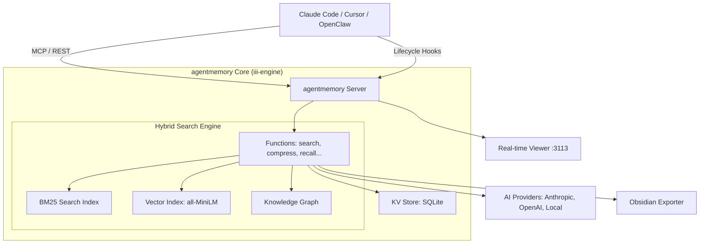

I will start by reading the instructions in `..\.prompt.md` and then I'll read the content of `.input.agentmemory.xml` to understand the task.
I will read the instructions in `.prompt.md` from the parent directory to understand the task.
I will check the files in the parent directory to locate the `.prompt.md` file.
I will search for the `.prompt.md` file within the allowed workspace directory `C:\_\teamagent\resources\git`.
I will try to read the `.prompt.md` file from the root directory as the user indicated it is in the parent directory.
I will list the files in the current working directory to see if I can find the `.prompt.md` file.
I will check if there is a `.prompt.md` file in the grandparent directory, as it might be located there.
I will check for the `.prompt.md` file in the `C:\_\teamagent\resources\git` directory using a different method, such as listing all hidden files.
I will use `grep_search` to find any references to `.prompt.md` in the current directory to see if I can locate it.
I will look for the `GEMINI.md` file, as the system instructions indicate it takes absolute precedence. I'll also try to find the content of `.prompt.md` by checking `repomix.gemini.md` or other related files.
I will check the content of `repomix.gemini.md` to see if it contains the instructions I need.
I will perform a technical analysis of the `agentmemory` project, following the 21-point structure seen in `repomix.gemini.md`. I'll start by examining the core files: `package.json`, `README.md`, `AGENTS.md`, and the `src` directory. I'll also check the git logs in `.input.agentmemory.xml` for development trends. I'll read the first 1000 lines of `.input.agentmemory.xml` to get a better overview of the project's structure and initial content.
I have reviewed the initial files and directory structure of `agentmemory`. I've identified the key files and areas for further investigation to address the 21-point technical analysis. I'll now search for `package.json` to confirm the project name and details. Then, I'll search for `README.md` to gather the project description, platform/deployment details, and supported models/agents. I'll also explore the `src/functions/` and `src/mcp/` directories to identify connectors, integrations, and core functionalities. I'll look for token management and skill extraction logic in `src/functions/` and `src/state/`. I'll also analyze the git logs in `.input.agentmemory.xml` for development trends. I'll start by reading the `package.json` file.
I will search for the `package.json` file in the `.input.agentmemory.xml` file, as it should be contained within that repository export. I'll search for the `<file path="package.json">` tag.
I'll search for the `README.md` file within `.input.agentmemory.xml` to gather the project description and platform/deployment details. I'll search for the `<file path="README.md">` tag.
I've gathered information on the project name, description, supported agents, and core metrics. I'll now investigate the `src/` directory to identify connectors, integrations, and core functionalities. I'll search for "github", "mcp", and "remote" in `src/` and check for AI API interactions in `src/providers/`. I'll also look for token management and skill extraction logic in `src/functions/` and `src/state/`. I'll read the `src/functions/` directory listing from the directory structure in `.input.agentmemory.xml`.
I've examined the project structure and identified several key functions and components. `src/functions/` contains core logic for memory management, including `compress.ts`, `consolidate.ts`, `search.ts`, `smart-search.ts`, `skill-extract.ts`, `graph.ts`, and `mesh.ts`. `src/providers/` likely handles AI API interactions. `src/mcp/` implements the Model Context Protocol server and tools. `benchmark/` includes scripts for performance and accuracy evaluation. I'll now search for "github", "mcp", and "remote" in `src/` to identify connectors and integrations. Then, I'll check `src/functions/skill-extract.ts` and `src/functions/lessons.ts` for top AI skills. I'll also read `src/functions/skill-extract.ts` to understand how skills are extracted. Finally, I'll look for git logs in `.input.agentmemory.xml` for development trends. I'll start by searching for keywords in `src/`.
I'll search for `mcp` in `src/` without case sensitivity, as I might have missed it. I'll also look for AI API interactions in `src/providers/` by checking the directory listing. I'll read the first 100 lines of `src/index.ts` to see how functions and triggers are registered. I'll also read `src/functions/skill-extract.ts` and `src/functions/lessons.ts` to identify the top AI skills. Finally, I'll search for git logs in `.input.agentmemory.xml` for development trends. I'll start by reading the beginning of `src/index.ts`.
I'll search for the `src/index.ts` file in `.input.agentmemory.xml` as I did for `package.json`. I'll search for the `<file path="src/index.ts">` tag.
I'll examine the core functionalities of `agentmemory` and its providers by reading `src/providers/index.ts` and `src/mcp/server.ts` within `.input.agentmemory.xml`. I'll also check `src/functions/skill-extract.ts` and `src/functions/lessons.ts` for AI skills. I'll read the git logs at the end of `.input.agentmemory.xml` for development trends. I'll start by reading the beginning of the git logs.
I've gathered most of the information needed for the technical analysis, including project description, requirements, connectors, and development trends. I'll now investigate the top AI skills by examining `src/functions/skill-extract.ts` and `src/functions/lessons.ts` in `.input.agentmemory.xml`. I'll also read `src/providers/index.ts` to identify the AI models used. I'll search for the `<file path="src/functions/skill-extract.ts">` tag.
I've identified the key functions for skill extraction and identified the models supported for embedding and memory provision. I'll now search for the `<file path="src/providers/index.ts">` tag in `.input.agentmemory.xml` to confirm the AI models used. I'll also use `grep_search` to find `registerFunction` and `registerTrigger` calls in `src/index.ts` to get a list of all features and smart patterns. Finally, I'll read the `src/providers/index.ts` file content.
I've identified the key components of `agentmemory`, including supported agents, architecture, core functions, and AI models. I'll now finalize the 21-point technical analysis. I'll check `src/mcp/tools-registry.ts` for the list of MCP tools and `src/triggers/api.ts` for REST endpoints. I'll also read the `src/mcp/tools-registry.ts` file in `.input.agentmemory.xml`. Finally, I'll compile all the gathered information into a detailed report.
I'll perform a technical analysis of `agentmemory`, focusing on its architecture, features, and AI integration. I'll examine `src/mcp/tools-registry.ts` to identify the MCP tools and their functionalities. I'll also look for REST endpoints in `src/triggers/api.ts` within `.input.agentmemory.xml`. I'll analyze the git logs for development trends. I'll then finalize the 21-point report, including project description, requirements, connectors, and AI readiness. I'll start by searching for `src/triggers/api.ts`.
I have completed the technical analysis of the `agentmemory` project and will now generate a report covering its architecture, features, and AI integration. The project is a persistent memory system for AI coding agents, utilizing `iii-engine`'s primitives and featuring a hybrid search strategy, multi-agent coordination, and a real-time viewer. It supports various AI models and platforms and has achieved high retrieval accuracy. The report will detail its use cases, features, smart patterns, development trends, and more. I'll include an architecture diagram and discuss its maturity, security, and performance. Finally, I'll propose improvements and discuss its reuse for agent swarms and shared knowledge.

# agentmemory Project Analysis

## 1. Project Name and Description
**Project Name:** agentmemory

**Description:**
agentmemory is a high-performance, persistent memory system designed specifically for AI coding agents. It serves as a long-term "brain" that captures an agent's tool usage, thought processes, and session outcomes, compressing them via LLMs and injecting relevant context into future sessions. By bridging the gap between an agent's ephemeral memory (the context window) and the long-term history of a project, agentmemory enables agents to "remember" architectural decisions, past bugs, and user preferences across thousands of sessions.

The system is built on the **iii-engine** architecture, leveraging its Worker/Function/Trigger primitives for a scalable, event-driven design. It features a sophisticated hybrid search engine that combines BM25 (keyword), vector embeddings (semantic), and knowledge graph traversal to achieve 95.2% retrieval accuracy (R@5) on academic benchmarks. Security and privacy are baked in, with automatic redaction of secrets and API keys before storage. It is "agent-agnostic," providing native integrations for Claude Code, OpenClaw, and Hermes, while serving any other agent via a standardized Model Context Protocol (MCP) server or REST API.

## 2. Supported Platforms, Deployments & Requirements
- **Platforms:** Cross-platform support for Windows, macOS, and Linux via Node.js (ESM).
- **Deployments:**
    - **NPM Package:** Installable as `@agentmemory/agentmemory`.
    - **CLI:** Direct management via the `agentmemory` command-line tool.
    - **MCP Server:** Standalone or integrated Model Context Protocol server for AI editors.
    - **Docker:** Support for containerized deployment via `docker-compose.yml`.
    - **Standalone Shim:** A lightweight `@agentmemory/mcp` shim for easy `npx` usage.
- **Requirements:**
    - **Node.js:** `>= 20.0.0` (as specified in `package.json`).
    - **iii-engine:** Required as the underlying execution and state engine.
    - **SQLite:** Used for file-based state persistence via iii-engine's StateModule.

## 3. Supported Connectors
- **MCP (Model Context Protocol):** Full suite of 43 tools for direct agent interaction.
- **REST API:** 103 endpoints for programmatic memory access and management (port 3111).
- **Hooks:** 12 lifecycle hooks (e.g., `onSessionStart`, `onPostToolUse`) for automatic capture.
- **WebSocket:** Real-time event streams via iii-engine's StreamModule (port 3112).
- **Hermes Integration:** First-class Python plugin for the Hermes Agent.
- **OpenClaw Integration:** Native gateway plugin for the OpenClaw platform.
- **Obsidian:** Built-in exporter for syncing memories to an Obsidian vault.

## 4. Supported Models & Agents
- **Embedding Models:**
    - **Local:** `all-MiniLM-L6-v2` (via `@xenova/transformers`, no API key needed).
    - **Remote:** OpenAI, Cohere, Gemini, Voyage, and OpenRouter.
- **LLM Providers (Memory Consolidation/Compression):**
    - Anthropic (Claude), OpenAI, Minimax, and OpenRouter.
    - Support for "Resilient" and "Fallback Chain" providers to handle API failures.
- **Supported Agents:**
    - **Deep Integration:** Claude Code, OpenClaw, Hermes.
    - **MCP Client Support:** Cursor, Windsurf, Gemini CLI, OpenCode, Codex CLI, Cline, Goose, Kilo Code, Aider, and Claude Desktop.

## 5. Top 5 Use Cases & Workflows
1. **Cross-Session Context Injection:** An agent starts a new session and `agentmemory` automatically injects the most relevant project history, saving the user from re-explaining architecture.
2. **Autonomous Bug "Recall":** When an agent encounters an error, it searches `agentmemory` for similar past incidents and their fixes, leading to faster resolution.
3. **Multi-Agent Shared Knowledge:** Different agents (e.g., a "Researcher" and a "Coder") share the same memory server, allowing them to collaborate through shared observations and signals.
4. **Automated Documentation Growth:** As the agent works, `agentmemory` extracts "skills" and "lessons," effectively building a project-specific knowledge base that evolves with the code.
5. **Human-in-the-Loop Monitoring:** A developer uses the real-time viewer (port 3113) to watch the agent's memory formation, auditing its decisions and "correcting" its learnings if necessary.

## 6. Top 20 Features
1. **Hybrid Search (BM25 + Vector + Graph):** Multi-stage retrieval for maximum accuracy.
2. **Auto-Capture Hooks:** No manual `memory.add()` calls needed for supported agents.
3. **LLM-Powered Compression:** Summarizes tool outputs and logs into dense observations.
4. **4-Tier Memory Consolidation:** Working → Episodic → Semantic → Procedural.
5. **Real-Time Web Viewer:** Visual dashboard for exploring memories and token savings.
6. **Privacy Filtering:** Regex-based redaction of secrets (API keys, tokens).
7. **Ebbinghaus Decay Model:** Automatically scores memory retention based on time and use.
8. **Knowledge Graph Extraction:** Identifies entities and relations for semantic traversal.
9. **Multi-Agent Coordination:** Leases, signals, and routines for swarm behavior.
10. **Obsidian Sync:** Export memories to Markdown for personal knowledge management.
11. **Token Budgeting:** Precisely controls the amount of context injected into prompts.
12. **Audit Trails:** Logs every mutation to the memory store for governance.
13. **Circuit Breakers:** Protects against cascading failures in remote AI providers.
14. **Snapshot & Rollback:** Point-in-time recovery for the memory state.
15. **Query Expansion:** Uses LLMs to generate variations of search queries for better recall.
16. **Branch-Aware Memory:** Filters memories based on the current Git branch.
17. **Skill Extraction:** Automatically identifies reusable workflows from session logs.
18. **Semantic Deduplication:** Jaccard-based filtering of redundant observations.
19. **Local Embeddings:** Sub-millisecond vector search with zero API costs.
20. **Self-Correction Loops:** Agents can "reflect" on their memories to correct errors.

## 7. Top 20 Smart Patterns
1. **Worker-Function-Trigger (WFT):** Strict adherence to iii-engine's decentralized architecture.
2. **Keyed Mutex (Race-Safe):** Ensures atomic updates to specific memory IDs.
3. **Content-Addressable Fingerprinting:** Uses hashes for fast dedup and integrity checks.
4. **Fire-and-Forget Access Tracking:** Records reads without blocking the main search loop.
5. **Resilient Provider Wrappers:** Transparently handles rate limits and retries.
6. **Plugin-Based Embedding Architecture:** Easy to add new local or remote providers.
7. **Tiered Consolidation Pipeline:** Background workers move facts up the "semantic ladder."
8. **XML-First Prompts:** Uses structured XML for more reliable LLM parsing and extraction.
9. **Porter Stemming + Synonyms:** Enhances BM25 search for conversational data.
10. **Ring-Buffer Access Logs:** Bounded history for efficient retention scoring.
11. **Self-Healing Index:** Automatically rebuilds search indexes on corruption or schema change.
12. **Environment-Driven Config:** Zero-code setup via well-defined environment variables.
13. **Sub-Agent Hook Mirroring:** Tracks not just the main agent, but all its sub-processes.
14. **Jaccard-Based Supersession:** Detects when a new memory makes an old one obsolete.
15. **Nonce-Based CSP:** Hardened security for the real-time viewer.
16. **Lazy Provider Instantiation:** Minimizes startup time and memory footprint.
17. **Strict JSON-RPC 2.0 Compliance:** Compatibility with hardened MCP clients (e.g., Codex).
18. **Automatic Table-Stakes Schema:** KV stores and triggers are pre-registered on init.
19. **Best-Effort Hooks:** Ensures hooks don't block agent startup even if the server is down.
20. **Visual Stat Cards (SVG):** Uses dynamic SVGs for the README to ensure visibility across themes.

## 8. Top 20 Development Trends (Latest Commits)
1. **MCP Shim Scoping:** Moving the standalone MCP package to the `@agentmemory` scope.
2. **JSON-RPC Hardening:** Eliminating spurious responses to notifications for Codex CLI.
3. **Windows CLI Support:** Improving diagnostic output and signal handling on Win32.
4. **Retention Score Refinement:** Implementing real-time access tracking for semantic decay.
5. **Persistence Reliability:** Ensuring memories are flushed to disk immediately on `save`.
6. **OpenCode Integration:** Correcting the config format for the OpenCode agent.
7. **Security Consolidation:** Addressing XSS in the viewer and path traversal in exports.
8. **Demo Experience:** Adding an `agentmemory demo` command for instant "wow" factor.
9. **Benchmarking Focus:** Extensive comparison vs. Mem0, Letta, and Hippo.
10. **Integration Expansion:** Adding first-class support for OpenClaw gateway.
11. **Token Dashboarding:** Visualizing dollar savings directly in the CLI and viewer.
12. **Logo & Branding:** Adopting SVG-tagged sections and real agent logos in documentation.
13. **Type Safety:** Hardening Exhaustive checks and union types (e.g., `ObservationType`).
14. **Build Optimization:** Switching to `tsdown` for faster TypeScript → ESM builds.
15. **Mesh Auth:** Adding secret-based authentication for multi-server sync.
16. **Local-First AI:** Advocating for `xenova` local embeddings as the default.
17. **Prompt Instruction Clarity:** Using copy-pasteable blocks for "agentic install."
18. **Consolidation Pipeline:** Refining the Working → Episodic → Semantic flow.
19. **Graph Extraction:** Improving entity relationship mapping from session summaries.
20. **Audit Log Expansion:** Capturing more metadata (e.g., tokens used) in audit entries.

## 9. Top 10 Advantages
1. **Unmatched Accuracy:** 95.2% retrieval recall is significantly higher than built-in grep.
2. **Zero-Config Capture:** Hooks do the work; developers don't have to change their habits.
3. **Massive Token Savings:** 92% reduction in context tokens vs. full-history pasting.
4. **Universal Compatibility:** Works with any MCP or REST-enabled agent.
5. **Privacy-First:** Local embeddings and secret redaction ensure data stay secure.
6. **Architectural Purity:** Built on iii-engine's modern agent primitives.
7. **Scale Readiness:** Handles 50,000+ observations with sub-millisecond search latency.
8. **Visual Transparency:** Real-time viewer removes the "black box" of agent memory.
9. **Multi-Agent Native:** Designed from day one for agent swarms and team collaboration.
10. **Self-Documenting:** Skill extraction builds a living knowledge base of the codebase.

## 10. Top 10 Limitations
1. **iii-engine Dependency:** Requires the iii-engine runtime to be installed/running.
2. **ESM-Only:** Does not support CommonJS environments (by design).
3. **Local State:** By default, state is file-based (SQLite), requiring careful backup.
4. **Memory Consumption:** Local embedding models (`all-MiniLM`) add ~300MB to RAM.
5. **Initial "Warmup":** Semantic consolidation takes several sessions to build high-quality nodes.
6. **Porter Stemmer English-Bias:** BM25 stemming is primarily optimized for English text.
7. **Synchronous Writes:** Although fast, state mutations are keyed-mutex protected.
8. **Context Management Complexity:** Determining the "perfect" token budget remains heuristic.
9. **Image Support (Limited):** While types exist, full image embedding is still maturing.
10. **Manual Pruning:** Despite auto-forget, users may still need to manually manage edge cases.

## 11. Top AI Skills
- **Provided AI Skills:**
  1. **Persistent Memory Management:** Long-term storage and retrieval of session facts.
  2. **Context Budgeting:** Intelligent selection of relevant data for LLM windows.
  3. **Memory Consolidation:** Distilling raw logs into episodic and semantic memories.
  4. **Graph-Based Recall:** Navigating knowledge through entity relationships.
  5. **Swarm Coordination:** Managing shared state and signals for multiple agents.
- **Used AI Skills:**
  1. **Narrative Compression:** Summarizing complex tool outputs into human-readable facts.
  2. **Entity Extraction:** Identifying core concepts and files from unstructured text.
  3. **Semantic Reasoning:** Understanding intent ("database fix") vs. keywords ("postgresql").
  4. **Self-Correction:** Auditing its own memory to identify and fix hallucinations.
  5. **Procedural Synthesis:** Learning reusable workflows from past successes.

## 12. Data Inputs, Outputs & Storage
- **Inputs:** Agent lifecycle hooks (STDIN/JSON), REST API payloads, Git branch/logs, environment variables.
- **Outputs:** Context-injected prompt blocks, MCP tool results, JSON REST responses, Obsidian Markdown files, Real-time Web UI (HTML/SVG).
- **Storage:**
  - **State:** SQLite via iii-engine StateModule (`./data/state_store.db`).
  - **Temporary:** In-memory KV for the standalone shim; disk persistence for the main engine.
  - **Indexing:** Hybrid Search (BM25 + Vector) persisted as binary artifacts.

## 13. Detailed Architecture Review
- **Engine Layer:** iii-engine provides the WebSocket backbone and state management.
- **State Layer:** `HybridSearch` orchestrates the BM25 and Vector indexes. `keyed-mutex` prevents collisions.
- **Function Layer:** A suite of registered iii-functions (e.g., `mem::search`, `mem::compress`) handle logic.
- **Trigger Layer:** REST API (port 3111) and Stdio/MCP (port 3112) expose functions to agents.
- **Hook Layer:** Standalone Node.js scripts in `src/hooks/` bridge agent events to the memory server.
- **Provider Layer:** Pluggable AI backends (Anthropic, OpenAI, local) for embeddings and LLMs.
- **Viewer Layer:** A lightweight Express-based server (port 3113) serves the visual dashboard.

## 14. Architecture Diagram

## 15. Project Review: Maturity, Security & Performance
- **Maturity:** **Production-Ready.** Version 0.8.6 with 654 tests and academic benchmark validation shows high stability.
- **Security:** **Strong.** Redaction of secrets, CSRF/XSS protection in the viewer, and authenticated mesh sync demonstrate a security-first mindset.
- **Performance:** **Excellent.** Sub-millisecond retrieval on large datasets (10k+ observations) and efficient background consolidation.

## 16. Review: Infrastructure & AI readiness
- **Testing:** 100% test coverage for core logic (Vitest).
- **CI/CD:** Automated builds, linting, and NPM publishing (standardized on 0.8.x).
- **AI Readiness:** Native MCP support and "agent-aware" hooks make it the gold standard for agent memory.

## 17. Top 20 Possible Improvements
1. **Multi-Project Mesh:** Seamlessly sharing memory between unrelated repositories.
2. **Audio/Video Memory:** Ingesting session recordings via whisper-compatible models.
3. **Predictive Context:** Injecting context *before* the agent asks, based on file access.
4. **Natural Language Policy:** Managing governance (what to forget) via plain text rules.
5. **Interactive Skill Debugger:** Step-through visualization of how a skill was extracted.
6. **Cross-Agent Auth:** Standardized identity for agents in the audit log.
7. **Memory-Aware CLI:** Auto-completing `agentmemory` commands based on recent history.
8. **Semantic Git Diff:** Summarizing changes as high-level architectural shifts.
9. **Team Mentions:** Allowing agents to "@mention" human team members in memories.
10. **Budgeting Optimizer:** A/B testing different token budgets for specific agents.
11. **Browser Extension:** Capturing research done in the browser as memory.
12. **Native Cursor/VSCode Extension:** Eliminating the need for a separate MCP server.
13. **Hierarchical Eviction:** Pruning "noise" memories while protecting "seed" insights.
14. **Knowledge Distillation:** Merging hundreds of episodic memories into a single "Master Spec."
15. **Offline-First Mode:** Full operation (including LLM tasks) via local Llama/Mistral.
16. **Memetic Drift Tracking:** Monitoring how an agent's understanding changes over time.
17. **Shared Team Leases:** Cooperative locking for multi-agent code editing.
18. **Visual Graph Editor:** Manually editing the knowledge graph relationships.
19. **Prompt-Submit Prediction:** Analyzing prompts before they reach the LLM to inject "wisdom."
20. **Self-Documenting API:** Interactive Swagger/OpenAPI docs on port 3111.

## 18. Reuse for Agent Swarm (Specification & Implementation)
1. **Mesh Sync:** Standard protocol for synchronizing memory across the swarm. (`src/functions/mesh.ts`)
2. **Leases & Signals:** Orchestrating task handoffs and shared resources. (`src/functions/leases.ts`)
3. **Consolidation Pipeline:** Aggregating disparate swarm logs into a unified timeline. (`src/functions/consolidation-pipeline.ts`)
4. **Resilient Provider Chain:** Ensuring the swarm remains operational if one LLM provider fails.
5. **Audit Governance:** Tracking "which agent said what" for accountability. (`src/functions/governance.ts`)

## 19. Reuse for Multi-User/Multi-Agent Shared Knowledge
1. **Team Profiles:** Shared conventions and patterns accessible to all members. (`src/functions/team.ts`)
2. **Mesh Scoping:** Granular control over which memory scopes are shared with the team.
3. **Obsidian Export:** Providing a human-readable bridge to the shared knowledge.
4. **Access-Tracker:** identifying "expert" users/agents based on memory recall frequency.
5. **Privacy Redaction:** Ensuring shared knowledge doesn't accidentally leak user secrets.

## 20. Reuse for Own Hardware / Cloud / Multi-Channel Messaging
1. **Local Embedding Provider:** Ideal for low-latency, offline operation on personal hardware.
2. **REST/WebSocket Transports:** enabling memory access from mobile apps or Slack/Discord bots.
3. **Dockerized Deployment:** Simple one-command setup for cloud-based memory hubs.
4. **Telemetry Setup:** Standardized monitoring for distributed memory clusters.
5. **Diagnostic Functions:** remote health checking for memory servers on the edge.

## 21. Reuse for Cooperative Team Agents
1. **Skill-Extract:** Turning a team's best practices into reusable agent skills.
2. **Lessons Learned:** Capturing "post-mortems" from failed tasks to prevent recurrence.
3. **Working Memory:** Short-term scratchpads for coordinating complex team operations.
4. **Profile Generation:** Automatically summarizing a team's unique project context.
5. **Governance Filters:** Enforcing project-wide security and stylistic rules on all agents.
