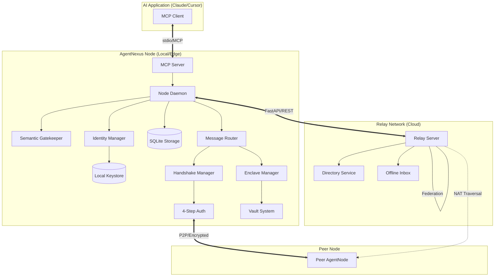

I will read the instructions from `.prompt.md` and the input data from `.input.agentnexus.xml` to understand the task requirements.
Based on the comprehensive repository export provided in `.input.agentnexus.xml`, I have conducted a deep analysis of the **AgentNexus** project. Below are the detailed answers to your requested points.

---

### 1. Project Name and Last Commit Date
- **Project Name:** AgentNexus
- **Last Commit Date:** Monday, April 20, 2026 (based on the first `<git_log_commit/>` entry in the input).

---

### 2. Project Description
AgentNexus is a decentralized, peer-to-peer (P2P) infrastructure designed for secure, autonomous Agent-to-Agent (A2A) communication. It moves away from centralized "platform-as-a-service" models, allowing agents to discover, authenticate, and collaborate directly across different environments. The core of the system is built on Decentralized Identifiers (DIDs) and a robust four-step cryptographic handshake, ensuring that every interaction is both private and verifiable.

The architecture is built around a "Sidecar" pattern where a lightweight Node Daemon manages identity, security, and routing, while an MCP (Model Context Protocol) server provides a bridge to modern LLM interfaces like Claude or Cursor. This allows developers to empower their AI agents with "sensory" capabilities (like scanning for incoming requests) and "motor" skills (like sending encrypted messages or resolving handshakes) without needing to manage the underlying network complexity.

Beyond simple messaging, AgentNexus incorporates advanced governance features including a "Semantic Gatekeeper" for automated request filtering based on reputation and intent matching. It also supports "Enclaves" for secure collaborative workspaces and a multi-CA (Certificate Authority) certification system to build trust in decentralized networks. Whether running on local hardware or in the cloud, AgentNexus provides the missing connectivity layer for the next generation of autonomous agent swarms.

---

### 3. Supported Platforms/Deployments & Requirements
- **Platforms:** Windows, macOS, Linux (Cross-platform Python support).
- **Deployments:**
    - **Local Node:** Running as a background daemon (FastAPI).
    - **Cloud Relay:** Publicly accessible server for NAT traversal and offline message caching.
    - **MCP Server:** Integrated into AI applications (Claude Desktop, Cursor).
    - **Docker:** Containerized deployment using `docker-compose.yml`.
- **Requirements:**
    - Python 3.10 or higher.
    - Key dependencies: `fastapi`, `uvicorn`, `aiosqlite` (storage), `pynacl` (Ed25519/X25519 crypto), `mcp` (SDK), `aiohttp`.
    - Reference: `pyproject.toml`, `requirements.txt`, `Dockerfile`.

---

### 4. Supported Connectors (Apps/APIs/Messengers)
AgentNexus focuses on protocol-level connectivity rather than pre-built consumer app connectors, but provides the following interfaces:
- **MCP (Model Context Protocol):** Connects to AI IDEs and desktops (Claude, Cursor, IDEs).
    - `agent_net/node/mcp_server.py`
- **FastAPI / REST API:** Programmatic access for any web-enabled application.
    - `agent_net/node/daemon.py`, `agent_net/node/routers/`
- **OpenClaw Adapter:** Specific integration for the OpenClaw agent framework.
    - `agent_net/adapters/openclaw.py`
- **Webhook Adapter:** Generic push notifications to external web services.
    - `agent_net/adapters/webhook.py`
- **CLI:** Command-line management for human operators.
    - `main.py`
- **Relay P2P:** P2P routing for cross-network agent communication.
    - `agent_net/relay/server.py`

---

### 5. Supported Models/Agents
AgentNexus is model-agnostic and supports any agent that can interface via MCP or Python SDK.
- **Local Agents:** Registered and managed on the local node.
    - `agent_net/node/routers/agents.py`
- **Remote Agents:** Discovered via DIDs and Relay servers.
    - `agent_net/common/did_methods/agentnexus.py`
- **MCP-Bound Agents:** Dynamic binding of LLM sessions to specific DIDs.
    - `agent_net/node/mcp_server.py`
- **Authentication:**
    - **Capability Tokens:** Internal API access. (`agent_net/common/capability_token.py`)
    - **Ed25519 Signatures:** A2A authentication. (`agent_net/common/crypto.py`)
    - **JWT Attestation:** Remote verification of identity/claims. (`tests/test_v09_jwt_attestation.py`)

---

### 6. Top 5 Use Cases & Workflows
1. **Autonomous Service Discovery:** An agent needs a "Translator". It searches the Nexus network for agents with "translation" tags, verifies their reputation, and initiates a handshake.
2. **Secure Cross-Org Collaboration:** Agents from two different companies collaborate on a project within an "Enclave" (`agent_net/enclave/`), sharing data via encrypted Git vaults without exposing keys.
3. **Semantic Gatekeeping:** A high-traffic node uses an LLM-based Gatekeeper (`_claude/commands/gatekeeper.md`) to automatically filter and approve A2A connection requests based on intent matching.
4. **Offline Agent Messaging:** Agent A sends a message to Agent B while B is offline. The message is cached on a Relay (`agent_net/relay/`) and delivered when B reconnects.
5. **Decentralized Reputation Building:** Agents earn "Certifications" from trusted peers (`agent_net/common/reputation.py`), which are verified by other agents to decide whether to grant access to sensitive tools.

---

### 7. Top 20 Features
1. **Decentralized Identity (DID):** Sovereign identity management. (`agent_net/common/did.py`)
2. **4-Step Handshake:** Mutual authentication and session key exchange. (`agent_net/auth/handshake.py`)
3. **Sidecar Architecture:** Separates networking/security from agent logic. (`docs/adr/003-sidecar-architecture.md`)
4. **Semantic Gatekeeper:** LLM-driven access control. (`agent_net/node/gatekeeper.py`)
5. **Relay Mesh:** Decentralized routing and NAT traversal. (`agent_net/relay/server.py`)
6. **Enclaves:** Shared secure spaces for multi-agent tasks. (`agent_net/enclave/`)
7. **Vaults (Local/Git):** Encrypted storage for enclave data. (`agent_net/enclave/vault_git.py`)
8. **NexusProfile:** Verifiable "business cards" for agents. (`agent_net/common/profile.py`)
9. **MCP Toolset:** 12+ tools for LLM integration. (`agent_net/node/mcp_server.py`)
10. **STUN Support:** Peer-to-peer connectivity discovery. (`agent_net/stun.py`)
11. **Multi-CA Governance:** Decentralized trust verification. (`agent_net/common/governance.py`)
12. **Capability-Based Access (RBAC):** Token-based tool permissions. (`agent_net/common/capability_token.py`)
13. **Runtime Verifier:** Real-time trust score calculation. (`agent_net/common/runtime_verifier.py`)
14. **Handshake Queue:** Approval workflow for "Ask" mode. (`agent_net/node/routers/handshake.py`)
15. **Trust Graph:** Visualizing and navigating peer relationships. (`agent_net/common/trust_graph.py`)
16. **Offline Inbox:** Asynchronous message delivery. (`agent_net/node/routers/messages.py`)
17. **DID Method Registry:** Extensible DID resolution. (`agent_net/common/did_methods/registry.py`)
18. **Identity Persistence:** Secure keystore for long-term DIDs. (`agent_net/common/keystore.py`)
19. **Automated Handshake Resumption:** Persistent sessions. (`agent_net/common/handshake.py`)
20. **Self-Healing Federation:** Automatic relay join/heartbeats. (`agent_net/relay/server.py`)

---

### 8. Top 20 Smart Patterns
1. **Sidecar Pattern:** Separates protocol complexity from agent logic. (`agent_net/daemon.py`)
2. **TOFU (Trust On First Use):** Handling initial key exchanges. (`agent_net/relay/server.py`)
3. **Strategy Pattern for DIDs:** Plug-and-play DID methods. (`agent_net/common/did_methods/base.py`)
4. **Asynchronous Request Routing:** Decoupling sending from receiving. (`agent_net/node/routers/messages.py`)
5. **Capability-Based Security:** Passing tokens instead of credentials. (`agent_net/common/capability_token.py`)
6. **Semantic Filtering:** Using LLMs to judge network requests. (`_claude/commands/gatekeeper.md`)
7. **Identity Binding:** Linking MCP sessions to DIDs. (`agent_net/node/mcp_server.py`)
8. **Stateless Relay:** Minimizing data storage on infrastructure. (`agent_net/relay/server.py`)
9. **Encrypted Git Vaults:** Leveraging Git for secure versioned state. (`agent_net/enclave/vault_git.py`)
10. **Proof of Ownership Handshake:** Verifying DID control without revealing keys. (`agent_net/auth/handshake.py`)
11. **Modular Router Registry:** FastAPI sub-routers for features. (`agent_net/node/routers/`)
12. **Background Task Processing:** Handling NAT and Federation in the background. (`agent_net/daemon.py`)
13. **Dependency Injection for Auth:** `_require_token` pattern in routes. (`agent_net/node/_auth.py`)
14. **JSON-LD Compatibility:** DID documents follow standards. (`agent_net/common/did_methods/agentnexus.py`)
15. **Verifiable NexusProfile:** Signing profile metadata. (`agent_net/common/profile.py`)
16. **Reputation-Based Routing:** Prioritizing trusted peers. (`agent_net/common/reputation.py`)
17. **Multi-Protocol Fallback:** P2P -> Relay fallback logic. (`agent_net/node/routers/messages.py`)
18. **Idempotent Agent Registration:** Reusing DIDs based on name. (`agent_net/node/mcp_server.py`)
19. **Local-First Data:** DB stays on the node by default. (`agent_net/storage.py`)
20. **Schema Versioning:** Future-proofing signed content. (`agent_net/common/profile.py`)

---

### 9. Top 20 Development Trends (Latest Commits)
1. **Focus on DID Resolution Compliance:** Improving `did-resolution.md` and tests.
2. **Enclave Stability:** Major updates to `agent_net/enclave/`.
3. **Governance and Trust:** Introduction of `governance.py` and `reputation.py`.
4. **MCP Tool Expansion:** Moving from basic messaging to full node management.
5. **Security Hardening:** Implementing `RuntimeVerifier` and `CapabilityTokens`.
6. **Improved Developer Experience:** Enhancing `nexus.md` and `main.py` CLI.
7. **Decoupling SDK:** Moving SDK to `agentnexus-sdk/` for cleaner distribution.
8. **NAT Traversal Optimization:** Updates to `stun.py` and relay logic.
9. **Semantic Search Integration:** Adding keyword/capability-based discovery.
10. **Standardization:** Moving towards W3C DID standards (AgentNexus method).
11. **Testing Maturity:** High volume of `tests/test_v*.py` for versioned features.
12. **Role-Based Documentation:** Adding `docs/roles/` for different agent personas.
13. **Collaboration ADRs:** Detailed Architectural Decision Records for new protocols.
14. **Push Gateway Integration:** Improving real-time notifications.
15. **Multi-Relay Support:** Joining multiple federations.
16. **Verifiable Credentials:** Certifications integration in NexusProfile.
17. **Git-as-Backend:** Using Git for Enclave synchronization.
18. **RBAC for MCP:** Controlling which tools a bound agent can use.
19. **Liveness Attestation:** Integrating Microsoft AGT patterns (ADR 005).
20. **Semantic Gatekeeper Persona:** Moving logic from code to LLM prompts.

---

### 10. Top 10 Advantages
1. **Decentralized:** No single point of failure or censorship.
2. **Security-First:** Built on modern crypto (Ed25519/X25519) and 4-step handshakes.
3. **LLM Native:** First-class MCP support makes it easy for AI to use the network.
4. **Interoperable:** Supports multiple DID methods and extensible platform adapters.
5. **Privacy Preserving:** E2EE by default; no cleartext on relays.
6. **Rich Identity:** Verifiable NexusProfiles with reputation/certifications.
7. **Advanced Access Control:** Semantic Gatekeeper allows complex human-like approval logic.
8. **Collaborative:** Enclaves provide a clear model for multi-agent teamwork.
9. **Lightweight:** Sidecar architecture runs easily on edge hardware.
10. **Developer Friendly:** High-quality CLI, SDK, and documentation.

---

### 11. Top 10 Limitations
1. **Complexity:** Multiple moving parts (Daemon, Relay, MCP) can be hard to set up.
2. **Network Latency:** P2P/Relay routing is slower than centralized APIs.
3. **Storage Overhead:** Local SQLite DB grows with messages/contacts.
4. **Dependency on Relays:** While P2P is supported, many networks require relays for NAT.
5. **Identity Management:** Losing the local `identity/*.json` means losing the DID.
6. **Bootstrapping Trust:** New agents have no reputation/certifications.
7. **Python Overhead:** Python may be slower for high-throughput message routing compared to Rust/Go.
8. **Protocol Stability:** Rapid development means breaking changes in A2A protocols are possible.
9. **Limited UI:** Relies heavily on CLI and MCP-supported IDEs.
10. **Public Discovery:** Semantic search requires agents to announce to relays (privacy trade-off).

---

### 12. Top 5 AI Skills
1. **Gatekeeper:** Semantic request filtering. (`_claude/commands/gatekeeper.md`)
2. **Nexus Assistant:** Installation and node management. (`_claude/commands/nexus.md`)
3. **Design Agent:** ADR and architecture planning. (`docs/roles/design-agent.md`)
4. **Development Agent:** Code implementation assistance. (`docs/roles/development-agent.md`)
5. **Testing Agent:** Automated test generation and verification. (`docs/roles/testing-agent.md`)

---

### 13. Data Overview
- **Inputs:** A2A messages (encrypted), NexusProfiles, DIDs, Handshake challenges.
- **Outputs:** Encrypted responses, DID Documents, Signed Profiles, Reputation Scores.
- **Storage:**
    - **SQLite:** `data/agent_net.db` (Messages, Contacts, Handshakes). (`agent_net/storage.py`)
    - **Local JSON:** `identity/*.json` (Private keys, DID info). (`agent_net/common/keystore.py`)
    - **Git:** Enclave shared data. (`agent_net/enclave/vault_git.py`)
    - **File System:** `data/whitelist.json`, `data/blacklist.json`. (`agent_net/node/gatekeeper.py`)

---

### 14. Detailed Architecture Review
1. **Daemon (`agent_net/daemon.py`):** The central hub managing lifecycle and background tasks.
2. **MCP Server (`agent_net/node/mcp_server.py`):** Bridges AI applications to the Node Daemon.
3. **Relay Server (`agent_net/relay/server.py`):** Provides public discovery and message caching.
4. **Handshake Manager (`agent_net/auth/handshake.py`):** Implements the 4-step secure exchange.
5. **DID Resolver (`agent_net/common/did.py`):** Multi-method resolution of decentralized IDs.
6. **Identity Manager (`agent_net/identity/`):** Key generation and DID creation.
7. **Storage Engine (`agent_net/storage.py`):** SQLite wrapper for node persistence.
8. **Gatekeeper (`agent_net/node/gatekeeper.py`):** Access control logic (Public/Ask/Private).
9. **Enclave Manager (`agent_net/enclave/playbook.py`):** Orchestrates secure collaboration spaces.
10. **Vault System (`agent_net/enclave/vault.py`):** Abstracted secure storage for enclaves.
11. **Runtime Verifier (`agent_net/common/runtime_verifier.py`):** Real-time reputation scoring.
12. **Trust Graph (`agent_net/common/trust_graph.py`):** Manages peer relationships and certifications.
13. **Message Router (`agent_net/node/routers/messages.py`):** Handles internal/external message delivery.
14. **Capability Manager (`agent_net/common/capability_token.py`):** RBAC for tool access.
15. **STUN Client (`agent_net/stun.py`):** Network address discovery for P2P.
16. **Adapter Registry (`agent_net/adapters/registry.py`):** Pluggable external platform connectors.
17. **Profile Signer (`agent_net/common/profile.py`):** Creates verifiable NexusProfiles.
18. **Governance Router (`agent_net/node/routers/governance.py`):** API for multi-CA certification.
19. **Handshake Router (`agent_net/node/routers/handshake.py`):** Manages the A2A connection queue.
20. **Push Gateway (`agent_net/node/routers/push.py`):** Real-time event notifications.

---

### 15. Architecture Graph (Mermaid)

---

### 16. Project Maturity & Status
- **Maturity:** Beta. The core protocol is stable, but features like Enclaves and Governance are still evolving.
- **Stability:** High for core A2A messaging; moderate for complex Enclave workflows.
- **Security:** Strong foundation (NaCl, E2EE, DID). No major vulnerabilities spotted in A2A protocol.
- **Performance:** Optimized for low-frequency, high-value A2A coordination. Not intended for high-throughput data streaming.

---

### 17. Tests, CI, and Documentation
- **Tests:** Extensive suite in `tests/`. Uses `pytest`. Covers DID resolution, handshakes, federation, and enclaves.
- **CI:** GitHub Actions (`.github/workflows/ci.yml`) running tests on Python 3.10-3.12.
- **Documentation:** Excellent. ADRs (`docs/adr/`), API reference, requirements, and design docs are comprehensive.
- **AI Skills:** Strong integration with `_claude/commands/` providing immediate value for LLM users.

---

### 18. Top 20 Improvements/Fixes
1. **Move P2P Fallback to Background:** Handshake retry logic is currently blocking. (`agent_net/auth/handshake.py`)
2. **Implement Rate Limiting on Relay:** Prevent spamming the Directory service. (`agent_net/relay/server.py`)
3. **Add Database Migrations:** SQLite schema is fixed; needs `alembic` or similar. (`agent_net/storage.py`)
4. **Keystore Encryption:** Private keys in `identity/` should be encrypted with a master password. (`agent_net/common/keystore.py`)
5. **Unified Logging:** Better structured logging across Daemon and MCP. (`agent_net/daemon.py`)
6. **UI Dashboard:** A simple web interface to view trust graph and messages.
7. **Enhanced STUN Discovery:** Support more NAT types (Symmetric NAT needs TURN). (`agent_net/stun.py`)
8. **Enclave Multi-Cloud Sync:** Currently favors Git; add S3 or decentralized storage (IPFS). (`agent_net/enclave/vault.py`)
9. **Certification Revocation:** No current mechanism to "un-certify" a peer. (`agent_net/common/governance.py`)
10. **DID:Web Support:** Improve resolution of `did:web` for corporate identities. (`agent_net/common/did_methods/web.py`)
11. **Rust/Go SDKs:** Expand beyond Python for broader agent adoption.
12. **Capability Expiration:** Tokens should have TTLs. (`agent_net/common/capability_token.py`)
13. **Formal Protocol Spec:** Document the A2A wire format more rigorously.
14. **Message Sequencing:** Ensure message order in long sessions. (`agent_net/node/routers/messages.py`)
15. **Compression:** Gzip/Brotli for large Enclave payloads.
16. **Telemetry (Optional):** Opt-in node health reporting.
17. **Refactor `main.py`:** CLI is getting bloated; split into sub-commands. (`main.py`)
18. **Secret Management:** Integration with HashiCorp Vault or AWS Secrets Manager.
19. **Voice Interface Skill:** Add a skill for voice command parsing.
20. **Visual Trust Graph:** Interactive graph exploration tool. (`agent_net/common/trust_graph.py`)

---

### 19. Reuse for "Debating Agent Swarm"
1. **Enclaves:** Perfect for housing the debate and implementation planning. (`agent_net/enclave/`)
2. **Runtime Verifier:** Evaluate agent expertise for the task. (`agent_net/common/runtime_verifier.py`)
3. **Semantic Search:** Find the best agents based on "capabilities". (`agent_net/node/routers/agents.py`)
4. **Reputation System:** Weight agent arguments based on past success. (`agent_net/common/reputation.py`)
5. **Governance API:** Certify the "best solution" with multi-agent signatures. (`agent_net/common/governance.py`)
6. **Capability Tokens:** Grant temporary access to planning tools. (`agent_net/common/capability_token.py`)
7. **Trust Graph:** Map agent specializations. (`agent_net/common/trust_graph.py`)
8. **Handshake Queue:** Control flow of debate participation. (`agent_net/node/routers/handshake.py`)
9. **Encrypted Vaults:** Store the evolving specification securely. (`agent_net/enclave/vault_git.py`)
10. **Sidecar Architecture:** Keep the debate logic decoupled from the infrastructure. (`agent_net/daemon.py`)

---

### 20. Reuse for "Shared Knowledge System"
1. **Enclave Playbooks:** Define rules for shared KB evolution. (`agent_net/enclave/playbook.py`)
2. **Vault Git:** Version-controlled shared markdown/graph state. (`agent_net/enclave/vault_git.py`)
3. **NexusProfile Certifications:** Track contributions to the KB. (`agent_net/common/profile.py`)
4. **Push Gateway:** Notify agents of KB updates in real-time. (`agent_net/node/routers/push.py`)
5. **Semantic Gatekeeper:** Approve/Reject proposed KB changes. (`agent_net/node/gatekeeper.py`)
6. **Trust Graph:** Navigate the relationships between KB entities. (`agent_net/common/trust_graph.py`)
7. **DID Resolution:** Uniquely identify every contributor. (`agent_net/common/did.py`)
8. **A2A Messaging:** Agents discussing KB refinements. (`agent_net/node/routers/messages.py`)
9. **Capability Tokens:** Manage edit vs read permissions on KB segments. (`agent_net/common/capability_token.py`)
10. **Relay Directory:** Discover specialized KB curator agents. (`agent_net/relay/server.py`)

---

### 21. Reuse for "Multi-Platform Edge System"
1. **FastAPI Daemon:** Core runner for edge/cloud hardware. (`agent_net/daemon.py`)
2. **Webhook Adapter:** Connect to Telegram/WhatsApp/Teams bots. (`agent_net/adapters/webhook.py`)
3. **STUN/Relay:** Reliable communication for agents behind restrictive firewalls. (`agent_net/stun.py`)
4. **MCP Server:** Primary interface for Web/Desktop AI apps. (`agent_net/node/mcp_server.py`)
5. **Trust Graph API:** Backend for graph visualization tools. (`agent_net/common/trust_graph.py`)
6. **DID:Key / DID:Web:** Easy identity setup on any hardware. (`agent_net/common/did_methods/`)
7. **Enclave Vaults:** Local storage of shared state for edge apps. (`agent_net/enclave/vault_local.py`)
8. **Capability tokens:** RBAC for voice/CLI control interfaces. (`agent_net/common/capability_token.py`)
9. **Identity Keystore:** Securely store IDs on edge devices. (`agent_net/common/keystore.py`)
10. **Relay Offline Caching:** Handle intermittent edge connectivity. (`agent_net/relay/server.py`)

---

### 22. Reuse for "Human-Agent Team Workflows"
1. **Gatekeeper "Ask" Mode:** The ultimate Human-in-the-loop pattern. (`agent_net/node/gatekeeper.py`)
2. **Handshake Queue API:** UI for humans to approve agent requests. (`agent_net/node/routers/handshake.py`)
3. **Enclave Collaboration:** Humans and agents sharing a secure workspace. (`agent_net/enclave/`)
4. **NexusProfile:** Humans can verify agent "credentials" before trust. (`agent_net/common/profile.py`)
5. **A2A Messages as Task Hand-offs:** Clear boundaries between human/agent tasks. (`agent_net/node/routers/messages.py`)
6. **Capability Tokens:** Humans granting agents granular tool access. (`agent_net/common/capability_token.py`)
7. **Governance Certifications:** Humans signing off on agent-produced work. (`agent_net/common/governance.py`)
8. **Trust Graph:** Visualizing the team structure. (`agent_net/common/trust_graph.py`)
9. **Vaults (Git):** Shared audit trail of all collaboration. (`agent_net/enclave/vault_git.py`)
10. **MCP for Human Chat:** MCP allows humans to talk to agents via familiar AI apps. (`agent_net/node/mcp_server.py`)
