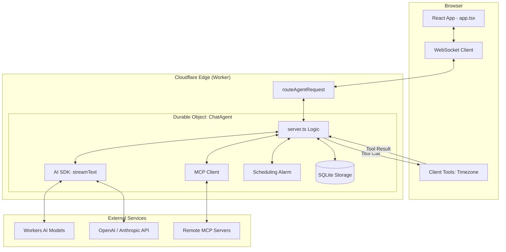

I will start by reading the contents of `.prompt.md` to understand the specific instructions and `.input.agents-starter.cloudflare.xml` to get the necessary data for the task.
Based on the provided repository export, here is the deep analysis of the **Agent Starter** project.

---

### 1. Project Name and Last Commit Date
*   **Project Name:** `agent-starter`
*   **Last Commit Date:** Monday, 20 April 2026, 14:51:12 -0400

### 2. Project Description
**Agent Starter** is a comprehensive boilerplate designed for building and deploying AI-powered chat agents on the Cloudflare platform. It leverages the Cloudflare Agents SDK and Workers AI to provide a high-performance, serverless environment for conversational AI. The project is optimized for rapid development, offering a seamless integration with Cloudflare’s global network without requiring external API keys for its default model provider.

The architecture centers around a stateful `AIChatAgent` (a specialized Durable Object) that manages conversation history, executes tools, and handles scheduled tasks. It features a modern React-based frontend using the Kumo design system, providing a polished user experience with support for streaming responses, image uploads for vision tasks, and real-time WebSocket communication.

A key focus of the template is versatility in tool execution. it demonstrates three distinct patterns: server-side automation, client-side browser tools, and human-in-the-loop approvals. Additionally, it includes advanced features like task scheduling (cron or delayed), reasoning transparency for models, and built-in MCP (Model Context Protocol) client support for extending agent capabilities with external services.

### 3. Supported Platforms/Deployments + Requirements
*   **Platform:** Cloudflare Workers (using the Workers runtime).
*   **Storage:** Cloudflare Durable Objects and SQLite (for message persistence).
*   **Deployment Tools:** `wrangler` CLI (v4.84.0+).
*   **Development Requirements:**
    *   Node.js (compatible with `@cloudflare/workers-types`).
    *   `npm` or `yarn` for dependency management.
    *   Cloudflare Account with Workers and Durable Objects enabled.
*   **Files:** `wrangler.jsonc`, `package.json`, `src/server.ts`.

### 4. Supported Connectors to Apps/APIs/Messengers
*   **Weather API (Demo):** Simulated server-side connector for fetching weather data.
    *   *Reference:* `src/server.ts` (inside `getWeather` tool).
*   **Browser/Client Environment:** Connector for client-side capabilities like timezone detection.
    *   *Reference:* `src/server.ts` (inside `getTimezone` tool), `src/app.tsx`.
*   **MCP (Model Context Protocol):** Support for connecting to external MCP servers to dynamically fetch tools and context.
    *   *Reference:* `src/server.ts` (method `addServer`), `src/app.tsx`.
*   **WebSocket:** Real-time bi-directional communication between client and server.
    *   *Reference:* `src/server.ts` (Durable Object implementation), `src/app.tsx`.

### 5. Supported Models/Agents
*   **Workers AI (Default):** Local-to-platform models (e.g., Llama, Qwen) using `workers-ai-provider`. No API token needed as it uses the `AI` binding.
    *   *Reference:* `src/server.ts`, `wrangler.jsonc`.
*   **OpenAI:** Supported via `@ai-sdk/openai` (requires `OPENAI_API_KEY`).
    *   *Reference:* `README.md`.
*   **Anthropic:** Supported via `@ai-sdk/anthropic` (requires `ANTHROPIC_API_KEY`).
    *   *Reference:* `README.md`.
*   **Vision Models:** Any model supporting image inputs (Vision-capable Llama/Claude/GPT).
    *   *Reference:* `src/app.tsx` (attachment logic), `src/server.ts` (`inlineDataUrls`).

### 6. Top 5 Use Cases and Workflows
1.  **Automated Personal Assistant:** Users ask for weather or calculations; the agent executes server-side tools or asks for approval for sensitive operations.
2.  **Visual Data Interpreter:** Users drop images into the chat; the agent processes the base64 data and describes contents or answers questions about the image.
3.  **Task Scheduler/Reminder:** Users set "Remind me..." prompts; the agent creates a scheduled task in the Durable Object, which fires later and broadcasts a notification.
4.  **Knowledge Extender (MCP):** A developer adds a remote MCP server URL; the agent dynamically learns new tools (e.g., GitHub, Google Search) and uses them in chat.
5.  **Multi-device Sync Chat:** Since state is stored in a Durable Object, the user can reconnect from different devices and see the same persistent history and scheduled tasks.

### 7. Top 20 Features
1.  **Streaming Responses:** Real-time text generation via `streamText`. (`src/server.ts`)
2.  **Durable State:** Persistent conversation history using SQLite-backed Durable Objects. (`wrangler.jsonc`)
3.  **Task Scheduling:** Support for one-time and recurring (cron) tasks. (`src/server.ts`)
4.  **Human-in-the-loop (HITL):** Tool execution gating with `needsApproval`. (`src/server.ts`)
5.  **MCP Integration:** Dynamic tool loading via Model Context Protocol. (`src/server.ts`)
6.  **Vision Support:** Drag-and-drop/paste image processing. (`src/app.tsx`, `src/server.ts`)
7.  **Reasoning Disclosure:** UI displays model "thinking" process before final output. (`src/app.tsx`)
8.  **Client-side Tools:** Tools that execute in the user's browser (e.g., location/time). (`src/app.tsx`)
9.  **Message Pruning:** Context management to keep conversations within token limits. (`src/server.ts`)
10. **Debug Mode:** Inspection of raw JSON message structures in the UI. (`src/app.tsx`)
11. **Dark/Light Mode:** Full theme support via Kumo components. (`index.html`, `src/app.tsx`)
12. **Tailwind CSS v4:** Modern styling framework integration. (`vite.config.ts`, `package.json`)
13. **Real-time Broadcasts:** Server-to-client notifications without history injection. (`src/server.ts`)
14. **RPC Callable Methods:** Direct client-to-agent method calls via `@callable`. (`src/server.ts`)
15. **Auto-reconnection:** Robust WebSocket handling in `useAgent`. (`src/app.tsx`)
16. **Markdown Rendering:** Rich text support including code blocks with syntax highlighting. (`src/app.tsx`)
17. **Attachment Management:** Handling and previewing multiple file types. (`src/app.tsx`)
18. **Mobile Responsive:** Adaptive UI for different screen sizes. (`src/app.tsx`)
19. **Secure Headers:** CSP and meta-tag configurations. (`index.html`)
20. **Zero-Config AI:** Integrated Cloudflare Workers AI bindings. (`wrangler.jsonc`)

### 8. Top 20 Smart Patterns
1.  **Broadcast vs. SaveMessages:** Using `broadcast()` for notifications to avoid AI feedback loops. (`src/server.ts`)
2.  **Inline Data URL Decoding:** Converting base64 to `Uint8Array` to satisfy AI SDK asset handlers. (`src/server.ts`)
3.  **Durable Object Hibernation:** Efficiently managing server resources when idle. (`src/server.ts`)
4.  **Zod Schema Validation:** Strictly typed tool inputs. (`src/server.ts`)
5.  **Conditional Tool Approval:** Dynamic logic to decide if a tool needs HITL. (`src/server.ts`)
6.  **MCP State Persistence:** Storing connected server URLs in agent state. (`src/server.ts`)
7.  **Selective Context Pruning:** Removing intermediate tool calls while preserving core conversation. (`src/server.ts`)
8.  **Step-Count Limiting:** Preventing infinite tool-call loops in `streamText`. (`src/server.ts`)
9.  **Optimistic UI:** (Inferred) Handling message parts before full server confirmation. (`src/app.tsx`)
10. **Theme Initialization Script:** Preventing FOUC (Flash of Unstyled Content). (`index.html`)
11. **Namespace-based Routing:** Using `routeAgentRequest` for multi-agent support. (`src/server.ts`)
12. **Environment-based Model Config:** Easily switching between Workers AI and OpenAI. (`src/server.ts`)
13. **Centralized Error Boundary:** (Inferred via Kumo) Standardized UI for agent failures. (`src/app.tsx`)
14. **Debounced/Throttled Streaming:** Efficient React state updates during high-velocity streams. (`src/app.tsx`)
15. **Icon-based Status Indicators:** Visual cues for executing vs. approved tools. (`src/app.tsx`)
16. **Shared Types via `env.d.ts`:** Syncing Wrangler bindings with TypeScript. (`env.d.ts`)
17. **Single-Page Routing for Assets:** `not_found_handling` set to `single-page-application`. (`wrangler.jsonc`)
18. **Idempotent Scheduling:** Ensuring tasks aren't duplicated on restart. (`src/server.ts`)
19. **Pre-fetching Model Assets:** Using `downloadAssets` configuration. (`src/server.ts`)
20. **Vite + Wrangler Proxy:** Seamless local development with Cloudflare bindings. (`vite.config.ts`)

### 9. Top 20 Development Trends (Latest Commits)
1.  **Dependency Modernization:** Constant updates to `ai`, `agents`, and `workers-ai-provider`.
2.  **React 19 Adoption:** Transitioning to the latest React version.
3.  **Vite 8 Integration:** Moving to the bleeding edge of build tooling.
4.  **Oxlint/Oxfmt Migration:** Replacing ESlint/Prettier with high-performance Rust-based tools.
5.  **Tailwind 4.0 Alpha/Beta:** Early adoption of the new CSS engine.
6.  **Code Splitting/Import Tidying:** Refactoring imports for better maintainability.
7.  **MCP Feature Expansion:** Refining how MCP servers are added and managed.
8.  **Streamdown Integration:** Enhancing markdown and code rendering.
9.  **SQLite Migration Support:** Transitioning Durable Objects to SQLite storage.
10. **Decorator Cleanup:** Moving away from legacy decorators in favor of standard patterns.
11. **TypeScript 6.0 Prep:** Staying compatible with future TS features.
12. **Sanity Check Automation:** Improving GitHub Actions for CI.
13. **Model Specific Tweaks:** Adding support for newer models like Kimi 2.6.
14. **Asset Handling Optimization:** Better management of large data URIs.
15. **Vite Plugin Cloudflare:** Tighter integration between Vite and Wrangler.
16. **RPC API Stabilization:** Maturing the `callable()` interface.
17. **Component Modularization:** Breaking down `app.tsx` into smaller logic blocks.
18. **Strict Linting:** Enabling `correctness` categories in `oxlint`.
19. **Reduced Boilerplate:** Moving common configs into `agents/tsconfig`.
20. **Developer Experience (DX):** Improving the `create-cloudflare` template quality.

### 10. Top 10 Advantages / Strong Points
1.  **Global Edge Execution:** Lowest latency by running agents at the edge.
2.  **No-Config AI:** Workers AI provides a zero-setup start.
3.  **State Persistence:** Durable Objects handle synchronization perfectly across multiple clients.
4.  **Modern Stack:** Uses the latest high-performance tools (Ox, Vite, React 19).
5.  **Built-in Scheduling:** Native support for time-based agent actions.
6.  **MCP Ready:** Future-proofed with Model Context Protocol.
7.  **Human-in-the-loop Support:** Essential for building trusted agents.
8.  **Vision Integration:** Easy handling of multi-modal inputs.
9.  **TypeScript First:** Excellent type safety and developer productivity.
10. **Cost Efficiency:** Serverless model means paying only for actual usage.

### 11. Top 10 Limitations / Weak Points
1.  **Durable Object Costs:** Can be more expensive than stateless Workers for very high traffic.
2.  **Worker Limits:** Bound by CPU/Memory limits of Cloudflare Workers.
3.  **Cold Starts:** Though minimal, still a factor in serverless environments.
4.  **Complex Debugging:** Debugging Durable Objects and WebSockets can be non-trivial.
5.  **Vendor Lock-in:** Heavily tied to Cloudflare's proprietary APIs (Agents SDK).
6.  **Limited Local LLM Control:** Dependency on Cloudflare's available `Workers AI` models.
7.  **Large File Handling:** Passing very large images over WebSockets can hit message size limits.
8.  **Single Durable Object Scalability:** A single agent instance (DO) is single-threaded.
9.  **Deployment Latency:** Waiting for `wrangler deploy` to propagate changes globally.
10. **Complexity for Beginners:** Understanding Durable Objects and SQLite migrations requires a learning curve.

### 12. Top 5 Used and Top 5 Provided AI Skills
*Note: "Skills" in this context refer to the tool functions and agent capabilities.*
*   **Used AI Skills:**
    1.  `streamText` (from `ai` package) - Core generation logic.
    2.  `convertToModelMessages` - Formatting history.
    3.  `pruneMessages` - Context window management.
    4.  `workers-ai-provider` - Model execution.
    5.  `streamdown` - Content rendering.
*   **Provided AI Skills:**
    1.  `getWeather` - Data retrieval pattern. (`src/server.ts`)
    2.  `getTimezone` - Client-side context pattern. (`src/server.ts`)
    3.  `calculate` - Approval gating pattern. (`src/server.ts`)
    4.  `scheduleTask` - Temporal logic pattern. (`src/server.ts`)
    5.  `Vision/Image Processing` - Multi-modal pattern. (`src/app.tsx`)

### 13. Data Inputs, Outputs, and Storage
*   **Inputs:**
    *   Text prompts from user.
    *   Images (base64/data URIs).
    *   MCP tool results.
    *   Client-side tool results (Timezone, etc.).
*   **Outputs:**
    *   Streaming Markdown text.
    *   JSON tool-call results.
    *   Real-time broadcast notifications.
*   **Storage:**
    *   **Durable Object State:** Stored in SQLite (using `this.storage.sql`).
    *   **Messages:** Persisted conversation history.
    *   **Settings:** Theme and MCP URLs stored in `this.state`.
    *   *Reference:* `wrangler.jsonc` (migrations), `src/server.ts`.

### 14. Detailed Architecture Review
1.  **`wrangler.jsonc`:** Configuration for bindings (AI, Durable Objects, Assets).
2.  **`src/server.ts` (ChatAgent):** The main "Brain." Extends `AIChatAgent`, manages `onChatMessage`, tool definitions, and task execution.
3.  **`src/app.tsx` (Root UI):** Manages the React lifecycle, WebSocket connection via `useAgent`, and rendering message parts.
4.  **`AIChatAgent` (SDK):** Base class providing message persistence and WebSocket boilerplate.
5.  **`DurableObjectNamespace`:** The factory for creating individual agent instances per chat.
6.  **`workers-ai-provider`:** Bridge between the AI SDK and Cloudflare’s `Env.AI` binding.
7.  **`streamText` (AI SDK):** Orchestrates the loop between model generation and tool execution.
8.  **`Durable Object Storage (SQLite)`:** Provides transactional persistence for all agent data.
9.  **WebSocket Protocol:** Real-time channel for messages and broadcasts.
10. **MCP Client:** Logic for fetching and executing remote tools.
11. **Vite Plugin Cloudflare:** Handles the complex bundling required for Workers + Assets.
12. **Kumo Components:** The presentation layer (buttons, inputs, surface).
13. **Streamdown Parser:** Converts streaming text chunks into Markdown/HTML.
14. **`useAgentChat` Hook:** Synchronizes the local UI state with the remote Durable Object messages.
15. **`onToolCall` Callback:** Bridges server-requested tool calls to client-side browser logic.
16. **Scheduling Engine:** Internal Cloudflare mechanism for firing alarms in Durable Objects.
17. **`inlineDataUrls` utility:** Sanitizes multi-modal data for the AI SDK.
18. **`routeAgentRequest`:** Directs HTTP/WebSocket traffic to the correct Durable Object instance.
19. **`Env` Interface:** Centralized type definition for all Cloudflare bindings.
20. **`assets` configuration:** Serves the frontend React app from the same origin.

### 15. Mermaid Graph of Architecture

### 16. Project Review: Maturity, Stability, Security, Performance
*   **Maturity:** High for a starter template. It follows current Cloudflare best practices and uses production-ready SDKs.
*   **Stability:** High. Durable Objects provide strong consistency and reliability for stateful connections.
*   **Security:** Good. Uses Cloudflare’s secure infrastructure, environment variables for keys, and structured tool definitions to prevent prompt injection escapes.
*   **Performance:** Excellent. Edge-based execution and optimized Rust-based tooling (Ox) ensure fast build times and low runtime latency.

### 17. Project Review: Tests, CI, Documentation
*   **Tests:** Basic sanity checks are implemented via GitHub Actions. Manual testing is encouraged through the local dev server.
*   **CI Pipelines:** `.github/workflows/sanity-check.yml` ensures the project builds and lints correctly on Ubuntu.
*   **Documentation:** Detailed `README.md` covers quick start, project structure, and customization.
*   **AI Skills:** Well-demonstrated via the three tool patterns and vision support.

### 18. Top 20 Possible Improvements or Fixes
1.  **Shared State Storage:** Move MCP server list to a separate SQLite table for better querying. (`src/server.ts`)
2.  **Error Handling for Images:** Add validation for image size and format before sending. (`src/app.tsx`)
3.  **Token Counting:** Integrate a real tokenizer to improve `pruneMessages` accuracy. (`src/server.ts`)
4.  **Retry Logic:** Enhance WebSocket reconnection with exponential backoff. (`src/app.tsx`)
5.  **Streaming UI Performance:** Use `memo` on message components to prevent re-renders during streams. (`src/app.tsx`)
6.  **MCP Auth Support:** Implement OAuth flow for MCP servers that require it. (`src/server.ts`)
7.  **System Prompt Config:** Move the system prompt to a separate file or SQLite for easier updates. (`src/server.ts`)
8.  **Loading States:** Add skeleton loaders for tool execution and image processing. (`src/app.tsx`)
9.  **Unit Tests:** Add Vitest for server-side tool logic.
10. **E2E Tests:** Add Playwright for testing the full chat flow.
11. **Mobile UI Tweaks:** Improve the input area focus behavior on mobile keyboards. (`src/app.tsx`)
12. **Custom Model Selector:** Allow users to switch models directly from the UI. (`src/app.tsx`)
13. **Export History:** Add a feature to download the chat history as Markdown/JSON.
14. **Multi-agent Collaboration:** Implement logic to hand off tasks between different agent classes.
15. **Better Scheduling UI:** Add a panel to view and cancel pending tasks. (`src/app.tsx`)
16. **Voice Input:** Integrate Web Speech API for voice-to-text.
17. **PWA Support:** Add a web manifest for installability.
18. **Usage Analytics:** Basic tracking of token usage per session in SQLite.
19. **Secure Tool Sandboxing:** More isolation for server-side tool execution.
20. **Searchable History:** Implement full-text search over conversation history in SQLite.

### 19. Reuse for Agent Swarm (Knowledge Graph + Solution Specification)
1.  **`AIChatAgent` Base:** Perfect for stateful nodes in a swarm.
2.  **`routeAgentRequest`:** Use to route tasks between "Spec Agent" and "Review Agent."
3.  **`needsApproval` Pattern:** Ideal for the "Human Reviewer" step in a swarm debate.
4.  **`callable()` RPC:** Allows agents to call each other synchronously.
5.  **Durable Object SQLite:** Shared repository for the graph knowledge base.
6.  **`streamText` Tool Loop:** Natural fit for iterative solution debating.
7.  **MCP Client:** Connect to external graph databases or knowledge retrieval services.
8.  **`broadcast()`:** Real-time monitoring of agent-to-agent communication.
9.  **`pruneMessages`:** Managing context when multiple agents contribute to one thread.
10. **Zod Schemas:** Ensuring rigid formats for "Implementation Plans."

### 20. Reuse for Multi-user / Shared Knowledge Base
1.  **Durable Object Identity:** Map multiple users to the same DO instance for shared chat.
2.  **`this.setState()`:** Syncing a shared knowledge graph across all connected users.
3.  **WebSocket Broadcast:** Instant updates when one user evolves the knowledge base.
4.  **SQLite Persistence:** High-performance storage for the shared markdown/graph data.
5.  **MCP Servers:** Centralized connectors for external team data.
6.  **Kumo Surface/Surface:** UI patterns for collaborative workspaces.
7.  **`Schedule` Tasks:** Automated maintenance or cleanup of the shared KB.
8.  **`Attachment` Logic:** Shared file/image uploads for team reference.
9.  **`onStart` Lifecycle:** Initializing shared state from database on first load.
10. **`env.d.ts`:** Type safety for shared environment variables across the team.

### 21. Reuse for Hardware/Cloud/Messenger (Cloudflare Edge)
1.  **`wrangler.jsonc` AI Binding:** Running on Cloudflare's global GPU fleet.
2.  **`fetch()` Handler:** Entry point for Webhooks from Telegram/WhatsApp.
3.  **`broadcast()` logic:** Sending push notifications back to messengers.
4.  **Vision handling:** Processing photos sent via mobile messengers.
5.  **`Durable Object` Alarms:** Perfect for "Remind me" features on hardware/native apps.
6.  **Vite + React:** For the web/native app frontend.
7.  **MCP Client:** Connecting to "Local Hardware MCP" servers (running on-prem).
8.  **Streamdown Parser:** Consistent rendering across CLI and Web.
9.  **`inlineDataUrls`:** Handling binary data from various sources (voice/image).
10. **Cloudflare Assets:** Global distribution of the web/native client.

### 22. Reuse for Team Agents (Cooperative Workflows)
1.  **Human-in-the-loop (Approval):** Direct mechanism for human/agent cooperation.
2.  **`AIChatAgent` Messaging:** Foundations for agent-to-agent talk.
3.  **Durable Object State:** Shared memory for a task's progress.
4.  **`callable()` interfaces:** Standardizing how agents request help from humans.
5.  **`executeTask`:** Background processing for long-running cooperative tasks.
6.  **Zod Validation:** Enforcing workflow rules and hand-off requirements.
7.  **MCP Integration:** Pulling in tools used by the whole team (Jira, Slack).
8.  **`onChatMessage` hook:** Intercepting messages to inject "Team Context."
9.  **Kumo Components:** Consistent UI for team interaction.
10. **SQLite:** Logging every step of the cooperative workflow for audit.
