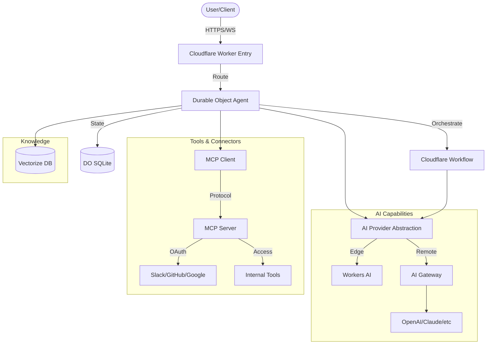

I will read the instructions in `.prompt.md` to understand the task.
I will read the content of `.input.ai.cloudflare.xml` to begin the analysis.
I will read the next section of `.input.ai.cloudflare.xml` to gather more details for the analysis.
I will read the root `package.json` to identify the workspaces and dependencies.
I will search for the beginning of the `package.json` entry in `.input.ai.cloudflare.xml`.
I will search for the `pnpm-workspace.yaml` entry in `.input.ai.cloudflare.xml` to see the workspace configuration.
I will search for any mention of `libs/` in the directory structure section of `.input.ai.cloudflare.xml`.
I will read the `directory_structure` section of `.input.ai.cloudflare.xml` to confirm the presence of `libs/`.
I will read the last few thousand lines of `.input.ai.cloudflare.xml` to find the `<git_log_commit/>` tag and other relevant information.
I will perform a final search for "skill" in `.input.ai.cloudflare.xml` to ensure I haven't missed any relevant AI skills or patterns.
I will read the root `README.md` of the project to understand its core concepts and descriptions.
I will read `packages/workers-ai-provider/README.md` to get more detailed information about the project's capabilities.
I will search for the beginning of `packages/workers-ai-provider/README.md` in `.input.ai.cloudflare.xml`.
# Deep Analysis of @cloudflare/ai-mono

## 1. Project Name and Last Commit Date
- **Project Name:** `@cloudflare/ai-mono` (Cloudflare AI Agents Monorepo)
- **Last Commit Date:** 2026-04-16 11:43:48 +0100

## 2. Description
The `@cloudflare/ai-mono` project is a sophisticated monorepo maintained by Cloudflare, serving as a comprehensive ecosystem for developing, testing, and deploying AI-powered agents and applications on the Cloudflare Workers platform. It provides a set of high-performance providers and adapters that bridge local edge models (Workers AI) and remote LLM APIs with the global scalability of Cloudflare’s serverless infrastructure.

The repository emphasizes advanced "agentic" patterns, moving beyond simple chat interfaces to stateful, autonomous systems. By leveraging Cloudflare-specific primitives like Durable Objects for persistent agent state and Workflows for complex multi-step reasoning, it demonstrates how to build resilient AI systems that can handle long-running tasks, human-in-the-loop approvals, and multi-agent coordination.

Furthermore, the project acts as a blueprint for the "Agentic Stack," showcasing integrations with the Model Context Protocol (MCP) for tool discovery and secure OAuth-based identity management. It includes an extensive library of demos that provide production-ready examples of patterns such as Evaluator-Optimizer loops, prompt chaining, and parallel execution, all optimized for the unique constraints and capabilities of the Cloudflare environment.

## 3. Supported Platforms/Deployments + Requirements
- **Cloudflare Workers:** Primary platform for agents and server-side logic. (Ref: `wrangler.jsonc` in various demos)
- **Cloudflare Pages:** Used for hosting demo frontends. (Ref: `demos/mcp-client/wrangler.json`)
- **Node.js:** Supported for local development and specific packages. (Ref: `demos/structured-output-node/package.json`)
- **Python:** Supported for specific demos like `python-workers-mcp`. (Ref: `demos/python-workers-mcp/pyproject.toml`)
- **Requirements:**
  - **pnpm:** For workspace management and dependencies.
  - **Cloudflare Account:** For deployment and access to Workers AI/Vectorize.
  - **Wrangler CLI:** For managing Worker deployments.
  - **Nx:** For monorepo task orchestration. (Ref: `nx.json`)

## 4. Supported Connectors
- **Slack:** OAuth-based integration for messenger agents. (Ref: `demos/mcp-slack-oauth/src/slack-handler.ts`)
- **GitHub:** OAuth-based integration for repository interactions. (Ref: `demos/remote-mcp-github-oauth/src/github-handler.ts`)
- **Google:** OAuth-based integration for Google services. (Ref: `demos/remote-mcp-google-oauth/src/google-handler.ts`)
- **Auth0:** Identity provider integration. (Ref: `demos/remote-mcp-auth0/mcp-auth0-oidc/src/auth.ts`)
- **Stytch:** B2B and consumer authentication. (Ref: `demos/mcp-stytch-b2b-okr-manager/api/OKRService.ts`)
- **Logto:** Identity management. (Ref: `demos/remote-mcp-logto/src/logto-handler.ts`)
- **Descope:** Authentication workflows. (Ref: `demos/remote-mcp-server-descope-auth/src/descope-handler.ts`)
- **WorkOS (AuthKit):** Modern auth integration. (Ref: `demos/remote-mcp-authkit/src/authkit-handler.ts`)
- **Cloudflare Access:** Secure perimeter for MCP servers. (Ref: `demos/remote-mcp-cf-access/src/access-handler.ts`)
- **Amazon Bedrock:** via AI Gateway. (Ref: `packages/ai-gateway-provider/src/providers/amazon-bedrock.ts`)
- **Anthropic:** via AI Gateway and direct adapters. (Ref: `packages/tanstack-ai/src/adapters/anthropic.ts`)
- **OpenAI:** via AI Gateway and direct adapters. (Ref: `packages/tanstack-ai/src/adapters/openai.ts`)
- **Google Vertex AI:** via AI Gateway. (Ref: `packages/ai-gateway-provider/src/providers/google-vertex.ts`)
- **Perplexity/DeepSeek/Cerebras:** via AI Gateway. (Ref: `packages/ai-gateway-provider/src/providers/index.ts`)

## 5. Supported Models/Agents
- **Workers AI Models:** Llama, Mistral, Gemma, etc. (Local/Edge). (Ref: `packages/workers-ai-provider/src/workersai-models.ts`)
- **Remote LLMs:** OpenAI, Claude, Gemini, Perplexity (Remote/API). (Ref: `packages/ai-gateway-provider/src/providers/index.ts`)
- **Stateful Agents:**
  - `SchedulerAgent`: Scheduling specialist. (Ref: `demos/agent-scheduler/src/SchedulerAgent.ts`)
  - `TaskManagerAgent`: Task management (HITL). (Ref: `demos/agent-task-manager-human-in-the-loop/src/TaskManagerAgent.ts`)
- **MCP Servers:** Exposing tools to agents. (Ref: `demos/mcp-server-bearer-auth/src/index.ts`)

## 6. Top 5 Use Cases
1. **Automated Scheduling:** Interpreting natural language to manage complex calendars and task scheduling.
   - *Workflow:* User query -> `SchedulerAgent` extraction -> Persistence in state -> Confirmation loop.
2. **Human-in-the-Loop Task Execution:** Securely executing sensitive tasks that require user approval.
   - *Workflow:* Agent plans action -> Creates pending `Confirmation` -> User approves via API -> Action executed.
3. **Iterative Content Refinement:** Using the Evaluator-Optimizer pattern to produce high-quality drafts.
   - *Workflow:* Generate initial draft -> Evaluate for flaws -> Optimize based on feedback -> Final output.
4. **Multi-Step Agentic Workflows:** Breaking down complex goals into a sequence of orchestrated AI steps.
   - *Workflow:* User goal -> Orchestrator decomposes -> Specialized workers execute steps -> Result synthesized.
5. **Secure Remote Tool Access:** Connecting internal business tools to AI models via MCP and Cloudflare Access.
   - *Workflow:* Cloud agent -> Authenticated MCP request -> Local/Protected tool execution -> Result returned.

## 7. Top 20 Features
1. **Workers AI Provider:** Native edge AI integration. (`packages/workers-ai-provider/src/index.ts`)
2. **AI Gateway Support:** Universal AI API access. (`packages/ai-gateway-provider/src/index.ts`)
3. **Durable Object Agents:** Stateful agent instances. (`demos/agent-task-manager/src/TaskManagerAgent.ts`)
4. **Cloudflare Workflows Integration:** Long-running agent reasoning. (`demos/evaluator-optimiser/src/evaluator-optimiser-workflow.ts`)
5. **Human-in-the-Loop (HITL):** Approval gates for agents. (`demos/agent-task-manager-human-in-the-loop/src/TaskManagerAgent.ts`)
6. **Model Context Protocol (MCP):** Standardized tool invocation. (`demos/mcp-server-bearer-auth/src/index.ts`)
7. **OAuth Identity Exchange:** Secure user-context for agents. (`demos/remote-mcp-github-oauth/src/github-handler.ts`)
8. **Structured Output (Zod):** Guaranteed schema extraction. (`demos/structured-output/src/index.ts`)
9. **Streaming Text/Tools:** Real-time agent feedback. (`demos/text-generation-stream/src/index.ts`)
10. **Image Generation:** Visual content creation at the edge. (`packages/workers-ai-provider/src/workersai-image-model.ts`)
11. **Vision Capabilities:** Multimodal input processing. (`demos/vision/src/server/index.ts`)
12. **Vectorize Integration:** Semantic search and RAG. (`types/workerd.d.ts`)
13. **Auto-RAG Helpers:** Simplified context retrieval. (`packages/workers-ai-provider/src/autorag-chat-language-model.ts`)
14. **Audio Transcription:** Voice-to-text conversion. (`packages/workers-ai-provider/src/workersai-transcription-model.ts`)
15. **Text-to-Speech (TTS):** Natural voice generation. (`packages/workers-ai-provider/src/workersai-speech-model.ts`)
16. **Reranking Models:** Enhancing search precision. (`packages/workers-ai-provider/src/workersai-reranking-model.ts`)
17. **Durable Object SQL Storage:** Transactional agent state. (`demos/hello-world/wrangler.jsonc`)
18. **CORS Middleware:** Secure web interaction. (`demos/hello-world/src/index.ts`)
19. **AICLI Tooling:** Developer productivity CLI. (`tools/aicli/src/bin/aicli.ts`)
20. **Monorepo Tasking (Nx):** Scalable build and test pipelines. (`nx.json`)

## 8. Top 20 Smart Patterns
1. **Evaluator-Optimizer:** Iterative refinement loop. (`demos/evaluator-optimiser/src/evaluator-optimiser-workflow.ts`)
2. **Pending Confirmation:** Decoupling intent from execution for HITL. (`demos/agent-scheduler/src/SchedulerAgent.ts`)
3. **Stateful Agent Instance:** One Durable Object per user/session. (`demos/agent-task-manager/src/TaskManagerAgent.ts`)
4. **Workflow-as-Brain:** Offloading heavy reasoning to a resilient workflow. (`demos/evaluator-optimiser/src/evaluator-optimiser-workflow.ts`)
5. **Model Routing:** Selecting model by complexity/cost. (`demos/routing/src/routing-workflow.ts`)
6. **Prompt Chaining:** Logical sequencing of LLM calls. (`demos/prompt-chaining/src/prompt-chaining-workflow.ts`)
7. **Parallel Execution:** Concurrent AI task processing. (`demos/parallelisation/src/parallelisation-workflow.ts`)
8. **Tool Discovery via MCP:** Dynamic runtime tool capability. (`demos/mcp-client/src/server.ts`)
9. **OAuth Token Pass-through:** Agents acting on user's behalf. (`demos/mcp-slack-oauth/src/index.ts`)
10. **Zod Schema Extraction:** Forcing LLMs into structured types. (`demos/agent-scheduler/src/llm/extract-action-type.ts`)
11. **Auto-Context Injection:** Pattern for simplified RAG. (`packages/workers-ai-provider/src/autorag-chat-language-model.ts`)
12. **Hono-Agent Binding:** Clean REST interfaces for agents. (`demos/agent-task-manager/src/index.ts`)
13. **Binary Streaming:** Efficiently handling non-text agent output. (`packages/tanstack-ai/src/utils/binary.ts`)
14. **Credential Auto-Detection:** Adapting to environment bindings. (`packages/tanstack-ai/test/config-detection.test.ts`)
15. **Eager Tool Response:** Optimizing tool call latency. (`packages/workers-ai-provider/src/streaming.ts`)
16. **Shared State SQL:** Transactional integrity for agent groups. (`demos/hello-world/wrangler.jsonc`)
17. **Multimodal Fusion:** Combining vision and text logic. (`demos/vision/src/server/index.ts`)
18. **Self-Hosted Access Bridge:** Securing internal tools for cloud agents. (`demos/remote-mcp-cf-access-self-hosted/src/index.ts`)
19. **JWT Validation for MCP:** Secure tool invocation. (`demos/remote-mcp-auth0/todos-api/src/middlewares/jwt.ts`)
20. **Replay Pattern:** Re-executing failed agent steps in Workflows. (`demos/evaluator-optimiser/src/evaluator-optimiser-workflow.ts`)

## 9. Top 20 Development Trends
1. **Standardizing on MCP:** Heavy shift towards Model Context Protocol.
2. **Securing the Perimeter:** Integration with Cloudflare Access for self-hosting.
3. **Resilient Workflows:** Using Cloudflare Workflows for agentic logic.
4. **Eager Streaming:** Improving perceived latency in tool calls.
5. **OAuth Proliferation:** Expanding identity providers for agents.
6. **Auto-RAG Simplification:** Making context retrieval transparent.
7. **Structured Output Priority:** Moving away from raw text parsing.
8. **Monorepo Scaffolding:** Automated demo creation tools. (`tools/create-demo`)
9. **Universal AI SDK:** Alignment with Vercel AI SDK standards.
10. **Edge Vision:** Increasing focus on multimodal inputs.
11. **Persistent State Management:** Refining Durable Object agent patterns.
12. **Fast Linting:** Transitioning to `oxlint` for speed.
13. **Python Worker Support:** Bridging the gap for AI engineers.
14. **Durable Object SQL Migration:** Moving state to SQL for better querying.
15. **Changeset releases:** Automated versioning and changelogs.
16. **Smoke Testing:** Daily automated validation of AI services.
17. **Provider Universalization:** One interface for many model APIs.
18. **Tool Discovery:** Improving how agents find and use tools at runtime.
19. **TypeScript Strictness:** Improving type safety in agent messages.
20. **Human-in-the-Loop formalization:** Standardizing approval patterns.

## 10. Top 10 Advantages
1. **Native Cloudflare Synergy:** Best-in-class use of Workers, DO, and Vectorize.
2. **Edge-First Performance:** Lower latency through localized inference.
3. **State Persistence:** Durable Objects provide reliable "memory."
4. **Flexible Model Choices:** Easily swap between local and remote models.
5. **Security Integration:** Enterprise-grade auth patterns built-in.
6. **Agentic Specialization:** Focus on complex reasoning, not just chat.
7. **Developer Experience:** Modern toolchain and fast iteration cycles.
8. **Scale:** Inherently ready for massive traffic via Cloudflare's network.
9. **Cost Efficiency:** Serverless pay-as-you-go with edge model options.
10. **Rich Documentation/Demos:** Clear path from "Hello World" to "Agent Swarm."

## 11. Top 10 Limitations
1. **Cloudflare Lock-in:** High dependency on Cloudflare-specific APIs.
2. **Monorepo Complexity:** Steeper learning curve for the project structure.
3. **Beta Primitives:** Reliance on some features (Workflows) still in evolution.
4. **Resource Bounds:** Workers CPU/memory limits for very large agent logic.
5. **Durable Object Overhead:** Costs and complexity of managing stateful instances.
6. **Local Model Capacity:** Edge models may lag behind top-tier remote LLMs.
7. **Documentation Drift:** Keeping many demos updated with fast-moving SDKs.
8. **Wrangler Proficiency:** Requires deep knowledge of Cloudflare's CLI.
9. **Cold Start considerations:** While fast, still a factor for ultra-low latency.
10. **External Agent Base:** Reliance on the `agents` package which might be external/closed.

## 12. Top 5 Used and Provided AI Skills
- **Used Skills:**
  1. `streamText`: Primary text and tool interaction. (`packages/workers-ai-provider/src/index.ts`)
  2. `generateImage`: Visual output generation. (`packages/workers-ai-provider/src/workersai-image-model.ts`)
  3. `embed`: Context vectorization. (`packages/workers-ai-provider/src/workersai-embedding-model.ts`)
  4. `rerank`: Search result optimization. (`packages/workers-ai-provider/src/workersai-reranking-model.ts`)
  5. `transcribe`: Audio-to-text conversion. (`packages/workers-ai-provider/src/workersai-transcription-model.ts`)
- **Provided Skills:**
  1. `SchedulerAgent`: Scheduling capability. (`demos/agent-scheduler/src/SchedulerAgent.ts`)
  2. `TaskManagerAgent`: Structured task management. (`demos/agent-task-manager/src/TaskManagerAgent.ts`)
  3. `OKRManagerMCP`: Business goal management tool. (`demos/mcp-stytch-b2b-okr-manager/api/OKRManagerMCP.ts`)
  4. `ModelScraper`: AI ecosystem information retrieval. (`demos/model-scraper/src/index.ts`)
  5. `TodoMCP`: Task list tool via MCP. (`demos/mcp-stytch-consumer-todo-list/api/TodoMCP.ts`)

## 13. Data Overview
- **Inputs:** HTTP JSON, natural language prompts, images (multimodal), audio.
- **Outputs:** Streaming text, generated images (binary), structured Zod data, tool calls.
- **Storage:**
  - **Durable Objects:** Primary persistence for agent state. (`demos/agent-scheduler/wrangler.jsonc`)
  - **SQLite (in DO):** Transactional state and history. (`demos/hello-world/wrangler.jsonc`)
  - **Vectorize:** Vector database for semantic RAG. (`types/workerd.d.ts`)
  - **Workflows State:** Managed state for reasoning loops. (`demos/evaluator-optimiser/src/evaluator-optimiser-workflow.ts`)

## 14. Architecture Review
The project follows a **Stateful Micro-Agent Architecture** where each agent is an independent Durable Object instance.
1. **Entrypoint:** Hono-based routing in Workers.
2. **Agent Layer:** `Agent` classes extending `agents` base, managing state in DO.
3. **Reasoning Layer:** Cloudflare Workflows for complex, multi-step agent logic.
4. **Provider Layer:** `workers-ai-provider` and `ai-gateway-provider` for model abstraction.
5. **Tooling Layer:** MCP servers providing external capabilities via standardized protocol.
6. **Identity Layer:** OAuth handlers managing user context and secure access.

## 15. Architecture Graph

## 16. Project Quality Review
- **Maturity:** **Emerging**. Built on modern patterns (MCP, Workflows) and shows high growth.
- **Stability:** **Stable Core**. Core Workers and AI bindings are reliable; higher-level agentic patterns are in active refinement.
- **Security:** **High**. Leverages Cloudflare's isolation and provides extensive auth blueprints.
- **Performance:** **Excellent**. Optimized for low-latency edge execution.

## 17. Validation & Verification
- **Tests:** Robust Vitest suite with E2E and smoke tests.
- **CI Pipelines:** Sophisticated GHA workflows for release and validation.
- **Documentation:** High quality, demo-centric documentation.
- **Skills:** Well-defined and reusable AI capabilities.

## 18. Possible Improvements
1. **Unified Agent SDK:** Consolidate the `Agent` base class into the monorepo.
2. **Standardized Hono Types:** Reduce duplication in `types/hono.ts`.
3. **Observability:** Unified logging for multi-agent traces.
4. **E2E for Workflows:** More comprehensive tests for reasoning loops.
5. **Component Library:** UI components for agent chat/interaction.
6. **Expanded RAG:** Native support for more vector stores.
7. **MCP Explorer:** Web UI for tool discovery and testing.
8. **Error Recovery:** Better retry logic for tool calls.
9. **Documentation:** Setup guides for complex OAuth providers.
10. **Planning Agent:** A dedicated agent for goal decomposition.
11. **Performance:** Further reduction of cold start times.
12. **Scaffolding:** More templates for the `create-demo` tool.
13. **Security:** Automated audits for MCP implementations.
14. **Knowledge Sharing:** Pattern for agents to share a common RAG index.
15. **Voice UI:** Native support for real-time voice in demos.
16. **Task history:** Persistent history beyond the current DO state.
17. **Model Scraper:** Add more community sources.
18. **HITL UI:** Standardized approval dashboard for all HITL demos.
19. **Node.js parity:** Better support for running agents in pure Node.
20. **Swarm UI:** Visualization of multi-agent interactions.

## 19. Reuse for Agent Swarm (Specification & Planning)
1. `WorkflowEntrypoint`: Orchestrating the multi-agent debate steps.
2. `Orchestrator Pattern`: Decomposing the spec into sub-tasks.
3. `Evaluator-Optimizer`: Refining the implementation plan iteratively.
4. `Routing Pattern`: Selecting the most capable model (e.g., Llama 3.3 70B) for complex logic.
5. `Structured Output (Zod)`: Formalizing the spec into machine-readable JSON.
6. `Durable Object State`: Maintaining the graph of the conversation/debate.
7. `Auto-RAG`: Pulling relevant knowledge from the graph knowledge base.
8. `Parallelization`: Running independent feasibility analyses concurrently.
9. `MCP Client`: Allowing agents to call specialized review tools.
10. `Zod-driven extraction`: Ensuring consistency across different agent outputs.

## 20. Reuse for Multi-User/Multi-Agent Shared Knowledge
1. `Durable Objects with SQL`: Managing the shared knowledge graph transactionally.
2. `Vectorize`: Providing shared semantic memory across all users.
3. `OAuth Identity exchange`: Tracking provenance of knowledge updates.
4. `Human-in-the-Loop`: Letting users review agent-proposed knowledge updates.
5. `Workflow State`: managing long-running knowledge evolution tasks.
6. `Structured Output`: ensuring the KB remains clean and queryable.
7. `Stateful Agents`: one agent per user session contributing to the global DO state.
8. `CORS Middleware`: allowing external dashboards to visualize the KB.
9. `MCP Server`: exposing the KB as a tool for other agents.
10. `AICLI`: for administrative management of the shared graph.

## 21. Reuse for Own Hardware / Messenger Agents
1. `Remote MCP Server`: Running agents/tools on hardware and exposing via tunnel.
2. `AI Gateway Provider`: Bridging messengers to cloud AI services securely.
3. `Cloudflare Access`: Securing the webhook entrypoints for Telegram/WhatsApp.
4. `Audio Transcription (Workers AI)`: For processing voice commands.
5. `Hono Routing`: Handling messenger webhooks and payload parsing.
6. `Durable Objects`: Maintaining individual user context for messenger threads.
7. `Image Generation`: Sending visual responses back to the messenger.
8. `Vision/Multimodal`: Interpreting photos sent via the messenger.
9. `MCP Bridge`: connecting hardware sensors to the cloud agent logic.
10. `Mermaid/React patterns`: rendering graphs to images for messenger preview.

## 22. Reuse for Team Agents (Cooperative Workflows)
1. `Human-in-the-Loop`: managing team approval cycles.
2. `Shared Durable Object`: a shared "space" for team collaboration.
3. `OAuth Identity Exchange`: verifying which team member is authorizing an action.
4. `Workflow Orchestration`: managing the "hand-off" between different roles (human/agent).
5. `Routing Pattern`: triaging team requests to the correct specialist agent.
6. `Structured Feedback`: standardizing how team members correct agent mistakes.
7. `Parallelization`: agents handling sub-components of a large team project.
8. `MCP Discovery`: shared internal tool registry for the entire team.
9. `CORS UI`: shared team dashboard for monitoring agent progress.
10. `SQL Persistence`: history of team decisions and agent actions for auditing.
