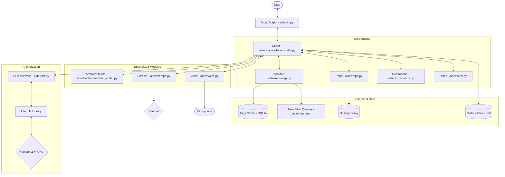

I will read the instructions from the `.prompt.md` file.
I will read the `.input.aider.xml` file to understand the project's content.
I will search for the `<git_log_commit/>` tag in `.input.aider.xml` and also search for `README.md` content in the same file.
I will search for the `<git_log_commit/>` tag in `.input.aider.xml`.
I will search for the string "commit" in `.input.aider.xml` to find the git log tags. I'll also check the last few hundred lines of the file.
I will read the last 1000 lines of `.input.aider.xml` to find the git log.
I will read the `README.md` file from `.input.aider.xml` starting at line 55054.
I will read `aider/repomap.py` to understand the repository mapping pattern in more detail.
I will search for the `<file path="aider/repomap.py">` tag in `.input.aider.xml`.
I will read the `RepoMap` class in `aider/repomap.py` from `.input.aider.xml`.
This analysis is based on the provided repository export for **Aider**, an AI pair programming tool.

### 1. Project Name and Last Commit Date
*   **Project Name:** Aider
*   **Last Commit Date:** 2026-04-08 (Ref: `<git_log_commit/>` in `.input.aider.xml`)

### 2. Project Description
Aider is an AI pair programming tool that operates directly in the terminal, enabling a seamless collaboration between developers and Large Language Models (LLMs). It integrates with local git repositories, allowing it to read, edit, and create code while automatically generating meaningful commit messages for every change. This "terminal-first" approach keeps developers in their flow, using familiar command-line tools while leveraging the advanced capabilities of models like Claude 3.7 Sonnet, GPT-4o, and DeepSeek.

One of Aider's core strengths is its sophisticated repository mapping (repo-map) system. By using ctags and tree-sitter, it creates a compressed map of the entire codebase, identifying key symbols, classes, and functions. This allows the AI to understand the context and relationships within large projects without needing to process every file in its entirety, making it highly effective for both starting new projects and building on existing, complex codebases.

Beyond simple code generation, Aider offers a suite of advanced features designed for real-world development. It includes an "Architect" mode for high-level planning, supports voice-to-code interaction, and can scrape web pages or process images for additional context. Its integrated linting and testing loop ensures that AI-generated changes are verified against the project's own standards, with the ability to automatically fix any issues detected by external tools.

### 3. Supported Platforms and Requirements
*   **Platforms:** Windows, macOS, Linux (any platform with Python support).
*   **Deployments:**
    *   Local installation via `pip` or `pipx`.
    *   Docker container (official images available).
    *   GitHub Codespaces.
    *   Replit.
*   **Requirements:**
    *   Python 3.10 to 3.14 (experimental support for 3.14).
    *   Git (essential for auto-commits and context management).
    *   API Keys for LLMs (OpenAI, Anthropic, Google, etc.) or a local LLM server (Ollama, LM Studio).
    *   `libportaudio2` (required for voice functionality on Linux).

### 4. Supported Connectors
*   **LLM Providers (via LiteLLM & custom implementations):**
    *   **OpenAI API** (GPT-4o, o1, o3-mini) - `aider/llm.py`, `aider/models.py`
    *   **Anthropic API** (Claude 3.7/3.5 Sonnet) - `aider/llm.py`, `aider/models.py`
    *   **DeepSeek API** (V3, R1) - `aider/llm.py`, `aider/models.py`
    *   **OpenRouter** - `aider/openrouter.py`
    *   **Google Gemini API** - `aider/llm.py`, `aider/models.py`
    *   **AWS Bedrock / Azure OpenAI / Groq / Cohere / Mistral** - `aider/llm.py`
*   **Local LLM Servers:**
    *   **Ollama / LM Studio** (OpenAI-compatible APIs) - `aider/llm.py`
*   **Web Scrapers:**
    *   **HTTPX & Playwright** (for fetching and parsing URLs) - `aider/scrape.py`
*   **Source Control:**
    *   **Git** (local integration for commits, diffs, and history) - `aider/repo.py`

### 5. Supported Models and Agents
*   **Models:**
    *   **Remote (API):** GPT-4o, Claude 3.7 Sonnet, DeepSeek V3, etc. (Token/Subscription).
    *   **Local:** Models via Ollama or LM Studio (e.g., Llama 3, Qwen).
*   **Agents (Coders):**
    *   **ArchitectCoder:** Planning-focused agent that directs an editor. `aider/coders/architect_coder.py`
    *   **AskCoder:** Non-modifying agent for codebase-aware Q&A. `aider/coders/ask_coder.py`
    *   **EditBlockCoder:** Uses SEARCH/REPLACE blocks for surgical edits. `aider/coders/editblock_coder.py`
    *   **UdiffCoder:** Uses unified diffs for more complex edits. `aider/coders/udiff_coder.py`
    *   **WholeFileCoder:** Replaces entire files (for smaller files). `aider/coders/wholefile_coder.py`

### 6. Top 5 Use Cases
1.  **Feature Implementation:** User requests a new feature; Aider analyzes the repo-map, plans the change (Architect), and implements it across multiple files.
2.  **Bug Fixing with Tests:** User provides a failing test; Aider runs the test, identifies the bug, applies a fix, and re-runs the test to verify.
3.  **Code Refactoring:** User asks to refactor a specific module; Aider identifies dependencies via the repo-map and performs surgical edits to move/extract logic safely.
4.  **Documentation Generation:** User asks to document a class/function; Aider reads the code and related symbols to generate accurate docstrings or README updates.
5.  **Environment Setup/Migration:** User asks to migrate a project; Aider identifies usage points of old libraries and updates imports and logic accordingly.

### 7. Top 20 Features
1.  **Repo-map (Codebase mapping):** `aider/repomap.py`
2.  **Git Auto-commit:** `aider/repo.py`
3.  **100+ Language Support:** `aider/queries/`
4.  **Architect/Editor Mode:** `aider/coders/architect_coder.py`
5.  **Voice-to-Code:** `aider/voice.py`
6.  **URL Scraping:** `aider/scrape.py`
7.  **Linting & Auto-fix Loop:** `aider/linter.py`
8.  **Image/Vision Support:** `aider/llm.py`
9.  **Interactive Test Running:** `aider/main.py`
10. **Multi-model compatibility:** `aider/models.py`
11. **Local LLM support:** `aider/llm.py`
12. **Search/Replace Edit Format:** `aider/coders/editblock_prompts.py`
13. **Unified Diff Edit Format:** `aider/coders/udiff_prompts.py`
14. **Context Summarization:** `aider/coders/base_coder.py`
15. **Slash Commands (/add, /drop, etc.):** `aider/commands.py`
16. **Read-only file context:** `aider/coders/base_coder.py`
17. **Markdown streaming:** `aider/mdstream.py`
18. **Persistence (Chat & Input History):** `aider/history.py`
19. **Argument/Config management:** `aider/args.py`
20. **Self-Update/Version check:** `aider/versioncheck.py`

### 8. Top 20 Smart Patterns
1.  **Symbolic Repo Mapping:** PageRank on symbol graphs for context selection. `aider/repomap.py`
2.  **SEARCH/REPLACE Blocks:** Surgical edits without full file rewrites. `aider/coders/editblock_prompts.py`
3.  **Architectural Separation:** Decoupling planning from execution. `aider/coders/architect_coder.py`
4.  **Feedback-driven Linting:** Using linter output as the next prompt. `aider/linter.py`
5.  **Thinking/Reasoning Budget:** Allocating tokens for model internal reasoning. `aider/llm.py`
6.  **Auto Commit Generation:** AI summarizing its own changes into commits. `aider/repo.py`
7.  **Adaptive History Summarization:** Compressing history while preserving critical context. `aider/coders/base_coder.py`
8.  **Personalized PageRank:** Weighting repo-map based on user-mentioned identifiers. `aider/repomap.py`
9.  **Language-Agnostic Symbol Extraction:** Tree-sitter queries for unified parsing. `aider/queries/`
10. **Proactive URL Addition:** Detecting URLs in chat and offering to scrape. `aider/coders/base_coder.py`
11. **Fenced Block Selection:** Picking non-conflicting code fences. `aider/coders/base_coder.py`
12. **Wait-time UI Feedback:** Non-blocking spinners during long API calls. `aider/waiting.py`
13. **Configuration Pre-parsing:** Handling multiple config sources (ENV, YAML) early. `aider/args.py`
14. **Safe Path Resolution:** Strict boundaries for file operations. `aider/utils.py`
15. **Tree-Sitter Capture Normalization:** Handling different API versions. `aider/repomap.py`
16. **MIME-based Scraping:** Handling plain text vs HTML. `aider/scrape.py`
17. **Alternating Role Enforcement:** Ensuring valid message sequences. `aider/sendchat.py`
18. **Important File Filtering:** Heuristics to identify core project files. `aider/special.py`
19. **Automated Bug Reporting:** Capturing uncaught exceptions and offering GitHub issue creation. `aider/report.py`
20. **Dynamic Edit Format Switching:** Choosing formats based on model/task. `aider/coders/base_coder.py`

### 9. Top 20 Development Trends
1.  Adding support for **GPT-5** (5.3, 5.4, Codex) variants.
2.  Enabling **"overeager mode"** for Claude 4.5.
3.  Expanding **Python 3.14** compatibility and testing.
4.  Refining **"reasoning effort"** settings for o1/o3-mini models.
5.  Improving error reporting with `ExInfo` for common API errors.
6.  Better handling of `PermissionDeniedError` across platforms.
7.  Reducing reliance on deprecated models in the test suite.
8.  Moving more model metadata into `model-settings.yml`.
9.  Enhancing the **Architect** mode's ability to direct the editor.
10. Improving repository mapping accuracy for Ruby and C++.
11. Increasing **"Singularity"** metric (code written by aider itself).
12. Moving to `uv` for more efficient dependency management.
13. Better support for "infinite output" from LLMs.
14. Enhancing the web-based edit benchmarks.
15. Adding more language-specific tree-sitter queries.
16. Refining the auto-commit logic for cleaner history.
17. Improving the onboarding experience for new users.
18. Better handling of large monorepos in the repo-map.
19. Expanding the linter support for more languages.
20. Cleaning up unused code and imports in the core engine.

### 10. Top 10 Advantages
1.  **Repo-map:** Best-in-class context management for large projects.
2.  **Git-Native:** Safe and undo-friendly via deep git integration.
3.  **Terminal-First:** Ideal workflow for CLI-centric developers.
4.  **Multi-Model:** Works with almost any LLM provider.
5.  **Local LLM Support:** Allows for private, offline coding.
6.  **Architect Mode:** Excellent for complex, multi-file planning.
7.  **Verification Loop:** Built-in linting/testing reduces broken code.
8.  **Performance:** Efficient token usage via smart context selection.
9.  **Ease of Setup:** Zero-config start for most projects.
10. **Multimodal:** Voice and vision inputs increase productivity.

### 11. Top 10 Limitations
1.  **CLI Learning Curve:** May be intimidating for GUI-only users.
2.  **Context Overflow:** Can still lose track in extremely large changes.
3.  **Model Cost:** High-end models can be expensive for heavy use.
4.  **Internet Dependency:** Most features require an active connection.
5.  **Edit Formats:** AI can struggle with very large SEARCH/REPLACE blocks.
6.  **Voice Dependencies:** System libraries can be difficult to install.
7.  **Token Limits:** Context windows still limit the total "active" files.
8.  **Scraping Complexity:** Dynamic pages require heavy Playwright dependency.
9.  **Architect Overhead:** Can feel slower for trivial one-line changes.
10. **Ambiguity:** May make "just-in-case" changes if prompts are broad.

### 12. Top 5 Used and Provided AI Skills
*   **Provided Skills (Commands):**
    1.  `/add`: Intelligent context inclusion. `aider/commands.py`
    2.  `/ask`: Codebase-aware Q&A. `aider/commands.py`
    3.  `/test`: Automated verification and repair. `aider/commands.py`
    4.  `/web`: Contextual web knowledge retrieval. `aider/commands.py`
    5.  `/voice`: Speech-to-implementation. `aider/commands.py`
*   **Used AI Skills (LLM Capabilities):**
    1.  **Code Synthesis:** Writing idiomatic code across 100+ languages.
    2.  **Architectural Reasoning:** Planning multi-file changes.
    3.  **Semantic Search:** Finding relevant code via symbols (Repo-map).
    4.  **Git Awareness:** Summarizing changes into commits.
    5.  **Multimodal Analysis:** Understanding screenshots and diagrams.

### 13. Data Inputs, Outputs, and Storage
*   **Inputs:** Local source code, git history, user text/voice, web URLs, images/PDFs.
*   **Outputs:** File edits, git commits, terminal markdown UI, persisted chat history.
*   **Storage:**
    *   `Chat History`: `.aider.chat.history.md`
    *   `Input History`: `.aider.input.history`
    *   `Tags Cache`: `.aider.tags.cache.v*` (SQLite/Diskcache).
    *   `Configuration`: `.aider.conf.yml`, `.env`, `.aiderignore`.

### 14. Detailed Architecture Review
Aider's architecture is centered around the interaction between the local codebase and remote LLMs.
*   **Coder (`aider/coders/base_coder.py`):** Orchestrates the chat loop, prompt preparation, and response processing.
*   **Repo (`aider/repo.py`):** An abstraction over Git for file tracking and version control.
*   **RepoMap (`aider/repomap.py`):** Build a compressed view of the codebase using ctags and tree-sitter PageRank.
*   **Model/LLM (`aider/models.py`, `aider/llm.py`):** Handles API communication and model capability metadata.
*   **IO (`aider/io.py`):** Manages the terminal interface and rich formatting.
*   **Linter (`aider/linter.py`):** Integrates external verification tools.
*   **Commands (`aider/commands.py`):** Implements user-facing slash commands.
*   **Architect (`aider/coders/architect_coder.py`):** Implements the two-stage planning/editing process.

### 15. Architecture Mermaid Graph

### 16. Project Maturity, Stability, Security, Performance
*   **Maturity:** High. Establish user base, high "Singularity" (88% self-written).
*   **Stability:** High. Comprehensive test suite and cross-platform CI.
*   **Security:** Moderate/High. Local-first approach; no sensitive data in analytics.
*   **Performance:** Excellent. Repo-map and caching allow handling of very large projects.

### 17. Review of Tests, CI, and Documentation
*   **Tests:** 100+ unit/integration test files in `tests/`.
*   **CI:** Robust GitHub Actions for Windows/Ubuntu, Docker, and PyPI.
*   **Documentation:** Comprehensive website (`aider.chat`) with tutorials and guides.

### 18. Top 20 Possible Improvements
1.  Modularize `base_coder.py` (over 1000 lines). `aider/coders/base_coder.py`
2.  Improve "infinite output" reliability for long generation. `aider/coders/base_coder.py`
3.  Add support for more local vision models. `aider/llm.py`
4.  Enhance repo-map for cross-language references. `aider/repomap.py`
5.  Interactive "diff review" mode before committing. `aider/repo.py`
6.  Reduce dependency footprint for optional features. `pyproject.toml`
7.  Improve UI for managing large numbers of added files. `aider/commands.py`
8.  Add pre-flight checks for configuration issues. `aider/main.py`
9.  Better support for multi-repo/monorepo projects. `aider/repo.py`
10. Integrate task-graph planning in Architect mode. `aider/coders/architect_coder.py`
11. Support project-specific system prompts. `aider/prompts.py`
12. Improve voice recording experience on Windows. `aider/voice.py`
13. Robust handling of hallucinated file paths. `aider/coders/base_coder.py`
14. Enhance auto-linter with custom fix scripts. `aider/linter.py`
15. Detailed per-turn cost estimation. `aider/coders/base_coder.py`
16. Session checkpointing (save/load chat state). `aider/history.py`
17. Repo-map performance for millions of LOC projects. `aider/repomap.py`
18. Better handling of binary files in context. `aider/utils.py`
19. "Safe mode" requiring confirmation for any edit. `aider/main.py`
20. Enhanced `AskCoder` for structured architecture reports. `aider/coders/ask_coder.py`

### 19. Reuse for Agent Swarm Debating Solutions
1.  **`ArchitectCoder`**: Planning logic for the swarm leader. `aider/coders/architect_coder.py`
2.  **`RepoMap`**: Shared understanding of the codebase. `aider/repomap.py`
3.  **`ModelSettings`**: Selecting the best model for each agent. `aider/models.py`
4.  **`Linter`**: Feedback loop for the "reviewer" agent. `aider/linter.py`
5.  **`SendChat`**: Managing alternating roles in multi-agent dialogue. `aider/sendchat.py`
6.  **`Diffs`**: Sharing and debating specific code changes. `aider/diffs.py`
7.  **`History`**: Tracking the evolution of the debate. `aider/history.py`
8.  **`Special`**: Identifying critical files to prioritize. `aider/special.py`
9.  **`ArchitectPrompts`**: Base instructions for planning personas. `aider/coders/architect_prompts.py`
10. **`Architect/Editor Pattern`**: Decoupling debate from execution. `aider/coders/architect_coder.py`

### 20. Reuse for Multi-user/Multi-agent Shared Knowledge Base
1.  **`RepoMap`**: The shared semantic knowledge graph. `aider/repomap.py`
2.  **`Diskcache`**: Persistent, shared storage for the KB. `aider/repomap.py`
3.  **`Git Integration`**: Conflict resolution in shared code. `aider/repo.py`
4.  **`History (Markdown)`**: Persistent record of shared decisions. `aider/history.py`
5.  **`Scraper`**: Pulling external knowledge into the shared KB. `aider/scrape.py`
6.  **`Linter`**: Validating contributions to the shared codebase. `aider/linter.py`
7.  **`Analytics`**: Monitoring usage across the team. `aider/analytics.py`
8.  **`Config/Args`**: Managing shared vs. individual settings. `aider/args.py`
9.  **`Special`**: Team-wide agreement on important files. `aider/special.py`
10. **`BaseCoder`**: Core engine for processing against shared KB. `aider/coders/base_coder.py`

### 21. Reuse for Hardware/Cloud Agents with Messenger/Voice/Graph
1.  **`Voice`**: Voice recording and transcription logic. `aider/voice.py`
2.  **`RepoMap`**: Foundation for graph-based navigation. `aider/repomap.py`
3.  **`Scraper`**: Docs/Web access for remote agents. `aider/scrape.py`
4.  **`IO (Markdown)`**: Formatting output for various clients. `aider/io.py`
5.  **`ModelSettings`**: Optimizing local vs. cloud model choice. `aider/models.py`
6.  **`Linter`**: Autonomous verification on remote hardware. `aider/linter.py`
7.  **`RunCmd`**: Executing system commands on target hardware. `aider/run_cmd.py`
8.  **`MDStream`**: Streaming output to low-latency clients. `aider/mdstream.py`
9.  **`Git Integration`**: State synchronization across environments. `aider/repo.py`
10. **`Analytics`**: Monitoring health of remote agents. `aider/analytics.py`

### 22. Reuse for Team Agents Cooperative Workflows
1.  **`Architect/Editor Pattern`**: Primary human/agent cooperation model. `aider/coders/architect_coder.py`
2.  **`RepoMap`**: Shared context for team code understanding. `aider/repomap.py`
3.  **`Git Auto-commit`**: Cooperative audit trail creation. `aider/repo.py`
4.  **`Linter/Auto-fix`**: Cooperative code quality verification. `aider/linter.py`
5.  **`History`**: Persistent memory of team evolution. `aider/history.py`
6.  **`Commands (/ask, /test)`**: Interactive cooperative tools. `aider/commands.py`
7.  **`Special`**: Shared identification of project anchors. `aider/special.py`
8.  **`Prompts`**: Evolving cooperative instructions. `aider/prompts.py`
9.  **`SendChat`**: Managing multi-party interaction flow. `aider/sendchat.py`
10. **`Analytics`**: Bottleneck identification in cooperative flows. `aider/analytics.py`
