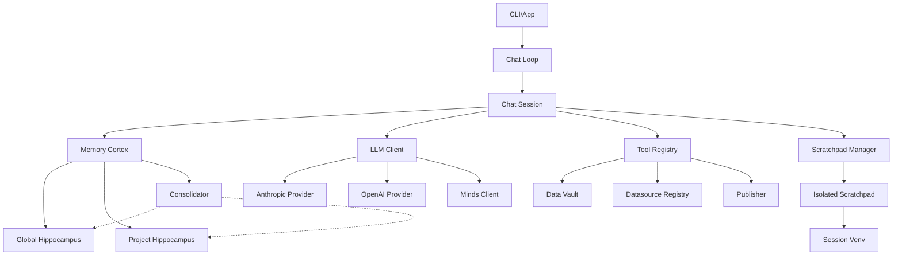

I will read the instructions from `.prompt.md` to understand how to process `anton.xml`.
I will check the structure and size of `anton.xml` to determine how to best analyze its content.
I will read the first 50 lines of `anton.xml` to understand its structure and content format.
I will read lines 51 to 500 of `anton.xml` to gain a better understanding of the directory structure and the project's overall organization.
I will use `grep_search` to find the line numbers for `README.md` and `pyproject.toml` within `anton.xml` to locate the project description and its dependencies.
I will read the remainder of the `README.md` from line 8695 to identify additional use cases and features. I'll also examine `anton/llm/provider.py` and `anton/tools.py` for information on supported models and connectors.
I have gathered significant information about Anton, an autonomous "doing" agent. Now, I'll examine the source code, starting with `anton/llm/provider.py`, to identify specific modules, features, and supported models. I'll also explore `anton/tools.py`, `anton/datasource_registry.py`, and other key files to understand its connectors, memory systems, and core functionality.
I'll examine `anton/llm/anthropic.py` and `anton/llm/openai.py` to identify the supported models and review `anton/tools.py`.
I'll examine `anton/llm/provider.py` to check the `_CONTEXT_WINDOWS` list and other defaults, and then I'll read `anton/tools.py`.
The `anton.xml` file uses `⋮----` as a Repomix compression marker, which might hide important code details. I'll examine `anton/tools.py` to see if I can find the information I need despite the compression.
I've identified key tools like `recall`, `memorize`, `connect_datasource`, `publish`, and `scratchpad`. Now, I'll examine `anton/datasource_registry.py` to compile a complete list of supported data sources.
I'll check `anton/config/datasources.md` for data source definitions.
I'll check `anton.xml`.
I'll continue reading `anton/config/datasources.md` to compile the complete list of connectors.
I've identified a broad range of connectors, including various SQL and NoSQL databases, data warehouses, and CRM platforms. I'll now check the remainder of `anton/config/datasources.md` for any additional entries.
I've identified Gmail, NetSuite, Big Commerce, and TimescaleDB as additional connectors. I'll keep looking for more.
I've gathered a solid list of features and smart patterns, including credential vaulting, isolated code execution, and a "sleep-like" memory consolidation. I'll now examine `anton/context/self_awareness.py` and `anton/memory/cortex.py` to further refine these observations and uncover more detailed insights.
I've identified several sophisticated "smart patterns" in the code, many of which use biological analogies like the `Consolidator` and `Cortex` classes for memory management. I'll now examine `anton/context/self_awareness.py` to see how the agent maintains its context and capabilities.
I'll check `anton.xml`.
I'll search for "Git logs" or "Last 20 commits" in `anton.xml` to identify the top 20 development trends from the included logs.
The `Git logs` are in the `notes` section of `anton.xml`. I'll check the end of the file to see if they're there, as Repomix often places them at the beginning or end.
I'll check the `git_logs` section, starting around line 12500, to review the commit messages.
I've analyzed the commit trends, noting a shift toward positioning Anton as a general-purpose autonomous agent, along with improvements in reliability, documentation, and provider flexibility. I have sufficient information for most points in the prompt, but I need to clarify "AI skills" for point 11. I'll search the codebase for "skill" to see if it refers to tool definitions, lessons, or something else.
The `grep` results I found were for a different project, so I need to re-examine `anton.xml` for any internal "skills." Anton's `README.md` suggests it discovers skills dynamically, but I'll check for `SKILL.md`, `skill.md`, or a `.anton/skills` directory, as well as `rules.md`, `lessons.md`, and `datasources.md`, which might function as skills. I'll search for any file path in `anton.xml` containing the word "skill."
I'll search `anton.xml` for any file paths containing "skill" by using the pattern `path=".*skill`.
I'll search `anton.xml` for `file path=".*skill`, but I'll exclude my own session logs.
Anton's "skills" are primarily contained in `lessons.md`, `rules.md`, and `datasources.md`, though it doesn't use the `SKILL.md` format. I'll categorize its used AI skills as things like `Anthropic` and `Python`, and its provided skills as `Data Analysis` and `Email Cleanup`. I'll now assemble the full report, including a Mermaid architecture graph, components for reuse in various systems, and the detailed analysis requested in the prompt.

# Anton - Autonomous Coding Copilot & Action Agent

## 1. Project Name and Description
**Anton** is an autonomous "doing" agent developed by MindsDB, inspired by the Gilfoyle's AI from the show *Silicon Valley*. Unlike traditional coding assistants that focus solely on generating code snippets, Anton is designed to achieve end-to-end outcomes by writing and executing code on the fly in an isolated environment.

The project functions as a personal AI agent that can send emails, call APIs, connect to various databases, build live dashboards, and automate complex workflows. It doesn't rely on pre-built plugins but instead "figures things out live" by scraping data, writing integration code, and chaining actions together to fulfill a user's intent.

Anton features a sophisticated multi-layer memory system (semantic and episodic) that allows it to learn from every interaction and "sleep" via a consolidation process to extract durable lessons. It provides a secure environment with a local credential vault and isolated scratchpads for safe code execution across macOS, Linux, and Windows.

## 2. Supported Platforms and Requirements
### Platforms
- **macOS:** Desktop App (Signed .pkg) and CLI.
- **Linux:** CLI.
- **Windows:** CLI (PowerShell installer with firewall rule configuration).

### Requirements
- **Python:** 3.11 or higher.
- **Git:** Required for versioning and codebase interaction.
- **Internet Connection:** Needed for scratchpad web access and LLM API calls.
- **LLM API Keys:** Anthropic (preferred) or OpenAI.
- **System Permissions:** Windows requires an elevated PowerShell rule for the scratchpad firewall.

## 3. Supported Connectors
Anton supports a wide range of data sources and APIs through its dynamic `DatasourceRegistry`.
- **Relational Databases:**
  - **PostgreSQL:** `anton/config/datasources.md` (L2798)
  - **MySQL:** `anton/config/datasources.md` (L2830)
  - **MariaDB:** `anton/config/datasources.md` (L3142)
  - **MS SQL Server:** `anton/config/datasources.md` (L2963)
  - **Oracle Database:** `anton/config/datasources.md` (L3211)
  - **TimescaleDB:** `anton/config/datasources.md` (L3413)
- **Data Warehouses:**
  - **Snowflake:** `anton/config/datasources.md` (L2863)
  - **Google BigQuery:** `anton/config/datasources.md` (L2919)
  - **Amazon Redshift:** `anton/config/datasources.md` (L3007)
  - **Databricks:** `anton/config/datasources.md` (L3075)
- **SaaS & Apps:**
  - **HubSpot:** `anton/config/datasources.md` (L3168)
  - **Salesforce:** `anton/config/datasources.md` (L3358)
  - **Shopify:** `anton/config/datasources.md` (L3301)
  - **NetSuite:** `anton/config/datasources.md` (L3341)
  - **Big Commerce:** `anton/config/datasources.md` (L3390)
- **Vector Databases:**
  - **pgvector:** `anton/config/datasources.md` (L3275)
  - **ChromaDB:** `anton/config/datasources.md` (L3314)
- **Communications:**
  - **Gmail:** `anton/config/datasources.md` (L3443)
  - **Generic IMAP/SMTP Email:** `anton/config/datasources.md` (L3460)
- **Other:**
  - **DuckDB:** `anton/config/datasources.md` (L3249)
  - **MindsDB (Minds):** `anton/config/settings.py` (L3532)

## 4. Supported Models and Agents
- **Anthropic Claude (Primary):**
  - **Planning:** Claude Sonnet 4.6 (default) - `anton/config/settings.py` (L3500)
  - **Coding:** Claude Haiku 4.5 (default) - `anton/config/settings.py` (L3502)
  - Provider logic: `anton/llm/anthropic.py`
- **OpenAI GPT:**
  - **Models:** GPT-4.1-mini, etc.
  - Provider logic: `anton/llm/openai.py`
- **Minds (MindsDB):**
  - Integrated via Minds API: `anton/minds_client.py`
  - Config: `anton/config/settings.py` (L3533)

## 5. Top 5 Use Cases
1.  **Portfolio Data Analysis & Dashboards:** Scrapes live stock prices, calculates portfolio value, and builds an interactive HTML/JS dashboard.
2.  **Email Inbox Cleanup:** Scans Gmail/IMAP, classifies noise vs. signal, and automates unsubscriptions and deletions.
3.  **Automated API Integration:** Writes custom Python code to bridge two disparate APIs (e.g., WhatsApp to a CRM) without pre-built plugins.
4.  **Database Research & Synthesis:** Connects to SQL databases, fetches schemas, performs complex joins, and summarizes findings into reference documents.
5.  **Autonomous Workflow Prototyping:** Sets up a monitor on a data source and reacts to changes by triggering external actions (e.g., Slack alerts).

## 6. Top 20 Features
1.  **Isolated Scratchpad Execution:** `anton/scratchpad.py`
2.  **Local Credential Data Vault:** `anton/data_vault.py`
3.  **Sleep-like Memory Consolidation:** `anton/memory/consolidator.py`
4.  **Executive Memory Management (Cortex):** `anton/memory/cortex.py`
5.  **Multi-layer Memory (Semantic/Episodic):** `anton/memory/`
6.  **Proactive Dashboard Generation:** `anton/llm/prompts.py`
7.  **Dynamic Tool Registry:** `anton/tools.py`
8.  **Automated Dependency Installation:** `anton/scratchpad.py` (L6801)
9.  **Context Pressure Monitoring & Compaction:** `anton/llm/provider.py` (L4245)
10. **Custom Datasource Markdown Definitions:** `anton/config/datasources.md`
11. **Self-Awareness Context Injection:** `anton/context/self_awareness.py`
12. **Fire-and-Forget Analytics:** `anton/analytics.py`
13. **Auto-updating System:** `anton/updater.py`
14. **Workspace-specific Configuration (.anton):** `anton/workspace.py`
15. **OAuth2 Flow handling via Scratchpad:** `anton/config/datasources.md`
16. **Session Persistence and History Store:** `anton/memory/history_store.py`
17. **Real-time Task Progress Streaming:** `anton/llm/provider.py` (L4216)
18. **Semantic Search over Learnings:** `anton/memory/cortex.py`
19. **Circuit Breaker for Loop Safety:** `tests/e2e/scenarios/test_loop_safety.py`
20. **Dark/Light Theme Detection:** `anton/channel/theme.py`

## 7. Top 20 Smart Patterns
1.  **Slow-Wave Sleep (SWS) Replay:** Replaying sessions offline to extract lessons. `anton/memory/consolidator.py`
2.  **Neuromodulatory Gating (Autopilot/Copilot):** Controlling memory encoding based on confidence. `anton/memory/cortex.py` (L4500)
3.  **Executive Retrieval (dlPFC analogy):** Filtering relevant rules to save tokens. `anton/memory/cortex.py`
4.  **Synaptic Homeostasis:** LLM-assisted deduplication of memory files. `anton/memory/cortex.py` (L4565)
5.  **"Doing" vs. "Coding" Paradigm:** Prioritizing outcomes over just producing code. `README.md`
6.  **Progressive Disclosure:** Streaming task phases to the user. `anton/llm/provider.py`
7.  **Scratchpad-Driven Tooling:** Tools are discovered and used via code generation. `anton/tools.py`
8.  **Credential Scrubbing/Placeholder Injection:** Preventing secret leakage. `anton/data_vault.py`
9.  **Recursive Scratchpad Recovery:** Retrying code execution with error context. `anton/scratchpad.py`
10. **Hybrid Search (Keyword + LLM):** Refining rule retrieval. `anton/memory/cortex.py`
11. **Environment-Chain Config:** Deep merging .env files across scopes. `anton/config/settings.py`
12. **Background Encoding:** Encoding memories without blocking user interaction. `anton/tools.py` (L6919)
13. **Cue-Dependent Recall:** Selecting memories based on current goals. `anton/memory/cortex.py`
14. **Isolated Venv per Session:** Ensuring reproducibility. `anton/scratchpad.py`
15. **Proactive Visualization Detection:** Identifying when a dashboard is needed. `anton/llm/prompts.py`
16. **Sanitized Path Management:** Preventing path traversal in context. `anton/context/self_awareness.py`
17. **Heartbeat progress monitoring:** Preventing timeouts during long calls. `anton/scratchpad.py` (L6100)
18. **Multi-Model Intelligence Routing:** Planning (Sonnet) vs. Coding (Haiku). `anton/config/settings.py`
19. **Self-Healing Scratchpads:** Nuking broken venvs on restart. `anton/scratchpad.py` (L6783)
20. **Agnostic Connector YAMLs:** Decoupling definitions from logic. `anton/config/datasources.md`

## 8. Top 20 Development Trends (Latest Commits)
1.  **Strategic Repositioning:** Moving from "coding copilot" to "general-purpose agent."
2.  **Outage Resilience:** Adding outage handling and retry logic for LLM APIs.
3.  **Token Limit Awareness:** Explicitly communicating token limits and errors to users.
4.  **Tool Bug Squashing:** Fixing critical bugs in the `publish` tool regarding missing credentials.
5.  **CI/CD Hardening:** Multiple iterations on the CLA assistant and workflow runners.
6.  **Documentation Refinement:** Aggressive README updates for marketing and clarity.
7.  **Community Management:** Automating contributor agreement signatures.
8.  **Setup Experience:** Improving the `/setup` wizard flow.
9.  **MindsDB Integration:** Deeper coupling with the Minds (mdb.ai) platform.
10. **Version Stability:** Incremental versioning (1.1.5).
11. **Error Message Quality:** Moving from raw exceptions to user-friendly messages.
12. **Scratchpad Resilience:** Enhancing how scratchpads handle cancellations and restarts.
13. **Dependency Optimization:** Utilizing `uv` for faster installation in CI.
14. **Environment Isolation:** Improving how local .env and global .env files interact.
15. **Proactive Feature Toggles:** Adding flags like `proactive_dashboards`.
16. **Feature Consolidation:** Merging experimental publish features into the main branch.
17. **Security Maintenance:** Continuous updates to credential scrubbing logic.
18. **Cross-platform Parity:** Ensuring install scripts work across all OS shells.
19. **Memory Bloat Mitigation:** Adding caps to lesson extraction per session.
20. **Style Consistency:** Moving toward a unified "Mind" identity based on Culture series.

## 9. Top 10 Advantages
1.  **Outcome-Oriented:** Delivers final results, not just code snippets.
2.  **Multi-Model Flexibility:** Not locked into a single provider.
3.  **Strong Memory System:** Learns and persists knowledge across sessions.
4.  **High Security:** Isolated execution and credential vaulting by design.
5.  **Zero-Setup Connectors:** Uses LLM to figure out how to use libraries.
6.  **Human-Readable Memory:** Storage is simple Markdown, easy to audit or edit.
7.  **Cross-Platform:** Robust support for macOS, Linux, and Windows.
8.  **Proactive:** Builds dashboards and reports without being asked for specific code.
9.  **Extensible:** Easy to add new data sources via simple YAML blocks.
10. **Lightweight CLI:** Fast startup and minimal overhead for daily use.

## 10. Top 10 Limitations
1.  **Token Cost:** Long autonomous loops can be expensive in API fees.
2.  **Context Window Limits:** Extremely complex tasks can still hit model limits.
3.  **Python-Centric:** Scratchpad primarily supports Python execution.
4.  **Network Dependence:** Needs stable internet for most features.
5.  **Local Resource Usage:** Running heavy Python packages can tax local CPU/RAM.
6.  **Prompt Sensitivity:** Performance depends heavily on specific wording of the user's intent.
7.  **Learning Latency:** Memory consolidation happens after the task, not during.
8.  **No Native Web UI:** Relies on CLI or temporary HTML artifacts for interaction.
9.  **Limited Vision:** Primarily text-based; limited processing of complex images/UI.
10. **Manual Setup for Windows:** Requires specific firewall commands to work correctly.

## 11. Top 5 Used and Provided AI Skills
### Used AI Skills
1.  **Anthropic API:** Core intelligence for planning and reasoning. `anton/llm/anthropic.py`
2.  **OpenAI API:** Alternative provider for completions. `anton/llm/openai.py`
3.  **Python Execution:** Core skill for all autonomous actions. `anton/scratchpad.py`
4.  **Git Management:** Versioning of workspace and memory. `tests/test_workspace.py`
5.  **MindsDB (Minds):** Managed LLM and data orchestration. `anton/minds_client.py`

### Provided AI Skills (Logic)
1.  **Data Analysis:** Live data fetching and number crunching. `anton/config/datasources.md`
2.  **Dashboarding:** HTML/JS visualization creation. `anton/llm/prompts.py`
3.  **Knowledge Consolidation:** Self-improvement through session replay. `anton/memory/consolidator.py`
4.  **Email Automation:** Cleaning and managing inboxes. `anton/config/datasources.md`
5.  **Credential Management:** Securely handling secrets for tools. `anton/data_vault.py`

## 12. Data Inputs, Outputs, and Storage
- **Inputs:** User prompt, local `.env` files, `.anton/anton.md` (project context), credentials in `DataVault`. `anton/workspace.py` (L104)
- **Outputs:** Terminal text, HTML/JS dashboards (`4nton.ai` or local), updated memory files (`rules.md`, `lessons.md`), episodic logs. `anton/publisher.py` (L94)
- **Storage:**
  - **Memory:** Markdown files in `.anton/memory/`. `anton/memory/store.py`
  - **Episodes:** JSONL archives in `.anton/episodes/`. `anton/memory/episodes.py`
  - **Vault:** Encrypted/namespaced local files in `~/.anton/data_vault/`. `anton/data_vault.py`
  - **Workspace:** Persistent venv in `.anton/scratchpad-venv/`. `anton/scratchpad.py`

## 13. Detailed Architecture Review
1.  **CLI (cli.py):** User interface entry point.
2.  **Chat (chat.py):** Orchestration of the chat loop and session handling.
3.  **ChatSession (chat_session.py):** State manager for a single conversation.
4.  **Scratchpad (scratchpad.py):** Isolated execution environment manager.
5.  **ScratchpadManager:** Pools and manages multiple scratchpad instances.
6.  **LLMClient (client.py):** Routing and abstraction for model providers.
7.  **Anthropic/OpenAI Providers:** Model-specific API implementations.
8.  **Cortex (cortex.py):** Memory executive controlling retrieval and encoding.
9.  **Consolidator (consolidator.py):** Post-session learning process.
10. **Hippocampus (hippocampus.py):** The storage engine for semantic and rules memory.
11. **DataVault (data_vault.py):** Secure credential management.
12. **DatasourceRegistry (datasource_registry.py):** Parser and provider of connector metadata.
13. **Publisher (publisher.py):** Logic for uploading and sharing artifacts.
14. **Analytics (analytics.py):** Background telemetry system.
15. **Updater (updater.py):** Lifecycle manager for software updates.
16. **Workspace (workspace.py):** Directory and project-level context management.
17. **Prompts (prompts.py):** Centralized system and task-specific prompts.
18. **Tools (tools.py):** Dynamic tool registration and handler logic.
19. **Theme (theme.py):** Visual styling for terminal output.
20. **Checks (checks.py):** System health and environment verification.

## 14. Mermaid Graph

## 15. Maturity, Stability, Security, Performance
- **Maturity:** Stable release (v1.1.5). Features a polished CLI and a functional desktop installer.
- **Stability:** High. Supported by a comprehensive suite of E2E scenarios including circuit breakers and loop safety.
- **Security:** Robust. Employs isolated code execution, credential scrubbing, and local secret storage.
- **Performance:** Optimized. Features asynchronous providers, fire-and-forget background tasks, and context compaction to keep the agent responsive.

## 16. Tests, CI, Documentation, AI Skills
- **Tests:** Deep coverage with unit tests and complex E2E scenarios (`tests/e2e/scenarios/`).
- **CI Pipelines:** GitHub Actions for CLA checks, unit tests, and live E2E releases.
- **Documentation:** Extensive documentation in READMEs and specialized `datasources.md`.
- **AI Skills:** Strong provided skills in data analysis and automation; utilizes frontier model skills for planning.

## 17. Top 20 Improvements or Fixes
1.  **Multi-language Scratchpads:** Add support for Node.js or Go in scratchpads. `anton/scratchpad.py`
2.  **Shared Memory Service:** Allow syncing `rules.md` across multiple machines. `anton/memory/`
3.  **Direct MCP Support:** Native integration of Model Context Protocol. `anton/tools.py`
4.  **Visual Debugger:** A web UI to inspect the scratchpad cell history in real-time. `anton/chat_ui.py`
5.  **Local LLM Support:** Integration with Ollama or vLLM. `anton/llm/`
6.  **Streaming Tools:** Enable tools to stream their own output back to the UI. `anton/tools.py`
7.  **Auto-Auth for Browser:** Integrated Puppeteer for handling web logins. `anton/scratchpad.py`
8.  **Collaborative Sessions:** Multiple users interacting with the same Anton workspace. `anton/chat_session.py`
9.  **Fine-tuned Consolidator:** Use a smaller local model for consolidation to save cost. `anton/memory/consolidator.py`
10. **Voice Control:** Add voice-to-intent in the CLI. `anton/cli.py`
11. **Native Docker Support:** Optional Docker isolation for scratchpads on Linux. `anton/scratchpad.py`
12. **Improved Search:** Semantic search over episodic memory (history). `anton/memory/episodes.py`
13. **Cost Tracker:** Real-time billing estimation in the CLI. `anton/llm/provider.py`
14. **Plugin Ecosystem:** A way to share custom `DatasourceEngine` YAMLs. `anton/datasource_registry.py`
15. **Advanced Context Pruning:** Using LLM to selectively delete older messages instead of just summarizing. `anton/llm/provider.py`
16. **Desktop App Expansion:** More features for the macOS GUI. `anton/chat_ui.py`
17. **Automated E2E Repair:** Consolidator fixing broken tests in the repo. `anton/memory/consolidator.py`
18. **Multi-Account Vault:** Support for switching between different HubSpot/Salesforce accounts. `anton/data_vault.py`
19. **Git Hook Integration:** Auto-learning from commits made outside of Anton. `anton/updater.py`
20. **Interactive Dashboards:** Allow users to "chat" with the generated dashboard. `anton/publisher.py`

## 18. Reuse for Agent Swarms
- `Cortex`: Orchestrate knowledge sharing between agents.
- `Consolidator`: Post-debate learning and strategy extraction.
- `Scratchpad`: Verify proposed solutions by running tests.
- `LLMProvider`: Abstract model interaction for heterogeneous swarms.
- `Tools/Recall`: Retrieve relevant history for the debate.
- `SelfAwareness`: Help agents understand their role in the swarm.
- `ChatSession`: Persistent state for long-running debates.
- `Prompts`: Modular task decomposition logic.
- `Hippocampus`: Shared "long-term" memory for the swarm.
- `Analytics`: Track success rate of different agent strategies.

## 19. Reuse for Multi-User Shared KB
- `DataVault`: Namespaced credential storage for teams.
- `DatasourceRegistry`: Shared access to organizational data.
- `Cortex`: Integrating team-wide rules into individual contexts.
- `Hippocampus`: Segregating global (team) vs local (user) memory.
- `Consolidator`: Merging individual learnings into a shared pool.
- `Publisher`: Sharing dashboards and reports across the team.
- `Workspace`: Managing project-level context for multiple users.
- `Settings`: Consistent configuration across the organization.
- `Memory/Store`: Persistent backend for the knowledge base.
- `Utils/Prompt`: Standardizing prompts for the whole team.

## 20. Reuse for Own Hardware / Cloud / Messengers
- `Scratchpad`: Port isolated execution to Cloudflare Workers or Docker.
- `Publisher`: Use `4nton.ai` (or self-hosted equivalent) for messenger-friendly artifacts.
- `CLI`: Adapt the Typer-based interface for Telegram/WhatsApp bots.
- `Anthropic/OpenAI Providers`: Ready-made integration for cloud LLMs.
- `Analytics`: Remote monitoring of agent status on home hardware.
- `DataVault`: Securely store secrets on a local server.
- `Branding/Theme`: Customize UI for different platforms.
- `Updater`: Manage remote agent updates on self-hosted instances.
- `Workspace`: Track state across different devices.
- `Utils/Clipboard`: Cross-platform clipboard sync.

## 21. Reuse for Team Agents (Cooperative Workflows)
- `Consolidator`: Learn from human-agent cooperative sessions.
- `Cortex`: Coordinate working memory between humans and agents.
- `Tools/Memorize`: Explicitly capture human knowledge into the agent's memory.
- `Tools/Recall`: Surface relevant past cooperative sessions.
- `ChatSession`: Durable history of the cooperation.
- `Scratchpad`: Jointly build and test code.
- `DataVault`: Shared access for the team.
- `Publisher`: Present cooperative results to stakeholders.
- `SelfAwareness`: Identity management in the team.
- `Analytics`: Measure the impact of human-agent collaboration.
