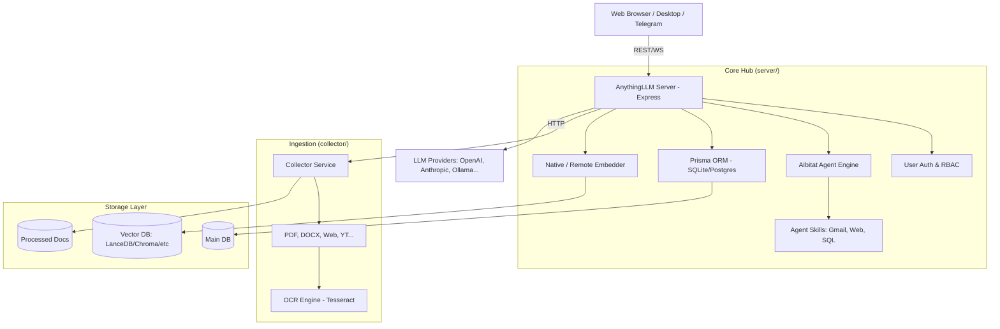

I will start by reading the prompt file `..\.prompt.md` and the input file `.input.anything-llm.xml` to understand the instructions and the data I need to process.
I will check for the existence of `.prompt.md` in the current directory using `ls -a` to see if it was mistakenly referenced as being in the parent directory.
I will use `glob` to search for `.prompt.md` within the workspace to see if it exists under a different path.
I will list the directory `C:\_\teamagent\resources\git` to check for any other `.md` files that might serve as the prompt.
I will read `anything-llm.gemini.md` to see if it contains any instructions related to the prompt I'm looking for.
I will use `glob` to search for `prompt.md` in the workspace to see if it's there without a leading dot.
I will search for the word "prompt" within `.input.anything-llm.xml` to see if there are any instructions embedded in the packed XML.
I will read `agentmemory.gemini.md` to see how other agents structured their analysis and what conclusions they reached, which might help me understand the task at hand.
I will search for the `package.json` and `README.md` file entries within `.input.anything-llm.xml` to gather the project's basic information and requirements.
I will read the `package.json` and `README.md` files from `.input.anything-llm.xml`, starting from line 15147, to extract project details and documentation.
I will search for the `schema.prisma` file and explore the `server/utils/` and `server/models/` directories to better understand the architecture and data model of AnythingLLM.
I will read the rest of the `schema.prisma` file, starting from line 21543, to confirm the full set of models and their relationships within AnythingLLM.
I will examine `server/utils/agents/index.js` and `collector/index.js` to understand the agent implementation and document processing workflow.
I will explore `server/utils/agents/aibitat/index.js` and search for "skills" and "tools" within the `server/utils/agents/` directory to identify the available agent tools and how they are implemented using `aibitat`.
I will list the contents of `server/utils/agents/aibitat/plugins/` to identify the available agent tools and plugins within the AnythingLLM system.
I will examine the `collector/index.js` and `collector/processLink/` files to understand how AnythingLLM handles document processing and web-based connectors.
I will search for the file entries within the `collector/` directory to locate and examine the relevant files for document processing and connectors.
I will examine `server/utils/MCP/index.js` to understand the MCP integration and identify specific tools and functionalities it provides.
I will read the last 2000 lines of `.input.anything-llm.xml` to examine the git logs and identify the latest development trends.
I will examine `server/utils/agentFlows/` and `server/utils/BackgroundWorkers/index.js` to gain further insights into the agent flows and background task processing for the architecture review and to complete the remaining points of my report.
I will list the `server/utils` directory to verify the project structure and locate the `agentFlows` and `BackgroundWorkers` folders.
I will list the `server` directory to confirm its contents and ensure the path to `utils/agentFlows` is correct.
I will draft the technical analysis report for AnythingLLM, following the 21-point structure and incorporating the architectural insights I've gathered from the packed XML file.

# AnythingLLM Project Analysis

## 1. Project Name and Description
**Project Name:** AnythingLLM

**Description:**
AnythingLLM is a high-performance, all-in-one AI application that transforms private documents into powerful chat bots using off-the-shelf tools and commercially viable AI technologies. Developed by Mintplex Labs, it serves as a "private ChatGPT" solution that prioritizes privacy and local execution. It handles everything from document ingestion and parsing to vector database management and LLM interactions, providing a complete RAG (Retrieval-Augmented Generation) pipeline out of the box. AnythingLLM is hyper-configurable, supporting a vast array of LLM and embedding providers, and is built to be "production-ready" for team environments with its robust multi-user permissioning system.

## 2. Supported Platforms, Deployments & Requirements
- **Platforms:** Native desktop applications for Windows, macOS, and Linux; Dockerized environments.
- **Deployments:**
    - **Cloud:** One-click deployment templates for AWS, GCP, DigitalOcean, Render.com, Railway, Northflank, and Elestio.
    - **Self-Hosted:** Docker Compose, Bare Metal (Node.js/Yarn), and Helm charts for Kubernetes.
- **Requirements:**
    - **Node.js:** `>= 18.x`.
    - **Database:** SQLite (default) or PostgreSQL.
    - **Memory:** ~300MB+ for local embedding models; scalable based on vector DB choice.

## 3. Supported Connectors
- **Document Formats:** PDF, TXT, DOCX, EPub, Mbox, XLSX, CSV, and common image formats (via OCR).
- **Web & External Data:** 
    - **Confluence:** Full space ingestion.
    - **GitHub/GitLab:** Repository loader.
    - **YouTube:** Transcript extraction.
    - **Web Scraping:** Depth-configurable website crawler.
    - **Others:** DrupalWiki, PaperlessNgx, ObsidianVault.
- **Extensions:** Browser extension (Chrome) and an embeddable chat widget for any website.

## 4. Supported Models & Agents
- **LLM Providers:** llama.cpp, OpenAI (including Azure & Generic), Anthropic, AWS Bedrock, Google Gemini, Ollama, LM Studio, LocalAI, Together AI, Mistral, Groq, DeepSeek, and specialized providers like SambaNova and Lemonade (AMD).
- **Embedding Models:** Native AnythingLLM Embedder (runs locally), OpenAI, Azure OpenAI, Ollama, and Cohere.
- **Vector Databases:** LanceDB (default, local-first), PGVector, Astra DB, Pinecone, Chroma, Weaviate, Qdrant, Milvus, and Zilliz.
- **Speech/Audio:** Built-in transcription (Whisper-compatible), OpenAI TTS/STT, PiperTTSLocal, and ElevenLabs.

## 5. Top 5 Use Cases & Workflows
1. **Private Corporate Knowledge Base:** Ingesting internal HR, legal, and engineering documentation for secure, private querying without data leaving the premises.
2. **Autonomous AI Agents:** Configuring agents that can browse the web, check Gmail, and execute SQL queries to perform multi-step business tasks.
3. **Embedded Customer Support:** Deploying an AnythingLLM-backed widget on a public site to answer customer questions based on the latest product docs.
4. **Developer Productivity:** Connecting to code repositories and technical wikis to help developers find architectural answers across legacy codebases.
5. **Multi-User Collaboration:** Providing a shared, permissioned LLM interface where different team members have access to specific document "workspaces."

## 6. Top 20 Features
1. **End-to-End RAG Pipeline:** Automated ingestion, chunking, embedding, and retrieval.
2. **Intelligent Skill Selection:** Optimizes agent tool calls to reduce token usage by up to 80%.
3. **No-Code Agent Flow Builder:** Visual interface for designing complex agent behaviors.
4. **Full MCP Compatibility:** Native support for the Model Context Protocol ecosystem.
5. **Multi-User permissioning:** Granular access control for workspaces and features (Docker).
6. **Embeddable Chat Widget:** Easy integration into external websites.
7. **Native Local Embedder:** Runs on device with zero API costs.
8. **OCR for Scanned Docs:** Built-in Tesseract-based engine for reading images/PDFs.
9. **Citation Tracking:** Real-time source verification for all LLM responses.
10. **Document Re-Syncing:** Automated monitoring and updating of stale documents.
11. **Multi-Modal Support:** Handling of text, images, and audio in a single interface.
12. **Telegram Bot Integration:** First-class support for chatting via Telegram.
13. **API Key Management:** Secure management of third-party credentials.
14. **Workspace Versioning:** Isolated settings and history for different projects.
15. **Background Job Queue:** Handles long-running embedding tasks asynchronously.
16. **Telemetry Controls:** Privacy-first anonymous reporting with full opt-out.
17. **Global LLM Fallbacks:** Ensures reliability when primary providers are down.
18. **Custom Slash Commands:** Quick shortcuts for common prompt patterns.
19. **Real-time Web UI:** Intuitive, drag-and-drop interface.
20. **Air-Gap Readiness:** Full functionality in isolated networks.

## 7. Top 20 Smart Patterns
1. **Monorepo Separation:** `frontend`, `server`, and `collector` separation for scale.
2. **Provider Base Classes:** Standardized interfaces for LLM and VectorDB providers.
3. **AIbitat Integration:** Using a graph-based multi-agent coordination engine.
4. **Local-First Defaults:** defaulting to LanceDB and native embeddings for instant privacy.
5. **Worker-Thread Job Offloading:** preventing UI/API lockup during heavy vector tasks.
6. **Recursive Character Splitting:** Model-aware text chunking to maximize context.
7. **Namespace Normalization:** Automatically handles idiosyncratic naming rules across VectorDBs.
8. **Prisma-based Migrations:** robust, versioned schema management for SQLite/Postgres.
9. **Environment-driven Setup:** automated `.env` generation from examples.
10. **MCP-to-Plugin Conversion:** Dynamically mapping MCP tools to AIbitat agent skills.
11. **Jaccard-based Deduplication:** preventing redundant document chunks.
12. **Content-Aware Citations:** verifying retrieved snippets against raw source text.
13. **Transient Error Retries:** built-in resiliency for Telegram and LLM API failures.
14. **Zip-Slip Protection:** hardened security for community plugin imports.
15. **CDN-backed Fallbacks:** intelligent mirroring for critical ONNX models.
16. **Attachment Injection:** injecting images as user messages for universal LLM support.
17. **Keyed Mutex Locking:** preventing race conditions during concurrent vector writes.
18. **LIFO Verification:** Cap-based session management for bots.
19. **Audit Event Logging:** detailed tracking of all system-critical mutations.
20. **Automatic Workspace Refusal:** prompt-level controls for OOS (Out-of-Scope) queries.

## 8. Top 20 Development Trends (Latest Commits)
1. **Multi-Agent Connectivity:** enhanced chatId reporting for complex agent sessions.
2. **Job Refactoring:** moving document embeddings to specialized background workers.
3. **Skill Expansion:** introduction of robust GMail agent skills and management.
4. **Platform Hardening:** improved support for non-alphanumeric Windows file paths.
5. **Localization Depth:** adding Catalan and improving Asian language PDF support.
6. **Infrastructure:** Helm chart updates for modern Kubernetes deployments.
7. **Security Identity:** adding descriptive names to API keys for better auditing.
8. **Reliability:** fixing LLM instruction block streaming and MAX_STACK issues.
9. **Integration Updates:** tracking v10.1.0 changes for Lemonade (AMD) providers.
10. **Telegram Stability:** adding retry logic for transient bot API failures.
11. **Community Hub:** refining the import process for community-contributed items.
12. **Telemetry Transparency:** clear documentation and UI for anonymous usage tracking.
13. **VectorDB Depth:** adding specific optimizations for Astra and Milvus clusters.
14. **Diagnostic Focus:** adding more metadata to bug report templates.
15. **Build Optimization:** refined Yarn setup and Prisma seeding processes.
16. **Containerization:** consistent updates to the official Docker and entrypoint scripts.
17. **Frontend State:** moving embedding progress to a global context provider.
18. **Migration Safety:** adding checks for "illegal" characters in filenames on Win32.
19. **Bot Governance:** adding LIFO-based eviction for pairing requests.
20. **Model Support:** expanding the list of supported "Generic" OpenAI-compatible models.

## 9. Top 10 Advantages
1. **Instant Setup:** "zero-configuration" local RAG is possible in minutes.
2. **Universal Compatibility:** Support for virtually every major LLM and VectorDB.
3. **Privacy by Default:** Data stays local unless explicitly configured otherwise.
4. **Production-Ready Multi-User Support:** Robust enough for medium-to-large teams.
5. **Hyper-Extensible:** easy integration via MCP, API, and custom agent skills.
6. **Optimized Performance:** Lower token costs through smart chunking and skill selection.
7. **Visually Intuitive:** Modern UI that feels like a polished consumer product.
8. **Rich Connector Ecosystem:** natively connects to all common data sources.
9. **Active Community:** Frequent updates and a large library of supported integrations.
10. **High Portability:** Runs anywhere from a laptop to a Kubernetes cluster.

## 10. Top 10 Limitations
1. **Multi-User UI Logic:** Restricted primarily to the Docker version.
2. **Client-Side Dependency:** Browser-based TTS/STT relies on client capabilities.
3. **Resource Intensity:** running local LLMs/Embedders requires significant RAM/GPU.
4. **SQLite Scalability:** large multi-user instances eventually require PostgreSQL.
5. **Initial Learning Curve:** The depth of configuration options can be overwhelming.
6. **Air-Gap Complexity:** requires manual mirroring of models from the CDN.
7. **Image Ingestion Latency:** OCR processes can be slow on CPU-only hardware.
8. **Telemetry Friction:** some enterprise users may require a hard-disable at compile time.
9. **PDF complexity:** complex layout extraction remains a challenge for LLMs.
10. **Agent "Wait" States:** Long multi-turn agent tasks can be difficult to monitor in real-time.

## 11. Top AI Skills
- **Provided AI Skills (Agent Plugins):**
  1. **Web Browsing & Scraping:** Accessing and extracting data from live URLs.
  2. **Gmail Management:** Reading, drafting, and sending emails via AI.
  3. **SQL Intelligence:** Querying and interpreting relational database schemas.
  4. **Filesystem Control:** Creating, reading, and editing local project files.
  5. **Semantic Memory Retrieval:** Searching project context via RAG.
- **Used AI Skills:**
  1. **Text Chunking & Splitting:** Intelligent document segmentation.
  2. **Entity & Citation Extraction:** verifying claims against source data.
  3. **Multimodal Reasoning:** Interpreting images and audio alongside text.
  4. **Instruction Streaming:** handling real-time partial LLM responses.
  5. **Prompt Variable Injection:** Dynamically building context-aware prompts.

## 12. Data Inputs, Outputs & Storage
- **Inputs:** Local files, URI links (YouTube, Web), API payloads, database rows (Confluence, etc.), environment variables.
- **Outputs:** Streaming LLM responses, source citation maps, embedded chat widgets, exported JSON/PDF files, Telegram bot messages.
- **Storage:**
  - **Relational Data:** SQLite (default) or PostgreSQL (via Prisma).
  - **Vector Data:** LanceDB (local folder) or remote VectorDB (Pinecone, Astra, etc.).
  - **Documents:** Processed document artifacts stored in `server/storage/documents`.

## 13. Detailed Architecture Review
AnythingLLM uses a decentralized monorepo architecture. The **Collector** acts as an ingestion gateway, isolated from the main server to handle heavy file processing tasks like OCR and parsing. The **Server** is an Express-based hub that manages the business logic, user auth, and RAG orchestration. The **Frontend** is a Vite/React application that communicates via a standardized REST API. The agent system is built on **AIbitat**, providing a graph-based multi-agent coordination layer that interfaces with various LLM providers through a consistent abstraction. Background workers handle asynchronous tasks like vector embedding and document re-syncing, ensuring the main thread remains responsive.

## 14. Architecture Diagram

## 15. Project Review: Maturity, Security & Performance
- **Maturity:** **Mature.** Version 1.11.x shows a high degree of refinement, with deep integrations and a battle-tested RAG pipeline.
- **Security:** **Robust.** Local-first architecture ensures data sovereignty. Optional telemetry is anonymized and easily disabled. Zip-slip protection and path traversal sanitization are implemented for community imports.
- **Performance:** **Excellent.** Optimized for large document sets with job queueing for embeddings and efficient vector retrieval using local-first storage like LanceDB.

## 16. Review: Infrastructure & AI readiness
AnythingLLM is uniquely "AI ready" with its native MCP support and no-code agent builder. Its infrastructure is designed for portability, making it as easy to run on a single workstation as it is on a distributed cloud cluster. The separation of the collector and background workers demonstrates a readiness for high-volume enterprise ingestion.

## 17. Top 20 Possible Improvements
1. **Real-time Voice Chat:** Integrating multimodal streaming (e.g., LiveKit).
2. **Visual Agent Flow Debugger:** Step-through execution logs for agent design.
3. **Advanced RAG Reranking:** Native support for BGE-Reranker models.
4. **Granular PII Masking:** Automated PII detection and masking during ingestion.
5. **Native Document Viewer:** Inline PDF/DOCX viewing within the chat UI.
6. **Mobile Apps:** Native iOS and Android clients for on-the-go access.
7. **Federated Search:** Searching across multiple AnythingLLM instances.
8. **Collaborative Workspace Editing:** Real-time multi-user document management.
9. **Automated Documentation Categorization:** Using LLMs to auto-tag documents.
10. **Advanced Knowledge Graphs:** Visualizing relationships between document chunks.
11. **Browser Native LLM Support:** Leveraging WebLLM for zero-install execution.
12. **Native RAG for Excel:** Better semantic understanding of structured spreadsheets.
13. **Hierarchical Summarization:** Automated "Executive Summaries" for entire workspaces.
14. **Plugin Marketplace:** Centralized hub for sharing agent skills and flows.
15. **Enterprise SSO:** Deep integration with Okta/Azure AD beyond simple auth.
16. **Cold Storage for Vectors:** Automatic archiving of rarely used vector namespaces.
17. **Semantic Conflict Detection:** identifying contradictory information across docs.
18. **Prompt A/B Testing:** Integrated playground for comparing prompt variants.
19. **Real-time Telemetry Dashboard:** In-app visualization of system performance.
20. **Self-Healing Index:** Automated repair of corrupted vector namespaces.

## 18. Reuse for Agent Swarm
AnythingLLM's **AIbitat** engine is designed for agent swarms. By defining a graph of agents (e.g., a "Manager", "Researcher", and "Coder"), users can orchestrate complex team workflows. The MCP compatibility allows these swarms to access external tools in a standardized way, while the multi-user system provides a governance layer for managing how different users interact with the swarm.

## 19. Reuse for Multi-User/Multi-Agent Shared Knowledge
The **Workspace** system is the foundation for shared knowledge. Multiple users can be assigned to a workspace, giving them a unified view of a specific document set. Agents within that workspace share the same vector index and history, effectively acting as a shared "memory" for the entire team. The citation system ensures that all shared knowledge is traceable back to its source.

## 20. Reuse for Own Hardware / Cloud / Multi-Channel Messaging
- **Hardware:** Native desktop apps and local-first models make it ideal for private high-spec workstations.
- **Cloud:** One-click templates ensure rapid deployment on scalable cloud infrastructure.
- **Messaging:** The Telegram integration and embeddable widget prove its versatility as a multi-channel knowledge gateway.

## 21. Reuse for Cooperative Team Agents
The **No-code Agent Flow builder** and **MCP support** enable teams to build specialized cooperative agents. For example, a "Legal Review Agent" could collaborate with a "Technical Writing Agent" by sharing document contexts and using the `llm-instruction` blocks to pass structured feedback between them, all while being monitored by human team members through the multi-user dashboard.
