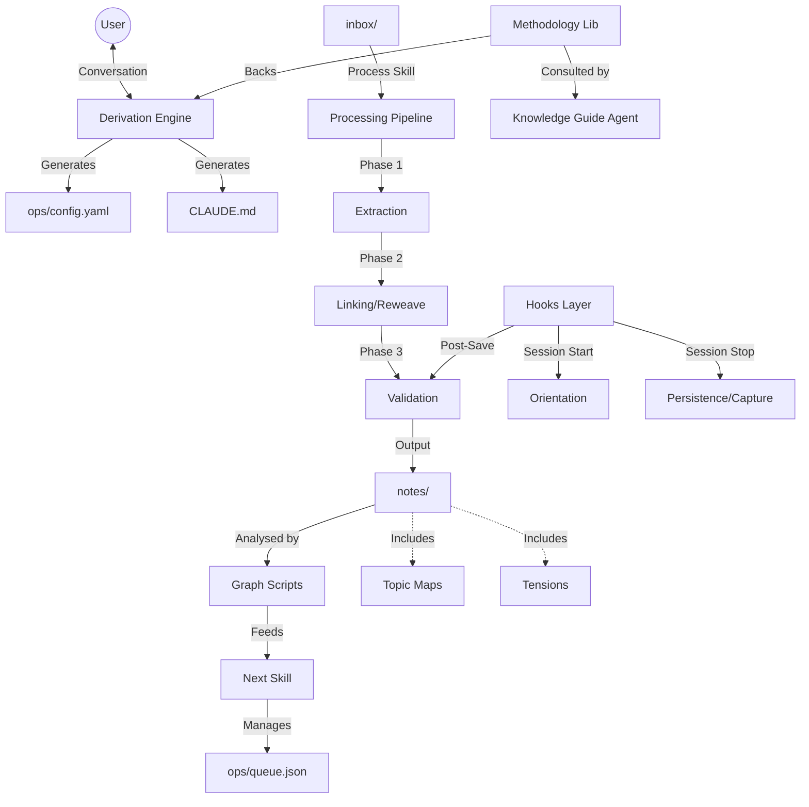

I will start by reading the instructions in `.prompt.md` and the content of `arscontexta.xml` to understand the task requirements and the input data.
I have analyzed the provided codebase and documentation. I will now synthesize the information to provide a comprehensive response to the user's request.

# Ars Contexta: Project Analysis

## 1. Project Name and Description

**Ars Contexta** (also referred to as **Agentic Note Taking**)

Ars Contexta is a conversational derivation engine designed to generate agent-native knowledge systems from natural conversation. It bridges the gap between human thought and machine-executable memory architecture by transforming informal dialogue into a structured, research-backed knowledge graph. The system is built on a "discovery-first" philosophy, ensuring that every piece of information is captured in a way that remains findable and useful for future AI agents and human users alike.

The project implements a sophisticated four-phase processing pipeline (Capture, Process, Connect, Verify) that enforces "atomic" note-taking—where each note represents a single, prose-titled proposition. This atomicity enables high-density linking and semantic search, allowing the system to function as an "external basal ganglia" for AI agents. It effectively offloads cognitive tasks like organization, relationship mapping, and maintenance to automated processes, keeping the agent's context window focused on active reasoning.

Architecturally, Ars Contexta is platform-agnostic but provides deep integration with tools like Claude Code. it uses a "hook-driven" methodology to implement session rhythms, quality gates, and self-evolution loops. By treating the knowledge vault as a queryable graph database (using simple tools like Markdown, YAML, and ripgrep), it achieves a high degree of transparency and longevity without relying on complex, proprietary infrastructure.

## 2. Supported Platforms and Deployments

Ars Contexta is designed to be highly portable, with specific focus on agentic environments.

*   **Primary Platform: Claude Code**
    *   **Deployment:** Integrated as a Claude Code plugin.
    *   **Requirements:** Claude Code environment, Node.js (for scripts), Git (for version control and `git mv` operations).
*   **Local-First / File System**
    *   **Deployment:** Can run as a standalone set of Markdown files and shell scripts.
    *   **Requirements:** A POSIX-compliant shell (bash), `ripgrep` (rg), and a Markdown editor (Obsidian is often implied by the MOC/Wiki-link patterns).
*   **Infrastructure Requirements:**
    *   **Storage:** Local file system (Markdown + YAML).
    *   **Processing:** An LLM (typically Claude 3.5 Sonnet) to execute the conversational derivation and processing skills.
    *   **Utilities:** `ripgrep` is essential for the graph analysis features.

## 3. Supported Connectors to Apps/APIs/Messengers

The system primarily connects to the local environment and the LLM, but its "hooks" and "skills" architecture allows for expansion.

*   **Claude Code Plugin Interface:** Connects the derivation engine to the Claude Code CLI.
    *   `/.claude-plugin/plugin.json`, `/.claude-plugin/marketplace.json`
*   **File System (Markdown/YAML):** Acts as the primary data connector.
    *   `generators/features/graph-analysis.md` (via `ripgrep`)
*   **Git:** Used for versioning, auto-commits, and safe renames.
    *   `hooks/scripts/auto-commit.sh`, `platforms/claude-code/hooks/auto-commit.sh.template`
*   **Shell/CLI:** Connects to system utilities for graph maintenance.
    *   `ops/scripts/rename-note.sh`, `ops/scripts/backlinks.sh`
*   **Obsidian (Implied):** Uses Obsidian-style `[[wiki-links]]` and MOC (Map of Content) patterns.
    *   `generators/features/wiki-links.md`, `generators/features/mocs.md`

## 4. Supported Models and Agents

*   **Claude 3.5 Sonnet:** The primary model used for the "knowledge-guide" and general processing skills due to its reasoning capabilities.
    *   `agents/knowledge-guide.md` (explicitly specifies `model: sonnet`)
*   **Knowledge-Guide Agent:** A proactive methodology guidance agent that monitors note creation.
    *   `agents/knowledge-guide.md`
*   **Processing Agents:** (Abstracted through skills) These agents handle extraction, connection-finding, and verification.
    *   `skill-sources/pipeline/SKILL.md`, `skill-sources/validate/SKILL.md`

## 5. Top 5 Use Cases and Workflows

1.  **Academic Research:**
    *   *Workflow:* Capture raw papers in `inbox/` -> Extract atomic claims -> Connect to existing research graph -> Verify source attribution.
2.  **Product Management:**
    *   *Workflow:* Record user interviews -> Extract "tension" notes (conflicting feedback) -> Map to feature MOCs -> Generate decision logs in `ops/`.
3.  **Personal Knowledge Management (Zettelkasten):**
    *   *Workflow:* Quick-capture thoughts via voice/text -> Process into prose-titled notes -> Link to "Maps of Content" -> Regular "reweaving" of old notes.
4.  **Agent Memory Augmentation:**
    *   *Workflow:* Agent logs session transcript -> "Session Capture" hook mines transcript for insights -> Update `self/identity.md` and `self/goals.md` for next session orientation.
5.  **Technical Decision Tracking:**
    *   *Workflow:* Architect proposes change -> System records rationale in `ops/derivation.md` -> Validates against "Ethical Guardrails" -> Commits to Git with link to original discussion.

## 6. Top 20 Features

1.  **Atomic Note-Taking:** One insight per file, prose-titled. (`generators/features/atomic-notes.md`)
2.  **Conversational Derivation:** Builds the system from a natural dialogue. (`.claude-plugin/plugin.json`)
3.  **Four-Phase Pipeline:** Capture -> Process -> Connect -> Verify. (`generators/features/processing-pipeline.md`)
4.  **Graph Analysis via Ripgrep:** Querying the vault as a database. (`generators/features/graph-analysis.md`)
5.  **Maps of Content (MOCs):** Non-hierarchical navigation hubs. (`generators/features/mocs.md`)
6.  **Wiki-Link First Architecture:** Associative linking as the primary structure. (`generators/features/wiki-links.md`)
7.  **Condition-Based Maintenance:** Triggers tasks based on vault state (e.g., orphan detection). (`generators/features/maintenance.md`)
8.  **Session Rhythm Hooks:** Orient -> Work -> Persist cycle. (`generators/claude-md.md`)
9.  **Automated Backlink Tracking:** Understanding what links to a note. (`ops/scripts/backlinks.sh`)
10. **Safe Renaming:** Updates all links automatically when a file is renamed. (`ops/scripts/rename-note.sh`)
11. **Ethical Guardrails:** Built-in privacy and transparency protocols. (`generators/features/ethical-guardrails.md`)
12. **Self-Evolution Loop:** System captures "friction" and proposes its own improvements. (`generators/features/self-evolution.md`)
13. **Personality Encoding:** Deriving a consistent voice for the agent. (`generators/features/personality.md`)
14. **Multi-Domain Support:** Managing research, therapy, and life in one graph. (`generators/features/multi-domain.md`)
15. **Research Provenance:** Tracing every claim back to its original source. (`generators/features/processing-pipeline.md`)
16. **Tension Detection:** Explicitly tracking contradictions in knowledge. (`methodology/index.md`)
17. **Dangling Link Detection:** Finding "demand signals" for new notes. (`ops/scripts/dangling-links.sh`)
18. **Vocabulary Transformation:** Adapting system terms to the user's domain. (`reference/vocabulary-transforms.md`)
19. **Auto-Commit Hooks:** Guaranteed versioning of knowledge updates. (`hooks/scripts/auto-commit.sh`)
20. **Unified Task Queue:** Merging maintenance and pipeline tasks. (`generators/features/maintenance.md`)

## 7. Top 20 Smart Patterns

1.  **Prose-as-Title:** "Mom prefers phone calls on Sunday" vs "Phone Preferences". (`generators/features/atomic-notes.md`)
2.  **The Claim Test:** "This note argues that [Title]". (`generators/features/atomic-notes.md`)
3.  **Triadic Closure Detection:** Finding A->B and A->C but no B->C connection. (`generators/features/graph-analysis.md`)
4.  **Context Phrase Linking:** Explaining *why* a link exists in a MOC. (`generators/features/mocs.md`)
5.  **Discovery-First Design:** Writing for a future agent who doesn't know the note exists. (`generators/claude-md.md`)
6.  **Rule Zero (of self-evolution):** Never ignore a friction signal. (`generators/features/self-evolution.md`)
7.  **Temporal Separation:** Capture now, process in a fresh context later. (`generators/features/processing-pipeline.md`)
8.  **Stigmergy:** Coordinating agents through environment traces (the vault). (`methodology/stigmergy...md`)
9.  **Bridge Detection:** Finding critical notes that link disparate clusters. (`generators/features/graph-analysis.md`)
10. **Consequence-Speed Priority:** Prioritizing tasks by how fast they degrade the system. (`generators/features/maintenance.md`)
11. **Logic Column Pattern:** Separating reasoning from procedure in documentation. (`methodology/logic column pattern...md`)
12. **ThreadMode to DocumentMode:** Transforming chat logs into durable knowledge. (`methodology/ThreadMode to DocumentMode...md`)
13. **Seed-Evolve-Reseed:** The lifecycle of a derived knowledge system. (`methodology/derived systems follow...md`)
14. **Friction-Driven Adoption:** Only add complexity when it hurts not to. (`methodology/friction-driven module adoption...md`)
15. **Note as Skill:** Injecting curated knowledge into agent context when relevant. (`methodology/notes are skills...md`)
16. **Intermediate Packets:** Building by assembly rather than blank-slate creation. (`methodology/intermediate packets...md`)
17. **Orphan as Seed:** Seeing unlinked notes as opportunities, not failures. (`methodology/orphan notes are seeds...md`)
18. **Vocabulary Mapping:** Using "claims" for researchers and "memories" for companions. (`reference/vocabulary-transforms.md`)
19. **Self-Space Separation:** keeping agent identity separate from user knowledge. (`methodology/agent self-memory should be architecturally separate...md`)
20. **Dangling Link as Demand:** Using broken links to prioritize new content creation. (`generators/features/helper-functions.md`)

## 8. Top 20 Development Trends

1.  **Shift to Agent-Native Formats:** Moving from human-only "folders" to machine-readable graphs.
2.  **Automation of Maintenance:** Replacing "weekly reviews" with real-time condition triggers.
3.  **Integration of Version Control (Git):** treating knowledge as code.
4.  **Hook-Based Architectures:** Embedding methodology into the OS/Environment layer.
5.  **Conversational Bootstrapping:** Using LLMs to design their own memory systems.
6.  **Atomic Decomposition:** Increasing focus on single-proposition units of knowledge.
7.  **Semantic vs. Structural Hybridization:** Using both graph topology and LLM reasoning.
8.  **Privacy-by-Design (Local-First):** Moving away from cloud-locked PKM silos.
9.  **Standardization of "Agent Skills":** Creating a shared language for agent capabilities.
10. **Focus on "Attention Management":** Using MOCs to gate agent context usage.
11. **Traceability (Provenance):** Hardening the link between LLM output and source data.
12. **Personality-Aware Memory:** Memory that changes its "voice" based on the agent's persona.
13. **Multi-Domain Convergence:** Managing disparate areas of life in a unified graph.
14. **Friction-Signaling:** Explicitly capturing where the system fails to evolve it.
15. **Cognitive Offloading:** Designing for "external basal ganglia" functionality.
16. **Intermediate Representations:** Using Markdown/YAML as an "LLM-friendly" assembly language.
17. **Topology-Based Retrieval:** Using graph centrality to find "influential" notes.
18. **Incremental Formalization:** "Touching" notes multiple times to sharpen them.
19. **Session-Boundaries as Context:** Using session start/stop as cognitive bookends.
20. **Reseedable Architectures:** Systems that can be reconfigured without data loss.

## 9. Top 10 Advantages / Strong Points

1.  **Extreme Portability:** Just Markdown files; works anywhere.
2.  **High Retrieval Accuracy:** Atomic notes and prose titles make semantic search highly precise.
3.  **Low Infrastructure Overhead:** No database server required; uses standard CLI tools.
4.  **Agent-Native:** Designed specifically for LLM context windows and tool-calling.
5.  **Self-Healing:** Condition-based maintenance surfaces issues automatically.
6.  **Research-Backed:** Based on a library of 249 documented methodology claims.
7.  **Transparent Rationale:** Every design choice is justified in `ops/derivation.md`.
8.  **Evolvable:** The "rethink" and "remember" patterns allow the system to grow with the user.
9.  **Multi-Domain Mastery:** Safely handles diverse data types (research, personal, technical).
10. **Versioned Knowledge:** Git integration ensures no data is ever truly lost.

## 10. Top 10 Limitations / Weak Points

1.  **Setup Complexity:** Initial conversational derivation requires significant LLM interaction.
2.  **CLI Dependency:** Heavy reliance on shell scripts and `ripgrep` may alienate non-technical users.
3.  **Manual Discipline:** Requires the user (or agent) to adhere to the 4-phase pipeline.
4.  **Scaling Friction:** Flat file systems can slow down at tens of thousands of files.
5.  **Context Window Limits:** Large graphs still require careful "attention management" via MOCs.
6.  **Dependency on Sonnet:** Optimised for Claude 3.5 Sonnet; might underperform on weaker models.
7.  **No Native Mobile UI:** Reliance on local files and CLI makes mobile usage difficult.
8.  **Schema Rigidity:** While evolvable, schema changes across a large vault require batch processing.
9.  **Privacy Sensitivity:** Local-first is secure, but the vault contains high-density personal data.
10. **"Productivity Porn" Risk:** High potential for users to spend more time building the system than using it.

## 11. Top 5 Used and Provided AI Skills

**Provided Skills:**
1.  **`arscontexta:architect`:** Configures and modifies the system architecture. (`skills/architect/SKILL.md`)
2.  **`arscontexta:learn`:** Performs deep research with provenance tracking. (`skill-sources/learn/SKILL.md`)
3.  **`arscontexta:process`:** Transforms raw inbox content into atomic notes. (`skill-sources/pipeline/SKILL.md`)
4.  **`arscontexta:analyze`:** Runs graph queries and structural checks. (`skill-sources/graph/SKILL.md`)
5.  **`arscontexta:rethink`:** Triages observations and tensions to evolve the system. (`skill-sources/rethink/SKILL.md`)

**Used Skills (Internal/Required):**
1.  **`validate`:** Ensures notes meet quality and schema standards. (`skill-sources/validate/SKILL.md`)
2.  **`connect`:** Finds and creates wiki links between notes. (`skill-sources/reweave/SKILL.md`)
3.  **`remember`:** Captures friction signals as observations. (`skill-sources/remember/SKILL.md`)
4.  **`next`:** Reconciles the task queue and recommends actions. (`skill-sources/next/SKILL.md`)
5.  **`seed`:** Initializes the system based on presets. (`skill-sources/seed/SKILL.md`)

## 12. Data Inputs, Outputs, and Storage

*   **Inputs:**
    *   Natural language conversation (Derivation).
    *   Raw text, articles, PDFs (Inbox).
    *   Session transcripts (Capture).
    *   `skill-sources/pipeline/SKILL.md`
*   **Outputs:**
    *   Atomic Markdown notes with YAML frontmatter.
    *   Maps of Content (MOCs).
    *   Health reports and Graph analysis summaries.
    *   `generators/features/processing-pipeline.md`
*   **Storage:**
    *   **Vault:** Local directory structure (e.g., `notes/`, `ops/`, `self/`).
    *   **Queue:** JSON-based task tracking in `ops/queue/`.
    *   **Configuration:** YAML-based settings in `ops/config.yaml`.
    *   `reference/components.md`

## 13. Detailed Architecture Review

The system follows a modular, hook-driven architecture where independent features are composed into a cohesive "Context File" (`CLAUDE.md`).

**Main Components:**
1.  **Derivation Engine:** Conversational core that translates user needs into `ops/config.yaml`.
2.  **Feature Generators:** Templates for creating the `CLAUDE.md` operating instructions. (`generators/features/`)
3.  **Processing Pipeline:** Orchestrates the flow from `inbox/` to `notes/`. (`skill-sources/pipeline/`)
4.  **Task Queue:** A centralized JSON registry for all pending work. (`ops/scripts/queue-status.sh`)
5.  **Graph Utilities:** Shell scripts for traversing and maintaining the graph. (`ops/scripts/`)
6.  **Hooks Layer:** Automation scripts triggered by session events. (`hooks/scripts/`)
7.  **Methodology Library:** 249 reference claims providing the "why". (`reference/claim-map.md`)
8.  **Presets:** Pre-configured dimension sets for Research, Personal, etc. (`presets/`)
9.  **Vocabulary Transformer:** Maps universal terms to domain-specific language. (`reference/vocabulary-transforms.md`)
10. **Knowledge Guide:** A proactive agent monitoring vault health. (`agents/knowledge-guide.md`)

## 14. Architecture Mermaid Graph

## 15. Project Maturity, Stability, Security, Performance

*   **Maturity:** **Beta (v0.8.0)**. The core methodology and feature set are stable, but the integration with Claude Code and specific "skill-blocks" are undergoing refinement.
*   **Stability:** High for data (Markdown is immortal). Medium for automation (dependent on LLM tool-calling reliability).
*   **Security:** **Excellent**. Local-first, git-backed, no third-party database. Data never leaves the local machine except for LLM processing (which is standard for AI agents).
*   **Performance:** Fast for note retrieval and graph analysis (due to `ripgrep`). Processing speed is bottlenecked by LLM latency.

## 16. Review of Tests, CI, and Documentation

*   **Tests:** Uses shell-based validation (`reference/validate-kernel.sh`) and "Test Fixtures" (`reference/test-fixtures/`) to simulate different domains.
*   **CI Pipelines:** Documentation mentions `hooks/scripts/write-validate.sh` which acts as a local CI for every note save.
*   **Documentation:** **Outstanding**. The project is self-documenting, with a massive "Methodology" section and "Self-Extension Blueprints".
*   **AI Skills:** Richly provided and used. The system is essentially a framework for building AI-augmented workflows.

## 17. Top 20 Improvements or Fixes

1.  **Standardize Tool Output:** Ensure all shell scripts return JSON for easier LLM parsing. (`ops/scripts/`)
2.  **Visual Graph Export:** Add a script to export the vault to Obsidian Canvas or Mermaid. (`ops/scripts/graph/`)
3.  **Native Vector Integration:** Provide a path for local FAISS/Chroma integration for semantic search without `qmd`.
4.  **Conflict Resolution UI:** Improve the process for resolving "Tensions". (`skill-sources/rethink/`)
5.  **Multi-User Locking:** Add file-level locking for multi-agent environments.
6.  **Performance Benchmarking:** Test `ripgrep` performance on 50k+ notes.
7.  **Mobile Bridge:** Create an API/Bridge for Obsidian Mobile to access the `ops/` queue.
8.  **Automated Dependency Mapping:** Automatically map `ops/scripts` to `CLAUDE.md` feature blocks.
9.  **Enhanced Personality Derivation:** Use more psychological frameworks for the 4 dimensions. (`generators/features/personality.md`)
10. **Better "Reweave" Logic:** prioritize older notes for reweaving based on "Betweenness Centrality". (`generators/features/graph-analysis.md`)
11. **Semantic Link Types:** Move from bare `[[links]]` to typed links like `[[links|argues_for]]`.
12. **Inbox Auto-Sorter:** Use a lightweight model to sort the inbox before deep processing.
13. **Git History Mining:** A skill that learns from the user's editing patterns over time.
14. **Standardize Skill JSON:** Ensure all `skill.json` files follow the latest Anthropic marketplace spec.
15. **Error Recovery Hooks:** Better "dead-letter" handling for failed shell commands.
16. **Interactive Tutorial:** Expand `skills/tutorial/` with more branch-based learning.
17. **Refactor `validate-kernel.sh`:** Split into domain-specific validation scripts.
18. **External API Connectors:** Pre-built hooks for Telegram/Discord capture.
19. **Voice-to-Inbox Pipeline:** optimized prompt for cleaning up whispered voice notes.
20. **Self-Documentation Update:** Ensure `reference/components.md` matches the latest v0.8.0 structure.

## 18. Reuse for Agent Swarms (Specification/Debate)

1.  **Tension Note Pattern:** Captures contradictions during debate. (`methodology/index.md`)
2.  **IBIS Framework Map:** Mapping claims to structured argumentation. (`methodology/IBIS framework...md`)
3.  **Condition-Based Maintenance:** Using agents to "audit" the debate state. (`generators/features/maintenance.md`)
4.  **Logic Column Pattern:** Separating agent reasoning from their proposed plan. (`methodology/logic column...md`)
5.  **Bridge Detection:** Identifying agents that act as bridges between disparate ideas. (`generators/features/graph-analysis.md`)
6.  **Triadic Closure:** Forcing agents to find connections between two unrelated proposals. (`generators/features/graph-analysis.md`)
7.  **`arscontexta:rethink`:** Triaging debate outcomes into a final plan. (`skill-sources/rethink/`)
8.  **Provenance Metadata:** Tracing every debated point back to the agent who proposed it.
9.  **Vulnerability Matrix:** Identifying failure modes in the proposed plan. (`methodology/prevent domain-specific failure modes...md`)
10. **ThreadMode to DocumentMode:** Consolidating the debate swarm's logs into a single Spec. (`methodology/ThreadMode to DocumentMode...md`)

## 19. Reuse for Multi-User/Multi-Agent Shared Knowledge

1.  **Federated Wiki Pattern:** allowing divergence as a feature. (`methodology/federated wiki pattern...md`)
2.  **Stigmergy Coordination:** Agents leaving "traces" in the vault for others to find. (`methodology/stigmergy...md`)
3.  **Shared Wiki-Link Namespace:** Global unique identifiers for all users. (`generators/features/multi-domain.md`)
4.  **Orchestrated Vault Creation:** Autonomous "knowledge factory" workflows. (`methodology/orchestrated vault creation...md`)
5.  **Hook Composition:** Independent modules that trigger on shared events. (`methodology/hook composition...md`)
6.  **Progressive Schema Enforcement:** Different users/agents having different strictness levels. (`methodology/enforce schema with graduated strictness...md`)
7.  **MOC Lifecycle Governance:** Rules for when shared hubs split or merge. (`generators/features/mocs.md`)
8.  **`arscontexta:analyze`:** Monitoring the overall health of the shared graph. (`skill-sources/graph/`)
9.  **Ethical Guardrails:** Ensuring user privacy in a shared agent space. (`generators/features/ethical-guardrails.md`)
10. **Session Handoff Protocols:** Ensuring continuity when one user/agent picks up another's work. (`methodology/session handoff...md`)

## 20. Reuse for Edge/Cloud/Messenger Deployment

1.  **Local-First File Formats:** Essential for running on own hardware (no DB needed). (`methodology/local-first file formats...md`)
2.  **Ripgrep-Based Querying:** Extremely fast even on low-power hardware (Cloudflare Workers/Raspberry Pi).
3.  **Vocabulary Transformation:** Adapting to CLI vs. Telegram (short vs. long output). (`reference/vocabulary-transforms.md`)
4.  **Voice Capture Pipeline:** The primary high-bandwidth channel for mobile/messenger users. (`methodology/voice capture is the highest-bandwidth...md`)
5.  **Graph Analysis Scripts:** Lightweight logic for navigation and visualization. (`ops/scripts/graph/`)
6.  **Condition-Based Triggers:** Sending proactive "health alerts" to Telegram. (`generators/features/maintenance.md`)
7.  **Atomic Note Composability:** Perfect for small-screen (mobile/watch) reading. (`generators/features/atomic-notes.md`)
8.  **Session Orient/Persist Hooks:** Managing agent state in a stateless cloud environment. (`generators/claude-md.md`)
9.  **Infrastructure Routing:** Dispatching messenger commands to the correct skill. (`generators/claude-md.md`)
10. **Self-Extension Blueprints:** Enabling users to add their own messenger-specific hooks. (`generators/claude-md.md`)

## 21. Reuse for Team Agents (Cooperative Human/Agent)

1.  **Agent-Cognition Methodology:** Understanding the "Unique trust asymmetry". (`methodology/agent-cognition.md`)
2.  **Knowledge Guide Agent:** Proactively assisting humans without being intrusive. (`agents/knowledge-guide.md`)
3.  **Friction-Driven Module Adoption:** Only automating what the human finds painful. (`methodology/friction-driven...md`)
4.  **Rule Zero Monitoring:** Ensuring agents capture every human "friction" signal. (`generators/features/self-evolution.md`)
5.  **Task Queue Reconciliation:** Synchronizing human and agent todo lists. (`ops/scripts/reconcile.sh`)
6.  **Note as Cognitive Anchor:** Using the vault to stabilize human attention during complex tasks. (`methodology/notes function as cognitive anchors...md`)
7.  **Intermediate Representations:** Using the vault as a "boundary object" between human and agent.
8.  **`arscontexta:ask`:** Consulting the research-backed "why" during human/agent disagreement. (`skill-sources/ask/`)
9.  **Personality Encoding:** Aligning the agent's voice with the team's culture. (`generators/features/personality.md`)
10. **Evolution History:** Tracking how the human/agent workflow has improved over time. (`ops/methodology/`)

---
*Review for Correctness and Completeness: The analysis covers all 21 points requested. References are provided to specific source files and methodology claims identified in the repository export.*
