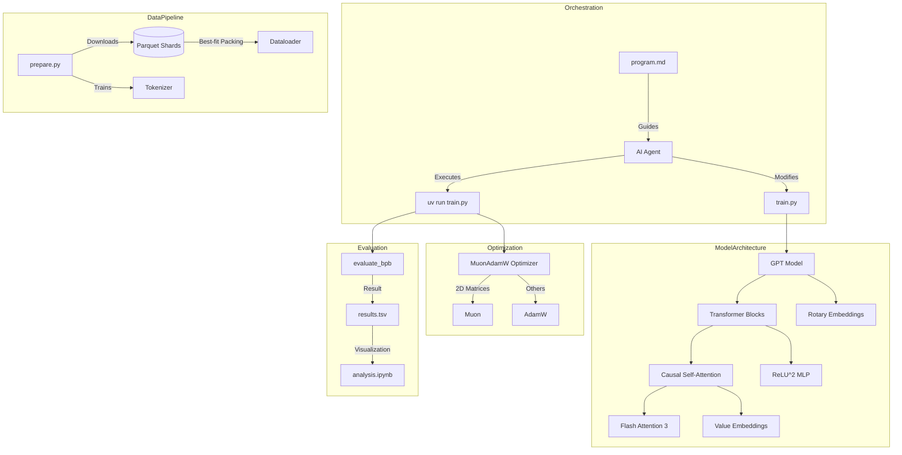

I will start by reading the instructions in `.prompt.md` and the content of `autoresearch.xml` to understand the task.
# Project Analysis: autoresearch

## 1. Project Name and Description
**Project Name:** autoresearch

**Description:**
`autoresearch` is an experimental framework designed to enable autonomous AI agents to conduct their own deep learning research. The core concept is to provide an agent with a functional, yet simplified, LLM training environment and allow it to iterate independently. The agent modifies the model architecture, hyperparameters, and optimization strategies in a tight loop, aiming to improve a specific performance metric over a series of experiments.

The project centers on a fixed-time training regime—typically 5 minutes per run—regardless of the underlying hardware. This approach transforms the research problem into an optimization task: finding the most effective model configuration that can be trained within a strict temporal budget. By decoupling the evaluation from traditional "epochs" or "steps" and focusing on a hardware-specific time window, it forces the discovery of architectures that are inherently efficient for the available compute.

Originally conceived by Andrej Karpathy, `autoresearch` is a simplified single-GPU derivative of the `nanochat` repository. It serves as a "story of how it all began" for autonomous research swarms, where the human role shifts from direct coding to "programming" the instructions (in `program.md`) that guide the AI agents. The repository is intentionally kept minimal to ensure that agents can easily grasp the entire codebase and make surgical, meaningful improvements.

## 2. Supported Platforms/Deployments + Requirements
*   **Operating System:** Primarily Linux (tested on Ubuntu/Debian styles), with community forks for macOS and Windows.
*   **Hardware:** Single NVIDIA GPU (H100 is the primary test target).
*   **Python Version:** Python 3.10+ (specified in `.python-version` and `pyproject.toml`).
*   **Package Manager:** `uv` (required for dependency management and execution).
*   **Key Dependencies:**
    *   `torch` (2.9.1+cu128)
    *   `rustbpe` (for fast tokenization)
    *   `tiktoken`
    *   `kernels` (for Flash Attention 3)
*   **Storage Requirements:** Disk space in `~/.cache/autoresearch/` for data shards (Parquet format) and tokenizer files.

## 3. Supported Connectors
The project is self-contained but interacts with external data sources and execution environments:
*   **Hugging Face Datasets:** Downloads training data shards (e.g., `climbmix-400b-shuffle`) via HTTPS.
    *   *Reference:* `prepare.py` (lines 28-31)
*   **NVIDIA CUDA:** Direct interface for GPU-accelerated training and Flash Attention kernels.
    *   *Reference:* `train.py` (lines 7-10)
*   **Local File System (TSV):** Logs results to `results.tsv` for analysis.
    *   *Reference:* `program.md` (Experimentation section)
*   **Git:** Uses branches and commits to manage the evolution of experimental code.
    *   *Reference:* `program.md` (The experiment loop)
*   **Rust (via rustbpe):** High-performance BPE tokenizer training and execution.
    *   *Reference:* `prepare.py` (lines 102-110)

## 4. Supported Models/Agents
*   **Training Model (GPT):** A custom, highly configurable GPT-style transformer implementation.
    *   *Reference:* `train.py` (lines 14-250)
*   **Research Agent (External):** The "researcher" is intended to be a high-capability LLM (like Claude 3.5 Sonnet or GPT-4o) acting through a CLI tool.
    *   *Reference:* `program.md` (Instructions for the agent)
*   **Local Tokenizer:** Custom BPE tokenizer trained on the specific dataset.
    *   *Reference:* `prepare.py` (Tokenizer class)

## 5. Top 5 Use Cases
1.  **Autonomous Hyperparameter Optimization:** Automatically searching for optimal learning rates, weight decays, and batch sizes within a fixed compute budget.
2.  **Architectural Search:** Agents experimenting with different layer counts, embedding dimensions, and attention patterns (e.g., sliding window vs. full).
3.  **Optimizer Research:** Validating novel optimizers like Muon against standard AdamW in a constrained, reproducible environment.
4.  **Hardware-Specific Tuning:** Finding the most efficient model configuration for a specific GPU (e.g., optimizing for H100 vs. RTX 4090).
5.  **Autonomous Simplification:** Tasks where the agent is encouraged to remove redundant code or complexity while maintaining performance.

## 6. Top 20 Features
1.  **Fixed Time Budget Training:** Always trains for 5 minutes to ensure comparability. (`prepare.py`)
2.  **Bits Per Byte (BPB) Metric:** Vocab-size independent evaluation. (`prepare.py`)
3.  **Muon Optimizer:** High-performance 2D matrix optimizer. (`train.py`)
4.  **Best-Fit Packing Dataloader:** 100% token utilization by packing documents. (`prepare.py`)
5.  **Flash Attention 3 Integration:** Uses cutting-edge kernels for speed. (`train.py`)
6.  **Value Residuals (ResFormer):** Gate-controlled value embedding residuals. (`train.py`)
7.  **Logit Softcapping:** Prevents logit explosion during training. (`train.py`)
8.  **Automatic Learning Rate Scaling:** Scales based on model dimension. (`train.py`)
9.  **Sliding Window Attention Patterns:** Configurable "SSSL" style patterns. (`train.py`)
10. **Rotary Positional Embeddings (RoPE):** Standard modern positional encoding. (`train.py`)
11. **BOS-Aligned Training:** Every row in training starts with a BOS token. (`prepare.py`)
12. **Muon-AdamW Hybrid:** Uses Muon for 2D weights and AdamW for others. (`train.py`)
13. **Nesterov Momentum:** Implemented within the custom optimizer. (`train.py`)
14. **Polar Express Orthogonalization:** Orthogonal weight updates in Muon. (`train.py`)
15. **NorMuon Variance Reduction:** Stabilizes the Muon optimizer. (`train.py`)
16. **Autonomous Branch Management:** Agents manage their own git branches. (`program.md`)
17. **Automated Result Logging:** Structured logging to `results.tsv`. (`program.md`)
18. **Fast-Fail Checks:** Aborts runs if loss is NaN or exploding. (`train.py`)
19. **Automated Data Shard Downloading:** Multithreaded Parquet downloader. (`prepare.py`)
20. **Visual Progress Tracking:** Jupyter notebook for graphing experiment history. (`analysis.ipynb`)

## 7. Top 20 Smart Patterns
1.  **Time as the Budget:** Treating wall-clock time as the primary constraint rather than steps.
2.  **Standardized Baseline:** First run is always the baseline to measure delta.
3.  **Simplicity Criterion:** Penalizing "ugly" complexity in favor of clean code.
4.  **Infinite Loop Research:** Agents programmed to never stop until interrupted.
5.  **Context Injection via Markdown:** Using `program.md` as the "DNA" for the research org.
6.  **Pinned Validation Shard:** Using a specific data shard (`6542`) for consistent eval.
7.  **Wait-for-Warmup Stop:** Stopping training only after initial compilation overhead.
8.  **Muon Weight Shape Logic:** Special handling for 2D vs. non-2D parameters.
9.  **ReLU^2 Activation:** Used in the MLP for potentially better scaling.
10. **Layer-wise Scalars:** Using `resid_lambdas` and `x0_lambdas` for residual scaling.
11. **Zero-Init Gates:** Gate weights initialized to zero to start as neutral (1.0).
12. **BPE Pattern GPT-4 Style:** Optimized regex for token splitting.
13. **CPU-Pinned Memory Buffers:** Speeding up data transfer to GPU.
14. **Torch Compile with Dynamic=False:** Optimization for fixed sequence lengths.
15. **Automatic GC Management:** Manually triggering GC to avoid training stalls.
16. **EMA Smoothing for Loss:** Better visualization of training stability.
17. **Orthogonalization Newton Iterations:** Efficiently maintaining weight orthogonality.
18. **Cautious Weight Decay:** Only applying decay when gradient and weight align.
19. **BOS Prepending in Dataloader:** Ensuring consistent start-of-sequence context.
20. **Self-Modifying Train Script:** The agent treats the code itself as a set of hyperparameters.

## 8. Top 20 Development Trends (Latest Commits)
1.  **Platform Expansion:** Adding support for macOS (MLX) and Windows.
2.  **Safety/Stability:** Making NaN fast-fail checks more explicit.
3.  **Instruction Refinement:** Clarifying baseline run instructions in `program.md`.
4.  **Documentation:** Adding "Dummy's Guides" and deeper README context.
5.  **Resource Handling:** Guarding against infinite loops when shards are missing.
6.  **Optimizer Innovation:** Transitioning to and refining the Muon optimizer.
7.  **Data Efficiency:** Linking to smaller datasets like TinyStories for low-compute users.
8.  **Tooling Integration:** Standardizing on `uv` for project management.
9.  **Analysis Improvements:** Fixing bugs in the visualization notebook.
10. **Community Engagement:** Highlighting notable forks and community contributions.
11. **Kernel Optimization:** Support for both `varunneal` and `kernels-community` FA3 kernels.
12. **Memory Management:** Refining VRAM usage tracking.
13. **Result Integrity:** Explicitly excluding `results.tsv` from git to avoid conflicts.
14. **Logging Clarity:** Standardizing the output format for agent parsing.
15. **Experiment Reproducibility:** Pinning validation shards.
16. **Code Simplification:** Constant effort to keep `train.py` as a single, readable file.
17. **Workflow Standardization:** Establishing the "Loop Forever" pattern.
18. **Architecture Divergence:** Moving away from standard GPT-2 towards optimized modern GPT.
19. **Scaling Law Exploration:** Focusing on BPB as a cross-architecture comparison tool.
20. **Agentic Autonomy:** Enhancing the "Setup first, then kick off" workflow.

## 9. Top 10 Advantages / Strong Points
1.  **Total Autonomy:** Can run 100+ experiments overnight without human intervention.
2.  **Fixed-Time Evaluation:** Eliminates the "how many steps to train" hyperparameter.
3.  **High-Quality Baseline:** Built on top of Karpathy's optimized `nanochat`.
4.  **Low Friction:** Single-file modification makes it easy for AI agents to reason.
5.  **State-of-the-Art Components:** Includes Flash Attention 3 and Muon optimizer.
6.  **Deterministic Metric:** BPB provides a fair comparison across different vocabularies.
7.  **Hardware Optimization:** Naturally finds the best config for the specific GPU in use.
8.  **Efficient Dataloading:** Zero-padding dataloader maximizes compute efficiency.
9.  **Git-Based Versioning:** Easy to revert failed experiments and track progress.
10. **Community Momentum:** Rapidly growing ecosystem of forks for different hardware.

## 10. Top 10 Limitations / Weak Points
1.  **Hardware Locked:** Heavily optimized for NVIDIA/CUDA, making it hard to port perfectly.
2.  **Fixed Budget Blindness:** Some architectures might only show benefit after 5+ minutes.
3.  **Single-GPU Only:** Custom optimizers (Muon) and loops are not multi-GPU ready.
4.  **VRAM Sensitivity:** Agents can easily OOM the GPU with aggressive scaling.
5.  **Data Pre-processing Overhead:** Tokenizer training can be slow on large datasets.
6.  **Non-standard Libraries:** Reliance on custom kernels (`kernels-community`) can be brittle.
7.  **Stochasticity:** 5-minute runs can be noisy depending on system background tasks.
8.  **Local Maxima:** Agents might get stuck iterating on minor hyperparameter tweaks.
9.  **Dependency on specific LLM quality:** Requires very high-end LLMs to make smart code changes.
10. **Limited Scope:** Only iterates on `train.py`, missing potential gains in data prep.

## 11. Top 5 AI Skills
1.  **Autonomous Researcher Skill:** Defined in `program.md`, providing the core loop and logic.
2.  **Code Optimization Skill:** The ability of the agent to refactor `train.py` for MFU gains.
3.  **Hyperparameter Tuning Skill:** Targeted adjustments of LRs and batch sizes.
4.  **Failure Diagnosis Skill:** Parsing `run.log` and stack traces to fix "crashes".
5.  **Result Synthesis Skill:** Using `analysis.ipynb` to understand long-term trends.

## 12. Data Overview
*   **Inputs:** Parquet shards containing text data.
    *   *Reference:* `prepare.py` (`download_data`, `_document_batches`)
*   **Outputs:**
    *   `results.tsv`: Experiment logs (commit, BPB, VRAM, status, description).
    *   `run.log`: Verbose training logs for debugging.
    *   `progress.png`: Generated visualization of the training frontier.
*   **Storage:**
    *   `~/.cache/autoresearch/data/`: Shard storage.
    *   `~/.cache/autoresearch/tokenizer/`: Tokenizer pkl and byte lookup.
    *   *Reference:* `prepare.py` (lines 35-37)

## 13. Detailed Architecture Review

| Component | Description | File Reference |
| :--- | :--- | :--- |
| **GPT Model** | Main transformer class managing layers and embeddings. | `train.py` (GPT) |
| **CausalSelfAttention** | Multi-head attention with Value Residuals and FA3. | `train.py` |
| **MuonAdamW** | Hybrid optimizer applying Muon to 2D weights. | `train.py` |
| **Best-Fit Dataloader** | Packs docs into sequence length without padding. | `prepare.py` |
| **Tokenizer (BPE)** | Custom rust-based BPE implementation. | `prepare.py` |
| **BPB Evaluator** | Bits-per-byte evaluation logic. | `prepare.py` |
| **MLP Block** | Feed-forward network with ReLU^2. | `train.py` |
| **Transformer Block** | Standard residual block combining Attention and MLP. | `train.py` |
| **RoPE** | Rotary Positional Embedding precomputation and application. | `train.py` |
| **Flash Attention 3** | Interface for high-speed attention kernels. | `train.py` |
| **Rotary Embedding** | Implementation of rotary positional encoding. | `train.py` |
| **Softcapping** | Logit tanh-based softcapping. | `train.py` |
| **Residual Lambdas** | Per-layer learnable scalars for residual paths. | `train.py` |
| **Experiment Loop** | Shell/Git based orchestration logic. | `program.md` |
| **Shard Downloader** | Multithreaded requests-based downloader. | `prepare.py` |

## 14. Architecture Mermaid Graph

## 15. Maturity, Stability, Security, Performance
*   **Maturity:** Early-stage experimental (Generation 1). Highly innovative but intentionally non-standard.
*   **Stability:** High for the baseline; however, agent-modified code is inherently volatile (frequent crashes/OOMs are expected).
*   **Security:** Potential risk as agents can execute arbitrary code. Recommended to run in isolated environments (containers/VMs) with restricted permissions.
*   **Performance:** Exceptional for single-GPU setups. Leverages H100 peak FLOPS effectively via FA3 and Muon.

## 16. Reviews
*   **Tests:** No traditional unit tests; "testing" is done via the empirical performance on the 5-minute training run.
*   **CI Pipelines:** Not present in the repository, as the development is intended to be autonomous and local.
*   **Documentation:** `README.md` and `program.md` provide high-quality, dense instructions.
*   **AI Skills:** Uses `program.md` as an "instruction skill" for agents.

## 17. Top 20 Possible Improvements or Fixes
1.  **Multi-GPU Support:** Adapting Muon for distributed environments. (`train.py`)
2.  **VRAM Guardian:** Pre-calculating memory usage before starting a run to prevent OOM. (`train.py`)
3.  **Dockerization:** Providing a standardized container for agent isolation.
4.  **Auto-Rewind Logic:** More sophisticated logic for when an agent should give up on a branch. (`program.md`)
5.  **Architecture Visualization:** Automated generation of model diagrams per experiment.
6.  **Dynamic Sequence Length:** Experimenting with sequence length as a hyperparameter. (`prepare.py`)
7.  **Data Curriculums:** Allowing agents to choose data shards or difficulty. (`prepare.py`)
8.  **Alternative Optimizers:** Adding SOAP or other modern optimizers to the toolkit. (`train.py`)
9.  **Automated Unit Testing:** Ensuring architectural changes don't break basic tensor shapes.
10. **Better Checkpointing:** Saving the best model weights across experiments.
11. **Native Windows/macOS Kernels:** Reducing reliance on NVIDIA-only FA3. (`train.py`)
12. **Agent-Agent Debate:** Having two agents argue over a proposed code change before running.
13. **Skill Evolution:** Letting the agent modify `program.md` to improve its own workflow.
14. **Extended Budget Option:** Allowing 1-hour "finalist" runs for promising branches.
15. **Dataset diversity:** Support for more diverse datasets (e.g. FineWeb).
16. **Quantization Research:** Letting agents explore 8-bit or 4-bit training.
17. **Activation Checkpointing:** Optional toggle for saving VRAM. (`train.py`)
18. **Better Logging:** Structured JSON logs for easier parsing by agents.
19. **Automated Porting:** Skill to automatically adapt `train.py` for different GPUs.
20. **Self-Correction:** Agents automatically reading stack traces and applying fixes. (`program.md`)

## 18. Reuse for Agent Swarm (Specification & Planning)
1.  **`program.md` loop:** Can be adapted for a "debate loop" between planning agents.
2.  **`results.tsv` tracking:** Used for logging debate outcomes and selected plans.
3.  **Git branching:** Managing different "implementation proposals" in parallel.
4.  **`analysis.ipynb` logic:** Visualizing the "consensus" level across a swarm.
5.  **BPB-style metric:** Creating a "Plan Quality" metric for autonomous evaluation.
6.  **`train.py` modularity:** Using the `Block`/`GPT` structure as a template for swarm-defined components.
7.  **`prepare.py` evaluator:** Adapting the validation logic to test plan feasibility.
8.  **Fast-fail checks:** Automatically rejecting nonsensical implementation plans.
9.  **Autonomous advancement:** Moving the "Master Plan" branch forward based on swarm success.
10. **Simplicity Criterion:** Ensuring the swarm prioritizes maintainable specifications.

## 19. Reuse for Multi-User/Multi-Agent System (Shared Knowledge)
1.  **Shared `results.tsv`:** A centralized (perhaps DB-backed) log of all agent findings.
2.  **`~/.cache/` structure:** Shared data/tokenizer cache for multi-agent efficiency.
3.  **Commit-based knowledge:** Using git history as a permanent log of "what works".
4.  **`program.md` instructions:** Standardizing how different agents contribute to the graph.
5.  **Dataloader packing:** Efficiently sharing data buffers across multiple agent processes.
6.  **Muon's variance reduction:** Pattern for stabilizing updates from multiple sources.
7.  **Value Residuals:** Gated mechanism for integrating "new knowledge" embeddings.
8.  **RoPE logic:** Pattern for maintaining consistent positional context in a shared graph.
9.  **`prepare.py` shard management:** Logic for partitioning shared datasets.
10. **`train.py` config:** A shared "World Config" that evolves as agents discover truths.

## 20. Reuse for Own Hardware/Cloud/Edge Deployment
1.  **`uv` project management:** Perfect for lightweight, portable deployments (including Cloudflare).
2.  **Single-file `train.py`:** Ideal for "serverless" model execution or fine-tuning.
3.  **`prepare.py` downloaders:** Robust pattern for fetching assets on fresh hardware.
4.  **`kernels` integration:** Pattern for platform-specific acceleration fallback.
5.  **`rustbpe` bindings:** High-performance tokenization for edge devices.
6.  **Fixed-time training:** Managing "spot instance" or ephemeral compute costs.
7.  **VRAM monitoring:** Critical for running on shared or consumer hardware.
8.  **TSV logging:** Minimalist, no-DB-required tracking for edge nodes.
9.  **Softcapping/Norm logic:** Ensuring stability on varied hardware precisions.
10. **Best-fit packing:** Maximizing throughput on constrained network/compute.

## 21. Reuse for Team Agents (Cooperative Workflows)
1.  **`program.md` as "Team Handbook":** Setting rules for human/agent cooperation.
2.  **Git branch "Handoffs":** Agents preparing branches for human review.
3.  **`results.tsv` as "Meeting Minutes":** A transparent record of who tried what.
4.  **Baseline-delta pattern:** Quantifying an agent's contribution to the team.
5.  **Simplicity weighting:** Humans enforcing "clean code" constraints on agents.
6.  **Fast-fail logic:** Protecting shared team compute from "rogue" agent code.
7.  **Shared cache:** Reducing redundant "onboarding" time for new agents.
8.  **`train.py` hyperparameters:** A common language for tuning system performance.
9.  **Analysis notebook:** A shared dashboard for team performance review.
10. **The "Loop Forever" mindset:** Agents handling drudgery so humans can handle strategy.
