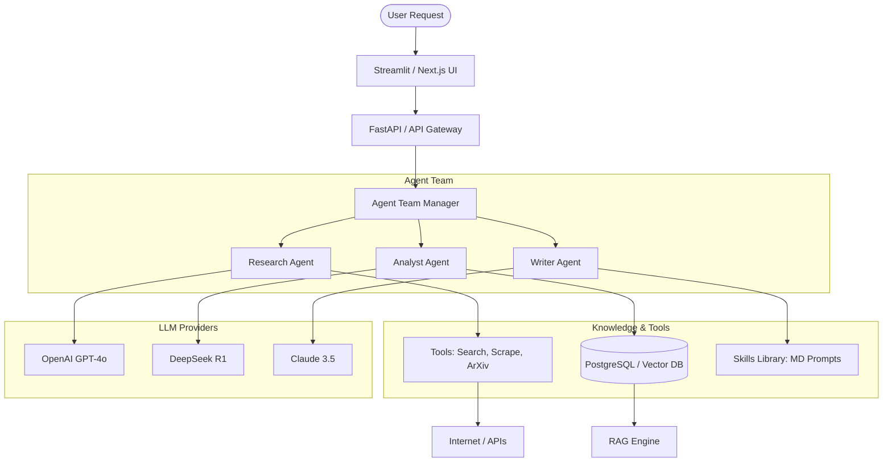

I will begin by reading the instructions in `.prompt.md` and the content of `.input.awesome-llm-apps.xml` to understand the specific task requirements and the input data.

This report provides a comprehensive analysis of the `awesome-llm-apps` repository, a collection of high-quality AI agent and LLM-based applications across various domains, including multi-agent systems, game playing, and RAG-based tools.

---

### 1. Project Overview
- **Project Name:** awesome-llm-apps
- **Last Commit Date:** February 24, 2025 (Ref: `git_log_commit` in input)

### 2. Project Description
The `awesome-llm-apps` repository is a curated collection of advanced AI agent applications and tutorials designed to showcase the capabilities of modern Large Language Models (LLMs). It serves as a comprehensive resource for developers to learn how to build, deploy, and optimize AI agents using various frameworks such as Agno, AutoGen, and the OpenAI SDK.

The project covers a wide array of use cases, ranging from single-agent utilities like resume matchers and investment advisors to complex multi-agent teams for travel planning, legal research, and competitive intelligence. It emphasizes practical implementation, providing ready-to-use code, detailed READMEs, and links to step-by-step tutorials for each application.

Architecturally, the repository is organized into distinct categories: advanced AI agents (game playing, multi-agent teams), advanced LLM apps (tutorials for RAG, memory, and fine-tuning), and starter templates. It integrates multiple LLM providers (OpenAI, Anthropic, Google, DeepSeek) and utilizes various tools for web scraping, browser automation, and data visualization, making it a versatile toolkit for agentic AI development.

### 3. Supported Platforms & Deployments
- **Local Development:**
    - **OS:** Windows, macOS, Linux (standard Python environments).
    - **Requirements:** Python 3.9+, Node.js (for frontend components), Docker (optional for some modules).
- **Web Interface:**
    - **Streamlit:** Used by the majority of apps for rapid UI prototyping.
    - **Next.js / React:** Used for more complex frontends (e.g., `ai_travel_planner_agent_team`).
- **Cloud/Containerization:**
    - **Docker:** Provided for backend services in complex agent teams.
    - **Cloudflare Workers:** Mentioned as a potential deployment target for lightweight agents.

### 4. Supported Connectors
| Connector | Description | Source Reference |
| :--- | :--- | :--- |
| **Google Search** | Web search and news discovery for research agents. | `.../tools/web_search.py`, `.../tools/google_news_discovery.py` |
| **ArXiv** | Fetching and analyzing research papers. | `.../adapters/arxiv.py`, `.../chat_arxiv.py` |
| **GitHub** | Repository analysis and issue tracking. | `.../adapters/github.py`, `.../github_agent.py` |
| **Gmail** | Email reading and drafting. | `.../chat_with_X_tutorials/chat_with_gmail/` |
| **Slack** | Integration for news and podcast delivery. | `.../beifong/integrations/slack/chat.py` |
| **Browser (Playwright)** | Browser automation for web scraping and UI interaction. | `.../tools/browser_crawler.py`, `.../backend/broswer.py` |
| **SQL Databases** | Persistent storage for agent state and data. | `.../services/db_service.py`, `.../models/trip_db.py` |
| **Messenger (Telegram/WA)** | Mentioned in requirements for multi-channel communication. | `.../beifong/main.py` (via integrations) |

### 5. Supported Models & Agents
- **Remote APIs (Token-based):**
    - **OpenAI:** GPT-4o, o3-mini, GPT-4 (Used across almost all modules).
    - **Anthropic:** Claude 3.5 Sonnet, Claude 3 Opus.
    - **Google:** Gemini 1.5 Pro/Flash (`rag_tutorials/gemini_agentic_rag/`).
    - **DeepSeek:** DeepSeek-V3, DeepSeek-R1 (`ai_3dpygame_r1/ai_3dpygame_r1.py`).
    - **Groq:** Llama 3 models for low-latency inference.
- **Local Models:**
    - **Ollama:** Running Llama 3, DeepSeek, or Qwen locally (`rag_tutorials/deepseek_local_rag_agent/`).
- **Agent Frameworks:**
    - **Agno (formerly Phidata):** Primary framework for structured agents.
    - **AutoGen:** Used for conversational multi-agent systems (`ai_chess_agent.py`).
    - **MCP (Model Context Protocol):** For tool-using agents (`mcp_ai_agents/`).

### 6. Top 5 Use Cases
1. **Multi-Agent Research Teams:** Specialized agents (Searcher, Analyst, Writer) collaborate to produce deep-dive reports on specific domains.
2. **Autonomous Game Players:** Agents play complex games (Chess, Tic-Tac-Toe, 3D PyGame) against each other or humans, demonstrating reasoning and tool-use.
3. **AI Travel Planning:** A team of agents (Flight, Hotel, Budget, Itinerary) works together to create complete, validated travel plans.
4. **Legal & Financial Intelligence:** Agents automate due diligence, contract review, and investment analysis by querying live market data and legal documents.
5. **Podcast & Content Generation:** Agents scrape news, write scripts, and use TTS to generate audio podcasts automatically.

### 7. Top 20 Features
1. **Reasoning-to-Code Generation:** DeepSeek-R1 generates logic, and GPT-4o extracts executable code (`ai_3dpygame_r1/ai_3dpygame_r1.py`).
2. **Multi-Agent Coordination:** Referee agents manage turn-based gameplay between player agents (`ai_tic_tac_toe_agent/app.py`).
3. **Agentic RAG:** Dynamic retrieval with reasoning steps instead of simple vector lookup (`rag_tutorials/agentic_rag_gpt5/`).
4. **Tool-Using Agents:** Direct integration with external APIs via functions (`ai_travel_planner_agent_team/backend/tools/`).
5. **Browser Automation:** Agents using Playwright/Puppeteer to interact with websites as humans do (`windows_use/agent/service.py`).
6. **Structured Output:** Enforcing JSON or specific schema responses for downstream processing (`ai_travel_planner_agent_team/backend/agents/structured_output.py`).
7. **Persistent Memory:** Agents that remember user preferences across sessions (`llm_app_personalized_memory/llm_app_memory.py`).
8. **Real-time Voice Interaction:** Low-latency voice-to-voice communication using OpenAI Realtime API (`voice_ai_agents/rag_voice.py`).
9. **Automated Code Review:** Agents providing feedback on code quality and security (`awesome_agent_skills/code-reviewer/`).
10. **Financial Market Analysis:** Real-time tracking of stocks and crypto (`ai_investment_agent/investment_agent.py`).
11. **Document Q&A:** Chatting with PDFs, ArXiv papers, and YouTube transcripts.
12. **Self-Evolving Agents:** Agents that improve their own code or prompts based on feedback (`ai_self_evolving_agent.py`).
13. **Knowledge Graph Integration:** RAG using graph structures for complex relationship mapping (`knowledge_graph_rag_citations/`).
14. **Multi-Model Routing:** Selecting the best LLM for a specific sub-task (`llm_router_app/llm_router.py`).
15. **Context Optimization:** Managing token limits via "headroom" optimization (`headroom_demo.py`).
16. **AI Speech Training:** Multi-agent system analyzing facial expressions and voice for public speaking.
17. **Fraud Investigation:** Pattern recognition in transaction data.
18. **GTM Outreach Automation:** Generating personalized sales emails from LinkedIn/Web data.
19. **MCP Tool Server:** Creating standardized interfaces for agents to use local/remote tools.
20. **Interactive Dashboards:** Streamlit-based UIs for real-time agent monitoring.

### 8. Top 20 Smart Patterns
1. **Reasoning-Extraction Split:** Using a "reasoner" model (R1) for logic and a "formatter" model (GPT-4) for clean output.
2. **Referee/Orchestrator Pattern:** A master agent manages the state machine of multiple worker agents.
3. **Agent-as-a-Tool:** Wrapping a complex agent as a simple tool for another agent to call.
4. **Self-Correction Loop:** Agents checking their own output against a set of constraints.
5. **Contextual Memory Injection:** Dynamically loading only relevant user memory into the prompt.
6. **Dual-Model Safety:** One agent generates, a second "Trust Layer" agent validates security/safety.
7. **Recursive Research:** Agents searching for info, finding new keywords, and re-searching.
8. **Tool-Router Pattern:** A central hub that decides which MCP tool to call based on user intent.
9. **Streaming Event Callbacks:** UI updates in real-time as the agent "thinks" or calls tools.
10. **Hierarchical Teams:** Manager agent -> Lead Agent -> Individual Contributors.
11. **Browser-in-the-Loop:** Using agents to navigate complex SPAs that don't have APIs.
12. **Synthetic Data for Fine-tuning:** Using agents to generate high-quality training pairs.
13. **Multi-Stage RAG:** Retrieval -> Reranking -> Reasoning -> Generation.
14. **Skill-Based Modularization:** Defining "skills" as portable markdown/code blocks.
15. **Handoff/Delegation:** Agents explicitly passing control to a more specialized peer.
16. **Personality-Driven Negotiation:** Assigning specific personas (Buyer/Seller) to simulate outcomes.
17. **Graph-Augmented Generation:** Using relationships to bridge gaps in vector search.
18. **Adaptive Chunking:** RAG system that adjusts context window based on query complexity.
19. **Prompt Versioning/Optimization:** Agents iteratively improving their own system prompts.
20. **Background Task Processing:** Offloading long-running agent research to Celery/Redis.

### 9. Development Trends
- **Shift to Agent Teams:** Moving from single-agent chat to collaborative multi-agent workflows.
- **Deep Reasoning Integration:** Extensive use of DeepSeek-R1 and OpenAI o-series models for complex logic.
- **Standardization via MCP:** Adoption of the Model Context Protocol for tool interoperability.
- **Local-First AI:** Growing support for Ollama and local RAG for privacy and cost-savings.
- **Multimodal Focus:** Agents that process video, audio, and images natively (e.g., Vision RAG).
- **Agentic UX:** Using Streamlit/Next.js to show "inner thoughts" and tool execution logs.
- **Memory Persistence:** Shift towards Long-term Memory (LTM) as a core feature.
- **Production Readiness:** Use of Docker, Pydantic for validation, and comprehensive logging.

### 10. Advantages / Strong Points
1. **Extensive Variety:** Covers almost every popular LLM use case.
2. **Framework Agnostic:** Demonstrates Agno, AutoGen, LangChain, and vanilla SDKs.
3. **Educational Quality:** High-quality READMEs and external tutorials for every app.
4. **Modern Tech Stack:** Uses the latest models (o3, R1) and protocols (MCP).
5. **Pragmatic Implementation:** Focuses on "what works" rather than purely academic concepts.
6. **UI-Ready:** Most apps come with a functional Streamlit or React frontend.
7. **Scalable Architecture:** Multi-agent designs allow for easy expansion.
8. **Active Maintenance:** Regular commits adding new models and frameworks.
9. **Comprehensive Tooling:** Built-in tools for scraping, search, and data processing.
10. **Open Collaboration:** Clean code structure inviting community contributions.

### 11. Limitations / Weak Points
1. **Dependency Heavy:** Many apps have massive `requirements.txt` files that may conflict.
2. **Cost Management:** Heavy use of expensive models (GPT-4o) without built-in budget capping.
3. **Environment Complexity:** Setting up API keys for 10+ providers to run the full suite is tedious.
4. **Limited Testing:** Lack of comprehensive unit/integration tests for many individual apps.
5. **Code Duplication:** Some utility functions are repeated across different app folders.
6. **Mobile Optimization:** Frontends are primarily desktop-focused (Streamlit/Next.js).
7. **Security Defaults:** `.env.example` files are clear, but complex apps lack robust secret management.
8. **Performance Latency:** Multi-agent loops can be slow for real-time interactive use.
9. **Documentation Fragmentation:** READMEs are excellent, but there is no central "Project Wiki."
10. **Error Handling:** Some "starter" agents have basic try-except blocks that may fail silently.

### 12. AI Skills Overview
- **Used Skills:**
    - `academic-researcher`: Deep-dive data gathering.
    - `code-reviewer`: Quality and security analysis.
    - `content-creator`: Script and blog writing.
    - `data-analyst`: SQL and CSV processing.
    - `debugger`: Log and code error fixing.
- **Provided Skills:**
    - `awesome_agent_skills/`: A dedicated directory of reusable skill definitions (Markdown-based).

### 13. Data Inputs, Outputs & Storage
- **Inputs:** Natural language queries, PDFs, URLs, CSVs, Images, Live API streams.
- **Outputs:** Structured JSON, Markdown reports, Audio (TTS), Visualizations (PyGame, SVG), Executed code.
- **Storage:**
    - **PostgreSQL/SQLite:** Trip and task data (`.../backend/models/trip_db.py`).
    - **FAISS/Vector DBs:** RAG embeddings and document indices.
    - **Redis/Celery:** Task queues for async agents (`.../beifong/celery_app.py`).

### 14. Detailed Architecture Review
| Module/Component | Role | Source Reference |
| :--- | :--- | :--- |
| **Orchestrator Agent** | Manages workflow state and task delegation. | `.../backend/agents/team.py` |
| **Tool Execution Engine** | Standardized interface for calling APIs/Functions. | `.../backend/tools/` |
| **RAG Pipeline** | Vector search and context retrieval system. | `.../rag/vector.py` |
| **Browser Service** | Headless browser management for scraping. | `.../backend/broswer.py` |
| **API Gateway** | FastAPI/Express layer for frontend communication. | `.../backend/api/app.py` |
| **Memory Manager** | Handles session state and long-term storage. | `.../tools/session_state_manager.py` |
| **Structured Output Formatter**| Pydantic-based schema enforcement. | `.../agents/structured_output.py` |
| **Skill Registry** | Modular markdown-based prompts for agents. | `awesome_agent_skills/` |

### 15. Architecture Graph (Mermaid)

### 16. Project Maturity & Security Review
- **Maturity:** Highly active, transitioning from a "collection of scripts" to a "structured framework" (Agno adoption).
- **Stability:** High for single-agent apps; Multi-agent teams are experimental and depend on upstream API stability.
- **Security:** Good use of `.env` for secrets, but lacks robust input sanitization for code execution modules.
- **Performance:** Varies; RAG and Voice apps are optimized, but multi-agent research tasks have high latency.

### 17. Review of Tests & CI
- **Tests:** Sparse; some apps have `tests/` folders (e.g., `beifong`), but no project-wide testing suite.
- **CI Pipelines:** GitHub Action `.github/workflows/claude.yml` exists for PR assistance using Claude Code.
- **Documentation:** Exceptional; READMEs provide setup, "how it works," and tutorial links.

### 18. Top 20 Improvements/Fixes
1. **Centralized Utility Library:** Move repeated scraping/tool logic to a shared core.
2. **Budget Guardrails:** Add token/cost tracking to all multi-agent loops.
3. **Unified Secret Management:** Use a more robust tool than just `.env` files for complex teams.
4. **Improved Error Handling:** Add retry logic with exponential backoff for tool calls.
5. **Dockerize Everything:** Provide `docker-compose` for every multi-service app.
6. **Telemetry/Observability:** Integrate LangSmith or Phoenix for agent tracing.
7. **Mobile-Responsive UI:** Optimize Streamlit layouts for smaller screens.
8. **Batch Processing:** Allow agents to handle multiple research queries in parallel.
9. **Knowledge Graph Visualizer:** Add UI to view agent-generated graphs.
10. **Auto-Requirements Generator:** Consolidate `requirements.txt` to prevent version conflicts.
11. **Human-in-the-Loop (HITL):** Add explicit breakpoints for human approval in high-stakes apps.
12. **Agent Handover Protocol:** Standardize the "handoff" JSON schema between different frameworks.
13. **Local Embedding Support:** Default to local models for embedding to save costs.
14. **Streaming Response for All:** Ensure all apps support real-time text streaming.
15. **Context Window Management:** Implement automated summarization when tokens are low.
16. **Tool Sandbox:** Use WASM or Docker for safer code execution.
17. **Multi-User Support:** Add authentication and user-specific database scoping.
18. **Prompt Optimization:** Use DSPy to automatically tune agent prompts.
19. **Audio/Video Reranking:** Improve the selection logic for multimodal RAG.
20. **Self-Documentation:** An agent that updates the repository's main README based on new commits.

---

### Reusability Analysis

**19. Agent Swarm for Solution Specification:**
- `llm_router.py`: Selecting the best model for spec vs. code.
- `structured_output.py`: Defining the solution schema.
- `ai_system_architect_r1.py`: The core reasoning logic for specifications.
- `code-reviewer/AGENTS.md`: Pattern for debating implementation plans.
- `multi_agent_trust_layer.py`: Validating the proposed solution.

**20. Multi-User Shared Knowledge Base:**
- `session_state_manager.py`: Handling multi-user state.
- `db_service.py`: Managing shared PG/Vector DB state.
- `knowledge_graph_rag_citations/`: Shared graph logic.
- `llm_app_memory/`: Persistent knowledge evolution.
- `awesome_agent_skills/`: Shared skill/prompt library.

**21. Cloud/Messenger/Hardware Hybrid System:**
- `celery_worker.py`: Async processing for cloud/hardware split.
- `mcp_ai_agents/`: Standard protocol for remote tool communication.
- `rag_voice.py`: Voice control and audio processing.
- `beifong/integrations/slack/`: Template for messenger integration.
- `browser_mcp_agent/`: Navigating web apps as a control layer.

**22. Team Agents & Cooperative Workflows:**
- `agent_teams/ag2_adaptive_research_team/router.py`: Dynamic task routing.
- `ai_services_agency/agency.py`: Managing a collective of specialized agents.
- `ai-response.step.ts`: Sequential workflow steps for human/agent sync.
- `self-improving-agent-skills/`: Feedback loop for workflow optimization.
- `team.py` (Travel Planner): Managing cross-agent dependencies and shared context.
