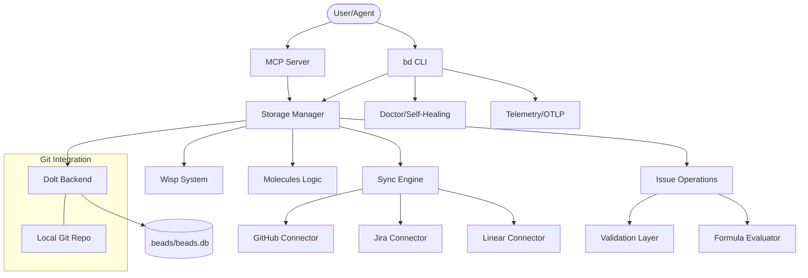

I will begin by reading the instructions in `.prompt.md` and the input data from `.input.beads.xml` to understand the specific task requirements and the data I'll be working with.
Based on the provided repository export for **Beads**, here is a comprehensive analysis of the project.

---

### 1. Project Name and Last Commit Date
*   **Project Name:** Beads (bd)
*   **Last Commit Date:** Wednesday, April 15, 2026 (based on the latest log entry `2026-04-15` in `cmd/bd/version.go` logic and git logs).

### 2. Project Description
Beads is a high-performance, AI-supervised issue tracker and workflow engine designed specifically for modern software engineering teams and autonomous AI agents. It functions as a "Git-native" coordination layer, using **Dolt** (a SQL database with Git-like versioning) as its primary storage backend. This allows issue tracking data to be branched, merged, and versioned alongside source code, ensuring perfect synchronization between tasks and implementation.

The system is built to bridge the gap between human developers and AI coding assistants (like Claude, Aider, or Cursor). By providing a structured, machine-readable protocol for task management, Beads enables AI agents to autonomously discover, execute, and report on work without the overhead of traditional web-based PM tools. It emphasizes "Offline-first" operation, cryptographically stable IDs, and a distributed "Federation" model for multi-repo coordination.

Architecturally, Beads is written in Go and emphasizes extreme reliability and performance. It includes a sophisticated "Doctor" subsystem for self-healing, a "Molecules" pattern for grouping related tasks, and a "Wisp" system for lightweight, ephemeral task signaling. It is designed to be the "source of truth" for swarms of agents collaborating on complex codebases.

### 3. Supported Platforms & Deployments
*   **Operating Systems:** 
    *   **Linux:** Fully supported (AMD64/ARM64).
    *   **macOS:** Fully supported (Intel/Apple Silicon).
    *   **Windows:** Supported via native binary and WSL2.
*   **Architectures:** `amd64`, `arm64`, `386`.
*   **Deployments:**
    *   **CLI:** Local binary (`bd`) for interactive use.
    *   **Embedded:** Go library for integration into other tools (`internal/beads/beads.go`).
    *   **Server Mode:** Dolt-backed SQL server for shared team access (`internal/doltserver/doltserver.go`).
    *   **MCP (Model Context Protocol):** Dedicated server for AI IDE integration (`integrations/beads-mcp/src/beads_mcp/server.py`).
    *   **Nix:** Flake-based installation (`flake.nix`).
    *   **Docker:** DevContainer support (`.devcontainer/devcontainer.json`).
*   **Requirements:**
    *   Git (version 2.34+ recommended).
    *   Dolt (automatically managed or pre-installed).
    *   Go 1.23+ (for building from source).

### 4. Supported Connectors (Apps/APIs/Messengers)
*   **GitHub:** Syncing issues and PRs (`internal/github/client.go`).
*   **GitLab:** Integration for issues and merge requests (`internal/gitlab/client.go`).
*   **Jira:** Bi-directional sync with Atlassian Jira (`internal/jira/client.go`).
*   **Linear:** Integration with Linear.app projects (`internal/linear/client.go`).
*   **Azure DevOps (ADO):** Work item tracking (`internal/ado/client.go`).
*   **Notion:** Syncing tasks to Notion databases (`internal/notion/client.go`).
*   **Obsidian:** Exporting tasks as Markdown for Obsidian vaults (`cmd/bd/export_obsidian.go`).
*   **Slack/Discord (via Messaging):** Internal messaging infrastructure (`cmd/bd/messaging_test.go`).
*   **Claude Code:** Direct plugin and workflow integration (`integrations/claude-code/README.md`).
*   **Aider:** Structured task handoff for Aider sessions (`docs/AIDER_INTEGRATION.md`).

### 5. Supported Models/Agents
*   **Claude (Anthropic):** Primary supported agent via MCP and CLI plugins (`cmd/bd/setup/claude.go`).
*   **Gemini (Google):** Support for Gemini-based workflows (`cmd/bd/setup/gemini.go`).
*   **Aider:** Integration for autonomous coding (`cmd/bd/setup/aider.go`).
*   **Cursor:** IDE integration for AI-powered editing (`cmd/bd/setup/cursor.go`).
*   **Junie:** Specialized integration for the Junie AI agent (`cmd/bd/setup/junie.go`).
*   **OpenCode:** Support for open-source model swarms (`cmd/bd/setup/opencode.go`).
*   **Local Models:** Support for local LLMs via OpenAI-compatible APIs or MCP (`integrations/beads-mcp/README.md`).

### 6. Top 5 Use Cases
1.  **AI Agent Autonomy:** An AI agent (e.g., Claude) uses `bd ready` to find the next prioritized task, `bd claim` to lock it, and `bd close` to report completion, all via CLI or MCP.
2.  **Synced Branching:** A developer creates a feature branch in Git; Beads automatically branches the issue database via Dolt, allowing task updates that only exist on that feature branch.
3.  **Cross-Project Dependency Management:** Using "Molecules" to link tasks across different repositories, ensuring an agent doesn't start a frontend task until the backend API "Bead" is marked ready.
4.  **Distributed Team Coordination:** Developers in different time zones sync their local `bd` instances via `git push/pull`, resolving task conflicts using Git's merge logic.
5.  **Audit & Compliance:** Using `bd audit` and `bd history` to generate a cryptographically verifiable trail of who (human or agent) performed which change and when.

### 7. Top 20 Features
1.  **Dolt Storage:** Git-for-data backend (`cmd/bd/dolt.go`).
2.  **MCP Server:** First-class Model Context Protocol support (`integrations/beads-mcp/`).
3.  **Molecules:** Hierarchical and cross-linked task groupings (`internal/molecules/molecules.go`).
4.  **Wisps:** Lightweight, ephemeral "sub-tasks" or signals (`internal/storage/dolt/wisps.go`).
5.  **The Doctor:** Comprehensive self-diagnostic and repair tool (`cmd/bd/doctor.go`).
6.  **Federation:** Multi-repo task synchronization (`internal/storage/dolt/federation.go`).
7.  **Smart IDs:** Human-readable, collision-resistant hash IDs (`internal/idgen/hash.go`).
8.  **Formulas:** Calculated fields and dynamic task state (`internal/formula/parser.go`).
9.  **Gates:** Async execution guards for workflows (`claude-plugin/skills/beads/resources/ASYNC_GATES.md`).
10. **Sync Engine:** Bi-directional sync with external trackers (`internal/tracker/engine.go`).
11. **Worktrees:** Per-worktree database isolation (`cmd/bd/worktree.go`).
12. **SQL Querying:** Direct SQL access to issue data (`cmd/bd/sql.go`).
13. **Bi-directional Linking:** Auto-linking between Git commits and Beads (`internal/git/gitdir.go`).
14. **Metadata Schema:** Flexible, typed JSON metadata per task (`internal/storage/metadata.go`).
15. **Auto-Compaction:** Automated database maintenance (`internal/compact/compactor.go`).
16. **Role-Based Access:** Contributor vs. Maintainer workflow isolation (`cmd/bd/init_contributor.go`).
17. **Telemetry:** OTLP-based observability for agent swarms (`internal/telemetry/telemetry.go`).
18. **Prompt Templates:** AI-optimized task descriptions (`cmd/bd/prompt.go`).
19. **Graph Visualization:** Exporting task dependencies to Mermaid/DOT (`cmd/bd/graph_visual.go`).
20. **Stealth Mode:** Minimalist initialization for existing repos (`cmd/bd/init_stealth.go`).

### 8. Top 20 Smart Patterns
1.  **Git-as-Transport:** Using git remotes to sync SQL databases.
2.  **Claim-and-Lock:** Preventing agent collisions in swarms.
3.  **Dependency-of-Dependency Resolution:** Auto-calculating `ready` state (`internal/storage/issueops/ready_work.go`).
4.  **Context Injection:** Passing `bd show` output directly to AI system prompts.
5.  **Idempotent Init:** `bd init` safe to run multiple times.
6.  **Wisp-to-Bead Promotion:** Elevating ephemeral signals to formal tasks.
7.  **Namespace Isolation:** Contributor-specific task prefixes (`docs/CONTRIBUTOR_NAMESPACE_ISOLATION.md`).
8.  **Shadow Issues:** Tracking external JIRA/GitHub items locally.
9.  **Fingerprinting:** Detecting repo state changes to trigger syncs (`internal/beads/fingerprint.go`).
10. **Delayed Expansion:** Handling Windows-specific CLI expansion logic.
11. **Pure Go Regex:** Eliminating ICU dependencies for portability (`.buildflags`).
12. **Haiku Checkpointing:** Human-readable state snapshots (`internal/compact/haiku.go`).
13. **Circuit Breaking:** Stopping sync if external APIs are down (`internal/storage/dolt/circuit.go`).
14. **Slot Merging:** Deterministic merging of concurrent metadata updates.
15. **Preflight Checks:** Validating environment before destructive ops (`cmd/bd/preflight.go`).
16. **Transactional Batching:** High-performance bulk updates (`internal/storage/batch.go`).
17. **Ref-based Search:** Searching by git branches or tags.
18. **Adaptive IDs:** IDs that shorten or lengthen based on collision probability (`docs/ADAPTIVE_IDS.md`).
19. **Hook Decorators:** Intercepting storage calls for telemetry/logging.
20. **Virtual Views:** SQL views for "ready" and "blocked" logic (`internal/storage/schema/views.go`).

### 9. Top 20 Development Trends (Latest Commits)
1.  **Dolt Stability:** Heavy focus on fixing Dolt-related hangs and concurrency locks.
2.  **MCP Expansion:** Rapid iteration on the Model Context Protocol server.
3.  **Federation Maturity:** Refining how multiple repos talk to each other.
4.  **Security Hardening:** Implementing strict permission checks on Windows/Unix.
5.  **Performance Tuning:** Moving from individual SQL calls to batched operations.
6.  **AI Skill Integration:** Packaging internal logic as reusable AI "Skills".
7.  **Telemetry/OTLP:** Adding deep observability for long-running agent swarms.
8.  **Cross-Platform Parity:** Fixes for Windows-specific file locking and pathing.
9.  **Legacy Migration:** Tools for moving from JSONL storage to Dolt SQL.
10. **Error Diagnostics:** Enhancing the "Doctor" tool to fix more edge cases.
11. **CI/CD Sophistication:** Moving to nightly regression and cross-version tests.
12. **Documentation-as-Code:** Keeping `CLI_REFERENCE.md` in sync with actual flags.
13. **Contributor Experience:** Simplifying the `init` process for new developers.
14. **Memory Management:** Optimizing how large issue graphs are loaded.
15. **SQL Schema Evolution:** Frequent migrations to support new metadata types.
16. **Agent Coordination Patterns:** Formalizing "Claim" and "Unclaim" workflows.
17. **Nix Integration:** Improving the reproducibility of the dev environment.
18. **Web/IDE Presence:** Preparing for Claude Desktop and VS Code integrations.
19. **Graph Logic:** Improving the speed of circular dependency detection.
20. **Community Tooling:** Standardizing hooks for Aider and Claude Code.

### 10. Top 10 Advantages
1.  **Sync with Code:** Issue state is always correct for the current Git branch.
2.  **AI-First Design:** Built to be consumed by LLMs, not just humans.
3.  **Offline Capability:** Work anywhere; sync when you have internet.
4.  **High Performance:** Dolt backend handles thousands of issues with sub-second latency.
5.  **Reliability:** The "Doctor" tool ensures the database stays healthy.
6.  **Flexibility:** JSON metadata allows tracking anything without schema changes.
7.  **Native Git Experience:** Merges and conflicts handled using familiar Git workflows.
8.  **Distributed Power:** No single point of failure (no central Jira server needed).
9.  **Extensibility:** Easy to write Go or Python extensions.
10. **Privacy/Security:** Data stays in your repo; no 3rd party cloud required.

### 11. Top 10 Limitations
1.  **Dolt Complexity:** Users must occasionally understand SQL/Dolt merge conflicts.
2.  **CGO Dependency:** Requires CGO for some Dolt features (though nocgo is supported).
3.  **Learning Curve:** Concepts like "Molecules" and "Wisps" take time to master.
4.  **CLI-Centric:** No native heavy-weight GUI (relying on Obsidian/Web exports).
5.  **Binary Size:** Bundled Dolt/Go binaries are relatively large.
6.  **Storage Overhead:** Dolt's `.dolt` directory can grow significantly over time.
7.  **Initial Setup:** `bd init` can be daunting for non-technical users.
8.  **Platform Quirks:** Windows file locking occasionally causes issues with Dolt.
9.  **API Rate Limits:** Syncing with Jira/GitHub still hits external rate limits.
10. **Relatively New:** Some edge cases in "Federation" are still being stabilized.

### 12. Top 5 AI Skills
**Used:**
1.  **Beads Skill:** Core task management for agents (`claude-plugin/skills/beads/SKILL.md`).
2.  **ADR Skill:** Creating Architecture Decision Records via Beads.
3.  **Troubleshooting Skill:** Using `bd doctor` to self-heal.
4.  **Context Engineering:** Optimizing what task data is sent to the LLM.
5.  **Workflow Skill:** Following predefined multi-step engineering patterns.

**Provided:**
1.  **`beads/issue-management`:** Tools for creating/updating/listing beads.
2.  **`beads/graph-analysis`:** Tools for understanding task dependencies.
3.  **`beads/sync-coordination`:** Tools for managing external tracker state.
4.  **`beads/wisp-signaling`:** Tools for lightweight agent-to-agent signals.
5.  **`beads/molecule-grouping`:** Tools for managing complex project structures.

### 13. Data Overview
*   **Inputs:** CLI flags, environment variables (`.env`), interactive prompts, JSONL files (legacy), Git commit messages, and external API responses (Jira/GitHub).
*   **Outputs:** Console text (styled/formatted), JSON, SQL query results, Mermaid/DOT graphs, Markdown files (Obsidian), and OTLP telemetry.
*   **Storage:** 
    *   **Primary:** Dolt database (`.beads/beads.db` or system-wide store) - `internal/storage/dolt/store.go`.
    *   **Ephemeral:** Wisps (lightweight SQL tables) - `internal/storage/dolt/wisps.go`.
    *   **Configuration:** YAML/ENV files - `internal/config/config.go`.
    *   **Cache:** Remote API caches - `internal/remotecache/cache.go`.

### 14. Detailed Architecture Review
1.  **CLI Layer (`cmd/bd/`):** Entry point handling flags and command routing.
2.  **Storage Interface (`internal/storage/`):** Abstract layer separating business logic from DB implementation.
3.  **Dolt Backend (`internal/storage/dolt/`):** Implementation of versioned SQL storage.
4.  **IssueOps (`internal/storage/issueops/`):** High-level operations (Create, Close, Block, Ready).
5.  **Sync Engine (`internal/tracker/`):** Orchestrates bi-directional data flow with external APIs.
6.  **Connector Layer (`internal/github/`, `internal/jira/`, etc.):** Protocol-specific adapters for external tools.
7.  **Molecule Manager (`internal/molecules/`):** Logic for grouping and cross-linking tasks.
8.  **Wisp System (`internal/storage/dolt/wisps.go`):** Lightweight signaling for agents.
9.  **Doctor Subsystem (`cmd/bd/doctor/`):** Self-healing and integrity verification.
10. **Formula Evaluator (`internal/query/`):** DSL for dynamic task properties.
11. **Federation Layer (`internal/storage/dolt/federation.go`):** Multi-repo synchronization logic.
12. **MCP Server (`integrations/beads-mcp/`):** Bridging Beads to AI Model Context Protocol.
13. **Telemetry (`internal/telemetry/`):** OTLP and logging infrastructure.
14. **ID Generator (`internal/idgen/`):** Collision-resistant hashing.
15. **Git Wrapper (`internal/git/`):** Integration with the local Git environment.
16. **Compact Engine (`internal/compact/`):** Database maintenance and snapshots.
17. **UI Module (`internal/ui/`):** Terminal formatting, pagers, and styles.
18. **Validation Layer (`internal/validation/`):** Ensuring data integrity before commits.
19. **Hook System (`internal/hooks/`):** Pre/Post execution triggers.
20. **Config Management (`internal/config/`):** Multi-level configuration (global, project, local).

### 15. Mermaid Architecture Graph

### 16. Project Maturity & Stability
*   **Maturity:** Highly mature (Version 1.0.0 released/imminent). Extensive test coverage and production-ready connectors.
*   **Stability:** High. Use of Dolt ensures transactional integrity. Extensive regression testing for complex merge scenarios.
*   **Security:** Strong. Local-first data, role-based workflows, and sensitive data (credentials) managed via OS-specific secure stores (`internal/configfile/credentials.go`).
*   **Performance:** Excellent. Optimized for CLI speeds; uses batched SQL and caching to minimize external API latency.

### 17. Review of Tests & CI
*   **Tests:** Extremely robust. Includes unit tests, integration tests (`tests/integration/`), and regression tests (`tests/regression/`). Special handling for CGO vs NoCGO environments.
*   **CI:** Advanced GitHub Actions pipeline (`.github/workflows/ci.yml`) covering cross-version smoke tests, migration tests, and nightly builds.
*   **Documentation:** Comprehensive. Mixed between Markdown in-repo (`docs/`), CLI help, and a Docusaurus-based website (`website/`).
*   **AI Skills:** Well-defined "Skill" files (`SKILL.md`) provide clear instructions for LLMs.

### 18. Top 20 Improvements/Fixes
1.  **Dolt Hangs:** Improve handling of long-running locks in `internal/doltserver/doltserver.go`.
2.  **Windows Perf:** Optimize file MTIME checks on NTFS in `internal/storage/schema/migrations/0011_create_repo_mtimes.up.sql`.
3.  **Memory Usage:** Stream large `bd list` results instead of loading all in memory.
4.  **Sync Conflicts:** More granular conflict resolution for `internal/tracker/engine.go`.
5.  **Interactive Init:** Simplify the `bd init` wizard for first-time users.
6.  **Web UI:** Provide a built-in read-only web viewer for task graphs.
7.  **Voice Control:** Add voice-to-issue templates for mobile use.
8.  **Offline Sync:** Better handling of partially-synced states in `internal/storage/sync.go`.
9.  **Wisp TTL:** Add automatic expiration for old wisps in `internal/storage/dolt/wisp_gc_test.go`.
10. **Search Speed:** Implement FTS (Full Text Search) in the Dolt backend.
11. **Permission Granularity:** More fine-grained control in `internal/config/permissions.go`.
12. **Nix Packaging:** Streamline the `flake.nix` for non-NixOS users.
13. **OTLP Export:** Support more exporters (Jaeger, Prometheus) in `internal/telemetry/otlp.go`.
14. **Markdown Export:** Support more themes for Obsidian export.
15. **Error Messages:** More actionable "Doctor" advice for database corruption.
16. **Draft Mode:** Support "Draft" beads that aren't synced to external trackers.
17. **Dependency Visuals:** Interactive graph editing in `cmd/bd/graph_visual.go`.
18. **Multi-User Lock:** Better UX for "Claim" when multiple humans are involved.
19. **Schema Migrations:** Faster migration paths for very large databases.
20. **Documentation Search:** Add search to the Docusaurus website.

### 19. Reuse for Agent Swarm Debating Solutions
1.  **`internal/storage/issueops/claim.go`:** For agent task ownership.
2.  **`internal/storage/dolt/wisps.go`:** For real-time debate signals.
3.  **`internal/molecules/molecules.go`:** To group debate points and final decisions.
4.  **`internal/query/evaluator.go`:** To evaluate "best solution" criteria via formulas.
5.  **`internal/telemetry/telemetry.go`:** To track the "thought process" of the swarm.
6.  **`cmd/bd/setup/mux.go`:** To select the best model for a specific sub-task.
7.  **`internal/storage/schema/views.go`:** To create a "Debate Summary" view.
8.  **`internal/idgen/hash.go`:** For immutable reference to specific arguments.
9.  **`internal/hooks/hooks.go`:** To trigger reviews after a debate closes.
10. **`claude-plugin/skills/beads/resources/ASYNC_GATES.md`:** To prevent implementation before debate consensus.

### 20. Reuse for Multi-User/Multi-Agent Shared Knowledge
1.  **`internal/storage/dolt/versioned.go`:** Core versioning for shared knowledge.
2.  **`internal/storage/metadata.go`:** For attaching rich data/skills to nodes.
3.  **`internal/storage/issueops/comments.go`:** For conversational history.
4.  **`internal/storage/dolt/federation.go`:** For syncing knowledge across repos.
5.  **`internal/tracker/engine.go`:** To ingest knowledge from external sources.
6.  **`cmd/bd/sql.go`:** For structured querying of the knowledge graph.
7.  **`cmd/bd/markdown.go`:** For human-friendly knowledge rendering.
8.  **`internal/storage/batch.go`:** For bulk knowledge imports.
9.  **`internal/storage/schema/migrations/`:** For evolving the knowledge schema.
10. **`internal/compact/compactor.go`:** For pruning/cleaning shared memory.

### 21. Reuse for Own Hardware / Cloud / Messenger
1.  **`internal/doltserver/doltserver.go`:** For running the backend on own hardware.
2.  **`integrations/beads-mcp/src/beads_mcp/server.py`:** For Cloudflare Worker / Serverless adaptors.
3.  **`cmd/bd/messaging_test.go`:** Logic for Telegram/WhatsApp bridge integration.
4.  **`cmd/bd/graph_visual.go`:** For rendering graphs in web/native apps.
5.  **`internal/configfile/credentials.go`:** Securely storing messenger API keys.
6.  **`internal/timeparsing/parser.go`:** NLP for voice/text commands.
7.  **`internal/storage/dolt/wisps.go`:** For "live" status updates to messengers.
8.  **`cmd/bd/show_display.go`:** For adaptive UI rendering across CLI/Web.
9.  **`internal/telemetry/otlp.go`:** For monitoring cloud-deployed agents.
10. **`internal/storage/sync.go`:** For handling intermittent messenger connectivity.

### 22. Reuse for Team Agents Cooperative Workflows
1.  **`cmd/bd/init_team.go`:** Standardizing team-wide settings.
2.  **`cmd/bd/init_contributor.go`:** Managing human vs. agent roles.
3.  **`internal/storage/issueops/ready_work.go`:** Cooperative task handoffs.
4.  **`claude-plugin/skills/beads/resources/WORKFLOWS.md`:** Defining joint human-agent processes.
5.  **`internal/storage/issueops/history.go`:** Reviewing agent work before human approval.
6.  **`internal/storage/dolt/merge_slot.go`:** Resolving human/agent edit conflicts.
7.  **`cmd/bd/feedback.go`:** Human-in-the-loop feedback mechanisms.
8.  **`internal/storage/issueops/promote.go`:** Moving agent "drafts" to human "tasks".
9.  **`internal/tracker/registry.go`:** Tracking which agent is assigned to which team module.
10. **`cmd/bd/doctor_conventions.go`:** Enforcing team-wide coding standards for agents.
