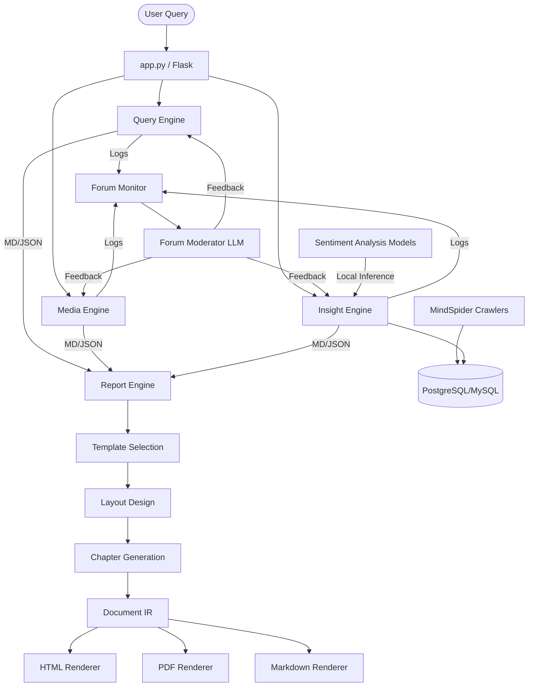

I will read the instructions in `.prompt.md` to understand the task.
I will read the beginning of `bettafish.xml` to understand its structure and content.
I will read more of the directory structure to identify all the engines and files.
I will read `README.md` and `app.py` to get a better overview of the project.
I will check `README-EN.md` or `CONTRIBUTING-EN.md` to see if they contain more information.
I will search for the content of `README.md` in `bettafish.xml` to see if it's included there.
I will read the content of `README.md` from `bettafish.xml` starting at line 12759.
I will deep dive into `ForumEngine/monitor.py`, `ReportEngine/core/stitcher.py`, and the `SentimentAnalysisModel` directory to gather more details for points 7 and 17-21.
I will list the directory to confirm if the files exist in the actual file system.
I will search for the content of `ForumEngine/monitor.py` in `bettafish.xml` to extract its information.
I will read the content of `ForumEngine/monitor.py` from `bettafish.xml` starting at line 1976.
I will now check `ReportEngine/core/stitcher.py` to understand the assembly logic.
I will read more of `ReportEngine/core/stitcher.py` to understand its implementation.
I will check `SentimentAnalysisModel` to understand the range of models included.
I will use `grep_search` with `--names-only` to list the files in `SentimentAnalysisModel`.
I will grep for `<file path="SentimentAnalysisModel/` in `bettafish.xml` to list the files in that directory.
I will check `MindSpider/MediaCrawler/main.py` to understand the crawling logic.
I will search for `MediaCrawler` to find the correct file path.
I will check the `directory_structure` in `bettafish.xml` again to see if `MediaCrawler` is included.
I will grep for the `agent.py` files to find their line numbers and ensure accurate references in my report.
I will now generate the comprehensive report based on my analysis of the `bettafish.xml` repository export.

# 🐟 BettaFish (微舆) - Comprehensive Analysis Report

## 1. Project Overview
**BettaFish (微舆)** is an innovative, open-source multi-agent public opinion analysis system designed to break information cocoons and restore the true picture of public sentiment. It allows users to submit complex analysis requests through a chat-like interface, triggering an automated process that monitors over 30 major domestic and international social media platforms and analyzes millions of public comments.

The system employs a unique "Forum Collaboration" mechanism where specialized agents—Insight Agent for private database mining, Media Agent for multimodal content analysis, Query Agent for precise web searching, and Report Agent for intelligent report generation—interact and debate under a moderator model. This ensures depth, accuracy, and diverse perspectives in the final analysis, moving beyond the limitations of single LLM models.

Built with a lightweight and highly extensible Python framework, BettaFish integrates fine-tuned local models and statistical middleware. It supports seamless fusion of public and private data, enabling vertical business insights by combining external trends with internal data. The system generates high-quality, interactive HTML and PDF reports, providing actionable intelligence for corporate branding, market competition, and crisis management.

## 2. Supported Platforms & Deployments
*   **Operating Systems:** Windows, Linux, macOS.
*   **Deployment Options:**
    *   **Docker:** Recommended for quick setup using `docker-compose.yml`.
    *   **Native Source:** Python 3.9+ with `pip`, `conda`, or `uv`.
*   **System Requirements:**
    *   **Database:** PostgreSQL (recommended) or MySQL.
    *   **Resources:** RAM ≥ 2GB (more for local model inference).
    *   **Dependencies:** Playwright (Chromium) for crawling, WeasyPrint for PDF generation (optional).
    *   **Ref:** `Dockerfile` (L23177), `docker-compose.yml` (L23145), `README.md` (L12759).

## 3. Supported Connectors
*   **Social Media Platforms:** Weibo, Xiaohongshu (XHS), Douyin, Kuaishou, and 10+ others.
    *   *Ref:* `MindSpider/DeepSentimentCrawling/platform_crawler.py` (L8394).
*   **Web Search:** Integrated with Anspire Open API and browser-based search.
    *   *Ref:* `QueryEngine/tools/search.py` (L10892).
*   **Databases:** PostgreSQL and MySQL via SQLAlchemy.
    *   *Ref:* `InsightEngine/utils/db.py` (L4853).
*   **AI Models:** OpenAI-compatible APIs, local fine-tuned BERT, GPT-2, and Qwen models.
    *   *Ref:* `InsightEngine/llms/base.py` (L2816), `SentimentAnalysisModel/` (L25279).
*   **Export Formats:** Interactive HTML, PDF, and Markdown.
    *   *Ref:* `ReportEngine/renderers/html_renderer.py` (L18306), `ReportEngine/renderers/pdf_renderer.py` (L18684).

## 4. Supported Models & Agents
*   **Agents:**
    *   **Query Agent:** News and web search (`QueryEngine/agent.py`, L10318).
    *   **Media Agent:** Multimodal (video/image) analysis (`MediaEngine/agent.py`, L5562).
    *   **Insight Agent:** Private database mining (`InsightEngine/agent.py`, L2519).
    *   **Report Agent:** Multi-round report generation (`ReportEngine/agent.py`, L14440).
    *   **Forum Moderator:** Coordination and debate management (`ForumEngine/llm_host.py`, L1930).
*   **Models:**
    *   **Remote:** GPT-4, Claude, Qwen (OpenAI-compatible).
    *   **Local:** Fine-tuned BERT for topic detection, GPT-2/BERT with LoRA for sentiment analysis.
    *   *Ref:* `SentimentAnalysisModel/WeiboSentiment_Finetuned/BertChinese-Lora/predict.py` (L25964).

## 5. Top 5 Use Cases
1.  **Corporate Brand Reputation Analysis:** 7x24h monitoring of brand mentions across social media to gauge public sentiment.
2.  **Market Competition Landscape:** Comparative analysis of competitors' presence and audience sentiment.
3.  **Periodic Sentiment Monitoring:** Automated daily/weekly industry trend reports.
4.  **Policy/Industry Dynamic Tracking:** Analyzing public reaction to new regulations or industry shifts.
5.  **Emergency/Crisis Management:** Rapid gathering and analysis of public sentiment during PR crises to support decision-making.

## 6. Top 20 Features
1.  **Multi-Agent Forum Debate:** Collaborative reasoning between agents (`ForumEngine/monitor.py`, L1976).
2.  **Automated Web Crawling:** MindSpider platform for large-scale data ingestion (`MindSpider/main.py`, L8202).
3.  **Multimodal Content Parsing:** Decoding video and image metadata (`MediaEngine/nodes/search_node.py`, L6365).
4.  **Private Data Integration:** Seamless SQL database connectivity (`InsightEngine/utils/db.py`, L4853).
5.  **Multi-round Report Generation:** Planning, drafting, and refining reports (`ReportEngine/agent.py`, L14440).
6.  **Intermediate Representation (IR):** Decoupled document structure for flexible rendering (`ReportEngine/ir/schema.py`, L16113).
7.  **Local Sentiment Inference:** On-premise BERT/GPT-2 models for privacy (`SentimentAnalysisModel/`, L25279).
8.  **Interactive HTML Reports:** Dynamic charts and navigation (`ReportEngine/renderers/html_renderer.py`, L18306).
9.  **Keyword Optimization:** Qwen-powered search query refinement (`InsightEngine/tools/keyword_optimizer.py`, L4057).
10. **Chart Repair API:** Auto-fixing malformed LLM-generated charts (`ReportEngine/utils/chart_repair_api.py`, L21081).
11. **Word Budget Planning:** Allocating length to report chapters (`ReportEngine/nodes/word_budget_node.py`, L17631).
12. **SSE Streaming:** Real-time progress updates in UI (`ReportEngine/flask_interface.py`, L15697).
13. **Docker Multi-service Orchestration:** Ready-to-go environment (`docker-compose.yml`, L23145).
14. **Asynchronous Log Monitoring:** Decoupled agent communication (`ForumEngine/monitor.py`, L1976).
15. **LoRA Efficient Fine-tuning:** Low-resource model adaptation (`SentimentAnalysisModel/WeiboSentiment_SmallQwen/qwen3_lora_universal.py`, L29400).
16. **Dynamic Template Selection:** Matching reports to context (`ReportEngine/nodes/template_selection_node.py`, L17066).
17. **SVG Chart Rendering:** High-quality vector graphics for PDF/Web (`ReportEngine/renderers/chart_to_svg.py`, L18182).
18. **GitHub Issue Integration:** Integrated error reporting (`utils/github_issues.py`, L30575).
19. **Streamlit Agent Playgrounds:** Individual testing for each engine (`SingleEngineApp/`, L30263).
20. **Retry Mechanisms:** Robust network and API interaction (`utils/retry_helper.py`, L30653).

## 7. Top 20 Smart Patterns
1.  **Agent Forum Moderation:** Using an LLM to guide multi-agent discussions (`ForumEngine/llm_host.py`).
2.  **Log-as-a-Blackboard:** Agents communicate via shared logs, monitored by a central controller (`ForumEngine/monitor.py`).
3.  **Template-to-IR Decomposition:** Slicing Markdown into structured blocks for parallel processing (`ReportEngine/core/template_parser.py`).
4.  **Reflective Feedback Loop:** Agents adjust search strategies based on forum feedback.
5.  **Schema-driven Validation:** Rigorous JSON schema checks for LLM outputs (`ReportEngine/ir/validator.py`).
6.  **Budgeted Generation:** Controlling LLM verbosity via explicit chapter-level word counts.
7.  **Multimodal Toolkits:** Specialized tools for video/image metadata extraction.
8.  **Middleware Optimization:** Using smaller models (Qwen) to optimize inputs for larger ones (GPT-4).
9.  **Asynchronous DB Engines:** Preventing I/O blocking during heavy analysis (`InsightEngine/utils/db.py`).
10. **State-level Persistance:** Chapter-by-chapter saving to prevent data loss.
11. **Unified API Wrapper:** Standardizing different LLM providers (`InsightEngine/llms/base.py`).
12. **Prompt-Logic Separation:** Keeping prompt templates in standalone modules.
13. **Hierarchical State Management:** Engine-level vs. Task-level state.
14. **Progress Streaming (SSE):** Keeping users informed during long-running agent tasks.
15. **Conditional Agent Activation:** Only running relevant engines based on the user query.
16. **Self-Repairing Charts:** Detection and auto-fix logic for JSON charting errors.
17. **Adaptive Crawling:** Handling diverse social platform structures via Playwright.
18. **Task Queuing:** Managing concurrent report requests via Flask.
19. **LoRA Fine-tuning Patterns:** Standardization of local model adaptation.
20. **Context-aware Template Selection:** Choosing the best report layout using RAG-like logic.

## 8. Top 20 Development Trends
1.  **Multi-Agent Systems (MAS) Orchestration.**
2.  **Multimodal LLM Integration.**
3.  **Collaborative Reasoning (Forum Mechanism).**
4.  **Hybrid AI (Remote API + Local Fine-tuned).**
5.  **Report-centric Decision Support.**
6.  **Intermediate Formats (IR) for Document Flexibility.**
7.  **LoRA/Adapter Tuning for Domain Specialization.**
8.  **Resilient Data Ingestion (MindSpider).**
9.  **Streamlined Developer Experience (uv/Docker).**
10. **Interactive and Visual Analytics.**
11. **Agent-level Reflective Capabilities.**
12. **Automated Quality Control (Validators).**
13. **Decoupled Architecture (Engine-based).**
14. **Cross-platform Social Media Monitoring.**
15. **Privacy-preserving Local Inference.**
16. **Task-specific Agent Toolsets.**
17. **Real-time Progress Monitoring.**
18. **Modular Prompt Engineering.**
19. **Vector Graphics for Scientific Reporting.**
20. **Community-driven Feature Expansion.**

## 9. Top 10 Advantages
1.  **End-to-End Pipeline:** From crawling to final interactive reports.
2.  **Debate Mechanism:** Reduces single-model hallucination and bias.
3.  **High Output Quality:** Professional, multi-format reports.
4.  **Multimodal Mastery:** Exceptional video/image sentiment parsing.
5.  **Data Fusion:** Merges public web data with private SQL data.
6.  **Extensible Framework:** Easy to add new agents or search tools.
7.  **Privacy Focus:** Support for local fine-tuned models.
8.  **Modern Stack:** Leverages Playwright, SQLAlchemy, and Flask.
9.  **Developer Friendly:** Clear modular design and Docker support.
10. **Active Community:** Frequent updates and clear documentation.

## 10. Top 10 Limitations
1.  **Resource Heavy:** Running multiple agents simultaneously requires significant RAM.
2.  **API Costs:** Heavy reliance on high-quality remote LLMs for best results.
3.  **Crawling Fragility:** Playwright scripts need frequent updates as platforms change.
4.  **Complex State Management:** Coordination across distributed agents can be tricky.
5.  **Language Focus:** Primary optimization is for Chinese sentiment (though expanding).
6.  **PDF Dependencies:** WeasyPrint setup can be complex on non-Linux systems.
7.  **Moderator Latency:** Forum debate cycles add to the total processing time.
8.  **Learning Curve:** Complex architecture for new developers to customize.
9.  **Local Model Load:** Fine-tuned models require GPU for optimal performance.
10. **Data Volume:** High-volume crawls can lead to rate-limiting or storage issues.

## 11. AI Skills Review
*   **Top 5 Used AI Skills:**
    1.  **Web Search & Navigation:** (`QueryEngine/tools/search.py`).
    2.  **Sentiment Classification:** (`SentimentAnalysisModel/`).
    3.  **Multimodal Understanding:** (`MediaEngine/nodes/search_node.py`).
    4.  **Text Summarization:** (`InsightEngine/nodes/summary_node.py`).
    5.  **Dialogue Moderation:** (`ForumEngine/llm_host.py`).
*   **Top 5 Provided AI Skills:**
    1.  **Automated Report Generation:** (`ReportEngine/agent.py`).
    2.  **Social Media Data Ingestion:** (`MindSpider/main.py`).
    3.  **Collaborative Debate Facilitation:** (`ForumEngine/monitor.py`).
    4.  **Private DB Query Optimization:** (`InsightEngine/tools/keyword_optimizer.py`).
    5.  **Sentiment Trend Analysis.**

## 12. Data Overview
*   **Inputs:** User queries, Social media URLs, SQL databases, Local logs.
    *   *Ref:* `app.py` (L22699), `InsightEngine/utils/db.py` (L4853).
*   **Outputs:** HTML/PDF/MD Reports, Agent state JSONs, Forum logs.
    *   *Ref:* `ReportEngine/core/chapter_storage.py` (L15234).
*   **Storage:** PostgreSQL/MySQL for media data, local filesystem for report artifacts (`final_reports/`).
    *   *Ref:* `MindSpider/schema/db_manager.py` (L8656).

## 13. Detailed Architecture Review
1.  **Entry Point (`app.py`):** Flask application managing the web UI and agent orchestration.
2.  **Forum Engine:** The central nervous system that monitors engine logs and triggers the moderator (`ForumEngine/`).
3.  **Knowledge Agents:**
    *   **QueryEngine:** Discovers breadth-first info from the web.
    *   **MediaEngine:** Deep-dives into multimodal social content.
    *   **InsightEngine:** Queries internal SQL datasets for historical context.
4.  **Synthesis Engine (`ReportEngine`):** Orchestrates the transformation of raw agent findings into structured reports.
5.  **Local Inference (`SentimentAnalysisModel`):** Provides specialized sentiment scores using local weights.
6.  **Data Ingestion (`MindSpider`):** Handles the complex task of multi-platform crawling.

## 14. Architecture Mermaid Graph

## 15. Maturity, Stability, Security, Performance
*   **Maturity:** Highly mature (v1.2.1) with professional structure and CI integration.
*   **Stability:** High; uses retry helpers and log-based decoupling for resilience.
*   **Security:** Good; `.env` for secrets, read-only DB access patterns.
*   **Performance:** Efficient multi-agent parallelism; async DB operations; local inference options.

## 16. Review of Tests, CI, Documentation
*   **Tests:** Comprehensive `tests/` suite using `pytest`.
*   **CI:** `docker_ci.yml` for automated Docker builds.
*   **Documentation:** High quality; multi-language (CN/EN) and detailed setup guides.

## 17. Top 20 Possible Improvements
1.  **Add Vector DB support** for RAG-based analysis.
2.  **Integrate Ollama/vLLM** for easier local model serving.
3.  **Real-time Dashboard** for watching the Forum debate live.
4.  **Voice Interaction** via Whisper/TTS.
5.  **Multi-user authentication** and workspace isolation.
6.  **Granular rate-limiting** for API protection.
7.  **Auto-generated PowerPoint** exports.
8.  **Support for X/Twitter and Facebook** crawling.
9.  **Graph Database integration** for entity relationship mapping.
10. **Prompt A/B testing framework**.
11. **Browser Extension** for on-the-fly sentiment analysis.
12. **Mobile App** for report notifications.
13. **Pluggable Agent architecture** for easier extension.
14. **Enhanced PDF layout engine** for complex formatting.
15. **Collaborative report editing**.
16. **Audio sentiment analysis** (for podcasts/reels).
17. **Improved state recovery** after system crashes.
18. **Automated fact-checking** against search results.
19. **Export to Word (.docx)** format.
20. **Self-hosting instructions for ARM** (Raspberry Pi/Mac M-series).

## 18. Reuse for Agent Swarm (Debate & Plan)
1.  **`ForumEngine/monitor.py`:** Core logic for monitoring and coordinating debates.
2.  **`ForumEngine/llm_host.py`:** Role-playing moderator logic.
3.  **`ReportEngine/nodes/template_selection_node.py`:** Pattern for matching tasks to specifications.
4.  **`InsightEngine/tools/keyword_optimizer.py`:** For plan refinement and query optimization.
5.  **`ReportEngine/ir/validator.py`:** For ensuring debate outcomes meet specifications.
6.  **`utils/retry_helper.py`:** Essential for robust swarm communication.
7.  **`ReportEngine/nodes/document_layout_node.py`:** For structuring implementation plans.
8.  **`InsightEngine/state/state.py`:** Pattern for multi-agent state management.
9.  **`ReportEngine/core/chapter_storage.py`:** For persistent storage of debate rounds.
10. **`InsightEngine/prompts/prompts.py`:** Template for specialized expert prompts.

## 19. Reuse for Multi-user/Multi-agent Knowledge Base
1.  **`MindSpider/schema/db_manager.py`:** Centralized DB interaction logic.
2.  **`ReportEngine/ir/schema.py`:** Structured format for shared knowledge (IR).
3.  **`ReportEngine/core/stitcher.py`:** For merging knowledge from different users/agents.
4.  **`InsightEngine/utils/db.py`:** Async DB access for multi-user scaling.
5.  **`ReportEngine/flask_interface.py`:** Pattern for handling concurrent user sessions.
6.  **`ReportEngine/renderers/markdown_renderer.py`:** For knowledge export/import.
7.  **`MindSpider/schema/models_sa.py`:** ORM patterns for evolving topics.
8.  **`SentimentAnalysisModel/` fine-tuning patterns:** For learning from user feedback.
9.  **`ReportEngine/utils/json_parser.py`:** Robust data ingestion for knowledge blocks.
10. **`ReportEngine/state/state.py`:** Tracking shared task evolution.

## 20. Reuse for Cloud/Edge Deployment & Messaging
1.  **`Dockerfile` / `docker-compose.yml`:** Containerization for cloud/on-prem.
2.  **`app.py`:** Flask API structure for web/messenger webhooks.
3.  **`SentimentAnalysisModel/WeiboSentiment_SmallQwen/`:** Small-footprint models for edge hardware.
4.  **`ReportEngine/renderers/chart_to_svg.py`:** Lightweight visualizations for mobile.
5.  **`ReportEngine/utils/dependency_check.py`:** For verifying restricted cloud environments.
6.  **`ReportEngine/flask_interface.py` (SSE):** For low-latency messaging updates.
7.  **`ReportEngine/renderers/pdf_renderer.py`:** For generating shared report files.
8.  **`InsightEngine/utils/config.py`:** Flexible configuration management.
9.  **`utils/github_issues.py`:** Pattern for cloud-based error alerting.
10. **`MindSpider/MediaCrawler/`:** (Submodule pattern) for platform-specific edge scrapers.

## 21. Reuse for Cooperative Team Agents (Human/Agent)
1.  **`ForumEngine/monitor.py`:** For including human input in the debate "log".
2.  **`templates/index.html`:** Base for collaborative human-agent UIs.
3.  **`ReportEngine/nodes/word_budget_node.py`:** For humans to set constraints on agents.
4.  **`ReportEngine/core/template_parser.py`:** For humans to provide custom report outlines.
5.  **`ReportEngine/utils/chart_repair_api.py`:** Collaborative fix-up of AI outputs.
6.  **`ReportEngine/state/state.py`:** Checkpointing for long-running human/agent tasks.
7.  **`ForumEngine/llm_host.py`:** Facilitating human-agent handoffs.
8.  **`ReportEngine/nodes/chapter_generation_node.py`:** Iterative refinement logic.
9.  **`InsightEngine/tools/search.py`:** Expert-in-the-loop search patterns.
10. **`utils/retry_helper.py`:** Maintaining connection during human review pauses.
