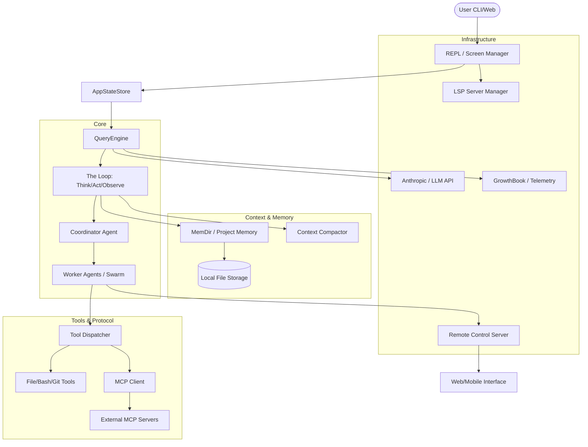

I will read the instructions from `.prompt.md` and the input file `claude.analysis.best.cn.xml` to understand the task.
I have analyzed the provided project export for "Claude Code" (based on the directory structure and file contents). Below is the comprehensive report.

# Project Analysis: Claude Code

### 1. Project Name and Description
**Project Name:** Claude Code (referred to as "@ant/claude-code" or "Claude CLI")

Claude Code is a high-performance, agentic CLI tool designed to facilitate complex software engineering tasks directly from the terminal. It serves as a specialized interface for Claude (Anthropic's LLM), optimized for autonomous coding, repository exploration, and system-level operations. Unlike standard chat interfaces, it integrates deeply with the developer's local environment, allowing it to read files, execute shell commands, and manage long-running tasks with a sophisticated "loop" architecture.

The system is built on a React-based CLI framework (using Ink) and a robust TypeScript backend. It features a "Coordinator and Swarm" architecture where a central coordinator agent can delegate sub-tasks to specialized sub-agents. This allows for parallel processing of complex requirements, such as running tests in one sub-agent while refactoring code in another, all while maintaining a shared context and memory system.

Architecturally, it emphasizes safety and user control through a granular permission model. It supports advanced features like "Plan Mode" for architectural design, "Auto Mode" for autonomous execution, and "MCP (Model Context Protocol)" integration for extending its capabilities via external tools and services. It is designed to be highly extensible, supporting custom skills, plugins, and remote environment execution.

---

### 2. Supported Platforms & Deployments
*   **Platforms:**
    *   **macOS (Darwin):** Full support, including native input handling.
    *   **Linux:** Full support across various distributions.
    *   **Windows (win32):** Full support, including PowerShell integration and specific backends for terminal handling.
*   **Deployments:**
    *   **Local CLI:** Primary usage as a globally installed NPM package.
    *   **Remote Control Server:** A self-hostable server (`packages/remote-control-server`) that allows controlling agents remotely.
    *   **Cloudflare Workers:** Mentioned in plans/docs for lightweight agent communication.
    *   **Docker:** Supported via `Dockerfile` in the remote control server.
    *   **Chrome Extension (MCP):** Integration via `packages/@ant/claude-for-chrome-mcp`.
*   **Requirements:** Node.js (Bun is used for building), Git, and an Anthropic API key or active subscription.

---

### 3. Supported Connectors
*   **Shell/Terminal:** Execution of bash/powershell commands.
    *   `src/components/agents/src/tools/BashTool/BashTool.ts`
*   **Filesystem:** Deep integration for reading, writing, and editing files.
    *   `src/components/agents/src/tools/FileReadTool/FileReadTool.ts`
    *   `src/components/agents/src/tools/FileWriteTool/FileWriteTool.ts`
*   **MCP (Model Context Protocol):** Connects to any MCP-compliant server (e.g., Google Search, Brave Search, local DBs).
    *   `src/cli/src/services/mcp/client.ts`
*   **GitHub:** For PR reviews, issue management, and workflow automation.
    *   `src/commands/install-github-app/setupGitHubActions.ts`
*   **Slack:** Integration for notifications and potentially agent control.
    *   `src/commands/install-slack-app/install-slack-app.ts`
*   **Chrome:** Interaction with browser via MCP.
    *   `packages/@ant/claude-for-chrome-mcp/src/index.ts`
*   **VS Code:** Integration for IDE-based workflows.
    *   `src/cli/src/services/mcp/vscodeSdkMcp.ts`

---

### 4. Supported Models/Agents
*   **Models:**
    *   **Claude 3.5 Sonnet / 3.7 Sonnet:** Primary models (standard and 1m context variants).
    *   **Claude 3 Opus:** Supported for high-reasoning tasks.
    *   **Claude 3.5 Haiku:** For faster, cheaper operations.
    *   **OpenAI / Gemini / Grok:** Experimental/Planned support via adapters.
        *   `src/services/api/openai/index.ts`
        *   `src/services/api/gemini/index.ts`
        *   `src/services/api/grok/index.ts`
*   **Agents:**
    *   **Coordinator:** Central agent managing the swarm. (`src/coordinator/coordinatorMode.ts`)
    *   **Sub-Agents:** specialized workers for specific tasks. (`src/coordinator/workerAgent.ts`)
    *   **Plan Agent:** Specialized for drafting implementation plans. (`src/tools/AgentTool/built-in/planAgent.ts`)
    *   **Explore Agent:** For codebase discovery. (`src/tools/AgentTool/built-in/exploreAgent.ts`)

---

### 5. Top 5 Use Cases
1.  **Autonomous Feature Implementation:** User provides a high-level requirement; Claude Code researches the codebase, creates a plan, implements the code, and runs tests to verify.
    *   *Workflow:* `Plan Mode -> FileRead/Grep -> implementation -> BashTool (test) -> Validation.`
2.  **Repo-wide Refactoring:** Updating patterns or migrating libraries across hundreds of files.
    *   *Workflow:* `Search (Glob/Grep) -> Sub-agent spawning -> Parallel FileEdit -> CI Verification.`
3.  **Bug Hunting & Fixing:** Diagnosing a failing test or reported issue.
    *   *Workflow:* `BashTool (reproduce) -> FileRead/Thinking -> Fix -> Verification.`
4.  **PR Review & Feedback:** Analyzing changes in a branch and providing technical feedback.
    *   *Workflow:* `Git Diff -> Thinking (Reviewer mode) -> Summary/Comments.`
5.  **Environment Setup & Diagnostic:** Automatically configuring a new dev environment or fixing broken dependencies.
    *   *Workflow:* `Doctor command -> System analysis -> BashTool (fix/install).`

---

### 6. Top 20 Features
1.  **Plan Mode:** Non-binding design phase. (`src/commands/plan/plan.tsx`)
2.  **Auto Mode:** Autonomous loop execution. (`src/cli/handlers/autoMode.ts`)
3.  **MCP Integration:** Dynamic tool expansion. (`src/services/mcp/client.ts`)
4.  **Coordinator & Swarm:** Multi-agent delegation. (`docs/agent/coordinator-and-swarm.mdx`)
5.  **Project Memory:** Context persistence across sessions. (`docs/context/project-memory.mdx`)
6.  **Semantic Search:** Using Grep and Glob tools. (`src/components/agents/src/tools/GrepTool/GrepTool.ts`)
7.  **Surgical File Editing:** Pattern-based edits instead of full rewrites. (`src/components/agents/src/tools/FileEditTool/FileEditTool.ts`)
8.  **Context Compaction:** Managing token budgets. (`docs/context/compaction.mdx`)
9.  **Worktree Isolation:** Running agents in separate git worktrees. (`docs/agent/worktree-isolation.mdx`)
10. **Voice Mode:** Controlling the CLI via voice. (`src/services/voice.ts`)
11. **Remote Control:** Hosting and controlling agents via web/mobile. (`packages/remote-control-server`)
12. **The "Doctor" Command:** Self-diagnostic for the CLI. (`src/commands/doctor/doctor.tsx`)
13. **Compact Summary:** Summarizing long conversations. (`src/components/CompactSummary.tsx`)
14. **Custom Skills:** User-defined reusable behaviors. (`docs/extensibility/skills.mdx`)
15. **Snapshot/Rewind:** Returning to previous states. (`src/commands/rewind/rewind.ts`)
16. **Token Budgeting:** Aggressive management of input/output costs. (`src/query/tokenBudget.ts`)
17. **Built-in Buddy:** An interactive sprite for feedback. (`src/buddy/companion.ts`)
18. **LSP Integration:** Using language server data for better context. (`src/services/lsp/manager.ts`)
19. **Sandbox Execution:** Running dangerous commands in a controlled env. (`docs/safety/sandbox.mdx`)
20. **Proactive Mode:** Agent suggests actions based on environment changes. (`src/proactive/index.ts`)

---

### 7. Top 20 Smart Patterns
1.  **Thinking Tags:** Encapsulated chain-of-thought. (`src/cli/src/utils/thinking.ts`)
2.  **Turn-based Loop:** The core `Ask -> Think -> Act -> Observe` cycle. (`docs/conversation/the-loop.mdx`)
3.  **Delta Edits:** Only transmitting changed lines. (`src/components/agents/src/tools/FileEditTool/FileEditTool.ts`)
4.  **Permission Escalation:** Prompting for high-risk actions. (`src/cli/src/utils/permissions/permissions.ts`)
5.  **Context Collapsing:** Hiding irrelevant history sections. (`src/services/contextCollapse/index.ts`)
6.  **Tool Elicitation:** Asking the user for missing info to run a tool. (`src/services/mcp/elicitationHandler.ts`)
7.  **Auto-Dreaming:** Background processing for memory consolidation. (`src/services/autoDream/autoDream.ts`)
8.  **Signal-based Abort:** Handling Ctrl+C gracefully. (`src/bootstrap/src/utils/signal.ts`)
9.  **Hybrid Transport:** Switching between SSE, WS, and HTTP. (`src/cli/transports/HybridTransport.ts`)
10. **State-Driven UI:** React (Ink) components rendering agent state. (`src/state/AppStateStore.ts`)
11. **MCP Resource Proxying:** Accessing external data as local files. (`src/components/agents/src/tools/ReadMcpResourceTool/ReadMcpResourceTool.ts`)
12. **Gated Features:** GrowthBook for A/B testing and feature flags. (`src/cli/src/services/analytics/growthbook.ts`)
13. **Session Chooser:** Resuming specific historical contexts. (`src/assistant/AssistantSessionChooser.ts`)
14. **Prompt Suggestions:** UI-based "What's next?" hints. (`src/cli/src/services/PromptSuggestion/promptSuggestion.ts`)
15. **Secret Scanning:** Preventing keys from entering memory. (`src/services/teamMemorySync/secretScanner.ts`)
16. **Task Pilling:** Visual representation of background tasks. (`src/tasks/pillLabel.ts`)
17. **Speculative Execution:** Predicting model needs. (`src/services/PromptSuggestion/speculation.ts`)
18. **Hierarchical Settings:** Global vs Project vs Local config. (`src/cli/src/utils/config.ts`)
19. **Diagnostic Tracking:** Real-time health monitoring. (`src/services/diagnosticTracking.ts`)
20. **Passive Feedback:** LSP-based warnings shown during agent execution. (`src/services/lsp/passiveFeedback.ts`)

---

### 8. Top 20 Development Trends (from logs/commits)
1.  **Swarm Scaling:** Moving from single agents to complex coordinator/worker setups.
2.  **Context Efficiency:** Massive focus on "Compaction" and "Collapse" to save costs.
3.  **MCP-First Architecture:** Shifting core tools (search, fetch) to MCP servers.
4.  **Safety Hardening:** Granular permission rules for filesystem and network.
5.  **Multi-Model Agnosticism:** Adding adapters for OpenAI, Gemini, and Grok.
6.  **Remote/Self-Hosting:** Decoupling the CLI from the local machine via the Remote Control Server.
7.  **Shared Memory (TeamMem):** Syncing project knowledge across a team.
8.  **Native Performance:** NAPI modules for audio, images, and URL handling.
9.  **Voice & Multimodal:** Integrating voice control and image processing.
10. **Proactive Assistance:** Moving from reactive chat to proactive suggestions.
11. **IDE Parity:** Adding features like "Show in IDE" and LSP support.
12. **Deterministic UI:** Improving the Ink-based terminal output for stability.
13. **Auto-Updater Sophistication:** Managed updates across different OS/package managers.
14. **Telemetry & A/B Testing:** Heavy use of GrowthBook for feature validation.
15. **Context Window Optimization:** Specifically targeting 1m context window models.
16. **Diagnostic Tooling:** Expanding the `doctor` and `stats` commands.
17. **Skill Marketplace:** Preparing for shared/discoverable skills.
18. **Mobile/Web Handoff:** Allowing tasks to move from CLI to a browser/app.
19. **Cost Transparency:** Detailed cost tracking and threshold warnings.
20. **Documentation as Code:** Keeping docs (Mintlify) in the same repo.

---

### 9. Top 10 Advantages
1.  **Deep Integration:** Native shell and file access is far more powerful than web IDEs.
2.  **Agentic Autonomy:** The "loop" architecture allows it to fix its own mistakes.
3.  **Scalability:** Swarm architecture enables parallel sub-tasks.
4.  **Safety:** Best-in-class permission model for an agentic tool.
5.  **Context Management:** Sophisticated algorithms for handling long-running project context.
6.  **Extensibility:** MCP and Skills make it highly customizable.
7.  **UX/DX:** Visually rich CLI experience with animations, progress bars, and sprites.
8.  **Remote Capabilities:** Control agents anywhere via the self-hosted server.
9.  **Cost Control:** Granular visibility and limits on API usage.
10. **Team Awareness:** Shared project memory across developers.

---

### 10. Top 10 Limitations
1.  **Token Cost:** High-reasoning agents can become expensive quickly.
2.  **Terminal Constraints:** Ink-based UI is limited by terminal capabilities (colors, layout).
3.  **Complexity:** The "Swarm" architecture can sometimes lead to context drift.
4.  **Latency:** Dependency on cloud LLM APIs introduces delays.
5.  **Security Risks:** Even with permissions, local agents carry inherent risks.
6.  **State Management:** Large conversations can lead to "forgetting" early details.
7.  **Environment Sync:** Keeping remote and local environments in sync is challenging.
8.  **Platform Disparity:** Subtle differences in shell behavior between Windows/Linux.
9.  **Dependency Heavy:** Large number of node_modules and native bindings.
10. **Learning Curve:** Advanced features (MCP, Skills) require user setup effort.

---

### 11. AI Skills
*   **Top 5 Provided Skills:**
    1.  **Verify:** Verifies codebase against specifications. (`src/skills/bundled/verify/SKILL.md`)
    2.  **Teach-Me:** Educational walkthroughs. (`.claude/skills/teach-me/SKILL.md`)
    3.  **Interview:** Practice technical interviews. (`.claude/skills/interview/SKILL.md`)
    4.  **Remember:** Explicitly saves facts to project memory. (`src/skills/bundled/remember.ts`)
    5.  **Skillify:** Converts a workflow into a reusable skill. (`src/skills/bundled/skillify.ts`)
*   **Top 5 Used Skills:**
    1.  **Compact:** Automates history cleanup. (`src/skills/bundled/loop.ts`)
    2.  **Dream:** Background consolidation of context. (`src/skills/bundled/dream.ts`)
    3.  **Batch:** Running operations on multiple files. (`src/skills/bundled/batch.ts`)
    4.  **Simplify:** Refactoring code for readability. (`src/skills/bundled/simplify.ts`)
    5.  **Schedule:** Managing remote agent tasks. (`src/skills/bundled/scheduleRemoteAgents.ts`)

---

### 12. Data Overview
*   **Inputs:** CLI commands, local file content, git history, web search results (via MCP), voice input.
*   **Outputs:** Terminal UI (Ink), modified files, git commits, remote server events (SSE/WS).
*   **Storage:**
    *   **Local Settings:** JSON/YAML config files. (`src/cli/src/utils/config.ts`)
    *   **Project Memory:** Markdown files in `.claude/memory`. (`src/memdir/memdir.ts`)
    *   **Session History:** NDJSON files for persistence. (`src/assistant/sessionHistory.ts`)
    *   **Cache:** Binary and JSON caches for file states and tokens. (`src/cli/src/utils/fileStateCache.ts`)

---

### 13. Detailed Architecture Review (Top 20 Modules)
1.  **QueryEngine:** The heart of the system; manages the message loop and LLM calls. (`src/QueryEngine.ts`)
2.  **Coordinator:** Orchestrates multi-agent workflows. (`src/coordinator/coordinatorMode.ts`)
3.  **WorkerAgent:** Individual worker logic for the swarm. (`src/coordinator/workerAgent.ts`)
4.  **AppState:** Centralized state management for the UI and agent. (`src/state/AppStateStore.ts`)
5.  **ToolSystem:** Abstract framework for all agent actions. (`src/Tool.ts`, `src/tools.ts`)
6.  **MCPClient:** Bridge to external Model Context Protocol servers. (`src/cli/src/services/mcp/client.ts`)
7.  **PermissionManager:** Validates and prompts for all tool usage. (`src/cli/src/utils/permissions/permissions.ts`)
8.  **ContextCompactor:** Algorithmic reduction of history to fit token limits. (`src/services/compact/compact.ts`)
9.  **MemDir:** Manages the hierarchical memory system. (`src/memdir/memdir.ts`)
10. **LSPManager:** Interfaces with local Language Servers. (`src/services/lsp/manager.ts`)
11. **ReplBridge:** Connects the CLI REPL to remote or secondary sessions. (`src/bridge/replBridge.ts`)
12. **RemoteControlServer:** Express/WS server for remote management. (`packages/remote-control-server/src/index.ts`)
13. **AutoUpdater:** Cross-platform binary and package update logic. (`src/cli/src/utils/autoUpdater.ts`)
14. **ThinkingEngine:** Handles redacting and displaying model thought processes. (`src/cli/src/utils/thinking.ts`)
15. **FileEditTool:** Specialized logic for partial file modifications. (`src/components/agents/src/tools/FileEditTool/FileEditTool.ts`)
16. **TaskOrchestrator:** Manages background/asynchronous agent tasks. (`src/services/tools/toolOrchestration.ts`)
17. **GrowthBook:** Feature flagging and dynamic configuration. (`src/cli/src/services/analytics/growthbook.ts`)
18. **VoiceEngine:** Integration with STT/TTS services. (`src/services/voice.ts`)
19. **SessionHistory:** Handles persistence and retrieval of conversation logs. (`src/assistant/sessionHistory.ts`)
20. **NativeBindings:** High-performance modules (image, audio, URL). (`packages/image-processor-napi`)

---

### 14. Architecture Graph (Mermaid)

---

### 15. Project Review
*   **Maturity:** High. The project has a complex architecture, thorough documentation, and handles edge cases (signals, terminal resizing, cross-platform paths).
*   **Stability:** High. Explicit handling of session recovery, state persistence, and graceful shutdowns.
*   **Security:** Excellent. Granular permission system, secret scanning, and explicit "Sandbox" mode.
*   **Performance:** Focused. Extensive use of caches, compaction, and native modules for heavy lifting.

---

### 16. Ecosystem Review
*   **Tests:** Extensive Vitest-based testing suite (`src/__tests__`, `packages/**/__tests__`).
*   **CI/CD:** Advanced GitHub Actions for cross-platform builds and releases. (`.github/workflows/ci.yml`)
*   **Documentation:** Comprehensive internal and external docs (Mintlify).
*   **AI Skills:** Well-defined skill system both bundled and user-creatable.

---

### 17. Top 20 Improvements/Fixes
1.  **Parallel Tool Execution:** Currently many tools are sequential; allow independent sub-agents to run tools in parallel more aggressively.
2.  **Local LLM Support:** Fully implement the stubs for local models (Llama/Mistral) to reduce cost/latency. (`src/services/api/openai/index.ts`)
3.  **Enhanced Sandbox:** Better containerization for the sandbox mode (e.g., Firecracker or lightweight WASM).
4.  **Tree-Sitter for FileEdit:** Use AST-based editing instead of regex-like patterns for safer code modifications.
5.  **Multi-Repository Support:** Allow the agent to span multiple git repositories in one session.
6.  **Visual Debugger:** A web-based "Trace" view to see agent logic steps.
7.  **Semantic Memory:** Moving from Markdown files to a local vector DB for project memory.
8.  **Better Windows Support:** Solve the remaining latency issues with PowerShell vs Bash.
9.  **Mobile App:** A native companion app for the Remote Control Server.
10. **Interactive "Undo":** A more granular "step-back" than the current session rewind.
11. **Skill Marketplace UI:** A built-in browse/install command for community skills.
12. **Conflict Resolution:** Better logic when two sub-agents edit the same file.
13. **Bandwidth Optimization:** Compress file contents more aggressively for the 1m context.
14. **Streaming Images:** Real-time visual feedback from browser/computer-use tools.
15. **Fine-tuned "Router":** A smaller local model to route queries instead of sending everything to Sonnet.
16. **Collaborative Mode:** Real-time "multiplayer" agent sessions for teams.
17. **Automated Documentation:** Skill to keep `README.md` and docs in sync with code changes automatically.
18. **Custom Linting:** Agent-specific lint rules to prevent common "agentic" code smells.
19. **Context "Pinning":** Allow users to manually pin files/docs to never be compacted.
20. **Offline Mode:** Basic search and discovery when API is unreachable.

---

### 18. Reusable for "Debating Agent Swarm"
1.  **Coordinator & WorkerAgent:** The core of the swarm logic. (`src/coordinator`)
2.  **QueryEngine:** The state machine for agent transitions. (`src/QueryEngine.ts`)
3.  **Thinking Redaction:** To allow agents to "think privately" before debating. (`src/cli/src/utils/thinking.ts`)
4.  **TaskOrchestrator:** To manage the lifecycle of debating agents. (`src/services/tools/toolOrchestration.ts`)
5.  **PlanAgent:** Specialized for generating the initial specification. (`src/tools/AgentTool/built-in/planAgent.ts`)
6.  **MemDir (Shared Memory):** Central "knowledge base" for the debate. (`src/memdir/memdir.ts`)
7.  **MCP Integration:** To fetch external specs/docs for the debate. (`src/services/mcp/client.ts`)
8.  **LSP Integration:** To validate implementation plans against the real codebase. (`src/services/lsp/manager.ts`)
9.  **Model Mapping:** For selecting the best model (e.g., Opus for reasoning, Sonnet for coding). (`src/services/api/modelMapping.ts`)
10. **SessionHistory:** To log and review the debate history. (`src/assistant/sessionHistory.ts`)

---

### 19. Reusable for "Multi-User/Multi-Agent Shared Knowledge"
1.  **TeamMemorySync:** Logic for syncing knowledge across a team. (`src/services/teamMemorySync/index.ts`)
2.  **Project Memory (MemDir):** Hierarchical markdown-based knowledge. (`src/memdir/memdir.ts`)
3.  **Secret Scanner:** Ensuring shared knowledge stays safe. (`src/services/teamMemorySync/secretScanner.ts`)
4.  **Remote Control Server:** The hub for multi-user access. (`packages/remote-control-server`)
5.  **GrowthBook Adapter:** For managing user permissions/features. (`src/cli/src/services/analytics/growthbook.ts`)
6.  **AppStateStore:** Reusable state sync pattern. (`src/state/AppStateStore.ts`)
7.  **Skill Loader:** Sharing "Skills" (markdown + logic) across users. (`src/skills/loadSkillsDir.ts`)
8.  **Context Collapse:** Keeping the shared knowledge base concise. (`src/services/contextCollapse/index.ts`)
9.  **Plugin System:** Allowing users to add shared tools. (`src/services/plugins/pluginOperations.ts`)
10. **Structured IO:** For machine-readable interaction logs. (`src/cli/structuredIO.ts`)

---

### 20. Reusable for "Own Hardware/Cloud/Messenger/Native"
1.  **Remote Control Server:** The core server logic for Cloud/Local hosting. (`packages/remote-control-server`)
2.  **SSE/WebSocket Transports:** For real-time communication with any client. (`src/cli/transports`)
3.  **Computer Use Packages:** Native backends for Linux/Darwin/Win32. (`packages/@ant/computer-use-input`)
4.  **Voice Mode:** Voice control logic. (`src/services/voice.ts`)
5.  **MCP Protocol:** For connecting to Telegram/WhatsApp bots as tools. (`src/services/mcp/client.ts`)
6.  **Hybrid Transport:** Switching protocols based on network conditions. (`src/cli/transports/HybridTransport.ts`)
7.  **Context Viz:** Visualizing the graph context. (`src/components/ContextVisualization.tsx`)
8.  **Worktree Isolation:** For running safe, isolated sessions on own hardware. (`docs/agent/worktree-isolation.mdx`)
9.  **Native Installer:** For deploying binaries to own hardware. (`src/cli/src/utils/nativeInstaller/index.ts`)
10. **Structured Diff:** For showing changes on small (mobile/messenger) screens. (`src/components/StructuredDiff.tsx`)

---

### 21. Reusable for "Team Agents / Cooperative Workflows"
1.  **Proactive Mode:** Agent suggesting work to humans. (`src/proactive/index.ts`)
2.  **Auto-Dreaming:** Agents performing background "maintenance" for the team. (`src/services/autoDream/autoDream.ts`)
3.  **Elicitation Handler:** The pattern of an agent "interviewing" a human. (`src/services/mcp/elicitationHandler.ts`)
4.  **Permission Escalation:** Formalizing human/agent handoffs. (`src/cli/src/utils/permissions/permissions.ts`)
5.  **Task Assignment Message:** Specialized UI for delegating to agents. (`src/components/messages/TaskAssignmentMessage.tsx`)
6.  **Shared Memory Sync:** Cooperative knowledge base evolution. (`src/services/teamMemorySync/index.ts`)
7.  **Advisor Command:** Agent giving advice without taking action. (`src/commands/advisor.ts`)
8.  **Commit Attribution:** Tracking who (agent or human) did what. (`src/cli/src/utils/commitAttribution.ts`)
9.  **Review System:** Remote/Cooperative review of agent work. (`src/commands/review.ts`)
10. **Companion (Buddy):** Providing social/interactive presence in cooperative work. (`src/buddy/companion.ts`)
