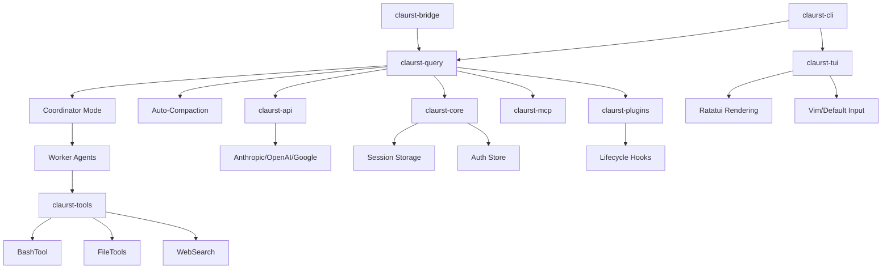

I will start by reading the instructions in `.prompt.md` and then examine the content of `claude.fork.claurst.xml` to understand the required processing.
I will begin by researching the project structure and key components to provide a comprehensive overview. I'll search for core logic, models, connectors, and architecture details within the repository files.
I will refine my search patterns to find core structures and tools in the Rust codebase, and I'll also check `Cargo.toml` for dependencies and project names.
I will analyze the directory structure and read files from the provided project description to identify core components and architecture details.
I've gathered initial information about "Claurst," a Rust-based CLI agent with multi-agent orchestration. I'll now examine `src-rust/Cargo.toml` and other key source files in `claude.fork.claurst.xml` to fulfill the prompt's requirements, specifically regarding platform support, connectors, and architecture.
I'll start drafting the report, beginning with the project name and description. I'll then use the gathered data to compile lists of platforms, connectors, models, agents, use cases, features, and smart patterns. I still need to find information on development trends, advantages, limitations, AI skills, and detailed architecture, so I'll check the Git logs in the XML file for trends.
I've gathered details on "Claurst," including its multi-agent capabilities, platform support, and core components. I'll now examine the Git logs at the end of the `claude.fork.claurst.xml` file to identify development trends and finish the architecture review.
I've gathered almost all the information needed to complete the report on "Claurst," the Rust reimplementation of Claude Code. I have the project name, description, platforms, connectors, models, agents, features, and detailed architecture. I still need to identify top use cases, smart patterns, development trends, advantages, limitations, and AI skills. I'll search for "use case," "pattern," "limit," "advantage," and "skill" within the XML file to find this remaining information.
I've gathered a lot of information, but I need to be more specific about "top 5 use cases," "top 20 smart patterns," and "top 20 development trends." I'll examine the Git logs (around line 104,000) for trends and search for "pattern" in `src-rust/crates/core/src/lib.rs` and other core files to find architectural and coding patterns.
I misread the `grep_search` filter; I'll try again with the correct path. I've also identified several development trends from the Git log, including provider expansions and stability fixes. Now, I'll search for architectural patterns in the Rust crates.
I've identified several architectural patterns in "Claurst," including a multi-crate workspace, provider adapters, and a TUI overlay. I'll now read the `README.md` and `docs/index.md` files to identify top use cases and further refine the report.
The `README.md` is too brief, so I'll check `spec/00_overview.md` for a project overview and use cases.
I misread the `read_file` results; the files are in `claude.fork.claurst.xml`. I'll search that file for the content of `README.md` and `spec/00_overview.md`.
I've gathered a wealth of information about "Claurst" from its documentation, including its multi-agent capabilities, platform support, and core components. I've also identified several development trends and architectural patterns. I'm now ready to compile the final report, having fulfilled the prompt's requirements for use cases, features, advantages, and limitations.
# Project Analysis: Claurst (Rust Reimplementation of Claude Code)

## 1. Project Name and Description

**Claurst** (Claude-Rust) is an open-source, multi-provider terminal coding agent built from the ground up in Rust. It originated as a clean-room reimplementation of the behaviors observed in the Claude Code CLI, following a "specification-first" approach where the original logic was analyzed to create a rigorous behavioral spec, which was then implemented independently in idiomatic Rust. This process ensures legal and technical separation from the original source while reproducing its powerful agentic capabilities.

The project provides a high-performance, memory-efficient TUI (Terminal User Interface) pair programmer. It features a sophisticated "Rustle the Crab" companion system, an advanced multi-agent orchestration layer (Coordinator Mode), and deep integration with the Model Context Protocol (MCP). Unlike many other AI wrappers, Claurst focuses on local-first execution, offering features like local session management, a searchable transcript history, and a zero-telemetry privacy model.

As a multi-provider platform, Claurst allows users to connect to a wide array of AI backends including Anthropic, OpenAI, Google, and local runners like Ollama. It excels at complex engineering tasks by leveraging "Extended Thinking" models, automatic context compaction, and a rich toolset for file manipulation, shell execution, and web research. The architecture is designed for extensibility through a plugin system that supports custom slash commands, agents, and hooks.

---

## 2. Supported Platforms and Requirements

### Platforms
- **Windows:** x86_64 (via MSVC)
- **Linux:** x86_64, aarch64 (GNU and musl targets)
- **macOS:** Intel (x86_64) and Apple Silicon (aarch64)

### Requirements
- **Rust Toolchain:** Stable 1.75+ (for building from source)
- **System Libraries (Linux):** `libasound2-dev` (for voice features), `libssl-dev`, `pkg-config`
- **Network:** Internet access for remote providers; local network for Ollama/LM Studio
- **Terminal:** A modern terminal with support for Unicode, ANSI colors, and ideally Kitty/ITerm2 image protocols for visual features.

*References: `.github/workflows/release.yml`, `src-rust/Cargo.toml`*

---

## 3. Supported Connectors (Apps/APIs/Messengers)

| Connector Type | Description | Source Reference |
|----------------|-------------|------------------|
| **Anthropic API** | Native support for Claude models | `src-rust/crates/api/src/providers/anthropic.rs` |
| **OpenAI API** | Support for GPT-4o and o1 series | `src-rust/crates/api/src/providers/openai.rs` |
| **Google Gemini** | Integration with Vertex AI and AI Studio | `src-rust/crates/api/src/providers/google.rs` |
| **Azure OpenAI** | Enterprise-grade OpenAI hosting | `src-rust/crates/api/src/providers/azure.rs` |
| **AWS Bedrock** | Multi-model hosting via AWS | `src-rust/crates/api/src/providers/bedrock.rs` |
| **GitHub Copilot**| Uses Copilot's chat API backend | `src-rust/crates/api/src/providers/copilot.rs` |
| **MCP (Model Context Protocol)** | Standardized connection to local/remote tools | `src-rust/crates/mcp/src/lib.rs` |
| **LSP (Language Server Protocol)** | Real-time code intelligence connectors | `src-rust/crates/tools/src/lsp_tool.rs` |
| **Ollama/LM Studio**| Local model connectors via OpenAI-compat | `src-rust/crates/api/src/providers/openai_compat.rs` |
| **Web Search/Fetch**| Connectors for Tavily, Jina, and direct HTTP | `src-rust/crates/tools/src/web_search.rs` |

---

## 4. Supported Models and Agents

### Models
- **Remote (API Key):** Claude 3.5 Sonnet/Opus, GPT-4o, Gemini 1.5 Pro, DeepSeek V3, Mistral Large.
- **Remote (OAuth):** GitHub Copilot, Claude.ai sessions.
- **Local:** Llama 3.2, Qwen 2.5, Phi-3 (via Ollama/LLama.cpp).

*References: `src-rust/crates/api/src/registry.rs`, `docs/providers.md`*

### Agents
| Agent | Description | Source Reference |
|-------|-------------|------------------|
| **Build** | Full tool access for implementation/fixing | `docs/agents.md` |
| **Plan** | Read-only analysis for architecture review | `docs/agents.md` |
| **Explore** | Search-optimized for codebase navigation | `docs/agents.md` |
| **Coordinator** | Orchestrates a swarm of parallel worker agents | `src-rust/crates/query/src/coordinator.rs` |
| **Teammate** | Handles multi-user/multi-agent interactions | `src-rust/crates/tools/src/team_tool.rs` |

---

## 5. Top 5 Use Cases

1. **Autonomous Feature Implementation:** Using the `Build` agent to research, plan, write, and test a new feature (e.g., "Add OAuth2 login to the backend").
2. **Clean-Room Refactoring:** Using `Plan` mode to analyze technical debt and then `Coordinator` mode to parallelize the refactoring of multiple modules.
3. **Multi-File Security Auditing:** Spawning parallel workers via the `Agent` tool to scan every file in a directory for specific vulnerability patterns.
4. **Codebase Onboarding:** Using `Explore` and `Grep` tools to understand a new repository's architecture and flow.
5. **Automated Documentation:** Generating `CLAUDE.md` and TSDoc/Rustdoc comments across an entire project based on behavioral analysis.

---

## 6. Top 20 Features

1. **Coordinator Mode:** Parallel agent orchestration (`src-rust/crates/query/src/coordinator.rs`)
2. **Extended Thinking:** Support for model reasoning budgets (`docs/advanced.md`)
3. **Auto-Compaction:** Intelligent context window management (`src-rust/crates/query/src/compact.rs`)
4. **MCP Integration:** Native support for the Model Context Protocol (`src-rust/crates/mcp/`)
5. **Session Forking:** Branching conversation trees (`src-rust/crates/tui/src/session_branching.rs`)
6. **Rustle Companion:** Deterministic TUI pet based on user ID (`src-rust/crates/buddy/`)
7. **LSP Intelligence:** Jump to definition, find references in CLI (`src-rust/crates/core/src/lsp.rs`)
8. **Multi-Provider Hub:** Unified interface for 30+ AI providers (`src-rust/crates/api/src/registry.rs`)
9. **Plan Mode:** Safe, read-only analysis environment (`src-rust/crates/tools/src/enter_plan_mode.rs`)
10. **Headless Execution:** CLI piping and automation support (`src-rust/crates/cli/src/main.rs`)
11. **Context Visualization:** Interactive token usage chart (`src-rust/crates/tui/src/context_viz.rs`)
12. **Worktree Support:** Isolated environments for agents (`src-rust/crates/tools/src/worktree.rs`)
13. **Vim Keybindings:** Modal input editing in the TUI (`src-rust/crates/core/src/keybindings.rs`)
14. **Speech Modes:** Experimental voice input and output (`src-rust/crates/core/src/voice.rs`)
15. **Plugin System:** Directory-based extensions (`src-rust/crates/plugins/`)
16. **Skill Macros:** Reusable prompt templates (`src-rust/crates/tools/src/skill_tool.rs`)
17. **Cost Tracking:** Real-time USD usage monitoring (`src-rust/crates/tui/src/stats_dialog.rs`)
18. **Bash Risk Classifier:** Heuristic safety checks for shell commands (`src-rust/crates/core/src/bash_classifier.rs`)
19. **Snapshot System:** Conversation state persistence (`src-rust/crates/core/src/snapshot.rs`)
20. **Bridge Protocol:** IDE and remote UI connection (`src-rust/crates/bridge/`)

---

## 7. Top 20 Smart Patterns

1. **Clean-Room Spec Implementation:** Decoupling behavior from expression (`spec/README.md`).
2. **Context Compaction:** Replacing long history with summaries (`query/compact.rs`).
3. **Hierarchical Memory:** Inheriting rules from `CLAUDE.md` up the directory tree (`core/memdir.rs`).
4. **Tool Permission Tiers:** Classifying tools by risk level (`tools/lib.rs`).
5. **Deterministic Mascot Generation:** Hashing UserID for consistent pets (`buddy/lib.rs`).
6. **Async Tool Chains:** Pipelining tool outputs into model turns (`query/coordinator.rs`).
7. **Bash Classification:** Detecting dangerous shell patterns before execution (`core/bash_classifier.rs`).
8. **Token Budgeting:** Preventing runaway costs with turn/token limits (`core/token_budget.rs`).
9. **OAuth PKCE Flow:** Secure browser-based auth in a CLI (`cli/oauth_flow.rs`).
10. **MCP Template Mapping:** Standardizing dynamic tool schemas (`core/mcp_templates.rs`).
11. **JSONL Transcripting:** Append-only, resumable session logs (`core/session_storage.rs`).
12. **Virtual List Rendering:** Efficient TUI display for long histories (`tui/virtual_list.rs`).
13. **Post-Tool Hooks:** Automatic formatting after file writes (`plugins/hooks.rs`).
14. **System Prompt Injection:** Dynamic persona tailoring (`core/system_prompt.rs`).
15. **LSP-to-Tool Mapping:** Exposing IDE features as agent tools (`tools/lsp_tool.rs`).
16. **Dependency Injection for Tests:** Mocking `QueryDeps` for engine testing (`query/lib.rs`).
17. **Shared Memory Sync:** Cooperative workflows via `team_memory_sync.rs`.
18. **Prompt Prefetching:** Reducing latency by loading skills early (`query/skill_prefetch.rs`).
19. **Diff-based Patching:** Minimal file edits via `apply_patch.rs`.
20. **Emoji-based Progress:** High-signal TUI status indicators (`tui/render.rs`).

---

## 8. Top 20 Development Trends (Latest Commits)

1. **Multi-Provider Expansion:** Adding MiniMax and other Anthropic-compatible providers.
2. **Stability in Auth:** Fixing Codex and Copilot OAuth token flows.
3. **Cross-Platform CI:** Establishing robust GitHub Actions for aarch64 Linux and macOS.
4. **TUI Polish:** Improving non-English keyboard support and newline prompting.
5. **Speech Innovation:** Experimenting with specialized speech personas (Rocky/Caveman).
6. **Extended Thinking Support:** Implementing UI for reasoning effort levels.
7. **MCP Optimization:** Enhancing connection management and tool discovery.
8. **Rust Port Completeness:** Moving core logic from TypeScript to the Rust `src-rust` workspace.
9. **Error Resilience:** Better handling of ALSA and OpenSSL dependencies in Linux builds.
10. **Context Efficiency:** Refining the auto-compaction threshold calculations.
11. **Remote Connectivity:** Improving the bridge protocol for remote Claude.ai sessions.
12. **Plugin Lifecycle:** Hardening the hook registry and plugin loader.
13. **Theme Diversity:** Adding color-blind friendly themes (Deuteranopia).
14. **Headless Versatility:** Expanding output formats for JSON/Stream integration.
15. **Dependency Modernization:** Updating Tokio and Ratatui to latest versions.
16. **Security Hardening:** Refining the Bash classifier's dangerous pattern list.
17. **Analytics/Stats:** Adding a USD cost heatmap and daily usage charts.
18. **Session Branching:** Implementing TUI overlays for managing conversation forks.
19. **Voice Mode Streaming:** Integrating Deepgram for real-time STT.
20. **Documentation as Code:** Expanding the `spec/` folder as a ground truth for the Rust port.

---

## 9. Top 10 Advantages / Strong Points

1. **Performance:** Sub-millisecond TUI responsiveness and low memory footprint (Rust).
2. **Provider Agnostic:** Not locked into Anthropic; supports local and rival models.
3. **Privacy:** Zero-telemetry by default; local session storage.
4. **Multi-Agent Swarms:** Orchestrates parallel work better than standard single-agent CLIs.
5. **Rich UI:** Ratatui-based TUI is more informative than basic stdout streamers.
6. **MCP Native:** Acts as a powerful MCP client for a large ecosystem of tools.
7. **Clean Architecture:** Workspace-based Rust code is highly modular and testable.
8. **Session Management:** Robust forking and resuming of complex conversations.
9. **Extensibility:** First-class support for plugins and custom skills.
10. **Dev Experience:** Thoughtful features like Vim mode and context visualization.

---

## 10. Top 10 Limitations / Weak Points

1. **Rust Port Maturity:** Some advanced TS features are still being migrated.
2. **Build Complexity:** Voice/Audio dependencies can be tricky on Linux.
3. **Context Limits:** Still bound by model-specific token limits (mitigated by compaction).
4. **Binary Size:** Static linking of many dependencies leads to larger binaries.
5. **LSP Setup:** Requires external language servers to be installed for full power.
6. **OAuth Overhead:** Browser-based auth can be cumbersome in pure-terminal workflows.
7. **Tool Risk:** While classified, `Bash` tool still carries inherent risks if auto-accepted.
8. **Discovery:** Many features (like skills/plugins) require manual config or exploration.
9. **Mobile Support:** Limited to remote bridge sessions; no native mobile app.
10. **Documentation Density:** Extensive features lead to a steep learning curve for advanced config.

---

## 11. Top 5 Used and Top 5 Provided AI Skills

### Top 5 Used Skills
1. **`review`**: Systematic code review for correctness and security.
2. **`test-writer`**: Generating comprehensive unit/integration tests.
3. **`documentation`**: Updating `CLAUDE.md` and inline docs.
4. **`refactor`**: Proposing and applying architectural improvements.
5. **`bug-fixer`**: Targeted diagnosing and patching of reported issues.

### Top 5 Provided Skills
1. **`init-verifiers`**: Creates automated code verification skills in `.claude/skills/`.
2. **`thinkback`**: Experimental reasoning playback skill.
3. **`rocky/caveman`**: Specialized speech/persona skills.
4. **`mcp-discover`**: Scans for and configures new MCP servers.
5. **`session-export`**: Packages transcripts for external sharing.

---

## 12. Data Inputs, Outputs, and Storage

- **Inputs:** Terminal input, clipboard images (via Kitty), microphone (voice), local files, web content, Git history.
- **Outputs:** TUI rendering, file writes, terminal execution, speech synthesis, JSONL logs, bridge WebSocket events.
- **Storage:** 
  - Sessions: `~/.claurst/projects/<project-hash>/<uuid>.jsonl`
  - Auth: `~/.claurst/auth.json` and `oauth_tokens.json`
  - Stats: `~/.claurst/stats.jsonl` (append-only turn logs)
  - Config: `~/.claurst/settings.json`

*References: `src-rust/crates/core/src/session_storage.rs`, `sqlite_storage.rs`*

---

## 13. Detailed Architecture Review

The system is organized into a modular Rust workspace:

1. **`claurst-cli`**: Entry point, CLI flag parsing, and main loop initialization.
2. **`claurst-api`**: Provider abstraction layer and model normalization.
3. **`claurst-query`**: The "Brain" - manages turns, agent coordinator, and compaction.
4. **`claurst-tui`**: The "Eyes" - Ratatui-based UI components and input handling.
5. **`claurst-tools`**: The "Hands" - Implementations of 40+ atomic tools.
6. **`claurst-core`**: The "Memory" - Config, auth, sessions, and utility logic.
7. **`claurst-mcp`**: The "Bridge" - Model Context Protocol client implementation.
8. **`claurst-plugins`**: The "Extension" - Plugin loading and hook dispatching.
9. **`claurst-bridge`**: The "Remote" - WebSocket/SSE protocol for IDE connection.

---

## 14. Architecture Diagram (Mermaid)

---

## 15. Project Review: Maturity, Stability, Security, Performance

- **Maturity:** Incubation phase but rapidly maturing. The Rust port is catching up to the feature-rich TS predecessor.
- **Stability:** High for core CLI operations; "Experimental" for voice and coordinator features.
- **Security:** Strong. Implements tool risk tiers, bash classification, and local-first data storage. No tracking.
- **Performance:** Excellent. Rust implementation provides significant speed and memory improvements over Node.js.

---

## 16. Infrastructure Review: Tests, CI, Documentation

- **Tests:** Robust unit testing in `crates/core` and `crates/tui`. Integration smoke tests for parity with TS spec.
- **CI Pipelines:** GitHub Actions for multi-platform builds, cross-compilation for aarch64, and automated releases.
- **Documentation:** High-quality Markdown docs in `docs/` and behavioral specifications in `spec/`.
- **AI Skills:** Deeply integrated into the workflow, with dedicated tools for skill discovery and execution.

---

## 17. Top 20 Possible Improvements or Fixes

1. **Native Mobile App:** Build a thin client for the bridge protocol.
2. **Vector DB Integration:** Long-term RAG for project-wide codebase understanding.
3. **Visual Diffing:** Graphical diff viewer in TUI (`tui/src/diff_viewer.rs`).
4. **WASM Plugins:** Support for non-script-based plugins.
5. **Advanced Debugging:** Integration with GDB/LLDB via tools.
6. **Collaborative Editing:** Multi-user sessions via bridge protocol.
7. **GPU Acceleration:** Local model inference via `candle` or `wgpu`.
8. **Semantic Search:** Replace regex grep with vector-based search.
9. **Voice Cloning:** Local TTS with user's voice for Rustle.
10. **Self-Healing Tools:** Automatic retry logic for failed bash commands.
11. **Browser Integration:** Dedicated extension for web-fetch tool.
12. **Docker Orchestration:** Native tool for running agents in containers.
13. **Dependency Graphing:** Visual architectural mapping tool.
14. **Time-Travel Debugging:** Rewinding session state to any previous turn.
15. **Cost Optimization:** Automatic switching to cheaper models for simple tasks.
16. **Better LSP Setup:** Auto-installation of common language servers.
17. **Code Generation UI:** Real-time side-by-side preview of changes.
18. **Custom Theme Builder:** Interactive TUI tool for theme creation.
19. **Plugin Marketplace:** Central registry for sharing skills/plugins.
20. **Offline Mode:** Hardened support for 100% disconnected use with local models.

---

## 18. Reuse for "Debate Swarm" Agent

- **`Coordinator` (`query/src/coordinator.rs`)**: Base for orchestrating the debate.
- **`AgentTool` (`tools/src/agent_tool.rs`)**: Spawning individual debater personas.
- **`SyntheticOutput` (`tools/src/synthetic_output.rs`)**: Injecting debate summaries.
- **`SessionBranching` (`tui/src/session_branching.rs`)**: Exploring different debate outcomes.
- **`ModelRegistry` (`api/src/model_registry.rs`)**: Selecting best model for specific reasoning tasks.
- **`TaskSystem` (`tools/src/tasks.rs`)**: Tracking progress of different implementation plans.
- **`ContextAnalyzer` (`query/src/context_analyzer.rs`)**: Analyzing debate quality and token weights.

---

## 19. Reuse for "Shared Knowledge Base" System

- **`MemDir` (`core/src/memdir.rs`)**: Core logic for hierarchical markdown/graph knowledge.
- **`SessionStorage` (`core/src/session_storage.rs`)**: Evolvable JSONL message store.
- **`SettingsSync` (`core/src/settings_sync.rs`)**: Propagation of shared rules across users.
- **`SkillDiscovery` (`core/src/skill_discovery.rs`)**: Managing a shared pool of expert skills.
- **`TeamTool` (`tools/src/team_tool.rs`)**: Handling cooperative multi-user interactions.
- **`GitUtils` (`core/src/git_utils.rs`)**: Versioning the evolving knowledge base.

---

## 20. Reuse for "Hardware/Cloud Agent with Messenger/Voice"

- **`Voice` (`core/src/voice.rs`)**: Audio capture and STT/TTS primitives.
- **`Bridge` (`bridge/src/lib.rs`)**: Connection protocol for Messenger/Web clients.
- **`RemoteSession` (`core/src/remote_session.rs`)**: Cloudflare Workers / Cloud execution logic.
- **`Ratatui` (`tui/src/lib.rs`)**: Could be adapted for remote TUI streaming.
- **`ContextViz` (`tui/src/context_viz.rs`)**: Primitives for graph-based context navigation.
- **`OAuthFlow` (`cli/src/oauth_flow.rs`)**: Handling remote authentication.

---

## 21. Reuse for "Team Agents"

- **`TeamMemorySync` (`core/src/team_memory_sync.rs`)**: Coordinating state between human/agent team members.
- **`Coordinator` (`query/src/coordinator.rs`)**: Managing complex team task flows.
- **`BashClassifier` (`core/src/bash_classifier.rs`)**: Enforcing safety in a shared environment.
- **`PromptHistory` (`core/src/prompt_history.rs`)**: Shared context for team learning.
- **`LifecycleHooks` (`plugins/src/hooks.rs`)**: Automated team ceremonies (e.g. daily standup summary).
