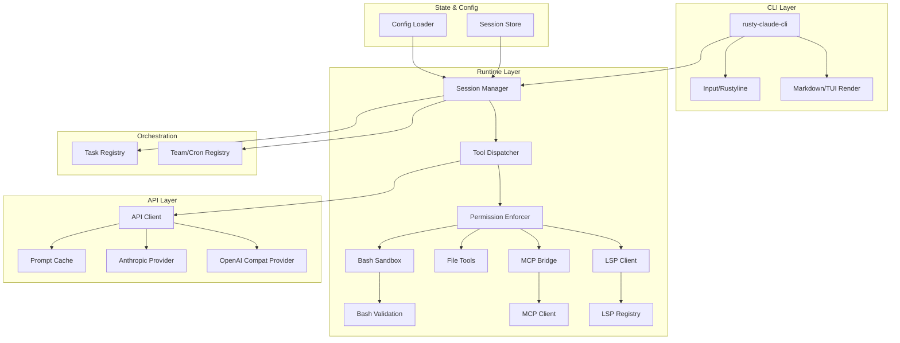

I will begin by reading the instructions in `.prompt.md` and the content of `claude.fork.claw-code.xml` to understand the task.
This is a comprehensive technical analysis of the project represented in `claude.fork.claw-code.xml` (Project Claw Code / `rusty-claude-cli`), based on the requirements from `.prompt.md`.

---

# Project Analysis: Project Claw Code (Clawd)

## 1. Project Overview
**Project Name:** Project Claw Code (also referred to as `clawd`, `claw-code`, or `rusty-claude-cli`).

Project Claw Code is an autonomous software engineering harness designed to operate as an agent-first development environment. Unlike traditional IDEs or CLIs designed primarily for human interaction, this system is built to be "clawable"—optimized for autonomous agents (claws) to perform complex coding tasks, including planning, implementation, testing, and recovery. It leverages the Anthropic Claude API (specifically optimized for models like Claude 3.5 Sonnet) to provide a high-agency coding assistant capable of managing entire development lifecycles.

The project is currently undergoing a significant transition from a TypeScript-based origin to a high-performance Rust implementation (`rust/` directory) and a Python-based porting workspace (`src/` directory). This multi-language approach serves as both a reimplementation of the core "Claude Code" functionality and an evolution into a more robust, event-driven orchestration layer. The Rust workspace is the active center of development, providing a modular architecture for tools, runtime management, and multi-agent coordination.

At its core, the project demonstrates a shift in software development philosophy: moving from humans as the primary coders to humans as directors who provide high-level intent, while autonomous "claws" handle the labor of building, verifying, and maintaining repositories. It integrates deeply with ecosystem tools like MCP (Model Context Protocol), LSP (Language Server Protocol), and specialized coordination layers like `oh-my-codex` and `clawhip`.

## 2. Supported Platforms & Deployments
- **Operating Systems:**
  - **Linux:** Primary development and CI environment (Ubuntu).
  - **macOS:** Supported via standard Rust/Python toolchains.
  - **Windows (WSL2):** Supported and tested (the current session context itself is a Windows environment interacting with the project).
- **Deployments:**
  - **Local CLI:** The `rusty-claude-cli` crate provides a standalone terminal interface.
  - **Containerized:** Support for Docker/Podman is detected and used for sandboxing.
  - **Cloud (Planned/Partial):** Integration with Cloudflare Workers is referenced in roadmap goals for remote agent execution.
- **Requirements:**
  - **Rust Toolchain:** Stable (Cargo, Rustc 2021 edition).
  - **Python:** 3.x for the porting workspace and utility scripts.
  - **API Keys:** Anthropic API key (primary), optional OpenAI/xAI keys for compatible models.
  - **Capabilities:** `unshare` capability for Linux sandboxing (`rust/crates/runtime/src/sandbox.rs`).

## 3. Supported Connectors
The project connects to various external systems and protocols to provide agents with context and execution capabilities.

| Connector | Type | Reference Files |
| :--- | :--- | :--- |
| **Anthropic API** | LLM Provider | `rust/crates/api/src/providers/anthropic.rs` |
| **OpenAI/xAI** | LLM Provider (Compat) | `rust/crates/api/src/providers/openai_compat.rs` |
| **MCP** | Model Context Protocol | `rust/crates/runtime/src/mcp.rs`, `src/mcp.py` (stub) |
| **LSP** | Language Server Protocol | `rust/crates/runtime/src/lsp_client.rs` |
| **GitHub** | Source Control / CI | `.github/workflows/rust-ci.yml`, `rust/crates/runtime/src/remote.rs` |
| **Discord** | Notification / UI | `PHILOSOPHY.md`, `ROADMAP.md` (via `clawhip`) |
| **Terminal (PTY/Bash)** | Execution Environment | `rust/crates/runtime/src/bash.rs`, `rust/crates/runtime/src/bash_validation.rs` |

## 4. Supported Models & Agents
The system is model-agnostic but optimized for the Anthropic family.

- **Models:**
  - **Anthropic Claude:** Claude 3.5 Sonnet (recommended), Claude 3 Opus, Claude 3 Haiku (`rust/crates/api/src/client.rs`).
  - **OpenAI Compat:** Models like Grok-3 (xAI) and OpenAI models are supported through the compatibility layer (`rust/crates/api/src/providers/openai_compat.rs`).
  - **Local Models:** Can be integrated via OpenAI-compatible local servers (e.g., Ollama, vLLM).
- **Agents/Roles:**
  - **Architect:** For high-level planning and design (`PHILOSOPHY.md`).
  - **Executor:** For writing and modifying code (`PHILOSOPHY.md`).
  - **Reviewer:** For verifying changes and ensuring quality (`PHILOSOPHY.md`).
- **Auth Methods:**
  - **API Token:** Standard environment variables (`ANTHROPIC_API_KEY`, `OPENAI_API_KEY`).
  - **OAuth:** Support for OAuth-based authentication for remote runtimes (`rust/crates/runtime/src/oauth.rs`).

## 5. Top 5 Use Cases
1. **Autonomous Refactoring:** An agent is given a directive to refactor a module (e.g., "Extract `LiveCli` from `main.rs`"). It plans the split, creates new files, updates imports, and runs tests to verify.
2. **Feature Implementation:** Implementing a new CLI command or tool. The agent identifies the necessary changes across the `api`, `runtime`, and `tools` crates, implements them, and adds integration tests.
3. **Bug Hunting & Fixing:** Given a failing test or a bug report, the agent uses `grep_search` and `lsp` to trace the cause, applies a fix, and verifies it with a new test case.
4. **Autonomous Porting:** The project itself uses agents to port TypeScript logic into Rust and Python, using existing files as reference to generate functionally equivalent code in a new language.
5. **Continuous Maintenance:** Monitoring a repository for stale branches, dependency updates, or lint errors, and autonomously creating PRs to fix them.

## 6. Top 20 Features
1. **Live Markdown Rendering:** Renders LLM output with syntax highlighting and formatting in real-time (`rust/crates/rusty-claude-cli/src/render.rs`).
2. **Bash Execution Sandbox:** Secure execution of shell commands with workspace boundaries (`rust/crates/runtime/src/sandbox.rs`).
3. **MCP Tool Bridge:** Seamless integration of Model Context Protocol servers as tools (`rust/crates/runtime/src/mcp_tool_bridge.rs`).
4. **LSP Integration:** Deep code intelligence (definition, hover, symbols) via Language Server Protocol (`rust/crates/runtime/src/lsp_client.rs`).
5. **Prompt Caching:** Optimized API usage by caching prompt prefixes to reduce latency and cost (`rust/crates/api/src/prompt_cache.rs`).
6. **Session Management:** Persistent, resumable conversation sessions with history compression (`rust/crates/runtime/src/session.rs`).
7. **Permission Enforcer:** Fine-grained control over which tools can run and in what mode (read-only vs write) (`rust/crates/runtime/src/permission_enforcer.rs`).
8. **Interactive REPL:** A feature-rich shell with slash commands and autocompletion (`rust/crates/rusty-claude-cli/src/input.rs`).
9. **Task Registry:** In-memory tracking of long-running autonomous tasks (`rust/crates/runtime/src/task_registry.rs`).
10. **File Operations:** Robust toolset for reading, writing, and editing files with safety guards (`rust/crates/runtime/src/file_ops.rs`).
11. **Grep & Glob Search:** Efficient codebase exploration tools (`rust/crates/runtime/src/file_ops.rs`).
12. **Team Coordination:** Registry for managing multiple agents working together (`rust/crates/runtime/src/team_cron_registry.rs`).
13. **Cron Jobs:** Support for scheduled agent tasks (`rust/crates/runtime/src/team_cron_registry.rs`).
14. **SSE Streaming:** Real-time event-based communication with LLM providers (`rust/crates/api/src/sse.rs`).
15. **Context Compaction:** Automatic summarization of history when context limits are approached (`rust/crates/runtime/src/compact.rs`).
16. **Plugin System:** Extensible hook-based architecture for custom functionality (`rust/crates/plugins/src/lib.rs`).
17. **Telemetry:** Integrated tracing and monitoring for agent actions (`rust/crates/telemetry/src/lib.rs`).
18. **Bash Validation:** Deep inspection of bash commands to prevent destructive actions (`rust/crates/runtime/src/bash_validation.rs`).
19. **Cost Tracking:** Real-time monitoring of API usage and financial cost (`src/cost_tracker.py`).
20. **Plan Mode:** Structured state for agents to design before executing (`ROADMAP.md`).

## 7. Top 20 Smart Patterns
1. **Tool-Use as API:** Treating agent tool calls as a first-class API surface for orchestration (`rust/crates/tools/src/lib.rs`).
2. **Registry Pattern:** Decoupling tool implementation from the runtime via thread-safe registries (Task, MCP, LSP) (`rust/crates/runtime/src/lib.rs`).
3. **Bridge Pattern:** Bridging different protocols (MCP, LSP) into a unified tool schema (`rust/crates/runtime/src/mcp_tool_bridge.rs`).
4. **Incremental Rendering:** Rendering LLM responses as they stream to improve perceived latency (`rust/crates/rusty-claude-cli/src/render.rs`).
5. **Graceful Degradation:** The system remains usable even if specific MCP servers or plugins fail to start (`rust/crates/runtime/src/mcp_stdio.rs`).
6. **Workspace Boundary Enforcement:** Ensuring agents cannot touch files outside the intended project directory (`rust/crates/runtime/src/permission_enforcer.rs`).
7. **Reflective Self-Porting:** Using the tool to build and port itself (`README.md`).
8. **State-First Orchestration:** Moving from log-scraping to typed event streams for monitoring (`ROADMAP.md`).
9. **Recovery Recipes:** Pre-defined strategies for recovering from common agent failures (e.g., prompt misdelivery) (`rust/crates/runtime/src/recovery_recipes.rs`).
10. **Deterministic Mocking:** A full parity harness for testing agent behavior against simulated API responses (`rust/crates/compat-harness/src/lib.rs`).
11. **Lane-Based Execution:** Organizing work into parallel "lanes" with explicit start/finish states (`ROADMAP.md`).
12. **Content-Addressable Cache:** Hashing requests to manage prompt caching efficiently (`rust/crates/api/src/prompt_cache.rs`).
13. **Hardened Lifecycle Management:** Robustly managing the lifecycle of external processes like MCP servers (`rust/crates/runtime/src/mcp_lifecycle_hardened.rs`).
14. **Slash Command Dispatch:** Modular handling of CLI commands as a separate layer from core logic (`rust/crates/commands/src/lib.rs`).
15. **Config Merge Precedence:** Hierarchical configuration (user > project > local) (`rust/crates/runtime/src/config.rs`).
16. **Binary Detection:** Preventing agents from accidentally reading or writing binary data to text files (`rust/crates/runtime/src/file_ops.rs`).
17. **Trust Auto-Resolution:** Allowlisting known safe environments to reduce human interruptions (`ROADMAP.md`).
18. **Summary Compression:** Reducing large outputs into concise summaries for the LLM context (`rust/crates/runtime/src/summary_compression.rs`).
19. **Provider-Agnostic Client:** A unified interface for different LLM providers (`rust/crates/api/src/client.rs`).
20. **Thinking Distinction:** Visual separation of "reasoning" (Chain of Thought) from final output (`rust/.omc/plans/tui-enhancement-plan.md`).

## 8. Development Trends
1. **Rust-First Core:** Migrating heavy-duty runtime and CLI logic from TypeScript/Python to Rust for performance and safety.
2. **"Clawability" Focus:** Prioritizing machine-readable states and autonomous recovery over human-centric TUI features.
3. **MCP Proliferation:** Deepening integration with Model Context Protocol as the standard for agent toolsets.
4. **Event-Driven Orchestration:** Moving towards a system where agents react to structured events (`lane.started`, `lane.failed`).
5. **Decoupled Monitoring:** Using external tools like `clawhip` to handle notifications, keeping the main agent context focused on code.
6. **Hardened Sandboxing:** Increasing the security of bash execution via Linux namespaces and capability probing.
7. **Parity Hardening:** Obsession with matching the behavior of the original system through rigorous "parity audits."
8. **Modularization:** Breaking down large crates (like `runtime`) into smaller, more focused components.
9. **Autonomous Testing:** Agents writing their own integration tests for new features.
10. **Prompt Optimization:** Aggressive use of prompt caching to reduce cost and latency.
11. **Shared Knowledge Bases:** Moving towards a unified graph-based state for multi-agent coordination.
12. **Remote Execution:** Preparing for agents to run on Cloudflare Workers or other remote environments.
13. **Cost Sensitivity:** Building tools to track and optimize the high cost of sophisticated LLM usage.
14. **Standardized Task Packets:** Using structured JSON for task dispatch instead of raw text prompts.
15. **Self-Documenting Architecture:** Using scripts and agents to generate architectural diagrams and manifests.
16. **TUI Polishing:** While prioritizing claws, still improving the human CLI experience with better Markdown and diff rendering.
17. **Unified Error Taxonomy:** Classifying failures (TrustGate, PromptDelivery, etc.) for automated handling.
18. **Stale Branch Awareness:** Agents becoming proactive about repository health and branch freshness.
19. **Plugin Ecosystem Maturity:** Standardizing the plugin lifecycle (install, enable, disable).
20. **Community-Driven Evolution:** Heavy influence from the "UltraWorkers" and "instructkr" communities.

## 9. Advantages & Strong Points
1. **High Agency:** Built for agents that can actually *do* things (run bash, edit files, use MCP) rather than just chat.
2. **Modern Architecture:** Rust-based, modular, and designed for concurrency and safety.
3. **Protocol-Rich:** First-class support for MCP, LSP, and SSE.
4. **Security Conscious:** Includes sandboxing and permission enforcement layers.
5. **Performance Optimized:** Uses Rust for the core and incorporates prompt caching.
6. **Autonomous Recovery:** Designed to heal from its own failures without human intervention.
7. **Developer-Centric:** Provides deep code intelligence and rich terminal rendering.
8. **Transparent Progress:** Clear visibility into tool calls, costs, and token usage.
9. **Extensible:** Robust plugin and hook system.
10. **Field-Tested:** The repo itself is built using the tool, providing a continuous dogfooding loop.

## 10. Limitations & Weak Points
1. **High Complexity:** The multi-language (Rust/Python/TS) and multi-protocol nature makes it hard for new contributors to grasp.
2. **Cost:** Heavy use of high-end models like Claude 3.5 Sonnet is expensive.
3. **Monolithic Hotspots:** Files like `main.rs` in the CLI crate are still overly large and complex.
4. **Partial Parity:** The Rust and Python implementations are still catching up to the original system's full feature set.
5. **Infrastructure Heavy:** Requires a specific environment (Linux/WSL) for full sandboxing features.
6. **Documentation Lag:** Fast-paced development means some docs (like README vs. Roadmap) can be contradictory.
7. **Steep Learning Curve:** Understanding "clawability" and the OmX/clawhip ecosystem takes time.
8. **Dependency on External APIs:** Heavily reliant on Anthropic; failures there block the entire system.
9. **Flaky Tests:** Some integration tests (especially MCP/Discovery) have intermittent timing issues.
10. **Inconsistent UI:** Some commands honor JSON output while others don't, making automation unpredictable.

## 11. AI Skills
*(Note: "Skills" in this context refer to the system's internal capabilities or the specific `Skill` tool.)*

- **Top 5 Provided Skills:**
  1. **Bash execution:** `rust/crates/runtime/src/bash.rs`
  2. **File manipulation (Edit/Write/Read):** `rust/crates/runtime/src/file_ops.rs`
  3. **Code Search (Grep/Glob):** `rust/crates/runtime/src/file_ops.rs`
  4. **MCP Tool usage:** `rust/crates/runtime/src/mcp_tool_bridge.rs`
  5. **LSP Intelligence:** `rust/crates/runtime/src/lsp_client.rs`
- **Top 5 Used Skills (by agents):**
  1. **Refactoring:** Autonomous code movement and cleanup.
  2. **Test Generation:** Writing unit and integration tests.
  3. **Research:** Exploring large codebases via grep and LSP.
  4. **Verification:** Running build and test commands.
  5. **Planning:** Drafting design docs before implementation.

## 12. Data Overview
- **Inputs:**
  - **User Intent:** Natural language prompts.
  - **Codebase:** Local filesystem access (constrained by workspace).
  - **Context:** Previous messages, tool results, MCP resources.
- **Outputs:**
  - **Code Changes:** Direct file edits and writes.
  - **Agent Feedback:** Markdown-rendered terminal output.
  - **Event Stream:** Structured JSON events for external orchestration.
- **Storage:**
  - **Sessions:** JSON-serialized history and state (`rust/.claude/sessions/`).
  - **Config:** Hierarchical JSON files (`.claude.json`, `.claude/settings.local.json`).
  - **Prompt Cache:** File-based cache for LLM requests (`rust/crates/api/src/prompt_cache.rs`).
  - **Task/Team State:** In-memory registries (`rust/crates/runtime/src/task_registry.rs`).

## 13. Detailed Architecture Review
1. **`rusty-claude-cli` (Bin):** The entry point and TUI layer. Handles input, rendering, and top-level dispatch (`rust/crates/rusty-claude-cli/src/main.rs`).
2. **`runtime` (Lib):** The heart of the system. Manages sessions, permissions, sandboxing, and coordination (`rust/crates/runtime/src/lib.rs`).
3. **`api` (Lib):** Abstracted client for LLM providers with built-in prompt caching (`rust/crates/api/src/lib.rs`).
4. **`tools` (Lib):** Definitions and dispatch logic for all built-in agent tools (`rust/crates/tools/src/lib.rs`).
5. **`mcp_client`:** Implements the Model Context Protocol client side (`rust/crates/runtime/src/mcp_client.rs`).
6. **`lsp_client`:** Manages connections to Language Servers for code intelligence (`rust/crates/runtime/src/lsp_client.rs`).
7. **`permission_enforcer`:** Middleware that gates tool execution based on policy (`rust/crates/runtime/src/permission_enforcer.rs`).
8. **`bash_validation`:** Deep parsing of shell commands for safety (`rust/crates/runtime/src/bash_validation.rs`).
9. **`session_store`:** Manages persistence of conversation history (`rust/crates/runtime/src/session.rs`).
10. **`task_registry`:** Tracks and manages autonomous agent tasks (`rust/crates/runtime/src/task_registry.rs`).
11. **`mcp_tool_bridge`:** Maps MCP tools into the system's unified tool schema (`rust/crates/runtime/src/mcp_tool_bridge.rs`).
12. **`sandbox`:** Provides isolated execution environments using Linux namespaces (`rust/crates/runtime/src/sandbox.rs`).
13. **`prompt_cache`:** Logic for prefix-based caching of LLM requests (`rust/crates/api/src/prompt_cache.rs`).
14. **`config_loader`:** Handles hierarchical configuration loading (`rust/crates/runtime/src/config.rs`).
15. **`telemetry`:** Infrastructure for logging and tracing agent actions (`rust/crates/telemetry/src/lib.rs`).
16. **`plugins`:** System for loading and executing external hooks (`rust/crates/plugins/src/lib.rs`).
17. **`commands`:** Metadata and help for slash commands (`rust/crates/commands/src/lib.rs`).
18. **`sse_parser`:** Handles Server-Sent Events from providers (`rust/crates/api/src/sse.rs`).
19. **`green_contract`:** Logic for determining if a workspace is in a "green" (healthy) state (`rust/crates/runtime/src/green_contract.rs`).
20. **`recovery_recipes`:** Set of automated recovery strategies (`rust/crates/runtime/src/recovery_recipes.rs`).

## 14. Architecture Diagram (Mermaid)

## 15. Maturity Review
- **Maturity:** Early-stage but highly active. It's a "production-grade prototype"—used to build itself but still undergoing major architectural shifts.
- **Stability:** Moderate. The core CLI and basic tools are stable, but the orchestration and multi-agent features are evolving rapidly.
- **Security:** High focus. Sandboxing, bash validation, and permission enforcement are core architectural pillars.
- **Performance:** High. Rust migration and prompt caching significantly improve responsiveness compared to standard LLM wrappers.

## 16. Ecosystem Review
- **Tests:** Excellent. Strong culture of integration testing and "parity" verification (`rust/crates/runtime/tests/`).
- **CI Pipelines:** Robust. Automated linting, formatting, and testing on every push (`.github/workflows/rust-ci.yml`).
- **Documentation:** Good, but fragmented. A mix of high-level philosophy, roadmaps, and usage guides.
- **AI Skills:** The system is essentially a "skill-engine" for LLMs, providing the necessary hooks for high-agency work.

## 17. Top 20 Improvements/Fixes
1. **Refactor `main.rs`:** Move `LiveCli` and its helpers into a modular `app/` structure (`rust/crates/rusty-claude-cli/src/main.rs`).
2. **Unify CLI Parsers:** Resolve the duplication between hand-rolled and clap-based argument parsing (`rust/crates/rusty-claude-cli/src/args.rs`).
3. **Fix Flaky MCP Tests:** Resolve timing issues in `manager_discovery_report_keeps_healthy_servers_when_one_server_fails` (`ROADMAP.md`).
4. **Honor JSON Output:** Ensure all inventory commands (skills, mcp) respect the `--output-format json` flag (`ROADMAP.md`).
5. **Add Interactive Session Picker:** Use fuzzy search for switching sessions (`rust/.omc/plans/tui-enhancement-plan.md`).
6. **Implement `/undo` for File Edits:** Use `originalFile` backups to revert changes (`rust/.omc/plans/tui-enhancement-plan.md`).
7. **Syntax Highlighting in Stream:** Apply real-time markdown highlighting during assistant response streaming (`rust/.omc/plans/tui-enhancement-plan.md`).
8. **Thinking Indicator:** Distinct visual style for model reasoning phases (`rust/.omc/plans/tui-enhancement-plan.md`).
9. **Context Window Preflight:** Check request size against model limits before sending (`ROADMAP.md`).
10. **Bridge `session_control`:** Wire the dead `session_control` module into the real execution path (`ROADMAP.md`).
11. **Bash Validation Parity:** Merge all 18 validation submodules from the upstream original into Rust (`PARITY.md`).
12. **Status Bar / HUD:** Persistent display for model, tokens, and git branch (`rust/.omc/plans/tui-enhancement-plan.md`).
13. **Collapsible Tool Output:** Truncate large outputs with an expand option to keep TUI clean (`rust/.omc/plans/tui-enhancement-plan.md`).
14. **Prompt Misdelivery Recovery:** Automate the detection and replay of prompts that land in the shell (`ROADMAP.md`).
15. **Stale Branch Detection:** Proactively check branch freshness before running expensive test suites (`ROADMAP.md`).
16. **Containerized Test Workflow:** Formalize and document the use of Docker for sandboxed testing (`ROADMAP.md`).
17. **Release Artifact Actions:** Automate the building of tagged binary releases (`ROADMAP.md`).
18. **Unified Config Namespace:** Clean up the mix of `.codex` and `.claude` in user-facing output (`ROADMAP.md`).
19. **Subcommand Help Interception:** Ensure `--help` works without requiring API authentication (`ROADMAP.md`).
20. **Worktree-Aware Push Events:** Improve de-duplication of commit summaries in multi-worker environments (`ROADMAP.md`).

## 18. Reuse for Agent Swarm (Specification/Implementation Debate)
1. **`oh-my-openagent` (OmO):** The core multi-agent coordination logic (`PHILOSOPHY.md`).
2. **`TaskRegistry`:** For tracking the state of multiple debating agents (`rust/crates/runtime/src/task_registry.rs`).
3. **`SummaryCompressor`:** To distill agent arguments into manageable context for the "Judge" agent (`rust/crates/runtime/src/summary_compression.rs`).
4. **`ModelAlias` Registry:** To select the best model (e.g., Opus for architecture, Sonnet for execution) (`rust/crates/api/src/client.rs`).
5. **`PlanMode` Transitions:** To manage the flow from specification to implementation (`ROADMAP.md`).
6. **`GreenContract`:** To provide an objective measure of "success" for the debated implementation (`rust/crates/runtime/src/green_contract.rs`).
7. **`LSP Registry`:** To allow agents to "see" the codebase structure during the debate (`rust/crates/runtime/src/lsp_client.rs`).
8. **`ProviderClient` abstraction:** To easily switch between different model providers for diverse perspectives (`rust/crates/api/src/client.rs`).
9. **`StructuredOutput` Tool:** To force agents into providing machine-readable specs (`rust/crates/tools/src/lib.rs`).
10. **`TaskPacket` Schema:** To pass high-fidelity instructions between agents in the swarm (`ROADMAP.md`).

## 19. Reuse for Multi-User/Multi-Agent Shared Knowledge Base
1. **`SessionStore` (JSONL/SQLite):** Foundation for persistent, shared history (`rust/crates/runtime/src/session.rs`).
2. **`ConfigLoader` hierarchy:** For managing shared project vs. private user settings (`rust/crates/runtime/src/config.rs`).
3. **`PermissionEnforcer`:** To gate interactions in a multi-user environment (`rust/crates/runtime/src/permission_enforcer.rs`).
4. **`MCP Bridge`:** To connect to shared external knowledge sources (Vector DBs, documentation) (`rust/crates/runtime/src/mcp_tool_bridge.rs`).
5. **`TaskRegistry`:** To allow users to see and manage what various agents are doing in parallel (`rust/crates/runtime/src/task_registry.rs`).
6. **`LaneEvent` Schema:** For a unified event stream that multiple clients can subscribe to (`ROADMAP.md`).
7. **`OAuth` module:** For managing user identities and access to remote agents (`rust/crates/runtime/src/oauth.rs`).
8. **`Skill` Tooling:** For evolving and sharing new agent capabilities across the system (`rust/crates/tools/src/lib.rs`).
9. **`TeamRegistry`:** For organizing agents and users into collaborative units (`rust/crates/runtime/src/team_cron_registry.rs`).
10. **`SummaryCompression`:** For distilling long-running shared knowledge into context-sized snapshots (`rust/crates/runtime/src/summary_compression.rs`).

## 20. Reuse for Remote/Messenger-Based Agent Interaction
1. **`SSE Streaming`:** For real-time updates to web/mobile clients (`rust/crates/api/src/sse.rs`).
2. **`RemoteRuntime`:** Logic for managing agents running outside the local machine (`src/remote_runtime.py`).
3. **`Voice` module:** Hooks for voice-to-text and text-to-voice interaction (`src/voice/__init__.py`).
4. **`Cloudflare Workers` targets:** References in roadmap for edge-based agent execution (`ROADMAP.md`).
5. **`TerminalRenderer`:** Adaptable for rendering Markdown in messenger apps (Telegram/WhatsApp) (`rust/crates/rusty-claude-cli/src/render.rs`).
6. **`JSON Output` contract:** For machine-to-machine communication between the CLI and a native/web app (`ROADMAP.md`).
7. **`LSP/Symbols` Tools:** For generating data for graph visualizations of the codebase (`rust/crates/runtime/src/lsp_client.rs`).
8. **`Sandboxing`:** Critical for running agents on own hardware securely (`rust/crates/runtime/src/sandbox.rs`).
9. **`Plugin Hooks`:** For connecting to messenger APIs or custom webhooks (`rust/crates/plugins/src/lib.rs`).
10. **`OAuth` flow:** For securing remote access via messengers (`rust/crates/runtime/src/oauth.rs`).

## 21. Reuse for Team Agents (Human/Agent Cooperation)
1. **`AskUserQuestion` Tool:** The primary bridge for agent-to-human escalation (`rust/crates/tools/src/lib.rs`).
2. **`TrustResolver`:** For reducing friction in human/agent handoffs (`ROADMAP.md`).
3. **`TeamRegistry`:** For managing the "Who's Who" of humans and agents in a lane (`rust/crates/runtime/src/team_cron_registry.rs`).
4. **`LaneBoard` Status:** A machine-readable board for human oversight of agent work (`ROADMAP.md`).
5. **`Policy Engine`:** For encoding human-defined rules for autonomous agent behavior (`ROADMAP.md`).
6. **`PlanMode` Design:** Allowing humans to review and approve agent designs before execution (`ROADMAP.md`).
7. **`Permission Prompts`:** The interactive approval loop for high-risk actions (`rust/crates/runtime/src/permission_enforcer.rs`).
8. **`Commit Provenance`:** Tracking who (human or agent) made which change (`ROADMAP.md`).
9. **`Escalation Policy`:** Rules for when an agent should stop and ask a human for help (`ROADMAP.md`).
10. **`Discord/Clawhip` integration:** Bringing human/agent interactions into the team's existing communication channels (`PHILOSOPHY.md`).
