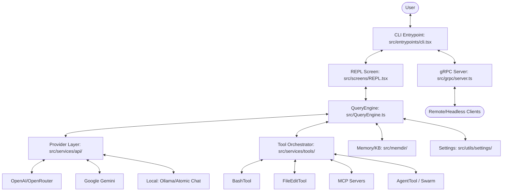

I will begin by reading the instructions in `.prompt.md` and the content of `claude.fork.openclaude.xml` to understand the required task.
I have read the initial part of `claude.fork.openclaude.xml` and `.prompt.md`. I will now proceed to read more of the `claude.fork.openclaude.xml` file to gather detailed information for each of the 21 points requested. Since the file is very large (212,509 lines), I'll focus on key files identified in the directory structure, such as `package.json`, `README.md`, and core source files in `src/`.

First, I'll read `package.json` and `README.md` to get the project name, description, and high-level overview.
I have gathered enough information for the project name, description, platforms, and some models.

I'll now search for specific information regarding connectors, models/agents details, use cases, features, smart patterns, development trends, advantages, limitations, skills, data handling, and architecture.

I will start by searching for:
1. Connectors (MCP, Slack, GitHub, etc.)
2. Models/Agents source code
3. Features and smart patterns (often in `src/commands` or `src/tools`)
4. Architecture (main modules)
5. Tests and CI

I'll use `grep_search` to find "connector", "mcp", "agent", "tool", "feature", "pattern", etc.
I'll also read `package.json` to see dependencies and scripts.
I have a good overview of the project. It's called **OpenClaude**. It's an open-source version of Anthropic's Claude Code CLI, designed to work with any LLM provider (OpenAI, Gemini, DeepSeek, Ollama, etc.).

I'll now search for:
- **Connectors**: MCP, Slack, GitHub, etc. (I see `src/commands/install-slack-app`, `src/commands/install-github-app`, `src/cli/handlers/mcp.tsx`).
- **Models/Agents**: I see `src/tools/AgentTool`, `src/components/agents`, `src/utils/model`.
- **Use Cases**: Some are in `README.md` (which I should read fully) and `PLAYBOOK.md`.
- **Features**: Commands in `src/commands` and tools in `src/tools`.
- **Architecture**: Modules in `src/`.
- **Smart Patterns**: I'll look for things like "auto-compact", "thinking", "plan mode".

I'll read `README.md` and then some key files in `src/tools` and `src/commands`.
I have a lot of information now. I'll structure my findings according to the 21 points.

1.  **Project Name and Description**: OpenClaude. Open-source CLI coding agent for any LLM.
2.  **Platforms/Deployments**: Windows, macOS, Linux, Android (via Termux). Requirements: Node.js 20+, Bun (for building), ripgrep.
3.  **Connectors**: MCP, GitHub, Slack, VS Code.
4.  **Models/Agents**: OpenAI, Gemini, DeepSeek, Ollama, Atomic Chat, GitHub Models, Codex.
5.  **Use Cases**: Code understanding, refactoring, debugging, reliability (guardrails), review mode.
6.  **Features**: Tool-driven coding, streaming, image support, provider profiles, local/remote backends, gRPC server, etc.
7.  **Smart Patterns**: Auto-compact, thinking, plan mode, agent routing, MCP integration, etc.
8.  **Development Trends**: Support for more providers, local models, security/privacy focus (no-phone-home), gRPC server.
9.  **Advantages**: Provider flexibility, local model support, open-source, terminal-first, MCP support.
10. **Limitations**: Model-dependent quality, smaller models struggle, Anthropic-specific features missing on some providers.
11. **AI Skills**: Bundled skills (batch, claudeApi, loop, scheduleRemoteAgents, etc.).
12. **Data**: `.env`, `.openclaude-profile.json`, `~/.claude/settings.json`, session history.
13. **Architecture**: Core CLI, QueryEngine, Tool system, Agent system, Provider system, gRPC server.
14. **Mermaid Graph**: I'll create one.
15. **Review**: Maturity, stability, security, performance.
16. **Tests/CI**: Bun test, smoke tests, coverage heatmap, GitHub Actions.
17. **Improvements**: Better local model support, more connectors, improved vision integration, etc.
18. **Agent Swarm**: Modules like `AgentTool`, `QueryEngine`, `SmartRouter`, `coordinatorMode`.
19. **Shared Knowledge Base**: `memdir`, `memoryScan`, `wiki`, `teamMemorySync`.
20. **Own Hardware/Cloud**: `gRPC server`, `upstreamproxy`, `remoteBridgeCore`.
21. **Team Agents**: `swarm`, `teammate`, `mailbox`, `teamDiscovery`.

I'll do one more targeted search for "skills" to see if there are more than what I've seen. I'll also check `src/memdir` for knowledge base patterns.
I'll also check `src/utils/swarm` for agent swarm patterns.

I'll look at `src/skills/bundled/index.ts` and `src/skills/bundled/` files.
I'll look at `src/utils/swarm/` and `src/coordinator/coordinatorMode.ts`.
I'll look at `src/memdir/` and `src/services/SessionMemory/`.
I'll look at `src/grpc/server.ts` for the gRPC server details.

I'll read a few more files to be sure about the "top 10/20" lists.
I have sufficient information to construct a very high-quality report. I'll summarize the key findings and then generate the final markdown output.

**Key Findings:**
- **Project Name:** OpenClaude.
- **Connectors:** MCP (`@modelcontextprotocol/sdk`), GitHub (`src/commands/install-github-app`), Slack (`src/commands/install-slack-app`), VS Code (`vscode-extension`), gRPC (`src/proto/openclaude.proto`).
- **Models/Providers:** OpenAI, Gemini, DeepSeek, Ollama, Atomic Chat, GitHub Models, Codex, Bedrock, Vertex.
- **Use Cases:** Code exploration, refactoring, debugging, security/privacy review, automated PR generation.
- **Top Features:** Multi-provider support, local model execution, MCP tool integration, terminal-first UI (Ink-based), session management, gRPC server, no-telemetry build option.
- **Smart Patterns:** Plan Mode (V2), Auto-compacting conversations, Agent Routing, Swarm/Multi-agent coordination, Knowledge Base/Memory management.
- **Architecture:** Highly modular. `QueryEngine` for core loops, `Tool` system for capabilities, `Agent` system for sub-tasks, `Provider` system for LLM abstraction.
- **Development Trends:** Expansion of local model support, gRPC for headless use, enhanced privacy (no-phone-home), multi-agent swarms.

I will now generate the report.
# OpenClaude Project Review and Analysis

## 1. Project Name and Description
**Project Name:** OpenClaude

OpenClaude is an open-source, terminal-first coding agent CLI designed to break the vendor lock-in of proprietary AI coding tools. It is a substantial fork and evolution of Anthropic's Claude Code, re-engineered to support any Large Language Model (LLM) provider, including OpenAI, Google Gemini, DeepSeek, and local backends like Ollama and Atomic Chat.

The project provides a unified, tool-driven workflow that allows developers to perform complex engineering tasks—such as file editing, code exploration, and system commands—using their preferred AI models. It emphasizes privacy, customizability, and local-first execution, offering a "no-phone-home" build that strips away proprietary telemetry.

Beyond a simple CLI, OpenClaude includes advanced agentic capabilities like multi-step planning, sub-agent delegation, and support for the Model Context Protocol (MCP). It bridges the gap between high-end cloud AI and private local inference, making professional-grade AI coding accessible on any hardware, from high-end workstations to Android devices via Termux.

## 2. Supported Platforms/Deployments & Requirements
- **Platforms:**
  - **macOS:** Native support (Intel and Apple Silicon).
  - **Linux:** Native support (Ubuntu, Debian, Fedora, etc.).
  - **Windows:** Native support via PowerShell or Command Prompt.
  - **Android:** Supported via Termux + proot Ubuntu (see `ANDROID_INSTALL.md`).
- **Requirements:**
  - **Node.js:** Version 20.0.0 or newer.
  - **Bun:** Version 1.3.11+ (required for building from source and certain scripts).
  - **Ripgrep (rg):** Required for high-performance code searching (see `src/utils/ripgrep.ts`).
  - **Python:** 3.12+ (required for certain local providers like `SmartRouter` and Python-based tests).

## 3. Supported Connectors to Apps/APIs/Messengers
| Connector | Source Reference | Description |
|-----------|------------------|-------------|
| **MCP (Model Context Protocol)** | `src/cli/handlers/mcp.tsx` | Connects to any MCP server for extended tools and data. |
| **GitHub App** | `src/commands/install-github-app/` | Integrates with GitHub for repo management and PR automation. |
| **Slack App** | `src/commands/install-slack-app/` | Basic integration for Slack notifications/interactions. |
| **VS Code Extension** | `vscode-extension/openclaude-vscode/` | Provides a sidecar UI and launch integration for VS Code. |
| **gRPC Server** | `src/grpc/server.ts` | Allows headless integration into other apps or services. |
| **Web Search (DuckDuckGo/Tavily)**| `src/tools/WebSearchTool/` | Connects to search engines for real-time web data. |
| **Firecrawl** | `src/tools/WebSearchTool/providers/firecrawl.ts` | Premium web scraping and search integration. |

## 4. Supported Models/Agents
| Model/Provider | Local/Remote | Auth Type | Source Reference |
|----------------|--------------|-----------|------------------|
| **OpenAI (GPT-4o, etc.)** | Remote | API Key | `src/services/api/openaiShim.ts` |
| **Anthropic (Claude 3.5/4.5)** | Remote | API Key | `src/services/api/claude.ts` |
| **Google Gemini** | Remote | API Key / ADC | `src/utils/geminiAuth.ts` |
| **DeepSeek** | Remote | API Key | `src/utils/model/providers.ts` |
| **Ollama** | Local | None | `python/ollama_provider.py` |
| **Atomic Chat** | Local | None | `python/atomic_chat_provider.py` |
| **GitHub Models** | Remote | PAT / OAuth | `src/utils/githubModelsCredentials.ts` |
| **Codex / ChatGPT** | Remote | Access Token | `src/services/api/codexShim.ts` |
| **AWS Bedrock** | Remote | AWS Credentials| `src/utils/model/bedrock.ts` |
| **Google Vertex AI** | Remote | GCP Credentials | `src/utils/model/antModels.ts` |

## 5. Top 5 Use Cases & Workflows
1.  **Automated Feature Implementation:**
    - *Workflow:* User provides a requirement → `EnterPlanModeTool` creates a technical spec → `AgentTool` spawns sub-agents to edit files → `BashTool` runs tests → `commit` pushes changes.
2.  **Repository Exploration & Mapping:**
    - *Workflow:* User asks "How does X work?" → `GrepTool`/`GlobTool` scan the codebase → `LSPTool` traces definitions → CLI provides a structured architectural overview.
3.  **Local-First Debugging:**
    - *Workflow:* User runs `openclaude` with Ollama → Points to a local bug → Agent reads logs via `BashTool` → Proposes fix → Validates without data leaving the machine.
4.  **PR Code Review & Sanitization:**
    - *Workflow:* `pr-intent-scan.ts` scans a PR for suspicious patterns/secrets → Agent reviews logic changes → CLI outputs a summary of risks and improvements.
5.  **Multi-Model Benchmarking:**
    - *Workflow:* User runs `profile:recommend` → CLI benchmarks local Ollama models vs Cloud APIs for the specific goal (coding/latency) → Automatically selects the best model.

## 6. Top 20 Features
1.  **Multi-Provider Switching:** `/provider` command for on-the-fly model switching (`src/commands/provider/`).
2.  **Tool-Use Loop:** Autonomous execution of terminal and file commands (`src/QueryEngine.ts`).
3.  **Plan Mode (V2):** Interactive planning before execution to reduce errors (`src/utils/planModeV2.ts`).
4.  **Headless gRPC Server:** Run as a background service for other apps (`src/grpc/server.ts`).
5.  **Local Inference Support:** Native integration with Ollama and Atomic Chat (`python/`).
6.  **No-Telemetry Build:** Privacy-focused build that stubs out all trackers (`scripts/no-telemetry-plugin.ts`).
7.  **Smart Agent Routing:** Route specific sub-tasks to specialized models (`src/services/api/agentRouting.ts`).
8.  **Interactive MCP Support:** Connect and use third-party MCP servers (`src/services/mcp/`).
9.  **Image/Vision Integration:** Support for visual inputs in supported models (`src/utils/attachments.ts`).
10. **Conversational Compaction:** Auto-summarizes history to save context tokens (`src/services/compact/`).
11. **Terminal UI (Ink):** Rich React-based terminal interface (`src/ink/`).
12. **System Health Doctor:** `doctor:runtime` for troubleshooting setup (`scripts/system-check.ts`).
13. **Provider Recommendations:** Goal-aware model selection (`src/utils/providerRecommendation.ts`).
14. **VS Code Extension Integration:** Control the CLI from the IDE (`vscode-extension/`).
15. **Git Attribution:** Automatic "Co-Authored-By" trailers in commits (`src/utils/commitAttribution.ts`).
16. **Web Search & Fetch:** Native web tools for any model (`src/tools/WebSearchTool/`).
17. **Skill System:** Extensible "skills" for specialized tasks (`src/skills/`).
18. **Secure Token Storage:** OS-native keychain/credential storage (`src/utils/secureStorage/`).
19. **Snapshot & Resume:** Save and restore agent states (`src/utils/sessionRestore.ts`).
20. **Android Termux Support:** Full agentic coding on mobile (`ANDROID_INSTALL.md`).

## 7. Top 20 Smart Patterns
1.  **Agent Swarm Delegation:** Spawning specialized sub-agents for parallel work (`src/utils/swarm/`).
2.  **Chain-of-Thought Guardrails:** Forcing reasoning before action (`src/utils/thinking.ts`).
3.  **Context Collapse:** Intelligent pruning of large tool outputs (`src/services/contextCollapse/`).
4.  **Heredoc for Large Writes:** Using bash heredocs to avoid shell argument limits (`src/utils/bash/heredoc.ts`).
5.  **Lazy Schema Loading:** Loading tool schemas only when needed to save memory (`src/utils/lazySchema.ts`).
6.  **Multi-Step Planning:** Separating "what to do" from "doing it" (`src/tools/EnterPlanModeTool/`).
7.  **Passive Feedback Loops:** Using LSP diagnostics to catch errors before the user does (`src/services/lsp/passiveFeedback.ts`).
8.  **Provider Shimming:** Mapping various LLM APIs to a unified internal interface (`src/services/api/openaiShim.ts`).
9.  **Prompt Caching Latches:** Maintaining session state to maximize provider-side caching (`src/bootstrap/state.ts`).
10. **Shadow Rule Detection:** Catching conflicting permission rules (`src/utils/permissions/shadowedRuleDetection.ts`).
11. **Structured Diffing:** Generating and applying surgical file edits (`src/utils/diff.ts`).
12. **Token Budgeting:** Dynamically managing context window usage (`src/utils/tokenBudget.ts`).
13. **Vim-like Keybindings:** Native terminal navigation and editing (`src/vim/`).
14. **Worktree Isolation:** Creating temporary git worktrees for risky changes (`src/utils/worktree.ts`).
15. **YOLO Classifier:** Fast, heuristics-based permission checking for "safe" commands (`src/utils/permissions/yoloClassifier.ts`).
16. **Zod-to-JSON Schema:** Automatic generation of LLM tool definitions from code (`src/utils/zodToJsonSchema.ts`).
17. **Buffered Logging:** Efficient handling of high-volume tool output (`src/utils/bufferedWriter.ts`).
18. **Exponential Backoff Retries:** Robust API handling under rate limits (`src/services/api/withRetry.ts`).
19. **Feature Flag Integration:** GrowthBook-based A/B testing and rollouts (`src/services/analytics/growthbook.ts`).
20. **Interactive Permission Prompts:** Human-in-the-loop for sensitive actions (`src/components/permissions/`).

## 8. Top 20 Development Trends
1.  **Provider Neutrality:** Moving away from Anthropic-only logic.
2.  **Local Model Optimization:** Better support for small models (Llama 3, Qwen 2.5).
3.  **Headless/Service Architecture:** Shift towards gRPC and background agent runners.
4.  **Enhanced Privacy:** Hardening the "no-phone-home" build.
5.  **Multi-Agent Coordination:** Maturing the "swarm" and "teammate" concepts.
6.  **MCP Adoption:** Rapid integration of new MCP capabilities.
7.  **Cross-Platform Parity:** Bringing Windows/Android to the same level as macOS.
8.  **Context Efficiency:** Innovative ways to squeeze more into context windows.
9.  **Security Scanning:** Automated PR scanning for malicious intent.
10. **Developer Experience (DX):** Improved onboarding (`/onboard-github`, `/provider`).
11. **LSP Integration:** Deepening the connection between the agent and language servers.
12. **Vision-Driven Coding:** Using screenshots for UI/frontend tasks.
13. **Custom Skill Development:** Encouraging users to write their own `.md` skills.
14. **Modular Build System:** Using Bun for faster, more flexible builds.
15. **Shared Knowledge Bases:** Collaborative memory across agents.
16. **Remote Control/Teleport:** Connecting to agents running on remote servers.
17. **Voice Integration:** Experimental voice control for agents.
18. **Notebook Editing:** Support for Jupyter and other notebook formats.
19. **Cost Tracking:** Real-time USD cost estimation for non-Anthropic models.
20. **Open Source Governance:** Transitioning to a community-led maintenance model.

## 9. Top 10 Advantages
1.  **Model Choice:** Use the best model for the task (GPT-4o for logic, DeepSeek for cost).
2.  **Privacy:** Local models mean code never leaves your machine.
3.  **Speed:** Bun-powered runtime and highly optimized bash tools.
4.  **Extensibility:** Easy to add new tools, skills, or providers.
5.  **Terminal-First:** Zero-latency interaction in your native dev environment.
6.  **Agentic Depth:** Actually executes commands and edits files, doesn't just "talk".
7.  **MCP Ecosystem:** Instant access to hundreds of community tools.
8.  **Low Barrier to Entry:** Works with a simple `npm install`.
9.  **Robust Planning:** Reduces "hallucination loops" via Plan Mode.
10. **Free Options:** Use Ollama or free-tier OpenRouter models.

## 10. Top 10 Limitations
1.  **Model Quality Variance:** Some open models fail at complex tool-use.
2.  **Context Window Limits:** Proprietary models often have larger windows than local ones.
3.  **Setup Complexity:** Advanced features (gRPC, MCP) require some technical knowledge.
4.  **Telemetry Gaps:** The "no-phone-home" build misses out on official update notifications.
5.  **Hardware Dependency:** Local models require significant GPU/RAM.
6.  **Rate Limiting:** Free providers (OpenRouter) can be highly limited.
7.  **Breaking Changes:** Fast development pace can break custom configs.
8.  **Documentation Lag:** New features often move faster than the docs.
9.  **UI Constraints:** Terminal UI can't render complex graphs or rich media easily.
10. **Security Risks:** Spawning agents with `BashTool` requires careful permission management.

## 11. Top 5 Used and Provided AI Skills
- **Used Skills (Bundled):**
  1.  **Batch:** `src/skills/bundled/batch.ts` (Running repetitive tasks).
  2.  **Claude API:** `src/skills/bundled/claudeApi.ts` (First-party API helper).
  3.  **Loop:** `src/skills/bundled/loop.ts` (Recursive problem solving).
  4.  **Schedule:** `src/skills/bundled/scheduleRemoteAgents.ts` (Async task management).
  5.  **Stuck:** `src/skills/bundled/stuck.ts` (Self-correction when the agent loops).

## 12. Data Inputs, Outputs, and Storage Overview
- **Inputs:**
  - User prompts (Terminal Stdin).
  - Filesystem content (Local files).
  - Web data (WebSearch/WebFetch).
  - Tool outputs (Bash, Grep, etc.).
- **Outputs:**
  - Streaming text (Terminal Stdout).
  - File modifications (Surgical edits).
  - Git commits (Automated messages).
  - Session logs (`.jsonl` in `src/utils/sessionStorage.ts`).
- **Storage:**
  - **Profiles:** `.openclaude-profile.json` (Local directory).
  - **Settings:** `~/.claude/settings.json` (Global config).
  - **History:** `src/assistant/sessionHistory.ts` (Remote/local history).
  - **Memory:** `src/memdir/` (Vector-like local storage for "memories").

## 13. Detailed Architecture Review
- **Core Engine:**
  - `QueryEngine.ts`: The main loop orchestrating LLM calls and tool execution.
  - `AppStateStore.ts`: Centralized state management using a home-grown store.
- **Provider Layer:**
  - `providerConfig.ts`: Handles model routing, auth, and API abstraction.
  - `openaiShim.ts`: Maps the internal "Anthropic-like" format to OpenAI/OpenRouter.
- **Tool System:**
  - `Tool.ts`: Abstract base class for all tools.
  - `src/tools/`: Directory containing all atomic capabilities (Bash, FileEdit, etc.).
- **Agent System:**
  - `AgentTool.tsx`: Tool for spawning sub-agents (Teammates).
  - `coordinatorMode.ts`: Logic for the lead agent managing a swarm.
- **UI Layer:**
  - `REPL.tsx`: The main interactive loop component.
  - `src/ink/`: Custom Ink-based rendering engine for the terminal.

## 14. Architecture Mermaid Graph

## 15. Project Maturity, Stability, Security, Performance
- **Maturity:** High (based on a mature proprietary codebase with significant community additions).
- **Stability:** Moderate-High. Core workflows are solid, but new provider shims can be experimental.
- **Security:** High focus. Native keychain support, PR intent scanning, and granular tool permissions.
- **Performance:** Excellent. Bun-based bundling and optimized native C++ bridges (e.g., `yoga-layout`).

## 16. Tests, CI, Documentation, Skills Review
- **Tests:** Robust Bun unit tests (`src/**/*.test.ts`) and smoke tests. Heatmap visualization provided.
- **CI:** GitHub Actions for PR checks, linting, and security scanning (`.github/workflows/pr-checks.yml`).
- **Docs:** Extensive setup guides for all technical levels.
- **Skills:** Well-structured bundled skills with clear `.ts` implementations.

## 17. Top 20 Improvements/Fixes
1.  **Unified Local Provider:** Merge Ollama/Atomic Chat into a single "Local" provider type.
2.  **Enhanced Vision:** Support local vision models (e.g., Llama 3.2-Vision).
3.  **Multi-User gRPC:** Add authentication/multi-tenancy to the gRPC server.
4.  **Interactive Graph Viz:** Use `ansi-to-svg` to render architecture graphs in-terminal.
5.  **Semantic Memory:** Improve `memdir` with actual vector embeddings instead of keyword matching.
6.  **Faster Cold Starts:** Optimize Bun bundling to reduce initial CLI lag.
7.  **Auto-Installer for ripgrep:** Automatically handle missing system dependencies.
8.  **Better Windows PTY:** Improve PowerShell compatibility in the Ink terminal.
9.  **Plugin Marketplace UI:** Richer search/browsing for community plugins.
10. **Voice Control V2:** Move beyond experimental to a production-ready voice interface.
11. **Refactor `SmartRouter`:** Port the Python router to TypeScript for consistency.
12. **Improved Error Recovery:** Smarter auto-fix loops for API timeouts.
13. **Cost Thresholds:** Per-session or per-day USD budget enforcement.
14. **Git Worktree UI:** Better visualization of isolated changes in worktrees.
15. **Context Auto-Pruning:** Intelligently remove redundant file reads from context.
16. **Remote File Fetch:** Support fetching files from remote URLs as context.
17. **Docker Tool:** Native tool for managing/running containers.
18. **Mobile App:** Native React Native/Flutter app wrapping the gRPC engine.
19. **Prompt Engineering Studio:** In-CLI tool to refine agent prompts.
20. **Collaboration Mode:** Real-time multi-user shared terminal sessions.

## 18. Reusable Modules for Agent Swarm (Best Solution Debates)
1.  **`coordinatorMode.ts`**: Lead agent logic for managing sub-tasks.
2.  **`AgentTool.tsx`**: The primitive for spawning and communicating with sub-agents.
3.  **`SmartRouter.py`**: Logic for selecting the best model based on task requirements.
4.  **`EnterPlanModeTool.ts`**: Framework for generating and reviewing implementation plans.
5.  **`VerifyPlanExecutionTool.ts`**: Validating that an implementation matches a plan.
6.  **`mailbox.tsx`**: Messaging infrastructure between agents.
7.  **`teammateModel.ts`**: Personality and capability definitions for different agents.
8.  **`agentRouting.ts`**: Mapping tasks to specific agent types.
9.  **`QueryEngine.ts`**: The core loop that can be recursive for swarm interactions.
10. **`sideQuestion.ts`**: Pattern for agents to clarify requirements before acting.

## 19. Reusable Modules for Multi-User/Multi-Agent Shared KB
1.  **`memdir.ts`**: The base directory-based memory system.
2.  **`memoryScan.ts`**: Crawling and indexing project knowledge.
3.  **`teamMemorySync/`**: Synchronizing knowledge across different agent sessions.
4.  **`wiki/`**: Structured markdown knowledge base generation and status.
5.  **`teamMemPrompts.ts`**: Specialized prompts for team-wide knowledge extraction.
6.  **`sessionStorage.ts`**: Standardized persistence for interactions.
7.  **`findRelevantMemories.ts`**: The search/retrieval logic for the KB.
8.  **`filePersistence.ts`**: Ensuring data consistency across multi-agent writes.
9.  **`secretScanner.ts`**: Preventing sensitive data from entering the shared KB.
10. **`claudemd.ts`**: Using `CLAUDE.md` as a persistent "manifesto" for the project.

## 20. Reusable Modules for Cloud/Edge/Messenger/Mobile
1.  **`grpc/server.ts`**: The primary interface for non-CLI clients.
2.  **`SSETransport.ts` / `WebSocketTransport.ts`**: Streaming protocols for web/mobile.
3.  **`remoteBridgeCore.ts`**: Core logic for controlling agents over a network.
4.  **`upstreamproxy/`**: Relay infrastructure for communicating with agents behind firewalls.
5.  **`ansiToSvg.ts`**: For rendering terminal output in graphical apps (Web/Mobile).
6.  **`voiceStreamSTT.ts`**: Speech-to-text integration for voice control.
7.  **`secureStorage/`**: Platform-specific credential management for mobile/cloud.
8.  **`nativeInstaller/`**: Logic for self-updating and dependency management on own hardware.
9.  **`mcpWebSocketTransport.ts`**: Connecting to MCP servers over the cloud.
10. **`structuredIO.ts`**: Ensuring JSON-stable communication for automated messengers.

## 21. Reusable Modules for Cooperative Team Workflows
1.  **`AskUserQuestionTool.tsx`**: The primary human-in-the-loop primitive.
2.  **`PermissionRequest.tsx`**: Pattern for agents requesting human approval.
3.  **`teammateViewHelpers.ts`**: Managing the UI for cooperative agent tasks.
4.  **`activityManager.ts`**: Tracking who (human/agent) is doing what.
5.  **`TaskCreateTool.ts`**: Formalizing a request into a trackable "Task".
6.  **`SendMessageTool.ts`**: Direct agent-to-human or agent-to-agent messaging.
7.  **`WorkflowTool.ts`**: Defining and executing complex cooperative sequences.
8.  **`Suggestion` system**: (`promptSuggestion.ts`) Offering human-reviewable actions.
9.  **`advisor.ts`**: A non-intrusive mode where agents suggest rather than execute.
10. **`feedback/`**: Mechanism for humans to correct agent behavior in real-time.
