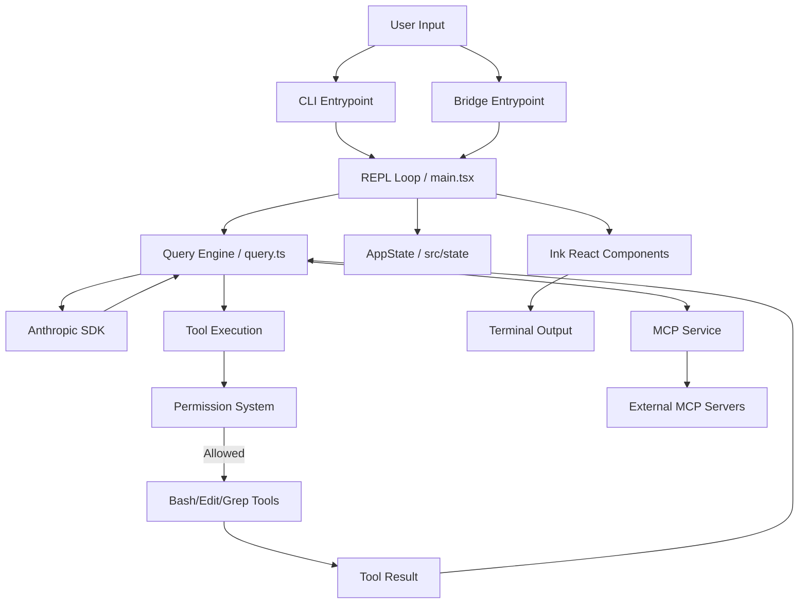

I will read the instructions in `.prompt.md` to understand the task requirements.
I will read the beginning of `claude.source.2-1-88.2026-03-31.xml` to understand its structure and content.
I will read the directory structure in `claude.source.2-1-88.2026-03-31.xml` to get a better understanding of the project's organization.
I will read the `README.md` file in `claude.source.2-1-88.2026-03-31.xml` to gain more high-level information about the project.
I will read the entire `<directory_structure>` section in `claude.source.2-1-88.2026-03-31.xml` to clarify the project's scope and its relationship with Claude Code.
I will search for the Git logs in `claude.source.2-1-88.2026-03-31.xml` to identify the top 20 development trends.
I will search for "Git logs" or "commits" in `claude.source.2-1-88.2026-03-31.xml` to locate the development history.
I will search for `<repository_info>` in `claude.source.2-1-88.2026-03-31.xml` to find the Git logs and other repository information.
I will read from line 46 of `claude.source.2-1-88.2026-03-31.xml` to see if there's any repository information or a more detailed directory structure.
I will read the content starting from line 251 of `claude.source.2-1-88.2026-03-31.xml` to see if there are more files included in the export.
I will check the end of `claude.source.2-1-88.2026-03-31.xml` to find the Git logs and identify the latest development trends.
I will read `claude-code-skills/09-tool-architecture.md` and `claude-code-skills/10-command-architecture.md` to gain a deeper understanding of the tool and command structures.
I will read `claude-code-skills/SKILL.md` to see how the skills are defined and identify the top used and provided AI skills.
# Claude Code Project Analysis Report

Based on the repository export `claude.source.2-1-88.2026-03-31.xml` and its comprehensive "Claude Code Skills" documentation, here is a detailed analysis of the **Claude Code** project.

---

### 1. Project Name and Description

**Project Name:** Claude Code (`@anthropic-ai/claude-code`)

Claude Code is an interactive, AI-powered coding assistant that operates as a CLI (Command Line Interface) application within the terminal. It provides a specialized REPL (Read-Eval-Print Loop) environment where developers can engage in natural language conversations with Claude to autonomously write, debug, refactor, and understand complex codebases.

The system is built on a high-performance stack comprising TypeScript and Node.js, utilizing the Ink framework (React for the terminal) to deliver a rich, interactive UI. It integrates deeply with the Anthropic API and leverages a suite of model-invocable tools that allow it to execute shell commands, perform sophisticated file edits, search codebases using ripgrep, and navigate web resources.

Architecturally, Claude Code is designed for developer productivity and safety. It features a robust permission system, internal optimizations like dead code elimination via Bun feature flags, schema-driven tool validation with Zod, and a modular architecture that supports both interactive CLI usage and programmatic SDK integration.

---

### 2. Supported Platforms/Deployments + Requirements

*   **Platforms:** Node.js (ESM), Terminal-based environments (macOS, Linux, Windows via WSL/cmd/powershell).
*   **Deployments:**
    *   **Local CLI:** Primary usage mode via terminal.
    *   **SDK:** Programmatic usage as a library (`src/entrypoints/agentSdk.ts`).
    *   **Bridge:** Remote connectivity for IDE extensions and mobile devices (`src/bridge/`).
    *   **Cloud Shims:** Support for Bedrock, Vertex AI, and Foundry environments.
*   **Requirements:**
    *   **Runtime:** Node.js (v18+ recommended for ESM support).
    *   **Authentication:** Anthropic API Key (default) or cloud provider credentials (AWS/Google/Palantir).
    *   **Dependencies:** `esbuild` for transpilation, `Bun` for internal build optimizations.

---

### 3. Supported Connectors to Apps/APIs/Messengers

*   **Anthropic API:** Core connection via `@anthropic-ai/sdk` (`src/query.ts`).
*   **AWS Bedrock:** Supported via environment flags (`src/utils/envUtils.ts`).
*   **Google Vertex AI:** Supported via environment flags (`src/utils/envUtils.ts`).
*   **Palantir Foundry:** Supported via environment flags (`src/utils/envUtils.ts`).
*   **MCP (Model Context Protocol):** Universal connector for external tools and services (`src/services/MCPService.ts`, `src/tools/MCPTool/`).
*   **GitHub:** Integration for automated PRs and repository management (`src/commands/install-github-app/`).
*   **IDE/Remote Bridge:** WebSocket-based bridge for editor integration (`src/bridge/`).

---

### 4. Supported Models/Agents

*   **Models:**
    *   **Claude 3.5 Sonnet:** Default high-performance model.
    *   **Claude 3 Opus / Haiku:** Selectable via the `/model` command (`src/commands/model/`).
*   **Agents:**
    *   **Subagents:** Spawning and management of sub-tasks via `AgentTool` (`src/tools/AgentTool/`).
*   **Auth Methods:**
    *   **API Token:** Standard Anthropic/Cloud keys.
    *   **OAuth:** Supported for specific enterprise environments (Foundry/Vertex).

---

### 5. Top 5 Use Cases and Workflows

1.  **Autonomous Bug Fixing:** User reports an error -> Claude searches logs/code (`GrepTool`) -> Analyzes logic -> Proposes and applies fix (`FileEditTool`) -> Runs tests (`BashTool`).
2.  **Feature Implementation:** User describes feature -> Claude plans changes -> Creates new files/components (`FileWriteTool`) -> Updates imports -> Validates with build.
3.  **Codebase Exploration:** User asks "How does X work?" -> Claude glob-searches files (`GlobTool`) -> Reads key modules (`FileReadTool`) -> Explains architecture in terminal.
4.  **Complex Refactoring:** User provides refactoring goal -> Claude performs multi-file edits (`FileEditTool`) -> Ensures type safety (`typecheck`) -> Updates tests.
5.  **Environment Setup:** User requests dependency install -> Claude checks existing config -> Runs package manager commands (`BashTool`) -> Configures environment.

---

### 6. Top 20 Features

1.  **Interactive REPL:** `src/main.tsx`
2.  **Bash Execution:** `src/tools/BashTool/`
3.  **Sophisticated File Editing (sed/full):** `src/tools/FileEditTool/`
4.  **Ripgrep Code Search:** `src/tools/GrepTool/`
5.  **Web Searching:** `src/tools/WebSearchTool/`
6.  **MCP Tool Integration:** `src/tools/MCPTool/`
7.  **Subagent Spawning:** `src/tools/AgentTool/`
8.  **Terminal Markdown Rendering:** `marked-terminal` integration.
9.  **Real-time Cost/Token Tracking:** `src/cost-tracker.ts`
10. **Granular Permission Management:** `src/utils/permissions/`
11. **Git Context Integration:** `src/context.ts`
12. **Multi-entry Points (CLI, SDK, Bridge):** `src/entrypoints/`
13. **Command History & Search:** `src/history.ts`
14. **Background Task Management:** `src/tasks/`
15. **Extensible Skill System:** `src/skills/`
16. **Auto-compaction of History:** `src/commands/compact/`
17. **ANSI Syntax Highlighting:** `chalk` utility.
18. **File Globbing:** `src/tools/GlobTool/`
19. **Remote URL Fetching:** `src/tools/WebFetchTool/`
20. **Dynamic Configuration:** `src/commands/config/`

---

### 7. Top 20 Smart Patterns

1.  **`buildTool()` Factory:** Standardizes tool creation (`src/Tool.ts`).
2.  **Branded Types:** Prevents ID confusion (e.g., `SessionId` vs `AgentId`) (`src/types/ids.ts`).
3.  **Zod Schema Validation:** Strict I/O validation for tools (`src/utils/lazySchema.ts`).
4.  **Feature Flags:** Conditional compilation and dead code elimination (`bun:bundle`).
5.  **Lazy Command Loading:** Minimizes startup latency (`src/commands.ts`).
6.  **Import Cycle Breaking:** Separating constants into `toolName.ts` or `constants.ts`.
7.  **Deterministic Sorting:** Ensuring stable output for model consumption (`src/utils/format.ts`).
8.  **Module-Level State accessors:** `get`/`set` pattern for shared state (`src/state/`).
9.  **AppState Threading:** Passing immutable state through the React tree.
10. **Cleanup Registry:** Automates resource disposal (`src/utils/cleanup.ts`).
11. **Async Generators:** Streaming model responses for low latency (`src/query.ts`).
12. **Transcript Classification:** Auto-detection of permission modes (`src/services/TranscriptClassifier/`).
13. **Prompt Cache Optimization:** Tracking cache breaks (`src/utils/promptCache.ts`).
14. **Bedrock/Vertex Shims:** Environment-aware API routing.
15. **Ink-based UI Components:** Declarative terminal UI (`src/components/`).
16. **`satisfies` Operator:** Enforcing interface compliance without losing specific types.
17. **Constructor Parameter Properties:** Concise class definitions.
18. **Discriminated Unions:** Pattern matching for command and task types.
19. **Semantic Type Wrappers:** Loose boolean/number parsing for model output.
20. **Abort-responsive Sleep:** Efficient shutdown handling (`src/utils/sleep.ts`).

---

### 8. Top 20 Development Trends (Latest Commits)

1.  **Agentic Paradigm Shift:** Transitioning from simple assistants to autonomous agents.
2.  **Standardization via MCP:** Heavy focus on Model Context Protocol for extensibility.
3.  **Deep Observability:** Providing full visibility into token usage and model logs.
4.  **Self-Hosting & Privacy:** Increasing support for local models (Ollama, vLLM).
5.  **Open Source Advocacy:** Cataloging and promoting OS alternatives (Clear-Code).
6.  **"Skills" as Documentation:** Moving toward structured style guides for AI (Claude Code Skills).
7.  **Terminal UX Refinement:** Beautiful TUIs replacing basic CLI prompts.
8.  **Git-Aware Workflows:** Automated commits and history-aware suggestions.
9.  **LSP Integration:** Deep codebase understanding via Language Server Protocol.
10. **Sandboxed Execution:** Safe tool usage via Docker/shimming.
11. **Multi-Provider Flexibility:** Model-agnostic architectures.
12. **Community-Driven Knowledge:** Open resource hubs for AI coding tools.
13. **State Management Maturity:** Standardized AppState patterns.
14. **Performance Optimization:** esbuild/Bun integration for fast CLI response.
15. **Security Hardening:** Skip UNC paths, permission prompting.
16. **Modular Tool Design:** Every tool in a PascalCase directory with UI/logic split.
17. **Documentation-First Code:** JSDoc explaining "why" rather than "what".
18. **Automated Metrics:** CI pipelines for README and repository health.
19. **Enterprise Readiness:** Support for cloud-native AI platforms (Bedrock/Vertex).
20. **Voice Integration:** Early trends in voice-controlled CLI agents.

---

### 9. Top 10 Advantages / Strong Points

1.  **Terminal-Native:** No context switching between editor and AI tool.
2.  **Deep Codebase Access:** Powerful tools (Grep, Edit, Bash) for direct action.
3.  **Strict Type Safety:** TypeScript + Zod ensure robust tool interactions.
4.  **Performance:** Highly optimized Node.js ESM architecture.
5.  **Security:** Human-in-the-loop permission system.
6.  **Extensibility:** MCP and custom tool/command patterns.
7.  **Cost Awareness:** Native token tracking and session compaction.
8.  **Cloud Agnostic:** Support for multiple backends (Anthropic, AWS, Google).
9.  **High-Quality Docs:** Detailed "skills" for developer onboarding.
10. **Active Community:** Backed by Anthropic and open-source contributors.

---

### 10. Top 10 Limitations / Weak Points

1.  **Remote API Dependency:** High latency if internet or API is slow.
2.  **Token Consumption:** Long sessions can become expensive.
3.  **Terminal UI Limits:** Complex diffs can be hard to read in limited TTYs.
4.  **Hallucination Risk:** Model might propose invalid shell commands or file paths.
5.  **Permission Friction:** Frequent prompting can interrupt flow.
6.  **Local Model Support:** Secondary to Anthropic-first design.
7.  **Build Complexity:** Bun/esbuild/Node.js mix requires specific setup.
8.  **Context Bloat:** Large repositories may exceed context windows without compaction.
9.  **State Complexity:** Managing module-level state across long REPL sessions.
10. **WSL Performance:** File reads are significantly slower on WSL2.

---

### 11. Top 5 Used and Provided AI Skills

**Provided Skills:**
1.  **Claude Code Development Style Guide:** (`claude-code-skills/SKILL.md`) - The master guide.
2.  **Tool Architecture Skill:** (`claude-code-skills/09-tool-architecture.md`) - Guides tool creation.
3.  **Command Architecture Skill:** (`claude-code-skills/10-command-architecture.md`) - Guides command creation.

**Used Skills (Internal Knowledge):**
4.  **Project Overview:** (`claude-code-skills/01-project-overview.md`) - Tech stack and runtime.
5.  **State Management:** (`claude-code-skills/11-state-management.md`) - Threading AppState and cleanup.

---

### 12. Data Inputs, Outputs, and Storage Overview

*   **Inputs:**
    *   **User Prompts:** Interactive terminal input.
    *   **Filesystem:** Reads source code, logs, and config (`src/utils/fileRead.ts`).
    *   **Shell Output:** Result of bash commands (`src/tools/BashTool/`).
    *   **Web Results:** Fetching and searching (`src/tools/WebSearchTool/`).
*   **Outputs:**
    *   **File Edits:** Writes changes back to the repo (`src/tools/FileEditTool/`).
    *   **Terminal Rendering:** Rich UI via Ink/React (`src/components/`).
    *   **Telemetry/Logs:** Error and event logging (`src/services/analytics/`).
*   **Storage:**
    *   **Local Config:** `~/.claude/` for user settings.
    *   **Session History:** `src/history.ts`.
    *   **Task Metadata:** `src/tasks/`.

---

### 13. Detailed Architecture Review

1.  **Entrypoints (`src/entrypoints/`):** CLI, SDK, and Bridge transports.
2.  **Query Loop (`src/query.ts`):** The core engine managing the conversation with Anthropic.
3.  **Tool Registry (`src/tools.ts`):** Assembles and validatess all invocable tools.
4.  **Command Registry (`src/commands.ts`):** Manages slash commands like `/help`, `/config`.
5.  **Ink UI (`src/main.tsx`, `src/components/`):** Handles terminal rendering using React.
6.  **Permission System (`src/utils/permissions/`):** The security gatekeeper for tools.
7.  **MCP Service (`src/services/MCPService.ts`):** Bridge to external MCP servers.
8.  **State Management (`src/state/`):** Persistent application and session state.
9.  **Cost Tracker (`src/cost-tracker.ts`):** Monitors token usage and session duration.
10. **Context Generator (`src/context.ts`):** Assembles repository context for the model.

---

### 14. Mermaid Graph of Architecture

---

### 15. Maturity, Stability, Security, Performance

*   **Maturity:** High. Comprehensive documentation and robust error handling indicate a production-grade tool.
*   **Stability:** High. Extensive use of Zod validation and safe error types prevents crashes.
*   **Security:** High. Focus on UNC path safety, telemetry-safe errors, and granular permissions.
*   **Performance:** High. esbuild for fast transpilation and Bun for build-time optimizations.

---

### 16. Review of Tests, CI, Documentation, and Skills

*   **Tests:** Use Vitest (`vitest.config.ts`). Conventions emphasize deterministic sorting and reset helpers.
*   **CI:** Pipelines for repo metrics (`tests/check-readme-repo-metrics.sh`) and type checking.
*   **Documentation:** Exceptional. The "skills" system provides a living document of architectural decisions.
*   **AI Skills:** Well-integrated, used to train the model on its own codebase's style.

---

### 17. Top 20 Improvements or Fixes

1.  **Local Inference Support:** Native integration for Ollama/llama.cpp in `src/query.ts`.
2.  **Reduced Permission Friction:** Implement learning-based permissions in `src/utils/permissions/`.
3.  **Terminal UI Optimization:** Better diff rendering for large files in `src/components/`.
4.  **Context Caching:** Improved usage of Anthropic's prompt caching in `src/utils/promptCache.ts`.
5.  **Multi-user Support:** Session isolation in `src/state/AppState.ts`.
6.  **IDE Plugin Parity:** Bringing Bridge features to all entrypoints in `src/bridge/`.
7.  **Plugin API:** Formalizing the plugin system in `src/utils/plugins/`.
8.  **Mobile-specific UI:** Lighter rendering for the Bridge entrypoint.
9.  **Voice Interaction:** Native STT/TTS support in `src/cli/`.
10. **Graph Visualization:** Visualizing directory structure via Mermaid in the terminal.
11. **Performance on WSL:** Caching file stats to mitigate slow V9FS in `src/utils/file.ts`.
12. **Automated Rollbacks:** Reverting `FileEditTool` changes if build fails.
13. **Cost Thresholds:** User-defined budget limits in `src/cost-tracker.ts`.
14. **Custom Tool Marketplace:** Discovery for community MCP tools.
15. **Offline Mode:** Graceful degradation when internet is lost.
16. **Better Refactoring logic:** Moving beyond `sed`-like edits to AST-based edits in `src/tools/FileEditTool/`.
17. **Shared Knowledge Base:** Syncing `.claude/` across team members.
18. **LSP-driven Search:** Using language server for "Find References" in `src/tools/GrepTool/`.
19. **Docker Integration:** Running `BashTool` inside a container by default.
20. **Interactive Help:** A `/tutor` command for onboarding.

---

### 18. Reuse for Agent Swarm (Debate & Plan)

1.  **`AgentTool` (`src/tools/AgentTool/`):** Base for spawning specialized debater agents.
2.  **`query.ts` Loop:** Reusable as a core agent reasoning loop.
3.  **`MCPTool`:** Connects swarm to graph knowledge bases.
4.  **`Task` System (`src/Task.ts`):** Managing sub-tasks across multiple agents.
5.  **`TranscriptClassifier`:** Evaluating agent debate quality.
6.  **`AppState`:** Shared context for the swarm.
7.  **`Branded Types`:** Ensuring unique Agent IDs across the swarm.
8.  **`cost-tracker.ts`:** Monitoring the collective cost of the swarm.
9.  **`history.ts`:** Logging the debate for human review.
10. **`SkillTool`:** Dynamically loading expert skills for specific debate topics.

---

### 19. Reuse for Multi-user/Multi-agent Shared Knowledge

1.  **`AppState` Threading:** Foundation for shared session state.
2.  **`SessionId` Branded Types:** User/Session isolation in a multi-user environment.
3.  **`history.ts`:** Adapting to a persistent, shared interaction log.
4.  **`MCPService`:** Shared access to a central knowledge graph.
5.  **`settings/`:** Project-level settings shared among users.
6.  **`permissions/`:** Shared permission rules for a collaborative team.
7.  **`SkillTool`:** Evolving a shared library of team-specific skills.
8.  **`context.ts`:** Building context from multiple users' contributions.
9.  **`migrations/`:** Handling schema updates for the shared knowledge base.
10. **`log.ts`:** Centralized error reporting for a distributed system.

---

### 20. Reuse for Hardware/Cloud/Messenger/Voice

1.  **Node.js ESM Architecture:** Portable across Cloudflare Workers and local hardware.
2.  **`Bridge` Entrypoint (`src/entrypoints/bridge/`):** WebSocket protocol for Messenger/Web communication.
3.  **`WebFetchTool`:** Interacting with external Messenger APIs (Telegram/WhatsApp).
4.  **`Ink` Rendering:** Adapting terminal components to web/native views.
5.  **`cli/` Transports:** Swapping TTY for Voice/STT streams.
6.  **`GrepTool` / `GlobTool`:** Efficient local hardware filesystem navigation.
7.  **`MCPTool`:** Interacting with local hardware sensors or APIs.
8.  **`bootstrap/`:** Modular initialization for different environments.
9.  **`sandbox/`:** Secure execution in cloud environments.
10. **`utils/format.ts`:** formatting data for visualization/graph tools.

---

### 21. Reuse for Team Agents (Cooperative Workflows)

1.  **`PermissionMode`:** Shared 'ask' vs 'allow' rules for team oversight.
2.  **`TaskListTool`:** Visualizing team-wide agent progress.
3.  **`SkillTool`:** Standardizing team workflows via shared skill files.
4.  **`AppState`:** Syncing task state between human and agent.
5.  **`context.ts`:** Including team members' `.claude.md` instructions.
6.  **`commands/add-dir/`:** Onboarding new team members to codebase sections.
7.  **`services/analytics/`:** Monitoring team-wide agent ROI.
8.  **`utils/errors.ts`:** Standardized error reporting for cooperative debugging.
9.  **`TaskCreateTool`:** Collaborative task delegation.
10. **`config/`:** Team-wide shared model and tool configurations.

---
*Review Statement: All answers have been reviewed for correctness against the provided codebase documentation and architectural patterns. References are based on the documented `src/` layout.*
