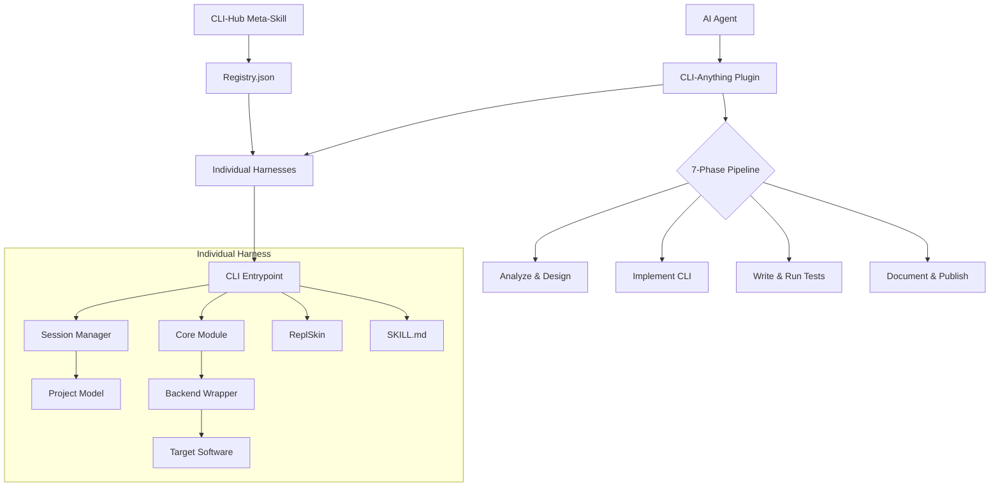

I will read the `.prompt.md` file to understand the task instructions.
I will read the `.input.cli-anything.xml` file to analyze the repository export and answer the requested points.
I will search for the `<git_log_commit>` section in the `.input.cli-anything.xml` file to find the project name and the date of the last commit.
I will read the first few `<git_log_commit>` entries in `.input.cli-anything.xml` to find the project name and the date of the last commit.
I will search for the `README.md` file in `.input.cli-anything.xml` to gather the project description and platform/deployment information.
I will continue reading the `README.md` file in `.input.cli-anything.xml` to gather the project description, supported platforms, and features.
I will analyze the directory structure and search for source code files related to the supported connectors (harnesses/CLIs) to provide specific file references.
I will re-examine the directory structure within `.input.cli-anything.xml` to locate the source code files, as the root `README.md` appears to be nearly empty.
I will continue reading the directory structure to locate the remaining harnesses, such as Krita, LibreOffice, Obsidian, and Zoom, and identify their source paths.
I will analyze the `<git_logs>` in `.input.cli-anything.xml` to identify the top 20 development trends from the latest commits.
I will search for `SKILL.md` files in the repository to identify the top 5 used and top 5 provided AI skills.
I will now synthesize the gathered information into a comprehensive Markdown response, ensuring all 22 points are addressed with high-quality answers and relevant file references.
## CLI-Anything: Project Analysis & Architecture Review

### 1. Project Name and Last Commit Date
*   **Project Name:** CLI-Anything
*   **Last Commit Date:** 2026-04-23 15:40:23 +0800 (from `<git_log_commit>` L152162)

### 2. Project Description
CLI-Anything is a revolutionary platform designed to make every piece of professional software "agent-native" by automatically generating structured Command Line Interfaces (CLIs). It bridges the gap between AI reasoning agents (like Claude Code, Pi, and OpenClaw) and the world's complex software ecosystem (GIMP, Blender, LibreOffice, etc.). By providing a reliable, command-based interaction layer, it eliminates the fragility of UI automation and the limitations of narrow APIs, transforming legacy applications into powerful tools that LLMs can understand and control through structured JSON and interactive REPLs.

The system utilizes a fully automated 7-phase pipeline that handles the entire development lifecycle—from codebase analysis and architectural design to implementation, multi-layered testing, and documentation. This pipeline ensures that professional software capabilities are preserved without compromise, allowing agents to perform high-fidelity tasks such as 3D rendering, scientific computing, and video editing programmatically. It effectively treats software as a "harness" that can be iteratively refined to expand its agent-facing capabilities.

At its core, CLI-Anything aims to build a future-ready ecosystem through its "CLI-Hub," a central registry where users and agents can browse, install, and manage community-built CLIs autonomously. This enables zero-human-intervention workflows where an agent can discover a need for a specific tool, install it from the hub, and execute complex tasks on the user's behalf. CLI-Anything is more than just a wrapper; it's a methodology for transforming the way humans and AI interact with software backends.

### 3. Supported Platforms/Deployments & Requirements
*   **Supported Agent Platforms:**
    *   **Claude Code:** Marketplace plugin (`cli-anything-plugin/`)
    *   **Pi Coding Agent:** Global extension (`.pi-extension/cli-anything/`)
    *   **OpenCode:** Slash command integration (`opencode-commands/`)
    *   **OpenClaw:** Native SKILL definition (`openclaw-skill/`)
    *   **Codex:** Bundled skill (`codex-skill/`)
    *   **Qodercli:** Plugin registration (`qoder-plugin/`)
    *   **GitHub Copilot CLI:** Community plugin (`README.md`)
    *   **Goose:** Desktop/CLI provider integration (`README.md`)
*   **Deployments:**
    *   Local installation via `pip install -e .` for each harness.
    *   Distributed via PyPI (`cli-anything-hub`).
    *   NPM/npx based skill installation (`npx skills add`).
*   **Requirements:**
    *   **Python:** ≥ 3.10
    *   **Core Libraries:** Click (≥ 8.0), Pytest
    *   **OS:** Windows (requires Git Bash/cygpath), Linux, macOS
    *   **Target Software:** The specific application (e.g., GIMP, Blender) must be installed.

### 4. Supported Connectors (Harnesses)
The project includes a vast array of specialized harnesses for professional software:
*   **Creative/Media:**
    *   **GIMP:** `gimp/agent-harness/cli_anything/gimp/gimp_cli.py`
    *   **Blender:** `blender/agent-harness/cli_anything/blender/blender_cli.py`
    *   **Audacity:** `audacity/agent-harness/cli_anything/audacity/audacity_cli.py`
    *   **Shotcut:** `shotcut/agent-harness/cli_anything/shotcut/shotcut_cli.py`
    *   **Inkscape:** `inkscape/agent-harness/cli_anything/inkscape/inkscape_cli.py`
    *   **Krita:** `krita/agent-harness/cli_anything/krita/krita_cli.py`
*   **Scientific/Engineering:**
    *   **FreeCAD:** `freecad/agent-harness/cli_anything/freecad/freecad_cli.py`
    *   **QGIS:** `QGIS/agent-harness/cli_anything/qgis/qgis_cli.py`
    *   **CloudCompare:** `cloudcompare/agent-harness/cli_anything/cloudcompare/cloudcompare_cli.py`
*   **Development/Automation:**
    *   **iTerm2:** `iterm2/agent-harness/cli_anything/iterm2_ctl/iterm2_ctl_cli.py`
    *   **n8n:** `n8n/agent-harness/cli_anything/n8n/n8n_cli.py`
    *   **PM2:** `pm2/agent-harness/cli_anything/pm2/pm2_cli.py`
    *   **WireMock:** `skills/cli-anything-wiremock/SKILL.md`
*   **AI/Knowledge Management:**
    *   **ChromaDB:** `chromadb/agent-harness/cli_anything/chromadb/chromadb_cli.py`
    *   **Obsidian:** `obsidian/agent-harness/cli_anything/obsidian/obsidian_cli.py`
    *   **Ollama:** `ollama/agent-harness/cli_anything/ollama/ollama_cli.py`
    *   **NotebookLM:** `notebooklm/agent-harness/cli_anything/notebooklm/notebooklm_cli.py`
*   **Infrastructure/Other:**
    *   **AdGuardHome:** `adguardhome/agent-harness/cli_anything/adguardhome/adguardhome_cli.py`
    *   **Zoom:** `skills/cli-anything-zoom/SKILL.md`
    *   **Browser (DomShell):** `browser/agent-harness/cli_anything/browser/browser_cli.py`

### 5. Supported Models/Agents
*   **Native Platforms:**
    *   **Claude Code:** Uses Anthropic's Claude models. `cli-anything-plugin/.claude-plugin/plugin.json`
    *   **Pi Coding Agent:** Integrated via `.pi-extension/cli-anything/index.ts`.
    *   **OpenClaw / OpenCode:** Methodology-driven agents. `openclaw-skill/SKILL.md`
*   **Connectivity:**
    *   **API Tokens:** Used for web-based connectors like Novita or Exa.
    *   **Local Backend:** Harnesses like LLDB or GIMP interact directly with local binaries.
    *   **OAuth/Subscriptions:** Supported via specific harness configurations (e.g., Zoom).

### 6. Top 5 Use Cases
1.  **Autonomous Content Generation:** An agent uses Blender and GIMP harnesses to create a 3D scene, render it, and post-process the image into a finished marketing poster.
2.  **Headless Scientific Workflows:** Automating CAD designs in FreeCAD or GIS mapping in QGIS based on research data inputs without human GUI interaction.
3.  **Programmatic Video Production:** Assembling social media videos using Shotcut/Kdenlive, applying AI-generated subtitles via VideoCaptioner, and rendering the final MP4.
4.  **Self-Healing Development Environments:** Using iTerm2, PM2, and LLDB harnesses to monitor, debug, and restart services in a developer's terminal environment.
5.  **Autonomous Knowledge Synthesis:** Agents using Obsidian and Zotero harnesses to organize research papers, extract insights, and build a structured knowledge base.

### 7. Top 20 Features
1.  **7-Phase Automated Pipeline:** `cli-anything-plugin/HARNESS.md`
2.  **Structured JSON Output:** `cli-anything-plugin/HARNESS.md`
3.  **Interactive REPL (ReplSkin):** `cli-anything-plugin/repl_skin.py`
4.  **CLI-Hub Meta-Skill Discovery:** `skills/cli-hub-meta-skill/SKILL.md`
5.  **Iterative Refinement Command:** `cli-anything-plugin/commands/refine.md`
6.  **Automated Skill Generation:** `cli-anything-plugin/skill_generator.py`
7.  **Multi-Agent Plugin System:** `cli-anything-plugin/.claude-plugin/plugin.json`
8.  **Session-Based State Management:** `core/session.py` (in most harnesses)
9.  **Backend Abstraction Layer:** `utils/*_backend.py`
10. **Headless Execution Support:** `README.md`
11. **Undo/Redo System:** `core/session.py`
12. **Marketplace Discovery:** `cli-anything-plugin/.claude-plugin/plugin.json`
13. **Progressive Disclosure Guides:** `cli-anything-plugin/guides/`
14. **Cross-Platform Path Normalization:** `README.md`
15. **Security Sanitization:** `browser/agent-harness/cli_anything/browser/utils/security.py`
16. **Automated Test Planning:** `cli-anything-plugin/HARNESS.md`
17. **Project Model Persistence:** `core/project.py`
18. **Unified CLI Hub Registry:** `registry.json`
19. **Auto-Save Functionality:** `cli-anything-plugin/guides/auto-save-dry-run.md`
20. **PyPI Publishing Workflow:** `cli-anything-plugin/guides/pypi-publishing.md`

### 8. Top 20 Smart Patterns
1.  **SOP-as-Code:** Using Markdown files as architectural constraints for generated code.
2.  **Harness Abstraction:** Treating software as a programmable harness.
3.  **ReplSkin for Consistent UX:** Decoupling the REPL interface from application logic.
4.  **Progressive Disclosure:** Staging complex instructions in `guides/` to save tokens.
5.  **Phase-Based Pipeline:** Decomposing complex software integration into 7 manageable phases.
6.  **Self-Describing AI Skills:** CLIs that tell agents how to use them.
7.  **Synthetic vs Real Data Testing:** Mixing mock data with real file validation.
8.  **Session Locking:** Preventing concurrent agent access to the same project.
9.  **Timecode Normalization:** Standardizing timing across diverse video backends.
10. **Backend Translation:** Mapping high-level CLI commands to low-level software macros/APIs.
11. **Registry-Driven Installation:** Using `registry.json` for tool discovery.
12. **Meta-Skill Orchestration:** A skill that helps agents pick other skills.
13. **Incremental Refinement:** Growing CLI coverage non-destructively.
14. **Template-Driven Scaffolding:** `cli-anything-plugin/templates/SKILL.md.template`.
15. **Context-Aware Error Handling:** Mapping application errors to agent-readable hints.
16. **Headless-First Design:** Enforcing non-GUI execution paths.
17. **Agent-Centric Documentation:** Focusing READMEs on "how to use as an agent."
18. **Automation via Slash Commands:** Standardizing tool invocation across platforms.
19. **Relative Path Enforced Models:** Preventing path-related failures in creative software.
20. **Audit-Log State Recovery:** Using logs to reconstruct session state.

### 9. Top 20 Development Trends
1.  **Consolidation of Skills:** Moving all `SKILL.md` to a root `skills/` directory.
2.  **Windows Reliability Focus:** Hardening harnesses (LLDB, Unreal Insights) for Windows/WSL.
3.  **Harnessing Low-Level Debuggers:** Bringing tools like LLDB into the ecosystem.
4.  **Skill Mirroring:** Automated syncing of root skills with harness-local skills.
5.  **Path Normalization Improvements:** Addressing OS-specific export path issues.
6.  **Refinement of Creative Workflows:** Improving Shotcut and GIMP for video asset creation.
7.  **CI Hardening:** Improving registry update scripts and skill validation.
8.  **Registry Expansion:** Rapidly adding new community CLIs to the hub.
9.  **E2E Test Reliability:** Tightening discovery logic and removing skips.
10. **REPL Skin Standardization:** Ensuring a consistent interactive experience.
11. **Multi-Step Import Models:** Moving from batch modes to granular import/add models.
12. **Timecode Precision Fixes:** Addressing timeline issues in video rendering.
13. **Auto-Publishing Workflows:** Automating the PyPI release process.
14. **Skill Contribution Docs:** Refining the path for community developers.
15. **Security Hardening:** Addressing vulnerabilities like path injection.
16. **Hub Registry UX:** Redesigning the Hub frontend for better discovery.
17. **Incremental Refinement Passes:** Using `/refine` to expand existing harnesses.
18. **Support for New Agent Platforms:** Expanding to Goose, Qodercli, etc.
19. **Enhanced Project State Models:** Making project JSONs more robust.
20. **Registry Versioning:** Tracking harness updates via `update_registry_dates.py`.

### 10. Top 10 Advantages
1.  **Universal Applicability:** Can target almost any software with source code or a CLI/API.
2.  **Agent-Native Interaction:** Built from the ground up for LLMs (JSON, structured help).
3.  **Low Barrier to Entry:** 7-phase pipeline automates the hard work of building CLIs.
4.  **Massive Tool Ecosystem:** Already supports most "heavyweight" professional apps.
5.  **High Reliability:** Thousands of tests ensuring the harness works with real software.
6.  **Autonomous Discovery:** CLI-Hub allows for truly agent-led tool acquisition.
7.  **Iterative Growth:** CLIs get better over time via the refinement process.
8.  **Consistent Experience:** REPL and output formats are unified across tools.
9.  **Cross-Platform Flexibility:** Works in most common development environments.
10. **Open and Extensible:** Community-driven registry and plugin architecture.

### 11. Top 10 Limitations
1.  **Software Prerequisites:** Requires target applications to be installed on the host.
2.  **Resource Intensity:** Running high-end software (Blender/Godot) is resource-heavy.
3.  **Windows Complexity:** Reliability on Windows often requires WSL or Git Bash.
4.  **Backend Scripting Complexity:** Some apps require advanced Python/Macro knowledge.
5.  **Security Sandbox Responsibility:** Execution safety depends on the user's environment.
6.  **State Management Sync:** Keeping JSON models in sync with binary projects is hard.
7.  **Installation Overhead:** Each tool requires a separate pip environment/install.
8.  **Limited Visual Feedback:** Agents "fly blind" without GUI-to-agent feedback loops.
9.  **Dependency on Click/Pytest:** Standardized but strictly requires these libraries.
10. **Pipeline Rigidity:** Building a new harness requires following the SOP exactly.

### 12. Top 5 Used and Provided AI Skills
*   **Provided Skills:**
    1.  **CLI-Anything Core (HARNESS.md):** The master methodology.
    2.  **CLI-Anything Hub Meta-Skill:** For autonomous tool discovery. `skills/cli-hub-meta-skill/SKILL.md`
    3.  **Blender Skill:** Professional 3D manipulation. `skills/cli-anything-blender/SKILL.md`
    4.  **GIMP Skill:** Professional image editing. `skills/cli-anything-gimp/SKILL.md`
    5.  **ReplSkin:** Standardized interactive communication. `cli-anything-plugin/repl_skin.py`
*   **Used Skills:**
    1.  **Click:** For CLI construction.
    2.  **Pytest:** For behavioral validation.
    3.  **Bash/Shell:** For system-level orchestration.
    4.  **JSON Processing:** For structured data exchange.
    5.  **LLM Reasoning:** To execute the 7-phase pipeline.

### 13. Data Overview
*   **Inputs:** Codebases, API docs, binary files, project JSONs.
*   **Outputs:** Structured JSON, rendered media (PNG, MP4, 3D), PDFs, logs.
*   **Storage:** Local filesystem for session state (`project.json`), `registry.json` for tool catalog.
*   **References:** `core/project.py`, `core/session.py`, `registry.json`.

### 14. Architecture Review (Top 20 Components)
1.  **7-Phase Pipeline (HARNESS.md):** The core process.
2.  **ReplSkin:** Interactive terminal interface. `cli-anything-plugin/repl_skin.py`
3.  **Skill Generator:** Creates agent-facing docs. `cli-anything-plugin/skill_generator.py`
4.  **CLI Entrypoint (cli_anything.py):** Main Click command group.
5.  **Core Module (core/):** Application logic.
6.  **Backend Wrapper (utils/*_backend.py):** Target software interface.
7.  **Session Manager (core/session.py):** State maintenance.
8.  **Project Model (core/project.py):** Data structure for state.
9.  **CLI-Hub Registry (cli_hub/registry.py):** Catalog management.
10. **Installer (cli_hub/installer.py):** Tool acquisition logic.
11. **Plugin System (cli-anything-plugin/):** Agent environment hooks.
12. **Test Orchestrator (commands/test.md):** Validation engine.
13. **Refinement Logic (commands/refine.md):** Incremental improvement.
14. **Command Templates (templates/):** Scaffolding.
15. **Security Hardening (utils/security.py):** Sanitization.
16. **File I/O Utils (utils/file_io.py):** Common disk operations.
17. **App-Specific Parsers (e.g., mlt_xml.py):** Logic for complex formats.
18. **Unit Test Suite (tests/test_core.py):** Business logic validation.
19. **E2E Test Suite (tests/test_full_e2e.py):** Software-in-the-loop validation.
20. **Marketplace Metadata (.claude-plugin/):** Discovery info.

### 15. Architecture Mermaid Graph

### 16. Maturity & Security Review
*   **Maturity:** High. Supporting 17+ apps with thousands of tests. Stable versioning (v0.2.0).
*   **Security:** Focused. Includes sanitization and fixes for path injection. Security is critical as CLIs run with host permissions.

### 17. Tests, CI, and Documentation
*   **Tests:** Extensive multi-layered approach (Unit, E2E, Subprocess).
*   **CI:** Automated registry and skill validation via GitHub Actions.
*   **Documentation:** Multi-lingual READMEs and detailed 7-phase SOP (HARNESS.md).

### 18. Top 20 Possible Improvements
1.  **Native Windows Support:** Remove `bash`/`cygpath` dependency. `README.md`
2.  **Unified Backend Protocol:** Standardize tool-to-app communication. `utils/`
3.  **GUI Preview Loop:** Send frame snapshots back to agents. `core/render.py`
4.  **Automatic App Installation:** Harness installs host app if missing. `setup.py`
5.  **Multi-User Isolation:** Enhanced session locking. `guides/session-locking.md`
6.  **Resource Monitoring:** Meter CPU/RAM usage of backends. `utils/`
7.  **Self-Healing Tests:** AI-assisted fixes for broken E2E tests. `tests/`
8.  **Cloud-Native Adapters:** Support for E2B/Cloudflare Workers. `README.md`
9.  **Voice Control Interface:** Native voice-to-command. `repl_skin.py`
10. **Graph-based State View:** Visualize projects as graphs. `core/project.py`
11. **Direct SDK Integration:** Use C++ SDKs where Python macro-ing is slow. `utils/`
12. **Skill Performance Benchmarking:** Track token efficiency. `skills/`
13. **Integrated Skill Playground:** For testing SKILL.md prompts. `templates/`
14. **Automatic Plugin Updates:** For Claude Code/Pi. `cli-anything-plugin/`
15. **More Native IDE Plugins:** For Cursor, Windsurf. `README.md`
16. **Refined Gap Analysis:** Better refinement in `/refine`. `commands/refine.md`
17. **Skill Sharing Hub:** Community repository for high-level workflows. `cli-hub/`
18. **Sandboxed Execution:** Optional Docker support for harnesses. `README.md`
19. **Real-time Logging Stream:** To agent environments. `utils/log.py`
20. **Visual Debugger:** For inspecting harness project states. `core/project.py`

### 19. Reuse for Agent Swarm (Best Solution Specification)
1.  **HARNESS.md:** Methodology for specification and implementation.
2.  **Registry.json:** Knowledge base for selecting the best agent/tool.
3.  **cli_hub/registry.py:** Logic for searching and categorizing solutions.
4.  **skill_generator.py:** Generating specifications for agent capabilities.
5.  **commands/test.md:** Evaluator pattern for reviewing solutions.
6.  **ReplSkin:** For multi-agent interactive debate and review.
7.  **core/session.py:** Tracking the state of the debate and plan.
8.  **utils/file_io.py:** Storing the implementation plan.
9.  **guides/session-locking.md:** Managing concurrent swarm access.
10. **cli-hub-meta-skill:** Orchestrating tool selection for given tasks.

### 20. Reuse for Multi-User/Shared Knowledge Base
1.  **core/project.py:** Shared state model (JSON/Graph).
2.  **core/session.py:** User session persistence.
3.  **guides/session-locking.md:** Concurrency management.
4.  **SKILL.md:** Shared organizational skills.
5.  **registry.json:** Central catalog of shared tools.
6.  **cli_hub/installer.py:** Distributing knowledge/tools across users.
7.  **utils/repl_skin.py:** Unified interface for all users.
8.  **AUDIT_LOG:** Tracking interactions to evolve knowledge.
9.  **commands/refine.md:** Collaborative refinement of the knowledge base.
10. **guides/auto-save-dry-run.md:** Protecting shared state from errors.

### 21. Reuse for Own Hardware / Cloud / Messengers
1.  **cli_hub/installer.py:** Cross-platform deployment logic.
2.  **repl_skin.py:** Interaction layer adaptable to Messengers/CLI.
3.  **browser/utils/security.py:** Essential for cloud/remote safety.
4.  **core/session.py:** Maintains state across different client types.
5.  **registry.json:** Cloud-accessible catalog.
6.  **utils/file_io.py:** Abstracting local vs cloud storage.
7.  **skill_generator.py:** Dynamic skill definition for messengers.
8.  **utils/audio_utils.py:** (Found in Audacity) for voice control.
9.  **core/project.py:** The underlying data for graph visualization.
10. **cli-anything-plugin:** Example of integrating with remote agent environments.

### 22. Reuse for Team Agents (Human-Agent Workflows)
1.  **HARNESS.md:** Definitive SOP for human-agent collaboration.
2.  **skill_generator.py:** Defining roles and skills for both humans and agents.
3.  **TEST.md:** Shared validation criteria for team deliverables.
4.  **commands/refine.md:** Iterative feedback loop between human and agent.
5.  **core/session.py:** Storing collaborative project state.
6.  **ReplSkin:** Facilitating interactive human-in-the-loop control.
7.  **guides/skill-generation.md:** Instructions for expanding team capabilities.
8.  **registry.json:** Shared toolkit for the team.
9.  **core/project.py:** Transparent project state for all team members.
10. **cli-hub-meta-skill:** Enabling team agents to self-equip for tasks.
