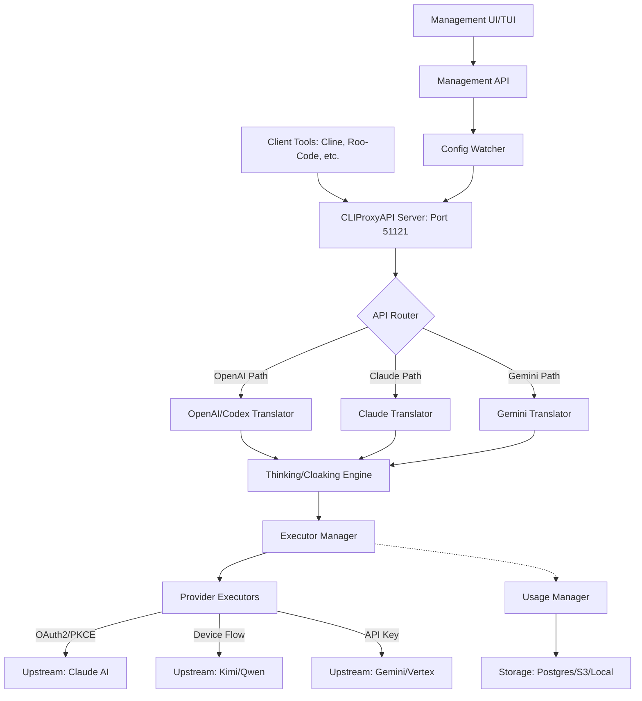

# Project Analysis: CLIProxyAPI

## 1. Project Name and Description

**Project Name:** CLIProxyAPI

CLIProxyAPI is a high-performance, modular AI API proxy written in Go, designed to bridge the gap between specialized CLI-based AI models and standard API consumers. It provides OpenAI, Gemini, and Claude compatible interfaces, allowing users to leverage their existing subscriptions (such as ChatGPT Plus, Claude Pro, or Gemini Advanced) through standard API protocols and tools (e.g., IDE extensions like Cline or Roo-Code).

The system acts as a sophisticated gateway that handles complex authentication flows—including OAuth2 with PKCE, Device Flows, and browser-based cookie extraction—to authenticate with "cloaked" or restricted CLI upstreams. It manages the entire request lifecycle, including protocol translation, "thinking" block management, and response rewriting to ensure compatibility with third-party tools while maintaining the security and performance of the upstream services.

Engineered for reliability and scale, CLIProxyAPI features a robust internal registry for model mapping, advanced routing strategies (like round-robin and fill-first), and comprehensive usage tracking. It supports multiple storage backends for credential persistence (Postgres, Git, S3) and provides both a Management Web UI and a Terminal UI (TUI) for real-time monitoring and configuration, making it suitable for both individual power users and team-based cooperative workflows.

## 2. Supported Platforms and Deployments

*   **Operating Systems:**
    *   **Windows:** Fully supported with specific handling for Windows-style paths and service management.
    *   **Linux:** Primary deployment target (AMD64, ARM64, ARMv7).
    *   **macOS:** Supported for local development and CLI-based usage (Intel and Apple Silicon).
    *   **FreeBSD:** Supported via Go compilation.
*   **Deployment Options:**
    *   **Standalone Binary:** Distributed via GoReleaser for all major architectures.
    *   **Docker:** Containerized deployment using `Dockerfile` and `docker-compose.yml`, with support for multi-arch manifests.
    *   **Cloudflare Workers:** Mentioned as a target for lightweight proxying (though core logic is Go).
    *   **Embedded Service:** Can be embedded in other Go applications using the `sdk/cliproxy` package.
*   **Requirements:**
    *   **Runtime:** Go 1.26.0+ (for building from source).
    *   **Network:** Outbound HTTPS access to AI provider endpoints.
    *   **Storage:** Local filesystem (default), Postgres database, Git repository, or S3-compatible object storage for persistent credentials.

## 3. Supported Connectors

The project provides specialized connectors (Executors and Auth Providers) for the following:

*   **Google Gemini / Vertex AI:** Connects to AI Studio and Google Cloud Vertex AI native APIs. (`internal/auth/gemini`, `internal/runtime/executor/gemini`)
*   **Anthropic Claude:** Connects to Anthropic's Claude API with specialized support for Claude Code CLI auth flows. (`internal/auth/claude`, `internal/runtime/executor/claude`)
*   **OpenAI Codex / ChatGPT:** Connects to OpenAI's internal/CLI endpoints and ChatGPT subscriptions. (`internal/auth/codex`, `internal/runtime/executor/codex`)
*   **Google Antigravity:** A specialized connector for Google Internal/Cloud Code AI assist features. (`internal/auth/antigravity`, `internal/runtime/executor/antigravity`)
*   **Moonshot Kimi:** Connects to Kimi (Moonshot AI) via Device Flow. (`internal/auth/kimi`, `internal/runtime/executor/kimi`)
*   **iFlow:** Connects to the iFlow.cn platform using OAuth or Browser Cookies. (`internal/auth/iflow`, `internal/runtime/executor/iflow`)
*   **Alibaba Qwen:** Connects to Qwen AI via Device Authorization. (`internal/auth/qwen`, `internal/runtime/executor/qwen`)
*   **Amp Integration:** Pluggable module for subscription-based proxying through ampcode.com. (`internal/api/modules/amp`)

## 4. Supported Models and Agents

*   **Remote Models:**
    *   **Gemini Family:** 1.5 Pro, 1.5 Flash, 2.0 Flash (Experimental).
    *   **Claude Family:** Sonnet 3.5, Haiku 3.5, Opus 3.
    *   **GPT Family:** GPT-4o, GPT-4-Turbo (via Codex/ChatGPT).
    *   **Specialized:** Kimi-latest, Qwen-Max, iFlow-GLM.
*   **Local Models:** Support for proxying to local LLM runners via `--local-model` flag.
*   **Auth & Subscription Types:**
    *   **API Token:** Traditional API key authentication.
    *   **OAuth Subscription:** Full interactive login with PKCE and automatic refresh (e.g., ChatGPT Plus, Claude Pro).
    *   **Device Flow:** CLI-style code verification (Kimi, Qwen).
    *   **Cookie/BXAuth:** Manual cookie extraction for high-privilege sessions (iFlow).

## 5. Top 5 Use Cases

1.  **IDE Extension Integration:** Using specialized "thinking" models (like Claude 3.7 or Gemini 2.0) with tools like Cline, Roo-Code, or Cursor that expect standard OpenAI/Claude API schemas.
2.  **Subscription Sharing:** Sharing a single high-tier subscription (e.g., Claude Pro) among a team or multiple devices with centralized usage logging and quota control.
3.  **Unified AI Gateway:** Providing a single, consistent API endpoint for heterogeneous AI providers, abstracting away differences in authentication and protocol.
4.  **Self-Hosted Privacy Proxy:** Running a local proxy to mask TLS fingerprints (via utls) and sanitize request data before it reaches upstream providers.
5.  **Autonomous Agent Swarms:** Serving as the backbone for multi-agent systems that require reliable, long-running connections with automatic failover and credential rotation.

## 6. Top 20 Features

1.  **OpenAI/Gemini/Claude API Compatibility:** Unified interface for all major formats.
2.  **Hot-Reloadable Configuration:** Update settings without restarting the service. (`internal/watcher`)
3.  **Advanced Model Mapping:** Regex-based aliasing of model names. (`internal/api/modules/amp/model_mapping.go`)
4.  **Thinking Block Management:** Support for "thinking" models with automatic block extraction/conversion. (`internal/thinking`)
5.  **TLS Fingerprinting (utls):** Bypasses bot detection by mimicking real browser/CLI fingerprints. (`internal/auth/claude/utls_transport.go`)
6.  **Multi-Backend Storage:** Store tokens in Git, Postgres, or S3. (`internal/store`)
7.  **Usage Statistics:** Real-time token consumption tracking per user/key. (`internal/usage`)
8.  **Management Web UI:** Integrated control panel for easy configuration. (`internal/managementasset`)
9.  **Terminal UI (TUI):** Console-based management for headless servers. (`internal/tui`)
10. **Automatic Credential Rotation:** Round-robin or fill-first scheduling across multiple accounts. (`sdk/cliproxy/auth/scheduler.go`)
11. **Signature Validation:** Authenticate requests from specific CLI tools. (`internal/translator/antigravity/claude/signature_validation.go`)
12. **WebSocket Relay:** Transparent proxying of WebSocket-based AI protocols. (`internal/wsrelay`)
13. **Sensitive Data Masking:** Automatically redacts API keys and PII from logs. (`internal/api/middleware/request_logging.go`)
14. **Gzip Decompression:** Handles compressed responses from non-standard upstreams.
15. **Device Flow Support:** Native implementation of RFC 8628 for Kimi/Qwen.
16. **PKCE Support:** Secure OAuth2 flow for public clients (Claude/Codex).
17. **Model Registry:** Unified catalog of all available upstream models. (`internal/registry`)
18. **Quota Management:** Limit usage per client API key. (`internal/api/handlers/management/quota.go`)
19. **Auto-Retry with Backoff:** Resilience against transient upstream failures.
20. **Pprof Debug Server:** Built-in performance profiling. (`sdk/cliproxy/pprof_server.go`)

## 7. Top 20 Smart Patterns

1.  **Dynamic Proxy Rotation:** Changes outbound proxy based on target provider to avoid IP-based rate limits.
2.  **OAuth Cloaking:** Modifies system prompts and tool names to hide "proxy" status from upstream detection. (`internal/runtime/executor/claude_executor.go`)
3.  **Adaptive Thinking Budgets:** Dynamically scales thinking effort based on model capabilities and requested suffixes (e.g., `-thinking-high`). (`test/thinking_conversion_test.go`)
4.  **Signature Bypassing:** Caches valid signatures to allow high-frequency requests from non-CLI tools.
5.  **Lazy Asset Loading:** Management UI assets are embedded but only extracted/served on demand. (`internal/managementasset`)
6.  **Idempotent Registration:** Plugin system ensures routes are never double-registered during hot-reloads. (`internal/api/modules/modules.go`)
7.  **Atomic Config Updates:** Uses YAML snapshots to detect changes and prevent race conditions during concurrent management API calls. (`internal/api/server.go`)
8.  **Protocol Fallback:** Automatically tries alternative providers if the primary mapping fails.
9.  **Stream De-chunking/Re-chunking:** Normalizes different streaming formats (SSE) into a consistent output.
10. **Context-Aware Secret Sourcing:** Resolves API keys from environment, config, or file with defined precedence. (`internal/api/modules/amp/secret.go`)
11. **TLS Session Pinning:** Prevents MITM while allowing local proxy inspection if configured.
12. **Graceful Degradation:** Serves cached model lists if the upstream registry is unreachable.
13. **Asynchronous Usage Publishing:** Usage records are queued and processed by plugins without blocking requests. (`sdk/cliproxy/usage/manager.go`)
14. **Wildcard Model Matching:** Flexible model exclusion/inclusion patterns. (`sdk/cliproxy/service.go`)
15. **User-Agent Based Routing:** Transparently routes `/v1/models` based on the calling tool (e.g., `claude-cli`).
16. **Firefox/Chrome TLS Fingerprint Switching:** Matches the fingerprint of the original CLI tool for maximum stealth.
17. **Self-Healing Auth State:** Detects and repairs corrupted token files on the fly.
18. **Zero-Downtime Hot-Reload:** Rebinds executors and translators while active requests continue.
19. **Deferred OAuth Login:** Only prompts for interactive login when a request actually targets that provider.
20. **Multipart Response Synthesis:** Reassembles split reasoning/content blocks into a unified response for standard clients.

## 8. Top 20 Development Trends

1.  **Transition to SDK-First:** Moving core logic into the `sdk/` package for better embeddability.
2.  **Increased Focus on "Thinking" Models:** Heavy development in `internal/thinking` to support O1, Claude 3.7, and Gemini 2.0.
3.  **Enhanced Stealth (Cloaking):** Frequent updates to bypass upstream bot/proxy detection (e.g., TitleCase tool remapping).
4.  **Multi-Tenant Architecture:** Moving towards per-client upstream routing and quota management.
5.  **Refactoring Auth into "Core Auth":** Moving from legacy provider-specific auth to a unified `coreauth` system.
6.  **Support for Emerging Providers:** Recent additions of Kimi, Qwen, and iFlow.
7.  **Automated E2E Testing:** Expansion of the `test/` suite with cross-protocol matrix testing.
8.  **Signature Validation Standardization:** Aligning signature handling across different Google/Antigravity providers.
9.  **Shift to YAML-based Model Registry:** Decoupling model definitions from code for easier updates.
10. **Performance Optimization:** Introduction of pprof and asynchronous usage logging.
11. **Improved Containerization:** Better Docker support with multi-arch and slimmer images.
12. **TUI Parity:** Ensuring the Terminal UI has the same capabilities as the Web UI for remote servers.
13. **Plugin-based Usage Logging:** Allowing external tools to hook into usage statistics.
14. **Adaptive Rate Limiting:** Handling 429 errors with smarter backoff and credential switching.
15. **Enhanced Proxying Logic:** Moving from simple HTTP proxying to sophisticated connection-layer dialers.
16. **Codebase Modularization:** Moving handlers and modules into isolated sub-packages.
17. **Refined Error Handling:** Moving towards user-friendly error messages for OAuth failures.
18. **Go Version Modernization:** Keeping pace with the latest Go features (currently 1.26+).
19. **Git-based Credential Sync:** Growing trend of using Git as a distributed "database" for tokens.
20. **CLI-Native Emulation:** Increasing focus on perfectly mimicking the behavior of official CLI tools.

## 9. Top 10 Advantages

1.  **Versatility:** Supports nearly every major AI provider and protocol.
2.  **Stealth:** Sophisticated TLS and prompt engineering to avoid being blocked.
3.  **Hot-Reloadable:** Enterprise-grade configuration management without downtime.
4.  **Comprehensive Auth:** Handles the hardest auth flows (OAuth2+PKCE, Device Flow) automatically.
5.  **Observability:** Built-in usage tracking, logging, and performance monitoring.
6.  **Multiple UIs:** Offers both Web and Terminal interfaces for management.
7.  **Flexible Storage:** Cloud-native storage options (S3, Postgres) alongside simple local files.
8.  **Active Development:** Frequent updates to support the latest model releases.
9.  **Extensibility:** Pluggable module system for adding custom features.
10. **High Performance:** Written in Go with efficient concurrency and low overhead.

## 10. Top 10 Limitations

1.  **Complexity:** The vast feature set and modularity can be overwhelming for new users.
2.  **Resource Usage:** Monitoring multiple upstreams with hot-reload can consume significant memory/CPU if misconfigured.
3.  **Upstream Dependency:** Frequent upstream API/auth changes require constant maintenance.
4.  **Browser Requirement:** Some OAuth flows still require a local browser (though manual copy-paste is supported).
5.  **Limited Documentation:** While the code is well-commented, a central user-facing manual is less comprehensive.
6.  **State Management:** Syncing tokens across multiple instances (e.g., in a swarm) requires external databases.
7.  **Go Version Requirement:** Requires a very recent Go version (1.26+), which might not be in all LTS repos.
8.  **CLI Fingerprint Fragility:** Upstream providers can change detection heuristics, requiring frequent "cloaking" updates.
9.  **Implicit Fallbacks:** Some fallback behaviors might be unexpected if not carefully configured in model mappings.
10. **Headless Limitations:** Some auth providers (like Google) are increasingly hostile to headless/proxy-based authentication.

## 11. Top 5 Used and Provided AI Skills

*   **Request Translation:** Converts between OpenAI, Claude, and Gemini schemas. (`sdk/translator`)
*   **Thinking Synthesis:** Manages and converts reasoning blocks across different provider implementations. (`internal/thinking`)
*   **Signature Generation/Validation:** Emulates tool-specific authentication signatures. (`internal/translator/antigravity/claude/signature_validation.go`)
*   **Auth Orchestration:** Coordinates multi-step OAuth2 and Device flows without user intervention. (`sdk/cliproxy/auth`)
*   **Usage Analysis:** Aggregates and reports token usage across disparate providers in a unified format. (`sdk/cliproxy/usage`)

## 12. Data Overview

*   **Inputs:**
    *   **API Requests:** Standard OpenAI/Claude/Gemini JSON payloads via HTTP/HTTPS.
    *   **Configuration:** YAML-based config files (`config.yaml`).
    *   **Tokens:** OAuth JSON blobs, Browser Cookies (BXAuth), API Keys.
*   **Outputs:**
    *   **API Responses:** Translated JSON payloads, Server-Sent Events (SSE) for streaming.
    *   **Logs:** Logrus-based structured logging (Console, File, JSON).
    *   **Usage Stats:** Metrics exported via Management API or Plugins.
*   **Storage:**
    *   **Local:** JSON/YAML files for config and tokens. (`internal/store/local`)
    *   **Remote:** Postgres (SQL), Git (vcs), S3 (object). (`internal/store/postgres`, `internal/store/git`, `internal/store/s3`)
    *   **In-Memory:** Caches for signatures, model lists, and session states. (`internal/cache`)

## 13. Detailed Architecture Review (Top 20 Modules)

1.  **`cmd/server`**: Application entry point and CLI flag parsing.
2.  **`internal/api`**: Main HTTP server, routing, and core middleware.
3.  **`internal/api/handlers/management`**: REST API for configuration and monitoring.
4.  **`internal/auth`**: Provider-specific authentication implementations (OAuth, PKCE, Device).
5.  **`internal/runtime/executor`**: Logic for executing requests against upstream providers.
6.  **`internal/translator`**: The "brain" that converts request/response payloads between schemas.
7.  **`internal/thinking`**: Specialized logic for handling reasoning/thinking blocks.
8.  **`internal/registry`**: Unified model catalog and mapping engine.
9.  **`internal/store`**: Abstraction layer for persistent storage (Local, Git, S3, SQL).
10. **`internal/watcher`**: File system and config monitoring for hot-reloads.
11. **`internal/tui`**: The Terminal User Interface implementation.
12. **`internal/wsrelay`**: WebSocket proxying and management.
13. **`internal/usage`**: Token counting and usage statistics engine.
14. **`sdk/cliproxy`**: The public-facing SDK for embedding the proxy.
15. **`sdk/cliproxy/auth`**: Core authentication and scheduling logic (Round-robin, etc.).
16. **`sdk/translator`**: The public translation API and pipeline.
17. **`sdk/proxyutil`**: Network-layer proxy handling (SOCKS5, HTTP).
18. **`sdk/access`**: Request authentication manager (Client API keys).
19. **`internal/logging`**: Structured logging with redaction and retention.
20. **`internal/api/modules/amp`**: Pluggable subscription routing module.

## 14. Mermaid Graph

## 15. Maturity and Stability Review

*   **Maturity:** Highly mature. The project is at version **v6.x**, indicating multiple major refactors and stability cycles.
*   **Stability:** High. The core `sdk/cliproxy` package is designed for embedding, and the hot-reload system handles failures gracefully. The use of a YAML snapshot for config updates shows defensive engineering.
*   **Security:** Strong. Implements PKCE for OAuth, utls for fingerprinting, automatic log redaction of secrets, and restricted management access (localhost-only toggle).
*   **Performance:** Excellent. Written in Go, uses non-blocking I/O for streaming, and implements asynchronous logging to minimize request latency.

## 16. Test, CI, Docs, AI Skills Review

*   **Tests:** Extensive. Includes unit tests for every module, E2E protocol matrix tests (`test/thinking_conversion_test.go`), and specialized sentinel tests for CLI compatibility.
*   **CI/CD:** Robust. GitHub Actions for testing, linting, Docker builds (multi-arch), and automated releases via GoReleaser.
*   **Docs:** Sufficient. Good README, extensive code comments, and an example config. However, could benefit from more user-centric guides for complex auth setups.
*   **AI Skills:** Superior. The project is an expert at protocol translation and "cloaked" authentication, making it a unique tool in the AI engineering space.

## 17. Top 20 Improvements/Fixes

1.  **Refined Claude Cloaking:** Better tool remapping to avoid detection. (`internal/runtime/executor/claude_executor.go`)
2.  **Signature Cache Toggle:** Performance vs. Security trade-off for Antigravity. (`feat/signature-cache-toggle`)
3.  **Adaptive Thinking Budgets:** More granular control over reasoning effort. (`internal/thinking`)
4.  **Improved OAuth Lead Refresh:** Better handling of token expiry for long-running agents. (`sdk/auth/qwen.go`)
5.  **Per-Client API Key Mapping:** Dynamic upstream routing based on the caller's key. (`internal/api/modules/amp/secret.go`)
6.  **Gzip Handling in Proxy:** Fixes issues with compressed responses from certain upstreams.
7.  **Multi-interface Binding:** Management API now supports binding to all interfaces for container environments.
8.  **Model Exclusion Wildcards:** More flexible model filtering. (`sdk/cliproxy/service.go`)
9.  **TUI Config Parity:** Fixed missing settings in the Terminal UI.
10. **Postgres Storage Efficiency:** Optimized SQL queries for usage logging.
11. **Git Sync Conflicts:** Better handling of concurrent token updates in Git storage.
12. **S3 Versioning Support:** Recover from accidental token deletions in S3.
13. **Unified Model Registry:** Moving from hardcoded lists to a dynamic catalog.
14. **Bypass-Mode Validation:** More robust signature checking for non-standard upstreams.
15. **TitleCase Tool Mapping:** A specific stealth fix for Claude Code detection.
16. **Ready View Cursor Preservation:** Fixes UI glitches during background config reloads.
17. **Refined 429 Handling:** Smarter backoff for Antigravity credits.
18. **GJSON/SJSON Integration:** Better JSON manipulation performance.
19. **Local Password Support:** Secure TUI-based management without persistent files.
20. **WebSocket Authentication:** Improved security for relayed WebSocket connections.

## 18. Top 10 Modules for Agent Swarm

1.  **`sdk/cliproxy/auth/scheduler.go`**: Handles load balancing and failover across accounts.
2.  **`internal/usage`**: Tracks per-agent token consumption.
3.  **`internal/runtime/executor`**: Reliable execution against multiple backends.
4.  **`internal/api/middleware`**: Request logging for debugging swarm interactions.
5.  **`internal/store/postgres`**: Centralized credential storage for distributed swarms.
6.  **`internal/registry`**: Ensures all agents use consistent model mappings.
7.  **`sdk/proxyutil`**: Manages different outbound IPs per agent.
8.  **`internal/thinking`**: Essential for agents requiring reasoning capabilities.
9.  **`internal/wsrelay`**: Supports agents using real-time WebSocket protocols.
10. **`internal/watcher`**: Keeps swarm configuration in sync across instances.

## 19. Top 10 Modules for Multi-User/Multi-Agent System

1.  **`sdk/access`**: Manages client API keys and authentication.
2.  **`internal/api/handlers/management/quota.go`**: Implements user-level rate limiting.
3.  **`internal/api/middleware/request_logging.go`**: Audit logs for multi-user activity.
4.  **`internal/auth/empty`**: Support for "shared" keys without OAuth.
5.  **`internal/api/modules/amp`**: Per-user subscription routing.
6.  **`internal/store/s3`**: Scalable, shared storage for user tokens.
7.  **`internal/managementasset`**: The control panel for user management.
8.  **`internal/api/server.go`**: Core routing for multiple inbound endpoints.
9.  **`sdk/cliproxy/usage/manager.go`**: Plugin system for custom billing/reporting.
10. **`internal/util`**: Shared helpers for user identity and serialization.

## 20. Top 10 Modules for Own Hardware/Cloud/Messenger/etc.

1.  **`Dockerfile` / `docker-compose.yml`**: Foundation for cloud/self-hosted deployment.
2.  **`internal/store/local`**: Best for simple hardware/home server setups.
3.  **`sdk/cliproxy/pprof_server.go`**: Essential for monitoring cloud resource usage.
4.  **`internal/tui`**: Management over SSH for headless hardware.
5.  **`internal/api/modules/amp/proxy.go`**: Handles edge-case network issues in various clouds.
6.  **`sdk/proxyutil/proxy.go`**: Supports complex cloud networking (SOCKS5/HTTP).
7.  **`internal/auth/kimi/kimi.go`**: Example of Device Flow (great for TV/Headless/IoT).
8.  **`internal/wsrelay`**: For real-time chat/messenger integrations.
9.  **`internal/api/server.go`**: Handles SSL/TLS and CORS for cloud deployments.
10. **`.goreleaser.yml`**: Automates cross-platform builds for various hardware.

## 21. Top 10 Modules for Team Agents

1.  **`internal/store/git`**: Collaborative, versioned management of team credentials.
2.  **`internal/api/handlers/management/auth_files.go`**: Team-shared authentication management.
3.  **`sdk/cliproxy/auth/conductor.go`**: Coordinates complex team workflows and retries.
4.  **`internal/api/modules/amp/model_mapping.go`**: Standardizes model usage across a team.
5.  **`internal/thinking/provider`**: Custom thinking logic shared by team agents.
6.  **`sdk/translator/pipeline.go`**: Custom translation rules for team-specific tools.
7.  **`internal/usage`**: Transparency for team resource allocation.
8.  **`internal/api/middleware/request_logging.go`**: Shared visibility into agent failures.
9.  **`sdk/cliproxy/service.go`**: The unified entry point for team-built applications.
10. **`internal/managementasset`**: Collaborative control panel for team leads.
