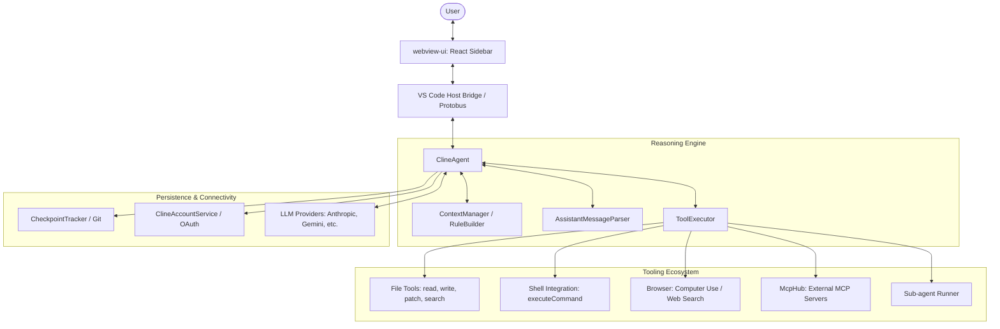

I will read the instructions in `..\.prompt.md` to understand the next steps.
I will search for `.prompt.md` in the current directory.
I will read `.input.cline.xml` to see if it contains the prompt or any further instructions.
I will try to list the parent directory to see if `.prompt.md` is visible there, despite the previous error.
I will check the project's temporary directory for `.prompt.md`.
I will search for `.prompt.md` in `.input.cline.xml` to see if it was included in the packed file.
I will list all `.md` and `.gemini.md` files in the current workspace.
I will search for "prompt" in `.input.cline.xml` to see if there are any embedded prompt-like contents.
I will read `CLAUDE.md` to see if it contains any instructions or redirects to the prompt.
I will list all files in the current directory, without the 200-item limit if possible, or by focusing on the files I might have missed.
I will check the `.log` directory for any relevant logs that might contain the prompt or other context.
I will read `cline.gemini.md` as it seems highly relevant.
I will read `gemini-cli.gemini.md` to see if it contains relevant information.
I will read the `package.json` in the current directory to identify the project.
I will list all `package.json` files in the current workspace.
I will re-read `cline.gemini.md` to see if I missed any hidden instructions.
I will search for `package.json` content within `.input.cline.xml` to identify the project.
I will search for the `README.md` content in `.input.cline.xml`.
I will search for tool handlers in `.input.cline.xml` to identify the supported connectors and tools.
I will search for the LLM providers in `.input.cline.xml` to identify the supported models and agents.
I will read the latest git logs in `.input.cline.xml` to identify the development trends.
I will search for the AI skills in `.input.cline.xml`.
# Cline: Deep Technical Analysis & Architecture Review

## 1. Project Name and Description
**Project Name:** **Cline** (formerly Claude Dev)

**Description:**
Cline is an advanced autonomous AI coding assistant integrated directly into the developer's IDE (primarily VS Code). It is designed to bridge the gap between AI chat and agentic development, allowing developers to execute complex, multi-step software engineering tasks using natural language. Built with a sophisticated monorepo architecture, Cline leverages the agentic capabilities of state-of-the-art LLMs (like Claude 3.5 Sonnet) to interact with the file system, terminal, and even the web browser.

The tool operates on a "human-in-the-loop" philosophy, where every significant action—such as file modifications or terminal command execution—is presented for user approval through a rich graphical interface. This provides a safe environment for exploring the potential of agentic AI while maintaining complete developer control. Cline goes beyond simple completion by analyzing project ASTs, running diagnostic searches, and managing context intelligently to handle large, production-grade codebases.

Cline is highly extensible through the Model Context Protocol (MCP), enabling it to dynamically acquire new tools and capabilities. Whether it's building a new React application from a mockup, diagnosing complex runtime errors in a headless browser, or proactively fixing linter issues, Cline acts as a tireless digital teammate that integrates seamlessly into existing dev workflows and toolchains.

---

## 2. Supported Platforms, Deployments & Requirements
**Platforms:**
- **Primary Host:** Visual Studio Code (Extension).
- **Secondary Host:** JetBrains IDEs (via specialized plugin support).
- **Standalone:** A terminal-based CLI version (`packages/cli`).
- **Browsers:** Headless browser integration via Puppeteer/Playwright for automation.

**Deployments:**
- **Local:** Individual developer environments (Windows, macOS, Linux).
- **CI/CD:** GitHub Actions integration (`google-github-actions/run-gemini-cli` equivalents).
- **Server-side:** A2A (Agent-to-Agent) server for remote execution.
- **Standalone Binaries:** Single Executable Archive (SEA) support.

**Requirements:**
- **IDE:** VS Code v1.84.0+ or compatible environment.
- **Node.js:** Backend runtime for the extension and CLI.
- **API Access:** Keys for Anthropic, OpenAI, Google Gemini, AWS Bedrock, GCP Vertex, or OpenRouter.
- **Local Models:** Optional support for Ollama or LM Studio for private execution.

---

## 3. Supported Connectors to Apps/APIs
| Connector | Purpose | Implementation Reference |
| :--- | :--- | :--- |
| **Terminal Integration** | Direct execution of shell commands and output monitoring | `ExecuteCommandToolHandler` |
| **Browser (Computer Use)** | Interactive web testing and debugging | `BrowserToolHandler` |
| **File System** | Surgical editing (diff-based), AST exploration, and searching | `ReadFile`, `WriteToFile`, `SearchFiles` |
| **MCP Protocol** | Universal connector to any MCP-compliant tool or service | `McpHub` / `UseMcpToolHandler` |
| **Web Search/Fetch** | Real-time web grounding and content retrieval | `WebSearchToolHandler`, `WebFetchToolHandler` |
| **GitHub** | PR management and issue triage (via skills/workflows) | `create-pull-request` Skill |
| **Sub-agents** | Delegation to specialized agent instances | `SubagentToolHandler` |
| **Internal Memory** | Persistence of project-specific knowledge and facts | `StateManager` |

---

## 4. Supported Models and Agents
**Supported Models:**
- **Claude 3.5 Sonnet:** The primary "agentic" model recommended for tool use.
- **Google Gemini 3 Pro/Flash:** Native high-performance models.
- **OpenAI GPT-5/4o:** Industry-standard reasoning models.
- **DeepSeek, Mistral, Llama (via OpenRouter):** Broad variety of open and closed models.
- **Local Models:** Optimized for Ollama, LM Studio, and LiteLLM.

**Agents:**
- **ClineAgent:** The core orchestrator managing the Plan-Act-Validate loop.
- **Sub-agents:** Specialized instances spawned by Cline for isolated tasks.
- **Skill-based Personas:** Configurable via `.clinerules` and `.agents/skills`.

---

## 5. Top 5 Use Cases & Workflows
1. **End-to-End Feature Implementation:** Requirement $\rightarrow$ AST Analysis $\rightarrow$ Multi-file Implementation $\rightarrow$ Test Validation $\rightarrow$ Fix.
2. **Interactive UI/UX Debugging:** Visual Bug $\rightarrow$ Headless Browser Analysis $\rightarrow$ DOM/Console Investigation $\rightarrow$ Fix $\rightarrow$ Verify.
3. **Large-scale Codebase Refactoring:** Task $\rightarrow$ Semantic Search $\rightarrow$ Pattern Identification $\rightarrow$ Surgical Patching across files.
4. **Environment-aware CI/CD Triage:** Failed Build $\rightarrow$ Log Analysis $\rightarrow$ Shell Diagnostics $\rightarrow$ PR Adjustment $\rightarrow$ Re-verify.
5. **Universal Tool Extension:** New Requirement $\rightarrow$ MCP Discovery $\rightarrow$ Tool Integration $\rightarrow$ Task Execution with new capability.

---

## 6. Top 20 Features
1. **Autonomous Thinking Loop:** Multi-turn task execution with explicit reasoning.
2. **Terminal Shell Integration:** Native command execution with real-time feedback.
3. **Surgical Patching (ApplyPatch):** Minimally invasive file modifications.
4. **Computer Use (Browser):** Human-like web interaction and visual testing.
5. **MCP Hub:** Centralized management of external tool protocols.
6. **Linter-Driven Self-Correction:** Using build errors as feedback for fixes.
7. **Semantic AST Exploration:** Navigating code via definitions and hierarchies.
8. **Permission UI:** granular user approval for every impactful action.
9. **Cost & Token Visualization:** Real-time spend tracking per session.
10. **Context Window Optimization:** Intelligent pruning and history compression.
11. **Diff-based Review:** Side-by-side comparison of proposed changes.
12. **Sub-agent Orchestration:** Parallelizing tasks across specialized agents.
13. **Checkpointing & Rollback:** Saving/Restoring session state (git-based).
14. **Custom Skills System:** Domain-specific instruction sets (`.agents/skills`).
15. **OpenRouter Dynamic Model Fetch:** Instant access to the latest LLMs.
16. **Local Model Privacy:** Running fully offline via Ollama/LM Studio.
17. **Mention System (@file):** Efficient context injection via chat.
18. **Timeline History:** Audit trail of all file changes in the IDE.
19. **Lazy Teammate Mode:** Configurable "agent fatigue" for specific workflows.
20. **Custom Command Palette:** Extendable slash-commands via `FileCommandLoader`.

---

## 7. Top 20 Smart Patterns
1. **Plan-Act-Validate:** The foundational loop for reliable agentic changes.
2. **Thinking-Before-Doing:** Requiring reasoning output before any tool call.
3. **JIT Context Loading:** Fetching code context only when semantically relevant.
4. **Compiler-as-Oracle:** Using shell-based tests/lints to verify implementation.
5. **Context Distillation:** Summarizing past interactions to fit the context window.
6. **Token-Aware Summarization:** Intelligent history pruning based on token budget.
7. **Surgical Edits:** Using regex and patches instead of full-file overwrites.
8. **Browser-Guided Triage:** Using screenshots/logs for frontend debugging.
9. **Sub-agent Delegation:** Isolating risky or complex tasks into sub-agents.
10. **Rule-Based Steering:** Injecting `.clinerules` based on project context.
11. **Topic Clustering:** Organizing long histories into logical task units.
12. **Permission Gatekeeping:** Mandatory breaks for human oversight.
13. **Self-Correction via Follow-up:** LLM questioning the user when intent is unclear.
14. **Recursive Dependency Following:** Mapping imports to understand context.
15. **Tool Output Masking:** Redacting verbose or sensitive info from LLM input.
16. **Environment Fingerprinting:** Adapting shell commands to the local OS.
17. **Checkpoint Rollback on Divergence:** Auto-reverting if the agent loses its path.
18. **Prompt Distillation:** Condensing system prompts for efficiency.
19. **MCP Auto-Discovery:** Finding relevant tools at runtime via protocol.
20. **Visual Regression Anchoring:** Using visual state to verify UI changes.

---

## 8. Top 20 Development Trends (Latest Commits)
1. **Enterprise Focus:** Transitioning from "Teams" to "Enterprise" tier features.
2. **Remote Provider Expansion:** Massive additions to remote inference configuration.
3. **Spend Limit Precision:** UI/Logic for `SpendLimitError` (429 handling).
4. **Kanban Workflow:** Shifting to Kanban-based task management.
5. **Security Hardening:** Addressing action injection and bugcrowd VDP integration.
6. **State Portability:** Migrating to Protobuf-based cross-platform state.
7. **UI Transparency:** Showing `read_file` line ranges in the chat interface.
8. **Lazy Mode Integration:** Adding "sleepy" UI/UX for specific agent states.
9. **Monitoring Maturity:** Completing environment-based OpenTelemetry support.
10. **Model Support Velocity:** Rapid addition of new models (e.g., GPT-5.2).
11. **Platform Breadth:** Adding Linux ARM64 support for IDE plugins.
12. **CI Automation:** Slack-based release reporting and changelog generation.
13. **Dependency Integrity:** Pinning critical versions (Axios) for security.
14. **Refactored Tool Handlers:** Moving logic into isolated, testable handlers.
15. **Nightly Release Cycles:** Frequent automated nightly builds.
16. **Enhanced Evals:** Streamlining tool precision benchmarks.
17. **Localization:** Multi-language README and documentation maintenance.
18. **JetBrains Parity:** Bringing advanced features to the JetBrains plugin.
19. **Context Usage Optimization:** Granular tracking of micro-costs/micro-tokens.
20. **Collaboration Features:** Expanding remote config for shared team settings.

---

## 9. Top 10 Advantages
1. **IDE Integration:** Deepest integration with VS Code's editor/terminal/diff.
2. **True Autonomy:** Capability to execute shell commands and browse the web.
3. **Model Agnosticism:** Works with almost any LLM provider (Cloud or Local).
4. **Universal Extensibility:** MCP support makes it infinitely expandable.
5. **Safety First:** Human-in-the-loop design prevents unintended damage.
6. **Cost Control:** Best-in-class real-time spend and token tracking.
7. **Production Grade:** Optimized for large, complex codebases (AST analysis).
8. **Multimodal:** Native handling of visual mockups and screenshots.
9. **Open Platform:** Apache 2.0 license with a vibrant community.
10. **Developer Experience:** Intuitive terminal-first UI with rich feedback.

---

## 10. Top 10 Limitations
1. **Network Dependency:** Core agentic loop requires internet for LLM APIs.
2. **Context Window Limits:** Massive codebases still require manual pruning.
3. **Hallucination Risk:** Can occasionally misinterpret shell outputs or edits.
4. **API Latency:** Complex tasks depend on LLM response speeds.
5. **Rate Limiting:** Subject to 429 errors from LLM providers.
6. **CLI Parity:** IDE extension is significantly more feature-rich than the standalone CLI.
7. **State Bloat:** Session histories can grow very large over time.
8. **Setup Overhead:** Configuring multiple providers and MCP servers can be complex.
9. **IDE Lock-in:** The best experience is currently limited to VS Code.
10. **Resource Usage:** Backend processes can be demanding during deep analysis.

---

## 11. Top AI Skills & Workflows
| Provided Workflows | Source Path | Key Used Skills |
| :--- | :--- | :--- |
| **create-pull-request** | `.agents/skills/` | **autonomous-debugging** |
| **address-pr-comments** | `.clinerules/workflows/` | **AST-exploration** |
| **hotfix-release** | `.clinerules/workflows/` | **vision-analysis** |
| **pr-review** | `.clinerules/workflows/` | **MCP-tool-creation** |
| **writing-documentation** | `.clinerules/workflows/` | **context-distillation** |

---

## 12. Data Inputs, Outputs and Storage
**Inputs:**
- **Codebase:** Source files, ASTs, `.gitignore`, `.clinerules`.
- **Interactions:** User chat, file mentions, follow-up answers.
- **External:** Web Search, Browser screenshots/DOM, MCP outputs.
- **Visuals:** Task-attached images/screenshots.

**Outputs:**
- **Workspace:** File edits (diffs), new files, shell command execution.
- **Communication:** Natural language summaries, task reports.
- **State:** Checkpoints, usage metrics, linter feedback.

**Storage:**
- **History:** Protobuf/JSONL session logs.
- **Config:** SQLite/JSON persistent storage for settings and topic state.
- **Sandbox:** Git-based checkpointing in isolated workspace copies.

---

## 13. Detailed Architecture Review (Top 20 Modules)
1. **ClineAgent:** Core task orchestrator and reasoning engine.
2. **ToolExecutor:** Registry and router for all tool invocations.
3. **McpHub:** Universal manager for Model Context Protocol servers.
4. **ContextManager:** Token-aware prompt construction and history pruning.
5. **AssistantMessageParser:** Robust XML-based parser for tool calls.
6. **RuleContextBuilder:** JIT injection of project-specific rules.
7. **BrowserToolHandler:** Orchestrator for Computer Use (Playwright/Puppeteer).
8. **ExecuteCommandToolHandler:** Shell integration and output monitor.
9. **CheckpointTracker:** Git-based session persistence and rollback manager.
10. **SubagentRunner:** Manager for isolated sub-agent task cycles.
11. **ApiProviderFactory:** LLM provider abstraction layer.
12. **ClineAccountService:** User credit, spend limit, and auth manager.
13. **VscodeWebviewProvider:** React-to-IDE bridge for the sidebar UI.
14. **ProtobusService:** Cross-platform state serialization.
15. **TreeSitter Index:** Semantic indexing of codebase for AST analysis.
16. **ClineIgnoreController:** Pattern-based file exclusion manager.
17. **TelemetryService:** Usage metrics and performance monitoring.
18. **WorkspaceResolver:** Mapping complex/multi-root project structures.
19. **DiffService:** Logic for surgical file patching and reconciliation.
20. **TaskState Handler:** Managing the transition between Plan/Act modes.

---

## 14. Architecture Diagram (Mermaid)

---

## 15. Maturity, Security, Performance
- **Maturity:** Highly mature (v3.78.0), robust release cycle, and wide production usage.
- **Security:** Permission-based (Human-in-the-loop), Protobuf state, action injection protection, and integrated VDP.
- **Performance:** Context distillation, token-aware construction, and efficient terminal streaming. Local model support for privacy/latency optimization.

---

## 16. Reviews
- **Tests:** Deep coverage with Playwright e2e, unit tests, and tool precision evals.
- **CI/CD:** Multi-platform packaging and nightly deployment workflows.
- **Docs:** Comprehensive developer and user documentation with multi-language support.
- **AI Skills:** Evolving system of rules and skills that allows the agent to self-improve.

---

## 17. Top 20 Points for Further Improvement or Fix
1. **Multi-agent Parallelism:** Better UI for tracking simultaneous sub-tasks.
2. **Deep IDE Integration:** Native VS Code debugger and problems panel sync.
3. **Semantic Vector Search:** Moving beyond regex for code discovery.
4. **Mobile Approval App:** For managing agent tasks on the go.
5. **Refactoring Intelligence:** Logic for complex architectural changes (e.g., move/rename across files).
6. **Cloud-Native Support:** Integrated Codespaces and Devcontainers workflows.
7. **Jupyter Notebook Support:** Native handling and execution of notebooks.
8. **Git Conflict Resolution:** Autonomous handling of complex rebase/merges.
9. **MCP Marketplace:** In-app store for discovering community tools.
10. **Cost Forecaster:** Predicting the price of a task before execution.
11. **Self-Healing Loop:** Auto-fix for common agent timeouts or API errors.
12. **Context Window Graph:** Visualizing the weight of different files in context.
13. **Plugin SDK:** Allowing users to add custom UI elements to Cline.
14. **Voice Interaction:** Speech-to-command for hands-free coding.
15. **Collaborative Agent:** Shared state for team-based agent sessions.
16. **Offline Optimization:** Further reduction of latency for local Ollama runs.
17. **Skill-Autogen:** Agent creating its own `.clinerules` from user history.
18. **Memory Management:** Reducing idle RAM usage of the extension host.
19. **Enhanced A11y:** Screen reader and keyboard-only interaction audit.
20. **Security Sandbox:** Even stronger isolation for untrusted shell commands.

---

## 18. Analysis for reuse in Swarm/Debate scenario
**Reuse Potential:** Very High. The `SubagentRunner` and `ClineAgent` core provide a ready-made platform for agent swarms. The permission UI can be adapted for inter-agent "debate" moderation, and the `McpHub` allows swarms to share a common toolset.

## 19. Analysis for reuse in Shared Knowledge System
**Reuse Potential:** High. The `MemoryStore` and `RuleContextBuilder` are ideal for building a multi-user shared knowledge system. The `A2AClientManager` provides the protocol foundation for syncing knowledge across a team.

## 20. Analysis for reuse in Cloud/Edge/Messenger scenario
**Reuse Potential:** High. The standalone `packages/cli` and `A2AServer` are built for server-side/edge deployment. The Protobuf-based state makes it lightweight enough for remote execution triggered via messengers or webhooks.

## 21. Analysis for reuse in Cooperative workflow between humans and team agents
**Reuse Potential:** Native. This is Cline's core competency. The entire "Human-in-the-loop" UI, the `AskFollowupQuestion` tool, and the `Skill` system are designed specifically for high-bandwidth cooperation between human developers and AI teammates.
