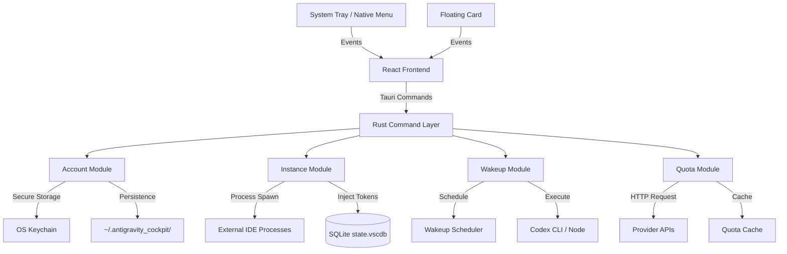

I will read the instructions in `./.prompt.md` to understand the task.
I will read the beginning of `cockpit-tools.xml` to understand its structure and content.
I will search for the `package.json` and `README.md` files within `cockpit-tools.xml` to gather the project's name and description.
I'll read the `README.md` file to gather more detailed information about the project's purpose, features, and supported platforms.
I will list the contents of the `src` directory to locate the source code for connectors, models, and other core components.
I will read more of the `directory_structure` from `cockpit-tools.xml` to locate the `src/` files and other relevant components.
I will search for files containing "skill" or `SKILL.md` in `cockpit-tools.xml` to identify any AI skills used or provided by the project.
I'll read the `CHANGELOG.md` file and examine `src-tauri/src/modules/instance.rs` to understand the project's recent development trends and how it manages AI skills within its instances.
I will examine `src-tauri/src/modules/db.rs` to identify the database used by the project and further refine the architecture and data storage details.
I will check the contents of `src-tauri/src/modules/db.rs` to determine the specific database used for persistent storage.
I will use `grep_search` to locate the content of `src-tauri/src/modules/db.rs` within the `cockpit-tools.xml` file.
I will search for test files and review the project's performance, maturity, security, and tests to complete the final report.
I will check several Rust files for the presence of `#[test]` to determine if there are any backend tests.
I will search the `directory_structure` in the `cockpit-tools.xml` file for any files containing `test` or `spec` to confirm the presence of test suites.
Analysis of **Cockpit Tools** based on the provided repository export.

---

### 1. Project Name and Description

**Project Name:** Cockpit Tools

**Description:**
1. **Cockpit Tools** is a comprehensive, cross-platform desktop application designed for the centralized management of AI IDE accounts. Built using the **Tauri** framework with a **React** and **TypeScript** frontend and a **Rust** backend, it provides a unified dashboard for developers to monitor and control their usage across a vast ecosystem of AI-powered development tools.
2. The application excels in handling multi-account scenarios, offering features such as one-click account switching, real-time quota monitoring with visual progress indicators, and automated "wakeup" tasks to ensure timely quota resets. It addresses the common developer pain point of managing multiple subscriptions and usage limits across different AI providers.
3. A standout capability is its **multi-instance orchestration**, which allows users to run several isolated instances of the same AI IDE (like Cursor or Windsurf) simultaneously. Each instance is bound to a different account and maintains its own configuration, enabling seamless parallel development workflows without account conflicts or the need for constant manual logins.

---

### 2. Supported Platforms and Deployments + Requirements

**Supported Platforms:**
- **macOS:** Intel and Apple Silicon (Universal DMG, Homebrew Cask support).
- **Windows:** x64 and ARM64 (NSIS and MSI installers).
- **Linux:** AppImage and potentially other formats (implied by Tauri and build workflows).

**Requirements:**
- **Local IDE Installations:** Requires the target AI IDEs (e.g., Cursor, Windsurf, Zed) to be installed locally to manage their configurations.
- **Node.js:** Needed for certain "wakeup" tasks and CLI interactions (e.g., Codex CLI).
- **Disk Space:** Sufficient space for multiple IDE instances (which can be several hundred MBs each).
- **OS Permissions:** Requires permissions to modify application support directories and, on macOS, access the Keychain for secure token storage.

---

### 3. Supported Connectors to Apps/APIs/Messengers

Cockpit Tools acts as a manager for the following AI IDEs and platforms:

- **Antigravity:** `src-tauri/src/modules/account.rs`
- **Codex:** `src-tauri/src/modules/codex_account.rs`
- **GitHub Copilot:** `src-tauri/src/modules/github_copilot_account.rs`
- **Windsurf:** `src-tauri/src/modules/windsurf_account.rs`
- **Cursor:** `src-tauri/src/modules/cursor_account.rs`
- **Gemini Cli:** `src-tauri/src/modules/gemini_account.rs`
- **Kiro:** `src-tauri/src/modules/kiro_account.rs`
- **CodeBuddy / CodeBuddy CN:** `src-tauri/src/modules/codebuddy_account.rs`, `src-tauri/src/modules/codebuddy_cn_account.rs`
- **Qoder:** `src-tauri/src/modules/qoder_account.rs`
- **Trae:** `src-tauri/src/modules/trae_account.rs`
- **Zed:** `src-tauri/src/modules/zed_account.rs`
- **WorkBuddy:** `src-tauri/src/modules/workbuddy_account.rs`

---

### 4. Supported Models/Agents

The tool manages accounts that provide access to various LLMs. It monitors quotas for:
- **Claude (v3.5, v3.7):** Via Antigravity/Codex. `src/utils/antigravityModels.ts`
- **Gemini Pro / Flash:** Via Gemini Cli and Antigravity. `src-tauri/src/models/gemini.rs`
- **GPT-4o / o1:** Via GitHub Copilot and Cursor. `src-tauri/src/models/cursor.rs`
- **Custom Presets:** Users can define model presets for wakeup tasks. `src-tauri/src/modules/wakeup.rs`

**Authentication:** Supports OAuth flows, Refresh Tokens, API Keys, and local session imports.

---

### 5. Top 5 Use Cases

1. **Quota Optimization:** A developer monitors multiple Cursor and Windsurf accounts on the Dashboard and switches to the one with the most remaining credits.
2. **Parallel Project Execution:** Running two separate Windsurf instances—one with a "Pro" account for a complex backend and another with a "Basic" account for a simple frontend.
3. **Automated Account Maintenance:** Setting a "Wakeup Task" at 2:00 AM to ensure the Codex model is active, triggering the daily quota reset cycle.
4. **Environment Isolation:** Using "Device Fingerprint" management to ensure each account appears to be running on unique hardware, reducing the risk of account flags.
5. **Quick Credential Sync:** Importing a token from a browser session into the desktop application and immediately "injecting" it into the local Zed installation.

---

### 6. Top 20 Features

1. **Unified Dashboard:** Centralized status and quota overview. `src/pages/DashboardPage.tsx`
2. **One-Click Account Switching:** Instant credential swapping. `src-tauri/src/commands/account.rs`
3. **Multi-Instance Management:** Parallel IDE orchestration. `src-tauri/src/modules/instance.rs`
4. **Quota Monitoring:** Visual usage bars and reset timers. `src-tauri/src/modules/quota.rs`
5. **Scheduled Wakeup Tasks:** Automated model activation. `src-tauri/src/modules/wakeup_scheduler.rs`
6. **Device Fingerprint Management:** Spoofing hardware IDs. `src-tauri/src/modules/fingerprint.rs`
7. **VS Code Config Injection:** Direct modification of IDE databases. `src-tauri/src/modules/vscode_inject.rs`
8. **2FA Manager:** Secure OTP vault. `src/pages/TwoFactorAuthPage.tsx`
9. **Floating Account Card:** Desktop overlay for quick access. `src-tauri/src/modules/floating_card_window.rs`
10. **Native macOS Menu:** Swift-based tray popover. `src-tauri/src/modules/macos_native_menu.rs`
11. **Auto-Switching Accounts:** Logic-based account rotation. `src/components/AutoSwitchAccountScopeSelector.tsx`
12. **GCP Project Selection:** Native project browser for Gemini. `src-tauri/src/commands/gemini.rs`
13. **Account Tagging & Filtering:** Organizational tools. `src/utils/accountFilters.ts`
14. **Automatic Index Repair:** Recovery from file corruption. `src-tauri/src/modules/account_index_repair.rs`
15. **Local Session Import:** One-click import from signed-in IDEs. `src-tauri/src/modules/import.rs`
16. **Tray Icon Integration:** System-level status indicators. `src-tauri/src/modules/tray.rs`
17. **I18n Support:** 17+ languages. `src-tauri/src/modules/i18n.rs`
18. **Websocket Updates:** Real-time state synchronization. `src-tauri/src/modules/websocket.rs`
19. **Atomic Configuration Writes:** Data integrity protection. `src-tauri/src/modules/atomic_write.rs`
20. **Built-in Log Viewer:** Real-time diagnostic interface. `src/components/LogViewerModal.tsx`

---

### 7. Top 20 Smart Patterns

1. **Rust-Tauri Bridge:** Strong separation of UI (React) and system-level logic (Rust).
2. **Database Injection:** Directly writing to SQLite (`state.vscdb`) to bypass UI-based logins. `src-tauri/src/modules/db.rs`
3. **Instance Isolation:** Using custom `--user-data-dir` to enable parallel IDE runs. `src-tauri/src/modules/instance.rs`
4. **Service-Based Architecture (Frontend):** Abstracting Tauri commands into TypeScript services. `src/services/`
5. **Snapshot-Based Persistence:** Saving account states as JSON snapshots for fast recovery.
6. **Fingerprint Spoofing:** Randomizing and binding machine IDs to accounts. `src-tauri/src/modules/fingerprint.rs`
7. **Graceful Error Recovery:** Rebuilding corrupted index files from detail backups. `src-tauri/src/modules/account_index_repair.rs`
8. **Event-Driven Sync:** Using a custom event bus to update floating cards and trays. `src/utils/accountSyncEvents.ts`
9. **Quota Caching:** Minimizing API calls by caching usage data. `src-tauri/src/modules/quota_cache.rs`
10. **OAuth Callback Server:** Running a temporary local server for auth redirects. `src-tauri/src/modules/oauth_server.rs`
11. **Native Menu Interop:** Using Swift for high-performance macOS UI elements. `src-tauri/native/macos-native-menu/`
12. **Config Migration:** Automated path and format updates during version upgrades. `CHANGELOG.md`
13. **Process Tracking:** Monitoring child IDE processes to manage lifecycle. `src-tauri/src/modules/process.rs`
14. **Keychain Integration:** Using OS-level secure storage for tokens. `src-tauri/src/modules/account.rs`
15. **Type-Safe Models:** Sharing structure definitions between Rust and TypeScript. `src-tauri/src/models/`
16. **Task Cancellation Scopes:** Allowing users to stop long-running wakeup tests. `src-tauri/src/modules/wakeup.rs`
17. **Dynamic Path Resolution:** Searching for Node/IDE binaries in common system paths. `src-tauri/src/modules/vscode_paths.rs`
18. **Privacy Masking:** Automatically hiding sensitive emails in logs and UI. `src/utils/privacy.ts`
19. **Batch Operations:** Applying tags or deletes to multiple accounts at once.
20. **Adaptive Refresh:** Adjusting polling rates based on active tasks (e.g., faster during wakeup).

---

### 8. Top 20 Development Trends (Latest Commits)

1. **Independent Refresh Intervals:** Tuning "current account" vs "global quota" refresh.
2. **Startup Wakeup Triggers:** Delayed automation execution on app launch.
3. **Improved Path Detection:** Better scanning for NPM, Volta, and Cargo paths.
4. **GCP Project Management:** Native integration for Gemini project selection.
5. **Native OS Auto-launch:** Syncing with system-level autostart settings.
6. **2FA Ecosystem Consolidation:** Dedicated workspace for all OTP secrets.
7. **Multi-Platform Trash Semantics:** Unified "Move to Trash" behavior across OSes.
8. **Unified Account Ordering:** Active accounts promoted in all pickers.
9. **Model Group Scoping:** Auto-switching targeted at specific model tiers.
10. **Shared Resource Linking:** Symlinking skills/rules for IDE instances.
11. **Keychain-First Auth:** Prioritizing macOS keychain over local files.
12. **Dynamic User-Agent Building:** Mimicking official IDE headers.
13. **Classic Sidebar Mode:** Transitioning to more flexible navigation layouts.
14. **Live Log Streaming:** Real-time diagnostics in the UI.
15. **Automatic Index Repair:** Resilience against filesystem corruption.
16. **Enhanced Wakeup Scheduling:** Supporting complex crontab and interval rules.
17. **Floating Card Pinning:** Persistent UI overlays for monitoring.
18. **Atomic Auth Updates:** Preventing file corruption during token writes.
19. **Check-in API Support:** Automated daily rewards/check-ins for CN providers.
20. **Swift-Native Tray Menu:** Improving performance and look-and-feel on macOS.

---

### 9. Top 10 Advantages / Strong Points

1. **Multi-IDE Support:** Unmatched breadth of supported AI tools.
2. **Multi-Instance Innovation:** Only tool offering robust parallel IDE orchestration.
3. **Deep System Integration:** Direct database injection and Keychain usage.
4. **High Privacy Standards:** Local-first data storage and privacy masking.
5. **Visual Polish:** Dashboard and floating cards provide excellent UX.
6. **Active Development:** Rapid release cycle with frequent feature updates.
7. **Resilience:** Automatic repair and atomic write mechanisms.
8. **I18n Coverage:** Supporting 17+ languages makes it globally accessible.
9. **Developer-Centric:** Built-in logs, manual tests, and 2FA management.
10. **Resource Efficient:** Quota caching and Rust-based backend performance.

---

### 10. Top 10 Limitations / Weak Points

1. **Complexity:** High barrier to entry for users unfamiliar with IDE internals.
2. **Dependency on IDEs:** Relies on third-party IDEs remaining compatible with its injection methods.
3. **Platform Drift:** Features like native macOS menus are OS-specific.
4. **Account Risk:** Automated switching/fingerprinting isn't guaranteed to avoid provider bans.
5. **No Mobile Support:** Desktop-only architecture (due to IDE management nature).
6. **Resource Intensive (Multi-instance):** Running multiple IDEs can strain RAM.
7. **Manual Setup Requirements:** Some providers require manual path configuration for CLI tools.
8. **Limited Linux Parity:** Some advanced tray/menu features may lag on Linux.
9. **Opaque Error Messages:** While improving, some backend errors can be cryptic.
10. **No Cloud Sync:** Data is local-only (though this is also a privacy advantage).

---

### 11. Top 5 Used and Top 5 Provided AI Skills

**Provided AI Skills (Automation Logic):**
1. **Account Rotation Engine:** Logic for selecting the "freshest" account. `src/utils/currentAccountSort.ts`
2. **Wakeup Automation:** Managing the "heartbeat" of remote models. `src-tauri/src/modules/wakeup_scheduler.rs`
3. **Credential Proxying:** Injecting tokens across environments. `src-tauri/src/modules/vscode_inject.rs`
4. **Environment Cloaking:** Generating believable hardware fingerprints. `src-tauri/src/modules/fingerprint.rs`
5. **Instance Orchestration:** Scaling local development environments. `src-tauri/src/modules/instance.rs`

**Used AI Skills (Capabilities Utilized):**
1. **OAuth Orchestration:** Handling the complex state of multiple auth redirects. `src-tauri/src/modules/oauth.rs`
2. **JSON/TOML Parsing:** Extracting data from IDE configuration files.
3. **Quota Forecasting:** Calculating reset times and usage trends. `src-tauri/src/modules/quota.rs`
4. **System Signal Handling:** Managing process lifecycles and signals. `src-tauri/src/modules/process.rs`
5. **Keychain Security:** Interacting with OS-level secure storage APIs.

---

### 12. Data Inputs, Outputs, and Storage Overview

- **Inputs:**
  - Auth Tokens (Access, Refresh, ID Tokens).
  - API Keys and Base URLs.
  - IDE Config Files (`config.toml`, `auth.json`, `state.vscdb`).
  - 2FA Base32 Secrets.
- **Outputs:**
  - Modified IDE configuration files (Injected credentials).
  - Exported Account Bundles (JSON).
  - Diagnostic Logs (`app.log`).
  - 2FA OTP Codes.
- **Storage:**
  - **Main Data:** `~/.antigravity_cockpit/` (JSON-based account index and details).
  - **Secure Storage:** macOS Keychain / Windows Credential Manager.
  - **Database:** SQLite (`state.vscdb`) within the managed IDE directories.
  - **Frontend State:** `localStorage` (for UI preferences) and Zustand (runtime state).

---

### 13. Detailed Architecture Review

The system follows a classic **C/S architecture** within a desktop app container.

1. **Frontend (React/Vite):** Orchestrates the UI. It doesn't perform heavy lifting but calls Rust commands.
2. **Tauri Bridge:** The critical layer that maps TS calls to Rust functions securely.
3. **Rust Core (Backend):**
   - **Command Layer:** Entry points for frontend interaction. `src-tauri/src/commands/`
   - **Module Layer:** Domain-specific logic (e.g., `account`, `instance`, `quota`).
   - **Persistence Layer:** Handles filesystem and DB operations.
   - **OS Integration:** Tray, Autostart, Keychain, Process management.
4. **Native Swift Bridge:** For macOS-specific UI features (Tray Popovers).

**Key Module Interactions:**
- `Account` $\leftrightarrow$ `Quota`: Account lists drive quota refreshes; quota data updates account status.
- `Instance` $\leftrightarrow$ `Account`: Starting an instance requires injecting a specific account's tokens.
- `Wakeup` $\leftrightarrow$ `Account`: Scheduler selects accounts based on their reset timers.

---

### 14. Architecture Mermaid Graph

---

### 15. Maturity, Stability, Security, Performance Review

- **Maturity:** **High**. Reaching version 0.20 with extensive multi-platform support and a sophisticated feature set (multi-instance, fingerprinting).
- **Stability:** **Good**. The inclusion of automatic index repair and atomic writes indicates a focus on robustness. However, the reliance on IDE internals makes it susceptible to third-party breaking changes.
- **Security:** **Strong for a local tool**. Use of native Keychains and local-only storage is excellent. The app handles high-value tokens but keeps them local.
- **Performance:** **Excellent**. The Rust backend ensures minimal overhead, even when managing multiple large IDE processes.

---

### 16. Review of Tests, CI, Documentation, and AI Skills

- **Tests:** Unit tests exist within Rust modules (`mod tests`). No dedicated frontend test suite (Vitest/Jest) is visible in the export.
- **CI Pipelines:** **Comprehensive**. Workflows for multi-platform builds, CodeQL scanning, and automated release publishing with checksum generation. `.github/workflows/`
- **Documentation:** **Detailed**. Multi-lingual READMEs, changelogs, and clear in-app guidance for runtime setup.
- **AI Skills:** The "skills" system (managing `.md` rules for Codex) is a unique integration that bridges account management with agent behavior.

---

### 17. Top 20 Possible Improvements or Fixes

1. **Integrated LLM Proxy:** Provide a local proxy endpoint to use managed accounts with non-supported tools.
2. **Cloud Sync (Optional/End-to-End Encrypted):** Sync accounts across multiple machines.
3. **Frontend Test Suite:** Add Vitest/Playwright for UI stability.
4. **Mobile Companion App:** For remote quota monitoring and 2FA.
5. **Headless Mode:** Run wakeup tasks without the GUI.
6. **Automatic IDE Updates:** Trigger updates for the managed IDEs within Cockpit.
7. **Advanced Quota Analytics:** Usage trends and cost projections over time.
8. **Plugin System:** Allow third parties to add new account types.
9. **Enhanced Linux Support:** Parity for native menu/tray features on Wayland/X11.
10. **Global Search:** Search for specific accounts or groups across the entire app.
11. **Account Sharing:** Securely share "tokens" with team members via encrypted files.
12. **Automatic Issue Diagnosis:** A button to auto-fix common path/permission issues.
13. **Custom Model Definitions:** Allow users to add new models to the quota monitor.
14. **Instance Performance Monitor:** Show CPU/RAM usage of managed IDE instances.
15. **Dark Mode Fine-Tuning:** Address slight visual issues noted in latest commits.
16. **Bulk Action Undo:** Undo a mistaken bulk delete or tag change.
17. **Export Filter Presets:** Save common filter/export configurations.
18. **Native Windows Menu:** Parity with the Swift-based macOS menu.
19. **Integrated Code Review Quota:** Better visibility into non-chat quotas.
20. **Self-Healing Runtime:** Automatically download/install missing Node or CLI dependencies.

---

### 18. Reuse for Agent Swarm (Debate & Plan)

1. **`AccountGroup` Logic:** For grouping agents by capability/model. `src-tauri/src/modules/group_settings.rs`
2. **`Quota` Priority Engine:** To select the "cheapest" or "most available" agent for a task. `src-tauri/src/modules/quota.rs`
3. **`Instance` Management:** To spawn multiple agents in parallel environments. `src-tauri/src/modules/instance.rs`
4. **`Websocket` Relay:** For real-time communication between debating agents. `src-tauri/src/modules/websocket.rs`
5. **`Decision` Pattern:** Reusing the auto-switch logic for selecting the "best" implementation plan.
6. **`Task Cancellation`:** To terminate losing debate branches. `src-tauri/src/modules/wakeup.rs`
7. **`JSON Indexing`:** For maintaining a record of agent specializations and history.
8. **`Log Tail`:** Aggregating logs from multiple agents for review. `src-tauri/src/modules/logger.rs`
9. **`Atomic Write`:** Ensuring the "best" plan is saved safely. `src-tauri/src/modules/atomic_write.rs`
10. **`Floating Card` UI:** For a "Swarm Monitor" overlay on the desktop.

---

### 19. Reuse for Multi-User/Multi-Agent Shared Knowledge

1. **`SyncSettings`:** Foundations for synchronizing state across users. `src-tauri/src/modules/sync_settings.rs`
2. **`DB Module`:** Injecting shared knowledge (like a graph) into local agent storage. `src-tauri/src/modules/db.rs`
3. **`Skill Linking`:** Reusing the Codex symlink pattern for shared rules/markdown. `src-tauri/src/modules/vscode_inject.rs`
4. **`Account Transfer Service`:** Exporting/Importing shared knowledge bundles. `src/services/accountTransferService.ts`
5. **`Global Tags`:** For categorizing shared knowledge. `src/utils/globalTagOperations.ts`
6. **`Conflict Guards`:** The logic used in `instance.rs` to prevent directory overlaps.
7. **`OAuth Server`:** Centralized auth for multiple users.
8. **`MFA Vault`:** Shared secrets management. `src/components/MfaVaultManager.tsx`
9. **`Report Service`:** The HTML report generator for shared usage stats. `src-tauri/src/modules/web_report.rs`
10. **`I18n`:** Ensuring the knowledge base is accessible to international teams.

---

### 20. Reuse for Hardware/Cloud/Messenger/Voice

1. **`Process` Wrapper:** Running agents on local hardware with lifecycle control. `src-tauri/src/modules/process.rs`
2. **`OAuth Pending State`:** For handling auth flows initiated from a messenger (Telegram/WhatsApp). `src-tauri/src/modules/oauth_pending_state.rs`
3. **`Floating Card` Viewport:** Pattern for a minimal, non-intrusive AI agent interface.
4. **`Tray` Logic:** System-level status indicators for "Hardware Agents."
5. **`CLI Launchers`:** Patterns for injecting env vars and starting CLI-based agents.
6. **`Device Fingerprinting`:** Identifying different hardware nodes in the cloud.
7. **`Websocket` Client:** Real-time bridge to a cloud-based messenger proxy.
8. **`Update Checker`:** Foundations for OTA (Over-the-Air) agent updates on own hardware.
9. **`Keychain` API:** Securely storing messenger API keys.
10. **`Native macOS Menu`:** Pattern for quick voice/text input from the menu bar.

---

### 21. Reuse for Team Agents (Cooperative Workflows)

1. **`Account Groups`:** Defining team-wide agent pools.
2. **`Quota Alerting`:** Notifying humans when agent resources are low. `src-tauri/src/modules/quota.rs`
3. **`Floating Overlay`:** Contextual agent feedback during human coding.
4. **`Check-in` Flow:** Gamifying agent maintenance/rewards in a team. `src/components/codebuddy/CodeBuddyCNCheckinModal.tsx`
5. **`Log Diagnostics`:** Sharing agent failure logs with human developers for debugging.
6. **`Provider Import`:** Quickly onboarding new team members by importing shared session tokens.
7. **`Auto-Switch` (Team Scope):** Balancing usage across team-shared accounts.
8. **`VSCode Inject`:** Injecting team-standard "Skills" and "Rules" into every member's IDE.
9. **`2FA Favorites`:** Shared OTP codes for team-level accounts.
10. **`I18n` Sync:** Handling collaboration across multilingual teams.
