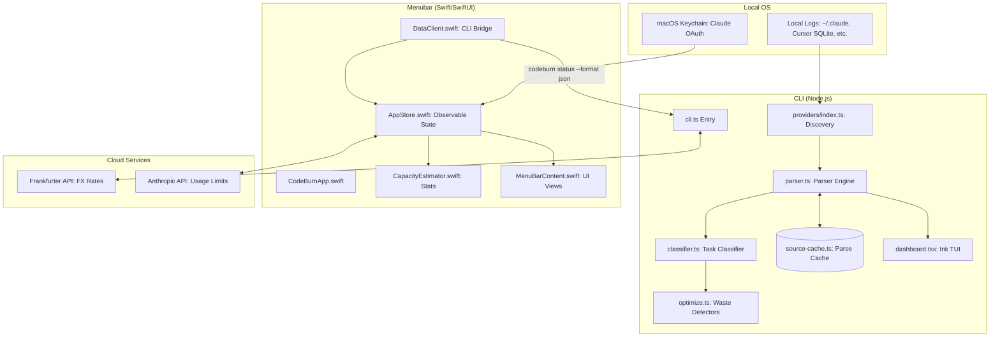

I will begin by reading the instructions in `.prompt.md` and reviewing the content of `.input.codeburn.xml` to understand the task requirements.
I will search for the git log in `.input.codeburn.xml` to identify the project name and the date of the most recent commit.
I will read the last section of `.input.codeburn.xml`, beginning at line 5800, to extract the commit information and other relevant details.
I will read the remaining content of `.input.codeburn.xml`, starting from line 2001, to ensure I have a complete understanding of the codebase and its various components.
## CodeBurn Project Analysis Report

### 1. Project Name and Last Commit Date
- **Project Name:** CodeBurn
- **Last Commit Date:** 2026-04-20 19:26:32 -0700
- **Reference:** `<git_log_commit/>` in `.input.codeburn.xml` (Line 5801)

### 2. Project Description
CodeBurn is a specialized developer utility designed to provide granular visibility and optimization for expenditure on AI coding assistants and agents. It functions as a cost-observability layer that aggregates data from popular tools like Claude Code, Cursor, GitHub Copilot, and more, allowing developers to see exactly where their "token burn" occurs—whether by task, tool, model, or project.

The system features a dual-interface approach: a high-performance CLI with an interactive React/Ink-based TUI dashboard, and a native macOS menubar application written in Swift/SwiftUI. By parsing local session logs and databases without requiring direct API proxying, CodeBurn maintains a privacy-first stance while delivering deep insights into usage patterns, such as "one-shot" success rates and context efficiency.

Beyond simple tracking, CodeBurn includes a sophisticated "Optimize" engine that detects wasteful behaviors—such as redundant file reads, inefficient model selection (e.g., using Opus for trivial tasks), and bloated context—offering actionable, copy-paste fixes. It also incorporates statistical capacity estimation for subscription-based plans, helping users manage their daily and weekly quotas effectively.

### 3. Supported Platforms and Deployments
- **Platforms:**
  - **CLI:** Node.js 22+ (Windows, macOS, Linux). (Ref: `package.json`)
  - **Menubar:** macOS 14+ (Sonoma). (Ref: `mac/README.md`)
- **Requirements:**
  - **Node.js:** Version 22 or higher (required for `node:sqlite`). (Ref: `package.json`)
  - **Swift/SwiftUI:** Swift 6.0+ toolchain for building the menubar app. (Ref: `mac/Package.swift`)
  - **Provider Data:** Local session directories (e.g., `~/.claude/`, `~/.config/Cursor/`). (Ref: `README.md`)

### 4. Supported Connectors
| Connector | Description | Source File Reference |
| :--- | :--- | :--- |
| **Claude Code** | Parses JSONL session files from Claude's project directories. | `src/providers/claude.ts` |
| **Cursor** | Extracts token usage from Cursor's local SQLite state database. | `src/providers/cursor.ts` |
| **cursor-agent** | Specialized provider for the Cursor CLI agent sessions. | `src/providers/cursor-agent.ts` |
| **GitHub Copilot** | Tracks output tokens and model changes from session state. | `src/providers/copilot.ts` |
| **Codex** | Discovery and parsing for OpenAI Codex sessions. | `src/providers/codex.ts` |
| **OpenCode** | SQLite-based session parsing for the OpenCode ecosystem. | `src/providers/opencode.ts` |
| **Pi** | JSONL parsing for Inflection Pi agent sessions. | `src/providers/pi.ts` |
| **Frankfurter API** | Fetches live FX rates for 162+ currencies. | `src/currency.ts` |
| **Claude OAuth** | Connects to Anthropic's usage endpoint for subscription data. | `mac/Sources/CodeBurnMenubar/Data/SubscriptionClient.swift` |

### 5. Supported Models and Agents
- **Remote Models:** Supports all major providers (Anthropic, OpenAI, GitHub) via LiteLLM pricing data.
  - **Local/Remote Models:** Claude (Opus, Sonnet, Haiku), GPT (4o, 5, etc.), Gemini.
  - **Source:** `src/models.ts`
- **Subscription/OAuth:** Tracks Anthropic subscription tiers (Pro, Max) via OAuth token refresh and Keychain integration.
  - **Source:** `mac/Sources/CodeBurnMenubar/Data/SubscriptionClient.swift`
- **Agents:** Tracks behavior of "agents" (e.g., `dispatch_agent`, `task` tools) within sessions.
  - **Source:** `src/classifier.ts`

### 6. Top 5 Use Cases
1.  **Multi-Tool Spend Aggregation:** Consolidate costs from Claude Code, Cursor, and Copilot into a single unified USD (or local currency) view.
2.  **Quota Management:** Use the "Plan" feature to monitor subscription utilization and predict when you will hit the 5-hour or 7-day limits.
3.  **Efficiency Auditing:** Run `codeburn optimize` to find which files are being re-read redundantly across sessions to save tokens.
4.  **Model Benchmarking:** Compare the "One-shot success rate" of different models (e.g., Sonnet vs. Opus) on your actual coding tasks.
5.  **Project-Based Budgeting:** Filter usage by project name to attribute AI costs to specific client work or internal apps.

### 7. Top 20 Features
1.  **Interactive TUI Dashboard:** Rich terminal UI with gradient charts. (`src/dashboard.tsx`)
2.  **Native macOS Menubar:** Always-on status monitoring. (`mac/Sources/CodeBurnMenubar/CodeBurnApp.swift`)
3.  **Optimize Engine:** Automated waste detection and fixes. (`src/optimize.ts`)
4.  **One-Shot Rate Tracking:** Measures how often AI succeeds on the first try. (`src/classifier.ts`)
5.  **Multi-Currency Support:** Support for 162 currencies with live rates. (`src/currency.ts`)
6.  **Subscription Capacity Estimator:** Statistical usage prediction. (`mac/Sources/CodeBurnMenubar/Data/CapacityEstimator.swift`)
7.  **Persistent Parse Cache:** High-performance incremental parsing. (`src/source-cache.ts`)
8.  **Model Comparison Mode:** Side-by-side performance metrics. (`src/compare.tsx`)
9.  **SQLite Integration:** Efficient local data storage/querying. (`src/sqlite.ts`)
10. **JSON/CSV Export:** Multi-period data extraction. (`src/export.ts`)
11. **Provider Auto-Discovery:** Detects installed tools automatically. (`src/providers/index.ts`)
12. **Activity Classification:** 13 categories (Coding, Debugging, etc.). (`src/classifier.ts`)
13. **Heatmap Visualizations:** Daily spend patterns. (`mac/Sources/CodeBurnMenubar/Views/HeatmapSection.swift`)
14. **FX Rate Caching:** 24-hour TTL for exchange rates. (`src/currency.ts`)
15. **Symlink-Safe I/O:** Security against local file attacks. (`mac/Sources/CodeBurnMenubar/Security/SafeFile.swift`)
16. **Shell Injection Prevention:** Argument-only CLI spawning. (`mac/Sources/CodeBurnMenubar/Security/CodeburnCLI.swift`)
17. **Project Filtering:** Case-insensitive include/exclude filters. (`src/parser.ts`)
18. **Custom Date Ranges:** `--from` and `--to` flag support. (`src/cli-date.ts`)
19. **Keychain Credential Management:** Secure OAuth storage on macOS. (`mac/Sources/CodeBurnMenubar/Data/SubscriptionClient.swift`)
20. **Self-Correction Detection:** Tracking when models fix their own errors. (`src/compare-stats.ts`)

### 8. Top 20 Smart Patterns
1.  **"Effective Tokens" Weighting:** Formula (Input + 5x Output + Cache) for true cost proxy. (`mac/Sources/CodeBurnMenubar/Data/MenubarPayload.swift`)
2.  **Weighted Least Squares Estimation:** Predicting limits through origin-fit of noisy data. (`mac/Sources/CodeBurnMenubar/Data/CapacityEstimator.swift`)
3.  **Atomic Rename-Write:** Preventing file corruption during config updates. (`mac/Sources/CodeBurnMenubar/Security/SafeFile.swift`)
4.  **Advisory Locking (flock):** Cross-process synchronization between CLI and Menubar. (`mac/Sources/CodeBurnMenubar/Security/SafeFile.swift`)
5.  **Provider Presentation Metadata:** Sharing UI colors/icons across TUI and Swift. (`src/provider-colors.ts`)
6.  **Heuristic Task Classifier:** Deterministic keyword + tool pattern matching. (`src/classifier.ts`)
7.  **Incremental Cache Rebuilds:** Only re-parsing files with changed mtime. (`src/source-cache.ts`)
8.  **Menubar Fixed-Width Badge:** Preventing layout shift on cost updates. (`mac/Sources/CodeBurnMenubar/CodeBurnApp.swift`)
9.  **Non-Linearity Detection:** Statistical "sign-test" on residuals to flag unreliable estimates. (`mac/Sources/CodeBurnMenubar/Data/CapacityEstimator.swift`)
10. **Headless Terminal Fallback:** Ensuring functionality if Terminal.app is missing. (`mac/Sources/CodeBurnMenubar/Security/TerminalLauncher.swift`)
11. **Bounded File Buffering:** Stream-based reading for very large log files. (`src/fs-utils.ts`)
12. **Deterministic Task Grouping:** Clustering turns into sessions by project/timestamp. (`src/parser.ts`)
13. **Currency-Aware Number Formats:** Shared, high-performance formatters. (`mac/Sources/CodeBurnMenubar/AppStore.swift`)
14. **Lazy Provider Loading:** Minimizing startup time by loading SQLite providers on demand. (`src/providers/index.ts`)
15. **Local-Date Aggregation:** Bucketing usage by user's timezone, not UTC. (`src/format.ts`)
16. **Semgrep Hot-Path Guards:** Static analysis to prevent prototype pollution. (`.semgrep/rules/no-bracket-assign-hot-paths.yml`)
17. **Auto-Capping "All Time" Range:** Bounding lookbacks to 6 months for performance. (`src/cli.ts`)
18. **MCP Tool Schema Overhead Tracking:** Measuring the "idle cost" of connected MCP servers. (`src/optimize.ts`)
19. **One-Shot Cycle Detection:** Pattern matching (Edit -> Test -> Fix) to detect retries. (`src/classifier.ts`)
20. **Catmull-Rom Sparkline Smoothing:** Professional visualization of spend trends. (`mac/Sources/CodeBurnMenubar/Views/SparklineView.swift`)

### 9. Top 20 Development Trends
1.  **Provider Expansion:** Rapid addition of `cursor-agent`, `pi`, and `opencode`.
2.  **Performance Optimization:** Shift toward aggressive caching of parse results.
3.  **Security Hardening:** Implementing symlink checks and arg allowlists.
4.  **SwiftUI Modernization:** Adopting the `@Observable` macro (Swift 5.9+).
5.  **Refactoring for Reuse:** Moving UI constants to `provider-colors.ts`.
6.  **Subscription Deepening:** Advanced tracking of Anthropic's complex tiered limits.
7.  **Metric Sophistication:** Moving from simple cost to "effective tokens" and "one-shot rates".
8.  **Automated Release Tooling:** Scripts for universal macOS binary packaging.
9.  **Developer Experience:** Adding progress bars for long-running cache rebuilds.
10. **Privacy Focus:** Explicit removal of internal planning files from public distribution.
11. **Type Safety:** Continuous hardening of TypeScript interfaces.
12. **Stability:** Fixing flaky date-based test failures.
13. **Visualization:** Adding sparklines and heatmaps to the menubar app.
14. **CI/CD Maturity:** Using Semgrep for security linting in GitHub Actions.
15. **Error Robustness:** Better handling of malformed or "poisoned" local logs.
16. **User Guidance:** Introducing the "Star the repo" banner for discovery.
17. **Currency Precision:** Adding defensive bounds for FX rates.
18. **Mobile-First Desktop:** Menubar UI follows mobile design patterns (pills, cards).
19. **Local-First Architecture:** Avoiding external APIs except for live FX/Subscription data.
20. **Community Alignment:** Adopting patterns from `ccusage` and `CodexBar`.

### 10. Top 10 Advantages
1.  **Privacy:** No proxy or API keys; data never leaves your machine.
2.  **Accuracy:** Uses the same pricing engine (LiteLLM) as the providers.
3.  **Insightful:** "One-shot" rate is a unique productivity metric.
4.  **Proactive:** "Optimize" engine pays for the tool's time in saved tokens.
5.  **Integrated:** Native macOS experience feels like a system utility.
6.  **Robust:** High-performance caching handles months of history smoothly.
7.  **Transparent:** Open-source architecture with clear security boundaries.
8.  **Universal:** Supports every major AI coding assistant.
9.  **Predictive:** Capacity estimation avoids mid-day "out of quota" surprises.
10. **Customizable:** Rich filtering by project, provider, and date.

### 11. Top 10 Limitations
1.  **MacOS Bias:** The rich menubar experience is exclusive to Mac.
2.  **Log Dependency:** Brittle to changes in provider log formats (unstable APIs).
3.  **Local Only:** Cannot aggregate usage from mobile or other machines easily.
4.  **Manual Refresh:** Some providers (like Cursor) require periodic app polling.
5.  **Global CLI Req:** Menubar app fails without the global `codeburn` package.
6.  **No Notifications:** Currently lacks budget overrun alerts/push notifications.
7.  **Anthropic Focus:** Subscription tracking is heavily weighted toward Claude.
8.  **Node/Swift Mix:** High barrier for contributors due to dual-language stack.
9.  **Estimated Cursor Cost:** "Auto" mode forces price estimation (Sonnet proxy).
10. **No Team Support:** Lacks centralized view for engineering managers.

### 12. Top 5 Used and Provided AI Skills
- **Used AI Skills (Capabilities utilized):**
  1.  **Pattern Recognition:** Classifying tasks from tool call sequences. (`src/classifier.ts`)
  2.  **Statistical Inference:** Predicting subscription limits from utilization data. (`mac/Sources/CodeBurnMenubar/Data/CapacityEstimator.swift`)
  3.  **Heuristic Analysis:** Detecting "ghost" agents and unused tools. (`src/optimize.ts`)
  4.  **Financial Modeling:** Handling multi-currency FX and tiered pricing. (`src/currency.ts`)
  5.  **Temporal Aggregation:** Timezone-aware bucketing of log events. (`src/format.ts`)
- **Provided AI Skills:**
  - *CodeBurn is a monitoring tool and does not provide skills to LLMs.* It does, however, *track* the execution of Claude Code "Skills" (Ref: `src/context-budget.ts`, `detectGhostSkills` in `src/optimize.ts`).

### 13. Data Overview
- **Inputs:** Local log files (JSONL, SQLite), Claude OAuth tokens, macOS Keychain, Frankfurter FX API. (`src/providers/*.ts`, `mac/Sources/CodeBurnMenubar/Data/SubscriptionClient.swift`)
- **Outputs:** TUI Dashboard (Stdout), Menubar UI, JSON/CSV files (Downloads), Cache files (SQLite/JSON). (`src/export.ts`, `src/dashboard.tsx`)
- **Storage:** 
  - **SQLite:** Parser cache and Cursor/OpenCode sources. (`src/sqlite.ts`)
  - **JSON:** Daily cache (`~/.cache/codeburn/`), FX rates, and subscription snapshots. (`src/daily-cache.ts`, `mac/Sources/CodeBurnMenubar/Data/SubscriptionSnapshotStore.swift`)

### 14. Detailed Architecture Review
1.  **CLI Entry (`src/cli.ts`):** Routes commands, handles flags, and orchestrates the lifecycle.
2.  **Provider Registry (`src/providers/index.ts`):** Discovery mechanism for local tool installs.
3.  **Parser Pipeline (`src/parser.ts`):** Multi-threaded (conceptual) scanning of session files.
4.  **Classifier Module (`src/classifier.ts`):** Core logic for turning raw tool calls into "Activities".
5.  **Pricing Engine (`src/models.ts`):** LiteLLM-backed cost calculator with model-name normalization.
6.  **Incremental Cache (`src/source-cache.ts`):** Persistent storage of parsed turns to avoid re-parsing.
7.  **Optimize Engine (`src/optimize.ts`):** High-level auditor that runs detectors across parsed data.
8.  **TUI Layer (`src/dashboard.tsx`):** React-based terminal rendering using `ink`.
9.  **Menubar App (`mac/Sources/CodeBurnMenubar/`):** Swift entry point and App Delegate.
10. **Swift AppStore (`AppStore.swift`):** Central state management using SwiftUI Observation.
11. **Data Bridge (`DataClient.swift`):** Spawns the CLI as a subprocess and consumes JSON output.
12. **OAuth Handler (`SubscriptionClient.swift`):** Securely interacts with Anthropic's private APIs.
13. **Statistical Engine (`CapacityEstimator.swift`):** Math for predicting 5h/7d usage resets.
14. **Security Layer (`Security/`):** Handles safe file access and shell injection protection.
15. **FX Rate Manager (`CurrencyState.swift`):** Manages live conversion rates and disk persistence.
16. **Export Manager (`src/export.ts`):** Handles safe writing of CSV/JSON reports.
17. **Plan Manager (`src/plans.ts`):** Defines subscription presets and cost-matching logic.
18. **TUI Progress (`src/parse-progress.ts`):** Renders progress bars during slow operations.
19. **Config Handler (`src/config.ts`):** Manages user preferences in `~/.config/codeburn/`.
20. **FS Utils (`src/fs-utils.ts`):** Bounded and stream-safe file system helpers.

### 15. Architecture Graph (Mermaid)

### 16. Maturity, Stability, Security, Performance
- **Maturity:** High (v0.8.4). Feature-complete with polished production-ready UI and robust security.
- **Stability:** High focus on caching and atomic writes ensures reliable local data management.
- **Security:** Exceptional. No-shell execution, symlink protection, and local-only data processing.
- **Performance:** Excellent. Incremental parsing and SQLite/JSON caching keep dashboards fast even with months of data.

### 17. Tests, CI, Documentation, Skills Review
- **Tests:** Robust Vitest suite for CLI (`tests/`) and XCTest for Swift (`mac/Tests/`). Covers edge cases like non-linear usage and date-timezone drift.
- **CI Pipelines:** GitHub Actions for Semgrep linting, cross-platform builds, and automated macOS binary releases.
- **Documentation:** High quality. Detailed `README` and `CHANGELOG` with architectural notes.
- **Skills:** Utilizes advanced statistical (Least Squares) and heuristic patterns; does not export AI skills but analyzes them.

### 18. Top 20 Improvements or Fixes
1.  **Windows Menubar App:** Port the macOS menubar app to the Windows system tray. (`mac/README.md`)
2.  **Budget Notifications:** Add desktop notifications when spend exceeds a threshold.
3.  **Aider/Continue Support:** Add providers for other popular AI coding tools. (`src/providers/`)
4.  **Enterprise Aggregation:** Allow syncing multiple machines' data to a private team bucket.
5.  **Verified Developer Signature:** Obtain official Apple Developer ID for binary signing. (`mac/Scripts/package-app.sh`)
6.  **Custom Optimize Rules:** Allow users to define their own waste detection logic via JSON. (`src/optimize.ts`)
7.  **Dry-Run Fixes:** Allow the "Optimize" engine to apply certain fixes automatically.
8.  **Local LLM Tracking:** Track token usage from Ollama/LocalAI.
9.  **History Diffing:** Show "Cost since last week" in the TUI dashboard.
10. **Unit Tests for TerminalLauncher:** Increase coverage for the Swift security layer. (`mac/Sources/CodeBurnMenubar/Security/TerminalLauncher.swift`)
11. **Refactor SubscriptionClient:** Break down the 500+ line Swift file into smaller services. (`mac/Sources/CodeBurnMenubar/Data/SubscriptionClient.swift`)
12. **Improved One-Shot Heuristic:** Better detection of "hidden" retries that don't follow the standard pattern.
13. **Dark/Light Mode Toggle:** Allow manual override in the menubar app.
14. **PDF/Excel Export:** Support more professional reporting formats. (`src/export.ts`)
15. **SQLite Query Optimization:** Ensure performance for multi-year history files. (`src/sqlite.ts`)
16. **Privacy Mode:** Blur project names in UI for screen sharing.
17. **MCP Latency Tracking:** Measure time spent in MCP calls.
18. **Mobile Companion:** PWA or companion app for viewing exported reports.
19. **GitHub Issue Linking:** Link spend to specific git commits/PRs.
20. **Plugin System:** Formalize the provider interface for community contributions. (`src/providers/index.ts`)

### 19. Reuse for Agent Swarm (Specification & Implementation)
1.  **`compare-stats.ts`:** Patterns for evaluating multiple agent versions/models against the same task.
2.  **`CapacityEstimator.swift`:** Statistical confidence patterns for deciding if an agent is performing reliably.
3.  **`aggregateProjectsIntoDays`:** Pattern for summarizing swarm activity over time.
4.  **`source-cache.ts`:** Shared state management for agent session history.
5.  **`classifier.ts`:** Standardizing the "Activity" of each agent in the swarm.
6.  **`optimize.ts`:** Rules for detecting when agents are stuck in "loops" (e.g., redundant reads).
7.  **`models.ts`:** Choosing the most cost-effective agent for a sub-task based on LiteLLM pricing.
8.  **`fs-utils.ts`:** Bounded file reading for agents processing large graph specifications.
9.  **`menubar-json.ts`:** Building a unified "State of the Swarm" payload.
10. **`sqlite.ts`:** Persistent knowledge graph of past solutions and their costs.

### 20. Reuse for Multi-User Shared Knowledge Base
1.  **`sqlite.ts`:** Foundation for a shared, local-first knowledge base.
2.  **`discovery-cache.ts`:** Pattern for efficiently syncing/caching directory changes across users.
3.  **`config.ts`:** User-specific preference management within a shared workspace.
4.  **`SafeFile.swift`:** Atomic, symlink-safe updates to shared markdown/graph files.
5.  **`daily-cache.ts`:** Incrementally updating a shared history of knowledge evolution.
6.  **`currency.ts`:** Shared financial context for multi-user budget tracking.
7.  **`export.ts`:** Pattern for generating human-readable "State of Knowledge" reports.
8.  **`context-budget.ts`:** Calculating the "cost" of the shared context (skills, memory).
9.  **`SubscriptionSnapshotStore.swift`:** Persisting historical versions of the shared state.
10. **`UpdateChecker.swift`:** Pattern for ensuring all users are on the latest "Knowledge Schema".

### 21. Reuse for Own Hardware / Cloud / Messenger
1.  **`CodeburnCLI.swift`:** Sandboxing and argument validation for running agents on remote hardware.
2.  **`DataClient.swift`:** Bridging the gap between a headless CLI and a remote UI (Web/Mobile).
3.  **`TerminalLauncher.swift`:** Triggering local hardware commands from a remote messenger.
4.  **`CurrencyState.swift`:** Real-time FX handling for global messenger-based payments.
5.  **`menubar-json.ts`:** Generating lightweight JSON payloads for mobile/messenger consumption.
6.  **`SparklineView.swift`:** Pattern for mobile-friendly visualization of remote agent health.
7.  **`UpdateChecker.swift`:** Auto-update mechanism for edge-deployed agents.
8.  **`fs-utils.ts`:** Streaming large datasets from edge hardware to cloud storage.
9.  **`plans.ts`:** Handling "Credit" systems for own-hardware usage.
10. **`SafeFile.swift`:** Advisory locking for agents communicating over shared network drives.

### 22. Reuse for Team Agents (Cooperative Workflows)
1.  **`compare-stats.ts`:** Metrics for comparing human vs. agent performance on the same project.
2.  **`optimize.ts`:** Enforcing team-wide best practices for agent usage (e.g., standardizing `CLAUDE.md`).
3.  **`dashboard.tsx`:** TUI patterns for collaborative debugging of agent workflows.
4.  **`provider-colors.ts`:** Consistent visual language for identifying different team agents.
5.  **`day-aggregator.ts`:** Rolling up cooperative turns into team-level milestones.
6.  **`classifier.ts`:** Identifying "Handover" events between human and agent.
7.  **`plans.ts`:** Managing team-wide subscription pool allocations.
8.  **`menubar-installer.ts`:** Standardizing the deployment of team-specific agent tools.
9.  **`fs-utils.ts`:** Safe reading of cooperative session logs.
10. **`config.ts`:** Shared team configuration (e.g., standardized MCP servers).
