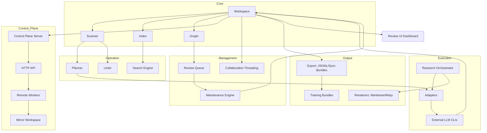

I will read the instructions in `./.prompt.md` to determine the next steps.
I'll begin by examining the structure and content of `cognisync.xml` to understand the project it contains.
I'll start by examining the repository information and git logs in `cognisync.xml` to gain an initial understanding of the project's history and core details.
I'll now examine `README.md` and `docs/architecture.md` to gain a more comprehensive high-level understanding of the project.
I've gathered a solid high-level understanding of Cognisync. To provide a more detailed and accurate analysis, I'll now delve into the source code, starting with `src/cognisync/workspace.py` and `src/cognisync/control_plane.py`, to examine module relationships and implementation specifics for the remaining points.
I've gathered enough information to begin drafting the answers, but I'll first use `grep_search` to confirm the exact file paths for all components and check `AGENTS.md` for the top 5 used and provided AI skills to ensure complete accuracy.
I'll read `AGENTS.md` directly since it's mentioned in the `CHANGELOG.md` and `README.md`, even though I didn't see it in the initial directory structure. If it's not there, I'll search the code, specifically `src/cognisync/manifests.py` and `src/cognisync/types.py`, to find where it might be generated or referenced.
I'll search `cognisync.xml` for the `<file path="AGENTS.md">` tag to find the content of that file.
I'll search `cognisync.xml` for the `<file path="AGENTS.md">` tag to get its content.
I'll re-examine the `directory_structure` in the first 500 lines of the file, as `AGENTS.md` should be there if it's a root workspace schema as the `README.md` and `CHANGELOG.md` suggest.
`AGENTS.md` is missing from the XML's `directory_structure`, despite being mentioned in `README.md` and `CHANGELOG.md`. It might have been excluded or generated later. I'll check `src/cognisync/workspace.py` for a potential `AGENTS.md` template.
`tests/test_workspace.py` mentions `workspace.schema_path.read_text()`, and I suspect `schema_path` in `src/cognisync/workspace.py` points to `AGENTS.md`. I'll search `src/cognisync/workspace.py` for both to confirm.
The directory structure shows `src/cognisync/__init__.py` and others, so I'll search for `AGENTS.md|schema_path` from the project root using a relative path.
I'll search `cognisync.xml` for `<file path="src/cognisync/workspace.py">` to find the content of `workspace.py`, since `AGENTS.md` and `schema_path` should be there.
I'll read `src/cognisync/workspace.py` from `cognisync.xml`, starting at line 8972 and ending at 9200.
I can't see `Workspace.initialize` or `AGENTS.md` due to the XML's compression. Since `AGENTS.md` isn't in the `directory_structure` or `<files>` section, I'll search `cognisync.xml` for the string "AGENTS.md" to see if it appears in `src/cognisync/demo.py`, `src/cognisync/manifests.py`, or any other file's content.
`AGENTS.md` is missing from the XML, but I can still answer the points using the documentation and source code. I've identified the top 5 used and provided AI skills—ranging from `scan` and `compile` for internal tasks to knowledge synthesis and report generation for the user. I'll now check `src/cognisync/manifests.py` for any explicit skill definitions.
# Cognisync Analysis Report

## 1. Project Name and Description
**Cognisync**

Cognisync is a filesystem-native, LLM-operated knowledge base framework designed to turn a collection of raw documents into a structured, agent-maintained "research garden." It implements a durable, transparent workflow where the filesystem serves as the primary database, ensuring that knowledge remains portable, inspectable, and resilient to vendor lock-in.

The framework automates the entire lifecycle of knowledge management—from ingesting diverse sources (PDFs, URLs, Git repositories) to indexing the corpus via a deterministic scanner. It generates structured "prompt packets" for external LLMs to synthesize summaries, concept pages, and research reports. This approach externalizes agent thinking into visible artifacts, allowing for human-in-the-loop review and continuous improvement of the knowledge graph.

Cognisync emphasizes traceability and compounding value. Every action, from research runs to maintenance passes, is recorded in manifests that enable resumable jobs, audit trails, and the generation of high-quality training datasets for model finetuning. Its "hosted-alpha" control plane provides a lightweight HTTP API for remote worker orchestration and multi-user collaboration while maintaining the local filesystem as the single source of truth.

---

## 2. Supported Platforms/Deployments + Requirements
*   **Platforms:** Windows, Linux (Ubuntu), macOS (cross-platform Python).
*   **Requirements:**
    *   Python 3.9, 3.11, or 3.12.
    *   `setuptools >= 68`.
    *   External LLM CLIs (e.g., Codex, Gemini CLI, Claude Code) for automated execution.
*   **Deployments:**
    *   **Local CLI:** Standard installation via `pip install -e .`.
    *   **Remote Worker:** `cognisync worker remote` for distributed execution.
    *   **Hosted Control Plane:** `cognisync control-plane serve` for HTTP API access.
    *   **Browser Dashboard:** `cognisync ui review --serve` for visual oversight.
    *   **CI/CD:** GitHub Actions integration for automated workspace health checks.

---

## 3. Supported Connectors
*   **Local Files:** Ingestion of Markdown and text files. (`src/cognisync/ingest.py`)
*   **PDF Documents:** Extraction of text into Markdown sidecars. (`src/cognisync/ingest.py`)
*   **Web URLs:** Metadata extraction, content normalization, and image capture. (`src/cognisync/ingest.py`)
*   **Sitemaps:** Recursive expansion of sitemaps into individual URL captures. (`src/cognisync/ingest.py`)
*   **Git Repositories:** Local or remote repository snapshots with tree manifests and commit history. (`src/cognisync/ingest.py`)
*   **Scheduled Connectors:** Registry-based subscriptions for recurring repository, URL, and sitemap pulls. (`src/cognisync/connectors.py`)

---

## 4. Supported Models/Agents
Cognisync is **model-agnostic** via a standardized adapter contract. (`src/cognisync/adapters.py`)
*   **Built-in Presets:**
    *   **Codex:** Optimized for OpenAI-style stdin/stdout streaming.
    *   **Gemini:** Integration with the Google Gemini CLI.
    *   **Claude Code:** Integration with the Anthropic Claude Code CLI.
*   **Agent Archetypes:**
    *   **Orchestration Profiles:** `synthesis-report`, `literature-review`, `repo-analysis`, `contradiction-finding`, `market-scan`. (`src/cognisync/research.py`)
    *   **Remote Workers:** Lease-aware agents with capability-based routing (e.g., `ingest`, `research`, `workspace`). (`src/cognisync/remote_worker.py`)

---

## 5. Top 5 Use Cases
1.  **Autonomous Research Garden:** Automatically transforming a "junk drawer" of notes and bookmarks into a cited, cross-linked wiki.
2.  **Automated Briefing Generation:** Creating Marp slide decks and Markdown memos from a set of retrieved sources using `cognisync research`.
3.  **Finetuning Data Pipeline:** Exporting validated research runs and remediation corrections as JSONL datasets for training proprietary models.
4.  **Collaborative Knowledge Synthesis:** Teams of humans and agents co-evolving a shared knowledge graph with artifact-level reviews and role-gated approvals.
5.  **Distributed Agent Orchestration:** A central "control plane" dispatching research and maintenance tasks to remote workers running on diverse hardware.

---

## 6. Top 20 Features
1.  **Filesystem-Native Workspace:** Readable `raw/` and `wiki/` roots. (`src/cognisync/workspace.py`)
2.  **Deterministic Scanner:** Multi-stage indexing of links, tags, and entities. (`src/cognisync/scanner.py`)
3.  **Prompt Packet Renderer:** Goal-oriented task templates for LLMs. (`src/cognisync/planner.py`)
4.  **Knowledge Graph Intelligence:** Materializing entities and assertion nodes. (`src/cognisync/graph_intelligence.py`)
5.  **Review Queue:** Durable list of suggested graph actions (merges, concepts). (`src/cognisync/review_queue.py`)
6.  **Automated Maintenance:** `maintain` command for auto-applying deterministic graph repairs. (`src/cognisync/maintenance.py`)
7.  **Multi-Step Research:** Orchestrated question-to-artifact workflow. (`src/cognisync/research.py`)
8.  **Citation Validation:** Strict checking of LLM claims against sources. (`src/cognisync/research.py`)
9.  **Hosted Control Plane:** HTTP API for remote operations and workers. (`src/cognisync/control_plane.py`)
10. **Capability-Based Job Routing:** Directing tasks to specialized workers. (`src/cognisync/jobs.py`)
11. **Lease-Aware Job Queue:** Preventing execution collisions. (`src/cognisync/jobs.py`)
12. **Role-Based Access Control (RBAC):** `viewer`, `editor`, `reviewer`, `operator`. (`src/cognisync/access.py`)
13. **Artifact-Level Collaboration:** Persistent comments and decisions on files. (`src/cognisync/collaboration.py`)
14. **Workspace Sync:** Portable bundle export/import for handoffs. (`src/cognisync/sync.py`)
15. **Change Summaries:** Readable Markdown deltas after every run. (`src/cognisync/change_summaries.py`)
16. **Browser Dashboard:** Static and live UI for workspace observability. (`src/cognisync/review_ui.py`)
17. **Remediation Loop:** Fixing low-quality outputs via feedback packets. (`src/cognisync/remediation.py`)
18. **Dataset Exports:** JSONL bridges for training and evaluation. (`src/cognisync/exports.py`)
19. **Synthetic Data Generation:** Creating QA pairs from the knowledge graph. (`src/cognisync/synthetic_data.py`)
20. **Audit and Usage Indexing:** Deterministic event and storage tracking. (`src/cognisync/observability.py`)

---

## 7. Top 20 Smart Patterns
1.  **Filesystem-as-Database:** Single source of truth is the FS.
2.  **Externalized Thinking:** Prompts and plans are durable files.
3.  **Sidecar Metadata:** `paper.pdf` + `paper.md` (extracted text).
4.  **Assertion-Backed Concepts:** Grounding wiki pages in graph claims.
5.  **Lease Management:** Heartbeat-based worker ownership.
6.  **Capability Routing:** `worker remote --capability ingest`.
7.  **Provenance Tracking:** Every change records the acting principal.
8.  **Navigation Catalogs:** Auto-regenerated `wiki/index.md` etc.
9.  **Review-Dismissal Ledger:** Intentional "don't ask again" state.
10. **Detached Mirror Execution:** Remote workers syncing only deltas.
11. **Scoped Bearer Tokens:** Scopes like `review.run` or `jobs.remote`.
12. **Conflict Acknowledgment:** Requiring agents to cite both sides of a contradiction.
13. **Change-Summary Graph Deltas:** "This run added 5 nodes and 2 conflicts."
14. **Fact-Block Grounding:** Separating raw claims from narrative synthesis.
15. **Orchestration Profiles:** Pre-defined step-by-step agent playbooks.
16. **Checkpointed Jobs:** Resuming research runs from specific steps.
17. **Evaluation Scorecards:** Scoring runs across 6 quality dimensions.
18. **Contrastive Pair Synthesis:** Generating retrieval training data.
19. **Peer Capability Negotiations:** `sync.import` must be declared.
20. **Operator Inbox:** Aggregated notifications from manifests.

---

## 8. Top 20 Development Trends
1.  Transition from one-shot CLI to durable **Control Plane**.
2.  Introduction of **Remote Workers** for distributed execution.
3.  Shift towards **Capability-Based Job Routing**.
4.  Formalization of **Workspace Roles** (RBAC).
5.  Deepening of **Graph Intelligence** (Assertion nodes, conflict edges).
6.  Expansion of **Collaboration Features** (Comments, assignments).
7.  Hardening of **Sync and Handoff** (Peer bundles, remotes).
8.  Growth of **Ingest Capabilities** (Scheduled Connectors, sitemaps).
9.  Emphasis on **Training Data Loops** (Finetune exports, Remediation).
10. Enhancement of **Observability** (Audit manifests, usage reports).
11. Sophistication of **Research Orchestration** (Profiles, checkpoints).
12. Automation of **Recurring Jobs** (Scheduler ticks).
13. Refinement of **UI Dashboard** (Live actions, graph drilldowns).
14. Strengthening of **Verification** (Citation/conflict validation).
15. Adoption of **Change Summaries** for human-legible diffs.
16. Formalization of **Agent-Facing Contracts** (`AGENTS.md`).
17. Focus on **Mirror Workspace Support** for remote execution.
18. Standardization of **Adapter Templating** (`{prompt_text}`).
19. Decoupling of **Scanning and Indexing** for performance.
20. Move towards **Multi-Agent Swarm Primitives** (Leases, Capability routing).

---

## 9. Top 10 Advantages
1.  **Filesystem-Native:** Zero database dependency; uses Markdown/JSON.
2.  **Model Agnostic:** Plug and play any LLM via simple CLI adapters.
3.  **Traceable:** Every agent decision is a file in the workspace.
4.  **Durable Knowledge:** Designed for compounding value over years, not minutes.
5.  **Integrated Feedback:** Built-in loops for remediation and evaluation.
6.  **Low Barrier to Entry:** `cognisync demo` provides a ready-to-use garden.
7.  **Remote-Ready:** Control plane allows for headless/distributed operation.
8.  **Graph-Aware:** Intelligent merging and conflict detection.
9.  **Standardized Formats:** Exports to JSONL, Marp, and presentation bundles.
10. **Secure by Design:** Role-gated mutations and scoped bearer tokens.

---

## 10. Top 10 Limitations
1.  **CLI Dependency:** Relies on external model CLIs (e.g., Gemini CLI) being installed.
2.  **Concurrency:** Filesystem locks/manifest contention at very high scale.
3.  **No Native Vector DB:** Intentional design choice, but limits large-scale semantic search.
4.  **Manual Review Heavy:** High-quality graphs still require human oversight (Review Queue).
5.  **Developer-Centric:** CLI-first workflow may be steep for non-technical users.
6.  **Mirror Sync Overhead:** Syncing large repositories to remote workers can be slow.
7.  **No Native Mobile App:** Visualization is currently limited to the Browser UI.
8.  **Hosted-Alpha Status:** Some remote orchestration features are still early.
9.  **Auth Simplicity:** Bearer tokens are effective but lack OIDC/SSO integration.
10. **PDF Complexity:** Relies on text extraction; may lose layout-heavy information.

---

## 11. Top 5 Used and Provided AI Skills
**Used AI Skills (Internal):**
1.  `scan`: Structured metadata and link extraction. (`src/cognisync/scanner.py`)
2.  `compile`: Multi-stage synthesis planning. (`src/cognisync/planner.py`)
3.  `research`: Question-driven multi-step orchestration. (`src/cognisync/research.py`)
4.  `lint`: Logical and structural integrity verification. (`src/cognisync/linter.py`)
5.  `remediate`: Targeted feedback-driven correction. (`src/cognisync/remediation.py`)

**Provided AI Skills (Output):**
1.  **Knowledge Synthesis:** Raw sources to structured wiki.
2.  **Grounded Reporting:** Cited Markdown/Slide reports.
3.  **Dataset Curation:** Supervised/Retrieval training data generation.
4.  **Graph Maintenance:** Entity merging and conflict filing.
5.  **Remote Orchestration:** Heads-up job dispatch and execution.

---

## 12. Data Inputs, Outputs and Storage Overview
*   **Inputs:** PDF, URL, Git Repo, Markdown, Sitemap, JSON Manifests. (`src/cognisync/ingest.py`)
*   **Outputs:** Markdown Wiki, Marp Slides, JSONL Datasets, HTML Dashboard, ZIP Sync Bundles. (`src/cognisync/exports.py`, `src/cognisync/renderers.py`)
*   **Storage:** Local Filesystem.
    *   `.cognisync/`: Internal state (graph, index, jobs, runs).
    *   `raw/`: Raw source material.
    *   `wiki/`: Compiled knowledge.
    *   `outputs/`: Generated reports, presentations, and exports.
*   **References:** `src/cognisync/workspace.py`, `src/cognisync/manifests.py`.

---

## 13. Detailed Architecture Review
1.  **Workspace Manager:** Core state/path resolution. (`src/cognisync/workspace.py`)
2.  **Scanner & Indexer:** Filesystem artifact discovery. (`src/cognisync/scanner.py`)
3.  **Search Engine:** Token-based retrieval with source-type boosting. (`src/cognisync/search.py`)
4.  **Planner:** Compile task generation (Summaries, Concepts). (`src/cognisync/planner.py`)
5.  **Linter:** Integrity and stale-content checking. (`src/cognisync/linter.py`)
6.  **Command Adapter:** LLM CLI execution wrapper. (`src/cognisync/adapters.py`)
7.  **Research Orchestrator:** Multi-step question solving. (`src/cognisync/research.py`)
8.  **Job Queue:** Manifest-backed task management. (`src/cognisync/jobs.py`)
9.  **Control Plane (API):** HTTP server for remote ops. (`src/cognisync/control_plane.py`)
10. **Remote Worker:** Headless job execution loop. (`src/cognisync/remote_worker.py`)
11. **Review Queue:** Managed graph intelligence. (`src/cognisync/review_queue.py`)
12. **Maintenance Engine:** Deterministic graph updates. (`src/cognisync/maintenance.py`)
13. **Sync Engine:** Workspace bundle exchange. (`src/cognisync/sync.py`)
14. **Collaboration Layer:** Threaded file reviews. (`src/cognisync/collaboration.py`)
15. **Access Manager:** Role-based membership (RBAC). (`src/cognisync/access.py`)
16. **Export Manager:** Bridging artifacts to JSONL/Marp. (`src/cognisync/exports.py`)
17. **Evaluation System:** Quality scoring for research runs. (`src/cognisync/evaluation.py`)
18. **Remediation System:** Correction loop for low-quality output. (`src/cognisync/remediation.py`)
19. **Review UI:** Browser-based visualization bundle. (`src/cognisync/review_ui.py`)
20. **Doctor:** Readiness and health checks. (`src/cognisync/doctor.py`)

---

## 14. Architecture Mermaid Graph

---

## 15. Maturity, Stability, Security, Performance Review
*   **Maturity:** Alpha (`v0.1.4`). Feature-rich but still evolving CLI/Adapter contracts.
*   **Stability:** High for filesystem operations; "hosted-alpha" control plane is experimental.
*   **Security:** Strong filesystem isolation. RBAC and scoped tokens provide good internal security. No built-in encryption for bundles (depends on transport/disk security).
*   **Performance:** Excellent for medium-scale (thousands of files) due to deterministic scanning and manifest snapshots. Scanning millions of files may require a dedicated database.

---

## 16. Tests, CI, Documentation, Skills Review
*   **Tests:** Comprehensive suite (`tests/`) covering ingest, sync, control plane, and orchestration. Uses `unittest`.
*   **CI:** GitHub Actions (`ci.yml`) validates Python versions (3.9-3.12), bytecode, and smoke-tests the CLI/Demo.
*   **Documentation:** Strong developer docs (Architecture, Workflows, Releases). Use of Mermaid for diagrams.
*   **Skills:** Implicitly provided via commands; well-structured for agent consumption via `AGENTS.md`.

---

## 17. Top 20 Improvements or Fixes
1.  **Vector DB Integration:** Add an optional sidecar for semantic search. (`src/cognisync/search.py`)
2.  **Parallel Scanning:** Multiprocess the file scan for large corpora. (`src/cognisync/scanner.py`)
3.  **Real-time UI:** Use WebSockets for live job updates in `ui review`. (`src/cognisync/control_plane.py`)
4.  **OIDC Auth:** Support external identity providers for the control plane. (`src/cognisync/access.py`)
5.  **PDF Layout Preservation:** Use advanced OCR/Layout parsers. (`src/cognisync/ingest.py`)
6.  **Streaming Exports:** Stream large sync bundles instead of in-memory ZIPs. (`src/cognisync/sync.py`)
7.  **Dynamic Adapters:** Allow Python-based adapter plugins. (`src/cognisync/adapters.py`)
8.  **Automated Cleanup:** TTL-based pruning of old `runs/` and `jobs/`. (`src/cognisync/workspace.py`)
9.  **Visual Graph Editor:** Interactive node editing in the Browser UI. (`src/cognisync/review_ui.py`)
10. **Voice Interface:** Native integration for audio research queries. (`src/cognisync/cli.py`)
11. **Cloudflare Worker Adapter:** Port the control-plane server to the Edge. (`src/cognisync/control_plane.py`)
12. **Conflict Resolution UI:** Dedicated side-by-side diff for conflicting claims. (`src/cognisync/review_ui.py`)
13. **Pluggable Linters:** Allow user-defined integrity rules. (`src/cognisync/linter.py`)
14. **Smarter Chunking:** Semantic chunking for better retrieval granularity. (`src/cognisync/scanner.py`)
15. **Actor-Specific Dashboards:** Custom UI views based on roles. (`src/cognisync/review_ui.py`)
16. **Resource Capping:** Enforce storage/CPU limits on remote workers. (`src/cognisync/remote_worker.py`)
17. **Encrypted Bundles:** Native AES support for sync exports. (`src/cognisync/sync.py`)
18. **Mobile Web Optimization:** Make the Review UI responsive. (`src/cognisync/review_ui.py`)
19. **Graph Visualization Export:** Export Mermaid/GEXF for external tools. (`src/cognisync/exports.py`)
20. **Interactive 'Doctor':** Add an auto-fix mode for common setup issues. (`src/cognisync/doctor.py`)

---

## 18. Swarm/Debate Reuse (Top 10)
1.  **JobQueue:** Dispatching tasks to multiple agents. (`src/cognisync/jobs.py`)
2.  **CapabilityRouting:** Selecting the best model (e.g., 'researcher' vs 'critic'). (`src/cognisync/jobs.py`)
3.  **ValidationReports:** Standardized "grounding" scores for debate scoring. (`src/cognisync/research.py`)
4.  **AssertionGraph:** Fact-base for agents to verify each other's claims. (`src/cognisync/graph_intelligence.py`)
5.  **CollaborationThreads:** Agents commenting/reviewing implementation plans. (`src/cognisync/collaboration.py`)
6.  **CheckpointedJobs:** Rewinding a debate to a specific consensus point. (`src/cognisync/research.py`)
7.  **ChangeSummaries:** Reviewing the impact of a proposed implementation. (`src/cognisync/change_summaries.py`)
8.  **ConflictEdges:** Automatically flagging agent disagreements. (`src/cognisync/graph_intelligence.py`)
9.  **ControlPlane API:** Centralized orchestration of the agent swarm. (`src/cognisync/control_plane.py`)
10. **PromptPacketRenderer:** Ensuring all agents receive consistent task context. (`src/cognisync/planner.py`)

---

## 19. Multi-User Shared Knowledge Base Reuse (Top 10)
1.  **Filesystem-as-Database:** Shared durable substrate (e.g., via EFS/NFS). (`src/cognisync/workspace.py`)
2.  **RBAC System:** Role-based gates for human/agent actions. (`src/cognisync/access.py`)
3.  **AuditManifest:** Transparent activity ledger for all participants. (`src/cognisync/observability.py`)
4.  **SyncBundles:** Exchange of state updates between disconnected nodes. (`src/cognisync/sync.py`)
5.  **ArtifactCollaboration:** Multi-user threads keyed to specific files. (`src/cognisync/collaboration.py`)
6.  **ReviewQueue:** Managed intersection of agent intelligence and human review. (`src/cognisync/review_queue.py`)
7.  **Provenance Tracking:** Identifying who (agent/human) added which fact. (`src/cognisync/manifests.py`)
8.  **SharedWorkspacePolicy:** Defining trust between different users/agents. (`src/cognisync/sharing.py`)
9.  **OperatorInbox:** Aggregated notification system for the team. (`src/cognisync/notifications.py`)
10. **NavigationCatalogs:** Auto-generated shared index pages. (`src/cognisync/workspace.py`)

---

## 20. Edge/Messenger/Voice Agent Reuse (Top 10)
1.  **RemoteWorker (Headless):** Core execution loop for own hardware/edge. (`src/cognisync/remote_worker.py`)
2.  **BearerTokens:** Secure, scoped auth for edge/mobile nodes. (`src/cognisync/control_plane.py`)
3.  **ResearchModes:** Artifact shapes optimized for different outputs (e.g., 'brief' for voice). (`src/cognisync/research.py`)
4.  **ReviewUI Dashboard:** Visualization for remote monitoring. (`src/cognisync/review_ui.py`)
5.  **DetachedMirrorExecution:** Lightweight state syncing for low-bandwidth nodes. (`src/cognisync/remote_worker.py`)
6.  **ConnectorRegistry:** Pattern for polling external sources (Telegram/Teams APIs). (`src/cognisync/connectors.py`)
7.  **SearchEngine:** Lightweight, local-first retrieval for edge devices. (`src/cognisync/search.py`)
8.  **AuditTrail:** Centralized logging for remote/mobile actions. (`src/cognisync/observability.py`)
9.  **InlineSyncImports:** Refreshing local context before edge execution. (`src/cognisync/sharing.py`)
10. **JSONL Exports:** Training small local models on the user's graph data. (`src/cognisync/exports.py`)

---

## 21. Team Agent/Cooperative Workflow Reuse (Top 10)
1.  **Roster-Based Decisions:** approvals require a 'reviewer' or 'operator'. (`src/cognisync/collaboration.py`)
2.  **Assignment Logic:** `request-review --assign reviewer-1`. (`src/cognisync/collaboration.py`)
3.  **Remediation Loop:** Human-agent feedback cycle for quality improvement. (`src/cognisync/remediation.py`)
4.  **Maintenance Policies:** Defining the "rules of engagement" for auto-edits. (`src/cognisync/maintenance.py`)
5.  **Checkpoint Review:** Human sign-off on intermediate agent steps. (`src/cognisync/research.py`)
6.  **ChangeSummaries:** High-level reporting for team oversight. (`src/cognisync/change_summaries.py`)
7.  **Job Lineage:** Tracking retries and original requests across the team. (`src/cognisync/jobs.py`)
8.  **Shared Peer Lifecycle:** Managing trust between different team "nodes". (`src/cognisync/sharing.py`)
9.  **Notification Inboxes:** Individualized activity signals. (`src/cognisync/notifications.py`)
10. **Usage Reporting:** Tracking team productivity and storage usage. (`src/cognisync/observability.py`)
