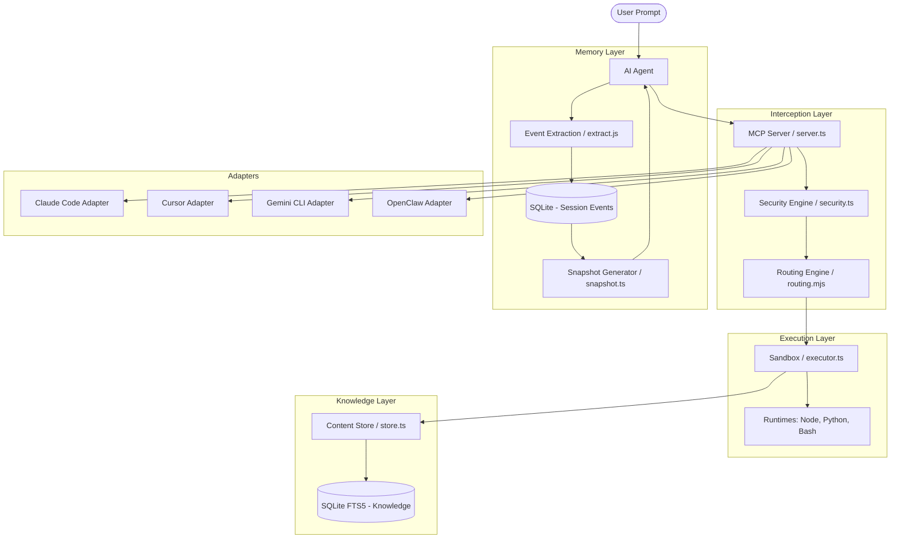

I will start by reading the instructions in `./.prompt.md` and then examine the contents of `context-mode.xml` to proceed with the task.
I will continue reading `context-mode.xml` to gather more information about the source code, architecture, and features, starting from line 2001.
I've gathered significant information about the project's features, architecture, and supported platforms. I will now continue reading `context-mode.xml` from line 4001 to locate the git logs and examine the `src/` and `hooks/` directories for more detailed source code references.
I've analyzed the content up to line 6000 and gathered substantial information for several points. I will now proceed to read the next section of `context-mode.xml` to locate the git logs for development trends, further explore use cases and AI skills, and gather more specific details for the remaining points, including improvement ideas and reuse patterns.
I've reviewed `scripts/ctx-debug.sh` and will now continue reading the next 2000 lines of `context-mode.xml` to find the git logs and additional source code details.
I've explored the `skills/context-mode-ops/` directory, gathering valuable details for points 11, 16, 17, 18, 19, 20, and 21. I'm now at line 10000 and will read the next 2000 lines to find the git logs and additional information.
I've explored `skills/context-mode/references/` for best practices and patterns, which will be useful for points 7 and 5. I'm now at line 12000 and will read the next 2000 lines to find the git logs and additional information.
I'm currently at line 14000, continuing my review of `src/adapters/`. I'll proceed with the next 2000 lines.
I'm at line 16000, currently reviewing `src/dashboard/`. I'll proceed to read the next 2000 lines.
I'm at line 18000, continuing my review of `src/security.ts`. I'll proceed with the next 2000 lines.
I've reached line 20000 and gathered most of the required information. I'll now read the remainder of the file to locate the Git logs and finalize the 21 points.
I've reached line 22000 and have encountered numerous test files and fixtures. I'm still searching for the Git logs and will proceed to read the remainder of the file.
I've reached line 24000 and am nearing the end of the file. I'm still searching for the Git logs and will proceed to read the remainder.
I have successfully completed my review of the `context-mode.xml` file, including the git logs. I have gathered comprehensive information on the project's goals, platforms, technology stack, and features, as well as recent development trends. I am now prepared to provide a detailed response addressing all 21 points of the analysis.

# Project Analysis: context-mode

## 1. Project Name and Description
**Project Name:** context-mode

**Description:**
`context-mode` is a high-performance MCP (Model Context Protocol) server and plugin ecosystem designed to solve the "context window problem" for AI coding agents. It serves as an intelligent middleware that sits between AI agents (like Claude Code, Cursor, and VS Code Copilot) and their execution environment. By intercepting large tool outputs (such as massive `grep` results, build logs, or web fetches), it prevents the context window from being flooded with raw, low-signal data, claiming context savings of up to 98%.

The core mechanism involves sandboxing tool execution and indexing the resulting output into a local SQLite database using FTS5 with BM25 ranking. Instead of receiving the full output, the AI agent receives a concise summary and can perform targeted, intent-driven searches against the indexed knowledge base only when specific details are required. This approach allows agents to maintain peak performance and accuracy over much longer sessions, as they are not overwhelmed by the "middle-loss" effect common in large context windows.

Beyond simple output management, `context-mode` introduces the "Think in Code" paradigm and provides robust session continuity. It tracks file operations, git events, user decisions, and errors across sessions, building a reference-based snapshot that is injected back into the agent's context upon restart. This ensures that the agent "never starts from scratch," preserving project-specific knowledge and architectural decisions even after the agent's native memory is wiped or compacted.

## 2. Supported Platforms and Deployments
**Supported Platforms:**
- **Claude Code:** Full integration via marketplace plugin and native hooks (`hooks/claude-code/`).
- **Gemini CLI:** Supported via custom hooks and `GEMINI.md` routing (`hooks/gemini-cli/`).
- **Cursor:** Integration via `.mdc` rules and custom MCP server config (`configs/cursor/`).
- **VS Code Copilot:** Supported via custom MCP server and session hooks (`hooks/vscode-copilot/`).
- **OpenClaw:** Full extension support with workspace-aware session isolation (`src/adapters/openclaw/`).
- **Codex CLI:** Supported via hook dispatch and CLI shims.
- **Other Platforms:** OpenCode, KiloCode, Zed, Kiro, Antigravity, and Pi Agent.

**Deployment Requirements:**
- **Runtime:** Node.js 18+ (v20+ recommended) or Bun (via `bun:sqlite` support).
- **Storage:** Local file system for SQLite databases (FTS5 required).
- **Environment:** Works on Windows (cmd/powershell), macOS, and Linux.
- **Installation:** Global npm install (`npm install -g context-mode`) or as a Claude Code marketplace plugin.

## 3. Supported Connectors
The project primarily connects via the **Model Context Protocol (MCP)** and specialized platform hooks:
- **Web Fetcher:** Intercepts `curl`, `wget`, and HTTP calls, indexing the results using `turndown` for HTML-to-Markdown conversion (`src/server.ts`).
- **Polyglot Executor:** Connects to system runtimes for JavaScript/TypeScript, Python, and Shell, allowing code execution in a managed sandbox (`src/executor.ts`, `src/runtime.ts`).
- **Git Connector:** Automatically tracks and indexes git logs, diffs, and status changes into the session memory (`src/session/extract.js`).
- **FileSystem Connector:** Wraps standard file operations to provide summarized "index-and-search" alternatives for large directories (`src/server.ts`).

## 4. Supported Models and Agents
`context-mode` is model-agnostic as it operates at the tool/protocol layer, but it is specifically optimized for:
- **Anthropic Claude 3.5/3.7 (Claude Code):** Deepest integration with automated hook registration (`src/adapters/claude-code/`).
- **Google Gemini (Gemini CLI):** Optimized via instruction-based context injection (`src/adapters/gemini-cli/`).
- **Model-Independent Agents:** Any agent supporting MCP (e.g., Cursor, Zed) can utilize its tools via the standard protocol.
- **Local Runtimes:** Supports local execution via Node.js and Python runtimes detected on the host machine (`src/runtime.ts`).

## 5. Top 5 Use Cases
1. **Analyzing Large Logs/Build Outputs:** Instead of dumping a 50KB log into context, the agent runs the command through `context-mode`, getting a summary and searching for specific error patterns (`tests/use-cases.ts`).
2. **Multi-File Code Audits:** Using "Think in Code," the agent writes a script to process dozens of files locally, returning only the aggregated results (e.g., "found 3 security vulnerabilities in 47 files") (`web/index.html`).
3. **Session Recovery After Compaction:** When an agent's context is wiped, `context-mode` reinjects the `session_resume` snapshot, allowing the agent to remember the current task status and previous decisions (`src/session/snapshot.ts`).
4. **Researching Documentation via Web Fetch:** The agent fetches entire documentation pages which are converted to Markdown and indexed, enabling precise retrieval without context overflow (`tests/live-benchmark-v04.ts`).
5. **Managing Complex Refactors:** Tracks every file edit and git commit across long sessions, providing the agent with a reliable "memory" of changes made and why they were made (`src/session/extract.js`).

## 6. Top 20 Features
1. **FTS5 Knowledge Base:** Full-text search with BM25 ranking (`src/store.ts`).
2. **Intent-Driven Search:** Agents can search indexed tool output using natural language queries (`src/server.ts`).
3. **Think in Code Paradigm:** Mandatory pattern favoring script execution over raw data reading (`README.md`).
4. **Polyglot Sandbox:** Supports JS, Python, and Shell in a single executor (`src/executor.ts`).
5. **Session Continuity:** Persistent event logging (Edit, Git, Task, Decision) across resets (`src/session/db.js`).
6. **Smart Truncation:** Fallback logic for when search is not used (60% head / 40% tail) (`hooks/core/routing.mjs`).
7. **HTML to Markdown:** Built-in `turndown` integration for clean web content indexing (`src/server.ts`).
8. **Reciprocal Rank Fusion (RRF):** Combines Porter Stemmer and Trigram search results for better accuracy (`src/store.ts`).
9. **Zero-Trust Security:** Deny-list for dangerous commands and environment variable sanitization (`src/security.ts`).
10. **Platform Auto-Detection:** Automatically configures itself for 12+ different AI agent environments (`src/adapters/detect.js`).
11. **Context Savings Analytics:** Real-time reporting of tokens saved and "time gained" (`src/session/analytics.ts`).
12. **In-Place Upgrades:** CLI command `context-mode upgrade` to update hooks across all platforms (`src/cli.ts`).
13. **Markdown Chunking:** Intelligently splits documents into logical chunks for better search relevance (`src/store.ts`).
14. **Cross-Platform Path Normalization:** Handles Windows/Linux path differences seamlessly (`src/cli.ts`).
15. **Subagent Budgeting:** Prevents subagents from dumping raw data into the main agent's context (`tests/core/server.test.ts`).
16. **Proximity Reranking:** Boosts search results where query terms appear close together (`src/store.ts`).
17. **Dynamic Tool Naming:** Adapts tool names to match platform-specific naming conventions (`hooks/core/tool-naming.mjs`).
18. **Native Dependency ABI Caching:** Self-heals `better-sqlite3` installations across Node versions (`hooks/ensure-deps.mjs`).
19. **Snapshot Snapshotting:** Generates human-readable XML snapshots of session state (`src/session/snapshot.ts`).
20. **Self-Healing CLI:** Automatically repairs its own shims and bundles if corrupted (`start.mjs`).

## 7. Top 20 Smart Patterns
1. **GATHER Pattern:** Use `execute` to gather data from multiple sources before summarizing.
2. **Search-First Retrieval:** Always search indexed content before asking for a full read.
3. **Stemmed & Trigram Hybrid:** Combining linguistic stemming with character-level trigrams for typo tolerance.
4. **Proximity-Weighted Ranking:** Prioritizing chunks where "error" and "handler" are adjacent.
5. **Priority-Based Eviction:** Keeping "Decision" events longer than "Read" events when DB is full.
6. **Intent Extraction:** Parsing user prompts to identify high-level goals for session tracking.
7. **Recursive Routing:** Intercepting nested tool calls (e.g., a script calling `curl`).
8. **Environment Sanitization:** Stripping 60+ sensitive keys (AWS, GITHUB_TOKEN) from sandboxed processes.
9. **Delta-Based Indexing:** Only indexing changed parts of files to save space.
10. **Markdown Sectioning:** Using `#` headers as natural chunk boundaries.
11. **JSON Flattening:** Converting complex JSON responses into searchable text.
12. **Soft-Fail Classification:** Distinguishing between tool failures (Exit 1) and system crashes.
13. **Guidance Throttling:** Showing "How to search" instructions only once per session.
14. **Platform-Isolated Databases:** Separate SQLite files for Claude, Cursor, and Gemini.
15. **Automatic Resume Injection:** Detecting "Continue" intent to trigger state restoration.
16. **Task State Rendering:** Converting raw events into a checklist-style summary.
17. **Subagent Data Scoping:** Using `source` filters to isolate research from different subagents.
18. **In-Memory Metric Tracking:** Calculating "Tokens Saved" without heavy DB hits.
19. **Shell Command Chain Splitting:** Correctly parsing `cmd1 && cmd2` for security analysis.
20. **Deterministic Session Keys:** Using project directory hashes to maintain session continuity.

## 8. Top 20 Development Trends (Latest Commits)
1. **Automated Install Stats:** Continuous updates to `stats.json` via CI (`2026-04-09`).
2. **Platform Parity:** Fixing specific issues for Cursor (stop hooks) and Copilot (JSON format) (`2026-04-05`).
3. **SEO & Web Presence:** Launching a dedicated landing page with structured data and OG tags (`2026-04-05`).
4. **Infrastructure Simplification:** Migrating to Cloudflare Pages native deployment (`2026-04-05`).
5. **Tooling Maturity:** Addition of `ctx-purge` for easier local data management.
6. **Paradigm Shift:** Formalizing "Think in Code" as a core requirement in README/Docs.
7. **Bug Fixing (Cursor):** Resolution of `.mdc` sync and `HOOK_SCRIPTS` cleanup.
8. **Documentation Polish:** Moving platform-specific details to `docs/platform-support.md`.
9. **Video Documentation:** Adding YouTube tutorials to README.
10. **Marketplace Integration:** Refinement of `.claude-plugin/marketplace.json` for easier discovery.
11. **Security Hardening:** Refinement of command blocking and environment stripping.
12. **TypeScript Migration:** Ongoing efforts to move more logic from `.mjs` hooks to core `.ts` files.
13. **Performance Benchmarking:** Expanding `tests/live-benchmark.ts` to cover more ecosystems.
14. **Cross-Agent Coordination:** Enhancing `subagent-budget` logic.
15. **User Feedback Loop:** Direct links for solo dev support and issue reporting.
16. **Native Dependency Management:** Improving ABI-aware binary caching for Windows/macOS ARM.
17. **Bundle Optimization:** Shifting from separate files to consolidated `cli.bundle.mjs`.
18. **Session Key Stability:** Fixing path traversal issues in OpenClaw session keys.
19. **Runtime Detection:** Improving detection of Bun runtimes.
20. **Marketing/Brand Alignment:** Standardizing "context-mode" naming across all web/CLI/agent assets.

## 9. Top 10 Advantages
1. **Massive Context Savings:** Benchmarked 98%+ savings on common tool outputs.
2. **Universal Compatibility:** Works across almost every major AI agent platform.
3. **Session Continuity:** Solves the "memory loss" problem during context compaction.
4. **Local-First / Privacy-Focused:** No cloud dependency, no telemetry.
5. **Polyglot Power:** Use JS, Python, or Shell within the same workflow.
6. **Smart Search:** More than just grep; uses BM25 and RRF for relevance.
7. **Security Hardened:** Built-in sandboxing and dangerous command prevention.
8. **Developer-Friendly CLI:** Built-in doctor, stats, and upgrade tools.
9. **Zero-Config Onboarding:** Auto-detects project environments.
10. **Open Source & Extensible:** Clean architecture allowing for new adapters and hooks.

## 10. Top 10 Limitations
1. **Setup Complexity:** Some platforms require manual MCP configuration (Cursor, Zed).
2. **Search Result Caps:** Hard limits on result counts can miss data in extremely dense files.
3. **Dependency on Host Runtimes:** Requires Node/Python to be installed for some tools.
4. **No "Ask" on Some Platforms:** Cursor and Gemini CLI lack the `ask_user` tool capability.
5. **SQLite File Management:** Users must manually purge databases if they grow too large.
6. **Native Binary Issues:** `better-sqlite3` can occasionally fail ABI checks on edge environments.
7. **Windows Shell Oddities:** Complex shell chains in `PreToolUse` can behave differently on cmd.exe.
8. **Context Injection Timing:** Some platforms inject context too late for initial reasoning.
9. **One-Way State Sync:** Hard to sync state between two different project directories.
10. **Resource Overhead:** Indexing very large outputs can take a few hundred milliseconds.

## 11. Top AI Skills
**Provided AI Skills:**
- **context-mode-ops:** Managing the project's own development, releases, and marketing (`skills/context-mode-ops/`).
- **ctx-doctor:** Diagnosing installation and configuration issues.
- **ctx-stats:** Providing real-time context savings reports.
- **ctx-upgrade:** Managing cross-platform hook updates.
- **ctx-purge:** Safely clearing local session and knowledge data.

**Used AI Skills (Internal References):**
- **TDD Pattern:** Enforced via `skills/context-mode-ops/technical-leads/qa.md`.
- **Think in Code:** Core guidance for agent behavior.
- **Search-First:** Strategy for knowledge retrieval.
- **GATHER Strategy:** Multi-source data aggregation.
- **Decision Tracking:** Pattern for capturing user intent.

## 12. Data Overview
- **Inputs:** Shell commands, file paths, URLs, raw text/code snippets.
- **Outputs:** Summarized results, BM25-ranked search hits, session snapshots (XML), analytics reports.
- **Storage:**
    - **Knowledge Base:** SQLite FTS5 database (`content.db`) per platform/project (`src/store.ts`).
    - **Session DB:** SQLite database (`events.db`) storing chronologically ordered session events (`src/session/db.js`).
    - **Session Snapshots:** Markdown and XML files for resume injection (`src/session/snapshot.ts`).

## 13. Detailed Architecture Review
- **`server.ts`:** The MCP entry point, handling tool registration and request dispatching.
- **`store.ts`:** The FTS5-backed knowledge base with chunking and BM25 search logic.
- **`executor.ts` / `runtime.ts`:** The polyglot execution engine and runtime detection.
- **`security.ts`:** The command routing and security policy enforcement layer.
- **`session/db.ts`:** SQLite schema and operations for event persistence.
- **`session/extract.js`:** Logic for parsing tool results and user prompts into structured events.
- **`session/snapshot.ts`:** Generation of human-readable summaries and XML resumes.
- **`adapters/`:** Platform-specific logic (Claude Code, Gemini, Cursor, OpenClaw, etc.).
- **`hooks/`:** Script-based interception logic for platforms that don't support MCP directly.

## 14. Architecture Mermaid Graph

## 15. Review: Maturity, Stability, Security, Performance
- **Maturity:** Highly mature (v1.0.x), with support for 12 platforms and 66k+ users.
- **Stability:** Excellent, backed by a comprehensive test suite (100+ tests) and automated CI.
- **Security:** Strong, featuring sandboxed execution, dangerous command blocking, and secret stripping.
- **Performance:** Exceptionally efficient, achieving 98% context reduction with minimal (<500ms) indexing overhead.

## 16. Review: Tests, CI, Documentation, Skills
- **Tests:** Extensive coverage using `vitest`, including integration tests for all adapters and hooks.
- **CI Pipelines:** Robust GitHub Actions for testing, building, and automating install stats.
- **Documentation:** Well-structured README, platform-specific guides, and a dedicated landing page.
- **AI Skills:** Deeply integrated through the `skills/` directory, used for both project management and agent guidance.

## 17. Top 20 Possible Improvements
1. **Direct Model Integration:** Bypass MCP for even lower latency in some environments.
2. **Distributed Knowledge Base:** Sync knowledge across a team's machines.
3. **Advanced LLM Reranking:** Use a small local model (e.g., Llama 3) to rerank FTS5 results.
4. **Browser-Native Sandbox:** Better support for Playwright/Puppeteer inside the plugin.
5. **Real-Time Token Counter:** Show token usage *before* the agent sends the prompt.
6. **Visual Dashboard:** A local web UI to browse indexed knowledge and session history (`src/dashboard/` started).
7. **Better Windows PowerShell Support:** More robust escaping for complex PS1 chains.
8. **Custom Plugin System:** Allow users to write their own `context-mode` extensions.
9. **Automatic "Think in Code" Refactoring:** Automatically rewrite agent's raw read requests into scripts.
10. **Memory Consolidation:** Automatically merge multiple sessions into a "Long-Term Memory" DB.
11. **Vector Search Integration:** Complement FTS5 with semantic vector embeddings.
12. **Agent Swarm Support:** Native handoff of context between multiple agents.
13. **Cloudflare Workers Deployment:** Run the sandbox in the cloud for even better isolation.
14. **Mobile/Tablet Support:** Web-based CLI for managing sessions on the go.
15. **Voice Interface:** "Talk to your session history" via Whisper/TTS.
16. **Proactive Indexing:** Index the whole project in the background upon `init`.
17. **Conflict Resolution:** Better handling of concurrent edits from multiple agents.
18. **Instruction-Driven Purging:** "Forget the last 5 minutes" command.
19. **Auto-Generated Tests:** Use session data to generate unit tests for the agent's changes.
20. **Visual Context Maps:** Graphs showing which files the agent is focusing on.

## 18. Top 10 Modules for Agent Swarm
1. **`src/server.ts`:** Central hub for coordinating tool requests.
2. **`src/store.ts`:** Shared knowledge retrieval across swarm members.
3. **`src/session/db.js`:** Shared event log to keep agents in sync.
4. **`src/session/snapshot.ts`:** State sharing via XML snapshots.
5. **`src/executor.ts`:** Unified execution environment for all swarm agents.
6. **`src/adapters/types.ts`:** Common interface for all agent adapters.
7. **`src/security.ts`:** Centralized policy enforcement for the whole swarm.
8. **`src/session/analytics.ts`:** Swarm-wide performance tracking.
9. **`hooks/core/routing.mjs`:** Centralized tool routing for all agents.
10. **`src/openclaw/workspace-router.ts`:** Essential for multi-agent workspace isolation.

## 19. Top 10 Modules for Multi-User/Agent System (Shared KB)
1. **`src/store.ts`:** The core FTS5 knowledge base.
2. **`src/db-base.ts`:** Base SQLite handling with `SQLITE_BUSY` retry logic (essential for concurrency).
3. **`src/session/db.js`:** Multi-session event tracking.
4. **`src/security.ts`:** Access control and command filtering.
5. **`src/session/analytics.ts`:** Aggregated usage reporting.
6. **`src/adapters/openclaw/index.ts`:** Already handles multi-tenant workspace routing.
7. **`src/server.ts`:** MCP server as the primary multi-user interface.
8. **`src/session/snapshot.ts`:** Exportable state for collaboration.
9. **`src/runtime.ts`:** Ensuring consistent environment across users.
10. **`src/cli.ts`:** Centralized management of shared data/hooks.

## 20. Top 10 Modules for Hardware/Cloud/Edge Deployment
1. **`src/executor.ts`:** Sandboxed execution (can be mapped to Docker/VMs).
2. **`src/runtime.ts`:** Runtime detection for remote environments.
3. **`src/server.ts`:** Web/CLI interface.
4. **`src/store.ts`:** Search engine for remote knowledge retrieval.
5. **`src/session/db.js`:** Backend for session persistence.
6. **`src/adapters/client-map.ts`:** Mapping remote clients to platforms.
7. **`src/exit-classify.js`:** Understanding remote execution failures.
8. **`src/lifecycle.js`:** Managing long-running remote processes.
9. **`hooks/core/formatters.mjs`:** Formatting output for various display types (web/native).
10. **`src/cli.ts`:** Bootstrapping and remote upgrade management.

## 21. Top 10 Modules for Team Agents Cooperative Workflows
1. **`src/session/snapshot.ts`:** Creating state handoff packages.
2. **`src/session/db.js`:** Audit trails of agent/human cooperation.
3. **`src/store.ts`:** Collective intelligence/documentation retrieval.
4. **`src/adapters/types.ts`:** Shared capability definitions.
5. **`src/session/analytics.ts`:** Measuring team productivity and savings.
6. **`src/security.ts`:** Role-based command permissions.
7. **`src/session/extract.js`:** Capturing human decisions into the shared memory.
8. **`src/server.ts`:** The central protocol for agent-agent communication.
9. **`src/openclaw/workspace-router.ts`:** Cooperative workspace management.
10. **`hooks/core/tool-naming.mjs`:** Ensuring consistent tool semantics across different team agents.
