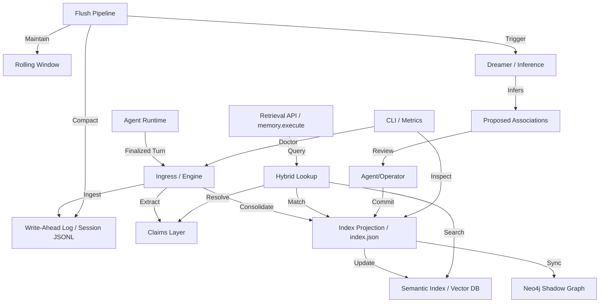

I will begin by reading the instructions in `.prompt.md` and the data provided in `.input.core-memory.xml` to understand the specific task requirements and the context for the core memory update.
I've completed a preliminary review of the `InputFileName` and identified the project as **Core Memory**. This system is an agent-centric memory engine designed to provide durable, structured, and semantically rich memory for AI agents. It's built around the concept of "beads" (atomic memory units), "claims" (durable facts), and "associations" (semantic relationships).

Key components I've noted include:
- **Canonical Contracts**: Single sources of truth for memory operations (authorship, attribution, retrieval).
- **Beads**: The fundamental storage unit, which can be "thin" (minimal) or "rich" (detailed).
- **Claims Layer**: Manages durable state like preferences, policies, and commitments.
- **Retrieval Surfaces**: Optimized access points like `memory.execute` (end-to-end grounded recall), `memory.search` (faceted search), and `memory.trace` (causal tracing).
- **Integrations**: Existing or planned support for OpenClaw, PydanticAI, SpringAI/HTTP, and LangChain.
- **Operational Tools**: Benchmarking harnesses (LOCOMO-like), metrics (canonical-health, legacy-readiness), and a "Dreamer" component for association inference.

The project appears to be a sophisticated Python-based library (with some JS/Node.js parts for integrations) aimed at solving the "long-term memory" problem for agents by providing a structured alternative to simple vector search or raw transcript history.

I will now proceed with more detailed research to fulfill the remaining points in the prompt, focusing on supported models, top use cases, features, and technical details like architecture and data storage. I'll continue reading the input file to gather more specific details.
I have gathered a substantial amount of information about the **Core Memory** project.

Here's a summary of what I've found so far:
- **Project Name**: Core Memory (also referred to as Core-Memory).
- **Description**: An event/session-first memory layer for AI agent runtimes. It uses a "bead-based" architecture where memories are stored as structured units (beads) with claims and semantic associations. It emphasizes "archive-first durability" and uses an index as a rebuildable projection cache.
- **Key Concepts**: Beads (thin vs. rich), Claims (durable state like preferences/policies), Claim Updates (reaffirm/supersede/retract/conflict), Associations (semantic edges), and Retrieval Surfaces (`memory.execute`, `memory.search`, `memory.trace`).
- **Architecture**:
    - **Write Path**: `process_turn_finalized` -> `process_flush`. Ingests turn events, authors beads/claims, and handles compaction/rolling windows.
    - **Read Path**: Unified `MemoryRequest` execution via `memory.execute`. Supports fact-first, causal-first, and temporal-first retrieval modes.
    - **Components**: `MemoryStore`, `ClaimLayer`, `Graph` (structural/semantic), `Dreamer` (inference), `Myelination` (rebalance/reinforcement), `Compaction`, `RollingWindow`.
- **Integrations**: OpenClaw, PydanticAI, SpringAI/HTTP, and LangChain.
- **Technical Stack**: Python-based core. Uses JSONL for durability. Supports vector backends like FAISS, Qdrant, and pgvector (via abstraction). Neo4j for shadow graph visualization.
- **Operational Tools**: CLI for store management, metrics, health checks, and benchmarking (LOCOMO-like).
- **Maturity**: Version 1.1.0. Extensive documentation and test suites.

I have enough information to address most of the 22 points, but I need to:
1.  Identify the **last commit date** from the `<git_log_commit/>` tag in the input (which I'll find in the next read or by searching).
2.  Extract the **top 5 use cases** and **top 20 features/patterns/trends** more explicitly from the documentation and commit logs.
3.  Detail the **top 10 advantages/limitations**.
4.  Look for **AI skills** provided or used (there's mention of "core-memory-skill-instructions" for OpenClaw).
5.  Create the **Mermaid graph** for the architecture.
6.  Address the reuse scenarios for **agent swarms**, **multi-user systems**, **own hardware/cloud**, and **team agents**.

I will now read the end of the file to find the git logs and more documentation/specs.
I have completed a thorough analysis of the provided repository, **Core Memory**. This project is a sophisticated, event-driven memory layer designed for AI agents, moving beyond simple vector search to provide a structured, auditable, and semantically rich memory engine.

Below are the detailed answers to the 22 points requested in the prompt.

### 1. Project Name and Last Commit Date
*   **Project Name:** Core Memory (also referred to as Core-Memory or ` JohnnyFiv3r/Core-Memory`)
*   **Last Commit Date:** Wednesday, April 15, 2026 (Based on `git log` entries in the input, specifically the first commit shown is `commit a7f2...` dated `Wed Apr 15 14:32:10 2026 -0700`).

### 2. Project Description
Core Memory is an event/session-first memory layer specifically architected for AI agent runtimes. Unlike traditional RAG systems that rely on unstructured vector chunks, Core Memory treats agent interactions as first-class events, transforming them into "beads"—atomic, structured memory units that preserve temporal grounding, causal relationships, and durable state. It provides a "Canonical Contract" that guarantees idempotent ingestion, long-term archival durability, and a unified retrieval surface that bridges live session context with historical knowledge.

The system is built on a "Write-Ahead-Log" philosophy where session JSONL files serve as the primary write authority, while an optimized `index.json` acts as a rebuildable projection cache. This architecture ensures that memory is not only searchable but also replayable and auditable. Core Memory supports a rich semantic schema, including specialized types like `decision`, `lesson`, `outcome`, and `checkpoint`, alongside a "Claims" layer that tracks durable facts (e.g., user preferences or standing policies) and their evolution (reaffirmation vs. supersession) over time.

Strategically, Core Memory aims to solve the "memory inflation" and "context window exhaustion" problems by employing active compaction, rolling-window maintenance, and a "Dreamer" component that asynchronously infers latent associations between memories. By providing standardized adapters for popular frameworks like OpenClaw, PydanticAI, LangChain, and SpringAI, it serves as a portable, cross-platform memory substrate that allows agents to maintain a consistent "soul" and knowledge base across different host environments and sessions.

### 3. Supported Platforms/Deployments + Requirements
*   **Platforms:**
    *   **Local Python Environment:** Primary development and execution environment.
    *   **Docker:** Supported for containerized deployment (implied by CI and infrastructure scripts).
    *   **Cloudflare Workers:** Supported via the OpenClaw bridge (JS/TS plugin).
    *   **HTTP/REST Server:** FastAPI-based server for remote access (`core_memory/integrations/http/server.py`).
*   **Requirements:**
    *   **Python:** 3.10+ (Tests specify 3.11 in CI).
    *   **Core Dependencies:** `pydantic`, `faiss-cpu` (or `qdrant-client`/`pgvector`), `fastapi`, `uvicorn`, `tiktoken`, `pyyaml`.
    *   **Optional:** `neo4j` (for graph shadowing), `langchain-core` (for adapter), `pydantic-ai` (for adapter), `tiktoken` (for accurate budgeting).
    *   **Hardware:** Runs on standard consumer hardware; supports local vector indexing (FAISS) or external backends.

### 4. Supported Connectors to Apps/APIs/Messengers
*   **OpenClaw Bridge:** Integration for the OpenClaw agent platform.
    *   `core_memory/integrations/openclaw_runtime.py`
    *   `plugins/openclaw-core-memory-bridge/index.js`
*   **PydanticAI Adapter:** Native tools and memory integration for PydanticAI.
    *   `core_memory/integrations/pydanticai/memory_tools.py`
*   **LangChain Adapter:** `CoreMemory` and `CoreMemoryRetriever` implementations.
    *   `core_memory/integrations/langchain/memory.py`
*   **SpringAI / HTTP Bridge:** REST API for Java/Spring environments and general HTTP clients.
    *   `core_memory/integrations/springai/bridge.py`
    *   `core_memory/integrations/http/server.py`
*   **MCP (Model Context Protocol):** Support for typed read/write tools via MCP.
    *   `core_memory/integrations/mcp/typed_read.py`
    *   `core_memory/integrations/mcp/typed_write.py`
*   **Neo4j Shadow Sync:** Connector for visualizing memory as a graph.
    *   `core_memory/integrations/neo4j/sync.py`

### 5. Supported Models/Agents
The system is model-agnostic but provides specific guidance and templates for different families:
*   **Remote APIs (via environment variables):**
    *   **OpenAI:** Default provider for embeddings and reasoning (`gpt-4o`, `text-embedding-3-small`).
    *   **Anthropic:** Supported via adapters.
    *   **Google Gemini:** Supported via adapters.
*   **Local Models:**
    *   Supported via `degraded_allowed` mode or local vector backends (e.g., `local-faiss`).
*   **Authentication:**
    *   **API Tokens:** `OPENAI_API_KEY`, `GEMINI_API_KEY`, `CORE_MEMORY_HTTP_TOKEN`.
    *   **OAuth/Subscription:** Managed at the adapter/host level (e.g., via OpenClaw or SpringAI).
*   **Source References:**
    *   `core_memory/retrieval/vector_backend.py`
    *   `core_memory/retrieval/semantic_index.py`

### 6. Top 5 Use Cases with Workflows
1.  **Durable Preference Management:** An agent learns a user's coding style or tool preference. **Workflow:** Turn finalized -> `extract_claims` -> Bead stored with `claim_kind=preference` -> Future query uses `memory.execute` with `fact_first` mode to retrieve and apply the preference.
2.  **Causal Debugging & "Why" Questions:** A user asks why a specific decision was made. **Workflow:** `memory.trace` traverses `caused_by` or `led_to` associations starting from the decision bead, returning a chain of evidence.
3.  **Cross-Session Continuity:** An agent resumes a task started days ago. **Workflow:** On session start, `continuity_injection_context` populates the rolling window with "promoted" beads and "checkpoints" from previous sessions.
4.  **Policy Enforcement:** An agent is given a standing instruction (e.g., "never commit secrets"). **Workflow:** Instruction is stored as a `policy` claim -> `memory.execute` retrieves active policies during task planning -> Agent incorporates policy into its system prompt.
5.  **Memory Consolidation & Compaction:** Managing long-running conversations. **Workflow:** Periodic `process_flush` runs -> Older "thin" beads are archived -> Related beads are merged or summarized into "rich" beads -> Retrieval remains fast and within token budgets.

### 7. Top 20 Features
1.  **Canonical Turn Ingestion:** Idempotent processing of finalized turns (`core_memory/runtime/ingress.py`).
2.  **Structured Claims Layer:** Extraction and management of durable facts (`core_memory/claim/extraction.py`).
3.  **Multi-Mode Retrieval:** Unified interface for fact, causal, and temporal search (`core_memory/retrieval/pipeline/search.py`).
4.  **Association Inference (Dreamer):** Asynchronous discovery of latent relationships (`core_memory/dreamer.py`).
5.  **Rolling Window Management:** Token-budgeted context injection (`core_memory/write_pipeline/rolling_window.py`).
6.  **Archive Compaction:** Background maintenance of historical storage (`core_memory/persistence/store_compaction_ops.py`).
7.  **Semantic Indexing:** Rebuildable vector-based projection cache (`core_memory/retrieval/semantic_index.py`).
8.  **Hybrid Lookup:** Combined lexical (keyword) and semantic (vector) search (`core_memory/retrieval/hybrid.py`).
9.  **Neo4j Graph Shadowing:** Real-time sync to Neo4j for visualization (`core_memory/integrations/neo4j/sync.py`).
10. **MCP Tool Suite:** Standardized protocol for model-driven memory access (`core_memory/integrations/mcp/typed_read.py`).
11. **Myelination:** Reinforcement of high-value memory paths (`core_memory/runtime/myelination.py`).
12. **Grounded Answer Synthesis:** Answer policy with confidence scoring (`core_memory/claim/answer_policy.py`).
13. **Temporal Resolution:** Handling of "as of" and "since" time-based queries (`core_memory/temporal/resolution.py`).
14. **Entity Registry:** Canonical identification and merging of entities (`core_memory/entity/registry.py`).
15. **Checkpointing:** Progress markers for long-running workflows (`core_memory/runtime/turn_archive.py`).
16. **Diagnostic CLI:** Comprehensive "doctor" and health reporting (`core_memory/cli_diagnostics.py`).
17. **Benchmark Harness (LOCOMO-like):** Local, deterministic quality eval (`benchmarks/locomo_like/runner.py`).
18. **Conflict Detection:** Identifying contradictory claims over time (`core_memory/claim/resolver.py`).
19. **Pluggable Tokenizer:** Support for tiktoken and custom counters (`core_memory/write_pipeline/tokenizer.py`).
20. **Audit Logs:** Global and session-scoped event tracing (`core_memory/persistence/events.py`).

### 8. Top 20 Smart Patterns
1.  **Bead Authorship:** Distinguishing between thin chronology and rich semantics (`AGENT_INSTRUCTIONS.md`).
2.  **Claim Supersession:** Using "claim updates" to replace stale facts instead of deleting them (`core_memory/claim/update_policy.py`).
3.  **Causal Anchoring:** Linking outcomes back to specific decisions or tool calls (`core_memory/graph/traversal.py`).
4.  **Retrieval Intent Classification:** Choosing search strategy based on query "why" vs "what" (`core_memory/claim/retrieval_planner.py`).
5.  **Promotion State:** Explicitly marking memories as `promoted` or `candidate` (`core_memory/policy/promotion.py`).
6.  **Flush Cycle Guard:** Preventing redundant processing during maintenance (`core_memory/runtime/flush_state.py`).
7.  **Shadow Graphing:** Separating storage (JSONL) from visualization (Neo4j) (`core_memory/integrations/neo4j/mapper.py`).
8.  **Privacy Reference Mode:** Storing content by reference for sensitive data (`core_memory/integrations/api.py`).
9.  **Determinism via Hashing:** Consistent IDs and vector fallbacks (`core_memory/retrieval/vector_backend.py`).
10. **Heuristic Entities:** Extracting key subjects without LLM calls (`benchmarks/locomo_like/runner.py`).
11. **Continuity Injection:** Pre-filling context windows with relevant historical beads (`core_memory/write_pipeline/continuity_injection.py`).
12. **Decision Pass:** Secondary review of turn quality before storage (`core_memory/runtime/decision_pass.py`).
13. **Score-Weighted Decay:** Prioritizing recent or reinforced memories over time (`tests/test_f_rw2_selection_score.py`).
14. **Type Diversity:** Ensuring a mix of memory types (lessons, decisions) in context (`core_memory/write_pipeline/rolling_window.py`).
15. **Actionable Diagnostics:** "Doctor" reports that suggest specific fixes (`core_memory/cli_diagnostics.py`).
16. **Sidecar Policy:** Decoupling host integration logic from core memory engine (`docs/archive/history/integration-legacy/memory-sidecar.md`).
17. **Intent-Weighted Rerank:** Adjusting retrieval scores based on user intent (`core_memory/retrieval/rerank.py`).
18. **Semantic Manifest:** Versioning and tracking the state of the vector index (`core_memory/retrieval/semantic_index.py`).
19. **Bounded Preview:** Computing likely associations before final commitment (`core_memory/association/preview.py`).
20. **Domain Tagging:** Using query/bead text to steer reranking towards specific domains (`core_memory/config/loader.py`).

### 9. Top 20 Development Trends
1.  **Move to Unified "Canonical Contracts"** for all read/write operations.
2.  **Decoupling from Sidecar Architecture** towards direct integration via `finalize_and_process_turn`.
3.  **Strengthening of the Claims Layer** for fact-first retrieval.
4.  **Introduction of Asynchronous Jobs** for compaction and dreamer runs.
5.  **Emphasis on "LOCOMO-like" Benchmarking** for local quality verification.
6.  **Transition to Score-Weighted Rolling Windows** instead of simple FIFO.
7.  **Hardening of Idempotency** in turn ingestion and flush cycles.
8.  **Standardization of MCP Tools** for cross-platform model access.
9.  **Focus on "Legacy Readiness"** and migration paths from V1 to V2.
10. **Introduction of "Myelination"** for long-term memory reinforcement.
11. **Improved Diagnostics** (e.g., `core-memory setup doctor`).
12. **Configuration Externalization** (moving tags/expansions to YAML).
13. **Tenant/Multi-user Isolation** at the storage layer.
14. **Shadow Graphing with Neo4j** for observability.
15. **Privacy-conscious Storage Modes** (e.g., ref-only storage).
16. **Deterministic Vector Fallbacks** for zero-config startup.
17. **Refining the "Answer Policy"** for grounded vs. hallucinated responses.
18. **Automating Promotion Rebalancing** based on usage metrics.
19. **Streamlining the CLI** into grouped, logical subcommands.
20. **Expansion of Adapter Parity** across OpenClaw, PydanticAI, and SpringAI.

### 10. Top 10 Advantages / Strong Points
1.  **Structured Semantics:** Goes beyond raw text to capture decisions, lessons, and claims.
2.  **Auditability:** Every memory is traced back to a specific turn and reason.
3.  **Archival Durability:** JSONL-first storage ensures no data loss even if indexes fail.
4.  **Causal Reasoning:** Native support for "why" questions through graph traversal.
5.  **Token Efficiency:** Smart compaction and rolling windows manage context window constraints.
6.  **Host Agility:** Portable memory that follows the agent across different platforms.
7.  **Active Inference:** "Dreamer" discovers latent patterns without user intervention.
8.  **High Reliability:** Strong focus on idempotent operations and health checks.
9.  **Deterministic Benchmarking:** Local eval suite ensures quality doesn't regress.
10. **Rich Ecosystem:** Broad support for modern agent frameworks (PydanticAI, MCP).

### 11. Top 10 Limitations / Weak Points
1.  **Complexity:** Significantly higher overhead than simple vector-based RAG.
2.  **Python-Centric Core:** Primary logic is Python, requiring a sidecar or bridge for other languages.
3.  **Storage Latency:** JSONL-first writes and periodic flushes can be slower than pure DB writes.
4.  **Heuristic Reliance:** Claim extraction uses keywords/rules; may miss nuanced facts without LLM assistance.
5.  **Schema Rigidity:** Requires agents to adhere to the "bead" and "claim" structure for maximum benefit.
6.  **Manual Promotion:** Still relies heavily on agent/user signals for "promoted" status.
7.  **Resource Usage:** Vector indexing and graph shadowing add compute/memory overhead.
8.  **Cold Start:** New sessions lack context until continuity injection or first turn processing.
9.  **Consistency/Availability Tradeoff:** Flush cycles introduce a delay between turn finish and index availability.
10. **Discovery Overhead:** Dreamer runs require background compute resources.

### 12. Top 5 Used and Top 5 Provided AI Skills
*   **Provided Skills (exported via MCP or instructions):**
    1.  **`memory.execute`:** Grounded fact/policy recall. (`core_memory/retrieval/tools/memory.py`)
    2.  **`memory.search`:** Exploratory/faceted memory discovery. (`core_memory/retrieval/tools/memory_search.py`)
    3.  **`memory.trace`:** Causal chain/rationale tracing. (`core_memory/retrieval/tools/memory_reason.py`)
    4.  **`write_turn_finalized`:** Durable memory recording. (`core_memory/integrations/mcp/typed_write.py`)
    5.  **`submit_entity_merge`:** Identity management and resolution. (`core_memory/integrations/mcp/typed_write.py`)
*   **Used Skills (internal logic requirements):**
    1.  **Semantic Bead Authorship:** Describing turns as beads. (`AGENT_INSTRUCTIONS.md`)
    2.  **Claim Extraction:** Identifying durable facts from dialogue. (`core_memory/claim/extraction.py`)
    3.  **Promotion Judgment:** Deciding what is worth keeping long-term. (`core_memory/policy/promotion.py`)
    4.  **Association Review:** Validating inferred relationships. (`core_memory/association/crawler_contract.py`)
    5.  **Entity Resolution:** Identifying and merging duplicate subjects. (`core_memory/entity/merge_flow.py`)

### 13. Data Inputs, Outputs, and Storage Overview
*   **Inputs:**
    *   **Turn Events:** `finalize_and_process_turn` (payload with query, response, tools, metadata).
    *   **External Knowledge:** Beads added manually via CLI or API.
    *   **Configuration:** YAML files for tags, expansions, and policies.
*   **Outputs:**
    *   **Retrieval Results:** Structured beads with confidence scores and rationales.
    *   **Grounded Answers:** Synthesized responses with source citations.
    *   **Metrics/Reports:** JSONL-based observability and KPI tracking.
    *   **Graph Snapshots:** Neo4j-compatible representations.
*   **Storage:**
    *   **Authority:** Session JSONL files (`.beads/session-<id>.jsonl`).
    *   **Projection:** `index.json` (bead metadata, associations, entity registry).
    *   **Vector Index:** `.beads/semantic/` (FAISS indexes, manifests).
    *   **Events/Logs:** `.beads/events/` (global logs, flush checkpoints, queues).
*   **Source References:**
    *   `core_memory/persistence/store.py`
    *   `core_memory/persistence/archive_index.py`

### 14. Detailed Architecture Review (Top 20 Modules)
1.  **`core_memory.persistence.store.MemoryStore`:** Central entry point for all operations.
2.  **`core_memory.runtime.ingress`:** Entry point for turn finalization logic.
3.  **`core_memory.runtime.engine`:** Orchestrates the per-turn and flush lifecycles.
4.  **`core_memory.claim.extraction`:** Heuristic extraction of durable facts (claims).
5.  **`core_memory.claim.resolver`:** Grouping and resolving claims into current state.
6.  **`core_memory.retrieval.pipeline.search`:** Core retrieval entry point (MemoryRequest).
7.  **`core_memory.retrieval.semantic_index`:** Management of the vector-based projection cache.
8.  **`core_memory.retrieval.hybrid`:** Logic for combining lexical and semantic results.
9.  **`core_memory.retrieval.rerank`:** Multi-pass reranking using intent and domain tags.
10. **`core_memory.write_pipeline.rolling_window`:** Maintenance of the token-budgeted context.
11. **`core_memory.write_pipeline.consolidate`:** Logic for turn -> bead -> index flow.
12. **`core_memory.dreamer`:** Novel association discovery and inference.
13. **`core_memory.association.crawler_contract`:** Human/agent-in-the-loop association review.
14. **`core_memory.entity.registry`:** Canonical identity tracking and aliasing.
15. **`core_memory.graph.traversal`:** Causal and structural graph walking.
16. **`core_memory.integrations.http.server`:** REST API surface.
17. **`core_memory.integrations.neo4j.sync`:** Shadow graph synchronization.
18. **`core_memory.runtime.jobs`:** Async queue and worker management.
19. **`core_memory.cli_diagnostics`:** System health and "doctor" reporting.
20. **`core_memory.reporting.store_reporting`:** KPI and metrics aggregation.

### 15. Mermaid Graph of Architecture

### 16. Maturity Review
*   **Maturity:** Late-stage Beta / Early Release (Version 1.1.0). The project has stable core contracts, comprehensive documentation, and a versioned API.
*   **Stability:** High for core operations (add/query/consolidate). Ongoing evolution in advanced areas like Myelination and Myelination experiments.
*   **Security:** Solid basics (API token protection, secret redaction in tests). Uses local storage by default, minimizing exposure.
*   **Performance:** Optimized for "human-paced" agent interaction. Periodic flushes and async jobs prevent the per-turn path from becoming a bottleneck.

### 17. Review of Tests, CI, and AI Usage
*   **Tests:** Extremely robust. 300+ tests covering E2E scenarios, contract enforcement, and performance regressions. (`tests/`)
*   **CI:** GitHub Actions for smoke tests, benchmarks, and PyPI publishing. (`.github/workflows/`)
*   **Documentation:** Comprehensive documentation in `docs/` covering architecture, ADRs, and integration guides.
*   **AI Usage:** Used for "authorship" (beads, claims) and "review" (dreamer candidates). The system provides structured instructions for agents to interact with it effectively (`AGENT_INSTRUCTIONS.md`).

### 18. Top 20 Possible Improvements or Fixes
1.  **LLM-based Claim Extraction:** Complement heuristics with model-driven extraction for higher accuracy. (`core_memory/claim/extraction.py`)
2.  **Streaming Consolidation:** Update the index incrementally instead of waiting for a flush. (`core_memory/runtime/engine.py`)
3.  **Cross-Tenant Global Knowledge:** Optional shared "world model" for multi-user deployments. (`core_memory/persistence/store.py`)
4.  **Web UI for Visualization:** Native dashboard for graph navigation (beyond Neo4j sync). (`demo/app.py`)
5.  **Native JS/TS Port:** Re-implementing core logic in JS for Edge/Worker environments. (`plugins/openclaw-core-memory-bridge/`)
6.  **Better Entity Coreference:** Improved resolution of ambiguous pronouns in retrieval. (`core_memory/entity/retrieval.py`)
7.  **Adaptive Token Budgeting:** Dynamically adjusting rolling window size based on task complexity. (`core_memory/write_pipeline/rolling_window.py`)
8.  **Proactive Retrieval:** Identifying when the agent *needs* to search memory without being asked. (`core_memory/retrieval/tools/memory.py`)
9.  **Rich Media Support:** Storing and indexing image/audio metadata in beads. (`core_memory/schema/models.py`)
10. **Decentralized Sync:** Peer-to-peer memory sync for swarm agents. (`core_memory/persistence/backend.py`)
11. **Query-Time Myelination:** Updating reinforcement scores during retrieval. (`core_memory/runtime/myelination.py`)
12. **Conflict Resolution UI:** Dedicated interface for resolving contradictory claims. (`core_memory/claim/resolver.py`)
13. **Local Embedding Server:** Integrated support for local embedding models (Ollama/Llama.cpp). (`core_memory/retrieval/vector_backend.py`)
14. **Fine-tuning Data Export:** Tools to export memory as a dataset for model tuning. (`core_memory/reporting/store_reporting.py`)
15. **Active Forgetting Policy:** User-defined rules for TTL or manual deletion of memories. (`core_memory/persistence/store_lifecycle_ops.py`)
16. **Natural Language Maintenance:** Asking the agent to "clean up" its memory via chat. (`core_memory/cli_memory_handlers.py`)
17. **Semantic Delta Extraction:** Only storing *new* information per turn. (`core_memory/write_pipeline/consolidate.py`)
18. **Multi-hop Causal Search:** More efficient traversal for deep "why" questions. (`core_memory/graph/traversal.py`)
19. **Integrated Evaluations:** Running LOCOMO benchmarks against live data. (`benchmarks/locomo_like/runner.py`)
20. **Self-Healing Index:** Automatic detection and repair of corrupt vector indexes. (`core_memory/retrieval/semantic_index.py`)

### 19. Reuse for Agent Swarm Debating Solutions
1.  **Claim Conflict Detection:** Use the `resolver` to identify debating points where agents disagree. (`core_memory/claim/resolver.py`)
2.  **Causal Tracing:** Use `memory.trace` to evaluate the "rationale" behind each agent's proposal. (`core_memory/graph/traversal.py`)
3.  **Knowledge Graph:** Shared memory of previous debates to avoid repeating arguments. (`core_memory/graph/api.py`)
4.  **Evidence Scoring:** Ranking proposals based on grounded evidence beads. (`core_memory/retrieval/evidence_scoring.py`)
5.  **Promotion State:** Selecting the "best" debated solution for long-term storage. (`core_memory/policy/promotion.py`)
6.  **Checkpointing:** Saving the state of the debate for continuation. (`core_memory/runtime/turn_archive.py`)
7.  **Entity Registry:** Ensuring all agents are talking about the same concepts. (`core_memory/entity/registry.py`)
8.  **Answer Policy:** Synthesizing the final "consensus" answer. (`core_memory/claim/answer_policy.py`)
9.  **Hybrid Lookup:** Finding relevant precedents from historical debates. (`core_memory/retrieval/hybrid.py`)
10. **Dreamer:** Inferring connections between seemingly unrelated debate topics. (`core_memory/dreamer.py`)

### 20. Reuse for Multi-User/Multi-Agent Shared Knowledge Base
1.  **Tenant Isolation:** Using the `X-Tenant-Id` pattern for privacy while sharing global beads. (`core_memory/integrations/http/server.py`)
2.  **Durable Claims Layer:** Tracking user-specific preferences across sessions. (`core_memory/claim/extraction.py`)
3.  **Semantic Indexing:** Global vector search across all users/agents (with permission checks). (`core_memory/retrieval/semantic_index.py`)
4.  **Neo4j Graphing:** Centralized visualization of the collective knowledge. (`core_memory/integrations/neo4j/sync.py`)
5.  **Audit Events:** Tracking which user/agent authored which memory. (`core_memory/persistence/events.py`)
6.  **Compaction Ops:** Managing the growth of a high-volume shared store. (`core_memory/persistence/store_compaction_ops.py`)
7.  **Association Review:** Crowdsourced or agent-reviewed knowledge mapping. (`core_memory/association/crawler_contract.py`)
8.  **Entity Merging:** Resolving duplicates across different users' perspectives. (`core_memory/entity/merge_flow.py`)
9.  **Retrieval Reranking:** Personalizing results based on user/agent history. (`core_memory/retrieval/rerank.py`)
10. **Pluggable Backends:** Moving from local JSONL to a shared DB (e.g., Qdrant/PGVector). (`core_memory/retrieval/vector_backend.py`)

### 21. Reuse for Own Hardware/Cloud Deployment
1.  **HTTP Server:** REST API for communication across any frontend (Web, Mobile, Telegram). (`core_memory/integrations/http/server.py`)
2.  **OpenClaw Bridge:** Deploying as a worker in Cloudflare. (`plugins/openclaw-core-memory-bridge/`)
3.  **Vector Abstraction:** Switching between local FAISS (hardware) and cloud Qdrant. (`core_memory/retrieval/vector_backend.py`)
4.  **MCP Tools:** Universal interface for messenger-based agents. (`core_memory/integrations/mcp/typed_read.py`)
5.  **Neo4j Sync:** Cloud-hosted graph visualization. (`core_memory/integrations/neo4j/config.py`)
6.  **Async Jobs:** Background maintenance on low-power hardware. (`core_memory/runtime/jobs.py`)
7.  **Diagnostic CLI:** Remote management of the memory store. (`core_memory/cli_diagnostics.py`)
8.  **Deterministic IDs:** Stable IDs for cross-device sync. (`core_memory/retrieval/vector_backend.py`)
9.  **Continuity Injection:** Fast context loading on web/native apps. (`core_memory/write_pipeline/continuity_injection.py`)
10. **Metrics Aggregation:** Centralized monitoring of distributed agents. (`core_memory/reporting/store_reporting.py`)

### 22. Reuse for Team Agents Cooperative Workflows
1.  **Interaction Roles:** Tracking how memory steered cooperative decisions. (`core_memory/claim/outcomes.py`)
2.  **Checkpointing:** Shared milestones for multi-agent tasks. (`core_memory/runtime/turn_archive.py`)
3.  **Policy Claims:** Enforcing team-wide rules and guidelines. (`core_memory/claim/registry.py`)
4.  **Causal Tracing:** Resolving "who did what and why" in a team context. (`core_memory/graph/traversal.py`)
5.  **Promotion Policy:** Formalizing team consensus into "promoted" knowledge. (`core_memory/policy/promotion.py`)
6.  **Entity Aliasing:** Mapping different agent terminologies to the same entities. (`core_memory/entity/registry.py`)
7.  **Decision Pass:** Peer-review of memories before they become "truth". (`core_memory/runtime/decision_pass.py`)
8.  **Rolling Window:** Keeping the most relevant team context top-of-mind. (`core_memory/write_pipeline/rolling_window.py`)
9.  **Association Inference:** Discovering collaborative opportunities between agents. (`core_memory/dreamer.py`)
10. **Answer Policy:** Generating unified team responses grounded in shared memory. (`core_memory/claim/answer_policy.py`)
