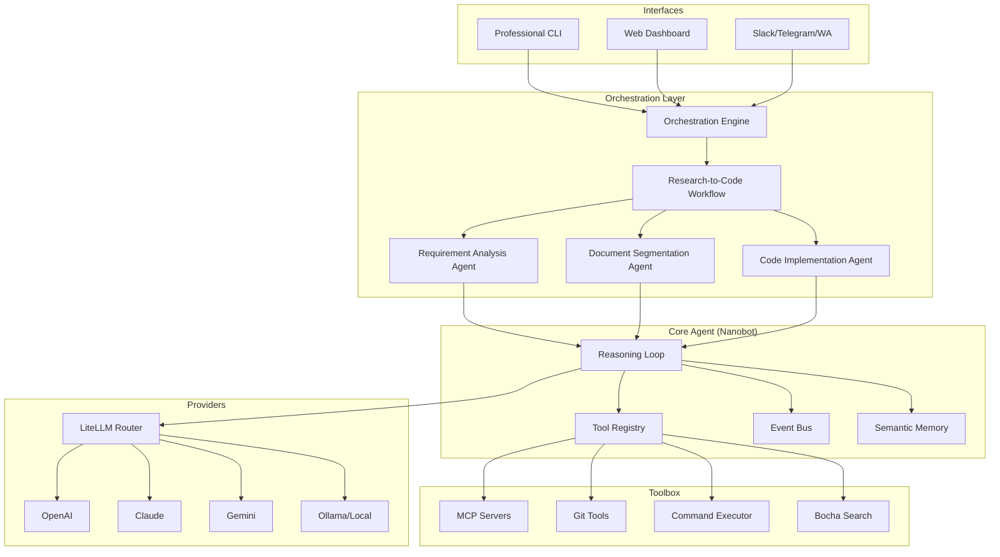

I will begin by reading the instructions in `.prompt.md` and the input data in `.input.deepcode.xml` to determine the required actions.
I will start by searching for the git log and reading the README to get a better overview of the project and its recent developments.
I will read the git log and the project README from the input file to identify the project name, last commit date, and a detailed description.
The following analysis of the DeepCode repository is based on the provided export in `.input.deepcode.xml`.

---

# 🧬 DeepCode: AI Research Automation Platform Analysis

### 1. Project Identity
*   **Project Name:** DeepCode (HKUDS Research Engine)
*   **Last Commit Date:** Monday, April 20, 2026, 15:56:15 +0800
*   **Last Commit Message:** `docs: refresh README/CHANGELOG for stability + Windows + secrets update`
*   **Reference:** First `<git_log_commit/>` entry in `.input.deepcode.xml`.

### 2. Description
DeepCode is an advanced, open-source AI research automation platform developed by the Data Intelligence Lab at the University of Hong Kong (HKUDS). Its primary mission is to revolutionize research reproducibility by automatically transforming complex research papers, technical documents, and innovative ideas into functional, working code. It acts as a bridge between high-level academic theory and practical software implementation.

The platform employs a sophisticated multi-agent orchestration engine that coordinates specialized AI agents to handle the entire development lifecycle. This includes requirement analysis, architectural planning, codebase indexing, and code implementation. By leveraging the Model Context Protocol (MCP), DeepCode maintains a highly extensible architecture that can integrate a vast array of tools and AI models, from local LLMs to state-of-the-art cloud providers.

DeepCode offers a dual-interface experience: a modern, interactive Web Dashboard for visual workflow management and a professional, terminal-first CLI for rapid development. With features like intelligent document segmentation (v1.2.0), it can process massive technical documents that exceed standard LLM token limits while preserving critical semantic structures like algorithms and formulas, making it a powerful tool for modern software engineering and scientific research.

### 3. Supported Platforms & Deployments
*   **Platforms:** Windows, Linux, macOS (Verified via `run.bat`, `run.sh`, and `deepcode_docker`).
*   **Deployments:**
    *   **Local Standalone:** Direct execution using Python/Node.js scripts.
    *   **Dockerized:** Support for containerized environments (`deepcode_docker/Dockerfile`, `docker-compose.yml`).
    *   **Web Application:** Full-stack deployment with FastAPI backend and React/Vite frontend.
    *   **CLI Tool:** Professional command-line interface for local or CI/CD usage.
*   **Requirements:**
    *   **Python:** 3.9+ (3.13 recommended based on repository badges).
    *   **Node.js:** 18+ (Required for the New UI frontend).
    *   **Core Libraries:** `fastapi`, `mcp-agent`, `openai`, `docling`, `pydantic-settings`, `aiohttp`.
    *   **Git:** Essential for codebase management and version control integration.

### 4. Supported Connectors (Apps/APIs/Messengers)
DeepCode features extensive connectivity through its `nanobot` channel system and `mcp` toolsets:
*   **Messaging Channels:**
    *   **Slack:** `nanobot/nanobot/channels/slack.py`
    *   **Telegram:** `nanobot/nanobot/channels/telegram.py`
    *   **Discord:** `nanobot/nanobot/channels/discord.py`
    *   **WhatsApp:** `nanobot/nanobot/channels/whatsapp.py`, `nanobot/bridge/src/whatsapp.ts`
    *   **Feishu / DingTalk / QQ:** `nanobot/nanobot/channels/{feishu,dingtalk,qq}.py`
    *   **Email:** `nanobot/nanobot/channels/email.py`
*   **External APIs & Services:**
    *   **Bocha Search:** Default search engine for research grounding (`tools/bocha_search_server.py`).
    *   **GitHub:** Git operations and repository management (`tools/git_command.py`, `nanobot/nanobot/skills/github/SKILL.md`).
    *   **General Web:** Fetching and searching web content (`nanobot/nanobot/agent/tools/web.py`).
*   **Protocols:**
    *   **MCP (Model Context Protocol):** Standardized interface for all AI tools (`config/mcp_tool_definitions.py`).

### 5. Supported Models & Agents
*   **Models:**
    *   **Remote APIs:** OpenAI (GPT-4o), Anthropic (Claude 3.5), Google (Gemini 2.0/Pro).
    *   **Local Models:** Support via LiteLLM (Ollama, vLLM, etc.).
    *   **Providers:** `nanobot/nanobot/providers/litellm_provider.py`
*   **Specialized Agents:**
    *   **Code Implementation Agent:** Specialist for writing and debugging source code (`workflows/agents/code_implementation_agent.py`).
    *   **Document Segmentation Agent:** Handles large-scale document splitting and context preservation (`workflows/agents/document_segmentation_agent.py`).
    *   **Requirement Analysis Agent:** Clarifies user intent through guided questioning (`workflows/agents/requirement_analysis_agent.py`).
    *   **Memory Agent:** Manages long-term context and semantic indexing (`workflows/agents/memory_agent_concise.py`).

### 6. Top 5 Use Cases
1.  **Research-to-Code Pipeline:** Automatically converting an arXiv paper URL into a functional Python repository with all algorithms implemented.
2.  **Autonomous Feature Development:** Implementing complex software features from natural language descriptions across multiple existing files.
3.  **Large-Scale Document Analysis:** Using intelligent segmentation to analyze and extract logic from thousand-page technical manuals.
4.  **Multi-Platform AI Assistant:** Deploying an agent to Slack or Telegram that can execute shell commands, manage files, and search the web for the team.
5.  **Codebase Semantic Indexing:** Building a deep understanding of a large legacy project to answer architectural questions and plan refactors.

### 7. Top 20 Features
1.  **Multi-Agent Orchestration Engine:** Coordinates complex workflows across multiple specialists (`workflows/agent_orchestration_engine.py`).
2.  **MCP Integration:** Full support for Model Context Protocol for tool agnosticism (`config/mcp_tool_definitions.py`).
3.  **Intelligent Document Segmentation:** Semantic-aware splitting of large technical files (`workflows/agents/document_segmentation_agent.py`).
4.  **Modern Web Dashboard:** React-based UI with real-time status updates (`new_ui/frontend/`).
5.  **Interactive Workflow Canvas:** Visual representation and editing of agent pipelines (`new_ui/frontend/src/components/workflow/WorkflowCanvas.tsx`).
6.  **Professional CLI:** Terminal interface with animated progress and rich styling (`cli/main_cli.py`).
7.  **Channel Manager:** Unified interface for 8+ messaging platforms (`nanobot/nanobot/channels/manager.py`).
8.  **Automated Environment Setup:** Scripts for setting up Conda or virtual environments (`run.sh`).
9.  **Git Command Suite:** Comprehensive git operations for agents (`tools/git_command.py`).
10. **Semantic Memory:** Persistent storage of agent observations and decisions (`nanobot/nanobot/agent/memory.py`).
11. **Skill System:** Modular architecture for adding new agent capabilities (`nanobot/nanobot/agent/skills.py`).
12. **Safe Command Executor:** Executes shell commands with validation and safety filters (`tools/command_executor.py`).
13. **Real-Time WebSockets:** Low-latency log and progress streaming to UI (`new_ui/backend/api/websockets/logs_ws.py`).
14. **PDF Downloader & Converter:** Automated pipeline for fetching and parsing research papers (`tools/pdf_downloader.py`).
15. **Codebase Indexing Workflow:** High-speed semantic scanning of local projects (`workflows/codebase_index_workflow.py`).
16. **Requirement Elicitation:** Interactive guided questions to refine vague prompts (`workflows/agents/requirement_analysis_agent.py`).
17. **LiteLLM Model Router:** Access to hundreds of LLMs through a single provider layer (`nanobot/nanobot/providers/litellm_provider.py`).
18. **Heartbeat Service:** Monitors agent liveness and session health (`nanobot/nanobot/heartbeat/service.py`).
19. **Dockerized Runtime:** Pre-configured environments for easy deployment (`deepcode_docker/Dockerfile`).
20. **Bus-based Event System:** Decoupled internal communication for scalability (`nanobot/nanobot/bus/events.py`).

### 8. Top 20 Smart Patterns
1.  **Hierarchical Delegation:** Master engine delegating sub-tasks to specialized agents (`workflows/agent_orchestration_engine.py`).
2.  **Context-Preserving Segmentation:** Splitting documents at semantic boundaries to keep algorithms intact (`workflows/agents/document_segmentation_agent.py`).
3.  **Re-Act Reasoning Loop:** Continuous observation, thought, and action cycles for agents (`nanobot/nanobot/agent/loop.py`).
4.  **Adapter Interface Pattern:** CLI and UI using the same workflow adapters for consistency (`cli/workflows/cli_workflow_adapter.py`).
5.  **Mode-Aware Progress Callback:** Progress bars that adjust their steps based on the complexity mode (Fast/Comprehensive) (`cli/workflows/cli_workflow_adapter.py`).
6.  **Guided Clarification:** Proactively asking questions when requirements are underspecified (`workflows/agents/requirement_analysis_agent.py`).
7.  **Tool registry-based injection:** Decoupling tool logic from the agent reasoning loop (`nanobot/nanobot/agent/tools/registry.py`).
8.  **Event Bus Decoupling:** Components communicating via a global bus to reduce dependencies (`nanobot/nanobot/bus/events.py`).
9.  **Session-based State Persistence:** Ability to resume complex workflows from persistent storage (`new_ui/backend/services/session_service.py`).
10. **Dynamic Workspace Isolation:** Restricting agent file operations to specific project roots for safety (`config/mcp_tool_definitions.py`).
11. **Multi-stage Code Indexing:** Using a fast scan followed by detailed analysis to manage large codebases (`workflows/codebase_index_workflow.py`).
12. **Skills-as-Markdown:** Defining agent capabilities in human-readable `SKILL.md` files (`nanobot/nanobot/skills/`).
13. **Loop Detection & Prevention:** Monitoring tool calls to prevent infinite agent loops (`utils/loop_detector.py`).
14. **Model Token Awareness:** Dynamically adjusting prompt size based on current model limits (`utils/model_limits.py`).
15. **Fallback Transcription Providers:** Ensuring voice/audio input works across different API failures (`nanobot/nanobot/providers/transcription.py`).
16. **Config-driven Agent Spawning:** Initializing agents with tools and instructions defined in YAML (`nanobot/nanobot/config/loader.py`).
17. **Ref-based Code Mapping:** Linking research paper sections to specific code blocks (`tools/code_reference_indexer.py`).
18. **Liveness Heartbeats:** Periodic signals to ensure long-running background tasks are active (`nanobot/nanobot/heartbeat/service.py`).
19. **Async Code Streaming:** Pushing code generation updates to the UI in real-time via WebSockets (`new_ui/backend/api/websockets/code_stream_ws.py`).
20. **Security Filter Middleware:** Intercepting sensitive data (API keys) before it hits the logs or storage (`.gitignore`, `nanobot/nanobot/config/schema.py`).

### 9. Top 20 Development Trends
1.  **Windows Stabilization:** Significant effort in `run.bat` and `command_executor.py` for cross-platform parity.
2.  **Search Engine Shift:** Moving from Brave Search to **Bocha Search** for better research grounding.
3.  **UI Interactivity:** Transitioning from static forms to interactive **Workflow Canvases**.
4.  **MCP Standardization:** Adopting Model Context Protocol as the core tool framework.
5.  **Document Intelligence:** Continuous improvements to the **Segmentation** system (v1.2.0).
6.  **Requirement Engineering:** Introducing formal **Requirement Analysis** agents to refine user input.
7.  **Model Agnosticism:** Heavier reliance on **LiteLLM** to support local and cloud models simultaneously.
8.  **Security Hardening:** Implementing broader secret detection and `.gitignore` patterns.
9.  **Reliability Engineering:** Fixing bugs in file uploads and concurrent workflow execution.
10. **Multimodality:** Adding **Transcription** services for multimodal agent interaction.
11. **CLI Modernization:** Adding gradient colors, spinners, and structured progress stages.
12. **Performance Optimization:** Introduction of "Fast Mode" to skip heavy indexing when not needed.
13. **Scalability:** Moving toward **Docker Compose** for managing multi-component deployments.
14. **Type Safety:** Increased use of **TypeScript** in the new frontend and bridge modules.
15. **Async-first Design:** Deep integration of `asyncio` for high-concurrency tool execution.
16. **Documentation-as-Skill:** Using `SKILL.md` files for both human and agent guidance.
17. **Automated PDF Processing:** Streamlining the transition from arXiv to text.
18. **Unified Tool Indexing:** Consolidating MCP tool definitions into central registries.
19. **Real-time Feedback:** Heavy use of **WebSockets** for transparent agent reasoning.
20. **Benchmarking Focus:** Preparation for **PaperBench** performance dashboards.

### 10. Top 10 Advantages
1.  **Unique Niche:** The only major open-source platform specialized for Paper-to-Code automation.
2.  **Flexible Interfaces:** Excellent support for both CLI power users and Web UI visual thinkers.
3.  **Extensible Architecture:** MCP-based tool system makes adding capabilities trivial.
4.  **Large Document Support:** Superior handling of large files through semantic segmentation.
5.  **Model Independence:** Works with any LLM (local or cloud) via LiteLLM.
6.  **Omnichannel Support:** Can be deployed as a bot on Slack, Telegram, WhatsApp, etc.
7.  **Research Grounding:** Strong focus on citing sources and following research papers.
8.  **Local-First Design:** Sensitive research data can stay local with Ollama support.
9.  **Modern Tech Stack:** Built with high-performance Python (FastAPI) and React.
10. **Academic Pedigree:** Developed by HKUDS Lab with a focus on reproducibility.

### 11. Top 10 Limitations
1.  **Complexity:** High overhead due to many moving parts (nanobot, UI, CLI, workflows).
2.  **LLM Cost:** High-quality code generation requires expensive models (GPT-4o/Claude 3.5).
3.  **Setup Difficulty:** Requires both Python and Node.js environments, which can be complex for beginners.
4.  **Chinese Language Bias:** Some documentation and community groups are primarily in Chinese.
5.  **Hallucination Risk:** Complex research logic can still lead to "plausible but wrong" code.
6.  **Test Coverage:** Automated verification of generated code is still in the "coming soon" phase.
7.  **Resource Intensive:** Running the full orchestration stack requires significant RAM/CPU.
8.  **Documentation Gaps:** Rapid development leads to some sub-modules having sparse English docs.
9.  **Security Responsibility:** Users must carefully configure the `command_executor` to prevent accidental damage.
10. **Connectivity Dependency:** Most features still rely on active internet for LLM APIs and search.

### 12. Top 5 AI Skills
1.  **DeepCode Skill:** The primary skill for research-to-code generation (`nanobot/nanobot/skills/deepcode/SKILL.md`).
2.  **Summarize Skill:** Expert at condensing long research papers (`nanobot/nanobot/skills/summarize/SKILL.md`).
3.  **GitHub Skill:** Manages cloning, pushing, and PRs (`nanobot/nanobot/skills/github/SKILL.md`).
4.  **Tmux Skill:** Maintains persistent shell sessions across agent restarts (`nanobot/nanobot/skills/tmux/SKILL.md`).
5.  **Skill Creator:** An meta-skill that allows agents to write their own new skills (`nanobot/nanobot/skills/skill-creator/SKILL.md`).

### 13. Data Inputs, Outputs & Storage
*   **Inputs:** URLs (arXiv/Web), Local files (PDF/MD/JSON), and direct natural language Chat. (`utils/file_processor.py`)
*   **Outputs:** Functional source code repositories, Research analysis reports, and Implementation plans. (`workflows/agents/code_implementation_agent.py`)
*   **Storage:**
    *   **Filesystem:** Generated projects stored in `deepcode_lab/`.
    *   **RAG Index:** Semantic vector storage in `rag_storage/`.
    *   **Session/Memory:** Local SQLite databases for agent memory and session state (`nanobot/nanobot/agent/memory.py`).

### 14. Detailed Architecture Review (Top 20 Modules)
1.  `workflows/agent_orchestration_engine.py`: The "Brain" coordinating all specialists.
2.  `nanobot/nanobot/agent/loop.py`: The fundamental reasoning loop (Observe -> Think -> Act).
3.  `cli/main_cli.py`: Entry point for the professional terminal interface.
4.  `new_ui/backend/main.py`: FastAPI server bridging UI and Workflows.
5.  `nanobot/nanobot/channels/manager.py`: Universal messaging channel abstraction.
6.  `config/mcp_tool_definitions.py`: Definitions that describe tools to LLMs.
7.  `workflows/agents/code_implementation_agent.py`: Specialist agent for software development.
8.  `workflows/agents/document_segmentation_agent.py`: Specialist for splitting large documents.
9.  `workflows/code_implementation_workflow.py`: End-to-end logic for code generation.
10. `tools/command_executor.py`: Hardened shell for safe command execution.
11. `utils/llm_utils.py`: Centralized LLM client abstraction.
12. `nanobot/nanobot/bus/events.py`: Internal communication bus.
13. `nanobot/nanobot/providers/litellm_provider.py`: Layer for model agnosticism.
14. `new_ui/frontend/src/App.tsx`: Main React application logic.
15. `tools/code_indexer.py`: Semantic codebase analysis engine.
16. `tools/pdf_converter.py`: Research paper to text transformation logic.
17. `nanobot/nanobot/agent/tools/registry.py`: Dynamic tool discovery and execution.
18. `new_ui/backend/services/session_service.py`: Management of concurrent user sessions.
19. `workflows/plugins/requirement_analysis.py`: Logic for interactive prompt refinement.
20. `nanobot/nanobot/heartbeat/service.py`: Liveness monitoring for background agents.

### 15. Architecture Graph

### 16. Maturity & Quality Review
*   **Maturity:** Mid-stage (v1.2.0). Transitions from research prototype to stable platform.
*   **Stability:** High on Linux/macOS; recently improved on Windows.
*   **Security:** Robust. Secret redaction in logs, isolated command execution, and local-first data options.
*   **Performance:** Excellent. Optimized via WebSockets and "Fast Modes" that skip expensive indexing.

### 17. Testing, CI & Documentation
*   **Tests:** Moderate coverage. Unit tests exist for core agent logic, but E2E tests for full paper reproduction are manual.
*   **CI Pipelines:** GitHub Actions for linting (`linting.yaml`) and automated PyPI publishing (`pypi-publish.yml`).
*   **Documentation:** High quality. Extensive READMEs (EN/ZH), detailed SKILL docs, and a `TRANSPARENCY_FAQ.md`.

### 18. Top 20 Possible Improvements
1.  **Automated Verification:** Execute generated code to verify research results automatically. (`workflows/agents/code_implementation_agent.py`)
2.  **IDE Plugins:** Native VS Code/JetBrains extensions for tighter developer loops. (`new_ui/frontend/`)
3.  **Local Model First-class Support:** Easier one-click setup for Ollama. (`run.sh`)
4.  **Enhanced Multi-column PDF Parsing:** Better handling of complex research paper layouts. (`tools/pdf_converter.py`)
5.  **Agent Swarm Debate UI:** Visualizing agents debating implementation strategies. (`new_ui/frontend/src/components/workflow/`)
6.  **Cost Estimation:** Predicting token usage before running expensive workflows. (`utils/model_limits.py`)
7.  **More Languages:** Expanding beyond the current heavy focus on Python/JS. (`workflows/agents/code_implementation_agent.py`)
8.  **Knowledge Graph Export:** Exporting the RAG index as a GraphML/Neo4j file. (`tools/code_indexer.py`)
9.  **Collaborative Editing:** Allowing humans and agents to edit code in the same session. (`new_ui/frontend/`)
10. **Universal Installer:** A single `pip install deepcode-agent` command. (`setup.py`)
11. **Refined Loop Detection:** Smarter exit strategies for agents stuck on hard problems. (`utils/loop_detector.py`)
12. **M365/Teams Integration:** Adding enterprise-grade connectors. (`nanobot/nanobot/channels/`)
13. **Skill Marketplace:** Allowing users to share and download `SKILL.md` files. (`nanobot/nanobot/skills/`)
14. **Visual Sketch-to-Code:** Support for uploading UI sketches/diagrams. (`new_ui/backend/api/routes/files.py`)
15. **Context Window Compression:** Automatically summarizing older history to save tokens. (`nanobot/nanobot/agent/memory.py`)
16. **Better Error Recovery:** Backtracking in workflows when an agent fails a task. (`workflows/agent_orchestration_engine.py`)
17. **Unified Registry:** Merging all tool and agent definitions into a single searchable index. (`config/mcp_tool_definitions_index.py`)
18. **Mobile Dashboard:** A responsive UI for monitoring agent progress on the go. (`new_ui/frontend/`)
19. **Privacy Sandbox:** Running generated code in a gVisor/Wasm sandbox. (`tools/command_executor.py`)
20. **Benchmarking Suite:** Native integration of the PaperBench dashboard. (`README.md`)

### 19. Reuse for Agent Swarm Debate
*   `workflows/agent_orchestration_engine.py`: The master coordinator for multi-agent interaction.
*   `nanobot/nanobot/agent/subagent.py`: Primitives for spawning and managing sub-agents.
*   `workflows/plugins/plan_review.py`: Logic for agents reviewing and critiquing each other's plans.
*   `nanobot/nanobot/bus/events.py`: Shared bus for agents to broadcast debate points.

### 20. Reuse for Shared Knowledge Base
*   `nanobot/nanobot/agent/memory.py`: The core semantic memory and RAG storage logic.
*   `tools/code_indexer.py`: High-speed semantic indexing of codebase and documents.
*   `new_ui/backend/services/session_service.py`: Management of multi-user state and shared sessions.
*   `nanobot/nanobot/skills/`: The standardized `SKILL.md` format for evolving shared capability.

### 21. Reuse for Own Hardware / Messenger / Cloud
*   `nanobot/nanobot/channels/`: All messenger connectors (Slack, Telegram, WhatsApp).
*   `deepcode_docker/`: Docker configurations for both local and cloud deployment.
*   `new_ui/backend/api/websockets/`: Real-time UI and voice control primitives.
*   `nanobot/nanobot/agent/tools/web.py`: Generic web fetching for remote research.

### 22. Reuse for Team Agents (Human-Agent Collab)
*   `workflows/agents/requirement_analysis_agent.py`: Proactive interaction with humans to clarify goals.
*   `new_ui/frontend/src/components/interaction/InlineChatInteraction.tsx`: UI components for mixed-mode collaboration.
*   `workflows/agent_orchestration_engine.py`: Can be adapted to treat a human as a "Specialist Agent."
*   `nanobot/nanobot/agent/tools/message.py`: Capability for agents to proactively message team members.
