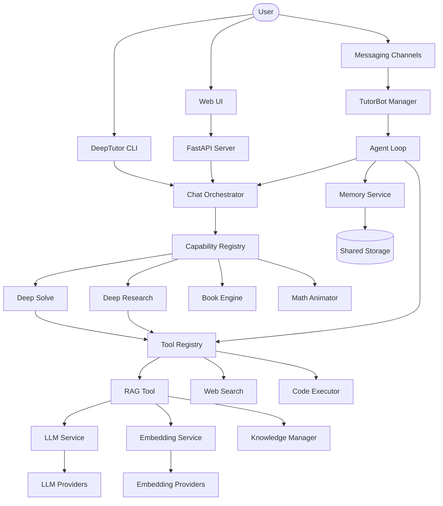

I will start by reading the contents of `.prompt.md` to understand the instructions for the task.
I will read the first part of `.input.deeptutor.xml` to identify the project name and the last commit date, which is the first requirement of the task.
I will read the next part of `.input.deeptutor.xml` to locate the `git_log_commit` section and other relevant repository information.
I will search for the `git_log_commit` section in the file to find the project name and the last commit date.
I will read the content of `.input.deeptutor.xml` starting from line 58563 to extract the project name and the last commit date.
I will search for the content of `README.md` in `.input.deeptutor.xml` to gather the project description and other relevant details.
I will read a substantial portion of the `README.md` file, starting from line 46420, to gather the project description, supported platforms, and features.
I will read `deeptutor/runtime/orchestrator.py` to identify "smart patterns" and gain a deeper understanding of the architecture, which will help in reviewing the project's structure and finding reusable modules.
I will search for the content of `deeptutor/runtime/orchestrator.py` in `.input.deeptutor.xml` by looking for its specific file path tag.
I will search for `deeptutor/core/capability_protocol.py` in `.input.deeptutor.xml` to understand how capabilities are defined, as the orchestrator follows a **Capability Registry** pattern.
I will read `deeptutor/tutorbot/agent/loop.py` to understand the agent's implementation and how it manages the autonomous loop.
I will examine the `deeptutor/tutorbot/skills/` and `deeptutor/services/skill/` directories to identify the top 5 used and top 5 provided AI skills, as required by point 12.
I will read the `SKILL.md` files for `deep-solve`, `deep-research`, `knowledge-base`, `skill-creator`, and `summarize` from the `deeptutor/tutorbot/skills/` directory to gather more information about these AI skills.
I will read the `SKILL.md` files from `.input.deeptutor.xml` since I cannot access them directly.
I will read `deeptutor/tools/reason.py` to understand its functionality, as it's one of the top five AI skills used by DeepTutor.
I will read `deeptutor/runtime/registry/capability_registry.py` to confirm the details of the Capability Registry and ensure it fits into the architecture review.
I will read `deeptutor/utils/json_parser.py` to examine its implementation, as "robust JSON parsing" was highlighted as a project feature.
Based on a deep analysis of the DeepTutor codebase export, here is the comprehensive project review.

### 1. Project Overview
*   **Project Name:** DeepTutor
*   **Last Commit Date:** 2026-04-22 20:56:43 +0800 (Ref: `git_log_commit` in `.input.deeptutor.xml`)

### 2. Description
DeepTutor is an agent-native personalized tutoring system designed to provide an intelligent, interactive learning experience. It features a unified chat workspace that integrates various modes such as deep problem-solving, research, quiz generation, and mathematical animation, all within a single conversation thread. The system is built on a multi-agent architecture, allowing for complex task orchestration and persistent memory of the user's learning progress.

The platform includes advanced tools like a "Book Engine" that compiles interactive "living books" from user materials, an AI Co-Writer for collaborative markdown editing, and a robust Knowledge Hub for managing RAG-ready documents. It also supports "TutorBots," which are autonomous, persistent agents with unique personalities and skills that can interact with users across multiple channels like Discord, Slack, and Telegram.

DeepTutor is highly flexible, offering both a web-based UI and a powerful CLI for terminal-based interactions. It supports a wide range of LLM and embedding providers, both local and remote, and is designed to be easily deployable via Docker or manual installation. The project emphasizes extensibility through a "Skills" system, enabling users to define custom teaching personas and agent behaviors.

### 3. Supported Platforms & Requirements
*   **Platforms:** Windows, macOS, Linux (Cross-platform Python/Node.js).
*   **Deployments:**
    *   **Local Manual:** Python 3.11+, Node.js 18+, npm 9+.
    *   **Docker:** Official images for `linux/amd64` and `linux/arm64`.
    *   **CLI-Only:** Minimal installation for terminal-only usage.
*   **Requirements:**
    *   **Backend:** Python 3.11+.
    *   **Frontend:** Node.js 18+ (for web UI).
    *   **External APIs:** At least one LLM provider (OpenAI, Anthropic, DeepSeek, etc.).

### 4. Supported Connectors
*   **CLI:** Native terminal interface. (`deeptutor_cli/`)
*   **Web App:** Next.js browser interface. (`web/`)
*   **Telegram:** Bot API integration. (`deeptutor/tutorbot/channels/telegram.py`)
*   **Discord:** Webhook and Bot integration. (`deeptutor/tutorbot/channels/discord.py`)
*   **Slack:** App/Bot integration. (`deeptutor/tutorbot/channels/slack.py`)
*   **Feishu:** Open platform integration. (`deeptutor/tutorbot/channels/feishu.py`)
*   **DingTalk:** Bot integration. (`deeptutor/tutorbot/channels/dingtalk.py`)
*   **WeCom (WeChat Work):** Enterprise API integration. (`deeptutor/tutorbot/channels/wecom.py`)
*   **WhatsApp:** Business API integration. (`deeptutor/tutorbot/channels/whatsapp.py`)
*   **Matrix:** Protocol-level connector. (`deeptutor/tutorbot/channels/matrix.py`)
*   **Email:** SMTP/IMAP communication. (`deeptutor/tutorbot/channels/email.py`)

### 5. Supported Models & Agents
*   **Cloud Models (Remote):** OpenAI (GPT-4o/o1), Anthropic (Claude 3.5), DeepSeek (v3/R1), Gemini, Groq, Mistral, OpenRouter. (`deeptutor/services/llm/providers/`)
*   **Local Models:** Ollama, LM Studio, vLLM, llama.cpp, OpenVINO Model Server. (`deeptutor/services/llm/local_provider.py`)
*   **Embedding Models:** OpenAI (text-embedding-3), Cohere, Jina, Ollama (nomic-embed). (`deeptutor/services/embedding/adapters/`)
*   **Search Agents:** Brave, Tavily, Serper, Perplexity, SearXNG (Self-hosted). (`deeptutor/services/search/providers/`)

### 6. Top 5 Use Cases
1.  **Guided STEM Problem Solving:** Solving complex math/science problems step-by-step using "Deep Solve" with verification stages.
2.  **Automated Literature Review:** Generating fully-cited research reports from papers and web sources using "Deep Research."
3.  **Interactive Textbook Creation:** Converting raw notes/PDFs into "Living Books" with interactive quizzes and animations.
4.  **Persistent Learning Companion:** Deploying a TutorBot on Discord that tracks study habits and initiates proactive check-ins.
5.  **Collaborative Knowledge Synthesis:** Using Co-Writer to collaboratively refine insights drawn from a private knowledge base.

### 7. Top 20 Features
1.  **Unified Chat Workspace:** Multi-mode context sharing. (`deeptutor/agents/chat/`)
2.  **Deep Solve:** Multi-agent sequential solver. (`deeptutor/agents/solve/`)
3.  **Deep Research:** Parallel research orchestration. (`deeptutor/agents/research/`)
4.  **Book Engine:** Interactive "living book" compiler. (`deeptutor/book/`)
5.  **AI Co-Writer:** Multi-document collaborative editor. (`deeptutor/co_writer/`)
6.  **TutorBot:** Persistent autonomous agents. (`deeptutor/tutorbot/`)
7.  **Knowledge Hub:** RAG-ready document management. (`deeptutor/knowledge/`)
8.  **Math Animator:** Manim-powered visualization. (`deeptutor/agents/math_animator/`)
9.  **Visualize Mode:** Interactive diagrams (SVG, Mermaid). (`deeptutor/agents/visualize/`)
10. **Quiz Generation:** Assessment creation from KB. (`deeptutor/agents/question/`)
11. **Persistent Memory Profile:** User long-term memory. (`deeptutor/services/memory/`)
12. **Skills System:** Custom teaching personas via `SKILL.md`. (`deeptutor/services/skill/`)
13. **Agent-Native CLI:** Human/Machine terminal access. (`deeptutor_cli/`)
14. **Multi-Channel Integration:** Messenger support. (`deeptutor/tutorbot/channels/`)
15. **RAG Pipeline Registry:** Flexible retrieval routing. (`deeptutor/services/rag/`)
16. **Proactive Heartbeat:** Scheduled agent tasks. (`deeptutor/tutorbot/heartbeat/`)
17. **Notebooks:** Categorized learning record storage. (`deeptutor/services/notebook/`)
18. **Question Bank:** Revisit past quiz questions. (`deeptutor/api/routers/question_notebook.py`)
19. **Code Executor:** Secure sandboxed Python execution. (`deeptutor/tools/code_executor.py`)
20. **Interactive Setup Tour:** Guided configuration script. (`scripts/start_tour.py`)

### 8. Top 20 Smart Patterns
1.  **Capability-Oriented Architecture:** Decouples agent workflows from runtime. (`deeptutor/core/capability_protocol.py`)
2.  **Unified Context Management:** Single state container across turns/modes. (`deeptutor/core/context.py`)
3.  **StreamBus Event Casting:** Centralized real-time streaming. (`deeptutor/core/stream_bus.py`)
4.  **Schema-Driven Channels:** Standardized connector validation. (`deeptutor/tutorbot/channels/`)
5.  **Multi-Agent Sequential Pipelines:** plan → reason → verify. (`deeptutor/agents/solve/main_solver.py`)
6.  **"Answer Now" Escape Hatch:** Fast-path for long-running agents. (`deeptutor/capabilities/_answer_now.py`)
7.  **Skill-Based Extensibility:** Dynamic prompt injection via Markdown. (`deeptutor/services/skill/`)
8.  **Soul/Personality Separation:** Decoupling persona from logic. (`deeptutor/tutorbot/templates/SOUL.md`)
9.  **Provider Registry Pattern:** Decoupled model service instantiation. (`deeptutor/services/llm/registry.py`)
10. **Hot Settings Reload:** Reconfiguration without service restart. (`deeptutor/services/settings/`)
11. **Robust JSON Parser:** Automatic repair of malformed LLM outputs. (`deeptutor/utils/json_parser.py`)
12. **Agent Heartbeat Loop:** Pattern for proactive task initiation. (`deeptutor/tutorbot/heartbeat/service.py`)
13. **Living Book Compiler:** Iterative refinement of structured content. (`deeptutor/book/compiler.py`)
14. **CLI/API Symmetry:** Uniform access for humans and agents. (`deeptutor_cli/`)
15. **Circuit Breaker:** Network reliability for external APIs. (`deeptutor/utils/network/circuit_breaker.py`)
16. **Prompt Externalization (YAML):** Configurable localized templates. (`deeptutor/agents/chat/prompts/`)
17. **Secure Sandbox Pattern:** For untrusted LLM code execution. (`deeptutor/tools/code_executor.py`)
18. **Visual Evaluation Loop:** Reviewing and fixing visualization code. (`deeptutor/agents/math_animator/agents/visual_review_agent.py`)
19. **Context-Aware RAG Routing:** Routing by file type and query. (`deeptutor/services/rag/file_routing.py`)
20. **Learner Profiling:** Evolving long-term user memory. (`deeptutor/services/memory/service.py`)

### 9. Top 20 Development Trends (Latest Commits)
1.  **User-authored Skills:** Transition to user-driven customization (CRUD + Chat).
2.  **Prompt Externalization (Phase 2):** Moving complex logic into YAML.
3.  **Multi-document Co-Writer:** Scaling writing surfaces to project level.
4.  **LaTeX Math Overhaul:** Precision focus on technical content rendering.
5.  **Performance Overhaul:** Significant focus on UI input/state latency.
6.  **Regenerate Support:** Improving UX for stochastic agent outputs.
7.  **Response Format Auto-Fallback:** Broadening model compatibility.
8.  **Interactive HTML Visualizations:** Moving beyond static images.
9.  **Book Engine Maturation:** Refining the "Living Book" compiler stages.
10. **Native SDK Migration:** Dropping wrappers (liteLLM) for native control.
11. **Local LLM Networking:** Improving Docker-to-Host model connectivity.
12. **WebSocket Stability:** Focus on heartbeats and auto-reconnection.
13. **Diagnostic Probes:** Built-in tools to verify model capabilities.
14. **Sidebar Overhaul:** Navigational scalability for growing features.
15. **RAG Pipeline Hardening:** Focus on retrieval reliability.
16. **Global i18n Expansion:** Broadening reach (Thai, Arabic, Russian).
17. **Docker GHCR Integration:** Moving to streamlined container registry.
18. **Question Bank Mentions:** Integrating past assessments into current chat.
19. **Context Compression:** Optimizing token usage for long sessions.
20. **"Answer Now" Everywhere:** Universal fast-responses across all modes.

### 10. Top 10 Advantages
1.  **Agent-Native Core:** Built for autonomous workflows, not just chat.
2.  **Unified Workspace:** Seamless state sharing across 6+ modes.
3.  **Educational Specialization:** Living Book and Quiz Gen features.
4.  **Extensible Personas:** Skill and Soul system allows deep tuning.
5.  **Multi-Channel Ubiquity:** Agent reach across all major messengers.
6.  **Privacy Focus:** Excellent local model and embedding support.
7.  **Robust Engineering:** Built-in JSON repair and circuit breakers.
8.  **Symmetric Access:** CLI and Web are both first-class citizens.
9.  **Rapid Iteration:** Fast release cycle with clear roadmap.
10. **Rich Toolbox:** Native support for Manim, LaTeX, and SVG.

### 11. Top 10 Limitations
1.  **Dependency Friction:** Python + Node stack is complex for beginners.
2.  **Token Cost:** Multi-agent pipelines (Research/Solve) are expensive.
3.  **Latency:** Deep modes can take minutes to complete.
4.  **Typing Maturity:** Significant parts of the codebase use `type: ignore`.
5.  **Docker Networking:** Host-container bridge for local models is fragile.
6.  **Mobile Gap:** Currently lacks a native mobile application.
7.  **RAG Scaling:** Local vector storage may struggle with massive KBs.
8.  **Security Overhead:** Local code execution requires strict trust.
9.  **Knowledge Dispersion:** Documentation is spread across many files.
10. **Offline Setup Effort:** Fully air-gapped usage requires manual work.

### 12. Top 5 Used & Provided AI Skills
*   **Used (Internal Tools):**
    1.  **Web Search Tool** (`deeptutor/tools/web_search.py`)
    2.  **RAG Tool** (`deeptutor/tools/rag_tool.py`)
    3.  **Code Executor** (`deeptutor/tools/code_executor.py`)
    4.  **Paper Search** (`deeptutor/tools/paper_search_tool.py`)
    5.  **Reasoning Tool** (`deeptutor/tools/reason.py`)
*   **Provided (to TutorBots):**
    1.  **deep-solve** (`deeptutor/tutorbot/skills/deep-solve/SKILL.md`)
    2.  **deep-research** (`deeptutor/tutorbot/skills/deep-research/SKILL.md`)
    3.  **knowledge-base** (`deeptutor/tutorbot/skills/knowledge-base/SKILL.md`)
    4.  **summarize** (`deeptutor/tutorbot/skills/summarize/SKILL.md`)
    5.  **notebook** (`deeptutor/tutorbot/skills/notebook/SKILL.md`)

### 13. Data & Storage Overview
*   **Inputs:** PDF, Markdown, Text, User Profile data.
*   **Outputs:** Markdown, NDJSON streams, SVG, HTML, PDF.
*   **Storage:**
    *   **SQLite:** Session history and metadata. (`deeptutor/services/session/sqlite_store.py`)
    - **Local Vectors:** FAISS/Chroma indices via LlamaIndex. (`deeptutor/knowledge/manager.py`)
    - **Filesystem:** YAML configs, Markdown memory files, BOT workspaces. (`deeptutor/services/path_service.py`)

### 14. Detailed Architecture Review
Top 20 components and their relations:
1.  **Chat Orchestrator:** Routes messages to capabilities. (`deeptutor/runtime/orchestrator.py`)
2.  **Capability Registry:** Manages discovery of modes (Solve, Research). (`deeptutor/runtime/registry/capability_registry.py`)
3.  **Tool Registry:** Central management of executable tools. (`deeptutor/runtime/registry/tool_registry.py`)
4.  **Unified Context:** Standard state container for all turns. (`deeptutor/core/context.py`)
5.  **StreamBus:** Real-time event broadcasting. (`deeptutor/core/stream_bus.py`)
6.  **LLM Service:** Multi-provider client with retry logic. (`deeptutor/services/llm/client.py`)
7.  **Embedding Service:** Vector generation interface. (`deeptutor/services/embedding/client.py`)
8.  **RAG Service:** Document retrieval orchestration. (`deeptutor/services/rag/service.py`)
9.  **Memory Service:** User profile and summary persistence. (`deeptutor/services/memory/service.py`)
10. **Session Manager:** Persistence for chat threads. (`deeptutor/services/session/unified_session_manager.py`)
11. **Knowledge Manager:** CRUD for KBs and vector indices. (`deeptutor/knowledge/manager.py`)
12. **Agent Loop (TutorBot):** Core iterative autonomous logic. (`deeptutor/tutorbot/agent/loop.py`)
13. **Channel Manager:** Routing between bots and messengers. (`deeptutor/tutorbot/channels/manager.py`)
14. **Book Engine Compiler:** Multi-agent document synthesis. (`deeptutor/book/compiler.py`)
15. **Deep Solve Agent:** Planner and solver logic. (`deeptutor/agents/solve/main_solver.py`)
16. **Deep Research Pipeline:** Orchestrating parallel research tasks. (`deeptutor/agents/research/research_pipeline.py`)
17. **Math Animator:** Manim code generation and rendering. (`deeptutor/agents/math_animator/renderer.py`)
18. **Prompt Manager:** Centralized template handling. (`deeptutor/services/prompt/manager.py`)
19. **Code Executor:** Secure local sandbox for Python. (`deeptutor/tools/code_executor.py`)
20. **Skill Service:** Discovery and loading of user skills. (`deeptutor/services/skill/service.py`)

### 15. Architecture Graph

### 16. Maturity & Security Review
*   **Maturity:** High (20k stars, v1.2+, stable multi-agent loops).
*   **Stability:** High (Retries, Circuit Breakers, JSON repair).
*   **Security:** Focused (Secret masking, sandboxed code, WebSocket heartbeats).
*   **Performance:** Optimized (Streaming, async orchestration).

### 17. Project Standards Review
*   **Tests:** Extensive `pytest` coverage for agents, API, and core logic.
*   **CI:** Robust GitHub Actions (Ruff, Prettier, Mypy, Docker).
*   **Documentation:** Multilingual, clear, and architecturally grounded.

### 18. Top 20 Improvements/Fixes
1.  **Unified Installer:** Single-binary or script installer.
2.  **Full Mypy Compliance:** Complete typing across routers and agents.
3.  **Native Mobile App:** Flutter or Compose implementation.
4.  **Advanced Vector DBs:** Support for Pinecone/Weaviate.
5.  **Agent Visual Debugger:** Real-time planning visualization in UI.
6.  **Collaborative KBs:** Multi-user shared knowledge bases.
7.  **Skill Discovery:** Auto-suggestion of skills based on usage.
8.  **Multi-Modal Support:** Unified voice and vision across all modes.
9.  **Local Fine-tuning:** UI-integrated LoRA training.
10. **Granular Privacy:** Selective data storage controls.
11. **Usage Profiler:** Per-pipeline token and latency tracking.
12. **Self-Correction Loop:** Agents detecting and fixing their own logic errors.
13. **Pluggable UI:** Custom blocks for Living Books.
14. **True Offline Mode:** Air-gap optimized installer.
15. **Knowledge Graph RAG:** Moving beyond simple vector retrieval.
16. **KB Versioning:** Branching and rolling back knowledge bases.
17. **Standardized Protocol:** Decoupling agents for MCP compatibility.
18. **Context Compression:** Summarizing history to save context.
19. **Auto-Search Fallback:** Logic-based provider switching.
20. **Visual Workflow Designer:** Drag-and-drop agent pipeline builder.

### 19. Reuse: Agent Swarm/Graph Knowledge
1.  **Capability Protocol** (`deeptutor/core/capability_protocol.py`) - For defining debate stages.
2.  **Sequential Pipelines** (`deeptutor/agents/solve/main_solver.py`) - For Planner -> Critic -> Refiner orchestration.
3.  **Unified Context** (`deeptutor/core/context.py`) - Sharing graph state across agents.
4.  **Tool Registry** (`deeptutor/runtime/registry/tool_registry.py`) - Granting swarm access to graph tools.
5.  **Reasoning Tool** (`deeptutor/tools/reason.py`) - For logical synthesis of debate points.
6.  **Prompt Manager** (`deeptutor/services/prompt/manager.py`) - Debate prompt orchestration.
7.  **Agent Loop** (`deeptutor/tutorbot/agent/loop.py`) - Base for swarm participants.
8.  **Event Bus** (`deeptutor/events/event_bus.py`) - Cross-agent synchronization.
9.  **Model Catalog** (`deeptutor/services/config/model_catalog.py`) - Dynamic agent/model selection.
10. **JSON Parser** (`deeptutor/utils/json_parser.py`) - Reliable inter-agent structured communication.

### 20. Reuse: Multi-User Shared Knowledge
1.  **Memory Service** (`deeptutor/services/memory/service.py`) - For user knowledge profiles.
2.  **Knowledge Manager** (`deeptutor/knowledge/manager.py`) - Shared RAG document management.
3.  **Unified Session Manager** (`deeptutor/services/session/unified_session_manager.py`) - Tracking multi-user threads.
4.  **TutorBot Manager** (`deeptutor/tutorbot/manager.py`) - Multi-instance orchestration.
5.  **Skill Registry** (`deeptutor/services/skill/service.py`) - Shared ability propagation.
6.  **Notebook Service** (`deeptutor/services/notebook/service.py`) - Shared insight storage.
7.  **Bot Memory Adapters** (`deeptutor/tutorbot/agent/memory.py`) - Isolation vs Sharing logic.
8.  **FileLock pattern** (`deeptutor/tutorbot/agent/team/_filelock.py`) - Handling concurrent KB updates.
9.  **Book Engine** (`deeptutor/book/compiler.py`) - Collaborative content synthesis.
10. **Event Bus Queue** (`deeptutor/tutorbot/bus/queue.py`) - Managing user interaction events.

### 21. Reuse: Hardware/Cloud/Messenger/Graph
1.  **Channel Drivers** (`deeptutor/tutorbot/channels/`) - For Telegram/Slack/Teams connectivity.
2.  **Visualize Capability** (`deeptutor/agents/visualize/pipeline.py`) - For graph visualization.
3.  **Transcription Provider** (`deeptutor/tutorbot/providers/transcription.py`) - For voice control.
4.  **Agent Heartbeat** (`deeptutor/tutorbot/heartbeat/service.py`) - Proactive cloud execution.
5.  **Math Animator Renderer** (`deeptutor/agents/math_animator/renderer.py`) - For dynamic graph navigation.
6.  **Unified API Server** (`deeptutor/api/run_server.py`) - Hardware-to-Cloud bridge.
7.  **Provider Routing** (`deeptutor/services/llm/providers/routing.py`) - Local (Hardware) vs Cloud model switching.
8.  **StreamBus** (`deeptutor/core/stream_bus.py`) - Real-time feedback to messagers.
9.  **Hot Settings** (`deeptutor/services/settings/`) - Dynamic environment reconfiguration.
10. **Capability CLI** (`deeptutor_cli/main.py`) - Lightweight hardware interface.

### 22. Reuse: Team Agents/Cooperative Workflows
1.  **Team Board** (`deeptutor/tutorbot/agent/team/board.py`) - Shared state for cooperative agents.
2.  **Team Mailbox** (`deeptutor/tutorbot/agent/team/mailbox.py`) - Inter-agent communication.
3.  **Sub-Agent spawning** (`deeptutor/tutorbot/agent/subagent.py`) - Hierarchical cooperation.
4.  **Co-Writer Edit Agent** (`deeptutor/co_writer/edit_agent.py`) - Human-agent collaboration pattern.
5.  **Living Book Review Loop** (`deeptutor/book/compiler.py`) - Multi-agent refinement stages.
6.  **Soul Templates** (`deeptutor/tutorbot/templates/SOUL.md`) - Cooperative personas.
7.  **Skill-Based Delegation** (`deeptutor/tutorbot/agent/skills.py`) - Cooperative task routing.
8.  **Unified Context Mental Model** (`deeptutor/core/context.py`) - Maintaining team context.
9.  **Progress Broadcaster** (`deeptutor/api/utils/progress_broadcaster.py`) - Human-in-the-loop updates.
10. **Agent Loop State** (`deeptutor/tutorbot/agent/team/state.py`) - Managing collective team progress.
