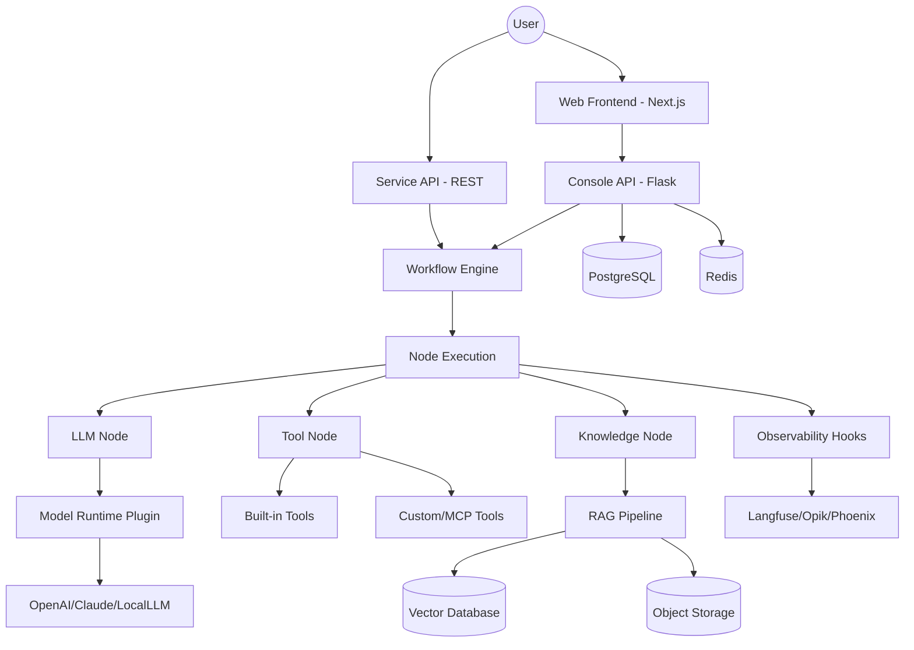

I will read the instructions in `.prompt.md` to determine the next steps.
I will check the size and content of `dify.xml` to determine the best way to analyze it.
I will read the first 100 lines of `dify.xml` to understand its structure and content.
I will read the next 500 lines of `dify.xml` to get a more complete view of the directory structure.
I will search for `README.md` and read its content to gather initial information about the project.
I will read 200 lines of `README.md` starting from line 278190 in `dify.xml`.
I will search for the directories `api/core/model_runtime/model_providers` and `api/core/tools` to identify supported models and tools.
I will search for the string "api/core/model_runtime/model_providers/" in `dify.xml` to see the list of model providers.
I will read the next 500 lines of `dify.xml` from line 601 to find the model runtime and tool directories.
I will search for "api/core/model_runtime" in `dify.xml` to find the exact path for model providers.
I will search for "openai" in `dify.xml` to understand its integration and find related files.
I will search for "model_runtime" in the directory structure section of `dify.xml` to find its location.
I will read `api/constants/recommended_apps.json` to find information on supported apps and models.
I will search for all directories under `api/core/tools/builtin_tool/providers/` in `dify.xml` to list the built-in tools.
I will read `api/core/model_manager.py` and `api/core/provider_manager.py` to understand how model providers are managed.
I will search for the path "api/core/model_manager.py" in `dify.xml` to find its line number and content.
I will search for "api/core/provider_manager.py" in `dify.xml` to find its content and understand model management.
I will search for "api/core/plugin/impl/model_runtime.py" in `dify.xml` to understand the actual implementation of `ModelRuntime`.
I will search for "api/core/plugin/entities/plugin.py" in `dify.xml` to understand the plugin definition.
I will read the last 500 lines of `dify.xml` to examine the Git logs and identify recent development trends.
# Project Analysis: Dify

## 1. Project Name and Description
**Dify** is an open-source LLM application development platform designed to bridge the gap between complex AI models and production-ready applications. It provides an intuitive, visual interface that allows both developers and non-technical users to build, deploy, and monitor AI-native applications. By combining AI workflow orchestration, RAG (Retrieval-Augmented Generation) pipelines, and autonomous agent capabilities into a single platform, Dify simplifies the entire lifecycle of LLM application development.

The platform is built with a "Backend-as-a-Service" (BaaS) philosophy, offering a comprehensive set of APIs that allow developers to integrate Dify's capabilities directly into their own business logic. This approach eliminates the need for complex backend infrastructure setup, enabling teams to focus on crafting unique user experiences and high-value AI interactions. Dify's visual canvas for workflow design allows for the creation of sophisticated, multi-step AI processes that can involve multiple models, tools, and datasets.

Dify's strength lies in its extensive ecosystem support and enterprise-grade features. It supports a wide array of LLM providers (both proprietary and open-source), dozens of vector databases, and various observability tools. With features like multi-tenancy, log analysis, annotation feedback loops, and robust security controls, it is suitable for everything from rapid prototyping to large-scale enterprise deployments.

## 2. Supported Platforms/Deployments + Requirements
Dify offers flexible deployment options to suit various environment needs:
*   **Docker Compose:** The primary and easiest method for self-hosting. (`docker/docker-compose.yaml`)
*   **Kubernetes:** Supported via community-contributed Helm Charts and YAML configurations for high availability.
*   **Cloud Platforms:** 
    *   **AWS:** Support via CDK (EKS or ECS based) and AWS Marketplace AMI.
    *   **Azure:** Support via Terraform.
    *   **Google Cloud:** Support via Terraform.
    *   **Alibaba Cloud:** Support via Computing Nest and Data Management.
*   **Dify Cloud:** A hosted SaaS version for zero-setup start.

**System Requirements:**
*   **CPU:** >= 2 Core
*   **RAM:** >= 4 GiB
*   **Storage:** Depends on data volume, but basic installation requires minimal space beyond Docker images.

## 3. Supported Connectors (Apps/APIs/Messengers)
Dify features a robust integration layer for external services:
*   **Vector Databases (30+):** `pgvector`, `Milvus`, `Qdrant`, `Chroma`, `Weaviate`, `Elasticsearch`, `Pinecone` (via plugins), and many cloud-native options like `Alibaba Cloud MySQL`, `Baidu Vector`, etc.
    *   *Reference:* `api/core/rag/datasource/vdb/`
*   **Built-in Tools (50+):** Google Search, DALL-E, Stable Diffusion, WolframAlpha, Web Scraper, etc.
    *   *Reference:* `api/core/tools/builtin_tool/providers/`
*   **Storage Providers:** Local, Amazon S3, Azure Blob, Google Cloud Storage, Aliyun OSS, Tencent COS, etc.
    *   *Reference:* `api/configs/middleware/storage/`
*   **Observability:** Langfuse, Opik, Arize Phoenix, Langsmith, MLflow, etc.
    *   *Reference:* `api/core/ops/`
*   **Connectors/Messengers:** Dify provides APIs and SDKs (Node.js, PHP, Java, Go, Python) to build connectors for Telegram, WhatsApp, Teams, etc.
    *   *Reference:* `sdks/`

## 4. Supported Models/Agents
Dify uses a plugin-based **Model Runtime** to support a vast array of models:
*   **LLMs:** OpenAI (GPT series), Claude (Anthropic), Mistral, Llama (Meta), Google Gemini, and any OpenAI-compatible API.
*   **Local Models:** Integration with Ollama, LocalAI, and Xinference.
*   **Other Model Types:** Text Embedding, Rerank, TTS (Text-to-Speech), STT (Speech-to-Text), and Moderation models.
*   **Agent Strategies:** Support for both **Function Calling** (for models that support it) and **ReAct** (for reasoning-based tool use).
    *   *Reference:* `api/core/agent/`, `api/core/plugin/impl/model_runtime.py`, `api/core/workflow/nodes/agent/`

## 5. Top 5 Use Cases
1.  **Customer Support Automation:** Building RAG-powered chatbots that query company documentation to provide accurate, 24/7 support.
2.  **Internal Knowledge Management:** Creating a centralized AI interface for employees to search and synthesize information from internal PDFs, Notion, and databases.
3.  **Automated Content Creation:** Using workflows to generate, format, and review marketing copy or technical documentation with human-in-the-loop steps.
4.  **Autonomous Research Agents:** Deploying agents that can use web search and scraping tools to gather and summarize information on specific topics.
5.  **BaaS for AI Features:** Using Dify as a backend to quickly add AI capabilities (like summarization or translation) to existing SaaS applications via simple API calls.

## 6. Top 20 Features
1.  **Visual Workflow Canvas:** Drag-and-drop DAG (Directed Acyclic Graph) for complex AI logic. (`api/core/workflow/`)
2.  **RAG Pipeline:** End-to-end document processing and retrieval. (`api/core/rag/`)
3.  **Agent Support:** ReAct and Function Calling autonomous agents. (`api/core/agent/`)
4.  **Model Provider Management:** Unified interface for 50+ model providers. (`api/core/provider_manager.py`)
5.  **Prompt IDE:** Visual environment for prompt engineering and testing. (`api/core/prompt/`)
6.  **BaaS APIs:** Full platform functionality exposed via RESTful APIs. (`api/controllers/service_api/`)
7.  **Observability Integration:** Deep tracking with Langfuse, Phoenix, etc. (`api/core/ops/`)
8.  **Multi-tenancy:** Isolated workspaces for teams and organizations. (`api/models/model.py`)
9.  **Knowledge Base (Datasets):** Structured storage and indexing for unstructured data. (`api/controllers/console/datasets/`)
10. **Built-in Toolset:** 50+ ready-to-use tools for agents and workflows. (`api/core/tools/builtin_tool/`)
11. **Log Analysis & Annotation:** Reviewing and improving AI responses based on real data. (`api/controllers/console/app/statistic.py`)
12. **Text-to-Speech / Speech-to-Text:** Integrated audio capabilities. (`api/core/base/tts/`)
13. **Sensitive Word Avoidance:** Configurable content moderation. (`api/core/app/app_config/common/sensitive_word_avoidance/`)
14. **Variable Management:** Dynamic inputs and context across workflows. (`api/core/workflow/variable_pool_initializer.py`)
15. **External Data Tools:** Fetching real-time data from external APIs during execution. (`api/core/external_data_tool/`)
16. **Enterprise Features:** SSO, RBAC, and advanced security controls. (`api/enterprise/`)
17. **Code Execution Sandbox:** Securely running Python/JS code within workflows. (`api/core/helper/code_executor/`)
18. **Hybrid Retrieval:** Combining keyword and vector search for better RAG accuracy. (`api/core/rag/retrieval/`)
19. **Prompt Templates:** Reusable and versioned prompt configurations. (`api/core/prompt/prompt_templates/`)
20. **Multi-SDK Support:** Official clients for major programming languages. (`sdks/`)

## 7. Top 20 Smart Patterns
1.  **DAG Workflow Execution:** Orchestrating complex logic as a directed acyclic graph.
2.  **Parent-Child Indexing:** Breaking documents into small chunks for retrieval but providing larger context to the LLM. (`api/core/rag/index_processor/processor/parent_child_index_processor.py`)
3.  **Hybrid Search:** Multi-path retrieval merging vector and keyword results.
4.  **Reranking:** Post-retrieval scoring to ensure the most relevant context is prioritized. (`api/core/rag/rerank/`)
5.  **Autonomous Agent Loops:** ReAct/CoT patterns for iterative problem-solving. (`api/core/agent/cot_agent_runner.py`)
6.  **Backend-as-a-Service (BaaS) Abstraction:** Standardizing disparate model APIs into a single interface.
7.  **Plugin Architecture:** Decoupling model runtimes and tools from the core engine. (`api/core/plugin/`)
8.  **Streaming Response Handling:** Efficient end-to-end streaming from LLM to UI. (`api/core/app/apps/streaming_utils.py`)
9.  **Model Context Protocol (MCP) Support:** Standardized integration for external tools and data sources. (`api/core/mcp/`)
10. **Human-in-the-loop (HITL):** Workflow pauses for human input or approval. (`api/core/repositories/human_input_repository.py`)
11. **Caching Layer:** Redis-based caching for model schemas and provider info. (`api/core/helper/model_provider_cache.py`)
12. **Variable Pool:** Centralized state management for workflow execution. (`api/core/workflow/variable_pool_initializer.py`)
13. **Structured Output Parsing:** Forcing LLMs to return valid JSON or specific formats. (`api/core/llm_generator/output_parser/`)
14. **Token-based Memory Management:** Sliding window memory to stay within context limits. (`api/core/memory/token_buffer_memory.py`)
15. **Load Balancing for Models:** Distributing requests across multiple API keys or providers. (`api/core/model_manager.py`)
16. **Dataset Synchronization:** Automatically updating knowledge bases from external sources (Notion, etc.).
17. **Multi-Vector Database Support:** Agnostic interface for 30+ VDB providers.
18. **Prompt Transformation:** Dynamically adapting prompts for different model families (Chat vs. Completion). (`api/core/prompt/prompt_transform.py`)
19. **Sensitive Word Filtering:** Pre- and post-processing for content safety.
20. **Telemetry Gateway:** Standardized event tracking across different observability backends. (`api/core/telemetry/`)

## 8. Top 20 Development Trends (Latest Commits)
1.  **Type Safety Overhaul:** Extensive migration from `Optional/Union` to modern `|` syntax.
2.  **Strict Typing:** Replacing `Any` with precise `TypedDict` and `Pydantic` models in core entities.
3.  **SQLAlchemy 2.0 Migration:** Moving from `session.query` to the `select()` API.
4.  **MCP Integration:** Rapidly evolving support for Model Context Protocol.
5.  **Refactoring for Maintainability:** Deduping logic in model properties and config managers.
6.  **Enhanced Error Handling:** Better JSON decoding error catches in OAuth and MCP flows.
7.  **Frontend Component Modularization:** Moving UI elements (like Avatar) to base UI libraries.
8.  **VDB Service Modernization:** Refactoring vector database services to use standard `sessionmaker`.
9.  **External API Security:** Strengthening cross-tenant disclosure protections.
10. **Modern Python Features:** Adoption of `match/case` for app mode branching.
11. **Test Coverage Expansion:** Increasing unit tests for new MCP and VDB features.
12. **SDK Standardization:** Improving consistency across Node.js, PHP, and other SDKs.
13. **Workflow Resilience:** Improvements to variable pool and node execution state.
14. **Observability Depth:** Adding support for newer tools like Opik.
15. **Plugin System Maturation:** Stabilizing the plugin-based model runtime.
16. **I18n Automation:** Workflows for automated translation of UI strings.
17. **CI/CD Optimization:** Improvements to build and test pipelines (anti-slop, vdb-tests).
18. **Cloud-Native Enhancements:** Better support for Kubernetes and Terraform deployments.
19. **Developer Experience (DX):** Streamlining the "deploy from source" workflow.
20. **Enterprise Readiness:** Continuous updates to telemetry and auditing features.

## 9. Top 10 Advantages
1.  **Open Source:** Full transparency and self-hosting capability.
2.  **Visual Orchestration:** Lowering the bar for complex AI logic creation.
3.  **Comprehensive RAG:** Out-of-the-box support for the entire retrieval lifecycle.
4.  **Model Agnostic:** Seamlessly switch between OpenAI, Claude, Llama, etc.
5.  **BaaS Architecture:** Simplifies integration into existing tech stacks.
6.  **Extensive Tooling:** 50+ built-in tools and easy custom tool creation.
7.  **Enterprise-ready Security:** Multi-tenancy and robust access controls.
8.  **Strong Community:** Active development and frequent updates.
9.  **Flexible Deployment:** From local Docker to large-scale K8s.
10. **Observability:** Built-in hooks for leading AI monitoring platforms.

## 10. Top 10 Limitations
1.  **Complexity:** The vast feature set can be overwhelming for simple use cases.
2.  **Resource Intensity:** Requires at least 4GB RAM, which can be high for small local setups.
3.  **Python Backend Performance:** While scalable, Python might have higher latency than Go/Rust for massive request volumes.
4.  **Plugin System Complexity:** Developing custom plugins requires deep knowledge of Dify's internal architecture.
5.  **Documentation Gaps:** Rapid evolution sometimes leaves documentation trailing behind new features.
6.  **Dependency on External Services:** Many core features (models) rely on 3rd party APIs.
7.  **Learning Curve for Workflows:** Mastering the DAG canvas and variable management takes time.
8.  **Migration Paths:** Significant architectural changes (like the plugin system) can complicate upgrades.
9.  **Mobile Support:** Primary interface is web-based; mobile experience is secondary.
10. **Data Privacy Concerns:** While self-hosted, users must manage their own data security and model provider privacy.

## 11. Top AI Skills (Found in `.agents/skills`)
*   **Backend Code Review:** Automating quality checks for Python/Flask/SQLAlchemy code.
*   **Frontend Code Review:** Best practices for React/Tailwind/TypeScript.
*   **Component Refactoring:** Strategies for splitting complex components and hook extraction.
*   **Frontend Query/Mutation:** Standardizing API interactions with contracts.
*   **Frontend Testing:** Patterns for async testing and mocking in the web layer.

## 12. Data Overview
*   **Inputs:** Structured (API parameters, variables) and Unstructured (PDF, CSV, Excel, TXT, HTML, Markdown, Notion, Website crawls).
*   **Outputs:** Text (streaming/blocking), Audio (TTS), Structured Data (JSON), Files.
*   **Storage:** 
    *   **PostgreSQL:** Relational data (apps, users, logs, configurations).
    *   **Redis:** Caching, task queues (Celery), and session state.
    *   **Vector DBs:** Embeddings for RAG (30+ options).
    *   **Object Storage:** S3/Local for uploaded files and processed data.
    *   *Reference:* `api/configs/middleware/`

## 13. Detailed Architecture Review
Dify follows a modern microservices-ready monolithic architecture (modular monolith):
1.  **Web (Frontend):** Next.js based UI for the Console and WebApps.
2.  **API (Backend):** Flask-based core providing RESTful APIs.
3.  **Workflow Engine:** Orchestrates DAG execution, variable pooling, and node runtimes. (`api/core/workflow/`)
4.  **RAG Pipeline:** Handles ETL (Extract, Transform, Load) for knowledge bases. (`api/core/rag/`)
5.  **Agent Runner:** Manages CoT/ReAct loops and tool execution. (`api/core/agent/`)
6.  **Model Runtime:** Abstracted layer for multi-provider model interaction. (`api/core/plugin/impl/model_runtime.py`)
7.  **Plugin System:** Allows for extensible tools, models, and nodes. (`api/core/plugin/`)
8.  **Task Queue (Celery):** Handles long-running tasks like document indexing and workflow execution. (`api/tasks/`)
9.  **Observability Layer:** Hooks into various tracing and logging backends. (`api/core/ops/`)
10. **Data Source Manager:** Unified interface for various document loaders. (`api/core/datasource/`)

## 14. Architecture Diagram (Mermaid)

## 15. Project Maturity
*   **Stability:** High. Used by thousands of organizations and has a mature codebase.
*   **Security:** Strong. Regular updates, cross-tenant isolation, and enterprise security features.
*   **Performance:** Generally good, though Python-based orchestration can be a bottleneck for extremely high-concurrency low-latency needs.
*   **Documentation:** Comprehensive, though some advanced areas (plugins) are still evolving.

## 16. Review of Tests, CI, Documentation
*   **Tests:** Extensive unit and integration tests for both API and Web. Uses `pytest` and `vitest`.
*   **CI Pipelines:** Robust GitHub Actions covering anti-slop, linting, tests, and docker builds.
*   **Documentation:** High quality, available in multiple languages.
*   **AI Skills:** Uses internal "skills" for code reviews and refactoring assistance.

## 17. Possible Improvements
1.  **Rust-based Orchestrator:** Moving the core workflow execution to a faster language like Rust.
2.  **Native Mobile SDKs:** Better support for mobile-first application developers.
3.  **Advanced Debugging Tools:** Visual debugger for workflows with step-by-step state inspection.
4.  **Marketplace for Plugins:** Easier discovery and installation of community-contributed tools/nodes.
5.  **Edge Execution:** Ability to run lightweight workflows on the edge (e.g., Cloudflare Workers).
6.  **Automated Prompt Optimization:** Using DSPy-like patterns to automatically improve prompts based on feedback.
7.  **Better Collaborative Editing:** Real-time multi-user editing of workflows.
8.  **Enhanced RAG Evaluation:** Built-in tools for evaluating retrieval quality (RAGAS integration).
9.  **Standardized Plugin SDK:** Simplifying the creation of complex plugins.
10. **Native Graph Visualization:** Better visual representation of knowledge base relations.

## 18. Reusable Components for Agent Swarm
*   **Workflow Engine:** As the primary orchestrator for agent interactions.
*   **Variable Pool:** For shared state management across agents.
*   **Model Provider Abstraction:** For selecting the best model per task.
*   **RAG Pipeline:** For grounding agent debates in shared knowledge.
*   **Agent Strategy Adapter:** To implement different reasoning patterns (CoT, ReAct).

## 19. Reusable Components for Multi-User Shared Knowledge
*   **Knowledge Base (Datasets):** Core system for evolving shared information.
*   **Annotation/Feedback Loop:** For human refinement of shared knowledge.
*   **Multi-tenancy Logic:** For workspace and permission management.
*   **Observability Hooks:** To track how knowledge is utilized and improved.

## 20. Reusable Components for Edge/Cloud Execution
*   **Node Execution Logic:** If decoupled, can be ported to edge environments.
*   **BaaS API Design:** For communication between edge agents and users via messengers.
*   **Model Runtime Plugin Interface:** To maintain model compatibility in different environments.

## 21. Reusable Components for Cooperative Workflows
*   **Human-in-the-loop (HITL) Repositories:** For managing pauses and human inputs.
*   **Workflow Node Definitions:** To define specialized cooperative steps.
*   **Task Queue (Celery):** For managing long-running collaborative processes.
