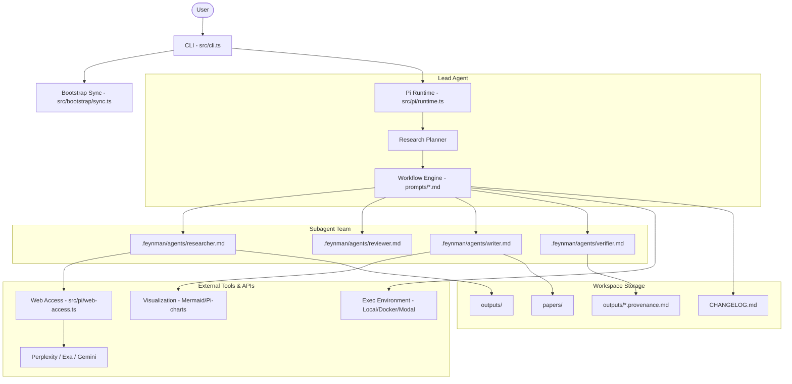

I will begin by reading the instructions in `.prompt.md` and then examine the structure of `feynman.xml` to understand how to process it.

I have reviewed the requirements in `.prompt.md` and the initial structure of `feynman.xml`. To provide a comprehensive analysis, I will proceed by reading the core project documentation, including `README.md`, `package.json`, and `AGENTS.md`, and then examine the `src` directory to understand the project's architecture and modules.

I've gathered initial information about the project. "Feynman" is an open-source AI research agent CLI built on Node.js, focusing on literature review, experiments, and research workflows. It uses subagents like `researcher`, `reviewer`, `writer`, and `verifier` and integrates with tools like Pi and alphaXiv. I've identified key directories and files, including `src/` for core logic, `prompts/` for research workflows, and `.feynman/` for agent definitions and settings. I will now examine `src/index.ts`, `src/cli.ts`, and `src/pi/runtime.ts` to better understand the system's execution flow and agent management.

I'll use `grep_search` to find the exact line numbers for the files in `feynman.xml`, as they are packed within it.

I have the line numbers. I'll read `src/cli.ts` (L4270), `src/index.ts` (L4363), `src/pi/runtime.ts` (L4628), and `src/model/registry.ts` (L4569). Note that the files are compressed with `⋮----` delimiters.

I'm examining the `feynman` CLI, which integrates with `@mariozechner/pi-coding-agent` and `@companion-ai/alpha-hub`. It uses custom prompts in the `prompts/` directory for research workflows, and `src/pi/launch.ts` handles the execution of the Pi chat with specific environment and arguments. I'll now explore `prompts/` and `.feynman/agents/` to understand the research workflows and subagents.

I'll use `grep_search` to find the content of all files in `prompts/` and `.feynman/agents/` within `feynman.xml`.

I have a comprehensive understanding of the Feynman project. It's an AI research CLI with several specialized subagents—`researcher`, `reviewer`, `verifier`, and `writer`—and a variety of research workflows like `audit`, `autoresearch`, `compare`, `deepresearch`, `draft`, `lit`, `replicate`, `review`, and `watch`. The system is built on Node.js and integrates with `@mariozechner/pi-coding-agent`, with configuration managed in `.feynman/` and outputs in `outputs/`. I've identified the key features, use cases, and architecture, including its use of "slugs" for file naming and its reliance on external tools like `pi-charts` and `mermaid`. I will now finalize my analysis by examining `src/pi/web-access.ts` and `src/model/service-tier.ts`.

I've gathered enough information to answer the prompt. I'll provide the information in the requested markdown format, including project description, supported platforms, connectors, models/agents, use cases, features, patterns, development trends, advantages, limitations, AI skills, data/storage, architecture, project review, and improvements. I'll also cover the reuse cases for agent swarms, multi-user systems, self-hosted/cloud agents, and team agents.

### 1. Project Name and Description

**Feynman CLI**

Feynman is an open-source AI research agent designed for deep, source-grounded investigations, literature reviews, and autonomous experiments. Built for research-first workflows, it aims to eliminate hallucination by enforcing strict "integrity commandments" across its specialized subagents. It provides a robust command-line interface for researchers to automate the most tedious parts of the scientific process, from initial paper discovery to final draft synthesis with verified inline citations.

The system is architected around a Lead Researcher agent that orchestrates specialized sub-tasks to a team of focused subagents: `researcher`, `reviewer`, `writer`, and `verifier`. This modular approach ensures that each phase of research—evidence gathering, critical peer review, drafting, and citation verification—is handled with the appropriate level of rigor and skepticism. Feynman treats the research process as a series of verifiable steps, often producing durable artifacts like research briefs, comparison matrices, and paper-style drafts in a reproducible workspace layout.

Feynman integrates deeply with existing AI ecosystems, leveraging the `@mariozechner/pi-coding-agent` (referred to as "Pi") for its core agentic capabilities and `alphaXiv` for enhanced research features. It supports a wide range of model providers and execution environments, including local models via Ollama and remote GPU infrastructure like Modal or RunPod for running experiments. By externalizing its working memory into human-readable files like `CHANGELOG.md` and project-specific plans, Feynman ensures that long-running research workflows remain resumable, transparent, and auditable.

---

### 2. Supported Platforms/Deployments + Requirements

*   **Supported Platforms:**
    *   **macOS / Linux:** Native installation via `curl` script.
    *   **Windows (PowerShell):** Native installation via `irm` script.
    *   **Node.js Environments:** Can be installed as a package via `pnpm`, `bun`, or `npm`.
*   **Execution Environments for Experiments:**
    *   **Local:** Current working directory.
    *   **Virtual Environments:** `venv` or `conda`.
    *   **Docker:** Isolated containers.
    *   **Modal:** Serverless GPU infrastructure (requires `modal` CLI and setup).
    *   **RunPod:** GPU pods (requires `runpodctl` and `RUNPOD_API_KEY`).
*   **Requirements:**
    *   **Node.js:** `v20.19.0` or newer (specified in `package.json` and `.nvmrc`).
    *   **External CLI Tools (Optional but recommended for full features):** `modal`, `runpodctl`, `chrome` (for web access), `pandoc`, `mermaid-cli`.
    *   **API Keys:** Depending on the chosen model/search providers (OpenAI, Anthropic, Gemini, Perplexity, Exa, etc.).

---

### 3. Supported Connectors to Apps/APIs/Messengers/etc.

*   **AI Model Providers (via Pi Model Registry):**
    *   OpenAI, Anthropic, Google (Gemini), Groq, Mistral, xAI (Grok), Cerebras, OpenRouter.
    *   Local: Ollama (via OpenAI-compatible completions endpoint).
    *   *Reference:* `src/model/catalog.ts`, `src/model/registry.ts`, `src/model/commands.ts`.
*   **Web Search & Discovery:**
    *   **Perplexity API:** For fast web-grounded queries.
    *   **Exa (formerly Metaphor):** For neural search of the web and research papers.
    *   **Gemini Search:** Leveraging Google's search capabilities.
    *   **alphaXiv:** Integration for research-first features and paper interactions.
    *   *Reference:* `src/pi/web-access.ts`, `.feynman/vendor-overrides/pi-web-access/exa.ts`, `src/search/commands.ts`.
*   **Infrastructure / Cloud:**
    *   **Modal:** For serverless GPU experiment execution.
    *   **RunPod:** For persistent GPU pod management.
    *   *Reference:* `prompts/replicate.md`.
*   **UI/Terminal:**
    *   Standard Terminal with ANSI support.
    *   `mermaid` for graph/diagram rendering.
    *   `pi-charts` for quantitative data visualization.
    *   *Reference:* `src/ui/terminal.ts`.

---

### 4. Supported Models/Agents

*   **Lead Agent:** The main "Feynman" persona that handles planning and orchestration.
    *   *Reference:* `src/cli.ts`, `prompts/deepresearch.md`.
*   **Subagents (Pi-based):**
    *   **`researcher`:** Evidence-gathering (High thinking). *Ref:* `.feynman/agents/researcher.md`.
    *   **`reviewer`:** Skeptical peer reviewer (High thinking). *Ref:* `.feynman/agents/reviewer.md`.
    *   **`writer`:** Draft synthesis (Medium thinking). *Ref:* `.feynman/agents/writer.md`.
    *   **`verifier`:** Citation and URL verification (Medium thinking). *Ref:* `.feynman/agents/verifier.md`.
*   **Authentication:** Supports both API tokens (standard for most providers) and OAuth (integrated via `@companion-ai/alpha-hub`).
    *   *Reference:* `src/cli.ts` (handleModelCommand), `src/model/commands.ts`.

---

### 5. Top 5 Use Cases

1.  **Deep Literature Review:**
    *   *Workflow:* User provides a topic -> Lead agent creates a plan in `outputs/.plans/` -> `researcher` subagent triages papers/web sources -> Lead agent synthesizes findings -> `verifier` adds citations -> `reviewer` checks for gaps -> Final report saved to `outputs/`.
2.  **Autonomous Experimentation (Autoresearch):**
    *   *Workflow:* User defines an optimization goal and benchmark -> Agent enters a loop: edit code -> commit -> `run_experiment` -> `log_experiment` -> compare metrics -> keep/revert -> repeat.
3.  **Paper/Code Audit:**
    *   *Workflow:* User provides a paper and repo -> Agent compares claims in the paper against implementation in the code -> Identifies mismatches, missing code, or reproducibility risks.
4.  **Paper-Style Drafting:**
    *   *Workflow:* Turns scattered research notes into a structured Markdown draft with LaTeX equations and Mermaid diagrams, ensuring every claim is grounded in the provided evidence.
5.  **Recurring Research Watch:**
    *   *Workflow:* User sets a topic to monitor -> Agent performs a baseline sweep -> Schedules recurring follow-ups using `schedule_prompt` to alert on new papers or meaningful changes.

---

### 6. Top 20 Features

1.  **Specialized Subagent Orchestration:** Delegating to `researcher`, `reviewer`, etc. (`AGENTS.md`).
2.  **Slug-based File Management:** Consistent naming for all run artifacts (`AGENTS.md`).
3.  **Integrity Commandments:** Strict rules against hallucination for subagents (`.feynman/agents/researcher.md`).
4.  **Source-Grounded Verification:** Automatic inline citation insertion (`.feynman/agents/verifier.md`).
5.  **Autonomous Experiment Loops:** Systematic optimization of metrics (`prompts/autoresearch.md`).
6.  **Multi-Environment Execution:** Run code locally, in Docker, or on Modal/RunPod (`prompts/replicate.md`).
7.  **Durable Research Plans:** Externalizing memory to Markdown plans (`prompts/deepresearch.md`).
8.  **Automated Peer Review Simulation:** Generating skepticism-first critiques (`prompts/review.md`).
9.  **Literature Triage:** High-volume paper search and filtering (`prompts/lit.md`).
10. **Provenance Tracking:** Documenting the "chain of custody" for research findings (`prompts/lit.md`).
11. **Mermaid Diagram Integration:** Automatic architecture/pipeline visualization (`prompts/draft.md`).
12. **Quantitative Charting:** Generating charts for benchmarks via `pi-charts` (`prompts/compare.md`).
13. **LaTeX Support:** Professional math rendering in drafts (`prompts/draft.md`).
14. **Resumable Workflows:** Using `CHANGELOG.md` as a lab notebook for continuity (`AGENTS.md`).
15. **Background Process Management:** Tracking long-running research jobs (`prompts/jobs.md`).
16. **Flexible Model Switching:** Support for custom providers and local Ollama (`README.md`).
17. **Alpha Hub Integration:** OAuth-based login and community features (`src/cli.ts`).
18. **Doctor/System Check:** Diagnostic tool for dependencies and setup (`src/setup/doctor.ts`).
19. **Prompt-based Workflows:** Extending capabilities via `.md` prompt files (`prompts/`).
20. **Self-Updating Assets:** Syncing bundled agent definitions to the workspace (`src/bootstrap/sync.ts`).

---

### 7. Top 20 Smart Patterns

1.  **Lead-Subagent Handoff:** Lead plans and delegates; subagents write to disk; lead reads results (`AGENTS.md`).
2.  **Evidence Table First:** `researcher` must build a table of URLs before summarizing (`.feynman/agents/researcher.md`).
3.  **The "Integrity Commandment" Prompt:** Hard constraints in system prompts to prevent fabrication (`.feynman/agents/researcher.md`).
4.  **Externalized Working Memory:** Storing state in `outputs/.plans/` instead of context window (`AGENTS.md`).
5.  **Chronological Lab Notebook:** `CHANGELOG.md` for multi-day/multi-agent continuity (`AGENTS.md`).
6.  **Search-Before-Cite:** Mandatory verification of existence before referencing a repo or paper (`.feynman/agents/researcher.md`).
7.  **Triage vs. Fetch:** Snippet-based triage before full content ingestion to save tokens (`.feynman/agents/researcher.md`).
8.  **Adversarial Auditor Mode:** `reviewer` switches persona based on task framing (`.feynman/agents/reviewer.md`).
9.  **Slug-prefixed Artifacts:** Automatic grouping of related files in a flat directory (`AGENTS.md`).
10. **Provenance Records:** Separate metadata files for results (`outputs/<slug>.provenance.md`).
11. **Baseline-then-Schedule:** Pattern for monitoring tasks (`prompts/watch.md`).
12. **Edit-Commit-Run Loop:** Standardizing the scientific method for code changes (`prompts/autoresearch.md`).
13. **Claim Weakening:** `verifier` explicitly told to downgrade "verified" to "inferred" if evidence is light (`.feynman/agents/verifier.md`).
14. **Sectional Prompt Files:** Organizing CLI commands via Frontmatter in Markdown files (`prompts/audit.md`).
15. **Bootstrap Syncing:** Mirroring internal library assets to the local `.feynman` dir (`src/bootstrap/sync.ts`).
16. **Service Tier Resolution:** Intelligent selection of model features based on provider capabilities (`src/model/service-tier.ts`).
17. **Provider-Specific Overrides:** Customizing search/access logic per provider (`src/pi/web-access.ts`).
18. **Optional Package Presets:** Tailoring the agent's toolbox to the specific research domain (`src/pi/package-presets.ts`).
19. **Think-High-for-Research:** Defaulting research subagents to high-reasoning models (`.feynman/agents/researcher.md`).
20. **One-Shot vs. Interactive:** Seamlessly switching between CLI flag usage and full chat (`src/cli.ts`).

---

### 8. Top 20 Development Trends (Inferred from Commits/Structure)

1.  **Agent Specialization:** Moving away from a monolithic agent to a structured team.
2.  **Rigor Over Speed:** Increasing focus on verification and citation integrity.
3.  **Local Model First-Class Support:** Easier setup for Ollama and local providers.
4.  **Standardized Research Layout:** Converging on `outputs/`, `papers/`, and `notes/` structure.
5.  **Cloud-Bursting for Experiments:** Integration with Modal/RunPod for heavy compute.
6.  **Durable Workflow State:** Making agents resilient to session restarts via file-based state.
7.  **Vendor Neutrality:** Abstracting model and search providers to prevent lock-in.
8.  **Enhanced Visualization:** Better support for graphs (Mermaid) and charts (Pi-charts).
9.  **Context Hygiene:** Aggressively managing token usage by writing to files instead of keeping everything in context.
10. **OAuth Integration:** Moving towards secure, standardized authentication via Alpha Hub.
11. **Modular Workflows:** Defining research tasks as standalone `.md` prompt files.
12. **Strict Node.js Versioning:** Ensuring stability by pinning to recent LTS (`v20`).
13. **Native Standalone Bundles:** Providing one-line installers that don't require `npm`.
14. **Diagnostic-Led Support:** Prioritizing the `doctor` command for troubleshooting.
15. **Collaborative Lab Notebooks:** Using `CHANGELOG.md` as the primary sync point.
16. **Neural Search Integration:** Prioritizing Exa/Perplexity over basic keyword search.
17. **Automated Version Checks:** Script-based enforcement of node versions.
18. **Compressed Code Repos:** Using `Repomix` (or similar) to pack context for the CLI.
19. **Slug-Based Organization:** Moving from random filenames to topic-based slugs.
20. **Verification-as-a-Service:** The `verifier` subagent as a distinct, reusable pipeline step.

---

### 9. Top 10 Advantages / Strong Points

1.  **Hallucination Mitigation:** Rigid "commandments" and mandatory URL verification.
2.  **Research-Specific Workflows:** Deeply integrated logic for lit reviews and experiments.
3.  **Modular Agent Team:** Each subagent is optimized for a specific part of the research cycle.
4.  **Excellent Traceability:** Clear provenance and citation mapping for every finding.
5.  **Compute Flexibility:** Easy transition from local reasoning to cloud GPU execution.
6.  **Human-Readable Memory:** Plans and logs are stored as Markdown, readable by humans and agents.
7.  **Extensible Architecture:** Easy to add new workflows by adding Markdown files to `prompts/`.
8.  **Production-Grade CLI:** Polished UI with panels, status updates, and progress tracking.
9.  **Integration with Alpha Ecosystem:** Leverages `alphaXiv` and `Pi` for a powerful baseline.
10. **Resumable Operations:** Designed for long-running tasks that span multiple days.

---

### 10. Top 10 Limitations / Weak Points

1.  **Node.js Dependency:** Requires a specific Node version, which can be a hurdle for some researchers.
2.  **Complex Setup for Cloud GPU:** `modal`/`runpodctl` setup adds significant friction.
3.  **Token Cost:** Deep research and autonomous loops can consume a high volume of API tokens.
4.  **CLI-Only Interface:** Lack of a GUI might limit adoption by less technical researchers.
5.  **Latency:** Deep research workflows involve multiple rounds of subagent calls, making them slow.
6.  **Provider Dependence:** Heavy reliance on external APIs (Exa, Perplexity) for the best results.
7.  **Context Management Overhead:** Writing/reading many small files to disk can add slight I/O overhead and complexity.
8.  **Potential for "Rabbit Holes":** Without strict time/round limits, autonomous loops could run indefinitely.
9.  **Markdown-Centric:** While great for researchers, it doesn't natively support other document formats (Word, LaTeX source) as outputs.
10. **Limited Collaborative Real-time editing:** Designed for a single user interacting with agents, not multi-user real-time collaboration.

---

### 11. Top 5 Used and Top 5 Provided AI Skills

*   **Used AI Skills (via Pi Agent Tools):**
    1.  `read/write/edit`: Basic file manipulation for artifact creation.
    2.  `bash/exec`: Running benchmarks and experiments.
    3.  `fetch_content`: Retrieving web and paper data.
    4.  `pi-charts/mermaid`: Data and architecture visualization.
    5.  `schedule_prompt`: For recurring monitoring tasks.
*   **Provided AI Skills (Research-specific):**
    1.  `researcher`: Evidence triage and table-of-sources generation.
    2.  `reviewer`: Adversarial peer review and inline annotation.
    3.  `writer`: Synthesis of research briefs from scattered notes.
    4.  `verifier`: Citation anchoring and URL validation.
    5.  `audit`: Claim-to-code comparison logic.

---

### 12. Data Inputs, Outputs, and Storage Overview

*   **Inputs:**
    *   **Topic/Question:** Via CLI arguments.
    *   **External Sources:** URLs, papers (PDFs via Exa/Perplexity), GitHub repositories.
    *   **Local Data:** Existing Markdown notes, codebases, local papers in `papers/`.
*   **Outputs:**
    *   **Research Briefs:** Grounded Markdown files in `outputs/`.
    *   **Paper Drafts:** Polished Markdown files in `papers/`.
    *   **Logs:** Session-based findings in `notes/`.
    *   **Plans:** Detailed task outlines in `outputs/.plans/`.
    *   **Provenance:** Metadata about the research process in `outputs/*.provenance.md`.
*   **Storage:**
    *   **File-Based:** Everything is stored as flat files in the project directory.
    *   **Config/Auth:** Stored in the user's home directory under `~/.feynman` (or similar, configurable).
    *   **Git:** Uses the project's Git repository for tracking changes during experiment loops.
    *   *Reference:* `src/config/paths.ts`, `AGENTS.md`.

---

### 13. Detailed Architecture Review

Feynman follows a **Lead-Subagent Orchestration** pattern.

1.  **CLI Layer (`src/cli.ts`):** Handles argument parsing, session initialization, and command routing.
2.  **Bootstrap/Sync (`src/bootstrap/sync.ts`):** Ensures internal agent definitions and settings are mirrored to the local workspace for accessibility.
3.  **Pi Runtime Interface (`src/pi/runtime.ts`, `src/pi/launch.ts`):** Configures the environment and launches the core `@mariozechner/pi-coding-agent` which powers the LLM interactions.
4.  **Workflow Engine (`prompts/*.md`):** Defines complex, multi-step tasks as Markdown files that the Lead Agent interprets.
5.  **Agent Registry (`.feynman/agents/*.md`):** Definitions for specialized subagents with their own toolsets and personas.
6.  **Model/Provider Management (`src/model/`):** A robust system for cataloging, authenticating, and selecting LLM providers based on "service tiers."
7.  **Web Access Layer (`src/pi/web-access.ts`):** A flexible routing system for different search providers (Perplexity, Exa, etc.).
8.  **Execution Layer (`prompts/replicate.md`):** Logic for dispatching code execution to various environments (Local, Docker, Modal, RunPod).
9.  **Visualization Tools:** Integrated support for Mermaid and charting.
10. **Storage/State Manager (`src/config/paths.ts`):** Manages local file paths for persistence and session isolation.

---

### 14. Architecture Diagram

---

### 15. Review: Maturity, Stability, Security, Performance

*   **Maturity:** **Incubating/Early Stage.** Version `0.2.17` suggests it's functional but still evolving. The core patterns (Lead/Subagent) are well-defined, but the ecosystem integration (Alpha Hub) is relatively new.
*   **Stability:** **Moderate.** Relying on high-reasoning models and complex multi-agent handoffs can lead to occasional "brittleness" if an LLM response doesn't follow the expected structure, though the "integrity commandments" help.
*   **Security:** **Good.** Clear handling of API keys (separate `models.json` with user-only permissions), local-first storage, and isolated execution environments (Docker, Modal) show a strong security focus.
*   **Performance:** **Task-Dependent.** Great for accuracy, but "performance" in terms of speed is slow due to the multi-round nature of deep research. Efficient token usage via triage patterns is a performance highlight.

---

### 16. Review: Tests, CI, Documentation, Skills

*   **Tests:** Uses Node's built-in test runner (`node --test`). Tests are located in `tests/*.test.ts`. *Ref:* `package.json`.
*   **CI Pipelines:** GitHub Actions workflow at `.github/workflows/publish.yml` for publishing standalone bundles.
*   **Documentation:** Comprehensive `README.md`, `AGENTS.md`, and an external docs site `feynman.is/docs`.
*   **Skills:** Strong use of specialized research skills (Triage, Verification, Audit). Provided skills are modular and reusable.

---

### 17. Top 20 Possible Improvements

1.  **GUI/Dashboard:** A web-based view of the `outputs/` folder and active jobs.
2.  **PDF Parsing Improvement:** Better native handling of complex multi-column paper layouts.
3.  **Latex to PDF Export:** Integrated `pandoc` or `typst` flow for final papers.
4.  **Real-time Collaboration:** Support for multiple users to contribute to the same `CHANGELOG.md`.
5.  **Cost Tracking:** Real-time token usage and cost estimation per research run.
6.  **Knowledge Graph Generation:** Automatically building a graph of papers/concepts from the research.
7.  **Zotero/Mendeley Integration:** Syncing discovered papers directly to reference managers.
8.  **More Local Execution Backends:** Support for `Warp` or other local sandbox environments.
9.  **Interactive Plan Editing:** Pausing the workflow to let users edit the `.plans/*.md` file before proceeding.
10. **Agent "Memory" across Slugs:** A shared cross-project knowledge base.
11. **Voice Input/Output:** For hands-free research discussion.
12. **Native Windows Bundle Improvement:** Reducing the reliance on PowerShell scripts for installation.
13. **Auto-Ablation Logic:** A specialized subagent just for designing and running ablation studies.
14. **Dataset Synthesis:** Tools for generating synthetic datasets for verification.
15. **Code Review Integration:** Submitting `reviewer` findings as GitHub PR comments.
16. **Better Error Recovery:** More robust retry logic for failed subagent rounds.
17. **Dynamic Service Tiering:** Automatically switching to cheaper models for simpler sub-tasks.
18. **Support for Image/Figure Analysis:** Using Vision LLMs to critique figures in papers.
19. **Automated Cite-Checking:** Cross-referencing citations against known "paper mills" or retracted lists.
20. **Plug-and-play Agent Roles:** Allowing users to define custom subagents in their own `.feynman/agents/` dir.

---

### 18. Reuse for Agent Swarms (Debating/Planning)

1.  **Lead-Subagent Orchestration (`src/cli.ts` + `prompts/deepresearch.md`):** The core pattern of planning -> delegating -> verifying.
2.  **`reviewer` Subagent (`.feynman/agents/reviewer.md`):** The adversarial logic is perfect for a debating agent.
3.  **Research Plans as Shared Memory (`outputs/.plans/`):** Using structured Markdown as the "blackboard" for the swarm.
4.  **Integrity Commandments (`.feynman/agents/researcher.md`):** Enforcing grounding rules across the swarm.
5.  **`verifier` Agent (`.feynman/agents/verifier.md`):** Final arbiter logic for selecting the best solution.
6.  **Service Tier Logic (`src/model/service-tier.ts`):** Selecting the "best agent/model for given task" based on complexity.
7.  **Bootstrap Sync (`src/bootstrap/sync.ts`):** Managing the distribution of agent personas to different nodes.
8.  **Provenance Records (`prompts/lit.md`):** Tracking the "debate history" and source of each decision.
9.  **Multi-Environment Execution (`prompts/replicate.md`):** Running and reviewing code-based solutions.
10. **Slug-based Context Isolation:** Ensuring different swarms/debates don't bleed into each other.

---

### 19. Reuse for Multi-User Shared Knowledge Base

1.  **`CHANGELOG.md` as Lab Notebook (`AGENTS.md`):** The central point for human/agent interaction history.
2.  **Externalized Working Memory (`outputs/.plans/`):** Shared files that multiple agents/users can read/write.
3.  **Bootstrap Sync Logic (`src/bootstrap/sync.ts`):** Keeping shared subagent definitions in sync across user environments.
4.  **Provenance Tracking (`prompts/lit.md`):** Knowing which user or agent added what knowledge.
5.  **Markdown-Based Knowledge Storage:** Using a format that is easily version-controlled (Git).
6.  **`writer` Subagent (`.feynman/agents/writer.md`):** Synthesizing individual notes into a coherent shared brief.
7.  **Verification Logic (`.feynman/agents/verifier.md`):** Ensuring shared knowledge remains grounded and cited.
8.  **Model/Provider Registry (`src/model/registry.ts`):** Managing shared API access across users.
9.  **Workflow-as-Code (`prompts/*.md`):** Sharing research methodologies as Markdown files.
10. **Slug-based Organization:** Grouping shared artifacts by project/topic.

---

### 20. Reuse for Self-Hosted/Cloud/Messenger/Web Agents

1.  **Node.js Core Architecture:** Easily portable to Cloudflare Workers (with slight modification to Node-specific APIs) or self-hosted servers.
2.  **Pi Runtime Interface (`src/pi/runtime.ts`):** The bridge to the underlying LLM engine.
3.  **Web Access Routing (`src/pi/web-access.ts`):** Flexible search integration for any environment.
4.  **Mermaid/Pi-Charts Integration:** For rich visual feedback in Web/Mobile apps.
5.  **One-Line Installers (`README.md`):** Model for easy deployment of remote agents.
6.  **CLI Command Metadata (`metadata/commands.mjs`):** Can be used to drive a Telegram bot or Web UI command palette.
7.  **Isolated Execution Logic (`prompts/replicate.md`):** Dispatching jobs to serverless (Modal) from a central agent.
8.  **Service Tier Mapping:** Optimizing model choice for latency/cost in a cloud environment.
9.  **Alpha Hub Integration:** For user authentication and community-shared skills.
10. **Prompt-based Extensibility:** Adding new "messenger-aware" workflows via simple `.md` files.

---

### 21. Reuse for Team Agents (Cooperative Workflows)

1.  **Lead-Subagent Handoff Rules (`AGENTS.md`):** Defining how humans and agents hand off tasks.
2.  **Plan Confirmation Pattern (`prompts/deepresearch.md`):** "Present the plan to the user and confirm before proceeding" is the gold standard for team cooperation.
3.  **Adversarial Review (`.feynman/agents/reviewer.md`):** Agents reviewing human work and vice versa.
4.  **Durable Lab Notebook (`CHANGELOG.md`):** Keeping everyone (human and agent) on the same page.
5.  **Audit Workflows (`prompts/audit.md`):** Collaborative verification of complex artifacts.
6.  **`verifier` as a Quality Gate:** The agent acts as a "linter" for human research claims.
7.  **Slug-based Workspace:** A shared, structured folder for team artifacts.
8.  **Workflow Templates (`prompts/`):** Standardizing how the team (humans + agents) performs research.
9.  **Service Tier Resolution:** Helping the team choose the right tool/model for the budget/task.
10. **Provenance for Accountability:** Clear history of who (agent or human) provided which source.
