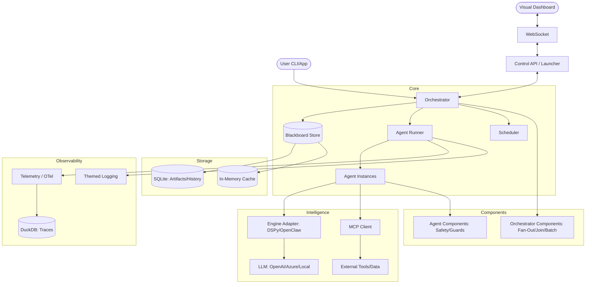

I will start by reading the `.prompt.md` file to understand the specific instructions for this task, as well as the `.input.flock.xml` file which contains the input data.
Based on the repository export and git logs provided, here is the detailed analysis of the project.

---

# 1. Project Name and Last Commit Date
*   **Project Name:** Flock
*   **Last Commit Date:** Tuesday, 17 February 2026 (Commit: `1001d0cc` - "final review + push for layout-auto-layout-toggle-and-persistence")

# 2. Project Description
Flock is a high-performance, asynchronous multi-agent orchestration framework designed for building complex, AI-driven workflows. It leverages a declarative approach to define agents and their interactions, allowing developers to focus on the logic of their "flock" rather than the underlying message passing and state management. The system is built on a "Blackboard" architecture where agents publish and subscribe to "Artifacts," enabling decoupled, event-driven collaboration.

The framework is "AI-native" from the ground up, featuring built-in support for distributed tracing (OpenTelemetry), semantic routing, and a real-time visual dashboard for monitoring agent interactions. It provides a robust set of "Orchestrator Components" that handle common patterns like fan-out, join operations, scheduling, and circuit breaking. Flock is designed to be extensible, allowing for custom engines, agents, and server-side components.

A key differentiator is its integration with the Model Context Protocol (MCP), enabling agents to seamlessly use external tools and data sources. It also introduces "OpenClaw," a specialized integration layer for advanced agentic capabilities like streaming, multi-output envelopes, and sophisticated context management. Whether running on local hardware or in the cloud, Flock provides the tools to build, test, and scale sophisticated multi-agent systems with ease.

# 3. Supported Platforms/Deployments + Requirements
*   **Platforms:**
    *   **Local Development:** Windows (win32 mentioned in environment), Linux, macOS (supported via Python/Node.js).
    *   **Containers:** Docker/Devcontainers (see `.devcontainer/devcontainer.json`).
    *   **Cloud:** Cloudflare Workers (via OpenClaw/MCP server patterns), general cloud providers supporting Python/FastAPI.
*   **Requirements:**
    *   **Python:** 3.12 or 3.13 (Managed via `uv`).
    *   **Node.js:** 22+ (for Frontend/Dashboard).
    *   **Package Manager:** `uv` (strongly recommended for Python dependencies).
    *   **Storage:** SQLite (local persistent storage), DuckDB (for telemetry/traces).
    *   **Environment Variables:** Model API keys (OpenAI, Azure, OpenRouter, etc.) and configuration flags (see `.envtemplate`).

# 4. Supported Connectors (Apps/APIs/Messengers)
Flock primarily connects via the **Model Context Protocol (MCP)** and specialized engine adapters.

| Connector / Integration | Description | Source Reference |
| :--- | :--- | :--- |
| **MCP (Model Context Protocol)** | Standardized tool and resource access. | `src/flock/mcp/client.py`, `src/flock/agent/mcp_integration.py` |
| **OpenAI API** | Integration via LiteLLM for various models. | `src/flock/engines/dspy_engine.py`, `.envtemplate` |
| **Azure OpenAI** | Enterprise-grade OpenAI integration with Entra ID support. | `src/flock/engines/auth/azure.py`, `src/flock/components/agent/azure_prompt_shield.py` |
| **OpenRouter** | Unified API for multiple LLM providers. | `.envtemplate` |
| **Ollama** | Local LLM execution. | `docs/tutorials/connect_with_ollama.md` |
| **LM Studio** | Local LLM serving. | `examples/04-misc/05_lm_studio.py` |
| **HuggingFace / Transformers** | Local model execution via Transformers library. | `src/flock/engines/providers/transformers_provider.py` |
| **Webhooks** | Outbound notifications for system events. | `src/flock/api/webhooks.py`, `src/flock/components/orchestrator/webhook.py` |
| **WebSocket** | Real-time bi-directional communication for dashboard/clients. | `src/flock/api/websocket.py`, `src/flock/components/server/websocket/websocket_component.py` |
| **REST API** | Standard HTTP interface for agent control and artifact access. | `src/flock/api/service.py`, `src/flock/api/launcher.py` |

# 5. Supported Models/Agents
Flock supports any model compatible with **LiteLLM** or **DSPy**, as well as local providers.

| Model / Agent Type | Connectivity | Source Reference |
| :--- | :--- | :--- |
| **OpenAI (GPT-4o, etc.)** | Remote (API Token) | `src/flock/engines/dspy_engine.py` |
| **Azure OpenAI** | Remote (API Token / OAuth via Managed Identity) | `src/flock/engines/auth/azure.py` |
| **Anthropic / Claude** | Remote (API Token via OpenClaw/LiteLLM) | `src/flock/integrations/openclaw/engine.py` |
| **HuggingFace Models** | Local (Own Hardware) | `src/flock/engines/providers/transformers_provider.py` |
| **Ollama / LM Studio** | Local (API) | `examples/04-misc/05_lm_studio.py` |
| **Custom Engines** | Local/Remote (Custom Logic) | `src/flock/engines/examples/simple_batch_engine.py` |
| **Scheduled Agents** | Automated execution via Timers/Cron. | `src/flock/orchestrator/scheduler.py`, `src/flock/components/orchestrator/scheduling/timer.py` |

# 6. Top 5 Use Cases
1.  **News Agency / Content Generation:** Multi-stage workflow where researchers gather data, writers draft content, and editors review. Uses **Fan-Out** for parallel research and **Join** for synthesis.
2.  **Competitive Intelligence:** Automated monitoring of competitors using MCP tools (web search), analyzing trends, and generating reports. Uses **OpenClaw** for streaming updates.
3.  **Medical Diagnostics / Data Processing:** Complex join operations where multiple specific diagnostic agents contribute to a final patient summary. Uses **JoinSpec Correlation**.
4.  **E-commerce Batch Processing:** High-volume processing of product descriptions or reviews using **Batch Processing** components for token efficiency.
5.  **Autonomous Code Detective:** Agents scanning repos, identifying bugs, and proposing fixes using **MCP Filesystem Roots**.

# 7. Top 20 Features
1.  **Declarative Agent Definition:** Define agents as simple Python objects. (`src/flock/core/agent.py`)
2.  **Blackboard Architecture:** Decoupled agent interaction via shared artifacts. (`src/flock/core/orchestrator.py`)
3.  **Real-time Visual Dashboard:** React-based UI for monitoring the "flock" in real-time. (`src/flock/frontend/`)
4.  **OpenTelemetry Tracing:** End-to-end observability of agent calls and artifacts. (`src/flock/logging/telemetry.py`)
5.  **MCP Integration:** First-class support for the Model Context Protocol. (`src/flock/mcp/client.py`)
6.  **Fan-Out/Parallel Execution:** Parallelize tasks across multiple agents. (`src/flock/core/fan_out.py`)
7.  **Join Operations:** Synchronize and aggregate outputs from multiple agents. (`src/flock/components/orchestrator/collection.py`)
8.  **Semantic Routing/Subscriptions:** Subscribe to artifacts based on semantic meaning. (`src/flock/core/subscription.py`, `src/flock/semantic/`)
9.  **Scheduled Agents:** Timer and Cron-based agent activation. (`src/flock/orchestrator/scheduler.py`)
10. **Batch Processing:** Group inputs for efficient model calls. (`src/flock/orchestrator/batch_accumulator.py`)
11. **Streaming Support:** Real-time token streaming for low-latency feedback. (`src/flock/engines/streaming/`)
12. **Idempotency Support:** Prevent duplicate processing of the same request. (`src/flock/api/idempotency.py`)
13. **Circuit Breaking:** Protect external services from overload. (`src/flock/components/orchestrator/circuit_breaker.py`)
14. **Custom Agent Components:** Lifecycle hooks for pre/post-processing. (`src/flock/agent/component_lifecycle.py`)
15. **Artifact Versioning/Storage:** Persistent storage of all agent outputs. (`src/flock/core/store.py`)
16. **Azure Prompt Shield:** Built-in safety and content filtering. (`src/flock/components/agent/azure_prompt_shield.py`)
17. **Webhook Notifications:** External event integration. (`src/flock/api/webhooks.py`)
18. **Themable UI/CLI:** Extensive theme support for logs and dashboard. (`src/flock/themes/`, `src/flock/api/themes.py`)
19. **Managed Authentication:** Built-in authentication for the control API. (`src/flock/components/server/auth/auth_component.py`)
20. **Dynamic Graph Visualization:** Auto-layout and interactive graph exploring. (`src/flock/frontend/src/components/graph/`)

# 8. Top 20 Smart Patterns
1.  **Semantic Subscription Predicates:** Intelligent filtering of data. (`src/flock/semantic/context_provider.py`)
2.  **JoinSpec Correlation IDs:** Tracking related artifacts across complex flows. (`src/flock/orchestrator/correlation_engine.py`)
3.  **Activation Conditions (DSL):** Declarative logic for agent triggering (`until`, `when`). (`src/flock/core/conditions.py`)
4.  **Deduplication Components:** Preventing redundant work in agent swarms. (`src/flock/components/orchestrator/deduplication.py`)
5.  **Artifact Materialization:** Converting raw LLM outputs into structured objects. (`src/flock/engines/dspy/artifact_materializer.py`)
6.  **Context-Aware Tracing:** Baggage propagation for distributed spans. (`src/flock/logging/span_middleware/baggage_span_processor.py`)
7.  **Auto-Trace Decorators:** Transparent observability without code pollution. (`src/flock/logging/auto_trace.py`)
8.  **Baggage-Based Auth:** Propagating credentials through agent chains. (`src/flock/engines/auth/azure.py`)
9.  **Idempotent API Patterns:** Safe retry logic for REST interactions. (`src/flock/api/idempotency.py`)
10. **Multi-Output Envelopes:** Handling multiple return types from one LLM call. (`src/flock/integrations/openclaw/engine.py`)
11. **Dynamic Fan-Out Range:** Computing the degree of parallelism at runtime. (`src/flock/core/fan_out.py`)
12. **Component-Based Server Architecture:** Modular FastAPI setup. (`src/flock/components/server/base.py`)
13. **Theme-Aware Log Formatting:** Rich CLI feedback. (`src/flock/logging/formatters/themed_formatter.py`)
14. **Artifact Filtering Engine:** Sophisticated querying of the Blackboard. (`src/flock/storage/in_memory/artifact_filter.py`)
15. **SQL-Driven History Aggregation:** Efficiently summarizing agent progress. (`src/flock/storage/sqlite/history_aggregator.py`)
16. **WebSocket-to-Event Mapping:** Real-time synchronization of state to UI. (`src/flock/api/websocket.py`)
17. **MCP Root Mounting:** Scoping agent tool access to specific directories. (`src/flock/agent/mcp_server_config.py`)
18. **Prompt Guarding:** Integrating external safety checks. (`src/flock/components/agent/guard.py`)
19. **Topology-Gated Redraw:** Optimized dashboard rendering. (`src/flock/frontend/src/components/graph/autoLayoutTrigger.ts`)
20. **Debounced UI Persistence:** Saving layout changes without perf impact. (`src/flock/frontend/src/hooks/useModulePersistence.ts`)

# 9. Top 20 Development Trends
1.  **OpenClaw Maturation:** Heavy focus on OpenClaw integration (streaming, multi-output, transport).
2.  **Dashboard Usability:** Moving from static to interactive layout (auto-layout toggles, persistence).
3.  **Logging Hardening:** Transitioning to structured, safer logging with `exc_info` handling.
4.  **Observability focus:** Continuous refinement of the tracing and telemetry stack (DuckDB, OpenTelemetry).
5.  **MCP Standardization:** Deeper integration with MCP servers (roots, tool handlers).
6.  **Schema Reliability:** Focus on artifact schema generation and type normalization.
7.  **Transport Migration:** Moving OpenClaw from session-based to response-based HTTP transport.
8.  **Persistence Layer Refinement:** Improving SQLite query performance and schema management.
9.  **Frontend Test Coverage:** Significant increase in React component testing (Vitest).
10. **Streaming Stability:** Fixing deadlocks and freezes in WebSocket streaming.
11. **Safety Integration:** Adding Azure Prompt Shield and Guard components.
12. **Idempotency:** Implementing robust request tracking for production APIs.
13. **Batching Efficiency:** Optimizing cardinality and payload shaping for batch engines.
14. **CI/CD Quality Gates:** Stricter coverage requirements and automated linting.
15. **Documentation Driven Development:** Using OpenSpec for detailed feature planning.
16. **Theming Expansion:** Adding a massive collection of terminal themes (TOML).
17. **Refactoring to Components:** Moving orchestrator logic into modular components.
18. **Async Safety:** Hardening async utils and avoiding common pitfalls (streaming freezes).
19. **Local First Development:** Focus on Ollama and local model providers.
20. **Developer Experience (DX):** Improving CLI helpers and example templates.

# 10. Top 10 Advantages
1.  **Asynchronous Mastery:** Built from the ground up for high-concurrency agent workflows.
2.  **Visual Observability:** The dashboard provides unparalleled insight into agent "thinking" and interactions.
3.  **Declarative Power:** Simple Python API hides immense complexity.
4.  **Tool-First Design:** Excellent MCP support connects agents to the real world.
5.  **Blackboard Decoupling:** Agents don't need to know about each other, only the artifacts they need.
6.  **Production Ready:** Includes tracing, auth, idempotency, and circuit breakers.
7.  **Extensible Architecture:** Almost every part (engines, components, storage) can be swapped.
8.  **Type Safety:** Heavy use of Pydantic and TypeScript ensures reliability.
9.  **Local/Cloud Hybrid:** Equally capable on a laptop or a server.
10. **Rich Ecosystem:** Comes with a huge library of themes and examples.

# 11. Top 10 Limitations
1.  **Learning Curve:** The declarative/Blackboard model requires a shift in mindset from linear coding.
2.  **Dependency Heavy:** Requires `uv`, Node.js, and multiple storage backends (SQLite, DuckDB).
3.  **Dashboard Build Process:** Requires a separate build step for the frontend (`scripts/build_dashboard.py`).
4.  **Resource Usage:** Running multiple agents + dashboard + tracing can be resource-intensive.
5.  **Complex Debugging:** Async event-driven bugs can be harder to trace than linear ones.
6.  **Schema Rigidity:** Changing artifact types requires care due to persistent storage.
7.  **OpenClaw Dependency:** Some advanced features rely on the OpenClaw gateway.
8.  **Frontend State management:** Large graphs can challenge the React/Zustand state management.
9.  **Limited Mobile Support:** Currently focused on CLI and Web Dashboard.
10. **Early Beta State:** Rapid development means frequent API shifts (though Roadmap is clear).

# 12. Top 5 Used / Provided AI Skills
*(Note: "Skills" in Flock are often represented as Agent Components or MCP Tools)*
1.  **MCP Web Research:** (Used) Gathering real-time data from the web. (`examples/01-getting-started/07_web_detective.py`)
2.  **Azure Prompt Shield:** (Provided) Safety filtering for agent prompts. (`src/flock/components/agent/azure_prompt_shield.py`)
3.  **Output Utility:** (Provided) Formatting and displaying agent outputs. (`src/flock/components/agent/output_utility.py`)
4.  **Filesystem Tools:** (Used) Agents reading and writing code/docs. (`examples/03-hackathon/10_mcp_filesystem_roots.py`)
5.  **Guard Logic:** (Provided) Pre-execution validation of agent inputs. (`src/flock/components/agent/guard.py`)

# 13. Data Inputs, Outputs, and Storage
*   **Inputs:** Python objects (Pydantic models), JSON payloads via REST/WebSocket, and environment variables.
*   **Outputs:** Artifacts (structured data), real-time token streams, OpenTelemetry spans, and visual graph updates.
*   **Storage:**
    *   **SQLite:** Persistent storage for agents, artifacts, and history. (`src/flock/storage/sqlite/`)
    *   **DuckDB:** Analytical storage for telemetry and traces. (`src/flock/logging/telemetry_exporter/duckdb_exporter.py`)
    *   **IndexedDB:** Browser-side persistence for dashboard settings and layout. (`src/flock/frontend/src/services/indexeddb.ts`)
    *   **In-Memory:** Fast lookup for active orchestrator state. (`src/flock/storage/in_memory/`)

# 14. Detailed Architecture Review
| Component | Responsibility | Source Reference |
| :--- | :--- | :--- |
| **Orchestrator** | Central coordinator of the Blackboard and agents. | `src/flock/core/orchestrator.py` |
| **Agent** | Declarative unit of work. | `src/flock/core/agent.py` |
| **Blackboard** | Shared data space for Artifacts. | `src/flock/core/store.py` |
| **Artifact Manager** | Lifecycle and storage of data units. | `src/flock/orchestrator/artifact_manager.py` |
| **Dispatcher/Launcher** | Manages the execution of the control API and dashboard. | `src/flock/api/launcher.py` |
| **MCP Manager** | Lifecycle of MCP server connections. | `src/flock/orchestrator/mcp_manager.py` |
| **Correlation Engine** | Tracks related execution paths. | `src/flock/orchestrator/correlation_engine.py` |
| **Telemetry System** | OpenTelemetry integration and DuckDB export. | `src/flock/logging/telemetry.py` |
| **DSPs Engine** | Adapter for DSPy model interactions. | `src/flock/engines/dspy_engine.py` |
| **OpenClaw Engine** | Advanced gateway for streaming/multi-output. | `src/flock/integrations/openclaw/engine.py` |
| **Scheduler** | Handles time-based activations. | `src/flock/orchestrator/scheduler.py` |
| **Websocket Manager** | Real-time event propagation to UI. | `src/flock/api/websocket.py` |
| **Frontend/Dashboard** | React application for visual monitoring. | `src/flock/frontend/src/App.tsx` |
| **Graph Builder** | Logic to convert Blackboard state to a graph. | `src/flock/api/graph_builder.py` |
| **Semantic Service** | Embedding generation and semantic search. | `src/flock/semantic/embedding_service.py` |
| **Batch Accumulator** | Buffers artifacts for batch model calls. | `src/flock/orchestrator/batch_accumulator.py` |
| **Webhooks Service** | Manages outbound event delivery. | `src/flock/api/webhooks.py` |
| **Auth Component** | FastAPI middleware for security. | `src/flock/components/server/auth/auth_component.py` |
| **Theme Service** | Management of terminal and UI styling. | `src/flock/api/themes.py` |
| **Condition DSL** | Interprets `until`/`when` logic. | `src/flock/core/conditions.py` |

# 15. Architecture Mermaid Graph

# 16. Maturity Review
*   **Stability:** Moderate. The core architecture is solid, but the OpenClaw and Dashboard features are in active development.
*   **Security:** Good. Includes Azure Prompt Shield, Guard components, and Entra ID (OAuth) support for Azure.
*   **Performance:** High. Built on `asyncio` with optimized storage (SQLite/DuckDB) and efficient frontend rendering.
*   **Maturity:** Late Beta. Feature-rich but still undergoing significant refinements in the advanced integration layers.

# 17. Engineering Quality Review
*   **Tests:** Extensive. Large suite of unit, integration, and E2E tests (using `pytest` and `vitest`).
*   **CI Pipelines:** Robust. GitHub Actions for quality gates, documentation deployment, and PyPI publishing.
*   **Documentation:** High Quality. Extensive MkDocs-based site with guides, tutorials, and API references.
*   **AI Usage:** The project is "AI-Native," designed to be understood and extended by AI agents (e.g., uses Beads for issue tracking).

# 18. Top 20 Possible Improvements
1.  **Non-blocking `serve()`:** Implement non-blocking dashboard startup. (`.github/issue_draft_non_blocking_serve.md`)
2.  **Mobile-Friendly Dashboard:** Responsive design for the React UI. (`src/flock/frontend/`)
3.  **Local Model Optimization:** Better support for quantization/hardware acceleration in `transformers_provider`.
4.  **Multi-User Auth:** Enterprise-grade RBAC in `AuthComponent`. (`src/flock/components/server/auth/auth_component.py`)
5.  **Distributed Orchestrator:** Support for multi-node agent flocks.
6.  **Agent Migration Tools:** Tools to move agents between environments.
7.  **Enhanced Debugger:** Step-through debugging of agent chains in the dashboard.
8.  **Automated Eval Integration:** Direct feedback loop from evaluation frameworks.
9.  **Voice Control Interface:** Integrate voice commands for agent control.
10. **Native App Wrapper:** Electron or Tauri wrapper for the dashboard.
11. **Plug-and-Play MCP Hub:** Centralized management of MCP servers.
12. **Agent Memory Pruning:** Intelligent cleanup of historical context. (`src/flock/storage/sqlite/`)
13. **Dynamic Theme Builder:** UI for creating custom terminal themes. (`src/flock/api/themes.py`)
14. **Streaming Error Recovery:** Auto-retry for interrupted token streams.
15. **Workflow Templates:** Pre-defined flocks for common tasks (e.g., PR review).
16. **Graph Export:** Export visual flows to Mermaid/PNG. (`src/flock/frontend/src/components/graph/`)
17. **Resource Monitoring:** Real-time CPU/GPU/Token usage in dashboard.
18. **Better Windows Support:** Hardening CLI interactions on cmd/powershell.
19. **Artifact Sandbox:** Isolated execution for agents handling sensitive data.
20. **Self-Improving Agents:** Agents that use telemetry to optimize their own prompts.

# 19. Reuse for Agent Swarm Debate Specification
1.  **Blackboard Architecture:** Centralized knowledge sharing for the debate. (`src/flock/core/store.py`)
2.  **Fan-Out Patterns:** Launching parallel agents to propose solutions. (`src/flock/core/fan_out.py`)
3.  **Join Operations:** Aggregating proposals for the debate phase. (`src/flock/components/orchestrator/collection.py`)
4.  **Activation Conditions (`until`):** Running the debate until a consensus is reached. (`src/flock/core/conditions.py`)
5.  **Deduplication:** Ensuring unique perspectives in the debate. (`src/flock/components/orchestrator/deduplication.py`)
6.  **Correlation Engine:** Linking proposals to their originating requirement. (`src/flock/orchestrator/correlation_engine.py`)
7.  **Telemetry/Tracing:** Reviewing the "chain of thought" in the debate. (`src/flock/logging/telemetry.py`)
8.  **Artifact Manager:** Storing and versioning the evolving specification. (`src/flock/orchestrator/artifact_manager.py`)
9.  **Custom Agent Lifecycle:** Adding a "critique" phase to agent calls. (`src/flock/agent/component_lifecycle.py`)
10. **MCP Tools:** Allowing agents to check technical feasibility during debate. (`src/flock/mcp/client.py`)

# 20. Reuse for Multi-User Shared Knowledge Base
1.  **SQLite Store:** The foundational persistent artifact store. (`src/flock/storage/sqlite/`)
2.  **Semantic Search:** Context retrieval across the shared knowledge base. (`src/flock/semantic/`)
3.  **WebSocket Manager:** Real-time updates for all users. (`src/flock/api/websocket.py`)
4.  **Auth Component:** Securing access to the shared base. (`src/flock/components/server/auth/auth_component.py`)
5.  **Artifact Versioning:** Tracking changes to knowledge units. (`src/flock/core/artifacts.py`)
6.  **Subscription Service:** Notifying users/agents of relevant knowledge updates. (`src/flock/core/subscription.py`)
7.  **REST Service:** Standard interface for external knowledge integration. (`src/flock/api/service.py`)
8.  **Idempotency API:** Preventing duplicate knowledge entries. (`src/flock/api/idempotency.py`)
9.  **Markdown Rendering:** Visualizing knowledge in the dashboard. (`src/flock/frontend/src/components/details/`)
10. **History Aggregation:** Summarizing knowledge evolution. (`src/flock/storage/sqlite/history_aggregator.py`)

# 21. Reuse for Own Hardware / Cloud / Messenger
1.  **Transformers Provider:** Running models on own hardware. (`src/flock/engines/providers/transformers_provider.py`)
2.  **OpenClaw Integration:** Gateway for cloud-to-local communication. (`src/flock/integrations/openclaw/`)
3.  **Webhook Service:** Connecting to messengers (Telegram/WhatsApp). (`src/flock/api/webhooks.py`)
4.  **CLI Helper:** Robust terminal interface. (`src/flock/utils/cli_helper.py`)
5.  **Launcher Service:** Running the agent server in the cloud. (`src/flock/api/launcher.py`)
6.  **Graph Canvas:** Interactive visualization on Web/Native. (`src/flock/frontend/src/components/graph/`)
7.  **Telemetry Exporters:** Sending logs to centralized cloud storage. (`src/flock/logging/telemetry_exporter/`)
8.  **MCP Servers (SSE/Stdio):** Flexible tool hosting. (`src/flock/mcp/servers/`)
9.  **Azure Managed Identity:** Secure cloud authentication. (`src/flock/engines/auth/azure.py`)
10. **Static Files Service:** Hosting the dashboard UI from a cloud worker. (`src/flock/components/server/static_files/`)

# 22. Reuse for Team Agents Cooperative Workflows
1.  **Blackboard Orchestrator:** The "virtual office" where humans and agents meet. (`src/flock/core/orchestrator.py`)
2.  **Manual Publish (Control Routes):** Humans injecting artifacts into the workflow. (`src/flock/components/server/control/`)
3.  **Join/Approval Gates:** Human-in-the-loop checkpoints. (`src/flock/components/orchestrator/collection.py`)
4.  **Scheduled Reminders:** Agents notifying humans of pending tasks. (`src/flock/orchestrator/scheduler.py`)
5.  **Themed Log Formatters:** Clear communication in shared terminals. (`src/flock/logging/formatters/themed_formatter.py`)
6.  **Live Output Tabs:** Real-time monitoring of agent work by humans. (`src/flock/frontend/src/components/details/LiveOutputTab.tsx`)
7.  **Artifact History:** Audit trail of cooperative decisions. (`src/flock/storage/sqlite/history_aggregator.py`)
8.  **Baggage Propagation:** Keeping context through human/agent transitions. (`src/flock/logging/span_middleware/baggage_span_processor.py`)
9.  **Correlation IDs:** Tracking a single project across multiple team members. (`src/flock/orchestrator/correlation_engine.py`)
10. **Dashboard Interface:** Shared visual state for team coordination. (`src/flock/frontend/src/App.tsx`)
