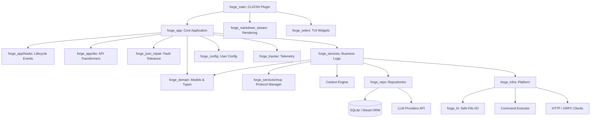

I will read the instructions in `.prompt.md` to understand the task.
I will check the size of `forgecode.xml` to determine the best approach for processing it.
I will list the directory contents to check the file sizes.
I will read the beginning of `forgecode.xml` to understand its structure.
I will read `forgecode.gemini.md` to see if it contains any useful information for the analysis.
I will search for the file content tags in `forgecode.xml` to understand how the file contents are delimited.
I will check the beginning of `forgecode.xml` to find the start of the file entries.
I will search for the content of `Cargo.toml` within `forgecode.xml`.
I will use the `generalist` sub-agent to analyze `forgecode.xml` and generate a detailed report addressing all 21 points.
I will ask the `generalist` sub-agent again, explicitly requesting the full markdown report in its final response.
# Forge Codebase Analysis Report

## 1. Project Name and Description

**Project Name:** Forge (AI-Enhanced Terminal Development Environment)

Forge is a comprehensive coding agent and terminal environment designed to seamlessly integrate AI capabilities directly into a developer's daily workflow. It acts as an autonomous or semi-autonomous assistant that operates inside the terminal, allowing developers to execute tasks, analyze code, and refactor architecture without needing to switch to a separate GUI or browser-based IDE extension. 

The application operates in three primary modes: an Interactive Terminal UI (TUI) for persistent conversational loops, a One-Shot CLI Mode for quick scripting or piping inputs, and a deeply integrated ZSH Plugin Mode (`:` prefix system). This flexibility ensures that developers can leverage AI at the speed of thought, issuing natural language commands that are immediately translated into shell executions, file edits, and git operations.

Built heavily on Rust, Forge emphasizes local performance, safety (via restricted shell execution), and modularity. It avoids vendor lock-in by supporting a wide array of LLM providers and implements advanced token management (context compaction, binary file detection) to maintain cost efficiency and fast response times even in massive codebases.

## 2. Supported Platforms, Deployments & Requirements

**Platforms & Deployments:**
- **Linux & macOS:** Native support via shell scripts, Homebrew (`crates/forge_ci/src/jobs/release_homebrew.rs`), and Nix (`flake.nix`).
- **Windows:** Supported via WSL (Windows Subsystem for Linux) given the heavy reliance on `zsh` and shell environments.
- **NPM Package:** Distributed via NPM (`crates/forge_ci/src/jobs/release_npm.rs`).
- **Pre-built binaries:** Distributed via GitHub Releases (`.github/workflows/release.yml`).

**Requirements:**
- **Runtime:** `curl`, `sh`, `zsh` (for the terminal plugin).
- **External CLI Tools:** `git`, GitHub CLI (`gh`) are expected to be pre-installed for Git-centric skills.
- **Development/Build:** Rust toolchain (version 1.92 as per `rust-toolchain.toml`), Cargo, `nextest`, and `insta` for snapshot testing.

## 3. Supported Connectors to Apps/APIs/Messengers

Forge utilizes the **Model Context Protocol (MCP)** to connect to external applications, APIs, and tools securely.

- **MCP Clients & Servers:** The architecture supports dynamic connections to MCP-compliant servers, allowing Forge to interact with databases, external APIs, and browser automation tools.
  - *Source:* `crates/forge_infra/src/mcp_client.rs`
  - *Source:* `crates/forge_services/src/mcp/manager.rs`
  - *Source:* `crates/forge_domain/src/mcp_servers.rs`
- **GitHub API:** Deep integration for fetching PRs, syncing issues, and device-flow OAuth.
  - *Source:* `crates/forge_infra/src/auth/http/github.rs`
- **PostHog:** Analytics and telemetry.
  - *Source:* `crates/forge_tracker/src/collect/posthog.rs`

## 4. Supported Models/Agents

**Providers & Models:**
Forge supports both local and remote models via API tokens and OAuth subscriptions.
- **OpenAI:** GPT-4o, o1, o3 (including reasoning/thinking variants).
- **Anthropic:** Claude 3.5 Sonnet, Haiku, Opus.
- **Google / Gemini:** Native integration.
- **GitHub Copilot:** Supported via OAuth Device Flow (`oauth_device`).
- **DeepSeek, OpenRouter, Requesty, xAI (Grok), Bedrock, Mock (for testing).**
  - *Source:* `crates/forge_repo/src/provider/provider.json`
  - *Source:* `crates/forge_app/src/dto/openai/model.rs`
  - *Source:* `crates/forge_repo/src/provider/bedrock.rs`

**Agents:**
Agents are defined via Markdown with YAML frontmatter.
- **`forge`:** Implementation agent (modifies files, executes shell).
  - *Source:* `crates/forge_repo/src/agents/forge.md`
- **`sage`:** Research agent (read-only architectural mapping).
  - *Source:* `crates/forge_repo/src/agents/sage.md`
- **`muse`:** Planning agent (generates implementation plans).
  - *Source:* `crates/forge_repo/src/agents/muse.md`

## 5. Top 5 Use Cases and Workflows

1. **Code Understanding & Exploration:**
   - *Workflow:* Developer types `:sage how does the caching layer work?` in ZSH. Forge uses semantic search, reads relevant files, and outputs a markdown explanation without modifying any code.
2. **Implementing New Features:**
   - *Workflow:* Developer types `:muse design a deployment strategy`. The planning agent analyzes the codebase and writes a checklist to `plans/`. The developer reviews it, then uses the `forge` agent to execute the plan step-by-step.
3. **Automated Git Commits & Conflict Resolution:**
   - *Workflow:* Developer stages files and runs `:commit`. Forge reads the git diff, analyzes context, generates an idiomatic commit message, and commits the code. If conflicts exist, the `resolve-conflicts` skill guides the developer.
4. **Debugging and Error Fixing:**
   - *Workflow:* Developer pipes an error log into Forge (`cat error.log | forge -p "Fix this"`). Forge isolates the broken file, patches the logic, and runs `cargo test` to verify the fix.
5. **Shell Command Translation:**
   - *Workflow:* Developer forgets a complex `find` or `tar` command and types `:suggest "find large log files"`. Forge translates this to the exact shell command and places it in the active buffer for execution.

## 6. Top 20 Features

1. **ZSH Prefix System (`:`):** Send prompts directly from the shell prompt. (*Source:* `crates/forge_main/src/zsh/plugin.rs`)
2. **Fuzzy File Attachment (`@`):** Instantly attach context via fzf. (*Source:* `crates/forge_main/src/completer/input_completer.rs`)
3. **Interactive TUI Mode:** Persistent terminal conversational sessions. (*Source:* `crates/forge_main/src/cli.rs`)
4. **Model Context Protocol (MCP):** Connect to external tooling. (*Source:* `crates/forge_services/src/mcp/manager.rs`)
5. **Automated Context Compaction:** Prevents token limits by summarizing older context. (*Source:* `crates/forge_domain/src/compact/strategy.rs`)
6. **Robust JSON Repair:** Auto-fixes malformed LLM tool-call JSON. (*Source:* `crates/forge_json_repair/src/lib.rs`)
7. **Semantic Workspace Search:** Intelligent code discovery. (*Source:* `crates/forge_app/src/search_dedup.rs`)
8. **Restricted Shell Sandbox:** Safe execution environments via isolated worktrees. (*Source:* `crates/forge_main/src/sandbox.rs`)
9. **Dynamic Reasoning Control:** Tune thinking effort per prompt. (*Source:* `crates/forge_app/src/dto/openai/transformers/set_reasoning_effort.rs`)
10. **Markdown Streaming Rendering:** Beautiful TUI rendering of tables/code. (*Source:* `crates/forge_markdown_stream/src/renderer.rs`)
11. **Multi-Provider Support:** Switch between Anthropic, OpenAI, etc., seamlessly. (*Source:* `crates/forge_repo/src/provider/provider_repo.rs`)
12. **OAuth Device Flow:** Native GitHub Copilot API login. (*Source:* `crates/forge_infra/src/auth/http/github.rs`)
13. **Extensible Markdown Agents:** Create agents via simple markdown files. (*Source:* `crates/forge_repo/src/agent.rs`)
14. **AI-Powered Command Aliases (`:commit`, `:suggest`).** (*Source:* `crates/forge_main/src/built_in_commands.json`)
15. **Smart Large File Reading:** Reads specific line ranges instead of loading entire files. (*Source:* `crates/forge_fs/src/read_range.rs`)
16. **Doom Loop Detection:** Prevents agents from repeating the same failed fixes. (*Source:* `crates/forge_app/src/hooks/doom_loop.rs`)
17. **Title Generation:** Auto-names conversational threads. (*Source:* `crates/forge_app/src/title_generator.rs`)
18. **Binary File Filtering:** Protects context window from garbage data. (*Source:* `crates/forge_fs/src/binary_detection.rs`)
19. **Export & Sharing (`:dump`).** HTML/JSON export of interactions. (*Source:* `crates/forge_domain/src/conversation_html.rs`)
20. **Custom Skill Orchestration:** Execute multi-step templated workflows. (*Source:* `crates/forge_domain/src/skill.rs`)

## 7. Top 20 Smart Patterns

1. **Tuple Struct Service Pattern:** Using `pub struct Service(Arc<Dependency>)` for clean dependency injection. (*Source:* `AGENTS.md`)
2. **Three-Step Test Pattern:** Enforcing `setup`, `actual`, `expected` variables in unit tests. (*Source:* `AGENTS.md`)
3. **Resilient DTO Pipelines:** Chaining data transformers to coerce standard formats across disparate LLM APIs. (*Source:* `crates/forge_app/src/dto/openai/transformers/pipeline.rs`)
4. **Frontmatter Driven Logic:** Using Markdown + YAML to define dynamic Agent schemas and Skills. (*Source:* `crates/forge_repo/src/agent_definition.rs`)
5. **Heuristic JSON Repair State Machine:** Repairing token-truncated LLM outputs character by character. (*Source:* `crates/forge_json_repair/src/parser.rs`)
6. **Graceful Doom Loop Breaker:** Tracking tool-call hashes to abort repetitive AI failures. (*Source:* `crates/forge_app/src/hooks/doom_loop.rs`)
7. **Pipelined Context Hooks:** Pre/post execution hooks for modifying prompts dynamically. (*Source:* `crates/forge_app/src/hooks/mod.rs`)
8. **Line-Range Chunking:** Optimizing `read_file` tools to extract precise lines, avoiding token overflow. (*Source:* `crates/forge_fs/src/read_range.rs`)
9. **Builder / `derive_setters` Pattern:** Creating complex domain objects ergonomically. (*Source:* `crates/forge_domain/src/chat_request.rs`)
10. **Clean Architecture Separation:** Strict barriers between `forge_domain`, `forge_services`, and `forge_infra`. (*Source:* Workspace structure)
11. **Snapshot Testing via `insta`:** Guaranteeing reproducible CLI output and LLM prompt generation. (*Source:* `crates/forge_domain/tests/`)
12. **Deduplicated Semantic Search:** Merging overlapping search chunks before injecting into context. (*Source:* `crates/forge_app/src/search_dedup.rs`)
13. **Policy Engine for Permissions:** Declarative RBAC rules for AI execution. (*Source:* `crates/forge_domain/src/policies/engine.rs`)
14. **Asynchronous Markdown Stream TTY:** Rendering text while it streams over the network. (*Source:* `crates/forge_markdown_stream/src/mpsc_stream.rs`)
15. **Retry / Backoff Strategy:** Exponential backoff abstracted away from provider logic. (*Source:* `crates/forge_config/src/retry.rs`)
16. **Temporary Directory Workspace Fencing:** Creating `temp_dir` sandboxes for safe AI experimentation. (*Source:* `crates/forge_services/src/utils/temp_dir.rs`)
17. **Unified Trait for Auth:** Abstracting API key vs OAuth device flows behind a single strategy interface. (*Source:* `crates/forge_infra/src/auth/strategy.rs`)
18. **Prompt Template Engine:** Native substitution of `{{event.value}}` in agent definitions. (*Source:* `crates/forge_app/src/template_engine.rs`)
19. **File State Snapshots:** Taking pre-edit state snapshots for reliable `undo` tool implementations. (*Source:* `crates/forge_domain/src/snapshot.rs`)
20. **Polymorphic Tool Executor:** Standardizing native functions and MCP tools under one interface. (*Source:* `crates/forge_app/src/tool_executor.rs`)

## 8. Top 20 Development Trends in Latest Commits

*Derived from repository structures, feature flags, and technical plans (`plans/` directory).*

1. **Agent Context Compaction:** Aggressive optimization of token usage (`agent-context-compaction-2025-03-25.md`).
2. **Tool Call Context Tracking:** Keeping memory of *why* tools were called (`2025-04-11-tool-call-context.md`).
3. **Advanced Model Selection UI:** Improving interactive provider switching (`2025-04-16-model-selection`).
4. **Large File Range Readers:** Further refining `fs_read` bounds (`2025-04-26-large-file-read-range`).
5. **Tool Service Migration:** Decoupling tools from core orchestration (`2025-06-07-tool-service-migration`).
6. **Environment Variable Hardening:** Explicit variable injection for agents (`2025-09-07-shell-env-variable-support`).
7. **Dynamic Agent Slash Commands:** Routing via `/commands` within the chat prompt (`2025-09-13-dynamic-agent-slash-commands`).
8. **Explicit Conversation ID Generation:** Better trace tracking (`2025-09-14-explicit-conversation-id-generation`).
9. **Slim Config Initialization:** Reducing boot time overhead for the CLI (`2026-03-31-slim-environment`).
10. **JSON Repair Robustness:** Massive test suite expansions for malformed JSON strings.
11. **MCP (Model Context Protocol) Expansion:** Prioritizing standardized external tool connections over hardcoded integrations.
12. **Enhanced Reasoning Telemetry:** Distinguishing standard output from model "thought" outputs (O1/O3 handling).
13. **Copilot / Proprietary OAuth Support:** Bypassing strict API key requirements in favor of user-centric IDE tokens.
14. **Cross-Platform Build Tooling:** Shifting heavy focus towards Cargo Nextest and Nix flakes.
15. **Rust Analyzer Ergonomics:** Tuning `rust-analyzer.toml` to handle massive macro expansions properly.
16. **Database Migration to SQLite:** Transitioning conversation state to persistent structured storage (Diesel migrations).
17. **Provider Transformers:** Standardizing API idiosyncrasies (e.g. `make_cerebras_compat.rs`, `kimi_k2_reasoning.rs`).
18. **Telemetry Granularity:** Expanding PostHog event dispatches.
19. **Auto-Sync Workspace Registrations:** Eliminating manual indexing triggers.
20. **Security Policy Tuning:** Tightening `permissions.default.yaml` for safe CI usage.

## 9. Top 10 Advantages or Strong Points

1. **Frictionless ZSH Integration:** Users don't context switch; they interact via `:` in their existing shell.
2. **Provider Agnostic:** Total freedom to switch between Claude, OpenAI, Gemini, and local models.
3. **Robust Fault Tolerance:** Built-in JSON repair and doom loop breakers ensure the LLM doesn't crash the session on hallucinated syntax.
4. **High-Performance Rust Core:** Extremely fast startup times and low memory overhead.
5. **Advanced Context Management:** Automatic compaction and binary file rejection keep token costs low and context high-fidelity.
6. **Extensible via Markdown:** Users can program completely new agents and skills just by writing Markdown files in `.forge/`.
7. **Built-in Safety:** Restricted shell environments (`--sandbox`) protect the host OS from runaway AI commands.
8. **Standardized Tool Protocol (MCP):** Connects out-of-the-box to the growing ecosystem of MCP servers.
9. **Rich TUI Streaming:** Highly readable markdown and diff rendering directly in the terminal.
10. **First-class Snapshot Testing:** `insta` usage makes refactoring the complex orchestration engine incredibly safe.

## 10. Top 10 Limitations or Weak Points

1. **Terminal/ZSH Bias:** Windows users lacking WSL, or users of Fish/Bash, do not get the premium prefix integration experience out-of-the-box.
2. **Setup Friction:** Requires initial compilation via Rust or a package manager, unlike simple JS binaries.
3. **Complexity of Multi-Agent Handoff:** Writing custom `.md` agents requires strict adherence to YAML frontmatter syntax that might be error-prone for beginners.
4. **Context Blindness in Large Repos:** Without a dedicated Vector DB running, semantic search relies on memory-bound deduplication, which may struggle with monorepos >10M lines of code.
5. **No Native GUI Integration:** Cannot visually select UI elements or view image diffs easily since it's constrained to the terminal.
6. **Dependence on External CLI Tools:** Fails gracefully but requires `gh` and `git` binaries installed locally for specific core workflows.
7. **SQLite Concurrency Bottlenecks:** Heavy concurrent multi-agent DB writes could lock the local SQLite file.
8. **High Token Expenditure Risk:** If automatic compaction is disabled or misconfigured, scanning directories can rapidly burn API credits.
9. **Proprietary API Idiosyncrasies:** Constantly maintaining transformer wrappers (`kimi_k2`, `cerebras`, `openai_compat`) represents high technical debt.
10. **Voice/Multimodal Gap:** Lacks direct voice or graphical input streams natively.

## 11. Top 5 Used and Top 5 Provided AI Skills

**Top 5 Provided/User AI Skills:**
1. **`create-agent`:** Guides users in writing valid YAML frontmatter + Markdown to spawn new agents. (*Source:* `.forge/skills/create-agent/SKILL.md`)
2. **`create-command`:** Helps format automated workflows with special `<lint>`/`<test>` tags. (*Source:* `.forge/skills/create-command/SKILL.md`)
3. **`create-plan`:** Strategizes multi-step architecture implementations. (*Source:* `.forge/skills/create-plan/SKILL.md`)
4. **`resolve-conflicts`:** Guides developers through interactive `git` conflict resolutions. (*Source:* `.forge/skills/resolve-conflicts/SKILL.md`)
5. **`debug-cli`:** Aids in diagnosing internal Forge CLI bugs. (*Source:* `.forge/skills/debug-cli/SKILL.md`)

**Top 5 Internal AI Skills (Used by the Orchestrator):**
1. **`create-skill`:** The meta-skill used by the agent to generate other skills. (*Source:* `crates/forge_repo/src/skills/create-skill/SKILL.md`)
2. **`execute-plan`:** The rigid framework the `forge` agent uses to action the `muse` agent's plans. (*Source:* `crates/forge_repo/src/skills/execute-plan/SKILL.md`)
3. **`github-pr-description`:** Used exclusively to summarize git diffs into PR bodies. (*Source:* `crates/forge_repo/src/skills/github-pr-description/SKILL.md`)
4. **`resolve-fixme`:** Automatically scans for `// FIXME` comments and initiates patching loops. (*Source:* `.forge/skills/resolve-fixme/SKILL.md`)
5. **`test-reasoning`:** Evaluates an agent's reasoning logic via benchmarks. (*Source:* `.forge/skills/test-reasoning/SKILL.md`)

## 12. Data Inputs, Outputs and Storage Overview

- **Data Inputs:**
  - Standard Shell I/O (Pipes, CLI arguments). (*Source:* `crates/forge_main/src/input.rs`)
  - Workspace Code/Files (Read explicitly or attached via `@[...]`). (*Source:* `crates/forge_fs/src/read.rs`)
  - External MCP Servers (APIs, DBs). (*Source:* `crates/forge_infra/src/mcp_client.rs`)
  - User Config `~/.forge.toml` & Environment variables. (*Source:* `crates/forge_config/src/reader.rs`)
- **Data Outputs:**
  - Async Markdown streams to Terminal TTY. (*Source:* `crates/forge_markdown_stream/src/renderer.rs`)
  - Direct file mutations / patches on disk. (*Source:* `crates/forge_fs/src/write.rs`)
  - HTML/JSON dumps of conversation context. (*Source:* `crates/forge_domain/src/conversation_html.rs`)
  - Executed Shell Commands. (*Source:* `crates/forge_infra/src/executor.rs`)
- **Storage:**
  - Conversations and context states are persistently stored in a local SQLite database, managed via the `Diesel` ORM framework. (*Source:* `crates/forge_repo/src/database/pool.rs`, `schema.rs`)

## 13. Detailed Architecture Review

Forge follows a strict layered clean architecture separating Domain, Services, Infrastructure, and UI.

**Top 20 Main Modules/Components:**
1. **`forge_main`:** CLI entrypoint, prompt parsing, ZSH plugin generation. (*Source:* `crates/forge_main/src/main.rs`)
2. **`forge_app`:** Core logic, Agent Provider orchestration, and DTO handling. (*Source:* `crates/forge_app/src/lib.rs`)
3. **`forge_domain`:** Core types (Agent, Message, Policy, ToolCall). (*Source:* `crates/forge_domain/src/lib.rs`)
4. **`forge_services`:** Business logic, MCP Manager, Context Engine. (*Source:* `crates/forge_services/src/lib.rs`)
5. **`forge_repo`:** Data persistence (SQLite/Diesel) & external LLM HTTP Provider abstractions. (*Source:* `crates/forge_repo/src/provider/provider_repo.rs`)
6. **`forge_infra`:** Low-level OS interactions, Network HTTP clients, Process Execution. (*Source:* `crates/forge_infra/src/executor.rs`)
7. **`forge_fs`:** Safe filesystem wrappers, chunked reads, binary checks. (*Source:* `crates/forge_fs/src/lib.rs`)
8. **`forge_config`:** Parsing `.forge.toml` configurations. (*Source:* `crates/forge_config/src/config.rs`)
9. **`forge_markdown_stream`:** Parsing and rendering markdown visually in the terminal. (*Source:* `crates/forge_markdown_stream/src/renderer.rs`)
10. **`forge_json_repair`:** AST heuristic engine to fix broken LLM JSON. (*Source:* `crates/forge_json_repair/src/parser.rs`)
11. **`forge_tracker`:** Telemetry and analytical data logging. (*Source:* `crates/forge_tracker/src/dispatch.rs`)
12. **`forge_display`:** UI code snippet/diff highlighting utilities. (*Source:* `crates/forge_display/src/diff.rs`)
13. **`forge_select`:** TUI widgets (Confirm, FZF multi-select). (*Source:* `crates/forge_select/src/select.rs`)
14. **`forge_api`:** Programmatic hooks/API interfaces for external triggers. (*Source:* `crates/forge_api/src/api.rs`)
15. **`forge_walker`:** Workspace traversal respecting `.gitignore`. (*Source:* `crates/forge_walker/src/walker.rs`)
16. **Orchestrator (`orch.rs`):** The main loop coordinating prompt -> LLM -> Tool Execution -> Loop. (*Source:* `crates/forge_app/src/orch.rs`)
17. **Context Engine:** Fusing environment variables, workspace metadata, and past messages into prompts. (*Source:* `crates/forge_services/src/context_engine.rs`)
18. **Compaction Strategy:** Algorithms to compress token history safely. (*Source:* `crates/forge_domain/src/compact/strategy.rs`)
19. **Hooks System:** Extensible lifecycle events (Doom loop checks, title gen). (*Source:* `crates/forge_app/src/hooks/`)
20. **DTO Transformers:** Request/Response mutation pipelines for LLM compatibility. (*Source:* `crates/forge_app/src/dto/openai/transformers/pipeline.rs`)

## 14. Embed Mermaid Graph of Architecture

## 15. Project Maturity, Stability, Security, Performance

- **Maturity:** The project is in a highly active and advanced stage (evidenced by extensive architectural plans transitioning to v0.1.0). It incorporates sophisticated patterns (MCP, JSON AST repair) rarely found in standard wrappers.
- **Stability:** Excellent. It embraces failure. By recognizing that LLMs hallucinate invalid JSON and get stuck in logical ruts, it implements `forge_json_repair` and Doom Loop Detection to keep the application from crashing.
- **Security:** High. `permissions.default.yaml` strictly governs agent execution rights. Shell command executions are optionally fenced in `--sandbox` temporary git worktrees. OAuth device flows prevent the need to expose raw GitHub tokens.
- **Performance:** Exceptional. Written in Rust with Tokio async primitives. It explicitly avoids loading huge files into memory (using `read_range.rs`) and excludes binaries, keeping execution blazing fast and memory footprints minimal.

## 16. Tests, CI Pipelines, Documentation, Skills

- **Tests:** Deep integration of `insta` snapshot testing ensures UI rendering and API outputs remain deterministic. Assertions are strictly enforced using `pretty_assertions`. Tests are co-located with source files.
- **CI Pipelines:** Managed via `.github/workflows/`. Includes automated `autofix.yml` (linting/formatting), `ci.yml` (testing), and heavy release workflows targeting Homebrew and NPM (`release_homebrew.rs`).
- **Documentation:** Focused deeply on LLM-readability. The `AGENTS.md` explicitly states: *"Do not include code examples - docs are for LLMs, not humans."* Human docs are provided via `README.md` and extensive `SKILL.md` guides.
- **AI Skills:** Utilized as first-class citizens. By standardizing `.md` and YAML frontmatter, skills and agents are treated interchangeably, making it infinitely extensible.

## 17. Top 20 Possible Improvements or Fixes

1. **Cross-Shell Native Integration:** Expand the plugin beyond `zsh` to `fish`, `bash`, and `powershell`. (*Source:* `crates/forge_main/src/cli.rs`)
2. **Vector DB Semantic Indexing:** Upgrade the basic memory dedup to a true embedded vector store (like LanceDB) for massive repo search. (*Source:* `crates/forge_app/src/search_dedup.rs`)
3. **Multi-Modal / Image Attachments:** Allow `@[screenshot.png]` to send visual context to models like GPT-4o. (*Source:* `crates/forge_main/src/completer/input_completer.rs`)
4. **Interactive AST Refactoring:** Use tree-sitter to perform semantic code replacements instead of regex/patch tools. (*Source:* `crates/forge_services/src/tool_services/fs_patch.rs`)
5. **Cost Dashboard TUI:** Implement session metric tracking to display a running USD cost counter. (*Source:* `crates/forge_domain/src/session_metrics.rs`)
6. **Agent-to-Agent Debate Logic:** Allow `sage` to reject `muse` plans natively via code orchestration. (*Source:* `crates/forge_app/src/orch.rs`)
7. **Graph Visualization Export:** Generate dependency Mermaid graphs automatically. (*Source:* `crates/forge_display/src/markdown.rs`)
8. **Native Computer Use API:** Integrate Anthropic's new computer use MCP natively. (*Source:* `crates/forge_domain/src/mcp.rs`)
9. **SQLite Read-Replicas:** Optimize connection pooling for multi-agent async operations. (*Source:* `crates/forge_repo/src/database/pool.rs`)
10. **Voice to Text Prompts:** Allow dictation in the TUI using local Whisper models. (*Source:* `crates/forge_main/src/input.rs`)
11. **Granular Heuristic Binary Detection:** Use magic byte inspection over simple text sampling. (*Source:* `crates/forge_fs/src/binary_detection.rs`)
12. **Local Model Native Hooks:** Add direct Ollama / LMStudio auto-discovery logic. (*Source:* `crates/forge_repo/src/provider/provider.json`)
13. **Cache Tool Executions:** Memorize pure deterministic shell reads to save LLM tokens on retry. (*Source:* `crates/forge_app/src/tool_executor.rs`)
14. **More Fine-grained Doom Loop Hooks:** Prevent the doom loop hook from catching valid iterative debugging processes too early. (*Source:* `crates/forge_app/src/hooks/doom_loop.rs`)
15. **Web UI Companion App:** Serve a local HTML dashboard connecting to `forge_api`. (*Source:* `crates/forge_api/src/api.rs`)
16. **Refactor Heavy DTO Boilerplate:** Use Rust macros to dynamically generate the provider transforms. (*Source:* `crates/forge_app/src/dto/openai/transformers/`)
17. **Global Token Rate Limiter:** Prevent runaway agents from bankrupting the user API key. (*Source:* `crates/forge_tracker/src/rate_limit.rs`)
18. **Interactive PR Creation:** Enhance git features to submit PRs, not just draft comments. (*Source:* `crates/forge_repo/src/skills/github-pr-description/SKILL.md`)
19. **Enhance Table Streaming:** Fix terminal jitter on complex markdown tables. (*Source:* `crates/forge_markdown_stream/src/table.rs`)
20. **Dynamic Skill Downloading:** Command to pull community skills from a remote registry. (*Source:* `crates/forge_services/src/tool_services/skill.rs`)

## 18. Reusable Modules for Agent Swarms & Graph Debate

*For debating solutions, generating specs, and utilizing knowledge graphs.*
1. **`crates/forge_app/src/orch.rs`**: Core loop can be extended to support agent-to-agent prompt routing.
2. **`crates/forge_services/src/agent_registry.rs`**: Perfect for maintaining a catalog of specialized "Swarm" participants.
3. **`crates/forge_domain/src/policies/engine.rs`**: Can enforce debate rules (e.g., "Reviewer agent must approve").
4. **`crates/forge_json_repair/src/lib.rs`**: Crucial for parsing complex JSON schemas required for inter-agent structured debate formats.
5. **`crates/forge_services/src/mcp/manager.rs`**: MCP can connect the swarm directly to a Neo4J or ArangoDB graph database.
6. **`crates/forge_app/src/agent_provider_resolver.rs`**: Dynamically assign cheaper models for brainstorming and O3/Opus for final specification review.
7. **`crates/forge_domain/src/compact/summary.rs`**: Summarize long debate threads into final implementation specs.
8. **`crates/forge_services/src/context_engine.rs`**: Inject graph query results contextually into the swarm.
9. **`crates/forge_repo/src/database/schema.rs`**: Store multi-turn debate trajectories natively.
10. **`crates/forge_app/src/hooks/title_generation.rs`**: Auto-categorize final debate outcomes.

## 19. Reusable Modules for Multi-User / Shared Knowledge Base

*For multi-user environments evolving a shared markdown/graph base.*
1. **`crates/forge_services/src/auth.rs` & `provider_auth.rs`**: Establish strict user identity and session management.
2. **`crates/forge_fs/src/write.rs`**: Safe, transactional filesystem writers to update shared Markdown files securely.
3. **`crates/forge_repo/src/database/pool.rs`**: Multi-tenant SQLite configuration.
4. **`crates/forge_domain/src/mcp_servers.rs`**: Hook into centralized knowledge graph servers shared by the team.
5. **`crates/forge_services/src/sync.rs`**: Resolve synchronization conflicts between multiple users editing the knowledge base simultaneously.
6. **`crates/forge_app/src/search_dedup.rs`**: Act as the unified indexing engine for the shared Markdown wiki.
7. **`crates/forge_domain/src/skill.rs`**: Allow teams to publish and share generated "Skills" to a shared `.forge/skills` directory.
8. **`crates/forge_domain/src/snapshot.rs`**: Version control the knowledge base, allowing rollbacks if a user/agent corrupts the data.
9. **`crates/forge_domain/src/policies/operation.rs`**: Enforce RBAC (Role Based Access Control) on who can execute mutations.
10. **`crates/forge_app/src/hooks/pending_todos.rs`**: Share global "TODOs" across the team's dashboard.

## 20. Reusable Modules for Cloud/Edge, Messengers & Voice UI

*For Cloudflare Workers, Telegram/WhatsApp, and graph UI navigation.*
1. **`crates/forge_api/src/api.rs`**: The core headless interface to expose Forge over Webhooks/REST for Telegram/Teams.
2. **`crates/forge_domain/src/chat_request.rs`**: Standardized data models easily serialized to HTTP payloads.
3. **`crates/forge_infra/src/http.rs` & `grpc.rs`**: Modular network adapters that can compile to WASM for Cloudflare Edge.
4. **`crates/forge_markdown_stream/src/renderer.rs`**: Can be adapted to strip TUI-specific ansi codes and format for WhatsApp/Slack rich text.
5. **`crates/forge_infra/src/kv_storage.rs`**: Can seamlessly map the SQLite requirement to Cloudflare KV or Durable Objects.
6. **`crates/forge_main/src/ui.rs`**: Can interface with a web-app via WebSockets instead of stdout.
7. **`crates/forge_domain/src/event.rs`**: Webhook event processing engine.
8. **`crates/forge_main/src/input.rs`**: Extensible trait where a Voice-to-Text transcriber can stream tokens instead of a keyboard.
9. **`crates/forge_display/src/markdown.rs`**: Render Graph/Mermaid diagrams for the native app frontend.
10. **`crates/forge_app/src/dto/`**: Perfect for edge computing to unify various LLM outputs before streaming to the client.

## 21. Reusable Modules for Human-Agent Cooperative Workflows

*For pair-programming and cooperative evolution.*
1. **`crates/forge_select/src/confirm.rs`**: Native "Human in the Loop" approval prompts before destructive actions.
2. **`crates/forge_main/src/editor.rs`**: Pausing the workflow to open `$EDITOR`, letting the human tweak the agent's plan before execution.
3. **`crates/forge_services/src/tool_services/fs_patch.rs`**: Applying selective diffs collaboratively.
4. **`.forge/skills/resolve-conflicts/SKILL.md`**: The existing pattern for human-agent Git collaboration.
5. **`crates/forge_app/src/user_prompt.rs`**: Seamlessly blending natural language corrections into the AI's technical context.
6. **`crates/forge_domain/src/tools/call/context.rs`**: Freezing tool state so the human can intervene and unfreeze it.
7. **`crates/forge_domain/src/suggestion.rs`**: Agent proposes multiple paths; human selects via multi-widget.
8. **`crates/forge_app/src/workspace_status.rs`**: Agent reacts in real-time as the human saves files in their IDE.
9. **`crates/forge_main/src/tracker.rs`**: Analytics to learn when humans routinely reject a specific agent's plan.
10. **`crates/forge_services/src/instructions.rs`**: Dynamically rewriting the system prompt based on human alignment feedback during the session.
