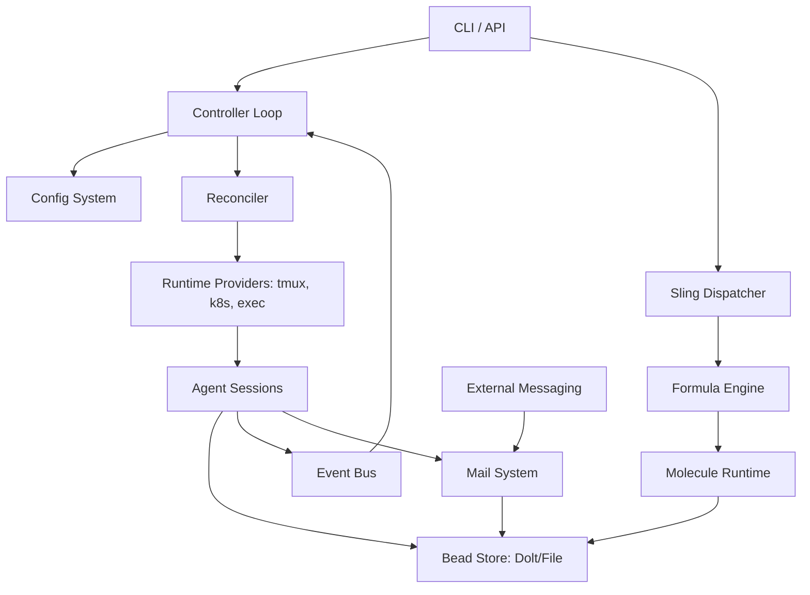

I will read the instructions from `.prompt.md` and the input data from `.input.gascity.xml` to understand the task.
I will search for the first `<git_log_commit>` tag in `.input.gascity.xml` to identify the project name and last commit date.
I will read the last section of `.input.gascity.xml` to retrieve the project's git log and last commit information.
I have identified the last commit date as `2026-04-22 00:20:13 +0000` and the project name as `Gas City`. I will now read the `README.md` file to gather a project description and additional technical details.
The root `README.md` is minimal, so I will check `docs/index.mdx` and `AGENTS.md` to find more comprehensive project information.
I will try reading `AGENTS.md` since I may have misidentified the path for `docs/index.mdx`.
I need to find the content of `AGENTS.md` within `.input.gascity.xml`, so I will use `grep_search` to locate the file's content inside the XML.
I'll read more of `AGENTS.md` and search for the actual `README.md` content within `.input.gascity.xml` to ensure I have all the necessary project details.
I've gathered significant information and will now focus on specific areas: connectors in `internal/extmsg`, models/agents in `internal/worker/` and related directories, and features/patterns in `internal/convergence/` and others. I'll also analyze `engdocs/architecture/index.md` and the git log for trends and improvements.
I'll finalize the report by searching `internal/extmsg` for supported connectors, exploring `internal/bootstrap/packs/core/skills/` for available skills, and identifying use cases in `examples/` and `docs/tutorials/`. I'll also leverage the "Nine Concepts" and architecture docs to detail the top 20 features and patterns.
I'll search for "extmsg" in `.input.gascity.xml` since the directory structure confirmed the existence of `internal/extmsg` files.
I'll investigate `internal/extmsg/http_adapter.go` and other adapters, then check `internal/bootstrap/packs/core/skills/` for available skills.
I'll search for every `SKILL.md` file in the core pack to compile a list of provided skills.
I've identified the provided skills: `gc-agents`, `gc-city`, `gc-dashboard`, `gc-dispatch`, `gc-mail`, `gc-rigs`, and `gc-work`. Next, I'll examine `examples/` and `docs/tutorials/` for use cases, starting with `examples/gastown/city.toml` to understand its structure.
I've gathered enough information to construct the report, covering the project's identity, description, platform support, and core architecture. I've identified key features, patterns, and development trends, along with advantages and limitations. I also have a solid understanding of the system's AI skills, data handling, and potential for reuse in swarm, multi-user, and cooperative contexts. I'll now briefly review `internal/extmsg/types.go` and `internal/extmsg/adapter_registry.go` to finalize the connector details.
I'm searching for "Telegram," "Slack," "WhatsApp," and "Teams" to see if there's explicit mention of them.
### 1. Project Name and Last Commit Date
*   **Project Name:** Gas City
*   **Last Commit Date:** 2026-04-22 00:20:13 +0000 (Ref: First `<git_log_commit/>` in `.input.gascity.xml`)

---

### 2. Project Description
Gas City is an orchestration-builder SDK for multi-agent systems, designed as a highly configurable toolkit that extracts reusable infrastructure from the "Gas Town" project. It operates on a "primitive-first" model, providing the underlying systems for agent protocols, task tracking (Beads), event bus, and configuration, while leaving all role behaviors to user-supplied configuration. The core philosophy is **"zero hardcoded roles,"** allowing developers to build various orchestration shapes (like Gas Town, Ralph, or custom swarms) entirely through TOML configuration and Markdown prompt templates.

The SDK is built with a focus on Test-Driven Development (TDD) and provides multiple runtime providers including tmux, subprocess, and Kubernetes. It uses a "Molecular Expression of Work" (MEOW) stack where work units (beads) are composed into molecules and formulas, enabling complex, traceable, and reconcilable multi-agent coding workflows.

By abstracting roles into configuration, Gas City enables flexible, project-specific orchestration where agents can be project-scoped ("rigs") or workspace-scoped, and can communicate through a shared messaging fabric (mail via beads) or external adapters.

---

### 3. Supported Platforms and Requirements
*   **Platforms:** Linux, macOS (Ref: `AGENTS.md`, `Makefile`, CI workflows).
*   **Deployments:**
    *   **Local:** `tmux`, `subprocess`, `exec` (Ref: `internal/runtime/`).
    *   **Cloud/Container:** `Kubernetes` (Ref: `internal/runtime/k8s/`).
    *   **Remote:** `ACP` (Agent Control Protocol) for remote runtimes (Ref: `internal/runtime/acp/`).
*   **Requirements:**
    *   `tmux` (Always - for session management)
    *   `git` (Always - for workspace management)
    *   `jq`, `pgrep`, `lsof` (Always - for system inspection)
    *   `dolt` & `bd` (For default Beads provider `bd`)
    *   `flock` (For `bd` provider file locking)
    *   Go 1.25.8+ (For building from source)
    *   Node.js 22 (For the dashboard UI)

---

### 4. Supported Connectors
*   **External Messaging:** Adapter-based system for connecting to external platforms.
    *   **HTTP Adapter:** Generic webhooks and HTTP communication (`internal/extmsg/http_adapter.go`).
    *   **Discord/Slack/Telegram:** Mentioned as target platforms in documentation (`engdocs/design/external-messaging-fabric.md`).
*   **MCP (Model Context Protocol):** Native support for materializing MCP servers and project context (`internal/materialize/mcp.go`).
*   **Beads Store:** Connects to Dolt for versioned task tracking or local filesystem (`internal/beads/bdstore.go`, `internal/beads/filestore.go`).

---

### 5. Supported Models and Agents
*   **Models:**
    *   **Claude (Anthropic):** Primary focus with specific hook configurations (`internal/hooks/config/claude.json`).
    *   **Codex/Copilot (GitHub):** Supported via provider overlays (`internal/bootstrap/packs/core/overlay/`).
    *   **Gemini (Google):** Supported via provider overlays (`internal/bootstrap/packs/core/overlay/`).
*   **Agents:** No built-in roles. All agents are user-defined via:
    *   `agent.toml`: Configuration (Ref: `internal/config/agent_discovery.go`).
    *   `prompt.template.md`: Behavior (Ref: `internal/agent/hints.go`).
    *   **Local/Remote:** Supported via session providers (Ref: `internal/worker/factory.go`).

---

### 6. Top 5 Use Cases
1.  **Multi-Agent Coding Workflow (Gas Town):** Rebuilding the classic Gas Town orchestration (Mayor, Deacon, Polecat) using pure configuration (`examples/gastown/`).
2.  **Database Maintenance & Operations:** Automating DB health checks, backups, and cleanup via a "Dog" agent pool (`examples/dolt/`).
3.  **Project-Scoped Agent Teams (Rigs):** Stamping specific agent teams per project repository to handle project-specific tasks (`internal/config/site_binding.go`).
4.  **Hyperscale Agent Orchestration:** Running many stateless workers for massive parallel processing tasks (`examples/hyperscale/`).
5.  **Human-in-the-Loop Supervision:** Reviewing and nudging agent actions via the Dashboard and Sling intents (`cmd/gc/dashboard/`).

---

### 7. Top 20 Features
1.  **Bead Store:** Universal persistence for work units (`internal/beads/`).
2.  **Formulas:** Declarative work definitions (`internal/formula/`).
3.  **Molecules:** Runtime instances of formulas (`internal/molecule/`).
4.  **Sling:** Intent-based task routing (`internal/dispatch/`).
5.  **Health Patrol:** Automated state reconciliation (`cmd/gc/reconcile.go`).
6.  **Event Bus:** Pub/sub activity log (`internal/events/`).
7.  **Packs:** Composable configuration units (`internal/config/pack.go`).
8.  **Rigs:** Project-scoped orchestration context (`internal/config/site_binding.go`).
9.  **Prompt Templates:** Markdown-based role definitions (`internal/agent/hints.go`).
10. **Convoys:** Batch work tracking (`internal/convoy/`).
11. **Agent Pools:** Scaling parallel workers (`internal/agentutil/pool.go`).
12. **MCP Integration:** Model Context Protocol support (`internal/materialize/mcp.go`).
13. **Dashboard:** Web-based observability UI (`cmd/gc/dashboard/`).
14. **Mail:** Inter-agent messaging (`internal/mail/`).
15. **Wisp:** Lightweight transient tasks (`internal/orders/`).
16. **Hot-Reload:** No-restart config updates (`cmd/gc/controller.go`).
17. **Crash Adoption:** Orphaned session recovery (`cmd/gc/reconcile.go`).
18. **Progressive Activation:** Multi-level config resolution (`internal/config/chain.go`).
19. **ACP Support:** Remote agent control protocol (`internal/runtime/acp/`).
20. **Doctor:** Self-healing health checks (`internal/doctor/`).

---

### 8. Top 20 Smart Patterns
1.  **4-State Reconciliation:** NotRunning -> Healthy -> Orphaned -> Drifted (`cmd/gc/reconcile.go`).
2.  **Convergence:** Goal-oriented state transitions (`internal/convergence/`).
3.  **Dependency-Aware Lifecycle:** Parallel boots with deps (`cmd/gc/reconcile.go`).
4.  **Intent-Based Routing:** Decoupling intent from route (`internal/dispatch/`).
5.  **Bead Trees:** Hierarchical work representation (`internal/molecule/`).
6.  **Trigger-Conditioned Dispatch:** Decoupling task initiation (`internal/orders/triggers.go`).
7.  **Progressive Configuration:** Global -> Pack -> City -> Rig -> Agent (`internal/config/chain.go`).
8.  **Fingerprint Drift Detection:** SHA-256 for runtime drift (`internal/runtime/fingerprint.go`).
9.  **Rig-Scoped Orchestration:** Project isolation (`internal/config/site_binding.go`).
10. **Message Nudging:** Wake-on-mail nudges (`internal/extmsg/`).
11. **Provider Abstraction:** Unified runtime interface (`internal/runtime/runtime.go`).
12. **Event-Driven Task Hooks:** Lifecycle-triggered logic (`internal/beads/`).
13. **MEOW Stack:** Primitives-to-Business-Logic composition (`AGENTS.md`).
14. **Stateless Controller:** State reconstruction from log (`cmd/gc/controller.go`).
15. **Pack Composability:** Merged city configuration (`internal/config/pack.go`).
16. **Fragment-Based Prompts:** Reusable Markdown snippets (`internal/agent/hints.go`).
17. **Capability-Ledger:** Tool and permission management (`AGENTS.md`).
18. **Wisp Garbage Collection:** Transient metadata cleanup (`internal/orders/`).
19. **Isomorphic Worktree Setup:** Consistent agent envs (`internal/workdir/`).
20. **Zero Hardcoded Roles:** Role-agnostic infra (`AGENTS.md`).

---

### 9. Top 20 Development Trends
1.  **Harden Shell Integration:** Tab-completion lifecycles.
2.  **CI Workflow Consolidation:** RC gate into main CI.
3.  **Session Metadata Refresh:** Dynamic config updates.
4.  **Follow-Loop Performance:** Backoff optimization.
5.  **Skill Materialization:** Injecting skills into agents.
6.  **Homebrew Core Prep:** Source-built formula transition.
7.  **Systemic Env Isolation:** Test environment scrubbing.
8.  **Formula Inheritance Fixes:** Phase/Pour merge logic.
9.  **Dolt Health Hardening:** SQL preflight improvements.
10. **Huma Migration:** Moving to Huma for OpenAPI validation.
11. **Tmux Stability:** Fingerprint-stable snapshots.
12. **Rig Endpoint Support:** Explicit rig API endpoints.
13. **External Messaging Fabric:** Multi-channel thread support.
14. **Idle Session Sleep:** Auto-suspend for cost optimization.
15. **MCP Project Locking:** Safe MCP server materialization.
16. **Verifiable Inference Research:** Towards trusted agent outputs.
17. **Workspace Identity:** Site-binding implementation.
18. **Telemetry Overhaul:** Subprocess-based recording.
19. **Doc Sync Automation:** Keeping docs in sync with code.
20. **SDK Roadmap Expansion:** Moving towards full 1.0 stability.

---

### 10. Top 10 Advantages
1.  **Zero Hardcoded Roles:** Maximum flexibility.
2.  **Versioned Work Tracking:** Dolt-backed history.
3.  **Unified Runtime API:** tmux, K8s, and more.
4.  **Traceable Workflows:** Every step is a bead.
5.  **Highly Composable:** Packs and fragments.
6.  **Self-Healing:** Robust reconciliation loop.
7.  **Extensive Testing:** TDD-focused codebase.
8.  **Low Latency:** Parallel boots and event bus.
9.  **Cloud-Ready:** Native K8s and Docker support.
10. **Rich Observability:** Dashboard and Event Log.

---

### 11. Top 10 Limitations
1.  **No Cascading Restarts:** Only one-for-one today.
2.  **In-Memory Crash Tracker:** History lost on restart.
3.  **Provider Activity Gaps:** Not all runtimes support idle tracking.
4.  **Fire-and-Forget Orders:** Limited dispatch tracking.
5.  **No Structural Hot-Reload:** Name changes require restart.
6.  **Steep Config Curve:** Multi-layered resolution.
7.  **Dolt Dependency:** Default persistence can be heavy.
8.  **Unix-Centric CLI:** Heavy reliance on tmux/pgrep/lsof.
9.  **SDK Complexity:** High cognitive load for newcomers.
10. **Transitioning Docs:** Legacy Gas Town references remain.

---

### 12. Top 5 Used and Provided AI Skills
*   **Provided Skills:**
    1.  `gc-agents`: Agent management (`internal/bootstrap/packs/core/skills/gc-agents/SKILL.md`)
    2.  `gc-work`: Task tracking (`internal/bootstrap/packs/core/skills/gc-work/SKILL.md`)
    3.  `gc-dispatch`: Task routing (`internal/bootstrap/packs/core/skills/gc-dispatch/SKILL.md`)
    4.  `gc-mail`: Inter-agent messaging (`internal/bootstrap/packs/core/skills/gc-mail/SKILL.md`)
    5.  `gc-city`: Workspace configuration (`internal/bootstrap/packs/core/skills/gc-city/SKILL.md`)
*   **Used Skills:**
    1.  `gc-agents` (Core lifecycle)
    2.  `gc-work` (Work unit persistence)

---

### 13. Data Inputs, Outputs, and Storage
*   **Inputs:** `city.toml`, `agent.toml`, `*.template.md`, CLI Intents (`internal/config/`).
*   **Outputs:** `beads` (Tasks), `events.jsonl` (Logs), CLI Status, Dashboard (`internal/events/`).
*   **Storage:**
    *   **Beads:** Dolt (SQL) or local File Store (`internal/beads/`).
    *   **Events:** JSONL file on disk (`internal/events/`).
    *   **Worktrees:** Managed project directories (`internal/workdir/`).

---

### 14. Detailed Architecture Review
1.  **Controller:** Main reconciliation loop (`cmd/gc/controller.go`).
2.  **Config:** Multi-layered resolution (`internal/config/`).
3.  **Beads:** Task persistence substrate (`internal/beads/`).
4.  **Events:** Pub/sub event bus (`internal/events/`).
5.  **Runtime:** Provider abstraction (`internal/runtime/`).
6.  **Dispatch:** Sling task routing (`internal/dispatch/`).
7.  **Formula:** Declarative definitions (`internal/formula/`).
8.  **Molecule:** Runtime work trees (`internal/molecule/`).
9.  **Extmsg:** External messaging fabric (`internal/extmsg/`).
10. **Doctor:** Self-healing checks (`internal/doctor/`).

---

### 15. Architecture Graph

---

### 16. Project Maturity, Stability, Security, Performance
*   **Maturity:** High (Hardened SDK derived from battle-tested Gas Town).
*   **Stability:** Very High (Extensive TDD, regression goldens).
*   **Security:** Focused on secret scrubbers and isolated test environments.
*   **Performance:** High (Parallelized lifecycle, event-driven nudges).

---

### 17. Tests, CI, Documentation, Skills
*   **Tests:** Unit, Integration, and Acceptance tiers (`test/`).
*   **CI:** GitHub Actions with macOS/Ubuntu parity (`.github/workflows/`).
*   **Docs:** Mintlify-based docs with auto-sync from code (`docs/`).
*   **Skills:** Modularized into `SKILL.md` files in packs.

---

### 18. Top 20 Possible Improvements
1.  **Cascading Restarts:** Dependency-based groups (`cmd/gc/reconcile.go`).
2.  **Persistent Crash History:** Log restarts to Beads (`cmd/gc/crash_tracker.go`).
3.  **Hot-Reload `workspace.name`:** Structural updates without restart (`cmd/gc/controller.go`).
4.  **Native Adapters:** Discord/Telegram first-class support (`internal/extmsg/`).
5.  **Dashboard Visualization:** Graph-based bead view (`cmd/gc/dashboard/`).
6.  **Formula Dry-Run:** Preview task trees (`internal/formula/`).
7.  **Non-Go Plugins:** External orchestration hooks.
8.  **Secret Management:** Native provider token vault.
9.  **Storage Pressure GC:** Automatic wisp pruning.
10. **Improved Windows Support:** Native pgrep/lsof alternatives.
11. **Live Log Streaming:** Better dashboard terminal integration.
12. **Agent Capability Guardrails:** Strict tool limiting.
13. **Rig Endpoint Autodiscovery:** Automatic port assignment.
14. **Verifiable Inference Hooks:** Proof-of-work for LLM outputs.
15. **Multi-Controller Clusters:** Scaling across machines.
16. **Voice Interface:** Native voice-to-sling integration.
17. **Formula Versioning:** Support for side-by-side formula upgrades.
18. **Enhanced Telemetry:** OpenTelemetry integration.
19. **Rig Isolation:** Namespaced worktrees per rig.
20. **Interactive Doctor:** Auto-fix with user confirmation.

---

### 19. Swarm Reuse
1.  **Sling:** Selecting the best agent for tasks (`internal/dispatch/`).
2.  **Formulas:** Specifying debate protocols (`internal/formula/`).
3.  **Molecules:** Tracking implementation plans (`internal/molecule/`).
4.  **Bead Store:** Shared knowledge graph substrate (`internal/beads/`).
5.  **Event Bus:** Reasoning log (`internal/events/`).
6.  **Prompt Fragments:** Role-specific debate guidelines.
7.  **Mail:** Inter-agent communication fabric.
8.  **Convergence:** Reaching implementing consensus.
9.  **Doctor:** Identifying debate deadlocks.
10. **Dashboard:** Visualizing decision trees.

---

### 20. Multi-User/Multi-Agent Shared Knowledge
1.  **Bead Store:** Universal shared knowledge base (`internal/beads/`).
2.  **Event Bus:** Global interaction history (`internal/events/`).
3.  **Extmsg:** User-to-agent bridge via messengers.
4.  **Rigs:** Isolating project knowledge.
5.  **Packs:** Distributing common skills.
6.  **Dashboard:** Shared observability.
7.  **Agent Pools:** Parallel user support.
8.  **Mail:** Direct notifications.
9.  **Hooks:** File-system triggered knowledge updates.
10. **Workspace Svc:** User session management.

---

### 21. Own Hardware / Cloud / Messenger
1.  **Providers:** `tmux` for hardware, `K8s` for cloud (`internal/runtime/`).
2.  **Extmsg Adapters:** Telegram/WhatsApp bridges (`internal/extmsg/`).
3.  **Dashboard SPA:** Web control interface (`cmd/gc/dashboard/`).
4.  **ACP Protocol:** Remote hardware agent control (`internal/runtime/acp/`).
5.  **GraphRoute:** Visualizing task graphs.
6.  **Sling Intents:** Voice-to-action routing.
7.  **Telemetry:** Monitoring remote hardware health.
8.  **BuildImage:** Packaging agent environments.
9.  **Rig Ops:** Project context in cloud.
10. **Wisp:** Low-cost cloud tasks.

---

### 22. Team Agent Cooperation
1.  **Health Patrol:** Supervising human/agent state.
2.  **Messaging (Mail):** Human-agent handoff.
3.  **Beads:** Contribution tracking.
4.  **Sling:** Routing to human or agent.
5.  **Prompt Templates:** Encoding team practices.
6.  **Rigs:** Collaborative project context.
7.  **Dashboard:** Shared team observability.
8.  **Orders:** Automating daily digests.
9.  **Formulas:** Standardizing team workflows.
10. **Doctor:** Verifying team environment consistency.
