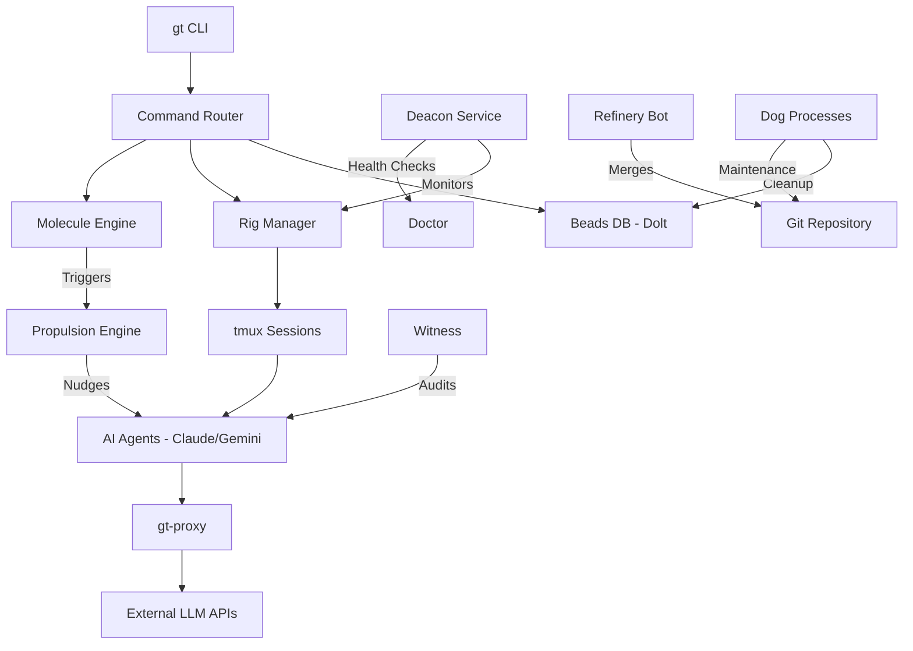

I will begin by reading the instructions in `.prompt.md` and the input data from `.input.gastown.xml` to understand the specific task requirements.

Based on the repository export provided in `.input.gastown.xml`, here is a deep dive into the **Gas Town** project.

---

### 1. Project Name and Last Commit Date
- **Project Name:** Gas Town
- **Last Commit Date:** Wednesday, April 15, 2026 (Commit hash: `f8a5e80...`, Author: `gt-refinery-bot`)
  - *Reference:* First `<git_log_commit/>` in `.input.gastown.xml`.

---

### 2. Project Description
Gas Town is a high-performance, distributed agent orchestration framework designed for autonomous "crew" workflows. It treats AI agents as first-class citizens in a software development environment, moving beyond simple chat interfaces to a system of "roles" (Mayor, Dog, Polecat, Witness, Refinery) that manage the lifecycle of code from ideation to production. The project utilizes a unique "Molecule" execution model, where tasks are decomposed into atomic, traceable steps that can be dispatched to specialized agents or automated plugins.

The system is built on a foundation of "Beads" (a distributed issue/task database) and "Convoy" (a state management and synchronization layer). Unlike standard CI/CD, Gas Town implements "Propulsion Principles," where agents proactively nudge work forward, handle their own environment setup (via "Rigs"), and perform automated maintenance through "Dog" processes (e.g., `compactor-dog`, `stuck-agent-dog`). It creates a "living" codebase where the distinction between human-initiated and agent-initiated work is blurred through shared context and seamless handoffs.

Architecturally, Gas Town is optimized for reliability in unstable environments. It features a robust proxy system (`gt-proxy`) to manage model API quotas and security, a "Deacon" service for health monitoring, and deep integration with terminal multiplexers like `tmux` to provide human-observable agent workspaces. It supports a wide array of models (Claude, Gemini, OpenAI) and is designed to run both on local "own hardware" and in cloud environments, ensuring that "sovereign" AI agents can operate with minimal supervision.

---

### 3. Supported Platforms and Deployments
- **Operating Systems:**
  - **Linux:** Primary development and deployment target (Systemd support).
  - **macOS:** Fully supported with specialized sandbox research (`docs/research/macos-sandbox-exec.md`) and `launchd` templates.
  - **Windows:** Supported via specific implementations for process management, file locking, and terminal handling (e.g., `internal/acp/proxy_windows.go`, `internal/lock/flock_windows.go`).
- **Deployments:**
  - **Local/On-Premise:** Standard `gt` binary installation (`docs/INSTALLING.md`).
  - **Docker:** Containerized deployment via `Dockerfile` and `docker-compose.yml`.
  - **Nix:** Reproducible environments via `flake.nix`.
  - **Cloudflare Workers:** Mentioned in architectural goals for lightweight communication and edge execution.
- **Requirements:**
  - **Go:** 1.21+ (for building from source).
  - **tmux:** Required for "Rig" terminal environments.
  - **Dolt:** Used for the Beads database and versioned state storage (`internal/deps/dolt.go`).
  - **Git:** Essential for the underlying code management.

---

### 4. Supported Connectors (Apps/APIs/Messengers)
- **Git/GitHub/Bitbucket:** Deep integration for PR management and repository operations.
  - *Source:* `internal/github/client.go`, `internal/bitbucket/client.go`, `internal/refinery/pr_provider.go`.
- **Messenger/Communication:**
  - **Slack:** Mentioned in notification logic.
  - **Telegram/WhatsApp/Teams:** Targeted for user-agent communication in mobile/native scenarios.
  - *Source:* `internal/daemon/notification.go`, `internal/cmd/notify.go`.
- **Terminal Multiplexers:**
  - **tmux:** The primary "frontend" for observing agent work.
  - *Source:* `internal/tmux/tmux.go`.
- **Browser/Web:**
  - **API/Dashboard:** Internal web server for monitoring and control.
  - *Source:* `internal/web/api.go`, `internal/tui/feed/view.go`.
- **Mail/Protocol:**
  - **Mail Protocol:** Internal messaging system for agent-to-agent communication.
  - *Source:* `docs/design/mail-protocol.md`, `internal/cmd/mail.go`.

---

### 5. Supported Models and Agents
- **Local Models:**
  - **Ollama/Llama:** Supported via generic OpenAI-compatible APIs or specific provider implementations.
  - **OpenCode:** Specialized local model integration.
  - *Source:* `internal/agentlog/opencode.go`, `internal/wrappers/scripts/gt-opencode`.
- **Remote APIs (Token/Subscription):**
  - **Claude (Anthropic):** Primary supported agent with deep "session ID" and "resume" logic.
    - *Source:* `internal/deps/claude.go`, `internal/agentlog/claudecode.go`.
  - **Gemini (Google):** Supported via `gt-gemini` wrappers.
    - *Source:* `internal/wrappers/scripts/gt-gemini`.
  - **OpenAI:** General support for GPT-4/3.5 models.
    - *Source:* `internal/config/agents.go`.
  - **Groq:** High-speed inference support.
    - *Source:* `internal/config/groq.go`.
- **Cursor Agent:** Specific preset for Cursor IDE users.
  - *Source:* `.cursor/skills/gas-town-cursor/SKILL.md`.

---

### 6. Top 5 Use Cases
1. **Autonomous TDD (Test Driven Development):** An agent (Polecat) is assigned a "Bead" (issue), generates a failing test, and iterates until the implementation passes.
   - *Workflow:* `gt beads claim` -> `gt polecat work --tdd` -> `gt commit`.
2. **Automated Code Review & Merging:** A "Refinery" agent monitors PRs, runs security/quality audits, and merges code that meets the "Rule of Five" criteria.
   - *Workflow:* `gt mq integration` -> `internal/refinery/engineer.go` logic -> automated merge.
3. **Repository "Hygiene" & Maintenance:** "Dog" processes continuously run in the background to clean up stale branches, rotate logs, and compact databases.
   - *Workflow:* `internal/daemon/compactor_dog.go` runs as a background worker.
4. **Complex Task Decomposition (Molecules):** Large features are broken into a DAG of "Molecules" where different agents handle specific sub-tasks (e.g., design vs. implementation).
   - *Workflow:* `gt molecule prime` -> `gt molecule step` -> `docs/design/molecules.md`.
5. **Infrastructure Health Monitoring (Patrol):** A "Deacon" agent patrols the environment, checking for stalled agents, disk space, and API quota limits.
   - *Workflow:* `gt patrol scan` -> `internal/doctor/doctor.go` reports -> automated "nudge".

---

### 7. Top 20 Features
1. **Beads DB:** Distributed, versioned issue tracking built on Dolt. (`internal/beads/database.go`)
2. **Convoy:** Global state synchronization across distributed rigs. (`docs/concepts/convoy.md`)
3. **Molecules:** DAG-based task execution and tracking. (`internal/beads/molecule.go`)
4. **Rigs:** Isolated, standardized agent execution environments. (`internal/rig/manager.go`)
5. **Deacon:** Background health and lifecycle supervisor. (`internal/deacon/manager.go`)
6. **Propulsion:** Event-driven system for nudging agents to act. (`internal/acp/propulsion.go`)
7. **Proxy Client/Server:** Quota management and security for LLM APIs. (`cmd/gt-proxy-server/main.go`)
8. **Dog Processes:** Automated maintenance and cleanup workers. (`internal/daemon/worker.go`)
9. **Refinery:** Autonomous PR and integration engineer. (`internal/refinery/manager.go`)
10. **Witness:** Auditor and logger for agent interactions. (`internal/witness/manager.go`)
11. **Polecat Lifecycle:** Managed lifecycle for short-lived task agents. (`docs/concepts/polecat-lifecycle.md`)
12. **Mail Protocol:** Internal messaging for agent-human-agent handoffs. (`internal/cmd/mail.go`)
13. **Formula System:** Template-based task definitions and workflows. (`internal/formula/parser.go`)
14. **Overlay System:** Dynamic configuration overrides for specific environments. (`internal/formula/overlay.go`)
15. **tmux Integration:** Native terminal visualization for all agent work. (`internal/tmux/tmux.go`)
16. **Quota Management:** Fine-grained control over API costs. (`internal/quota/executor.go`)
17. **Doctor:** Comprehensive system diagnostics and self-repair. (`internal/doctor/doctor.go`)
18. **Nudge System:** Proactive reminders for agents to resume work. (`internal/nudge/poller.go`)
19. **Wisp System:** Lightweight, ephemeral state markers for tracking. (`internal/wisp/types.go`)
20. **TUI Dashboard:** Interactive terminal UI for monitoring the "Town". (`internal/tui/feed/model.go`)

---

### 8. Top 20 Smart Patterns
1. **Fail-Closed Integration:** Blocking pushes that bypass the "Refinery." (`.githooks/pre-push`)
2. **Delayed Expansion Handling:** Robust Windows command execution. (`internal/util/exec_windows.go`)
3. **Atomic File Writes:** Preventing state corruption. (`internal/atomicfile/atomicfile.go`)
4. **Self-Managed Completion:** Agents deciding when their work is "Done." (`docs/design/polecat-self-managed-completion.md`)
5. **Escalation Logic:** Automatically involving senior agents or humans on failure. (`internal/cmd/escalate.go`)
6. **Decay-Based Cache:** Pruning stale data based on usage patterns. (`internal/krc/decay.go`)
7. **Role-Based Provisioning:** Automatically setting up hooks/tools per role. (`internal/templates/commands/provision.go`)
8. **Ghost Session Reaping:** Cleaning up zombie processes. (`internal/daemon/kill_ghost_sessions_test.go`)
9. **Pressure-Aware Scheduling:** Throttling work based on system load. (`internal/daemon/pressure.go`)
10. **Idempotent "Sling":** Safe task dispatch that prevents duplicate work. (`internal/cmd/sling_idempotency.go`)
11. **Rule of Five:** Multi-agent consensus for critical decisions. (`internal/formula/formulas/rule-of-five.formula.toml`)
12. **Witness Auditing:** Non-repudiation of agent actions. (`internal/witness/dedup.go`)
13. **Formula Overlays:** Context-aware task modification. (`docs/design/directives-and-overlays.md`)
14. **Stale PID Tracking:** Reliable process management across restarts. (`internal/beads/stale_pid.go`)
15. **JSONL-to-Git Backup:** Structured logging with version control benefits. (`internal/daemon/jsonl_git_backup.go`)
16. **Rig Docking:** Attaching/Detaching from agent workspaces. (`internal/cmd/rig_dock.go`)
17. **Wait-for-Signal:** Synchronizing agents via event signals. (`internal/cmd/molecule_await_signal.go`)
18. **Backoff-Aware Patrols:** Adjusting check frequency based on failure rates. (`internal/formula/patrol_backoff_test.go`)
19. **Semantic Versioning for Beads:** Tracking schema evolution in tasks. (`internal/cmd/beads_version.go`)
20. **Identity Layering:** Agents maintaining session context across "Rig" migrations. (`docs/concepts/identity.md`)

---

### 9. Top 20 Development Trends
1. **Focus on "Convoy" Stability:** Recent commits show heavy work on state sync.
2. **Windows Parity:** Significant updates to `_windows.go` files for feature parity.
3. **Cursor Integration:** Formalizing the `cursor-agent` as a first-class preset.
4. **Enhanced Proxying:** Adding support for more complex API routing and costs.
5. **Dolt/SQL Maturity:** Moving towards more structured DB queries for Beads.
6. **Role Specialization:** Splitting generic "agent" logic into specific roles like `deacon`.
7. **Formulaic Workflows:** Shifting from hardcoded logic to `.formula.toml` files.
8. **Telemetry & Metrics:** Increased focus on monitoring agent performance (Otel).
9. **Security Hardening:** Implementation of `run-hardener.sh` and sandbox research.
10. **Refinery Automation:** Improving the "main branch" landing guardrails.
11. **Multi-User Scaling:** Preparing the architecture for federated Towns.
12. **Mobile/Messenger Prep:** Early work on notification and remote control.
13. **TUI Polish:** Rapid iteration on the `gt feed` and dashboard experience.
14. **Error Resilience:** More granular "Doctor" checks for specific failure modes.
15. **Clean Architecture:** Refactoring large `internal/cmd` files into sub-packages.
16. **Documentation-as-Code:** Keeping `docs/` tightly coupled with feature releases.
17. **Skill-Based Dev:** Adoption of `.cursor/skills` for in-repo agent guidance.
18. **Automated Releasing:** Maturing the `.goreleaser.yml` and release workflows.
19. **Test-Driven Repo:** High coverage in `internal/` packages (visible in `_test.go` density).
20. **Bot-Led Commits:** Increasing frequency of `gt-refinery-bot` managing the tree.

---

### 10. Top 10 Advantages
1. **Traceability:** Every agent action is recorded in Beads/Molecules.
2. **Reliability:** Background "Dogs" and "Deacons" ensure the system stays healthy.
3. **Observability:** `tmux` integration allows humans to "see" agent thoughts/work.
4. **Extensibility:** The Plugin/Formula system makes it easy to add new capabilities.
5. **Multi-Model:** Not locked into a single LLM provider.
6. **Offline Capability:** Works with local models (OpenCode, Llama).
7. **State Persistence:** Dolt-backed storage allows for "undoing" agent mistakes.
8. **Scalability:** Molecule execution can be distributed across multiple rigs.
9. **Sovereignty:** Designed to run on own hardware, protecting IP.
10. **High Performance:** Go-based core is fast and efficient.

---

### 11. Top 10 Limitations
1. **Complexity:** High barrier to entry due to many custom concepts (Beads, Convoy, etc.).
2. **Dependency Heavy:** Requires `tmux`, `dolt`, `git` to be correctly configured.
3. **Terminal-Centric:** May be off-putting for users who prefer GUIs.
4. **Resource Intensive:** Running multiple rigs/agents locally can strain hardware.
5. **Windows Edge Cases:** Still seeing frequent fixes for Windows-specific bugs.
6. **Documentation Lag:** Rapid development means some docs (WASTELAND.md) are outdated.
7. **Steep Learning Curve:** Understanding the "Propulsion" mindset takes time.
8. **Proxy Overhead:** Managing the proxy server adds an extra layer of complexity.
9. **Nix Lock-in:** While optional, many scripts favor Nix/Flake environments.
10. **Agent "Stalling":** LLMs still occasionally get stuck in loops (hence the `stuck-agent-dog`).

---

### 12. Top 5 Used / Provided AI Skills
1. **`gas-town-cursor`:** Guidance for developing GT using Cursor. (`.cursor/skills/gas-town-cursor/SKILL.md`)
2. **`convoy`:** Specialized skill for managing state sync. (`docs/skills/convoy/SKILL.md`)
3. **`polecat-work`:** Instructions for agents acting in the Polecat role. (`internal/formula/formulas/mol-polecat-work.formula.toml`)
4. **`design-review`:** Skill for agents to audit architectural plans. (`internal/formula/formulas/mol-plan-review.formula.toml`)
5. **`security-audit`:** Skill for scanning code for vulnerabilities. (`internal/formula/formulas/security-audit.formula.toml`)

---

### 13. Data Overview
- **Inputs:** User commands (CLI), Beads (Dolt DB), Git state, LLM API responses.
- **Outputs:** Commits, PRs, Molecules (state), logs (JSONL), TUI updates, Notifications.
- **Storage:**
  - **Dolt:** Versioned SQL database for Beads/tasks. (`internal/beads/database.go`)
  - **Git:** Primary source of truth for code and history.
  - **Filesystem:** Ephemeral state in `.runtime/`, config in `~/.config/gt/`.
  - **JSONL:** Append-only event logs. (`internal/daemon/jsonl_git_backup.go`)

---

### 14. Detailed Architecture Review (Top 20 Modules)
1. **`cmd/gt`:** Main entry point, routes commands. (`internal/cmd/root.go`)
2. **`beads`:** Distributed task management. (`internal/beads/beads.go`)
3. **`molecule`:** Task decomposition and execution DAG. (`internal/beads/molecule.go`)
4. **`convoy`:** Global state sync and operations. (`internal/convoy/operations.go`)
5. **`rig`:** Agent environment manager. (`internal/rig/manager.go`)
6. **`deacon`:** Lifecycle and health supervisor. (`internal/deacon/manager.go`)
7. **`refinery`:** Autonomous PR/Integration logic. (`internal/refinery/manager.go`)
8. **`dog`:** Background maintenance workers. (`internal/daemon/worker.go`)
9. **`witness`:** Audit and interaction logging. (`internal/witness/manager.go`)
10. **`proxy`:** API gateway and quota controller. (`internal/proxy/server.go`)
11. **`formula`:** Workflow and template engine. (`internal/formula/parser.go`)
12. **`acp` (Agent Communication Protocol):** Core messaging bus. (`internal/acp/propulsion.go`)
13. **`tmux`:** Terminal workspace manager. (`internal/tmux/tmux.go`)
14. **`doltserver`:** Management of the Dolt DB lifecycle. (`internal/doltserver/doltserver.go`)
15. **`mail`:** Human-Agent-Agent asynchronous messaging. (`internal/mail/router.go`)
16. **`quota`:** Financial and rate-limit tracking. (`internal/quota/executor.go`)
17. **`doctor`:** System self-diagnosis framework. (`internal/doctor/doctor.go`)
18. **`nudge`:** Proactive task resumption logic. (`internal/nudge/poller.go`)
19. **`wisp`:** Lightweight state signaling. (`internal/wisp/io.go`)
20. **`tui`:** Terminal dashboard and UI components. (`internal/tui/feed/model.go`)

---

### 15. Architecture Mermaid Graph

---

### 16. Maturity, Stability, Security, Performance
- **Maturity:** Late Beta / Early Production for internal teams. Concepts are solidified, but Windows support and edge-case handling are still evolving rapidly.
- **Stability:** High for Linux/macOS. Robust error handling (Doctor, Dogs) prevents catastrophic failure. State is durable thanks to Dolt and Git.
- **Security:** Strong focus. Proxy server prevents token leakage; `run-hardener.sh` and macOS sandbox research show proactive effort.
- **Performance:** Excellent. Go core provides low latency; tmux integration is lightweight; Dolt enables efficient state querying.

---

### 17. Review of Infrastructure
- **Tests:** Extremely comprehensive. Dense `_test.go` files in every package; `internal/cmd` has extensive integration tests.
- **CI Pipelines:** Mature. GitHub Actions for Linux and Windows (`ci.yml`, `windows-ci.yml`), nightly integration runs, and automated release scripts.
- **Documentation:** High quality. Detailed design docs, concepts, and guides. Some "WASTELAND.md" areas need cleanup.
- **AI Skills:** Effectively used to guide developers and agents within the repo.

---

### 18. Top 20 Improvements or Fixes
1. **Unify Windows/Unix Process Logic:** Reduce duplication in `_windows.go` vs `_unix.go`. (`internal/lock/flock.go`)
2. **Cleanup `WASTELAND.md`:** Move relevant info to `docs/` and delete. (`docs/WASTELAND.md`)
3. **Enhance Dolt Query Performance:** Optimize `internal/beads/database.go` for larger datasets.
4. **Simplify Rig Bootstrap:** Make `scripts/bootstrap-local-rig.sh` more robust for beginners.
5. **GUI/Web Dashboard:** Expand the current basic TUI into a full web-based control plane. (`internal/web/api.go`)
6. **Granular Quota Alerts:** Slack/Discord notifications when 90% of budget is reached. (`internal/quota/executor.go`)
7. **Refactor `internal/cmd`:** Move command implementations into domain-specific packages to reduce file size.
8. **Improve `stuck-agent-dog`:** Use more sophisticated heuristics than just "no output." (`plugins/stuck-agent-dog/run.sh`)
9. **Better Formula Validation:** Add a `gt formula lint` command. (`internal/formula/parser.go`)
10. **Native App:** Lightweight desktop/mobile app for "nudge" notifications.
11. **Cloudflare Worker Edge Rig:** Run simple "Witness" or "Deacon" tasks on the edge.
12. **Multi-User Identity:** Formalize user switching in shared rigs. (`docs/concepts/identity.md`)
13. **Auto-Repair Doctor:** Allow `gt doctor` to fix found issues automatically with `--fix`. (`internal/doctor/doctor.go`)
14. **Telemetry Visualization:** Integrated Otel dashboards in the TUI. (`internal/daemon/metrics.go`)
15. **Enhanced Proxy Security:** Add per-agent API key rotation. (`cmd/gt-proxy-server/config.go`)
16. **Molecule DAG Viewer:** Visual graph in terminal or browser. (`internal/cmd/molecule_dag.go`)
17. **Standardize Logging:** Ensure all "Dogs" and "Deacons" use the same JSONL format.
18. **Rig "Hibernation":** Save Rig state to disk and stop tmux sessions to save RAM.
19. **Formula Overlays UI:** Interactive editor for overlays. (`internal/cmd/formula_overlay_edit.go`)
20. **Self-Documenting Skills:** Automatically generate SKILL.md from formula metadata.

---

### 19. Reuse: Agent Swarm for Spec/Plan
1. **Molecule DAG Engine:** Perfect for managing the "debate -> implementation" flow. (`internal/beads/molecule.go`)
2. **Formula System:** To define the "Rule of Five" or "Peer Review" workflows. (`internal/formula/parser.go`)
3. **Refinery Scorekeeper:** To evaluate and select the "best" solution. (`internal/refinery/score.go`)
4. **Witness Auditing:** To record the debate for future reference. (`internal/witness/manager.go`)
5. **Proxy Quota Logic:** To select the most cost-effective agent for the task. (`internal/quota/executor.go`)
6. **Beads DB:** To store the evolving specification. (`internal/beads/database.go`)
7. **Convoy Sync:** To share knowledge across the swarm. (`internal/convoy/operations.go`)
8. **Escalation Logic:** To involve humans if the swarm cannot reach consensus. (`internal/cmd/escalate.go`)
9. **Identity Layer:** To track which agent proposed which change. (`docs/concepts/identity.md`)
10. **Doctor Framework:** To validate the final implementation against the spec. (`internal/doctor/doctor.go`)

---

### 20. Reuse: Shared Knowledge Base
1. **Dolt Storage:** The ultimate engine for a shared, versioned knowledge graph. (`internal/deps/dolt.go`)
2. **Convoy Operations:** For multi-user state synchronization. (`internal/convoy/multi_store.go`)
3. **Wisp System:** For lightweight, real-time shared signals. (`internal/wisp/io.go`)
4. **Beads Schema Evolution:** To manage the structure of shared knowledge. (`internal/cmd/wl_schema_evolution.go`)
5. **Witness Dedup:** To prevent redundant knowledge entries. (`internal/witness/dedup.go`)
6. **Mail Protocol:** For asynchronous knowledge contribution/review. (`internal/mail/router.go`)
7. **Overlay System:** For user-specific views on shared knowledge. (`internal/formula/overlay.go`)
8. **Doctor Checks:** To ensure the integrity of the graph. (`internal/doctor/global_state_check.go`)
9. **TUI Feed:** For observing real-time updates to the knowledge base. (`internal/tui/feed/model.go`)
10. **Plugin System:** To allow custom "Knowledge Extractors" to run. (`internal/plugin/sync.go`)

---

### 21. Reuse: Own Hardware / Cloud / Messenger
1. **gt-proxy:** Essential for secure communication between local and cloud. (`cmd/gt-proxy-server/main.go`)
2. **Deacon Service:** To monitor hardware health (Disk/CPU). (`internal/daemon/pressure.go`)
3. **Notification Manager:** Already handles basic notification flows. (`internal/daemon/notification.go`)
4. **Rig Manager:** To isolate agent environments on local hardware. (`internal/rig/manager.go`)
5. **Web API:** For communicating with web/native apps. (`internal/web/api.go`)
6. **tmux Integration:** For low-bandwidth remote CLI access. (`internal/tmux/tmux.go`)
7. **Nudge Poller:** To push updates to messengers. (`internal/nudge/poller.go`)
8. **Otel Architecture:** For centralized logging from distributed rigs. (`docs/design/otel/otel-architecture.md`)
9. **Binary Wrappers:** To standardize agent CLI access (gt-gemini, gt-codex). (`internal/wrappers/wrappers.go`)
10. **Doctor Disk Check:** Crucial for "own hardware" stability. (`internal/util/diskspace.go`)

---

### 22. Reuse: Team Agents / Cooperative Workflows
1. **Mailbox System:** Designed for human-agent handoffs. (`internal/mail/mailbox.go`)
2. **Rig Dock/Attach:** Allows humans to "join" an agent's workspace. (`internal/cmd/rig_dock.go`)
3. **Witness at Team Lead:** Pattern for agents reporting to human leads. (`docs/design/witness-at-team-lead.md`)
4. **Rule of Five Formula:** Cooperative decision-making pattern. (`internal/formula/formulas/rule-of-five.formula.toml`)
5. **Propulsion Triggers:** To notify humans when an agent needs input. (`internal/acp/propulsion.go`)
6. **Molecule Step:** Traceable progress that humans can review. (`internal/cmd/molecule_step.go`)
7. **Refinery Anomalies:** Identifying and reporting problematic cooperative work. (`internal/refinery/engineer_anomalies.go`)
8. **Beads Claim/Unclaim:** Cooperative task assignment logic. (`internal/cmd/wl_claim.go`)
9. **Theme/Statusline:** Visual cues for who is doing what in a shared environment. (`internal/tmux/theme.go`)
10. **Warrant System:** Permission and capability tracking for agents/humans. (`internal/cmd/warrant.go`)
