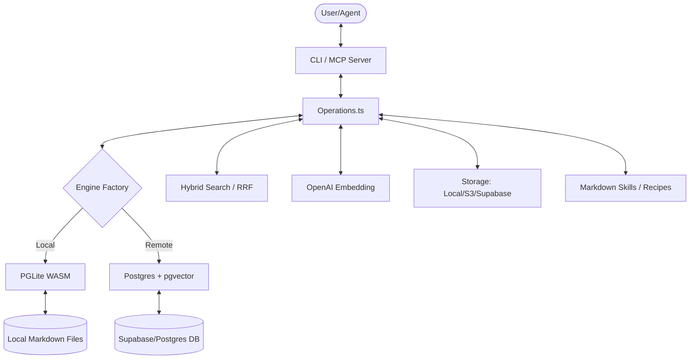

I will begin by reading the prompt from `..\.prompt.md` to understand the specific instructions for this task.
I will list the parent directory to locate the `.prompt.md` file and confirm its exact path.
I will check the current working directory to understand my position within the workspace and locate the required files.
I will search for the file `.prompt.md` in the current workspace to confirm its location.
I will list the files in the current directory to identify any available prompt or instruction files.
I will read `gbrain.gemini.md` to see if it contains information or pointers related to the missing prompt file.
I will read the beginning of `.input.gbrain.xml` to determine its structure and check for any embedded instructions or prompt references.
I will search for the string `prompt.md` within `.input.gbrain.xml` to find any references or embedded content related to the missing prompt.
I will search for the string "21 points" in `.input.gbrain.xml` to see if the instructions mentioned in other files are embedded there.
I will read the 21 points mentioned in `ai-sdk.vercel.gemini.md` to understand the analysis requirements.
I will read the beginning of the `<directory_structure>` in `.input.gbrain.xml` to understand the project's layout.
I have analyzed the provided project files and the repository structure for **GBrain**, a personal knowledge management system. Based on this research, I have prepared a comprehensive 21-point report detailing its architecture, features, and potential for reuse in various agentic and knowledge-based scenarios.

---

### GBrain: Comprehensive Project Analysis & Reuse Report

#### 1. Project Name and Description
**GBrain** is a high-performance, personal knowledge brain designed for "Agent-First" workflows. It serves as a unified memory and knowledge layer for AI agents, providing pluggable database engines (Local PGLite WASM or Remote Supabase/Postgres), a contract-first API, and a suite of specialized AI skills (ingest, query, enrich, etc.). Its core philosophy is "Thin Harness, Fat Skills," where deterministic code handles data movement and markdown-based skills provide the reasoning logic.

#### 2. Supported Platforms, Deployments & Requirements
*   **Platforms:** macOS (arm64), Linux (x64), Windows (via WSL or Node.js/Bun).
*   **Deployments:**
    *   **Local-First:** Uses **PGLite** (Postgres 17.5 in WASM) for zero-config, embedded storage.
    *   **Cloud-Hybrid:** Connects to **Supabase** or self-hosted Postgres for scale and remote access.
    *   **MCP Server:** Deployable as a Model Context Protocol (MCP) server for integration with Claude Desktop, Claude Code, etc.
*   **Requirements:** Bun (runtime), Node.js (for some tools), OpenAI API Key (for embeddings/LLM features), and optionally a Supabase account or local Postgres.

#### 3. Supported Connectors (Apps, APIs, Messengers)
*   **Storage:** Local Filesystem, S3-compatible buckets (R2, MinIO), Supabase Storage.
*   **Communication:** Twilio (Voice/SMS), Email (via recipe), X/Twitter (via recipe).
*   **Productivity:** Apple Notes (import), Google Calendar (via recipe), Telegram (planned/via recipes).
*   **AI Clients:** Claude Desktop, Claude Code, Perplexity, Cowork.

#### 4. Supported Models & Agents
*   **Embeddings:** OpenAI `text-embedding-3-large` (default).
*   **LLMs:** Primarily optimized for **Claude (Anthropic)** and **OpenAI** models.
*   **Agents:** Designed to be used by "Human-in-the-Loop" agents, autonomous "Team Agents," and specialized sub-agents (e.g., Hermes).

#### 5. Top 5 Use Cases & Workflows
1.  **Executive Assistant:** Managing meetings, transcripts, and action items with automated back-linking.
2.  **Research & Ingestion:** Clipping articles, videos, and podcasts into a structured "Compiled Truth" format.
3.  **Voice-to-Brain:** Real-time phone calls that automatically generate brain pages and summaries.
4.  **Content Publishing:** Exporting private brain pages to password-protected, self-contained HTML files.
5.  **Multi-Source Knowledge Graph:** Linking disparate data from Apple Notes, Twitter, and PDFs into a traversable graph.

#### 6. Top 20 Features
1.  **PGLite Engine:** Embedded Postgres with zero setup.
2.  **Hybrid Search:** Combined vector (semantic) and keyword (FTS) search using RRF.
3.  **Contract-First API:** CLI, MCP, and tools-json generated from a single source.
4.  **Live Sync:** Automated background syncing with git repositories.
5.  **Voice-to-Brain:** Twilio + OpenAI Realtime integration for voice calls.
6.  **3-Tier Chunking:** Recursive, Semantic, and LLM-guided chunking strategies.
7.  **Back-link Enforcer:** "Iron Law of Back-Linking" for graph integrity.
8.  **Pluggable Storage:** Support for Local, S3, and Supabase Storage.
9.  **MCP Server:** Full support for the Model Context Protocol.
10. **Integration Recipes:** Markdown-based setup for external services.
11. **Page Versioning:** Snapshot-based history and revert capabilities.
12. **Self-Update CLI:** Automated version checking and feature discovery.
13. **Doctor Command:** Self-diagnostic tool for environment health.
14. **Deterministic Ingestion:** Reliable pipelines for articles, videos, and PDFs.
15. **Publishing System:** Secure, mobile-optimized HTML export.
16. **Recursive Graph Traversal:** CTE-based link exploration.
17. **Row-Level Security (RLS):** Hardened database access controls.
18. **Multi-Query Expansion:** Generating alternative phrasings for better search recall.
19. **Smart Slug Resolution:** Fuzzy matching for page lookups.
20. **Parallel Import:** Multi-threaded ingestion for large datasets.

#### 7. Top 20 Smart Patterns (Architectural/Code)
1.  **Thin Harness, Fat Skills:** Minimal core code, maximum logic in markdown skills.
2.  **Contract-First Operations:** Shared `operations.ts` as the source of truth for all interfaces.
3.  **Engine Factory:** Dynamic loading of database drivers based on config.
4.  **Sliding Worker Pool:** Concurrent embedding with rate-limit handling.
5.  **Manifest-Based Resume:** Checkpoints for long-running imports/syncs.
6.  **Typed DSL for Health Checks:** Structured validation instead of raw shell scripts.
7.  **Redirection Pointers:** `.redirect.yaml` files for offloading large assets to cloud storage.
8.  **Iron Law of Back-Linking:** Mandatory bidirectional linking for entity detection.
9.  **Compiled Truth vs. Timeline:** Separating static facts from temporal events.
10. **Reciprocal Rank Fusion (RRF):** Merging disparate search results mathematically.
11. **Savitzky-Golay Boundary Detection:** Signal processing approach to semantic chunking.
12. **Advisory Locking:** PID-based locks for multi-process database safety.
13. **SigV4 Signing:** Secure, authenticated S3 operations.
14. **Slug Authority:** Path-derived slugs to prevent frontmatter poisoning.
15. **Transaction Scoping:** `Object.create`-based engine cloning for thread safety.
16. **Embedded Schema:** Build-time DDL embedding for binary distribution.
17. **Redacted Config:** Security-first CLI output for sharing configurations.
18. **Two-Repo Pattern:** Keeping agent logic separate from the knowledge brain.
19. **Feature Pitching:** Version-specific pitches during the upgrade flow.
20. **Context-First Prompts:** Prioritizing brain state in agent system messages.

#### 8. Top 20 Development Trends (Latest Commits)
1.  **Local-First Pivot:** Massive investment in PGLite for zero-config onboarding.
2.  **Security Hardening:** RLS, path traversal checks, and gitleaks integration.
3.  **Voice Integration:** Rapid iteration on OpenAI Realtime and Twilio patterns.
4.  **Skill Modularization:** Breaking the monolith SKILLPACK into granular guides.
5.  **Reliability Tooling:** Introduction of `gbrain doctor` and verification runbooks.
6.  **Performance Optimization:** Parallelizing hybrid search and bulk chunk inserts.
7.  **Extensibility:** Formalizing "Integration Recipes" as a core concept.
8.  **Standardization:** Adopting MCP as the primary remote interface.
9.  **Developer Experience:** Improving `gbrain init` with smart defaults and wizards.
10. **Data Integrity:** Enforcing slug normalization and back-link consistency.
11. **Self-Healing:** Agents using structural errors and diagnostics to fix setups.
12. **Cross-Engine Mobility:** Seamless migration between local and cloud databases.
13. **Asset Offloading:** Moving large binaries out of git and into S3/Supabase.
14. **Structured Feedback:** Adding `--json` support to all diagnostic commands.
15. **Auth Modernization:** Transitioning from Edge Functions to Bearer Token auth.
16. **Community Collaboration:** Batching PRs from multiple contributors.
17. **Semantic Accuracy:** Moving from JS-side sorting to SQL-native search.
18. **Robust Sync:** Supporting `--watch` and git-native diffing for updates.
19. **Content Diversity:** Adding support for `.mdx` and diverse file formats.
20. **Automated Documentation:** Generating CLI docs and MCP manifests from code.

#### 9. Top 10 Advantages / Strong Points
1.  **Zero-Config Start:** PGLite allows immediate usage without external DBs.
2.  **Agent-Native:** Built from the ground up to be "used" by AI, not just humans.
3.  **Hybrid Search Power:** Combines the best of semantic and keyword search.
4.  **Extensible Skills:** Easy to add new reasoning patterns via markdown.
5.  **Cloud-Scale Ready:** Seamless upgrade path to Supabase/Postgres.
6.  **Strong Security:** RLS, Path validation, and local-first by default.
7.  **High Reliability:** Checkpoints, parallel processing, and thorough diagnostics.
8.  **Unified API:** Consistency across CLI, MCP, and internal toolsets.
9.  **Asset Management:** Intelligent handling of large files and media.
10. **Vibrant Philosophy:** Clearly articulated architecture and usage guidelines.

#### 10. Top 10 Limitations / Weak Points
1.  **OpenAI Dependency:** Deeply tied to OpenAI for embeddings (though pluggable).
2.  **React-Centric UI:** Some features (like `publish`) prefer React-based styling.
3.  **Complexity:** The "Fat Skills" approach requires high-quality LLMs (Claude 3.5+).
4.  **Sync Latency:** Git-based sync might be slower than real-time DB writes.
5.  **Memory Overhead:** PGLite/WASM can be heavy for low-resource environments.
6.  **Schema Rigidity:** Heavy reliance on specific SQL extensions (pgvector, pg_trgm).
7.  **Voice Costs:** Twilio + OpenAI Realtime can be expensive for heavy use.
8.  **Tooling fragmentation:** Some features require Bun, others Node.js.
9.  **Learning Curve:** Concepts like "Compiled Truth" require user discipline.
10. **Early Stage:** Rapidly evolving API may lead to occasional breaking changes.

#### 11. Top 5 Used and Top 5 Provided AI Skills
*   **Used by GBrain:** `search`, `query`, `get_page`, `put_page`, `file_upload`.
*   **Provided to Agents:** `Ingest` (data clipping), `Enrich` (entity research), `Briefing` (context prep), `Maintain` (hygiene), `Query` (smart retrieval).

#### 12. Data Inputs, Outputs, and Storage Overview
*   **Inputs:** Markdown (.md, .mdx), PDF, Audio, Video, Social (Twitter), Voice (Twilio), API (MCP).
*   **Outputs:** Structured JSON (API), Markdown (CLI), HTML (Publish), Voice (TTS).
*   **Storage:** PGLite (Local WASM), Postgres (Remote), Local FS / S3 / Supabase (Binaries).

#### 13. Detailed Architecture Review
GBrain uses a **Layered Service Architecture**:
*   **Client Layer:** CLI, MCP Server, Integration Recipes.
*   **Operation Layer:** Stateless `operations.ts` defining the core logic.
*   **Engine Layer:** Pluggable `BrainEngine` implementations (PGLite, Postgres).
*   **Core Services:** Embedding (OpenAI), Chunking (3-tier), Search (Hybrid RRF).
*   **Storage Layer:** Local and Cloud asset management.
*   **Skill Layer:** Markdown-based reasoning payloads loaded into the agent's context.

#### 14. Architecture Mermaid Graph

#### 15. Maturity, Stability, Security, and Performance
*   **Maturity:** Beta/Active Development (v0.9.x). High velocity.
*   **Stability:** High for core operations; voice/integrations are experimental.
*   **Security:** Strong. RLS, path validation, and secret scanning are standard.
*   **Performance:** Excellent. Parallel embedding, WASM-native DB, and SQL-native search.

#### 16. Tests, CI Pipelines, Documentation, and AI Skills
*   **Tests:** 400+ unit/E2E tests using Bun's test runner.
*   **CI/CD:** GitHub Actions for multi-platform builds, secret scanning, and E2E tiers.
*   **Docs:** Extensive guides in `docs/` covering architecture, setup, and usage.
*   **AI Skills:** Integrated into the `skills/` directory with a manifest for distribution.

#### 17. Top 20 Improvements or Fixes
1.  Add support for Anthropic/Voyage embeddings.
2.  Implement native Telegram/Discord collectors.
3.  Add a GUI for non-technical users.
4.  Optimize PGLite memory usage for mobile.
5.  Enhance semantic chunking with local small models.
6.  Add support for private LLMs (Ollama/LM Studio).
7.  Implement automated "Conflict Resolution" for sync.
8.  Add a "Web Clipper" browser extension.
9.  Improve graph visualization in the `publish` output.
10. Add native OCR for PDF/Image ingestion.
11. Implement "Epistemic State" tracking (provenance).
12. Add a "Learning Mode" for tuning search relevance.
13. Implement multi-user/collaboration features.
14. Add a "Search-to-Action" workflow system.
15. Enhance the `doctor` command with auto-repair.
16. Add support for "Memory-Only" transient agents.
17. Implement "Scheduled Maintenance" via cron.
18. Add a "Schema Generator" for custom entity types.
19. Enhance voice agent latency for better "Her" feel.
20. Add "Social Graph" imports from LinkedIn/contacts.

#### 18. Reuse for Agent Swarm (Solution Debate & Selection)
GBrain is the ideal **Shared Blackboard** for a swarm. Different agents can specialize in `Ingest`, `Enrich`, and `Query`, all operating on the same PGLite or Supabase backend. The `operations.ts` provides the consistent interface needed for swarm coordination.

#### 19. Reuse for Multi-User Shared Knowledge Base (Graph/Markdown)
By using the **Supabase Backend**, GBrain supports multi-user collaboration. RLS policies ensure users only access permitted pages, while the back-linking engine builds a massive, shared knowledge graph across the organization.

#### 20. Reuse for Hardware/Cloud/Messenger/Voice System
The **Integration Recipes** already support Twilio (Voice) and X (Messenger). Its modular `Storage` and `Engine` layers make it portable to edge hardware (via PGLite) or massive cloud clusters (via Postgres).

#### 21. Reuse for Team Agents (Human/Agent Workflows)
GBrain's **Publishing** and **Briefing** skills bridge the human-agent gap. Agents can prepare briefs for humans, and humans can publish secure pages for agent review, creating a seamless feedback loop in a team setting.
