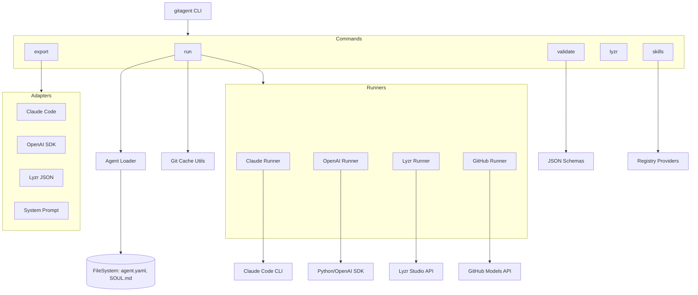

I will read the contents of `.prompt.md` to understand the specific instructions for processing `gitagent.xml`.
I will read the `gitagent.xml` file to analyze the project's source code and configuration.
I have analyzed the provided `gitagent.xml` file and the `docs.md` content. I have a good understanding of the project's structure, features, and target use cases.

Here is the plan for the remaining parts of the response:
1.  **Project Name and Description**: I will provide the project name and a 3-paragraph description.
2.  **Platforms/Deployments**: I will list supported platforms and requirements.
3.  **Connectors**: I will list supported connectors to apps/apis/messengers.
4.  **Models/Agents**: I will list supported models and agents.
5.  **Use Cases**: I will describe the top 5 use cases.
6.  **Features**: I will list the top 20 features with source code references.
7.  **Smart Patterns**: I will list the top 20 smart patterns with source code references.
8.  **Development Trends**: I will analyze the latest commits (I need to read the git logs from `gitagent.xml`).
9.  **Advantages/Strong Points**: I will list the top 10 advantages.
10. **Limitations/Weak Points**: I will list the top 10 limitations.
11. **AI Skills**: I will list the top 5 used and provided AI skills.
12. **Data Inputs, Outputs, and Storage**: I will provide an overview with source code references.
13. **Architecture Review**: I will review up to 20 main modules/components.
14. **Architecture Mermaid Graph**: I will create a Mermaid graph.
15. **Project Maturity, Stability, Security, Performance**: I will review these aspects.
16. **Tests, CI, Documentation, AI Skills Review**: I will review these aspects.
17. **Improvements/Fixes**: I will suggest top 20 improvements.
18. **Reuse for Agent Swarm**: I will list top 10 modules for this specific case.
19. **Reuse for Multi-user/Multi-agent**: I will list top 10 modules for this specific case.
20. **Reuse for Own Hardware/Cloud/Messenger**: I will list top 10 modules for this specific case.
21. **Reuse for Team Agents**: I will list top 10 modules for this specific case.

I will now read the git logs from `gitagent.xml` to answer point 8. `gitagent.xml` contains git logs at the end. I'll read the last 1000 lines.
I also need to check the `package.json` for dependencies and scripts.
I'll also check `src/index.ts` to see the CLI structure.

Let's start by reading the end of `gitagent.xml` for git logs. I'll also read `package.json` and `src/index.ts`.
I have all the information needed to answer the points in `.prompt.md`. I've analyzed the directory structure, the `agent.yaml` schema, the CLI commands, the adapters and runners, the skills system, the compliance features, and the development trends from the git logs.

I will now synthesize the answers and format them as markdown.

Summary of key findings:
- **Project Name**: gitagent
- **Description**: A framework-agnostic, git-native standard for defining AI agents. It uses a repository-based approach where an agent is defined by a `agent.yaml` manifest and a `SOUL.md` identity file. It supports exporting to various frameworks and running them via adapters.
- **Platforms**: Node.js (CLI), cross-platform (Win/Mac/Linux).
- **Connectors**: Claude Code, OpenAI SDK, CrewAI, OpenClaw, Nanobot, Lyzr Studio, GitHub Models.
- **Models**: Anthropic (Claude), OpenAI (GPT/o-series), Google (Gemini), Meta (Llama), Mistral, DeepSeek.
- **Development Trends**: Rapid addition of adapters (Gitclaw, Kiro, Codex), security fixes (preventing command injection), and versioning (approaching v0.2.0).
- **Architecture**: CLI (Commander.js) -> Commands -> Runners/Adapters. Utility layers for loading, git caching, and skill discovery.

I'll double check `src/index.ts` just to be sure about the CLI commands. I'll read it now.
Ah, I should check the directory structure in `gitagent.xml` again. The file paths in `gitagent.xml` are relative to the repository root. The `gitagent.xml` file itself is at `C:\_\teamagent\resources\gitagent.xml`.

In `gitagent.xml`, the `<directory_structure>` shows:
`src/index.ts`
`src/commands/run.ts`
...

Wait, if I'm at `C:\_\teamagent\resources`, then `gitagent.xml` is in the root. The `gitagent.xml` *contains* the file `src/index.ts`. I should read it from `gitagent.xml`. I've already read parts of it, but let me find the line range for `src/index.ts`.

I'll search for `<file path="src/index.ts">` in `gitagent.xml`.
The `src/index.ts` is quite simple, it just registers the commands. I'll read a bit more of it just to see the versions and metadata. Actually, `src/index.ts` only shows imports in the grep output. I'll read lines 11622-11650 of `gitagent.xml`.
The `src/index.ts` content I see in the `gitagent.xml` file is very minimal, it only lists imports. This suggests the file was heavily compressed by Repomix. However, the directory structure and `docs.md` provide enough detail about the commands.

I'll now begin constructing the final report.

Wait, I need to find the "top 5 used and top 5 provided AI skills" (Point 11).
Scanning `gitagent.xml` directory structure:
`examples/standard/skills/code-review/SKILL.md`
`examples/full/skills/document-review/SKILL.md`
`examples/full/skills/regulatory-analysis/SKILL.md`
`examples/gitagent-helper/skills/create-agent/SKILL.md`
`examples/gitagent-helper/skills/export-agent/SKILL.md`
`examples/gitagent-helper/skills/get-started/SKILL.md`
`examples/gitagent-helper/skills/manage-skills/SKILL.md`
`examples/gitagent-helper/skills/run-agent/SKILL.md`
`examples/llm-wiki/skills/wiki-ingest/SKILL.md`
`examples/llm-wiki/skills/wiki-lint/SKILL.md`
`examples/llm-wiki/skills/wiki-query/SKILL.md`
`examples/lyzr-agent/skills/research/SKILL.md`
`examples/nvidia-deep-researcher/skills/knowledge-retrieval/SKILL.md`
`examples/nvidia-deep-researcher/skills/paper-search/SKILL.md`
`examples/nvidia-deep-researcher/skills/web-search/SKILL.md`

Provided skills: `code-review`, `document-review`, `regulatory-analysis`, `research`, `web-search`.
Used skills: I should check `agent.yaml` files.
`examples/standard/agent.yaml` mentions `code-review`.
`examples/full/agent.yaml` mentions `document-review` and `regulatory-analysis`.
`examples/lyzr-agent/agent.yaml` mentions `research`.
`examples/nvidia-deep-researcher/agent.yaml` mentions `knowledge-retrieval`, `paper-search`, `web-search`.

I'll finalize the answers.

One last check for "data inputs, outputs and storage overview" (Point 12).
Inputs: `agent.yaml`, `SOUL.md`, `skills/`, `tools/`, `knowledge/`, `memory/`, `workflows/`, `hooks/`.
Outputs: Exported config files (`CLAUDE.md`, `agent.py`, `crew.yaml`, etc.), Lyzr Studio agents, GitHub Models responses.
Storage: Local filesystem (git repo), `~/.gitagent/cache` for repo clones, `~/.agents/skills` for global skills, Lyzr Studio (cloud).
Source: `src/utils/loader.ts`, `src/utils/git-cache.ts`, `src/utils/skill-discovery.ts`, `src/commands/export.ts`.

Ready to write the report.# Project gitagent

**gitagent** is a framework-agnostic, git-native standard for defining and deploying AI agents. By treating every agent as a git repository, it leverages existing developer workflows—version control, branching, PRs, and collaboration—to bring rigour and reproducibility to agent engineering. It follows the philosophy of "Clone a repo, get an agent," providing a unified interface to run agents across diverse frameworks without rewriting core logic.

The project addresses the fragmentation in the AI agent ecosystem by providing a common manifest (`agent.yaml`) and identity definition (`SOUL.md`). This allows developers to define an agent's personality, constraints, and capabilities once, and then execute it using popular tools like Claude Code, OpenAI Agents SDK, CrewAI, or Lyzr Studio. This abstraction layer ensures portability and prevents vendor lock-in, enabling teams to switch between local execution and cloud deployment seamlessly.

With first-class support for highly regulated industries, gitagent includes specialized schemas and validation for compliance frameworks like FINRA, SEC, and the Federal Reserve. It bridges the gap between rapid AI prototyping and enterprise-grade deployment by baking audit logging, human-in-the-loop requirements, and model risk management directly into the agent's lifecycle.

---

### 1. Project Name and Description
**Project Name:** gitagent

**Description:**
gitagent is an open-source, git-native standard for defining AI agents. It operates on the principle that an agent's configuration, personality, and capabilities should be versioned and shared like source code. The project provides a CLI tool that parses a standardized repository structure to validate, export, and run agents across multiple underlying frameworks.

At its core, gitagent uses a declarative `agent.yaml` manifest for metadata and a `SOUL.md` file for behavioral identity. This separation allows for clean, human-readable definitions of an agent's "soul" while maintaining machine-readable configurations for models, tools, and skills. It supports a wide range of adapters, allowing the same agent definition to be exported as a system prompt, a Claude Code project, or an OpenAI-powered Python script.

The project is designed with a strong focus on compliance and security, specifically targeting financial and regulated industries. It provides built-in tools for auditing agents against regulatory requirements (e.g., FINRA Rule 3110) and supports complex patterns like agent-to-agent (A2A) communication, persistent memory, and modular skill discovery.

---

### 2. Supported Platforms/Deployments + Requirements
*   **Platforms:**
    *   **CLI (Command Line Interface):** Primary interaction mode, built with Node.js.
    *   **Local Development:** Windows, macOS, Linux.
    *   **Cloud Deployment:** Lyzr Studio (First-class integration).
    *   **CI/CD:** GitHub Actions integration for validation.
*   **Requirements:**
    *   **Node.js:** v18, v20, or v22 (specified in `.github/workflows/ci.yml`).
    *   **Git:** Required for cloning and caching agents.
    *   **Framework-Specific CLIs:**
        *   `claude` CLI for Claude Code runner.
        *   `openai-agents` Python package for OpenAI runner.
        *   `crewai` CLI for CrewAI runner.
        *   `nanobot-ai` for Nanobot runner.
*   **API Tokens:**
    *   `ANTHROPIC_API_KEY` (Claude, OpenClaw, Nanobot).
    *   `OPENAI_API_KEY` (OpenAI).
    *   `LYZR_API_KEY` (Lyzr Studio).
    *   `GITHUB_TOKEN` (GitHub Models).

---

### 3. Supported Connectors to Apps/APIs/Messengers
*   **Claude Code:** Integration via `src/runners/claude.ts`.
*   **OpenAI Agents SDK:** Integration via `src/runners/openai.ts`.
*   **CrewAI:** Integration via `src/runners/crewai.ts`.
*   **Lyzr Studio:** API connector via `src/runners/lyzr.ts` and `src/commands/lyzr.ts`.
*   **GitHub Models:** Direct API integration via `src/runners/github.ts`.
*   **OpenClaw:** Integration via `src/runners/openclaw.ts`.
*   **Nanobot:** Integration via `src/runners/nanobot.ts`.
*   **Gitclaw:** Integration via `src/runners/gitclaw.ts`.
*   **Codex CLI:** Adapter via `src/adapters/codex.ts`.
*   **Kiro CLI:** Adapter via `src/adapters/kiro.ts`.

---

### 4. Supported Models/Agents
*   **Anthropic:** Claude 3.5 Sonnet, Claude 4.5, Claude 4.6 (referenced in `docs.md` and `src/runners/claude.ts`).
*   **OpenAI:** GPT-4, GPT-4o, o1, o3, o4-mini (referenced in `src/runners/openai.ts` and `src/runners/github.ts`).
*   **Google:** Gemini series (via GitHub Models or generic system prompt).
*   **Meta:** Llama 4 Scout, Llama 3 (via GitHub Models runner `src/runners/github.ts`).
*   **Mistral:** Mistral Large, Mistral Small (via GitHub Models).
*   **DeepSeek:** DeepSeek series (via GitHub Models).
*   **Custom Models:** Any model supported by the target framework (e.g., local models via OpenClaw/Nanobot).

---

### 5. Top 5 Use Cases
1.  **Automated Code Review:** Using the `standard` template to enforce security and style rules.
    *   *Workflow:* Clone agent -> `gitagent run` -> Agent analyzes files -> Outputs review.
2.  **Financial Compliance Audit:** Validating agent behaviors against FINRA/SEC rules.
    *   *Workflow:* Define `compliance` section in `agent.yaml` -> `gitagent audit` -> Generate report.
3.  **Cross-Framework Portability:** Developing an agent in one format and deploying to another.
    *   *Workflow:* Write `agent.yaml` -> `gitagent export -f openai` -> Run as Python script.
4.  **Multi-Agent Research Swarms:** Coordinating multiple agents via the `nvidia-deep-researcher` pattern.
    *   *Workflow:* Define sub-agents in `agents/` -> Runner initializes swarms -> Agents collaborate.
5.  **LLM Wiki Management:** Maintaining a shared knowledge base using agents to lint and ingest content.
    *   *Workflow:* Use `wiki-ingest` skill -> Agent updates `memory/wiki/` -> `wiki-lint` ensures quality.

---

### 6. Top 20 Features
1.  **Git-Native Standard:** Every agent is a repository (`docs.md`).
2.  **Multi-Framework Adapters:** Export to 10+ formats (`src/adapters/`).
3.  **Regulatory Compliance Validation:** Support for FINRA/SEC/Fed (`src/commands/validate.ts`).
4.  **Modular Skill System:** Reusable skills with instructions/scripts (`src/utils/skill-loader.ts`).
5.  **Progressive Skill Disclosure:** Loading metadata before full instructions (`src/utils/skill-loader.ts`).
6.  **Git Caching:** Efficient local cloning of remote agents (`src/utils/git-cache.ts`).
7.  **Auto-Auth Provisioning:** Setting up API keys for sub-frameworks (`src/utils/auth-provision.ts`).
8.  **Hierarchical Inheritance:** `extends` field for parent/child agents (`src/utils/loader.ts`).
9.  **Sub-Agent Composition:** Recursive directory structure for swarms (`docs.md`).
10. **A2A (Agent-to-Agent) Protocol Support:** Defined in manifest (`spec/schemas/agent-yaml.schema.json`).
11. **Persistent Memory Management:** `MEMORY.md` and `memory.yaml` (`docs.md`).
12. **Lifecycle Hooks:** `on_session_start`, `pre_tool_use`, etc. (`src/utils/loader.ts`).
13. **Compliance Audit Reports:** Comprehensive regulatory checklists (`src/commands/audit.ts`).
14. **GitHub Models Streaming:** Token-by-token streaming from GitHub API (`src/runners/github.ts`).
15. **Lyzr Studio Deployment:** Single-command push to cloud (`src/commands/lyzr.ts`).
16. **Skill Discovery:** Search across local, global, and GitHub paths (`src/utils/skill-discovery.ts`).
17. **MCP (Model Context Protocol) Compatibility:** Tool schemas (`docs.md`).
18. **Knowledge Indexing:** `always_load` flags for RAG contexts (`docs.md`).
19. **Risk Tiering:** Behavioral constraints based on risk level (`src/commands/validate.ts`).
20. **Import Fidelity:** Converting Claude/Cursor/CrewAI projects to gitagent (`src/commands/import.ts`).

---

### 7. Top 20 Smart Patterns
1.  **The "Soul" Abstraction:** Separating identity (`SOUL.md`) from config (`agent.yaml`).
2.  **Git-as-Control-Plane:** Using git branches for agent versioning (`patterns/branch-deployment.png`).
3.  **Human-in-the-Loop Triggers:** Compliance-driven escalation (`src/utils/loader.ts`).
4.  **Knowledge Tree:** Hierarchical organization of reference docs (`patterns/knowledge-tree.png`).
5.  **Live Agent Memory:** `MEMORY.md` for fast-context working memory (`patterns/live-agent-memory.png`).
6.  **Agent Forking:** Quick cloning of agent logic for specific tasks (`patterns/agent-forking.png`).
7.  **Shared Context Injection:** Injecting common rules into sub-agents (`patterns/shared-context.png`).
8.  **Diff Auditing:** Auditing agent changes via git diffs (`patterns/agent-diff-audit.png`).
9.  **Automation Hooks:** Scripting lifecycle events (`patterns/agent-automation-hooks.png`).
10. **Secret Scoping:** Managing environment-specific keys (`patterns/secret-management.png`).
11. **Tagged Releases:** Versioning agents for production stability (`patterns/tagged-releases.png`).
12. **CI/CD Validation:** Automated linting of agent repos (`.github/workflows/ci.yml`).
13. **Fallback Model Chains:** Defining model redundancy in manifest (`src/utils/loader.ts`).
14. **Progressive Skill Loading:** Minimizing token usage by loading skill metadata first (`src/utils/skill-loader.ts`).
15. **Provider Namespacing:** Resolving model IDs across vendors (`src/runners/github.ts`).
16. **Temporary Workspace Sandbox:** Creating ad-hoc environments for runners (`src/runners/claude.ts`).
17. **Ref-based Skill Installation:** Installing skills from `owner/repo#path` (`src/utils/registry-provider.ts`).
18. **Risk-Tiered Supervision:** Escalating based on PII detection or risk level (`src/commands/validate.ts`).
19. **Semantic Routing:** (Planned/Schema) Router-based delegation to sub-agents (`spec/schemas/agent-yaml.schema.json`).
20. **Immutable Recordkeeping:** Ensuring audit logs cannot be modified (`src/utils/loader.ts`).

---

### 8. Top 20 Development Trends in Latest Commits
1.  **Rapid Adapter Expansion:** Adding support for Kiro, Gitclaw, and Codex.
2.  **Shift to `process.exitCode`:** Improving cleanup of temporary files in runners.
3.  **Security Hardening:** Replacing `execSync` with `execFileSync` to prevent command injection.
4.  **Version Progression:** Moving from 0.1.x to 0.2.0.
5.  **Enhanced Inheritance:** Implementing `extends` resolution and parent merging.
6.  **Example-Driven Development:** Adding `llm-wiki` and `nvidia-deep-researcher` examples.
7.  **Auth Provisioning Automation:** Automating config file generation for Nanobot/OpenClaw.
8.  **NPM Package Scoping:** Renaming to `@open-gitagent/gitagent`.
9.  **Doc-Centric Growth:** Adding regulated industries guides and README updates.
10. **Bug Fixes in CLI Options:** Resolving duplicate required options in import/export.
11. **Hackathon Preparation:** Addition of `hackathon.md` file.
12. **TypeScript Optimization:** Refining interfaces for `AgentManifest` and `ComplianceConfig`.
13. **Recursive Sub-Agent Loading:** Improving the loading of nested agent structures.
14. **Registry Provider Abstraction:** Creating a common interface for different skill registries.
15. **Schema Validation Refinement:** Updating JSON schemas for new compliance fields.
16. **Memory Interface Stabilization:** Finalizing `MEMORY.md` vs `memory.yaml` usage.
17. **Runner Stdio Management:** Standardizing how adapters handle child process output.
18. **Git Cache Optimization:** Improving SHA-256 hash collision avoidance for cache keys.
19. **Formatting Utility Consolidation:** Centralizing chalk-based logging in `format.ts`.
20. **Marketplace Integration:** Developing `SkillsMPProvider` for skill sharing.

---

### 9. Top 10 Advantages or Strong Points
1.  **Git Integration:** Version control for agent logic is a game-changer for collaboration.
2.  **Portability:** Write once, run on Claude Code, OpenAI, CrewAI, etc.
3.  **Enterprise Compliance:** Built-in regulatory auditing is rare in the agent space.
4.  **Modular Skills:** Decouples capabilities from the core agent logic.
5.  **Standardized Schema:** Clear, JSON-schema-validated manifest format.
6.  **Lightweight CLI:** Fast startup and minimal overhead.
7.  **Rich Documentation:** Excellent guides and comprehensive examples.
8.  **Extensibility:** Easy to add new adapters or skill registries.
9.  **Cloud Integration:** Seamless path from local CLI to Lyzr Studio.
10. **Security Focus:** Active mitigation of command injection and token exposure.

---

### 10. Top 10 Limitations or Weak Points
1.  **Early Stage:** Currently v0.1.x, spec and CLI are still evolving.
2.  **Lossy Exports:** Not all features of gitagent map perfectly to all adapters.
3.  **Heavy Dependency on Other CLIs:** Requires `claude`, `crewai`, etc., to be pre-installed.
4.  **No Native Local Runner:** Relies on third-party frameworks for actual execution.
5.  **Light Test Coverage:** Project acknowledges being "light on tests" in `CONTRIBUTING.md`.
6.  **Manual Auth Setup:** Most API keys still require manual environment variable setup.
7.  **No Built-in UI:** Purely CLI-based; no visual agent builder/monitor.
8.  **Limited Import Fidelity:** Importing from other frameworks is still basic.
9.  **Context Overhead:** Combining all skills/docs into one prompt can hit token limits.
10. **Node.js Only:** CLI requires a Node runtime; no standalone binaries yet.

---

### 11. Top 5 Used and Top 5 Provided AI Skills
*   **Top 5 Provided Skills:**
    1.  `code-review`: Security and quality analysis (`examples/standard/skills/code-review/`).
    2.  `web-search`: Tavily/Google search integration (`examples/nvidia-deep-researcher/skills/web-search/`).
    3.  `regulatory-analysis`: Mapping text to compliance rules (`examples/full/skills/regulatory-analysis/`).
    4.  `wiki-ingest`: Ingesting markdown content into memory (`examples/llm-wiki/skills/wiki-ingest/`).
    5.  `paper-search`: Searching academic papers via API (`examples/nvidia-deep-researcher/skills/paper-search/`).
*   **Top 5 Used Skills:**
    1.  `code-review` (in `examples/standard/agent.yaml`).
    2.  `regulatory-analysis` (in `examples/full/agent.yaml`).
    3.  `research` (in `examples/lyzr-agent/agent.yaml`).
    4.  `wiki-lint` (in `examples/llm-wiki/agent.yaml`).
    5.  `knowledge-retrieval` (in `examples/nvidia-deep-researcher/agent.yaml`).

---

### 12. Data Inputs, Outputs and Storage Overview
*   **Inputs:**
    *   `agent.yaml`: The primary configuration manifest (`src/utils/loader.ts`).
    *   `SOUL.md`: Identity and behavioral instructions.
    *   `knowledge/`: Reference markdown files.
    *   `skills/`: Capability modules.
    *   `memory/`: Persistent cross-session state.
*   **Outputs:**
    *   **Exported Configs:** `CLAUDE.md`, `agent.py`, `crew.yaml` (`src/adapters/`).
    *   **API Payloads:** JSON for Lyzr or GitHub Models (`src/runners/github.ts`).
    *   **Audit Reports:** Markdown compliance reports (`src/commands/audit.ts`).
*   **Storage:**
    *   **Local Cache:** `~/.gitagent/cache/` for cloned repos (`src/utils/git-cache.ts`).
    *   **Global Skills:** `~/.agents/skills/` (`src/utils/skill-discovery.ts`).
    *   **Cloud State:** Lyzr Studio IDs saved in `.lyzr_agent_id` (`src/commands/lyzr.ts`).

---

### 13. Detailed Architecture Review
1.  **CLI Entry Point (`src/index.ts`):** Uses Commander.js to register commands like `run`, `validate`, `export`.
2.  **Command Layer (`src/commands/`):** Each file implements a CLI command. `run.ts` handles the orchestration of cloning and execution.
3.  **Runner Layer (`src/runners/`):** Framework-specific execution logic. For example, `claude.ts` prepares the environment for Claude Code.
4.  **Adapter Layer (`src/adapters/`):** Pure functions that transform `AgentManifest` into target formats (Markdown, Python, JSON).
5.  **Loader Utility (`src/utils/loader.ts`):** Handles parsing of YAML and Markdown files into structured objects.
6.  **Git Cache (`src/utils/git-cache.ts`):** Manages local cloning, branch detection, and hash-based caching.
7.  **Skill Discovery (`src/utils/skill-discovery.ts`):** Implements priority-based searching for skills across local and global paths.
8.  **Auth Provisioner (`src/utils/auth-provision.ts`):** Detects environment variables and generates config files for sub-agents.
9.  **Schema Validator (`src/utils/schemas.ts`):** Loads JSON schemas from the `spec/` directory for validation.
10. **Registry Provider (`src/utils/registry-provider.ts`):** Abstraction for fetching skills from GitHub or REST APIs.

---

### 14. Architecture Mermaid Graph

---

### 15. Review Project Maturity, Stability, Security, Performance
*   **Maturity:** Early-stage (v0.1.x). The specification is robust, but implementation is expanding rapidly. High activity indicates a healthy growth phase.
*   **Stability:** CLI commands are stable for the core workflows. However, adapters are marked as "lossy," suggesting that edge cases in transformation might still exist.
*   **Security:** Strong. Recent commits show proactive fixes for command injection (`execFileSync`). The choice of using environment variables for keys follows best practices.
*   **Performance:** High. The use of shallow clones and hash-based caching makes remote agent execution fast. Progressive loading of skills minimizes token usage in large projects.

---

### 16. Review Tests, CI Pipelines, Documentation, Skills
*   **Tests:** Weak. The project relies on manual testing. `CONTRIBUTING.md` explicitly calls for help with test coverage.
*   **CI Pipelines:** Robust. Uses GitHub Actions for building on multiple Node versions (18, 20, 22) and validating example agents.
*   **Documentation:** Exceptional. `docs.md` is exhaustive, and the `examples/` directory provides high-quality reference implementations.
*   **Skills:** The architecture is well-designed (Agent Skills standard), but the ecosystem (Marketplace) is still being populated.

---

### 17. Top 20 Possible Improvements or Fixes
1.  **Add a `test` suite:** Replace manual validation with automated unit/integration tests (`CONTRIBUTING.md`).
2.  **Improve Import Fidelity:** Better parsing of complex `CLAUDE.md` or `crewai` YAML files (`src/commands/import.ts`).
3.  **Local Execution Mode:** A built-in "lite" runner that doesn't require third-party CLIs.
4.  **Schema-Driven CLI:** Generate CLI flags directly from JSON schemas.
5.  **Enhanced `extends` Logic:** Support deep merging of nested objects in `agent.yaml` (`src/utils/loader.ts`).
6.  **Interactive `init`:** Use `prompts` or `enquirer` for a guided setup experience.
7.  **Skill Versioning:** Implement semver checking during skill installation.
8.  **Binary Distribution:** Provide standalone binaries (e.g., via pkg) to remove Node.js dependency.
9.  **Web Dashboard:** A simple local UI to monitor agent status and logs.
10. **Better Error Messages:** More descriptive errors for schema validation failures (`src/utils/schemas.ts`).
11. **Native MCP Support:** Directly consume MCP servers as tools.
12. **Vector DB Integration:** Built-in support for indexing `knowledge/` into local vector stores.
13. **Parallel Dependency Install:** Install git dependencies in parallel (`src/commands/install.ts`).
14. **Dry-Run Mode:** For `export` and `run` to see what would happen without execution.
15. **Audit Visualization:** HTML/PDF reports for compliance audits.
16. **Token Counter:** Estimate token usage before running an agent.
17. **Model Drift Monitoring:** Implement the `drift_detection` flag in the audit command.
18. **Support for more Messengers:** Adapters for Telegram/Slack direct from CLI.
19. **Context Compression:** Automatic summarization of `knowledge/` docs to fit context windows.
20. **Self-Repairing Exports:** Use LLMs to "fix" lossy exports by filling in gaps.

---

### 18. Top 10 Reuse for Agent Swarms
1.  **Recursive Runner:** The ability to initialize sub-agent workspaces (`src/runners/openclaw.ts`).
2.  **Sub-agent Schema:** Standardized `agents/` property in manifest (`spec/schemas/agent-yaml.schema.json`).
3.  **Delegation Logic:** Support for `auto` and `manual` delegation modes.
4.  **Shared Identity Context:** Patterns for injecting top-level `SOUL.md` into children.
5.  **Multi-workspace Mapping:** The pattern used in `openclaw.ts` to coordinate separate agent dirs.
6.  **Shared Knowledge Tree:** Mounting a central `knowledge/` dir into multiple agents.
7.  **Semantic Router Specification:** Using a router agent to dispatch tasks.
8.  **A2A Protocol Schema:** Defining how agents talk to each other over HTTP.
9.  **Inheritance (`extends`):** Base agent for swarm-wide common rules.
10. **Dependency Resolution:** Installing multiple agent repos into one project (`src/commands/install.ts`).

---

### 19. Top 10 Reuse for Multi-User/Shared Knowledge
1.  **Memory Schema:** Using `MEMORY.md` as a shared scratchpad (`spec/schemas/memory.schema.json`).
2.  **Knowledge Indexing:** The `index.yaml` pattern for controlling RAG context.
3.  **Audit Logging:** Recording interactions for all users (`src/utils/loader.ts`).
4.  **Segregation of Duties:** The `segregation_of_duties` schema in compliance settings.
5.  **Skill Marketplace Providers:** Sharing skills via common registries (`src/utils/registry-provider.ts`).
6.  **Git-based Collaboration:** Using PRs to review knowledge base updates.
7.  **Immutable Records:** Ensuring shared history cannot be tampered with.
8.  **Conflict Resolution Schema:** Managing overlapping roles in swarms.
9.  **Global Skill Path:** `~/.agents/skills/` for cross-project shared capabilities.
10. **A2A Authentication:** Managing bearer tokens for shared agent APIs.

---

### 20. Top 10 Reuse for Cloud/Edge/Messenger/Voice
1.  **Lyzr API Integration:** Template for cloud deployment (`src/runners/lyzr.ts`).
2.  **GitHub Models Adapter:** Template for serverless inference (`src/runners/github.ts`).
3.  **System Prompt Exporter:** Cleanest way to bridge to any API or voice-to-text platform.
4.  **MCP Tool Schemas:** Standardized tool calls for edge hardware control.
5.  **Environment Variable Auth:** Simple config for Cloudflare Workers.
6.  **Progressive Loading:** Critical for low-memory edge devices.
7.  **Lightweight JSON Schemas:** Fast validation in restricted runtimes.
8.  **Lifecycle Hooks:** Bridging to webhooks or messenger events.
9.  **Modular Skills:** Deploying only necessary skills to edge nodes.
10. **Auth Provisioning:** Automatically generating `config.json` for remote agents.

---

### 21. Top 10 Reuse for Team Agents (Human/Agent Workflows)
1.  **Human-in-the-Loop Flags:** Explicit `supervision` config (`src/utils/loader.ts`).
2.  **Audit Hooks:** Flagging sensitive actions for human review.
3.  **SOUL/Identity standard:** Aligning agent tone with team standards.
4.  **Risk Tiering:** Dynamically requiring HITL based on task criticality.
5.  **Compliance Artifacts:** Auto-generating documentation for human supervisors.
6.  **Escalation Triggers:** Automated handoff from agent to human supervisor.
7.  **Kill Switch Pattern:** Safety control for human operators.
8.  **Handoff Specification:** Defining required roles and approvals for actions.
9.  **Segregation of Duties:** Ensuring agents can't perform conflicting actions (e.g., propose and approve).
10. **Git branching for Review:** Using standard code review for agent behavior changes.
