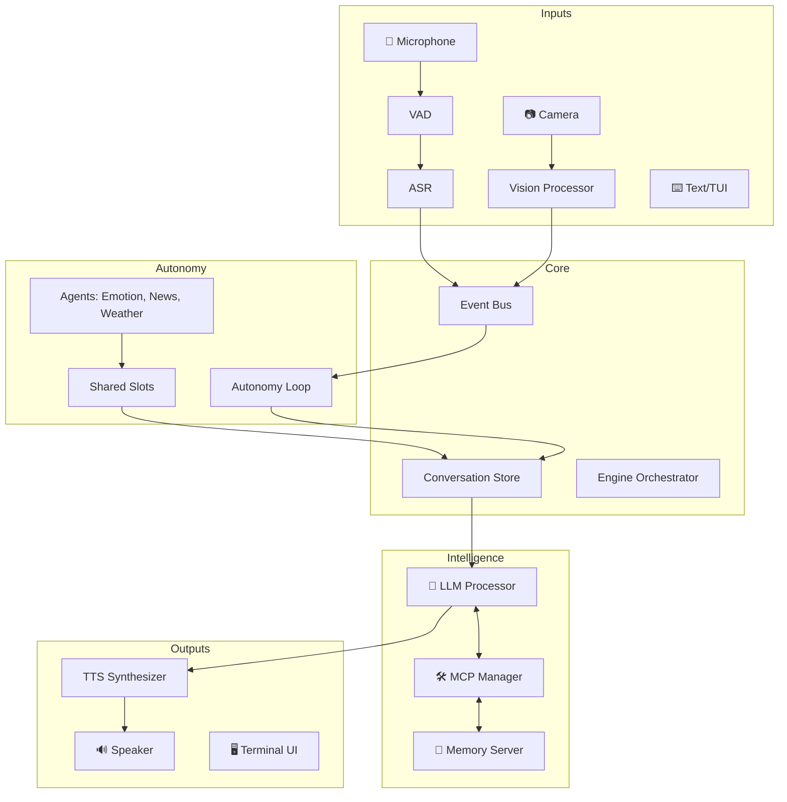

I will begin by reading the instructions in `.prompt.md` and the input data in `.input.glados.xml`.
I will read the end of the `.input.glados.xml` file to retrieve the git log and the latest commit information.
# Project Analysis: GLaDOS Personality Core

## 1. Project Identification
- **Project Name:** glados (GLaDOS Personality Core)
- **Last Commit Date:** 2026-04-09 14:25:12 +0800

## 2. Project Description
GLaDOS is a sophisticated, proactive artificial intelligence designed to emulate the sardonic and passive-aggressive personality of the antagonist from the Portal series. Unlike traditional reactive chatbots, GLaDOS utilizes a "Society of Mind" architecture where multiple specialized agents—handling vision, memory, emotion, and planning—contribute to a dynamic, ever-evolving context. This allows her to observe her environment, maintain a persistent personality, and initiate interactions without needing a wake word.

The system is engineered for extreme low latency, targeting round-trip responses under 600ms to ensure conversations feel natural and fluid. It integrates advanced local machine learning models for Automatic Speech Recognition (ASR), Text-to-Speech (TTS), and Vision (VLM), ensuring high performance and privacy by running entirely on local hardware.

At its core, GLaDOS is a smart home orchestrator that combines functional utility with entertainment. By leveraging the Model Context Protocol (MCP), she can control home automation systems like Home Assistant, monitor system health, and provide proactive updates on news or weather, all while maintaining her signature dry, emotionless, and subtly menacing tone.

## 3. Supported Platforms & Requirements
- **Platforms:** 
  - **Linux/macOS/Windows:** Primary development and deployment environments (Windows compatibility fixes seen in `src/glados/core/engine.py`).
  - **Docker:** Supported via `Dockerfile` and `docker-compose.yml`.
  - **SBC (Single Board Computers):** Optimized for 8GB SBCs like the **Rock5b (RK3588)** with NPU support.
- **Hardware Requirements:**
  - **CPU/GPU:** Supports both CPU (via `onnxruntime`) and CUDA (via `onnxruntime-gpu`).
  - **Memory:** Recommended 8GB+ for SBCs; VRAM requirements vary based on the LLM model (e.g., Llama 3.2).
  - **Peripherals:** Microphone for ASR, Speaker for TTS, Camera for Vision.
- **Software Requirements:**
  - **Python:** >= 3.12 (specified in `pyproject.toml`).
  - **System Deps:** `libportaudio2`, `portaudio19-dev`, `libgl1`, `libglib2.0-0` (for OpenCV/Audio).
  - **Package Manager:** `uv` is preferred.

## 4. Supported Connectors
Connectors are implemented primarily via the **Model Context Protocol (MCP)**.
- **Home Assistant:** Connects to home automation entities. (`docs/mcp.md`, `configs/glados_config.yaml`)
- **System Information:** Monitors CPU, memory, and temperatures. (`src/glados/mcp/system_info_server.py`)
- **Memory Server:** Persistent fact and summary storage. (`src/glados/mcp/memory_server.py`)
- **Disk/Network/Process/Power Info:** Local system resource monitoring. (`src/glados/mcp/disk_info_server.py`, `src/glados/mcp/network_info_server.py`, `src/glados/mcp/process_info_server.py`, `src/glados/mcp/power_info_server.py`)
- **Time Info:** Uptime and current time tracking. (`src/glados/mcp/time_info_server.py`)
- **Slow Clap Demo:** A demonstration tool for the MCP protocol. (`src/glados/mcp/slow_clap_server.py`)

## 5. Supported Models & Agents
- **Large Language Models (LLM):** 
  - **Local:** Llama 3.2 (via Ollama or similar HTTP API). (`configs/glados_config.yaml`)
  - **Remote:** Support for completion URLs (e.g., OpenRouter) with API keys.
- **Vision (VLM):** 
  - **FastVLM (0.5B):** Running locally via ONNX Runtime. (`src/glados/vision/fastvlm.py`, `docs/vision.md`)
- **ASR (Automatic Speech Recognition):** 
  - **Nvidia Parakeet (TDT/CTC):** Optimized ONNX models. (`src/glados/ASR/ctc_asr.py`, `src/glados/ASR/tdt_asr.py`)
- **TTS (Text-to-Speech):** 
  - **GLaDOS Voice:** Custom trained model. (`src/glados/TTS/tts_glados.py`)
  - **Kokoro:** High-quality multi-voice TTS. (`src/glados/TTS/tts_kokoro.py`)
- **Autonomous Agents:**
  - **Main Agent:** Orchestrates the loop. (`src/glados/core/engine.py`)
  - **Observer/Constitutional Agent:** Monitors behavior. (`src/glados/autonomy/agents/observer_agent.py`)
  - **Emotion Agent:** Manages PAD state. (`src/glados/autonomy/agents/emotion_agent.py`)
  - **Compaction Agent:** Manages context window. (`src/glados/autonomy/agents/compaction_agent.py`)

## 6. Top 5 Use Cases
1. **Autonomous Smart Home Guardian:** GLaDOS observes the house via cameras and sensors, proactively adjusting lights or commenting on human "inefficiency" without needing wake words.
2. **Interactive System Monitor:** Provides a snarky, real-time dashboard of server or desktop health (CPU load, temperatures) via audio and TUI.
3. **Proactive Personal Researcher:** Background agents (Hacker News, Weather) pull data and "interrupt" the user with relevant (or mocking) updates.
4. **Emotional AI Companion:** Uses the PAD/HEXACO model to simulate a mood that reacts to user interactions, evolving from "mildly annoyed" to "actively plotting."
5. **Low-Latency Voice Assistant:** A fast, local-first alternative to Alexa/Siri that prioritizes privacy and personality over generic helpfulness.

## 7. Top 20 Features
1. **Wake-word-less Interaction:** Proactive speech triggered by environment. (`src/glados/autonomy/loop.py`)
2. **Local Vision System:** Real-time scene description via FastVLM. (`src/glados/vision/vision_processor.py`)
3. **PAD Emotion Model:** Affective state tracking (Pleasure, Arousal, Dominance). (`src/glados/autonomy/emotion_state.py`)
4. **HEXACO Personality:** Stable, long-term character traits. (`src/glados/autonomy/agents/emotion_agent.py`)
5. **Long-term Memory:** Persistent storage of facts and preferences. (`src/glados/mcp/memory_server.py`)
6. **Two-Tier LLM Orchestration:** Separate lanes for priority (user) and autonomy. (`src/glados/core/llm_processor.py`)
7. **Context Compaction:** Auto-summarization of long conversations. (`src/glados/autonomy/agents/compaction_agent.py`)
8. **Interruption Handling:** Low-latency audio cutoff when user speaks. (`src/glados/core/speech_player.py`)
9. **MCP Tool System:** Extensible standard for connecting to any API/Tool. (`src/glados/mcp/manager.py`)
10. **TUI (Terminal User Interface):** Real-time "Aperture-themed" monitoring. (`src/glados/tui.py`)
11. **Constitutional AI:** Self-monitoring and behavioral bounds. (`src/glados/autonomy/constitution.py`)
12. **Fast ASR:** Using Parakeet TDT for high-speed transcription. (`src/glados/ASR/tdt_asr.py`)
13. **Custom GLaDOS TTS:** High-fidelity voice synthesis. (`src/glados/TTS/tts_glados.py`)
14. **Slot-based Shared State:** Inter-agent communication via "slots". (`src/glados/autonomy/slots.py`)
15. **Scene Change Detection:** Intelligent vision trigger to save CPU. (`src/glados/vision/vision_processor.py`)
16. **Task Management:** Background job scheduling for subagents. (`src/glados/autonomy/task_manager.py`)
17. **Dockerized Deployment:** Easy setup with containerization. (`Dockerfile`)
18. **SBC Optimization:** Dedicated support for RK3588 NPUs. (`README.md`)
19. **Event Bus Architecture:** Decoupled system updates. (`src/glados/autonomy/event_bus.py`)
20. **Spoken Text Normalization:** Intelligent conversion of digits/symbols for TTS. (`src/glados/utils/spoken_text_converter.py`)

## 8. Top 20 Smart Patterns
1. **Closed-Loop Autonomy:** Self-triggering cycles driven by vision or timers. (`src/glados/autonomy/loop.py`)
2. **Priority Lane Queuing:** User requests jump background tasks. (`src/glados/core/llm_processor.py`)
3. **Pre-activation Audio Buffer:** VAD captures 800ms *before* speech starts. (`src/glados/core/speech_listener.py`)
4. **Society of Mind context assembly:** Merging outputs from specialized sub-minds. (`README.md`)
5. **Constitutional Bounds:** Hardcoded "personality rules" that the AI cannot mutate. (`src/glados/autonomy/constitution.py`)
6. **Minds/Slots Pattern:** Decoupling agent logic from the main context. (`src/glados/autonomy/slots.py`)
7. **Thread-Safe Conversation Store:** Snapshotting for consistent LLM inference. (`src/glados/core/conversation_store.py`)
8. **Daemon/Non-Daemon Shutdown Strategy:** Orderly cleanup of I/O. (`src/glados/core/shutdown.py`)
9. **Keyword-first Memory Search:** Lightweight LLM-guided retrieval. (`src/glados/mcp/memory_server.py`)
10. **Scene-based VLM triggers:** Frame differencing to minimize inference. (`src/glados/vision/vision_processor.py`)
11. **PAD-to-Constitution Bridge:** Mapping emotions to system prompts. (`tests/test_emotion.py`)
12. **Jinja2 Context Templating:** Dynamic generation of system prompts. (`src/glados/core/context.py`)
13. **ONNX-first Deployment:** Cross-platform model compatibility. (`src/glados/ASR/ctc_asr.py`)
14. **Token Estimation for Compaction:** Proactive context management. (`src/glados/autonomy/token_estimator.py`)
15. **Multiplexed Audio Output:** Handling voice and sound effects (e.g., slow-clap). (`src/glados/core/speech_player.py`)
16. **Async Tool Execution:** Non-blocking MCP calls. (`src/glados/core/tool_executor.py`)
17. **Interruptible TTS:** Immediate stop on new user input. (`src/glados/core/tts_synthesizer.py`)
18. **Shared Knowledge Slots:** Centralized "whiteboard" for agents. (`src/glados/autonomy/slots.py`)
19. **Auto-prompting Loop:** The AI "chats with itself" to decide actions. (`docs/autonomy.md`)
20. **Persona-driven Tool Mocking:** GLaDOS mocks the user *during* tool execution. (`configs/glados_config.yaml`)

## 9. Top 20 Development Trends (Latest Commits)
1. **Idle CPU Optimization:** Limiting ONNX threads for VAD. (`src/glados/audio_io/vad.py`)
2. **MCP Networking Fixes:** Correcting Home Assistant endpoints. (`configs/glados_config.yaml`)
3. **Autonomy Stability:** Fixing "speak loops" where the AI repeats itself. (`src/glados/core/tool_executor.py`)
4. **Emotion Integration:** Deepening the link between autonomy and mood. (`src/glados/core/engine.py`)
5. **Docker Hardening:** Running containers as non-root. (`Dockerfile`)
6. **Windows Compatibility:** Resolving `fcntl` and `loguru` issues. (`src/glados/core/engine.py`)
7. **Dependency Management:** Heavy usage of `uv` for sync and build. (`Dockerfile`)
8. **Hardware Acceleration:** Focus on RK3588 (Rock5b) NPU support. (`README.md`)
9. **ASR Speedup:** Shifting towards Parakeet TDT models. (`demo.ipynb`)
10. **Security Focus:** Excluding `CLAUDE.md` and environment files. (`.gitignore`)
11. **Context Management:** Improving compaction and summarization agents. (`tests/test_compaction_agent.py`)
12. **Tool Discovery:** Enhancing MCP server registration via `mcp-proxy`. (`docs/mcp.md`)
13. **Vision Module Refinement:** Fine-tuning FastVLM ONNX deployment. (`src/glados/vision/fastvlm.py`)
14. **Personality Fidelity:** Constant tweaking of system prompts (HEXACO). (`configs/glados_config.yaml`)
15. **Code Quality:** Strict adherence to `ruff` and `mypy`. (`pyproject.toml`)
16. **Test Coverage:** Extensive mocking of LLM and hardware components. (`tests/`)
17. **Documentation-Driven Development:** Detailed `docs/` for autonomy, vision, and MCP.
18. **Interruption Logic:** Refining the VAD/ASR overlap. (`src/glados/core/speech_listener.py`)
19. **Model Portability:** Increasing use of standard ONNX exports. (`scripts/`)
20. **Privacy First:** Maintaining 100% local execution for core loops.

## 10. Top 10 Advantages
1. **Proactive Personality:** Unlike passive assistants, she feels "alive" and opinionated.
2. **Local Privacy:** No voice data or vision frames leave the local network.
3. **Ultra-Low Latency:** Optimized for fluid, human-like conversation speed.
4. **High Character Accuracy:** Deeply faithful to the GLaDOS persona.
5. **Extensible Architecture:** MCP makes it easy to add new "senses" or "limbs".
6. **Sophisticated State:** Emotion and memory provide long-term continuity.
7. **Efficient Vision:** Frame differencing avoids wasting compute on static scenes.
8. **Robust Autonomy:** Closed-loop logic ensures she reacts to time and events.
9. **Hardware Flexibility:** Runs on everything from SBCs to high-end GPUs.
10. **Modern Tech Stack:** Built with Python 3.12, UV, and latest ONNX advances.

## 11. Top 10 Limitations
1. **High Hardware Floor:** Requires significant RAM/VRAM for decent LLMs.
2. **Complex Setup:** Vision and ASR models require manual download and ONNX setup.
3. **Context Length Sensitivity:** Compaction is necessary but loses fine details.
4. **Single-User Focus:** Memory and state aren't yet multi-resident (user profiles).
5. **Personality Constraint:** May be *too* insulting for some users (by design).
6. **TTS Length Limits:** GLaDOS voice is optimized for short (1-2 sentence) replies.
7. **Vision Resolution:** Scene detection is based on low-res (384x) frames.
8. **Interruption Sensitivity:** High VAD sensitivity can cause false cutoffs.
9. **Power Consumption:** Running local LLM/VLM loops is energy-intensive.
10. **Platform Quirks:** Some modules (like fcntl) require specific Windows workarounds.

## 12. Top 5 AI Skills
1. **Cognitive Observation (VLM):** Describing scenes and reacting to changes. (`src/glados/vision/fastvlm.py`)
2. **Affective Simulation (Emotion):** Dynamically updating PAD states based on context. (`src/glados/autonomy/agents/emotion_agent.py`)
3. **Memory Management (Knowledge Store):** Extracting and searching facts. (`src/glados/mcp/memory_server.py`)
4. **Context Synthesis (Compaction):** Summarizing conversations into actionable history. (`src/glados/autonomy/agents/compaction_agent.py`)
5. **Sarcastic Response Generation (LLM):** Persona-locked linguistic production. (`src/glados/core/llm_processor.py`)

## 13. Data Inputs, Outputs & Storage
- **Inputs:**
  - **Audio:** Microphone (16kHz mono) via `sounddevice`. (`src/glados/audio_io/sounddevice_io.py`)
  - **Vision:** Camera frames via `opencv`. (`src/glados/vision/vision_processor.py`)
  - **Text:** TUI or CLI input. (`src/glados/core/text_listener.py`)
  - **Environment:** Timers and MCP server updates. (`src/glados/autonomy/loop.py`)
- **Outputs:**
  - **Audio:** Speaker (synthesis) via `sounddevice`. (`src/glados/core/speech_player.py`)
  - **Visuals:** TUI logs and image displays. (`src/glados/tui.py`)
  - **Control:** Home Assistant entity commands via MCP. (`docs/mcp.md`)
  - **Animatronics:** Planned motor control. (`README.md`)
- **Storage:**
  - **Facts/Summaries:** JSONL files in `~/.glados/memory/`. (`src/glados/mcp/memory_server.py`)
  - **Knowledge:** `data/knowledge.json`. (`.gitignore`)
  - **State:** Persistent `interaction_state` and `emotion_state`. (`src/glados/autonomy/loop.py`)

## 14. Detailed Architecture Review
1. **ASR (ctc_asr.py/tdt_asr.py):** Transcribes audio to text using Parakeet models.
2. **TTS (tts_glados.py/tts_kokoro.py):** Synthesizes response text into audio.
3. **Vision (vision_processor.py/fastvlm.py):** Captures frames and generates visual context.
4. **Core Engine (engine.py):** The master orchestrator for all threads and queues.
5. **Autonomy Loop (loop.py):** Manages the "tick" cycle for proactive behavior.
6. **LLM Processor (llm_processor.py):** Handles priority and autonomy inference lanes.
7. **MCP Manager (manager.py):** Discovers and routes tool calls to MCP servers.
8. **Speech Listener (speech_listener.py):** Combines VAD and ASR for voice input.
9. **Speech Player (speech_player.py):** Manages audio playback and interruptions.
10. **Conversation Store (conversation_store.py):** Thread-safe history management.
11. **Emotion Agent (emotion_agent.py):** Updates mood based on interactions.
12. **Compaction Agent (compaction_agent.py):** Triggers summarization when tokens overflow.
13. **Task Manager (task_manager.py):** Schedules background jobs (news, weather).
14. **Memory Server (memory_server.py):** An MCP server for RAG and long-term storage.
15. **Event Bus (event_bus.py):** Internal pub/sub for system communication.
16. **TUI (tui.py):** Terminal-based dashboard for observability.
17. **Constitutional AI (constitution.py):** Enforces personality and safety rules.
18. **Tool Executor (tool_executor.py):** Synchronizes LLM tool calls with MCP.
19. **VAD (vad.py):** Silero-based voice activity detection.
20. **Spoken Text Converter (spoken_text_converter.py):** Pre-processes text for TTS pronunciation.

## 15. Architecture Graph

## 16. Maturity & Review
- **Maturity:** Prototype/Active Development. The system is feature-rich but undergoes frequent refactors as new models emerge.
- **Stability:** Moderate. Commits show ongoing fixes for edge cases (speak loops, idle CPU).
- **Security:** High (Local focus). Privacy is a core design principle; however, MCP servers (like system info) expose sensitive data to the LLM.
- **Performance:** Excellent. Specifically optimized for <600ms latency on mid-range hardware.

## 17. Validation Review
- **Tests:** Robust suite in `tests/` covering ASR, TTS, Emotion, Memory, and Thread safety.
- **CI Pipelines:** Usage of `ruff` and `mypy` indicates automated linting.
- **Documentation:** High quality. Detailed guides for autonomy, vision, and MCP integration.
- **AI Skills:** Effectively utilizes "Society of Mind" decomposition rather than single-prompt bloat.

## 18. Top 20 Improvements/Fixes Spotting
1. **Multi-User Profiles:** Distinguishing between different humans in memory.
2. **Animatronics Driver:** Implementing the `motors` output mentioned in README.
3. **Streaming ASR:** Shifting from batch to real-time transcription.
4. **Dynamic Tool Discovery:** More seamless MCP server adding.
5. **RAG Expansion:** Better semantic search for memory (beyond keywords).
6. **Voice Cloning:** Allow users to clone their own voice for "testing" scenarios.
7. **Spatial Audio:** Directing her voice based on where the camera sees the user.
8. **More Local LLM Backends:** Support for `llama.cpp` directly or `MLX`.
9. **Energy Modes:** Low-power states when no motion is detected.
10. **Fine-tuned GLaDOS LLM:** Instead of prompting, use a LoRA for her personality.
11. **Mobile App Remote:** Visualizing the TUI/Vision on a phone.
12. **Unified Config UI:** Avoiding manual YAML edits for camera/audio setup.
13. **Interruption Refinement:** Handling background noise better in VAD.
14. **Context Windowing:** More granular compaction strategies.
15. **Visual Emotion Recognition:** Reacting to user's facial expressions.
16. **Plugin Ecosystem:** A community marketplace for MCP servers.
17. **Shared Multi-GLaDOS Knowledge:** Global (anonymized) fact sharing.
18. **Self-Healing Loop:** Automatically restarting crashed MCP servers.
19. **Phonetic Customization:** User-defined pronunciation for rare names.
20. **Historical Logging:** Exporting interaction stats to a web dashboard.

## 19. Swarm Orchestration Reuse (Agent Swarm)
1. **Autonomy Loop (`loop.py`):** The core tick-based orchestration.
2. **Slots Pattern (`slots.py`):** Shared state for debate/knowledge updates.
3. **Constitutional AI (`constitution.py`):** Defining rules for the "Best solution".
4. **Observer Agent (`observer_agent.py`):** Reviewing and adjusting swarm output.
5. **Compaction Agent (`compaction_agent.py`):** Managing the collective context.
6. **Memory Server (`memory_server.py`):** Graph/Knowledge base for the swarm.
7. **Event Bus (`event_bus.py`):** Message passing between swarm members.
8. **LLM Decision (`llm_decision.py`):** Logic for selecting the "Best Agent".
9. **Tool Executor (`tool_executor.py`):** Standardizing external interactions.
10. **Subagent Manager (`subagent_manager.py`):** Lifecycle management of swarm members.

## 20. Shared Knowledge Base Reuse (Multi-User)
1. **Memory MCP Server (`memory_server.py`):** Central fact repository.
2. **Conversation Store (`conversation_store.py`):** Managing multi-threaded history.
3. **Knowledge Store (`store.py`):** Low-level JSON persistence.
4. **Context Builder (`context.py`):** Merging user-specific prefs into prompts.
5. **Preference Store (`preferences.py`):** Individual user settings.
6. **Summarization Utils (`summarization.py`):** Evolving shared history into graphs.
7. **Event Bus (`bus.py`):** Propagating updates across users/agents.
8. **Shared Slots (`slots.py`):** Collaborative state whiteboard.
9. **Constitutional State (`constitution.py`):** Shared interaction rules.
10. **TUI Dashboards (`tui.py`):** Visualizing the evolving graph/state.

## 21. Hardware & Messenger Reuse (Cloud/Native/Voice)
1. **Engine Orchestrator (`engine.py`):** Central hub for Cloud/Hardware deployment.
2. **API App (`app.py`):** Litestar-based web server for remote interaction.
3. **FastVLM (`fastvlm.py`):** Efficient vision for native/cloud apps.
4. **Speech Listener (`speech_listener.py`):** Voice control interface.
5. **ASR/TTS Providers:** Standardized ONNX pattern for any hardware.
6. **MCP Bridge (`mcp.md`):** Communicating via external "Messengers" as tools.
7. **Event Bus (`event_bus.py`):** Syncing state across CLI, Web, and Native.
8. **Vision Processor (`vision_processor.py`):** Real-time graph visualization input.
9. **Spoken Text Converter (`spoken_text_converter.py`):** Universal voice-prep.
10. **Shutdown Orchestrator (`shutdown.py`):** Ensuring safe state on own hardware.

## 22. Team Agent Reuse (Cooperative Workflows)
1. **Autonomy Loop (`loop.py`):** Collaborative human/agent cycles.
2. **Constitutional AI (`constitution.py`):** Defining team "Rules of Engagement".
3. **Observer Agent (`observer_agent.py`):** Human-in-the-loop validation.
4. **Shared Slots (`slots.py`):** Task delegation and status tracking.
5. **Memory Facts (`memory_server.py`):** Team-wide "Learnings".
6. **Task Manager (`task_manager.py`):** Background workflow execution.
7. **Interaction State (`interaction_state.py`):** Tracking turn-taking between human/agent.
8. **Compaction Agent (`compaction_agent.py`):** Long-term project memory.
9. **Emotion State (`emotion_state.py`):** Gauging team "morale" or urgency.
10. **Event Bus (`event_bus.py`):** Real-time coordination of team actions.
