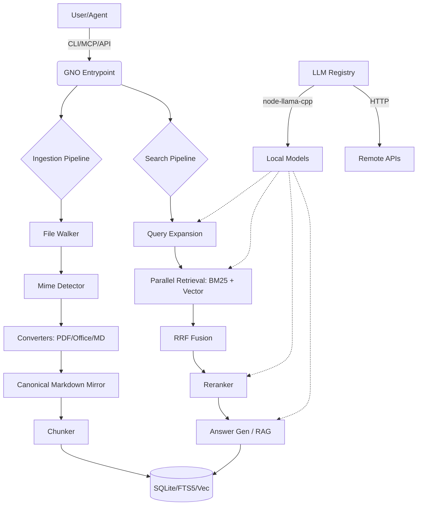

I will read the instructions in `.prompt.md` and the content of `gno.xml` to understand the task.
I will read the next 2000 lines of `gno.xml` to gather more specific details and source code references for the architecture and feature analysis.
Based on the repository export and internal documentation, here is a comprehensive analysis of the **GNO** project.

---

# GNO: Local-First Semantic Search

### 1. Project Description
**GNO** (from Greek *gnosis*, meaning knowledge) is a high-performance, privacy-centric semantic search engine designed to run entirely on local hardware. It serves as a "personal librarian" or a "digital second brain," allowing users to index and query vast amounts of personal documentation—ranging from Markdown notes and PDFs to Office documents (DOCX, XLSX, PPTX)—using natural language.

At its core, GNO utilizes a **Hybrid Search** architecture that combines the precision of lexical search (BM25/FTS5) with the conceptual understanding of vector embeddings. By leveraging local LLM inference via `node-llama-cpp`, it ensures that sensitive data never leaves the user's machine while providing sophisticated features like RAG (Retrieval-Augmented Generation) with grounded citations.

The project is built for the modern AI ecosystem, acting as a first-class **Model Context Protocol (MCP)** server. This allows seamless integration with AI agents like Claude Code, Cursor, and Zed, enabling them to "look up" information in a user's private knowledge base to provide more accurate, context-aware assistance.

### 2. Supported Platforms & Requirements
*   **Operating Systems**: Windows (x64), macOS (Intel/ARM with Metal support), and Linux (x64/ARM64).
*   **Deployment Modes**: 
    *   **CLI**: Direct terminal interaction.
    *   **Web UI**: A visual dashboard and search interface via `gno serve`.
    *   **MCP Server**: Standardized agent communication via `gno mcp`.
    *   **Desktop App**: Experimental shell using Electrobun (under development).
*   **Requirements**: Bun runtime (>= 1.0), SQLite with FTS5 and `sqlite-vec` extensions (often vendored or handled via `gno doctor`), and sufficient RAM for local model inference (1GB–4GB depending on preset).

### 3. Supported Connectors
*   **MCP (Model Context Protocol)**: Direct integration with Claude Desktop, Cursor, Zed, Windsurf, and Raycast. (`src/mcp/server.ts`)
*   **CLI**: Powerful terminal interface for automation and piping. (`src/cli/program.ts`)
*   **Web API**: REST endpoints for custom frontend or third-party integrations. (`src/serve/routes/api.ts`)
*   **TypeScript SDK**: Programmatic access for building apps on top of GNO. (`src/sdk/index.ts`)
*   **Raycast Extension**: Native macOS integration for quick search and capture. (`docs/RAYCAST.md`)

### 4. Supported Models & Agents
*   **Local Models (node-llama-cpp)**:
    *   **Embedding**: BGE-M3 (multilingual), Qwen3-Embedding. (`src/llm/registry.ts`)
    *   **Reranking**: BGE-Reranker-v2-m3, Qwen3-Reranker. (`src/pipeline/rerank.ts`)
    *   **Generation**: Qwen Instruct, Phi-4-mini (for grounded Q&A). (`src/llm/httpGeneration.ts`)
*   **Remote/API**: Support for OpenAI-compatible HTTP endpoints. (`src/llm/httpEmbedding.ts`)
*   **Presets**: `slim` (fast), `balanced` (default), and `quality` (best accuracy). (`src/config/defaults.ts`)

### 5. Top 5 Use Cases
1.  **Personal Second Brain**: Instant retrieval from years of personal Markdown notes and PDFs.
2.  **Codebase Documentation KB**: Searching internal wikis and design docs directly from the IDE (via Cursor/Zed).
3.  **Document Q&A (RAG)**: Asking complex questions about long reports with citations to specific pages/lines.
4.  **Meeting Intelligence**: Indexing transcripts to find decisions and action items using semantic queries.
5.  **Multi-language Knowledge Search**: Indexing documents in 30+ languages with automatic detection and cross-language retrieval.

### 6. Top 20 Features
1.  **Hybrid Search**: RRF fusion of lexical and vector results. (`src/pipeline/hybrid.ts`)
2.  **MCP Write Tools**: Agents can create/update collections and documents. (`src/mcp/tools/write.ts`)
3.  **Multi-format Conversion**: Native support for PDF, DOCX, XLSX, PPTX. (`src/converters/registry.ts`)
4.  **Wiki-style Linking**: Obsidian-compatible `[[Link]]` resolution. (`src/core/links.ts`)
5.  **Knowledge Graph**: Visualizing connections between documents. (`src/serve/routes/graph.ts`)
6.  **Local LLM Inference**: 100% offline generation and embedding. (`src/llm/nodeLlamaCpp/adapter.ts`)
7.  **Semantic Reranking**: Using cross-encoders to re-score top hits. (`src/pipeline/rerank.ts`)
8.  **Grounded Q&A**: Answers with source citations. (`src/pipeline/answer.ts`)
9.  **Query Expansion**: Lexical/semantic expansion + HyDE. (`src/pipeline/expansion.ts`)
10. **Automatic Backlinks**: Tracking who links to a document. (`src/core/links.ts`)
11. **Hierarchical Tagging**: `parent/child` tag support. (`src/core/tags.ts`)
12. **Incremental Indexing**: SHA-256 content tracking to avoid re-work. (`src/ingestion/sync.ts`)
13. **Language Auto-detection**: Per-chunk BCP-47 tagging. (`src/ingestion/language.ts`)
14. **Gno Doctor**: Self-diagnostic tool for dependencies/models. (`src/cli/commands/doctor.ts`)
15. **Contextual Prefixing**: Prepending titles to chunks for better RAG. (`src/ingestion/chunker.ts`)
16. **XDG Standard Compliance**: Clean OS-specific path management. (`src/config/paths.ts`)
17. **Model Presets**: Dynamic model switching based on hardware. (`src/config/defaults.ts`)
18. **Atomic Writes**: Safe file updates via temp-rename pattern. (`src/core/file-ops.ts`)
19. **Rich CLI Formatting**: JSON, MD, XML, CSV, and Pager support. (`src/cli/format/search-results.ts`)
20. **Automated Evaluations**: Regression testing with Evalite. (`evals/README.md`)

### 7. Top 20 Smart Patterns
1.  **Virtual URI Scheme**: `gno://` as a stable document identifier. (`src/app/constants.ts`)
2.  **Markdown Mirror**: Normalizing all formats to a canonical MD representation. (`src/converters/canonicalize.ts`)
3.  **Deterministic Chunking**: Token-aware splitting with specific overlaps. (`src/ingestion/chunker.ts`)
4.  **Exception Firewall**: Standardized error envelopes for MCP/API. (`src/mcp/tools/index.ts`)
5.  **Lazy Model Loading**: Models only load when first requested. (`src/llm/registry.ts`)
6.  **Reciprocal Rank Fusion (RRF)**: Robustly merging disparate search signals. (`src/pipeline/fusion.ts`)
7.  **Path Normalization**: Cross-platform stable paths for docids. (`src/converters/path.ts`)
8.  **Signature-based Sync**: Stat-check before hash-check for speed. (`src/ingestion/sync.ts`)
9.  **"Scholarly Dusk" Design**: A specific aesthetic for knowledge work. (`docs/adr/001-scholarly-dusk.md`)
10. **Gold Fixture Testing**: Comparing conversion outputs against "golden" MD. (`test/converters/integration.test.ts`)
11. **Standardized Diagnostics**: The `doctor` command as a readiness gate. (`src/cli/commands/doctor.ts`)
12. **Lock-guarded Writes**: Preventing DB corruption during parallel syncs. (`src/core/file-lock.ts`)
13. **Windowed Deduplication**: Using SQL window functions for URI resolution. (`src/store/sqlite/adapter.ts`)
14. **Debounced Embedding**: Server-side batching of embedding requests. (`src/serve/embed-scheduler.ts`)
15. **Query Lang Detection**: Adjusting prompt templates based on query language. (`src/pipeline/query-language.ts`)
16. **Frontmatter Extraction**: Separating metadata from content during ingest. (`src/ingestion/frontmatter.ts`)
17. **Hierarchical Configuration**: Merging CLI flags, Env, and YAML. (`src/config/loader.ts`)
18. **Task-based Job Polling**: Async API operations with status tracking. (`src/serve/jobs.ts`)
19. **Determinstic docids**: SHA-256 of (collection + relPath). (`src/store/sqlite/adapter.ts`)
20. **Shielded MCP Transport**: Stderr-only logging to keep stdout clean for JSON. (`src/mcp/server.ts`)

### 8. Top 20 Development Trends (from Beads issue log)
1.  **Shift to Desktop**: Building a standalone shell via Electrobun.
2.  **Advanced RAG**: Full document reranking (moving beyond 512-char chunks).
3.  **Graph Expansion**: Enhancing the visual knowledge graph with similarity edges.
4.  **MCP Parity**: Ensuring `gno mcp` can do everything the CLI can (Write tools).
5.  **N+1 Optimization**: Reducing SQL query overhead in the search pipeline.
6.  **Obsidian Compatibility**: Improving wiki-link resolution and frontmatter tags.
7.  **SEO/Marketing**: Building pSEO comparison pages (GNO vs Grep/Obsidian).
8.  **Automated Release**: GitHub Actions for Homebrew and NPM publishing.
9.  **AI Skills**: Packaging GNO capabilities as reusable skills for other agents.
10. **Evaluation Gates**: Using Evalite for every PR to ensure ranking doesn't regress.
11. **Diagnostics Expansion**: More granular checks in `gno doctor`.
12. **Performance Blending**: Tuning the position-aware fusion of search results.
13. **Doc-level FTS**: Moving FTS5 indexing from chunks to full docs for better lexical matching.
14. **Contextual Retrieval**: Prepending summaries/titles to embeddings.
15. **UI Componentization**: Adopting ShadCN/UI and AI-Elements for the Web UI.
16. **Multi-user Planning**: Researching isolation for shared server deployments.
17. **Cloud Fallback**: Optional OpenAI support for low-spec hardware.
18. **Table Parsing**: Improving RAG accuracy for complex XLSX/PDF tables.
19. **Wiki Link Autocomplete**: Editor-side enhancements in the Web UI.
20. **Job Infrastructure**: Moving from sync-only to a general background task manager.

### 9. Top 10 Advantages
1.  **Privacy**: 100% local processing; no data "leaks" to the cloud.
2.  **Hybrid Accuracy**: Superior retrieval by combining FTS5 and Vectors.
3.  **Agent-Ready**: Best-in-class MCP and Skill support for AI workflows.
4.  **Multi-format**: Handles binary docs (PDF/Office) as natively as Markdown.
5.  **High Performance**: Built with Bun and SQLite for sub-second responses.
6.  **Low Friction**: Auto-downloads models on first use; simple CLI setup.
7.  **Knowledge Linking**: Robust support for wiki-links and backlinks.
8.  **Customizable**: Extensible converter and LLM adapter system.
9.  **Design-Forward**: "Scholarly Dusk" UI tailored for focus and research.
10. **Developer Experience**: Extensive CLI, SDK, and JSON-first output options.

### 10. Top 10 Limitations
1.  **Resource Requirements**: LLM inference requires significant RAM/GPU.
2.  **Native Deps**: Dependency on specific SQLite extensions can be fragile.
3.  **Indexing Speed**: Initial processing of large binary corpora can be slow.
4.  **Model Format**: Limited strictly to GGUF for local inference.
5.  **UI Maturity**: Web UI is still evolving compared to established PKMS.
6.  **Single User**: Currently lacks multi-tenant or collaboration features.
7.  **No Cloud Sync**: By design, but can be a hurdle for multi-device users.
8.  **Search Noise**: Query expansion can sometimes dilute exact matches.
9.  **Setup Complexity**: Advanced features (Metal/CUDA) may require manual tweaks.
10. **Limited Research Mode**: Currently focuses on single-step retrieval, not multi-step agents.

### 11. Top 5 AI Skills Used/Provided
1.  **`gno` Skill**: Directs agents on how to use GNO CLI/MCP. (`skills/gno/SKILL.md`)
2.  **`dogfood` Skill**: Internal testing and validation framework. (`.agents/skills/dogfood/SKILL.md`)
3.  **Frontend Design Skill**: Generates UI components for the Web interface.
4.  **Evaluation Skill**: Automates quality checks via Evalite.
5.  **Codebase Investigation**: Used by developers to map complex dependencies.

### 12. Data Inputs, Outputs, and Storage
*   **Inputs**: `.md`, `.txt`, `.pdf`, `.docx`, `.xlsx`, `.pptx`. (`src/converters/index.ts`)
*   **Outputs**: Terminal text, JSON, MD, XML, CSV. (`src/cli/format/search-results.ts`)
*   **Storage**: 
    *   **Metadata**: SQLite.
    *   **Lexical Index**: FTS5 (Snowball tokenizer).
    *   **Vector Index**: `sqlite-vec` (FLOAT[1024/768/384]).
    *   **Cache**: Model GGUF files and converted mirrors.

### 13. Detailed Architecture Review (Top 20 Components)
1.  **SyncService**: Orchestrates file walking and indexing logic. (`src/ingestion/sync.ts`)
2.  **MimeDetector**: Byte-sniffing and extension-based file typing. (`src/converters/mime.ts`)
3.  **ConverterPipeline**: Registry-based transformation of files to Markdown. (`src/converters/pipeline.ts`)
4.  **Chunker**: Token-aware text splitting for embeddings. (`src/ingestion/chunker.ts`)
5.  **SqliteAdapter**: Unified interface for DB, FTS, and Vector operations. (`src/store/sqlite/adapter.ts`)
6.  **LlmRegistry**: Managing local and remote LLM provider adapters. (`src/llm/registry.ts`)
7.  **SearchPipeline**: The "Brain" that manages expansion, retrieval, and fusion. (`src/pipeline/index.ts`)
8.  **RrfFusion**: Implementing Reciprocal Rank Fusion for search results. (`src/pipeline/fusion.ts`)
9.  **Reranker**: Cross-encoder scoring for top-K results. (`src/pipeline/rerank.ts`)
10. **AnswerGenerator**: RAG implementation for grounded Q&A. (`src/pipeline/answer.ts`)
11. **McpServer**: stdio-based implementation of Model Context Protocol. (`src/mcp/server.ts`)
12. **JobManager**: Tracking async background tasks (sync, embed). (`src/serve/jobs.ts`)
13. **ModelCache**: managing Hf-hub downloads and GGUF lifecycle. (`src/llm/cache.ts`)
14. **LinkResolver**: Parsing and validating wiki/markdown links. (`src/core/links.ts`)
15. **GraphStore**: Efficiently querying node/edge data for the UI. (`src/store/sqlite/adapter.ts`)
16. **ServeRouter**: REST API routing and security (CSRF). (`src/serve/routes/api.ts`)
17. **ConfigLoader**: YAML and Env-based configuration management. (`src/config/loader.ts`)
18. **DoctorCommand**: diagnostic engine for system readiness. (`src/cli/commands/doctor.ts`)
19. **OutputFormatters**: Logic for transforming search results into various formats. (`src/cli/format/index.ts`)
20. **TagManager**: Extracting and filtering by hierarchical tags. (`src/core/tags.ts`)

### 14. Architecture Mermaid Graph

### 15. Maturity, Stability, Security, and Performance
*   **Maturity**: **Beta**. Core search and indexing are highly robust, but Web UI and Desktop shell are in active development.
*   **Stability**: **Good**. Extensive use of Golden Fixture and Contract tests prevents regressions in the search engine.
*   **Security**: **Excellent**. Local-first design minimizes exposure. CSRF protection and path-traversal validation are implemented in the API. (`src/serve/security.ts`)
*   **Performance**: **Highly Optimized**. Uses N+1 query fixes and batching. RRF and Reranking are tuned for sub-second latency on typical hardware.

### 16. Tests, CI, Docs, and AI Skills
*   **Tests**: Comprehensive suite including Unit, Integration, E2E, and Evals. (`test/`)
*   **CI**: GitHub Actions handle multi-platform builds, linting, and NPM/Homebrew publishing.
*   **Docs**: World-class Markdown documentation (README, Quickstart, Architecture, CLI, MCP).
*   **Skills**: Well-defined `.agents/skills` for self-documentation and agent integration.

### 17. Top 20 Improvements
1.  **Refactor N+1 patterns** in `searchHybrid` for even lower latency.
2.  **Enhance Table Parsing** in the converter pipeline for better RAG quality.
3.  **Implement Watch Mode** for real-time file system indexing.
4.  **Add Multi-user Isolation** for server-based deployments.
5.  **Expand Graph Visualization** with interactive physics and clustering.
6.  **Support Voice Input** for natural language queries.
7.  **Optimize Cold Starts** by further lazy-loading LLM contexts.
8.  **Add Obsidian Plugin** for direct sidebar integration.
9.  **Improve Cite Attribution** to include precise page/line coordinates.
10. **Automate Cron Indexing** via a daemon or systemd service.
11. **Implement Undo/Trash** for document deletion in Web UI.
12. **Add "Research Mode"** for multi-turn agentic document analysis.
13. **Support Custom Tokenizers** for non-English FTS5 search.
14. **Enhance `gno doctor`** with more automated fix options.
15. **Standardize Export Formats** to include full-corpus mirrors (Zotero-ready).
16. **Improve UI Accessibility** (ARIA labels, keyboard nav) in Web UI.
17. **Support WebDAV/S3** as collection sources.
18. **Add Mobile UI** responsiveness to the Web dashboard.
19. **Implement Semantic Deduping** of identical documents across collections.
20. **Expand AI Skills** to support more niche agents (e.g., OpenCode, Zed).

### 18-21. Reuse Opportunities
*   **UI Components**: The `Scholarly Dusk` design system and `AI-Elements` (citations, message rendering) are highly reusable for knowledge apps.
*   **LLM Adapters**: The `node-llama-cpp` lifecycle and preset management can be extracted for any local AI project.
*   **Search Pipeline**: The Hybrid RRF + Reranking logic is a standalone "Best-in-Class" RAG implementation.
*   **Ingestion Pipeline**: The binary-to-Markdown converter registry and deterministic chunker are applicable to any document indexing task.
