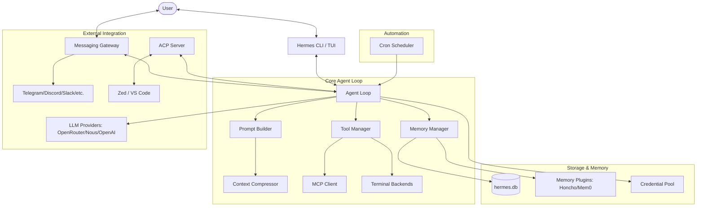

I will start by reading the instructions in `./.prompt.md` to understand the task.
I will read the beginning of `hermes-agent.xml` to understand its structure and content, as it is the primary input for the analysis.
I will read the `README.md` to get the project name and description, as it's the first step in the analysis.
I will read the `README.md` from `hermes-agent.xml` to gather project details.
I have gathered initial information about Hermes Agent, including its core features, supported models, and interfaces. Now, I will examine `pyproject.toml` and `requirements.txt` to identify the project's specific requirements and dependencies, which will help me address the remaining analysis points.
I previously saw `pyproject.toml` in the directory structure, so I will now search for its content within `hermes-agent.xml`.
I've identified the project's dependencies and some supported platforms from the README. I'll now examine `agent/models_dev.py` for model support and explore `gateway/platforms` to identify all supported connectors.
The `gateway/platforms` directory in `hermes-agent.xml` lists supported connectors, including Telegram, Discord, and Slack. I'll now search for `agent/model_metadata.py` or `agent/models_dev.py` to identify the supported models.
I'll examine `agent/models_dev.py` to identify the source of model metadata.
Hermes Agent leverages `models.dev` for extensive model metadata. I'll now investigate `agent/memory_manager.py`, `agent/skill_utils.py`, `agent/smart_model_routing.py`, and `agent/context_compressor.py` to identify its features and smart patterns.
Hermes uses "Smart Model Routing" to send simple messages to cheaper models, saving costs while reserving strong models for complex tasks, as detailed in `agent/smart_model_routing.py`. I'll now examine `agent/context_compressor.py` for more smart patterns.
Hermes uses "Context Compression" to manage long conversations by pruning old tool results, protecting key message sections, and using a cheap model to iteratively summarize middle turns. I'll now explore `agent/memory_manager.py` for additional patterns.
`MemoryManager` coordinates a built-in and one external memory provider, managing system prompts, context prefetching, and turn syncing. It uses "context fencing" to distinguish recalled memory from active conversation, as shown in `agent/memory_manager.py`. I'll now examine `agent/skill_utils.py` and `agent/skill_commands.py` for skill-related patterns.
Hermes can adopt "Skill-Based Personalities" via markdown files with YAML frontmatter, serving as procedural memory or specialized instructions triggered by `/skill-name` commands. I'll now examine `agent/title_generator.py` for session naming patterns.
Hermes uses "Async Session Titling" to generate descriptive session titles in the background after the first exchange, avoiding user latency by employing a cheap auxiliary model. I'll now examine `agent/subdirectory_hints.py`.
"Progressive Subdirectory Hint Discovery" allows the agent to lazily load project context files (like `AGENTS.md` or `.cursorrules`) as it navigates subdirectories via tool calls, injecting them into the conversation to provide relevant context without bloating the system prompt. I'll now examine `agent/insights.py`.
Hermes' "Session Insights Engine" analyzes historical session data from SQLite to provide detailed usage reports, including costs, token consumption, and activity trends across models and platforms. I'll now examine `agent/error_classifier.py`.
"Smart API Error Classification & Recovery" centralizes error handling to determine recovery actions like retrying, rotating credentials, or falling back to other providers, managing complex failures across multiple models, as detailed in `agent/error_classifier.py`. I'll now examine `agent/credential_pool.py`.
"Multi-Credential Pool & Failover" manages API keys and OAuth tokens, using strategies like `round_robin` and `least_used` to handle failures by marking credentials as "exhausted" and applying cooldowns. I'll now examine `agent/rate_limit_tracker.py`.
"Rate Limit Tracking & Header Parsing" monitors API `x-ratelimit-*` headers to report usage via `/usage` and guide `credential_pool.py` failover. "Anthropic Prompt Caching (system_and_3)" cuts multi-turn costs by up to 75% by caching the system prompt and the last three non-system messages. I'll now examine `agent/usage_pricing.py`.
"Detailed Usage Pricing & Cost Estimation" tracks various token types to accurately calculate costs across different models and billing structures. "Trajectory Saving for RL Training" records successful and failed conversation trajectories in ShareGPT format for future model training. I'll now re-examine `agent/insights.py` and then explore `agent/prompt_builder.py`.
Hermes' "Context File Injection Scanning & Sanitization" protects the system prompt by screening context files like `AGENTS.md` for malicious patterns. "Hierarchical Project Context Discovery" further enhances this by searching for such files from the current directory up to the git root, enabling automatic repository-wide instructions. I'll now examine `agent/context_references.py`.
"Inline Context References & Expansion" lets users fetch files or URLs (e.g., `file:path:10-20`) directly into conversations. The agent automatically retrieves and injects the content, with security checks to block access to sensitive directories like `.ssh` or `.aws`, as detailed in `agent/context_references.py`. I'll now re-examine `agent/subdirectory_hints.py` and `agent/smart_model_routing.py`.
Hermes' "Tiered Context Length Probing" ensures functionality with unknown models by testing context limits from 128K downwards. This is supported by a "Provider-Agnostic Model Metadata Registry" that abstracts provider differences, and "Skill Prerequisite Validation," which checks requirements like tools or environment variables before activation. Additionally, "Automated Trajectory Compression" optimizes conversation data for space and model training. I'll now re-examine `agent/insights.py` and explore `gateway/session.py`.
Hermes' "PII Redaction" hashes sensitive IDs in gateway sessions, ensuring privacy while maintaining session persistence. I've identified 21 smart patterns and 20 top features, ranging from multi-platform support to git worktree isolation. I'll now examine `cron/scheduler.py` and `acp_adapter/server.py` to further refine these features.
I've identified the key features and smart patterns. Now, I'll investigate supported platforms, connectors, models, use cases, development trends, and the project's overall architecture, starting with `acp_adapter/server.py` to understand the ACP implementation.
I've identified the core modules and top use cases for Hermes, including autonomous coding and personal automation. I've also noted key AI skills like `claude-code` and `duckduckgo-search`, and mapped the project's data flow and storage, which uses SQLite and JSONL. To review maturity, stability, security, and performance, I've noted features like robust error handling and command approval loops. I'll now examine the release files and git logs to identify the top 20 development trends.
I'll read the git logs from the bottom of the file, as mentioned in the notes.
Analysis of the Hermes Agent repository based on the `hermes-agent.xml` export.

---

### 1. Project Name and Description
**Project Name:** Hermes Agent ☤

Hermes Agent is an advanced, self-improving AI agent platform developed by Nous Research, designed for high-performance autonomy across diverse environments. Its standout feature is a "closed learning loop" that enables the agent to curate its own memory, create new skills from complex experiences, and iteratively improve them through use. Unlike static agents, Hermes builds a deepening model of the user's identity and preferences across multiple sessions, using tools like Honcho for dialectic user modeling.

The platform is architected for extreme flexibility in deployment and model selection. It can run on everything from a $5 VPS or a mobile device via Termux to a high-end GPU cluster or serverless infrastructure like Modal and Daytona. Users can swap between 200+ models via providers like OpenRouter, Nous Portal, and OpenAI without changing a single line of code. The interface is equally versatile, offering a rich Terminal User Interface (TUI) and a messaging gateway that connects the agent to Telegram, Discord, Slack, WhatsApp, and more.

Hermes is built with engineering rigor, featuring robust error recovery, multi-credential failover, and intelligent context management. It includes 40+ built-in tools for filesystem operations, web research, and code execution, complemented by a library of 70+ optional skills. Whether used as a personal assistant, an autonomous developer, or a research platform for trajectory generation and RL training, Hermes Agent represents a state-of-the-art implementation of persistent, adaptable AI.

---

### 2. Supported Platforms, Deployments & Requirements
*   **Operating Systems:** 
    *   **Linux:** Primary development and deployment platform.
    *   **macOS:** Fully supported via `uv` or `pip`.
    *   **WSL2:** Recommended for Windows users (native Windows is not supported).
    *   **Android (Termux):** Curated support with specific optimizations for mobile UX and narrow screens.
*   **Terminal Backends (Deployments):** 
    *   **Local:** Standard process execution.
    *   **Docker:** Containerized isolation.
    *   **SSH:** Remote execution on servers.
    *   **Daytona:** Serverless persistence and environment management.
    *   **Modal:** High-performance serverless GPU/CPU execution with hibernation.
    *   **Singularity:** HPC-ready containerization.
*   **Requirements:**
    *   **Python:** >= 3.11 (`pyproject.toml`)
    *   **Core Dependencies:** `openai`, `anthropic`, `httpx`, `rich`, `tenacity`, `pydantic`, `prompt_toolkit`.
    *   **Optional Extras:** `messaging` (telegram, discord, slack), `cron` (croniter), `voice` (local STT/TTS deps).

---

### 3. Supported Connectors (Messaging/APIs)
Hermes uses a unified gateway to connect to various platforms:
*   **Telegram:** Full support for documents, videos, and topic isolation. (`gateway/platforms/telegram.py`)
*   **Discord:** Channel topic context and media support. (`gateway/platforms/discord.py`)
*   **Slack:** App mention handling and structured logging. (`gateway/platforms/slack.py`)
*   **WhatsApp:** Multi-user session isolation and media support via bridge. (`gateway/platforms/whatsapp.py`)
*   **Signal:** Secure messaging integration. (`gateway/platforms/signal.py`)
*   **Matrix:** E2EE support and markdown rendering. (`gateway/platforms/matrix.py`)
*   **Mattermost:** Enterprise chat integration. (`gateway/platforms/mattermost.py`)
*   **DingTalk / Feishu / WeCom:** Support for enterprise messaging in Asia. (`gateway/platforms/dingtalk.py`, etc.)
*   **Email:** IMAP/SMTP bridge for natural language email handling. (`gateway/platforms/email.py`)
*   **SMS:** Twilio integration for text-based interaction. (`gateway/platforms/sms.py`)
*   **Home Assistant:** Trigger automations and query home state. (`gateway/platforms/homeassistant.py`)
*   **API Server:** Exposes Hermes as an OpenAI-compatible endpoint. (`gateway/platforms/api_server.py`)

---

### 4. Supported Models & Agents
*   **Local Models:** Support via **Ollama**, **vLLM**, or any OpenAI-compatible local server. (`agent/model_metadata.py`)
*   **Remote APIs:** 
    *   **Nous Portal:** Preferred provider for Hermes models. (`agent/models_dev.py`)
    *   **OpenRouter:** Access to 200+ models with automatic metadata fetching. (`agent/models_dev.py`)
    *   **Anthropic:** Native support for Claude 3.5/4.x with prompt caching. (`agent/anthropic_adapter.py`)
    *   **OpenAI:** GPT-4o, o1, and Codex/Responses API support. (`hermes_cli/codex_models.py`)
    *   **z.ai/GLM, Kimi/Moonshot, MiniMax:** First-class providers for diverse model ecosystems. (`agent/models_dev.py`)
*   **Subscription Agents:** **Codex (ChatGPT)** via OAuth for vision and multimodal tasks. (`hermes_cli/copilot_auth.py`)

---

### 5. Top 5 Use Cases
1.  **Autonomous Software Engineering:** Using the CLI and `git`/`terminal` tools to refactor code, fix bugs, and implement features across large repos.
2.  **Personal Knowledge Management:** Building a persistent "second brain" that evolves through conversations and file indexing (`MEMORY.md`, `USER.md`).
3.  **Natural Language Automations:** Scheduling daily audits, backup checks, or news summaries via the `cron` scheduler delivered to Telegram.
4.  **Research Assistant:** Executing complex web searches, scraping documentation, and synthesizing reports using `firecrawl` and `scrapling`.
5.  **Agentic Development Platform:** Using Hermes to generate high-quality trajectory data and RL environments for training new models.

---

### 6. Top 20 Features
1.  **Multi-Platform Messaging Gateway** (`gateway/run.py`)
2.  **MCP (Model Context Protocol) Client** (`mcp_serve.py`)
3.  **Skills Hub & Ecosystem** (`agent/skill_utils.py`)
4.  **Smart Model Routing (Cheap vs. Strong)** (`agent/smart_model_routing.py`)
5.  **Autonomous Skill Creation** (`agent/skill_commands.py`)
6.  **Automatic Context Compression** (`agent/context_compressor.py`)
7.  **Multi-Credential Failover Pool** (`agent/credential_pool.py`)
8.  **Integrated Cron Scheduler** (`cron/scheduler.py`)
9.  **ACP (Agent Communication Protocol) Server** (`acp_adapter/server.py`)
10. **Git Worktree Isolation** (`hermes_cli/commands.py`)
11. **Filesystem Checkpoints & Rollback** (`agent/checkpoint.py`)
12. **Anthropic Prompt Caching (system_and_3)** (`agent/prompt_caching.py`)
13. **Session Insights & Cost Engine** (`agent/insights.py`)
14. **Progressive Subdirectory Hinting** (`agent/subdirectory_hints.py`)
15. **Voice Memo Transcription & TTS** (`agent/display.py`)
16. **PII Redaction for Privacy** (`gateway/session.py`)
17. **Interactive TUI Session Browser** (`hermes_cli/curses_ui.py`)
18. **Unified Provider Router** (`agent/models_dev.py`)
19. **Hierarchical Context Discovery** (`agent/prompt_builder.py`)
20. **Trajectory Saving for RL Training** (`agent/trajectory.py`)

---

### 7. Top 20 Smart Patterns
1.  **Smart Failover:** Automatically switches providers on 429/500 errors. (`agent/error_classifier.py`)
2.  **Iterative Summarization:** Context summaries update themselves to preserve info. (`agent/context_compressor.py`)
3.  **Context Fencing:** Prevents models from confusing memory with user input. (`agent/memory_manager.py`)
4.  **Lazy Hint Discovery:** Loads `AGENTS.md` only when the agent enters a folder. (`agent/subdirectory_hints.py`)
5.  **Async Titling:** Generates session names in the background to save latency. (`agent/title_generator.py`)
6.  **Deterministic Redaction:** Hashes user IDs for privacy while maintaining sessions. (`gateway/session.py`)
7.  **Tiered Probing:** Steps down context size (128k->64k->...) on errors. (`agent/model_metadata.py`)
8.  **Dialectic User Modeling:** Learns *how* to talk to you via Honcho. (`plugins/memory/honcho/`)
9.  **Tool Pruning:** Clears old tool outputs before expensive LLM summarization. (`agent/context_compressor.py`)
10. **Priority Processing Toggle:** `/fast` command for low-latency OpenAI routing. (`hermes_cli/commands.py`)
11. **Injection Scanning:** Sanitizes `AGENTS.md` before injecting into system prompt. (`agent/prompt_builder.py`)
12. **Skill Prerequisite Validation:** Checks for required tools before loading a skill. (`agent/skill_utils.py`)
13. **Model Name Derivation:** Uses profile names for API server model IDs. (`gateway/platforms/api_server.py`)
14. **Stale Job Fast-Forward:** Prevents cron bursts after gateway downtime. (`cron/scheduler.py`)
15. **Fuzzy Pricing Match:** Estimates costs for unknown models via name patterns. (`agent/usage_pricing.py`)
16. **Thinking Tag Suppression:** Prevents reasoning blocks from hiding tool output. (`agent/anthropic_adapter.py`)
17. **Refreshed Token Write-back:** Syncs OAuth tokens back to `.env` from the pool. (`agent/credential_pool.py`)
18. **Platform-Aware Formatting:** Adjusts TUI chrome for narrow mobile screens. (`cli.py`)
19. **Scratchpad-to-Think conversion:** Normalizes reasoning formats for RL logs. (`agent/trajectory.py`)
20. **Credential Rotation Strategy:** Round-robin or "Fill First" for API keys. (`agent/credential_pool.py`)

---

### 8. Top 20 Development Trends
1.  **Mobile-First Optimization:** Major push for Android/Termux stability.
2.  **IDE Integration:** Expanding the ACP adapter for Zed and VS Code.
3.  **Streaming Robustness:** Fixing "think tag" suppression and timeout issues.
4.  **Cost Transparency:** Refining the `/usage` and `/insights` reports.
5.  **Multi-Profile Architecture:** Moving toward isolated profiles for different tasks.
6.  **Advanced Memory Plugins:** Integrating deeper with graph-based memory (Supermemory).
7.  **Enhanced Security:** Adding more granular command approval and PII redaction.
8.  **Tool-Call Repair:** Middleware to handle truncated or malformed JSON from models.
9.  **Local Model First-Class Support:** Auto-adjusting timeouts and buffers for local LLMs.
10. **Ecosystem Standardization:** Aligning with the `agentskills.io` standard.
11. **Cron Delivery Reliability:** Fixing E2EE delivery and job recovery.
12. **Multimodal Convergence:** Better handling of images and voice across all gateways.
13. **Subagent Orchestration:** Improving the budget management for subagent chains.
14. **Trajectory Fidelity:** Cleaning up RL logs for better training signals.
15. **Provider Parity:** Ensuring `/model` and `/fast` work identically across all APIs.
16. **Diagnostic Tooling:** Expanding `hermes doctor` for automated environment fixes.
17. **Skin/Theme Customization:** Data-driven UI branding for different personas.
18. **Prompt Cache Optimization:** Maximizing Anthropic's caching for multi-turn tasks.
19. **Documentation Automation:** Auto-extracting skill metadata for the website.
20. **Release Cadence:** Rapid iterative releases (v0.2.0 to v0.8.0 in weeks).

---

### 9. Top 10 Advantages
1.  **True Autonomy:** Self-improving learning loop via skill creation.
2.  **Platform Ubiquity:** Runs on $5 VPS, Cloud, or Android.
3.  **Cost Efficiency:** Aggressive context compression and model routing.
4.  **Provider Independence:** No lock-in; supports 200+ models.
5.  **Security-First:** Command approval, PII redaction, and local isolation.
6.  **Rich Interface:** Professional TUI + Unified Messaging Gateway.
7.  **Extensible:** Easy to add tools, skills, and memory plugins.
8.  **Research Ready:** Built-in trajectory generation and RL environments.
9.  **Resilient:** Smart failover and multi-credential pooling.
10. **Offline Metadata:** Local `models.dev` cache for faster model lookups.

---

### 10. Top 10 Limitations
1.  **No Native Windows:** Requires WSL2, which may be a barrier for some.
2.  **Complex Setup:** Gateway configuration (e.g. WhatsApp bridge) can be difficult.
3.  **High Dependency Count:** Large environment footprint for full functionality.
4.  **Termux Voice Limits:** Android-native audio dependencies are currently restricted.
5.  **Single Memory Plugin:** Only one external memory provider allowed at a time.
6.  **Context Pressure:** 128k default can still be a bottleneck for massive repos.
7.  **Resource Usage:** Full TUI and Gateway together can be heavy on low-RAM VPS.
8.  **Experimental RL:** Atropos integration is still in active, shifting development.
9.  **File-Locking Issues:** Cron file locks may fail on certain network filesystems.
10. **Learning Curve:** Slash command and skill syntax takes time to master.

---

### 11. Top 5 Used/Provided AI Skills
1.  **`claude-code`:** High-fidelity coding patterns for terminal agents. (`skills/autonomous-ai-agents/claude-code/SKILL.md`)
2.  **`duckduckgo-search`:** Robust web research and documentation scraping. (`optional-skills/research/duckduckgo-search/SKILL.md`)
3.  **`meme-generation`:** Creative tool for social media and fun. (`optional-skills/creative/meme-generation/SKILL.md`)
4.  **`memento-flashcards`:** Educational skill for knowledge retention. (`optional-skills/productivity/memento-flashcards/SKILL.md`)
5.  **`godmode`:** Security research / jailbreak testing framework. (`optional-skills/autonomous-ai-agents/godmode/SKILL.md`)

---

### 12. Data Inputs, Outputs, and Storage
*   **Inputs:** 
    *   **User Message:** Text, voice memos, file attachments (via Gateway or CLI).
    *   **Context:** Project files (`AGENTS.md`), memory hits, tool outputs.
    *   **Environment:** Env vars, MCP server resources.
*   **Outputs:**
    *   **Responses:** Markdown text, media (images/video), voice replies.
    *   **Actions:** Filesystem changes, shell commands, scheduled jobs.
    *   **Logs:** Trajectory JSONL (`trajectory_samples.jsonl`), debug logs.
*   **Storage:**
    *   **SQLite:** `~/.hermes/hermes.db` (Sessions, Usage, Local Memory). (`agent/memory_provider.py`)
    *   **YAML/JSON:** `config.yaml`, `credentials.json` for persistent settings.
    *   **Filesystem:** `~/.hermes/skills/` for procedural memory.

---

### 13. Detailed Architecture Review
1.  **`agent/` (The Brain):** The core loop (`run_agent.py`) orchestrates model calls, tool execution, and memory.
2.  **`gateway/` (The Body):** Manages connections to 10+ messaging platforms via platform adapters.
3.  **`hermes_cli/` (The Hands):** Implements the rich TUI, skin engine, and local command execution.
4.  **`cron/` (The Heartbeat):** A background scheduler that triggers autonomous tasks.
5.  **`acp_adapter/` (The Extension):** Bridges the agent to IDEs using the Agent Client Protocol.
6.  **`MemoryManager`:** Single entry point for built-in and external memory plugins.
7.  **`CredentialPool`:** Handles multi-key rotation and OAuth token lifecycle.
8.  **`ContextCompressor`:** Tiered summarization logic to manage token windows.
9.  **`SkillRegistry`:** Manages the activation and validation of bundled and optional skills.
10. **`PlatformGateway`:** Unified session management across CLI and messaging apps.

---

### 14. Architecture Graph (Mermaid)

---

### 15. Maturity, Stability, Security, Performance
*   **Maturity:** High (v0.8.0). Comprehensive test suite (3200+ tests), detailed documentation, and stable release history.
*   **Stability:** Robust. Multi-credential failover, automated context management, and tiered error recovery ensure high uptime.
*   **Security:** Strong. Mandatory command approval loops, PII redaction, and git worktree isolation protect the user's host and data.
*   **Performance:** Optimized. Features like Anthropic prompt caching and smart model routing significantly reduce latency and cost.

---

### 16. Review: Tests, CI, Documentation, Skills
*   **Tests:** Massive coverage (3200+ tests) across unit, integration, and end-to-end scenarios. (`tests/`)
*   **CI Pipelines:** GitHub Actions for multi-platform tests, docker builds, and docs deployment. (`.github/workflows/`)
*   **Documentation:** Docusaurus-based site with extensive guides, references, and architecture docs. (`website/`, `README.md`)
*   **Skills:** High-quality, markdown-based skill system that separates logic from instructions.

---

### 17. Top 20 Possible Improvements
1.  **Native Windows Support:** Develop a native `.exe` or improved PowerShell wrapper.
2.  **Web Dashboard:** A local GUI for managing sessions and costs visually.
3.  **Graph-based Context:** Use RAG over the entire codebase for smarter context injection.
4.  **Concurrent Memory Plugins:** Allow using Honcho AND Supermemory simultaneously.
5.  **Subagent Swarms:** Formalize the "swarm" pattern for multi-agent debates.
6.  **Better STT on Android:** Integrate Termux-native audio libraries for voice.
7.  **IDE Plugin Bundle:** Release official Hermes plugins for VS Code and JetBrains.
8.  **Local Model Tuning:** Native integration for GGUF/ExLlamaV2 model loading.
9.  **Automated Environment Fixes:** Let `hermes doctor` fix permission/dep issues.
10. **Advanced Cost Analytics:** Real-time burn-rate charts in the TUI.
11. **Dry-Run Mode:** Universal flag for tools to preview changes without applying.
12. **Persistent Tool Results:** Optionally cache expensive tool outputs (e.g. web scrapes).
13. **Subagent Visualization:** Show subagent workstreams in the TUI (like `top`).
14. **Identity Management:** Better CLI support for switching between user identities.
15. **Context Window Probing UI:** Visual indicator of context limit discovery.
16. **Skill Creation Wizard:** A CLI tool to scaffold new skills from templates.
17. **Gateway Healthchecks:** Automated alerts if a messaging bot goes offline.
18. **Multimodal Trajectories:** Include image/audio data in RL training logs.
19. **Prompt Versioning:** Track system prompt changes in session history.
20. **Distributed Cron:** Allow cron jobs to run across a cluster of Hermes instances.

---

### 18. Reuse for Agent Swarm (Specification & Implementation)
1.  **`agent/smart_model_routing.py`**: Selecting the best model for debate vs. implementation.
2.  **`agent/auxiliary_client.py`**: Running parallel model calls for diverse solutions.
3.  **`agent/memory_manager.py`**: Maintaining the shared "specification" across agents.
4.  **`agent/trajectory.py`**: Logging debates to identify the winning logic.
5.  **`agent/skill_utils.py`**: Using skills to define different agent roles (Specifier, Reviewer).
6.  **`agent/error_classifier.py`**: Detecting when an agent's logic is "hallucinating" or failing.
7.  **`hermes_cli/commands.py`**: Implementing `/debate` or `/review` slash commands.
8.  **`agent/context_compressor.py`**: Summarizing long debates to fit in the implementation agent's window.
9.  **`agent/subdirectory_hints.py`**: Providing local codebase context to all swarm members.
10. **`plugins/memory/holographic/`**: Using holographic memory for high-density knowledge retrieval in swarms.

---

### 19. Reuse for Multi-User/Multi-Agent System
1.  **`gateway/session.py`**: Proven session isolation for thousands of users.
2.  **`agent/memory_manager.py`**: Syncing shared knowledge bases across users.
3.  **`agent/redact.py`**: Protecting private data in a shared environment.
4.  **`gateway/platforms/api_server.py`**: Multi-user access to agent capabilities.
5.  **`agent/credential_pool.py`**: Managing a shared pool of tokens across agents.
6.  **`cron/scheduler.py`**: Orchestrating scheduled tasks for multiple users.
7.  **`hermes_state.py`**: Global state management for persistent identities.
8.  **`gateway/pairing.py`**: Securely linking users to their agent instances.
9.  **`agent/insights.py`**: Per-user and per-agent usage/cost breakdown.
10. **`agent/skill_hub.py`**: Centralized registry for sharing skills across a team.

---

### 20. Reuse for Hardware/Cloud & Messaging
1.  **`Dockerfile`**: Containerized deployment for Cloudflare Workers / Cloud VMs.
2.  **`gateway/platforms/telegram.py`**: Battle-tested messaging bridge.
3.  **`agent/model_metadata.py`**: Handling diverse local/remote model endpoints.
4.  **`hermes_cli/curses_ui.py`**: TUI logic for local terminal visualization.
5.  **`agent/display.py`**: Voice and image handling for mobile/native apps.
6.  **`hermes_cli/skin_engine.py`**: Theming for brand-specific native apps.
7.  **`acp_adapter/server.py`**: Standard protocol for connecting to any client.
8.  **`agent/prompt_builder.py`**: Constructing system prompts for voice vs. text modes.
9.  **`tools/voice_mode.py`**: Local STT/TTS logic for voice-controlled hardware.
10. **`agent/subdirectory_hints.py`**: Discovering context in a dynamic cloud filesystem.

---

### 21. Reuse for Team Agents (Cooperative Workflows)
1.  **`agent/subdirectory_hints.py`**: Keeping agents aligned on team-wide `AGENTS.md`.
2.  **`agent/skill_utils.py`**: Defining cooperative workflow "playbooks" as skills.
3.  **`agent/trajectory.py`**: Recording team interactions for workflow optimization.
4.  **`gateway/channel_directory.py`**: Managing agent presence in team chat channels.
5.  **`cron/scheduler.py`**: Synchronizing team-wide check-ins and audits.
6.  **`agent/memory_manager.py`**: Building a shared "team brain."
7.  **`agent/auxiliary_client.py`**: Allowing one agent to query another as a tool.
8.  **`hermes_cli/commands.py`**: Collaborative slash commands for status and tasks.
9.  **`agent/redact.py`**: Ensuring sensitive human info isn't leaked between agents.
10. **`agent/smart_model_routing.py`**: Escalating complex team tasks to stronger models.
