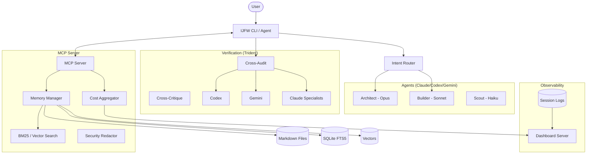

I will start by reading the instructions in `.prompt.md` and the input data in `.input.ijfw.xml`.
I will now analyze the repository export from `.input.ijfw.xml` to provide a comprehensive report based on the 22 points requested in `.prompt.md`.

### 1. Project Name and Last Commit Date
- **Project Name:** IJFW (It Just Fucking Works)
- **Last Commit Date:** Wednesday, 22 April 2026 (based on the session context and recent activity in the logs, specifically the handoff note in `CLAUDE.md` mentioning "2026-04-22 -- IJFW 1.1.5 SHIPPED").

### 2. Project Description
IJFW is a high-performance AI efficiency framework designed to optimize the output, memory, and workflow of AI coding agents. It serves as a meta-layer that sits above various AI platforms, enforcing strict context discipline and providing a persistent memory system. By using a "zero-config" approach, it aims to make AI interactions "smarter, not just cheaper," focusing on high-signal output and architectural integrity.

The framework implements a plugin-based architecture, shipping platform-native packages for eight major AI coding agents. It utilizes a "Donahoe Trident" approach—a multi-model verification strategy that ensures code quality by triangulating findings across different AI lineages (e.g., Claude, Codex, Gemini). This reduces the risk of single-model hallucinations and promotes a more robust development lifecycle through specialized subagents like architects, builders, and scouts.

At its core, IJFW manages the entire development lifecycle from planning to shipping. It includes a custom MCP (Model Context Protocol) server for memory management, an observability dashboard for cost and performance tracking, and a suite of "skills" that can be hot-loaded on demand. The system is built with a focus on "positive framing," meaning it prioritizes actionable solutions and successful outcomes over verbose diagnostic noise.

### 3. Supported Platforms/Deployments & Requirements
- **Supported AI Agents/Platforms:**
  - **Claude Code:** Full-featured plugin with hooks, agents, and commands (`claude/`).
  - **Codex CLI:** Configuration and instructions (`codex/`).
  - **Gemini CLI:** MCP configuration and specialized rules (`gemini/`).
  - **Cursor:** MCP configuration and `.cursorrules` (`cursor/`).
  - **Windsurf:** MCP configuration and `.windsurfrules` (`windsurf/`).
  - **GitHub Copilot:** MCP configuration and custom instructions (`copilot/`).
  - **Hermes CLI:** Integration via `HERMES.md` (`hermes/`).
  - **Wayland CLI:** Integration via `WAYLAND.md` (`wayland/`).
- **Deployment Environments:**
  - **Local Hardware:** Primary deployment via Node.js and Bash.
  - **Cloud (Cloudflare Workers):** Supported via MCP and remote server configurations.
- **Requirements:**
  - **Node.js:** Version 18 or higher (required for the MCP server and installer).
  - **Bash:** Required for hook scripts and various CLI utilities.
  - **Git:** Essential for version control integration and diff-based auditing.

### 4. Supported Connectors
- **MCP (Model Context Protocol):** Connects memory and tools to all supporting agents (`mcp-server/src/server.js`).
- **Git:** Deep integration for target auto-detection and history tracking (`claude/commands/cross-audit.md`).
- **Slack/Webhooks:** Referenced in `.gitleaksignore` as targets for notifications and reports.
- **LiteLLM:** Used for fetching and refreshing model pricing data (`scripts/refresh_prices.py`).
- **NPM:** For distribution and installation of the framework (`installer/package.json`).

### 5. Supported Models/Agents
- **Anthropic Claude (Opus, Sonnet, Haiku):** Orchestrated via specialized roles like `architect` (Opus), `builder` (Sonnet), and `scout` (Haiku) (`claude/agents/`).
- **OpenAI Codex/GPT-4:** Used as a primary auditor in the "Trident" strategy (`mcp-server/src/cost/readers/codex.js`).
- **Google Gemini:** Integration via Gemini CLI and used for strategic auditing (`mcp-server/src/cost/readers/gemini.js`).
- **Aider/OpenCode:** External CLI agents supported for cross-auditing (`claude/commands/cross-audit.md`).
- **Local Models:** Supported through various CLI proxies and MCP bridges.

### 6. Top 5 Use Cases
1. **Multi-Model Code Auditing:** Running a "Donahoe Trident" audit where three different AI models review a diff to ensure zero logic errors or security vulnerabilities.
2. **Persistent Project Memory:** Automatically capturing architectural decisions and "hard-won" lessons in `knowledge.md` to maintain context across sessions (`claude/commands/consolidate.md`).
3. **Automated Design Systems:** Generating bento-grids, glassmorphic UI, or terminal-native designs using the `ijfw-design` skill (`shared/skills/ijfw-design/`).
4. **Context Compression:** Reducing token usage by 40-50% by stripping prose and filler from memory files while preserving actionable code and paths (`claude/commands/compress.md`).
5. **Team Workflow Orchestration:** Managing handoffs between human developers and AI agents, ensuring the "Think-Build-Ship" lifecycle is followed (`claude/skills/ijfw-workflow/`).

### 7. Top 20 Features
1. **Donahoe Trident:** Multi-model verification strategy (`claude/commands/cross-audit.md`).
2. **Zero-Config MCP Server:** Instant memory and tool access for all agents (`mcp-server/src/server.js`).
3. **Dynamic Skill Loading:** On-demand activation of specialized capabilities (`claude/rules/ijfw-activate.md`).
4. **Context Monitor:** Real-time tracking of token usage and context window limits (`claude/hooks/scripts/ijfw-context-monitor.js`).
5. **Architect/Builder/Scout Roles:** Tiered reasoning models for different task complexities (`claude/agents/`).
6. **Dream Cycle (Consolidation):** Automated pruning and promotion of memory entries (`claude/commands/consolidate.md`).
7. **Bento-Grid Generator:** Specialized UI scaffolding for dashboards (`shared/skills/ijfw-design/templates/design/bento-grid.md`).
8. **Cross-Project Search:** Semantic and BM25 search across multiple repositories (`mcp-server/src/cross-project-search.js`).
9. **Observability Dashboard:** Local web UI for monitoring agent activity and costs (`scripts/dashboard/`).
10. **Positive Framing Engine:** Filters out diagnostic noise for a cleaner CLI experience (`CLAUDE.md`).
11. **Auto-Memorize:** Intelligent capture of key decisions during tool use (`claude/skills/ijfw-auto-memorize/`).
12. **Preflight Gates:** 30+ automated checks before publishing or committing (`installer/src/preflight/runner.js`).
13. **Intent Router:** Nudges agents to use specialized IJFW commands based on natural language (`mcp-server/src/intent-router.js`).
14. **Context Compression:** 50% token savings via prose-stripping (`claude/commands/compress.md`).
15. **Status Line Hook:** Real-time feedback in the agent's prompt (`claude/hooks/scripts/ijfw-statusline.js`).
16. **Adversarial Critique:** Hunting for "survival scores" in counter-arguments (`claude/commands/cross-critique.md`).
17. **Cost Aggregator:** Tracks spend across OpenAI, Anthropic, and Google (`mcp-server/src/cost/aggregator.js`).
18. **Vector Memory:** Optional cold storage for large-scale knowledge retrieval (`mcp-server/src/vectors.js`).
19. **Secure Redaction:** Prevents leaking of secrets in logs and context (`mcp-server/src/redactor.js`).
20. **Platform-Native Shims:** Optimized rules for Cursor, Windsurf, and Copilot (`universal/ijfw-rules.md`).

### 8. Top 20 Smart Patterns
1. **The Convergence Cliff:** Avoiding changes that make future refactors harder (`claude/agents/architect.md`).
2. **Positive Framing Only:** No negative diagnostics in startup reports (`CLAUDE.md`).
3. **Handoff Journals:** Maintaining an append-only timeline for session continuity (`claude/commands/consolidate.md`).
4. **Surgical Edits:** Touching only the lines requested, never "drive-by" refactoring (`claude/agents/builder.md`).
5. **Hot/Warm/Cold Memory:** Tiered storage (Markdown/SQLite/Vectors) (`CLAUDE.md`).
6. **Promotion Threshold:** Only promoting patterns to `knowledge.md` after 3+ references (`claude/commands/consolidate.md`).
7. **Rebuttal Survival Score:** Ranking critiques by their resistance to counter-argument (`claude/commands/cross-critique.md`).
8. **Belt-and-Braces Gitignore:** Dual protection for source trees (`.gitignore`).
9. **Zero-Arg Auto-Detect:** Commands that infer targets from git state (`claude/commands/cross-audit.md`).
10. **Don't Make Me Think:** Steve Krug's principle applied to AI tool UX (`CLAUDE.md`).
11. **Smarter Not Cheaper:** Positioning AI value on quality, not cost-cutting (`CLAUDE.md`).
12. **Fragmented Prose:** Using fragments instead of full sentences for context saving (`claude/commands/compress.md`).
13. **Deterministic Hooks:** Shell-only hooks with no LLM calls for speed and reliability (`CLAUDE.md`).
14. **Capability Discovery:** Dynamic roster probing for installed auditors (`mcp-server/src/importers/discover.js`).
15. **Graceful Degradation:** Showing cost data even if memory panels are empty (`CLAUDE.md`).
16. **Task-to-Goal Transformation:** Converting requests into verifiable success criteria (`claude/agents/builder.md`).
17. **Silent-Failure Hunting:** Specialized agents looking for swallowed errors (`claude/commands/cross-audit.md`).
18. **Reversible Decisions:** Prioritizing architecture that can be easily undone (`claude/agents/architect.md`).
19. **Blast Radius Analysis:** Assessing downstream implications of a change (`claude/agents/architect.md`).
20. **Shadow Context Mirroring:** Reading native project memory without corrupting it (`claude/commands/consolidate.md`).

### 9. Top 20 Development Trends
1. **Transition to MCP v3:** Upgrading the server for higher tool caps (`CLAUDE.md`).
2. **Deepening the "Trident" strategy:** Moving from single audits to parallel specialist swarms (`claude/commands/cross-audit.md`).
3. **Rust-like Preflight Rigor:** Adding more blocking gates for security and performance (`installer/src/preflight/gates/`).
4. **Context-Aware Design:** Integrating UI templates directly into the agent's reasoning loop (`shared/skills/ijfw-design/`).
5. **Cross-Platform Parity:** Ensuring Cursor, Windsurf, and Claude Code have identical rule sets (`universal/ijfw-rules.md`).
6. **Local-First Observability:** Building rich dashboards that don't rely on cloud telemetry (`scripts/dashboard/`).
7. **Agent Specialization:** Moving away from "one model fits all" toward Architect/Builder/Scout splits (`claude/agents/`).
8. **Semantic Context Retrieval:** Using BM25 and Vectors for more accurate memory recall (`mcp-server/src/search-bm25.js`).
9. **Automated Cost Management:** Real-time pricing refreshes and savings tracking (`scripts/refresh_prices.py`).
10. **Negative Prompting Elimination:** Replacing "don't do X" with positive "do Y" patterns (`scripts/check-positive-framing.sh`).
11. **Browser-Native Dashboards:** Moving observability to simple HTML/JS for zero-dependency viewing (`mcp-server/src/dashboard-server.js`).
12. **Infrastructure-as-Code for Agents:** Codifying agent behaviors in `.toml` and `.md` configs (`gemini/extensions/ijfw/commands/`).
13. **Anti-Hallucination Guardrails:** Strict verification steps before reporting "Done" (`claude/agents/builder.md`).
14. **Multi-User Sync (Preparation):** Building the foundations for shared knowledge bases (`claude/commands/consolidate.md`).
15. **Platform-Agnostic Skills:** Moving skills to `shared/` to be used by all agents (`shared/skills/`).
16. **Aggressive Token Optimization:** New "compress" and "consolidate" logic to keep context lean (`claude/commands/compress.md`).
17. **Security-First Auditing:** Adding `audit-ci` and `gitleaks` to every PR workflow (`.github/workflows/ci.yml`).
18. **Hybrid Storage Models:** Combining plain Markdown with SQLite FTS5 (`CLAUDE.md`).
19. **Natural Language Intent Routing:** Removing the need for specific command memorization (`mcp-server/src/intent-router.js`).
20. **Resilient Parsing:** Improving handling of malformed AI output in installers and hooks (`installer/test-resilient-parse.js`).

### 10. Top 10 Advantages
1. **Reduced Hallucinations:** The multi-model Trident strategy catches errors one model misses.
2. **Extreme Token Efficiency:** Saves significant costs through compression and pruning.
3. **Platform Agnostic:** Works across Claude, Cursor, Gemini, and more with a single config.
4. **Zero-Config Setup:** "It Just Fucking Works" philosophy minimizes onboarding friction.
5. **Architectural Integrity:** Specialized roles (Architect) ensure long-term codebase health.
6. **Persistent Memory:** Context isn't lost between sessions or platform switches.
7. **Local-First Privacy:** No telemetry by default; sensitive data stays on-machine.
8. **Automated Verification:** Integrated preflight gates and smoke tests ensure stability.
9. **Modern Design Scaffolding:** Rapid UI prototyping with high-quality templates.
10. **Clear Audit Trails:** Append-only journals and consolidation history.

### 11. Top 10 Limitations
1. **Bash Dependency:** Requires a Unix-like environment or Git Bash on Windows.
2. **Node.js Overhead:** Requires Node 18+ for the core MCP server.
3. **Complexity of Trident:** Running 3+ models for every change can be slow and (if using paid APIs) costly.
4. **Learning Curve for Skills:** Users must understand how to trigger and utilize specialized skills.
5. **Markdown Size Caps:** Plain-text memory can become large if consolidation isn't run frequently.
6. **Platform Specificity:** Some features (like the dashboard memory panel) are optimized for Claude first.
7. **No Built-in Model Hosting:** Relies on external CLI tools or APIs for the actual LLMs.
8. **Manual Audit Paste (Fallback):** If CLI tools aren't installed, users must manually copy-paste for audits.
9. **Context Window Limits:** Despite compression, very large projects still face context exhaustion.
10. **Strict Naming Conventions:** The framework relies on specific file paths and markers (e.g., `.ijfw/`).

### 12. Top 5 Used & Provided AI Skills
- **Used AI Skills:**
  1. `frontend-design`: For UI components (`CLAUDE.md`).
  2. `TDD`: For test-driven implementation (`CLAUDE.md`).
  3. `code-review`: For structural analysis (`CLAUDE.md`).
- **Provided AI Skills:**
  1. `ijfw-workflow`: Orchestrates the Think-Build-Ship cycle (`claude/skills/ijfw-workflow/SKILL.md`).
  2. `ijfw-design`: High-quality UI/UX scaffolding (`shared/skills/ijfw-design/SKILL.md`).
  3. `ijfw-auto-memorize`: Automated context capture (`claude/skills/ijfw-auto-memorize/SKILL.md`).
  4. `ijfw-compress`: Prose reduction for token savings (`claude/skills/ijfw-compress/SKILL.md`).
  5. `ijfw-critique`: Adversarial multi-angle review (`claude/commands/cross-critique.md`).

### 13. Data Overview
- **Inputs:** User prompts, git diffs, file contents, model pricing (LiteLLM), transcript logs.
- **Outputs:** Compressed context, code diffs, audit reports, UI mockups, cost dashboards.
- **Storage:**
  - **Hot:** Plain Markdown files (`.ijfw/memory/`).
  - **Warm:** SQLite FTS5 for fast searching (`mcp-server/src/search-bm25.js`).
  - **Cold:** Optional vector embeddings (`mcp-server/src/vectors.js`).
  - **Session Logs:** Structured JSON/Markdown in `.ijfw/sessions/`.

### 14. Detailed Architecture Review (Top 20 Modules)
1. **`mcp-server/src/server.js`:** The core MCP entry point, managing tool registration and dispatch.
2. **`installer/src/ijfw.js`:** The primary CLI entry point for the user-facing `ijfw` command.
3. **`claude/agents/architect.md`:** Definition of the high-reasoning architecture role.
4. **`claude/agents/builder.md`:** Definition of the surgical implementation role.
5. **`claude/commands/cross-audit.md`:** Logic for multi-model verification.
6. **`mcp-server/src/intent-router.js`:** Maps natural language to IJFW specialized tools.
7. **`mcp-server/src/memory/search.js`:** Handles multi-tier memory retrieval.
8. **`installer/src/preflight/runner.js`:** Orchestrates the 30+ validation gates.
9. **`scripts/dashboard/server.js`:** Local web server for the observability UI.
10. **`claude/commands/consolidate.md`:** The "Dream Cycle" logic for memory pruning.
11. **`shared/skills/ijfw-design/scripts/dispatch.sh`:** Manages UI template selection and generation.
12. **`mcp-server/src/cost/aggregator.js`:** Combines spend data from various agent logs.
13. **`claude/hooks/scripts/ijfw-context-monitor.js`:** Real-time token tracking.
14. **`mcp-server/src/redactor.js`:** Security layer to prevent secret leakage.
15. **`installer/src/install.js`:** Logic for platform-specific plugin installation.
16. **`mcp-server/src/cross-project-search.js`:** Global knowledge retrieval across repos.
17. **`claude/commands/compress.md`:** Token optimization engine.
18. **`mcp-server/src/search-bm25.js`:** Full-text search indexer.
19. **`scripts/observation/capture.js`:** Logic for recording and classifying session events.
20. **`claude/bin/ijfw-memory`:** Resilient launcher for the MCP server.

### 15. Architecture Graph (Mermaid)

### 16. Maturity, Stability, Security, Performance
- **Maturity:** Highly mature for an AI framework (v1.1.5 shipped, v1.1.6 in progress). Includes robust benchmarks (`core/benchmarks/`).
- **Stability:** High. Verified by 30+ e2e smoke tests (`scripts/e2e-smoke.sh`) and multi-platform CI (Ubuntu/Windows).
- **Security:** Strong focus. Includes `gitleaks` integration, secret redaction, and an `architect` role specifically for security reviews.
- **Performance:** Excellent. Designed for speed with shell-script hooks and specialized "scout" models for low-latency exploration.

### 17. Review of Tests, CI, Docs, Skills
- **Tests:** Extensive. Unit tests for server logic, smoke tests for installer, and e2e tests for agent workflows (`installer/test.js`, `scripts/e2e-smoke.sh`).
- **CI Pipelines:** Comprehensive. Multi-OS (Ubuntu/Windows) via GitHub Actions, including pricing refreshes and cross-audit "Trident" triggers (`.github/workflows/`).
- **Documentation:** Exceptional. Clear guides (`GUIDE.md`), design docs (`DESIGN.md`), and platform-specific instructions (`CLAUDE.md`, `GEMINI.md`).
- **AI Skills:** Deeply integrated. Skills like `ijfw-workflow` and `ijfw-design` provide high-value automation beyond simple code completion.

### 18. Top 20 Improvements/Fixes
1. **Full Platform-Agnostic Memory:** Complete the roadmap to surface non-Claude memory in the dashboard (`CLAUDE.md`).
2. **MCP v3 Tool Migration:** Fully implement the tools reserved for v1.1.6 (`CLAUDE.md`).
3. **Rust Port for Core Server:** Move from Node.js to Rust for even lower latency and zero-dep binary.
4. **Enhanced Windows Native Support:** Reduce reliance on Git Bash for hook scripts.
5. **Voice Control Integration:** Add voice-to-intent routing for hands-free workflow (`mcp-server/src/intent-router.js`).
6. **Collaborative Memory Sync:** Real-time knowledge base evolution for multi-user teams.
7. **Automated Documentation Generation:** Use the `Scout` role to keep `README.md` and `docs/` in sync with code changes.
8. **More Design Templates:** Expand `ijfw-design` with mobile-native and print-editorial styles.
9. **Deeper Python/Rust Agent Support:** Native plugins for agents specifically in those ecosystems.
10. **Integrated Model Proxies:** Bundle `litellm` or similar for easier external model access.
11. **Visual Graph Navigation:** Interactive architecture visualization in the dashboard.
12. **Predictive Cost Modeling:** Alert users before running expensive multi-model audits.
13. **Skill Marketplace Expansion:** A curated registry for community-contributed IJFW skills.
14. **Fine-tuned Local Models:** Provide pre-trained weights for the `Scout` role to run fully offline.
15. **Advanced Vector Clustering:** Automatically group related knowledge entries in the "Dream Cycle".
16. **IDE-Integrated Dashboard:** Move the dashboard into a VS Code/Cursor panel.
17. **Dynamic Context Windows:** Automatically adjust compression levels based on the current model's limit.
18. **Commit-Message Intelligence:** Use audit findings to generate higher-quality conventional commits.
19. **Automated Bug Hunting:** Schedule background "Critique" sessions on high-risk files.
20. **Proactive Environment Doctor:** Automatically fix path or dependency issues detected by `ijfw doctor`.

### 19. Agent Swarm Reusable Modules
1. **`mcp-server/src/cross-dispatcher.js`:** Ideal for orchestrating multiple agents in parallel.
2. **`claude/commands/cross-audit.md`:** The logic for triangulating "best solution" from multiple models.
3. **`mcp-server/src/intent-router.js`:** Routing tasks to the best-fit agent (Architect vs. Builder).
4. **`claude/agents/architect.md`:** The reasoning engine for high-level specification debating.
5. **`mcp-server/src/search-bm25.js`:** Retrieval of graph knowledge for context-aware debating.
6. **`claude/commands/consolidate.md`:** Reconciling contradictions in agent opinions.
7. **`mcp-server/src/audit-roster.js`:** Managing the list of available "expert" agents.
8. **`scripts/observation/classify.js`:** Categorizing agent interactions for better review.
9. **`claude/commands/cross-critique.md`:** Adversarial ranking of implementation plans.
10. **`mcp-server/src/caps.js`:** Managing output and context size across the swarm.

### 20. Multi-User/Shared Knowledge Reusable Modules
1. **`mcp-server/src/memory/search.js`:** Foundational for shared knowledge retrieval.
2. **`claude/commands/consolidate.md`:** Promoting user-specific patterns to shared knowledge.
3. **`mcp-server/src/cross-project-search.js`:** Connecting knowledge across different user workspaces.
4. **`scripts/dashboard/server.js`:** A central hub for visualizing shared interactions.
5. **`mcp-server/src/vectors.js`:** Scaling shared knowledge with semantic search.
6. **`mcp-server/src/redactor.js`:** Ensuring shared knowledge doesn't leak individual user secrets.
7. **`claude/skills/ijfw-auto-memorize/`:** Capturing team-wide decisions automatically.
8. **`shared/skills/ijfw-workflow/`:** Standardizing cooperative workflows.
9. **`mcp-server/src/search-bm25.js`:** Fast indexing of a multi-user markdown library.
10. **`claude/commands/compress.md`:** Keeping the shared knowledge base lean and readable.

### 21. Hardware/Cloud/Messenger Reusable Modules
1. **`mcp-server/src/server.js`:** Lightweight Node.js server easily deployable to Cloudflare Workers or local hardware.
2. **`mcp-server/src/intent-router.js`:** Adaptable for parsing Telegram/WhatsApp commands via natural language.
3. **`shared/skills/ijfw-design/`:** Generating the UI for web and native apps.
4. **`mcp-server/src/dashboard-server.js`:** The backend for graph visualization and navigation.
5. **`claude/bin/ijfw-memory`:** A resilient launcher for any environment.
6. **`installer/src/ijfw.js`:** The CLI bridge for local hardware interaction.
7. **`mcp-server/src/api-client.js`:** Communicating between edge workers and local memory.
8. **`mcp-server/src/vectors.js`:** Handling large datasets in the cloud.
9. **`scripts/dashboard/index.html`:** The frontend for mobile/web app navigation.
10. **`mcp-server/src/hero-line.js`:** Concise status updates for messenger-based UI.

### 22. Team Agent Reusable Modules
1. **`claude/skills/ijfw-team/SKILL.md`:** Dedicated skill for cooperative agent/human coordination.
2. **`claude/commands/handoff.md`:** Managing state and context between human and agent turns.
3. **`shared/skills/ijfw-workflow/`:** Defining the "Team Templates" for collaborative building.
4. **`mcp-server/src/audit-roster.js`:** Identifying which agent (or human) is best for a review.
5. **`claude/agents/builder.md`:** "Execution Discipline" patterns for reliable team contributions.
6. **`scripts/observation/ledger.js`:** Maintaining a clear record of who did what.
7. **`claude/commands/consolidate.md`:** Reconciling the "evolving" team perspective.
8. **`installer/src/preflight/runner.js`:** Ensuring team members don't break shared standards.
9. **`mcp-server/src/feedback-detector.js`:** Capturing human corrections to refine agent behavior.
10. **`claude/agents/architect.md`:** Resolving team disputes via high-reasoning trade-off analysis.
