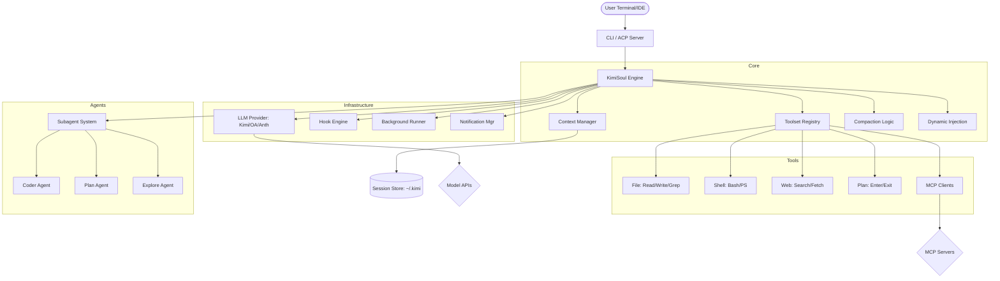

I will read the instructions in `./.prompt.md` to determine the task.
I will read the beginning of `kimi-cli.xml` to understand its structure and content.
I will read the `README.md` content from `kimi-cli.xml` to find the project name and description.
I will read the `README.md` content from `kimi-cli.xml` starting from line 22048.
I will search for the `src` directory structure in `kimi-cli.xml` to locate model and connector implementations.
I will read `src/kimi_cli/llm.py` to identify the supported models and providers.
I will read `src/kimi_cli/llm.py` from `kimi-cli.xml` starting from line 26720.
I will read `src/kimi_cli/config.py` from `kimi-cli.xml` to determine the default providers and models.
I will search for the `src/kimi_cli/tools/` directory in `kimi-cli.xml` to identify available tools.
I will search for `ralph` in `kimi-cli.xml` to understand its role and implementation.
I will read `CHANGELOG.md` from `kimi-cli.xml` to identify the latest development trends.
I will read `src/kimi_cli/soul/compaction.py` and `src/kimi_cli/soul/kimisoul.py` from `kimi-cli.xml` to gain a deeper understanding of the core logic.
I will read `src/kimi_cli/soul/kimisoul.py` from `kimi-cli.xml` to continue my architectural review.
I will read `src/kimi_cli/agents/default/agent.yaml` from `kimi-cli.xml` to understand agent definitions.
# Kimi Code CLI - Comprehensive Project Analysis

## 1. Project Overview
**Kimi Code CLI** is a sophisticated terminal-native AI agent designed to autonomously handle complex software engineering tasks. It operates as an expert partner capable of reading, writing, and editing code across entire repositories, executing shell commands, and conducting web-based research to solve technical problems.

The project is built around the "KimiSoul" engine, which manages an agent's lifecycle, context, and tool interactions. It emphasizes a "Research -> Strategy -> Execution" workflow, often utilizing a dedicated "Plan Mode" to ensure rigorous design before any destructive changes are applied to the codebase.

Beyond a simple CLI, it serves as a platform for agentic workflows, featuring a modular architecture that supports Model Context Protocol (MCP) for tool expansion, Agent Client Protocol (ACP) for IDE integration (VS Code, Zed, JetBrains), and a robust multi-agent system for task delegation.

## 2. Supported Platforms and Requirements
- **Platforms:**
  - **Operating Systems:** Windows (via PowerShell), Linux, and macOS (via Bash).
  - **Terminal Environments:** Standard shells (Bash, Zsh, PowerShell), with specialized Zsh integration via `zsh-kimi-cli`.
- **Deployments:**
  - **Standalone CLI:** The primary interface for terminal-based interaction.
  - **VS Code Extension:** Integrated coding experience within the editor.
  - **ACP Server:** Can run as an agent server for ACP-compatible IDEs.
  - **Web UI:** Provides interactive visualizations and side panels.
- **Requirements:**
  - **Python:** Version >= 3.12 (development uses 3.14).
  - **Tools:** `uv` (recommended for installation and package management).
  - **Build Dependencies:** Node.js/npm (required for building the embedded web UI and visualizations).

## 3. Supported Connectors
| Connector | Description | Source Reference |
| :--- | :--- | :--- |
| **MCP (Model Context Protocol)** | Dynamic tool expansion via external MCP servers. | `src/kimi_cli/cli/mcp.py`, `src/kimi_cli/acp/mcp.py` |
| **ACP (Agent Client Protocol)** | Standardized protocol for IDE-agent communication. | `src/kimi_cli/acp/server.py` |
| **VS Code Extension** | Direct integration with Visual Studio Code. | `docs/en/customization/plugins.md` |
| **Zsh Integration** | Deep shell integration with `Ctrl-X` agent toggle. | `README.md` (zsh-kimi-cli repo) |
| **Moonshot Search** | Proprietary web search API for real-time information. | `src/kimi_cli/tools/web/search.py` |
| **Moonshot Fetch** | Specialized service for fetching and parsing web pages. | `src/kimi_cli/tools/web/fetch.py` |
| **Git Integration** | Context-aware file discovery and metadata extraction. | `src/kimi_cli/subagents/git_context.py` |

## 4. Supported Models and Agents
- **Supported Models (via `src/kimi_cli/llm.py`):**
  - **Kimi (Moonshot AI):** Primary optimized model with specialized headers and tracking.
  - **OpenAI:** Support for both legacy and modern Chat Completions APIs.
  - **Anthropic (Claude):** Integration for Claude 3/3.5 models.
  - **Google (Gemini):** Native support for Gemini Pro/Flash models.
- **Specialized Agents (via `src/kimi_cli/agents/default/`):**
  - **General Coder:** Handles broad software engineering tasks (`coder.yaml`).
  - **Explore Agent:** Optimized for rapid codebase navigation and reading (`explore.yaml`).
  - **Plan Agent:** Specialized in creating implementation plans without making changes (`plan.yaml`).
  - **Okabe:** A custom agent profile (`src/kimi_cli/agents/okabe/agent.yaml`).

## 5. Top 5 Use Cases
1. **Autonomous Refactoring:** Agent plans changes across multiple files, executes edits using `StrReplaceFile`, and validates results via shell-based tests.
2. **Terminal-Agent Dual Workflow:** User toggles between manual shell commands and agent assistance using `Ctrl-X` without losing context.
3. **Complex Bug Diagnosis:** Agent searches the web for error messages, greps the local codebase for patterns, and proposes a fix.
4. **Long-running Background Tasks:** Agent executes a multi-step build or migration in the background, notifying the user via desktop alerts upon completion.
5. **IDE-Integrated Assistance:** Developers use the Kimi agent directly within VS Code or Zed to generate boilerplate or explain legacy code.

## 6. Top 20 Features
| Feature | Description | Source Reference |
| :--- | :--- | :--- |
| **Shell Mode Toggle** | `Ctrl-X` switches between shell and agent. | `src/kimi_cli/cli/__main__.py` |
| **Ralph Mode** | Automatic iteration loop for continuous task execution. | `src/kimi_cli/soul/kimisoul.py` |
| **Plan Mode** | Enforced read-only state for strategy formulation. | `src/kimi_cli/soul/dynamic_injections/plan_mode.py` |
| **Auto-Compaction** | Smart summarization to manage long context histories. | `src/kimi_cli/soul/compaction.py` |
| **MCP Integration** | Seamless connection to third-party tool servers. | `src/kimi_cli/acp/mcp.py` |
| **ACP Support** | Universal IDE compatibility via standard protocol. | `src/kimi_cli/acp/server.py` |
| **Background Tasks** | Asynchronous execution of long-running operations. | `src/kimi_cli/background/manager.py` |
| **Notifications** | Desktop and LLM-based task completion alerts. | `src/kimi_cli/notifications/manager.py` |
| **Session Forking** | Duplicate sessions to branch development paths. | `src/kimi_cli/session_fork.py` |
| **Session Undo** | Revert to previous turns and fork from there. | `src/kimi_cli/soul/slash.py` |
| **Git File Discovery** | High-performance file searching using Git internals. | `src/kimi_cli/utils/file_filter.py` |
| **Sensitive File Protection** | Blocks access to secrets like `.env` and SSH keys. | `src/kimi_cli/tools/file/utils.py` |
| **Interactive Visualization** | Real-time UI components in the terminal. | `src/kimi_cli/cli/vis.py` |
| **Side Questions (/btw)** | Ask quick questions without breaking the main flow. | `src/kimi_cli/soul/btw.py` |
| **YOLO Mode** | Auto-approval for tool calls in trusted environments. | `src/kimi_cli/soul/dynamic_injections/yolo_mode.py` |
| **Dual-Channel Input** | Queue or steer messages during active streaming. | `src/kimi_cli/soul/kimisoul.py` |
| **Skill System** | Reusable toolsets and prompt templates. | `src/kimi_cli/skill/__init__.py` |
| **Hook Engine** | Lifecycle event triggers for custom workflows. | `src/kimi_cli/hooks/engine.py` |
| **Plugin Manager** | Extensible architecture for adding capabilities. | `src/kimi_cli/plugin/manager.py` |
| **Subagent Delegation** | Specialized sub-processes for focused tasks. | `src/kimi_cli/subagents/core.py` |

## 7. Top 20 Smart Patterns
1. **Research-First Injection:** Reminds the agent to research before acting if in Plan Mode (`plan_mode.py`).
2. **Context-Aware Truncation:** Gracefully handles CJK text shortening in UI (`shorten()` utility).
3. **Adaptive Compaction:** Triggers summarization based on token usage ratios or reserved buffers (`compaction.py`).
4. **Retryable Error Classification:** Automatically retries on specific HTTP status codes and network drops (`kimisoul.py`).
5. **Back-to-the-Future Reversion:** Exception-based flow to revert context to checkpoints on failure (`kimisoul.py`).
6. **Thinking-Only Detection:** Retries if LLM outputs reasoning but no action (`CHANGELOG.md`).
7. **OAuth Token Pre-warming:** Refreshes credentials at start of turn to prevent timeouts (`kimisoul.py`).
8. **Slug-Based Path Stability:** Generates stable IDs for plan files that survive restarts (`kimisoul.py`).
9. **Dual-Sink Approval:** Routes approval requests to either terminal or wire client depending on active UI (`kimisoul.py`).
10. **Prompt Cache Alignment:** Uses consistent system prompts for side-questions to optimize cache (`btw.py`).
11. **Git-Recurse Discovery:** Uses `git ls-files` with timeout for massive repos (`CHANGELOG.md`).
12. **Anti-Storm Todo Persistence:** Prevents infinite tool loops by persisting state files (`CHANGELOG.md`).
13. **Negative Line Offset:** Supports "tail" mode for reading logs via `ReadFile` tool (`CHANGELOG.md`).
14. **Fail-Open Hooks:** Ensures execution continues if a lifecycle hook times out (`hooks/config.py`).
15. **Neutral Markdown Theme:** Overrides terminal colors to prevent unreadable text (`CHANGELOG.md`).
16. **CWD Loss Detection:** Gracefully handles disconnection from the working directory (`CHANGELOG.md`).
17. **Dynamic Tool Masking:** Hides destructive tools during Plan Mode based on runtime state (`kimisoul.py`).
18. **Prompt Flow-based Ralph Loop:** Replaced hardcoded loop with a modular flow engine (`CHANGELOG.md`).
19. **Ad-hoc MCP Injection:** Allows connecting to MCP servers via command line flags (`cli/mcp.py`).
20. **Self-Correcting Status Updates:** Syncs client UI when mode changes mid-execution (`kimisoul.py`).

## 8. Top 20 Development Trends (Latest Commits)
1. **Modularizing UI Logic:** Splitting large files into specialized packages (e.g., `visualize/`).
2. **Resilience to Network Instability:** Better handling of `APIError` during long streams.
3. **Enhancing Session Navigation:** Full-screen session pickers and directory-scoped filtering.
4. **Advanced Input Control:** Queuing and steering inputs during active model turns.
5. **Formalizing Side Conversations:** Introduction of the `/btw` command for non-interrupting queries.
6. **Cross-Client Protocol Maturation:** Adding wire events for hooks and side questions.
7. **Security Hardening:** Implementing sensitive file protection and path traversal guards.
8. **Context Management Refinement:** Adding line counts and tail-reading to file tools.
9. **Agentic Strategy Improvements:** Defaulting to Plan Mode for complex sessions.
10. **Session Integrity:** Tolerating malformed persisted state during resume cycles.
11. **User Experience Polish:** Improving elapsed time formatting and CJK text handling.
12. **Skill Discovery Overhaul:** Merging skills from multiple brand-specific directories.
13. **Tool Call Storm Prevention:** Persisting tool state to avoid repetitive identical calls.
14. **Diagnostics Enrichment:** Adding system manifests and log files to exports.
15. **Interactive Completion Logic:** Tuning auto-triggers to respect user typing speed.
16. **Environment Awareness:** Detecting loss of working directory (e.g., unplugged drives).
17. **Theme Consistency:** Neutralizing Markdown rendering across diverse terminal themes.
18. **Performance Optimization:** Primary use of Git-based file discovery for large scales.
19. **Session Portability:** Unified `--session`/`--resume` flags with interactive pickers.
20. **IDE Bridge Stability:** Fixing hanging approval requests in parallel agent scenarios.

## 9. Top 10 Advantages
1. **Terminal/IDE Hybridity:** Seamless transition between CLI and VS Code.
2. **Context Efficiency:** Advanced compaction and checkpointing systems.
3. **Extensible Architecture:** MCP and Skill systems allow for infinite tool growth.
4. **Protocol Native:** Built on ACP/MCP standards, ensuring longevity.
5. **Autonomous Planning:** Dedicated "Plan Mode" prevents half-baked executions.
6. **Resilient Loop:** "Ralph Mode" and retry logic handle intermittent failures.
7. **Multi-Model Flexibility:** Not locked into a single LLM provider.
8. **Background Execution:** True multi-tasking for long-running operations.
9. **Human-in-the-Loop:** Sophisticated approval and steering mechanisms.
10. **Security Conscious:** Built-in guards against leaking secrets.

## 10. Top 10 Limitations
1. **High Python Version Requirement:** Requires Python 3.12+, which may be unavailable on older LTS servers.
2. **Build Complexity:** Requires Node.js/npm for web assets, complicating pure Python setups.
3. **Token Consumption:** Complex autonomous loops can be expensive without strict limits.
4. **Terminal Rendering Variability:** Markdown/Rich styles may clash with some custom terminal themes.
5. **Connectivity Dependency:** Relies on stable cloud APIs (no native local-only LLM mode shown).
6. **Learning Curve:** Managing MCP/ACP and custom agents requires technical depth.
7. **Notification Fragmenting:** Desktop alerts vary by OS and may fail in SSH sessions.
8. **Context Window Limits:** Despite compaction, massive histories can still exceed LLM limits.
9. **Sub-Agent Latency:** Spawning sub-agents adds overhead and multiple LLM round-trips.
10. **Web UI Overhead:** The embedded web viewer adds resource usage compared to pure text.

## 11. Top 5 Used and Provided AI Skills
- **kimi-cli-help:** Interactive guide for project features. (`src/kimi_cli/skills/kimi-cli-help/SKILL.md`)
- **skill-creator:** Bootstraps the creation of new custom skills. (`src/kimi_cli/skills/skill-creator/SKILL.md`)
- **gen-changelog:** Automates changelog generation from commit history. (`.agents/skills/gen-changelog/SKILL.md`)
- **pull-request:** Assists in drafting and managing GitHub PRs. (`.agents/skills/pull-request/SKILL.md`)
- **codex-worker:** Specialized worker for codebase indexing tasks. (`.agents/skills/codex-worker/SKILL.md`)

## 12. Data Overview
- **Inputs:** Terminal prompts, file system contents, shell outputs, web scraping data, MCP tool responses.
- **Outputs:** File modifications, shell commands, interactive visualizations, session exports (`kimi export`).
- **Storage:**
  - **Config:** `~/.kimi/config.toml` (Settings, Providers, Models). (`src/kimi_cli/config.py`)
  - **Sessions:** `~/.kimi/sessions/` (JSONL history, checkpoints, state). (`src/kimi_cli/session.py`)
  - **Metadata:** `~/.kimi/kimi.json` (Working directory mapping). (`src/kimi_cli/metadata.py`)
  - **Logs:** `~/.kimi/logs/` (Detailed execution traces).

## 13. Detailed Architecture Review
1. **KimiSoul:** The central orchestration engine managing loops, context, and state. (`src/kimi_cli/soul/kimisoul.py`)
2. **LLM Provider:** Unified interface for various LLM backends (OpenAI, Anthropic, Gemini). (`src/kimi_cli/llm.py`)
3. **Context Manager:** Handles history normalization, checkpointing, and compaction. (`src/kimi_cli/soul/context.py`)
4. **Toolset:** Registry and execution handler for all agent capabilities. (`src/kimi_cli/soul/toolset.py`)
5. **ACP Server:** Implements Agent Client Protocol for IDE bridging. (`src/kimi_cli/acp/server.py`)
6. **MCP Client:** Manages connections to external Model Context Protocol servers. (`src/kimi_cli/cli/mcp.py`)
7. **Background Runner:** Manages non-blocking task execution and polling. (`src/kimi_cli/background/manager.py`)
8. **Notification System:** Handles alert delivery and event wiring. (`src/kimi_cli/notifications/manager.py`)
9. **Hook Engine:** Lifecycle event dispatcher for custom extensions. (`src/kimi_cli/hooks/engine.py`)
10. **Subagent System:** Spawns specialized agents with independent toolsets. (`src/kimi_cli/subagents/core.py`)
11. **Session Store:** Persists conversation history and agent state to disk. (`src/kimi_cli/session.py`)
12. **Dynamic Injection:** Injects reminders and context into the prompt stream. (`src/kimi_cli/soul/dynamic_injection.py`)
13. **Plugin System:** Loads external capabilities at runtime. (`src/kimi_cli/plugin/manager.py`)
14. **Skill Manager:** Manages reusable markdown-based agent skills. (`src/kimi_cli/skill/__init__.py`)
15. **CLI Router:** Main entry point handling command parsing and shell switching. (`src/kimi_cli/cli/__init__.py`)
16. **Visualizer:** Modular package for rendering interactive terminal components. (`src/kimi_cli/cli/vis.py`)
17. **Approval Runtime:** Manages human-in-the-loop validation flow. (`src/kimi_cli/soul/approval.py`)
18. **D-Mail:** Internal messaging system for agent-agent or agent-user comms. (`src/kimi_cli/soul/btw.py`)
19. **File Filter:** Git-aware discovery logic for high-performance file access. (`src/kimi_cli/utils/file_filter.py`)
20. **Config Loader:** Manages TOML-based user preferences and secrets. (`src/kimi_cli/config.py`)

## 14. Architecture Diagram (Mermaid)

## 15. Maturity, Stability, Security, Performance
- **Maturity:** High (v1.30.0). Extensive feature set including IDE protocols and multi-agent flows.
- **Stability:** High. Detailed error recovery for streaming and network issues, with a robust test suite.
- **Security:** Strong. Implements sensitive file protection, OAuth, and path traversal guards.
- **Performance:** Optimized. Uses Git-based file discovery and background execution to maintain responsiveness.

## 16. Review of Tests and Documentation
- **Tests:** Comprehensive. Uses `pytest` with specialized tests for core loops (`test_kimisoul_ralph_loop.py`).
- **CI Pipelines:** Mature. GitHub workflows for linting, type-checking, and cross-platform releases.
- **Documentation:** Excellent. Multilingual (EN/ZH) documentation covering all aspects from installation to custom MCP servers.
- **AI Skills:** Integrated. Uses skills for help, PRs, and changelogs, dogfooding its own features.

## 17. Possible Improvements or Fixes
1. **Local LLM Support:** Integrate with Ollama or Llama.cpp for air-gapped usage. (`src/kimi_cli/llm.py`)
2. **Enhanced Diffing:** Visual side-by-side diffs in the terminal before applying `StrReplaceFile`. (`src/kimi_cli/cli/vis.py`)
3. **Shared Knowledge Graph:** Persist a graph of codebase relationships across sessions. (`src/kimi_cli/soul/context.py`)
4. **Voice Control:** Add STT/TTS for hands-free terminal operation. (`src/kimi_cli/cli/__init__.py`)
5. **PDF/Image Tools:** Native support for reading media files beyond basic bytes. (`src/kimi_cli/tools/file/read_media.py`)
6. **Remote Tunneling:** Built-in support for agents on remote servers over SSH/Wireguard. (`src/kimi_cli/acp/server.py`)
7. **Granular Permissions:** Allow-listing specific shell commands instead of full shell access. (`src/kimi_cli/tools/shell/__init__.py`)
8. **Auto-fix Linting:** Built-in skill to run project linters and fix errors before committing. (`src/kimi_cli/plugin/tool.py`)
9. **Faster Startup:** Parallelize MCP server initialization for large configs. (`src/kimi_cli/acp/mcp.py`)
10. **Agent Memory:** Long-term memory storage for user preferences and project quirks. (`src/kimi_cli/metadata.py`)
11. **Browser Integration:** Native tool for interactive browser control (e.g. Playwright). (`src/kimi_cli/tools/web/__init__.py`)
12. **Collaborative Mode:** Multi-user session sharing via the ACP server. (`src/kimi_cli/acp/server.py`)
13. **Mobile App Bridge:** Dedicated protocol for mobile-to-CLI interaction. (`src/kimi_cli/acp/types.py`)
14. **Custom Visualization DSL:** Allow users to define their own UI components in YAML. (`src/kimi_cli/cli/vis.py`)
15. **Token Usage Dashboards:** Real-time cost tracking in the Web UI. (`src/kimi_cli/soul/compaction.py`)
16. **Automatic Rollback:** Git-integrated state restoration on turn failure. (`src/kimi_cli/soul/kimisoul.py`)
17. **Skill Marketplace:** Centralized loading of community-contributed skills. (`src/kimi_cli/skill/__init__.py`)
18. **Context-Aware Throttling:** Adjust LLM thinking effort based on task complexity. (`src/kimi_cli/llm.py`)
19. **Conflict Resolution:** Better handling of concurrent file edits between user and agent. (`src/kimi_cli/tools/file/write.py`)
20. **Interactive Debugger:** Step-by-step agent execution mode for troubleshooting. (`src/kimi_cli/soul/kimisoul.py`)

## 18-21. Reuse for Swarms, Shared Knowledge, Cloud, and Teams
| Domain | Reusable Components | Source Reference |
| :--- | :--- | :--- |
| **Agent Swarm** | `subagents/core.py`, `soul/btw.py`, `soul/compaction.py` | Core loop and delegation. |
| **Shared Knowledge** | `session.py`, `metadata.py`, `soul/context.py` | State and context persistence. |
| **Cloud/Remote** | `acp/server.py`, `notifications/wire.py`, `llm.py` | Protocol-based remote communication. |
| **Team Agents** | `hooks/engine.py`, `soul/approval.py`, `soul/dynamic_injection.py` | Cooperative event triggers. |
