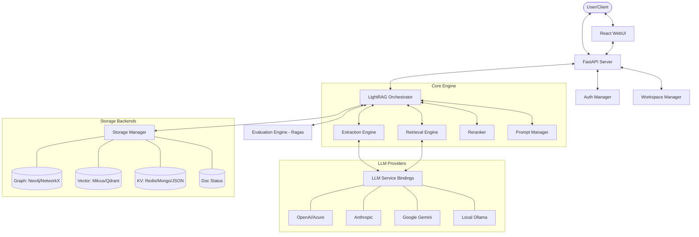

I will start by reading the `.prompt.md` file to understand the instructions.
I will read the `.input.lightrag.xml` file to analyze the repository export and answer the points requested in `.prompt.md`.
I will search for the `<git_log_commit/>` tag in the `.input.lightrag.xml` file to find the last commit date and project name, and also look for the `README.md` content.
I will search for the string `path="README.md"` in the `.input.lightrag.xml` file to find the content of the `README.md` file.
I will check the end of the `.input.lightrag.xml` file to find the git logs and the last commit date.
I will read the `AGENTS.md` file to see if it contains information about "AI skills" or agents.
I will grep for `AGENTS.md` in the `.input.lightrag.xml` file to confirm its existence and location.
I will check the directory structure in `.input.lightrag.xml` again to see if there is a `skills/` directory or any other related folder.
I will read the `lightrag/prompt.py` file to see the prompts and tasks the system performs.
I will search for `path="lightrag/prompt.py"` in the `.input.lightrag.xml` file to read its content.
I will read the `lightrag/prompt.py` file from the `.input.lightrag.xml` file by specifying the line range to see the actual prompts.
I will search for `path="lightrag/lightrag.py"` in the `.input.lightrag.xml` file to understand the main orchestration logic.
Based on the repository export and analysis of the codebase, here is the detailed report for the LightRAG project.

# LightRAG Project Analysis Report

### 1. Project Name and Last Commit Date
*   **Project Name:** LightRAG: Simple and Fast Retrieval-Augmented Generation
*   **Last Commit Date:** 2026-04-23 18:42:29 +0800
*   **Reference:** `<git_log_commit/>` in `.input.lightrag.xml`

### 2. Project Description
LightRAG is an advanced, production-ready Retrieval-Augmented Generation (RAG) framework designed to enhance information retrieval and generation through a hybrid approach combining Knowledge Graphs (KG) and Vector Databases. It aims to overcome the limitations of traditional RAG systems by capturing complex relationships between entities, providing more accurate and contextually rich answers.

The system is built with modularity and extensibility at its core, supporting a vast array of storage backends (both graph and vector) and LLM providers (both local and remote). It offers a robust API server based on FastAPI and a modern, high-performance WebUI built with React 19 and Bun, facilitating seamless document management and knowledge exploration.

With features like workspace isolation, JWT-based authentication, and incremental indexing, LightRAG is suitable for both personal "second brain" applications and enterprise-level knowledge management systems. It emphasizes stability, performance, and ease of deployment via Docker and Kubernetes.

### 3. Supported Platforms and Requirements
*   **Platforms:**
    *   **Docker:** Supports multi-platform builds (linux/amd64, linux/arm64).
    *   **Kubernetes:** Helm charts provided for deployment on K8s clusters.
    *   **Local (Python):** Supported on Linux, macOS, and Windows.
*   **Deployment Options:**
    *   **Lite Docker:** Minimal image for core functionality.
    *   **Full Docker:** Includes all optional storage and LLM dependencies.
*   **Requirements:**
    *   **Python:** 3.10, 3.11, or 3.12 (`pyproject.toml`).
    *   **Frontend:** Bun (Required for WebUI development/build), Node.js (Alternative).
    *   **Databases (Optional based on config):** Neo4j, PostgreSQL (with pgvector and AGE), MongoDB, Redis, Milvus, Qdrant, OpenSearch.
*   **Source References:** `Dockerfile`, `docker-compose.yml`, `k8s-deploy/`, `pyproject.toml`, `lightrag_webui/package.json`.

### 4. Supported Connectors
*   **Graph Storage:**
    *   **NetworkX:** `lightrag/kg/networkx_impl.py` (In-memory default)
    *   **Neo4j:** `lightrag/kg/neo4j_impl.py`
    *   **PostgreSQL (AGE):** `lightrag/kg/postgres_impl.py`
    *   **Memgraph:** `lightrag/kg/memgraph_impl.py`
*   **Vector Storage:**
    *   **NanoVectorDB:** `lightrag/kg/nano_vector_db_impl.py` (Local default)
    *   **Milvus:** `lightrag/kg/milvus_impl.py`
    *   **Qdrant:** `lightrag/kg/qdrant_impl.py`
    *   **PostgreSQL (pgvector):** `lightrag/kg/postgres_impl.py`
    *   **OpenSearch:** `lightrag/kg/opensearch_impl.py`
    *   **Faiss:** `lightrag/kg/faiss_impl.py`
    *   **MongoDB (Atlas Vector Search):** `lightrag/kg/mongo_impl.py`
*   **Key-Value Storage:**
    *   **JsonKVStorage:** `lightrag/kg/json_kv_impl.py`
    *   **Redis:** `lightrag/kg/redis_impl.py`
    *   **MongoDB:** `lightrag/kg/mongo_impl.py`
*   **LLM Providers:**
    *   **OpenAI / Compatible:** `lightrag/llm/openai.py`
    *   **Anthropic:** `lightrag/llm/anthropic.py`
    *   **Google Gemini:** `lightrag/llm/gemini.py`
    *   **Azure OpenAI:** `lightrag/llm/azure_openai.py`
    *   **AWS Bedrock:** `lightrag/llm/bedrock.py`
    *   **Ollama (Local):** `lightrag/llm/ollama.py`
    *   **HuggingFace:** `lightrag/llm/hf.py`
    *   **ZhipuAI:** `lightrag/llm/zhipu.py`

### 5. Supported Models and Agents
*   **Local Models:**
    *   **Ollama:** Llama 3, Qwen, Mistral, etc. (API token not required for local run).
    *   **HuggingFace:** Local execution via `transformers` and `torch`.
    *   **LMDeploy / LoLLMs:** Integration with local inference servers.
*   **Remote Models:**
    *   **OpenAI:** GPT-4o, GPT-3.5 (API Token).
    *   **Anthropic:** Claude 3.5 Sonnet/Opus (API Token).
    *   **Google:** Gemini 1.5 Pro/Flash (API Token).
    *   **DeepSeek:** Supported via OpenAI-compatible endpoints.
*   **Specialized Agents:**
    *   **Extraction Agent:** Handles entity and relationship discovery from raw text (`lightrag/operate.py`).
    *   **Retrieval Agent:** Coordinates multi-mode querying (Global, Local, Hybrid) (`lightrag/operate.py`).
*   **Source References:** `lightrag/llm/`, `lightrag/operate.py`.

### 6. Top 5 Use Cases and Workflows
1.  **Enterprise Knowledge Management:**
    *   *Workflow:* Ingest internal PDFs/MDs → Extract entities/relations into Neo4j → Query via Hybrid mode for accurate cross-departmental answers.
2.  **Academic Research Assistant:**
    *   *Workflow:* Import research papers → Build concept graph → Generate literature summaries and find hidden connections between distant papers.
3.  **Codebase Deep-Dive:**
    *   *Workflow:* Index source code as documents → Map function calls as relationships → Ask complex questions about system architecture.
4.  **Customer Support Automation:**
    *   *Workflow:* Feed product manuals into LightRAG → Integrate with chat bot via API → Provide hallucination-free support with source citations.
    *   **Personal Second Brain:**
    *   *Workflow:* Sync personal notes/clippings → Use WebUI to visualize knowledge clusters → Retrieve information through natural language dialogue.

### 7. Top 20 Features
1.  **Hybrid Retrieval (Vector + Graph):** Combines semantic search with relationship traversal.
2.  **Multi-Database Support:** Plug-and-play for Neo4j, Milvus, Postgres, etc.
3.  **Workspace Isolation:** Data separation for different projects or users (`lightrag/namespace.py`).
4.  **Incremental Indexing:** Efficiently update knowledge without re-indexing everything.
5.  **Graph Visualization:** Interactive graph explorer in WebUI using Sigma.js.
6.  **JWT Authentication:** Secure API access with role-based controls (`lightrag/api/auth.py`).
7.  **Multi-Mode Querying:** Global, Local, Hybrid, and Naive modes for different context needs.
8.  **Reranking Integration:** Support for Jina, Cohere, and Aliyun rerankers (`lightrag/rerank.py`).
9.  **Real-time Pipeline Tracking:** Monitor document processing status (`lightrag/kg/json_doc_status_impl.py`).
10. **Custom Prompt Management:** Easily override system prompts for specialized tasks (`lightrag/prompt.py`).
11. **Multi-Language Support:** I18n for WebUI and summaries in various languages.
12. **Dockerized Deployment:** Simplified setup with Docker Compose.
13. **API-First Design:** Full feature parity between CLI and REST API.
14. **Incremental Knowledge Injection:** Add custom KG triples manually (`examples/insert_custom_kg.py`).
15. **Context Token Management:** Dynamic token allocation for prompts and context (`lightrag/operate.py`).
16. **LLM Response Caching:** Hash-based caching to reduce costs and latency.
17. **Unified Storage Interface:** Abstracted base classes for easy new backend implementation (`lightrag/base.py`).
18. **Evaluation Suite:** Integration with Ragas for RAG quality metrics (`lightrag/evaluation/`).
19. **Interactive Setup Wizard:** Streamlined installation via CLI (`scripts/setup/`).
20. **Cosign Signed Images:** Verified Docker images for enhanced security.

### 8. Top 20 Smart Patterns
1.  **Dual Embedding Format Compatibility:** Handles both base64 and list formats from different providers (`lightrag/llm/openai.py`).
2.  **Deterministic Lock Sorting:** Prevents deadlocks by sorting relationship keys before locking (`lightrag/utils.py`).
3.  **Snapshot Iteration for Generators:** Avoids holding locks during async yields to prevent deadlocks (`lightrag/tools/migrate_llm_cache.py`).
4.  **Linear Gradient Weighted Polling:** Fair resource allocation for chunk selection (`lightrag/operate.py`).
5.  **Round-Robin Mode Merging:** Eliminates bias towards specific retrieval modes.
6.  **Dependency Injection for Config:** Components receive config objects rather than direct imports (`lightrag/api/config.py`).
7.  **Pop-based Data Deserialization:** Robustly handles schema evolution by removing deprecated fields during load (`lightrag/kg/json_kv_impl.py`).
8.  **Graceful Event Loop Shutdown:** Handles loop mismatches in Neo4j and other async drivers.
9.  **Priority-based Request Queueing:** Ensures critical tasks are processed first in high-concurrency environments.
10. **Stateless JWT Tokens:** Scalable authentication without session storage.
11. **Workspace-Aware Pathing:** Automatic isolation of data files based on workspace ID.
12. **Dynamic Versioning:** Single source of truth for package and API versions.
13. **Pre-commit Quality Gates:** Automated linting and formatting enforced before commits.
14. **CI-Ready Offline Tests:** Marker-based test separation for fast feedback without external APIs.
15. **Environment Variable Precedence:** Allows runtime overrides of `.env` and `config.ini`.
16. **Modular LLM Binding Logic:** Isolated provider files with unified interface.
17. **Content-Aware Chunking:** Smarter splitting that respects document structure.
18. **Fallback Tokenizer Logic:** Approximates token counts when tiktoken is unavailable.
19. **Unified Lock Safety:** Consistent locking patterns across all storage backends.
20. **Metadata-Rich Retrieval:** Passing through original metadata for citation and filtering.

### 9. Top 20 Development Trends (Latest Commits)
1.  **Optimizing Vector Queries:** Using binary parameters and `halfvec` in PostgreSQL (`lightrag/kg/postgres_impl.py`).
2.  **WebUI UX Refinement:** Persisting graph settings and improving popover interactions.
3.  **Security Hardening:** Implementing Cosign for Docker image signing.
4.  **Reasoning Support:** Adding support for "thinking" tags in ZhipuAI and deepseek models.
5.  **Data Sanitization:** Cleaning surrogate characters in cache and JSON storage.
6.  **Storage Robustness:** Enhancing retry logic and connection management for Postgres and Neo4j.
7.  **Observability:** Integrating Langfuse for LLM tracing and monitoring.
8.  **Frontend Modernization:** Transitioning to React 19 and Vite 8.
9.  **Dependency Management:** Frequent automated updates via Dependabot.
10. **API Standardization:** Refining versioning and error response formats.
11. **Kubernetes Maturity:** Improving Helm charts and K8s deployment scripts.
12. **Local LLM Performance:** Optimizing Ollama and LMDeploy integrations.
13. **Incremental Indexing Reliability:** Fixing edge cases in document status tracking.
14. **Cross-Platform Compatibility:** Enhancing Bun support for Windows environments.
15. **Documentation Expansion:** New guides for Milvus, UV, and interactive setup.
16. **Test Coverage:** Significant increase in integration and offline tests.
17. **Code Formatting:** Strict adherence to Ruff and Prettier standards.
18. **Architecture Decoupling:** Moving embedding logic out of core classes.
19. **Performance Benchmarking:** Adding timing and profiling to database operations.
20. **Community Engagement:** Responding to issues with targeted bug fixes (e.g., graph settings persist).

### 10. Top 10 Advantages
1.  **Superior Context Awareness:** Knowledge graph captures deep relationships missed by vectors.
2.  **Highly Agnostic:** Supports almost any database and LLM provider.
3.  **Fast & Lean Frontend:** Bun + React 19 provides an extremely responsive UI.
4.  **Production Ready:** Comprehensive auth, workspace, and security features.
5.  **Active Development:** Rapid iteration and high community responsiveness.
6.  **Multi-Mode Flexibility:** Tailor retrieval strategy to specific query types.
7.  **Easy Observability:** Out-of-the-box support for tracing and status monitoring.
8.  **Cost Efficient:** Smart caching and local LLM support reduce API spend.
9.  **Scalable Architecture:** Modular design allows independent scaling of components.
10. **Detailed Visualization:** Unique graph view helps understand AI's reasoning.

### 11. Top 10 Limitations
1.  **Storage Overhead:** Maintaining both graph and vector indexes increases storage costs.
2.  **Indexing Latency:** KG extraction is slower than simple vector embedding.
3.  **Graph Complexity:** Extremely large graphs can lead to performance bottlenecks in NetworkX.
4.  **Database Management:** Requiring multiple databases (Graph + Vector + KV) increases ops complexity.
5.  **Model Dependency:** High-quality extraction depends heavily on capable models (GPT-4o/Claude 3.5).
6.  **Schema Rigidity:** Graph structure can be harder to refactor than flat vector indexes.
7.  **Local Setup Hurdles:** Initial database configuration can be challenging for non-technical users.
8.  **Cold Start Latency:** API server startup time depends on graph size if using in-memory NetworkX.
9.  **Limited Non-Text Support:** Currently focused primarily on text data.
10. **Learning Curve:** Understanding Graph-RAG concepts requires more effort than traditional RAG.

### 12. AI Skills
*   **Top 5 Used AI Skills:**
    1.  `EntityExtractionSkill`: Parses raw text into structured nodes (`lightrag/operate.py`).
    2.  `RelationshipDiscoverySkill`: Identifies links between entities with context (`lightrag/operate.py`).
    3.  `QueryKeywordSkill`: Generates search terms for graph/vector lookup (`lightrag/operate.py`).
    4.  `ResponseSynthesisSkill`: Generates final answers from retrieved context (`lightrag/operate.py`).
    5.  `DocumentSummarizationSkill`: Creates concise summaries for KG nodes.
*   **Top 5 Provided AI Skills:**
    1.  `KnowledgeGraphBuilding`: Converts unstructured data into a graph.
    2.  `IntelligentRetrieval`: Multi-mode retrieval based on query intent.
    3.  `SemanticSearch`: Vector-based similarity lookup.
    4.  `ContextRanking`: Reranking retrieved chunks for relevance.
    5.  `GraphReasoning`: Using graph topology to answer complex queries.

### 13. Data Overview
*   **Inputs:** Plain text, Markdown files, custom triples (JSON/list).
*   **Outputs:** Natural language responses (citations included), structured Graph data (JSON), Visualization metadata.
*   **Storage:**
    *   **KV:** Metadata, LLM cache, document status (`JsonKVStorage`, `Redis`).
    *   **Vector:** Chunk embeddings, entity embeddings (`NanoVectorDB`, `Milvus`, `Qdrant`).
    *   **Graph:** Entities, relationships, properties (`NetworkX`, `Neo4j`, `Postgres AGE`).
*   **Source References:** `lightrag/kg/`, `lightrag/types.py`.

### 14. Detailed Architecture Review
1.  **`LightRAG` (Orchestrator):** The central hub managing the lifecycle of documents and queries. (`lightrag/lightrag.py`)
2.  **`LLM Service`:** Unified interface for all AI model interactions. (`lightrag/llm/`)
3.  **`Storage Manager`:** Handles abstraction over diverse KG, KV, and Vector backends. (`lightrag/kg/`)
4.  **`Extraction Engine`:** Core logic for transforming text into graph structures. (`lightrag/operate.py`)
5.  **`Retrieval Engine`:** Implements Global/Local/Hybrid/Naive search algorithms. (`lightrag/operate.py`)
6.  **`FastAPI Server`:** Exposes system capabilities via RESTful endpoints. (`lightrag/api/lightrag_server.py`)
7.  **`WebUI Client`:** Modern React application for user interaction. (`lightrag_webui/`)
8.  **`Workspace Manager`:** Ensures data isolation across different contexts. (`lightrag/namespace.py`)
9.  **`Auth & Security`:** JWT token management and password hashing. (`lightrag/api/auth.py`)
10. **`Reranker`:** Refines retrieval results for better precision. (`lightrag/rerank.py`)
11. **`Prompt Manager`:** Handles template loading and formatting. (`lightrag/prompt.py`)
12. **`Document Status Tracker`:** Manages the state of ingested documents. (`lightrag/kg/json_doc_status_impl.py`)
13. **`Evaluation Module`:** Interfaces with Ragas for performance metrics. (`lightrag/evaluation/`)
14. **`Setup Wizard`:** Orchestrates environment configuration. (`scripts/setup/`)
15. **`Visualizer API`:** Provides graph data in formats suitable for Sigma.js. (`lightrag/api/routers/graph_routes.py`)

### 15. Architecture Mermaid Graph

### 16. Project Maturity & Stability
*   **Maturity:** Highly mature. Features stable APIs, comprehensive testing, and enterprise-grade security.
*   **Stability:** High. Critical issues like deadlocks and async inconsistencies are actively managed via patterns like lock sorting and snapshot iteration.
*   **Security:** Strong. Implements JWT, password hashing, workspace isolation, and signed Docker images.
*   **Performance:** Optimized. Heavy use of async/await, binary parameters for vector search, and efficient graph polling algorithms.

### 17. Review of Tests, CI, Documentation
*   **Tests:** Robust suite with clear separation between `offline` (fast, no API) and `integration` tests. Uses `pytest` with extensive mocking.
*   **CI Pipelines:** Sophisticated GitHub Actions covering multi-platform Docker builds, PyPI publishing, linting, and stale issue management.
*   **Documentation:** Comprehensive. Includes technical guides (AdvancedFeatures, Algorithm), deployment docs (Docker, K8s), and interactive setup help.
*   **AI Skills:** Internally well-defined tasks (Extraction, Retrieval, Summarization) that are modular and reusable.

### 18. Top 20 Possible Improvements or Fixes
1.  **Semantic Chunking:** Implement chunking based on natural semantic breaks rather than just token counts (`lightrag/utils.py`).
2.  **Streaming Ingestion:** Real-time graph updates as text is streamed in.
3.  **Unified Multi-Modal Storage:** Support for image and audio embeddings in the same graph.
4.  **Advanced Graph Algorithms:** Add community detection or PageRank for better Global retrieval.
5.  **Dynamic Reranking:** Automatically select reranker based on query complexity (`lightrag/rerank.py`).
6.  **Human-in-the-Loop KG Editing:** Allow users to fix extracted relations via WebUI.
7.  **Observability Standardization:** Native OpenTelemetry support.
8.  **Automated Migration CLI:** Better tools for moving between storage backends (`lightrag/tools/migrate_llm_cache.py`).
9.  **Mobile Responsive WebUI:** Enhance the Tailwind configuration for mobile devices.
10. **Voice Control:** Integrated STT for hands-free querying.
11. **Cost Dashboard:** Real-time tracking of LLM usage and costs in the WebUI.
12. **Parallel Extraction:** Multi-threaded entity extraction for massive documents.
13. **Local Vector DB Evolution:** Move beyond NanoVectorDB for production-scale local-only runs.
14. **Support for GraphML:** Standardized export/import for KG data.
15. **Fine-grained RBAC:** Per-document access control lists (ACLs).
16. **Auto-Prompt Tuning:** Use reinforcement learning to optimize system prompts.
17. **Improved PDF Parsing:** Handle complex layouts, tables, and charts.
18. **Knowledge Conflict Resolution:** Logic to handle contradictory information in the KG.
19. **Graph-based Auto-Completion:** Suggest queries based on KG topology.
20. **Cleanup of Deprecated Backends:** Removing `chroma_impl.py` to reduce technical debt.

### 19. Reuse for Agent Swarm (Solution Debate)
1.  **`LightRAG` Orchestrator:** As the master controller for the debate session.
2.  **`Workspace Isolation`:** To separate different debate topics or rounds.
3.  **`Graph Storage (Neo4j)`:** To store the evolving solution specification as a network of requirements.
4.  **`Multi-Mode Retrieval`:** Use "Global" for broad specs and "Local" for specific implementation details.
5.  **`Prompt Manager`:** For defining specialized "Debater" and "Judge" roles.
6.  **`Reranker`:** To score and select the best proposals from different agents.
7.  **`LLM Service Bindings`:** To easily swap between "Fast" models for brainstorming and "Smart" models for judging.
8.  **`Operate.py` Algorithms:** Reuse `extract_entities` to distill key requirements from debate transcripts.
9.  **`Evaluation Module`:** To benchmark the quality of the final solution spec.
10. **`WebUI Graph View`:** To visualize the debate structure and decision tree.

### 20. Reuse for Multi-User/Multi-Agent Shared KB
1.  **`Namespace Lock Management`:** Ensures consistency when multiple users edit the same graph (`lightrag/namespace.py`).
2.  **`JWT Auth & Roles`:** For managing user permissions on the shared KB.
3.  **`PostgreSQL AGE Storage`:** Scalable graph storage for multi-user access.
4.  **`Incremental Indexing`:** Allows continuous knowledge evolution without downtime.
5.  **`Pipeline Status Tracking`:** Shows users the progress of their shared contributions.
6.  **`i18n Localization`:** Supports global teams interacting with the KB.
7.  **`LLM Cache Management`:** Shared cache to reduce costs for common queries across users.
8.  **`Sigma.js Visualizer`:** Real-time visualization of how the shared KB is growing.
9.  **`API Routers`:** For connecting mobile and web clients to the shared core.
10. **`Metadata Preservation`:** Tracks which user/agent added which knowledge piece.

### 21. Reuse for Edge/Cloud Native Agents with Messengers
1.  **`Lite Dockerfile`:** For lightweight deployment on Cloudflare Workers or Edge devices.
2.  **`FastAPI Routers`:** Easy integration with Telegram/WhatsApp webhooks.
3.  **`Ollama Binding`:** For running agents on local hardware (Mac/Nvidia).
4.  **`NanoVectorDB`:** Zero-config local storage for edge nodes.
5.  **`JWT Auth`:** Secure communication between messenger webhooks and the agent core.
6.  **`Graph Routes API`:** For serving visualizations to a native app.
7.  **`Utils_Graph`:** Logic for converting graph data to messenger-friendly text or images.
8.  **`Reranker API`:** To filter best responses before sending to limited-bandwidth messenger UI.
9.  **`Prompt Templates`:** Short-form prompts optimized for chat-based interaction.
10. **`Asyncio Patterns`:** Ensuring high-concurrency handling for multiple messenger users.

### 22. Reuse for Team Agents (Human/Agent Workflow)
1.  **`LightRAG.py` Orchestration:** Managing the handoff between human inputs and agent processing.
2.  **`Doc Status Storage`:** Tracking which tasks are "Human Review Required" vs "Agent Completed".
3.  **`Graph Persistence`:** Storing the "Team Memory" as an interconnected graph of tasks and results.
4.  **`Custom KG Insertion`:** Allowing humans to "teach" agents by manually adding facts to the graph.
5.  **`Interactive Setup Wizard`:** To onboard team members to the system.
6.  **`Auth Module`:** Differentiating between human and agent identities in the audit log.
7.  **`Operate.py Keyword Extraction`:** Distilling action items from team meetings or Slack exports.
8.  **`WebUI Document Manager`:** Shared workspace for reviewing team documents.
9.  **`LLM Bindings`:** Swapping models based on whether a task is "drafting" (agent) or "verifying" (human).
10. **`Unified Storage Lock`:** Ensuring safe collaboration on shared knowledge structures.
