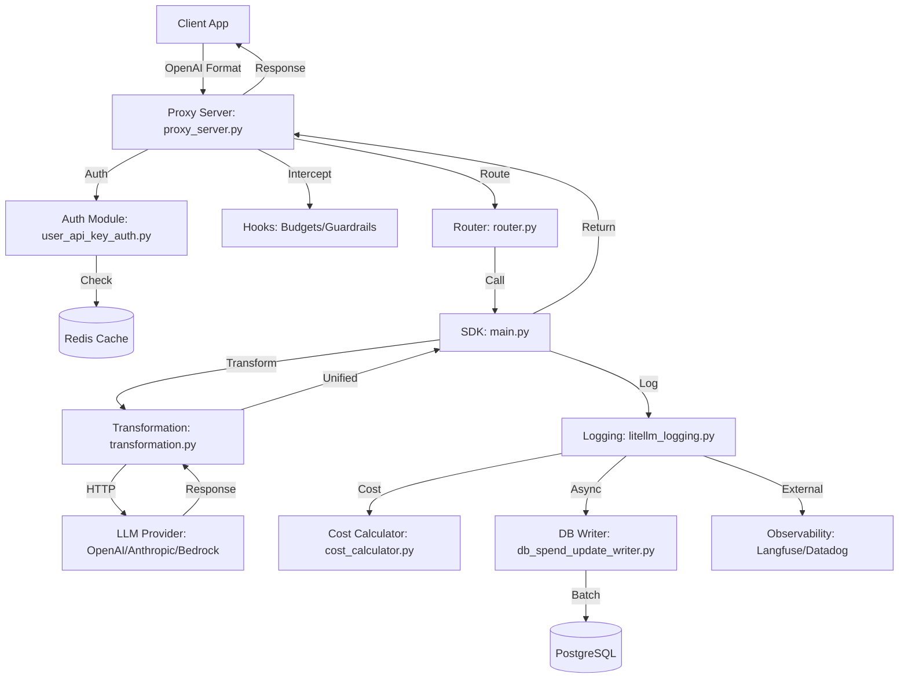

I will start by reading the instructions in `./.prompt.md` to understand how to process `litellm.xml`.
I will now examine the structure of `litellm.xml` to prepare for a comprehensive analysis of the project.
I will read the next 500 lines of `litellm.xml` to get a better overview of the directory structure and identify key files for my analysis.
I will search for the string `path="README.md"` in `litellm.xml` to locate and read the main `README.md` file, which will provide the project name and description.
I will read the next 300 lines of `README.md` starting from line 617244 to gather more information for the project description and other required details.
I will read `pyproject.toml` and `litellm/main.py` to identify core features and smart patterns, and then examine the latest git logs in `litellm.xml` to determine recent development trends.
I will search for the "Git logs" in `litellm.xml` to identify recent development trends and then examine the `litellm/proxy/proxy_server.py` file to understand the project's core features.
I will search for the "Repository information" section in `litellm.xml` to locate the git logs.
I will search for the `<repository_info>` tag in `litellm.xml`.
I will re-examine the first 50 lines of `litellm.xml` to locate the "Repository information" section.
I will examine lines 40 to 50 of `litellm.xml` to see what lies between the `</file_summary>` and `<directory_structure>` tags.
I will search for "git log" in `litellm.xml`.
I will read `ARCHITECTURE.md` and `CLAUDE.md` to gain more insight into the project's structure and development.
I will search for the content of `ARCHITECTURE.md` in `litellm.xml`.
I will check the end of the `litellm.xml` file to see if the git logs are located there.
I will search for the "audio" directory in `litellm.xml` to verify the project's audio processing capabilities.
I will search for the `litellm/llms/openai/audio` directory in `litellm.xml`.
I will search for "audio" within the `litellm/llms/` directory.
# LiteLLM: Open Source AI Gateway Analysis

## 1. Project Name and Description
**LiteLLM**

LiteLLM is an enterprise-grade, open-source AI Gateway and Python SDK designed to provide a unified interface for interacting with over 100 different Large Language Models (LLMs). It allows developers to call any supported model—including those from OpenAI, Anthropic, Azure, Google Vertex AI, and AWS Bedrock—using a single, standardized OpenAI-compatible format. This significantly simplifies the integration of multiple AI providers into a single application, reducing vendor lock-in and streamlining code maintenance.

The project offers two primary modes of operation: a flexible Python SDK for direct library integration and a high-performance Proxy Server (AI Gateway). The Proxy Server acts as a centralized service for managing LLM access across an organization, providing essential enterprise features such as centralized API key management (Virtual Keys), multi-tenant cost tracking, and per-project budget limits. It is designed to be self-hosted and is capable of handling high-volume traffic with sub-millisecond overhead.

Beyond simple proxying, LiteLLM includes advanced reliability and orchestration features. Its built-in Router provides automated retry logic, fallbacks to healthy deployments, and application-level load balancing. Furthermore, LiteLLM is at the forefront of agentic workflows, supporting emerging standards like the Model Context Protocol (MCP) for connecting external tools and the Agent-to-Agent (A2A) protocol for standardized communication between different AI agents.

## 2. Supported Platforms and Deployments
*   **Platforms:** Python (3.9+), Docker, Kubernetes (Helm charts), Node.js (via Proxy), and any language supporting HTTP/JSON.
*   **Deployment Options:**
    *   **Self-hosted:** On-premise or private cloud via Docker/Kubernetes.
    *   **Cloud Providers:** Easy deployment to AWS (Fargate/ECS), Azure, Google Cloud, Render, Railway, and Vercel.
    *   **Edge/Serverless:** Support for Cloudflare Workers.
*   **Requirements:**
    *   **Runtime:** Python 3.9 - 3.13.
    *   **Database (Optional):** PostgreSQL (for persistent keys/logs), Redis (for caching/rate-limiting).
    *   **Dependencies:** `fastapi`, `uvicorn`, `httpx`, `pydantic`, `prisma`.

## 3. Supported Connectors
LiteLLM acts as a bridge between LLMs and various ecosystems:
*   **Observability/Logging:**
    *   Langfuse, Langsmith, Helicone, Lunary, MLflow, Athina, Arize, Braintrust, Datadog, Sentry, Prometheus.
    *   *Reference:* `litellm/litellm_core_utils/litellm_logging.py`, `litellm/integrations/prometheus.py`
*   **Agent Frameworks:**
    *   LangChain, LlamaIndex, CrewAI, AutoGPT, OpenInterpreter, Pydantic AI.
    *   *Reference:* `docs/my-website/docs/langchain/langchain.md`, `litellm/a2a_protocol/`
*   **Communication Protocols:**
    *   **MCP (Model Context Protocol):** Connects MCP servers (e.g., GitHub, Slack, Google Drive) to any LLM.
    *   **A2A (Agent-to-Agent):** Standardized communication for agent swarms.
    *   *Reference:* `litellm/experimental_mcp_client.py`, `litellm/a2a_protocol/`
*   **Enterprise Infrastructure:**
    *   **Secret Managers:** AWS Secrets Manager, Azure Key Vault, Google KMS.
    *   **Auth:** OAuth2, OIDC, Microsoft Entra ID, Okta.
    *   *Reference:* `litellm/proxy/auth/user_api_key_auth.py`, `litellm/secret_managers/`

## 4. Supported Models and Agents
*   **Remote APIs (API Token/OAuth):**
    *   OpenAI (GPT-4o, o1), Anthropic (Claude 3.7), Azure OpenAI, Google Gemini/Vertex AI, AWS Bedrock (Nova, Claude, Llama), Cohere, Mistral, TogetherAI, Groq, Perplexity, Replicate, DeepSeek.
    *   *Reference:* `litellm/llms/` (contains sub-packages for each provider).
*   **Local Models:**
    *   Ollama, vLLM, Llama.cpp (via OpenAI-compatible server), LM Studio.
    *   *Reference:* `litellm/llms/vllm/`, `litellm/llms/ollama/`
*   **Agents (A2A Protocol):**
    *   Supports LangGraph, Vertex AI Agent Engine, Azure AI Foundry, Bedrock AgentCore.
    *   *Reference:* `litellm/a2a_protocol/providers/`

## 5. Top 5 Use Cases
1.  **Unified AI Gateway:** Centralizing all LLM calls across an organization to enforce security, manage costs, and provide a single audit trail.
2.  **Reliable Multi-Cloud LLM Deployment:** Using the Router to automatically failover from Azure OpenAI to OpenAI (or vice versa) during outages.
3.  **Cost and Usage Monitoring:** Implementing per-user or per-team budgets and tracking real-time spend across multiple model providers.
4.  **Agentic Tool Integration (MCP):** Giving any model (even those without native tool-use support) the ability to use external tools via the Model Context Protocol.
5.  **Standardized Model Benchmarking:** Easily switching between models for A/B testing or latency comparisons without changing application code.

## 6. Top 20 Features
1.  **Unified OpenAI-compatible API:** Standard interface for 100+ LLMs. (`litellm/main.py`)
2.  **Virtual Keys:** Temporary, scoped API keys for the proxy. (`litellm/proxy/auth/`)
3.  **Advanced Routing:** Retries, fallbacks, and priority-based routing. (`litellm/router.py`)
4.  **Load Balancing:** Distributing requests across multiple model endpoints. (`litellm/router.py`)
5.  **Multi-tenant Cost Tracking:** Spend management per team/user/key. (`litellm/proxy/db/`)
6.  **Admin Dashboard:** UI for managing keys, models, and monitoring. (`ui/litellm-dashboard/`)
7.  **Real-time Cost Calculation:** Instant pricing for requests based on token usage. (`litellm/cost_calculator.py`)
8.  **Observability Callbacks:** Plug-and-play logging to 20+ platforms. (`litellm/litellm_logging.py`)
9.  **Model Context Protocol (MCP) Support:** Tool-use bridge for any model. (`litellm/experimental_mcp_client.py`)
10. **Agent-to-Agent (A2A) Support:** Cross-agent communication protocol. (`litellm/a2a_protocol/`)
11. **Streaming Support:** Standardized SSE streaming across all providers. (`litellm/utils.py`)
12. **Secret Management:** Integration with Azure/AWS/Google secret stores. (`litellm/proxy/utils.py`)
13. **Enterprise SSO:** Auth via OIDC/OAuth2. (`litellm/proxy/auth/`)
14. **Custom Hooks:** Pre/post-call logic for guardrails or custom logging. (`litellm/proxy/hooks/`)
15. **Pass-through Endpoints:** Forwarding raw provider-specific requests. (`litellm/proxy/proxy_server.py`)
16. **Token Usage Normalization:** Standardized token counting across providers. (`litellm/utils.py`)
17. **Semantic Routing:** Content-aware request directing. (`litellm/semantic_router.py`)
18. **Image/Audio/Video Support:** Unified endpoints for multi-modal models. (`litellm/llms/`)
19. **Batch API Support:** Standardized handling of provider batch jobs. (`litellm/llms/base_llm/batches/`)
20. **Response Metadata Injection:** Adding cost and provider info to response objects. (`litellm/utils.py`)

## 7. Top 20 Smart Patterns
1.  **Unified Transformation Layer:** Using specific `transformation.py` files to map any API to OpenAI format.
2.  **Async-First Proxy:** Leveraging FastAPI's async capabilities for high concurrency.
3.  **Redis-Backed Rate Limiting:** Distributed state management for proxy swarms.
4.  **Config-Driven Capabilities:** Reading model features from a JSON map instead of hardcoding. (`model_prices_and_context_window.json`)
5.  **Hidden Parameter Context:** Using `_hidden_params` in response objects to pass metadata (like cost) without breaking OpenAI compatibility.
6.  **Provider-Specific Mixins:** Reusable logic for common provider behaviors (e.g., Anthropic headers).
7.  **Async DB Batching:** Queuing spend updates to avoid database bottlenecks. (`db_spend_update_writer.py`)
8.  **Automatic Fallback Chains:** Defining ordered lists of models for automatic failover.
9.  **Virtual Key Scoping:** Allowing keys to be restricted by model, budget, or TTL.
10. **Pre-call Guardrails:** Implementing logic before the LLM call to prevent policy violations.
11. **Post-call Sanitization:** Standardizing outputs before they reach the client.
12. **Background Health Monitoring:** Proactively checking endpoint status to update the Router.
13. **Pluggable Logging Architecture:** Decoupling core logic from observability integrations.
14. **Standardized Error Mapping:** Converting provider-specific errors to OpenAI error codes.
15. **Lazy Loading of Providers:** Importing provider-specific SDKs only when needed to keep memory low.
16. **Shared Connection Pooling:** Optimizing HTTP clients across multiple models.
17. **Dynamic API Base Resolution:** Flexible URL construction for enterprise/private endpoints.
18. **OIDC Metadata Discovery:** Automated auth configuration for enterprise identity providers.
19. **MCP Bridge Mapping:** Transforming MCP tool definitions to model-specific tool formats.
20. **A2A Card Resolution:** Using "Agent Cards" to discover and connect to agents.

## 8. Top 20 Development Trends
1.  **Deep MCP Integration:** Heavy focus on making MCP easy for enterprise users (per-user OAuth tokens).
2.  **Security Hardening:** Implementing cosign verification for Docker images and detailed security guides.
3.  **Agentic Evolution:** Expanding the A2A protocol and supporting agent-specific frameworks.
4.  **Multi-Modal Parity:** Bringing audio/video endpoints up to the same level of support as chat.
5.  **Cost Precision:** Adding support for tool-call cost tracking and reasoning token pricing.
6.  **Enterprise Credential Management:** Allowing team-level credential overrides via metadata.
7.  **Dashboard Refinement:** Improving the admin UI with better test coverage and faster load times.
8.  **High-Performance Observability:** Optimizing Prometheus and OpenTelemetry exporters.
9.  **Vertex AI Advanced Support:** Integrating fine-tuned models and newer Gemini features.
10. **SAP AI Core Support:** Expanding into enterprise-specific AI ecosystems.
11. **Baseten Integration:** Supporting newer specialized model hosting providers.
12. **Sub-millisecond Latency Optimization:** Continuous tuning of the proxy request pipeline.
13. **Enhanced Documentation:** Auto-generating pricing and context window docs.
14. **Compliance Focus:** Vanta recertification and audit log improvements.
15. **Reasoning Model Support:** Special handling for models like OpenAI 'o1' and DeepSeek-R1.
16. **WebSocket Support:** Enabling real-time/streaming responses via WebSockets.
17. **Tool Allowlisting:** Finer control over which tools agents can access.
18. **Prompt Management:** Integrating with centralized prompt management servers.
19. **Semantic Search/Rerank Expansion:** Broadening support beyond just completion models.
20. **Self-Service Enterprise Tier:** Automated onboarding for enterprise features.

## 9. Top 10 Advantages
1.  **Unrivaled Provider Support:** Access to 100+ models from day one.
2.  **OpenAI Compatibility:** Zero code changes needed for many existing applications.
3.  **Enterprise Readiness:** Built-in auth, budgets, and audit logs.
4.  **Low Latency:** Optimized Python/FastAPI stack with minimal overhead.
5.  **Flexible Deployment:** Run it as a library or a standalone service.
6.  **Rich Observability:** Integrated with nearly every major AI monitoring tool.
7.  **Reliability:** Built-in load balancing and failover.
8.  **Cost Savings:** Multi-tenant budget limits and model-switching capabilities.
9.  **Active Development:** Extremely high commit velocity and community engagement.
10. **Modern Standards:** Leading the way in MCP and A2A adoption.

## 10. Top 10 Limitations
1.  **Infrastructure Complexity:** Adding a proxy introduces a new potential point of failure.
2.  **Python-Centric SDK:** While the proxy is language-agnostic, the SDK is Python-only.
3.  **Database Overhead:** Advanced features require PostgreSQL and Redis.
4.  **Schema Drift Risks:** High-velocity updates are needed to keep pace with provider changes.
5.  **Prisma Setup Complexity:** Can be difficult in restricted CI/CD environments.
6.  **Configuration Verbosity:** Large `config.yaml` files can become hard to manage.
7.  **High Update Frequency:** May require frequent version bumps to get latest model support.
8.  **Limited Non-Chat Support:** While expanding, some niche endpoints (like 3D/Video) lag behind.
9.  **Enterprise Setup Curve:** The full enterprise suite requires significant configuration.
10. **Performance Tuning Needs:** Achieving <10ms P95 requires careful configuration of Redis and DB.

## 11. Top AI Skills
*   **Used Skills (Internal/Dependent):**
    1.  **Prisma ORM:** For type-safe database access. (`schema.prisma`)
    2.  **FastAPI:** High-performance web framework. (`proxy_server.py`)
    3.  **Redis Caching:** Distributed state and rate limiting.
    4.  **OpenTelemetry:** Standardized observability.
    5.  **Pydantic:** Data validation and model definitions.
*   **Provided Skills (Capabilities):**
    1.  **Unified LLM Completion:** `litellm.completion` skill.
    2.  **Intelligent Routing:** `litellm.router` skill.
    3.  **Cost Attribution:** `litellm.cost_calculator` skill.
    4.  **MCP Tool Bridge:** `litellm.experimental_mcp_client` skill.
    5.  **A2A Negotiation:** `litellm.a2a_protocol` skill.

## 12. Data Inputs, Outputs, and Storage
*   **Inputs:** OpenAI-compatible JSON (Chat, Embeddings, etc.), A2A messages, MCP tool schemas, Multipart/form-data for audio/images.
*   **Outputs:** OpenAI-compatible JSON, SSE (Server-Sent Events) for streaming, Binary data for images/audio.
*   **Storage:**
    *   **PostgreSQL:** Keys, Users, Teams, Organizations, Spend Logs, Model Configs. (`litellm/proxy/db/`)
    *   **Redis:** Rate limiting counters, short-term cache, temporary budget state.
    *   **In-Memory:** Model pricing map, health check status.

## 13. Detailed Architecture Review
1.  **`proxy_server.py`:** Main entry point; handles API routing and request lifecycle.
2.  **`auth/user_api_key_auth.py`:** Core authentication and virtual key validation logic.
3.  **`router.py`:** Intelligent request directing, failover, and load balancing.
4.  **`main.py`:** The primary SDK interface (`completion`, `embedding`).
5.  **`litellm_logging.py`:** Centralized hub for all observability and cost tracking.
6.  **`cost_calculator.py`:** High-precision token-to-cost conversion logic.
7.  **`llms/custom_httpx/llm_http_handler.py`:** Standardized HTTP client for all providers.
8.  **`llms/{provider}/chat/transformation.py`:** Mapping logic for each specific API.
9.  **`proxy/hooks/`:** Directory for pre/post-request interceptors (Guardrails, Budgets).
10. **`proxy/db/db_spend_update_writer.py`:** Async, batched database logging.
11. **`management_endpoints/`:** Admin APIs for managing the proxy state.
12. **`experimental_mcp_client.py`:** Bridge for connecting models to MCP servers.
13. **`a2a_protocol/`:** Implementation of standardized agent communication.
14. **`litellm_core_utils/`:** shared utilities for token counting, sanitization, and config loading.
15. **`secret_managers/`:** Connectors for AWS/Azure/Google key vaults.

## 14. Architecture Mermaid Graph

## 15. Project Maturity, Stability, Security, Performance
*   **Maturity:** High. Adopted by major companies like Stripe, Netflix, and Google. Over 100 providers supported.
*   **Stability:** Enterprise-ready. Uses a stable release cycle with 12-hour load tests.
*   **Security:** Strong. Virtual keys, budget limits, secret manager integration, and regular security scans (CodeQL, GitGuardian).
*   **Performance:** Excellent. 8ms P95 latency at 1k RPS.

## 16. Tests, CI, and Documentation
*   **Tests:** Massive suite including unit, integration, and UI tests. enforce Black, Ruff, and MyPy.
*   **CI Pipelines:** Extensive use of GitHub Actions and CircleCI for provider-specific testing.
*   **Documentation:** Top-tier. comprehensive, searchable, and includes many cookbooks/tutorials.

## 17. Top 20 Possible Improvements
1.  **Granular UI RBAC:** More roles beyond just 'Admin' and 'Member'.
2.  **Native Session Management:** Built-in persistence for chat threads.
3.  **Interactive MCP Debugger:** Better tooling for testing MCP tool calls.
4.  **Advanced Cost Analytics:** Trend forecasting and visualization in the UI.
5.  **Multi-Language SDKs:** Native Go or JS/TS libraries.
6.  **Integrated Vector Store Proxy:** Unified interface for RAG workloads.
7.  **Dynamic Guardrail Updates:** Updating policies without proxy restarts.
8.  **Simplified SQLite Mode:** For easier local development/small teams.
9.  **Better Video Support:** Unified API for newer video generation models.
10. **Native WebSearch Integration:** Standardized "Search" tool across providers.
11. **Improved Error Visualizer:** Showing the full provider error trace in the UI.
12. **Automated Prompt Optimization:** Hooks for testing different prompt variants.
13. **Local vLLM Orchestration:** Ability for the proxy to spin up/down local instances.
14. **Custom Plugin System:** Easier way to add non-Python hooks.
15. **Streaming Latency Benchmarks:** Tracking time-to-first-token in the UI.
16. **Enhanced A2A Visualizer:** Graph view of agent-to-agent interactions.
17. **Built-in Moderation Fallbacks:** Automatically running moderation on all calls.
18. **Config Versioning:** Storing history of proxy configuration changes.
19. **Real-time Alerting:** Webhooks for budget exhaustion or high error rates.
20. **Improved SDK Typing:** Even stricter MyPy coverage for complex parameters.

## 18-21. Reusable Components for Specialized Agent Systems

### 18. Agent Swarm (Solution Selection)
*   `litellm/router.py`: Core logic for selecting the "best" model/agent.
*   `litellm/a2a_protocol/`: Protocol for agent debate/negotiation.
*   `litellm/cost_calculator.py`: Factoring in cost during selection.
*   `litellm/litellm_logging.py`: Auditing the decision process.
*   `litellm/experimental_mcp_client.py`: Accessing technical specs via MCP tools.

### 19. Multi-User Shared Knowledge Evolution
*   `litellm/proxy/auth/user_api_key_auth.py`: Multi-tenant user management.
*   `litellm/proxy/db/`: Persistence layer for the shared knowledge base.
*   `litellm/experimental_mcp_client.py`: Bridge to graph databases/knowledge bases.
*   `litellm/proxy/hooks/`: Interceptors for updating knowledge on every interaction.

### 20. Edge/Messenger/Voice Agents
*   `litellm/proxy/proxy_server.py`: Central hub for diverse client connections.
*   `litellm/llms/azure/text_to_speech/`: Voice control foundation.
*   `litellm/llms/openai/transcriptions/`: Voice command processing.
*   `litellm/experimental_mcp_client.py`: Tool bridge for messenger/web integrations.

### 21. Team Cooperative Workflows
*   `litellm/proxy/management_endpoints/team_endpoints.py`: Defining team structures and permissions.
*   `litellm/a2a_protocol/`: Human-in-the-loop and agent coordination.
*   `litellm/proxy/hooks/`: Workflow enforcement and step validation.
*   `litellm/litellm_core_utils/litellm_logging.py`: Observability for cooperative tasks.
