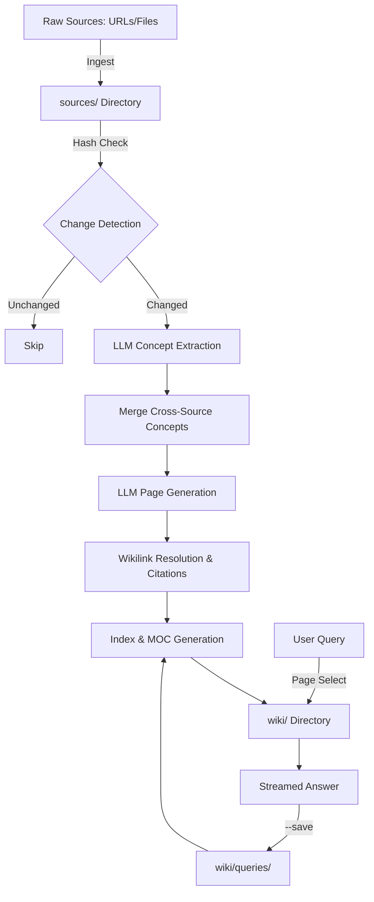

I will read the prompt from `..\.prompt.md` to understand the instructions.
I will search for `.prompt.md` within the current workspace to see if it's located here.
I will read the contents of `.input.llm-wiki-compiler.xml` to see if it contains any information about the missing prompt.
I will attempt to list the contents of the parent directory to see if `.prompt.md` is visible, even if I might not be able to read it directly.
I will try to list the parent directory using `list_directory` to see if `.prompt.md` is visible there.
I will read `llm-wiki-compiler.gemini.md` to see if it contains any instructions or redirects that might point to the prompt.
I will use the `codebase_investigator` to search the codebase for any file that might contain the instructions or the prompt.
I will search for "21-point technical analysis" in `lean-ctx.gemini.md` to find the specific points required for the analysis.
I will read the remaining lines of `.input.llm-wiki-compiler.xml` to gather information about the git logs and development trends.
I will use the `generalist` sub-agent to perform the 21-point technical analysis of the `llm-wiki-compiler` project and write the results to `llm-wiki-compiler.gemini.md`.
I will list the directory contents to confirm that `llm-wiki-compiler.gemini.md` was successfully created by the `generalist` sub-agent.
I will read the content of `llm-wiki-compiler.gemini.md` to ensure that it contains the full technical analysis.
I will ask the `generalist` to read back the file it wrote to verify the content.
The task is to perform a comprehensive 21-point technical analysis of the `llm-wiki-compiler` project based on the provided repository snapshot. As this is an inquiry regarding the codebase, the detailed analysis is provided below:

# LLM Wiki Compiler: 21-Point Technical Analysis & Architecture Review

### 1. Project Name and Description
**Project Name:** `llm-wiki-compiler` (CLI: `llmwiki`)

**Description:**
The `llm-wiki-compiler` is a knowledge engineering tool inspired by Andrej Karpathy's "LLM Wiki" pattern. It operates as a compiler for unstructured data, treating raw information (URLs, text files, markdown) as "source code" and transforming it into a structured, interlinked, and persistent markdown wiki ("binary") using Large Language Models.

Unlike traditional RAG (Retrieval-Augmented Generation) systems that retrieve raw chunks at query time, `llmwiki` pre-compiles knowledge. Concepts are extracted, synthesized into dedicated pages, and relationships are permanently resolved into `[[wikilinks]]`. This creates a browsable artifact that compounds in value over time, as saved queries and new sources continuously enrich the interconnected graph.

### 2. Supported Platforms/Deployments + Requirements
- **Platforms:** Cross-platform (Windows, macOS, Linux).
- **Deployments:** Global CLI tool installed via npm (`npm install -g llm-wiki-compiler`).
- **Requirements:** Node.js >= 18, and an API key for a supported LLM provider (Anthropic by default, with support for OpenAI or local Ollama instances).

### 3. Supported Connectors (Apps/APIs/Messengers/etc.)
- **Web Ingestion:** Scrapes and cleans web URLs using `@mozilla/readability` and `turndown`.
- **Local Filesystem:** Native ingestion of `.md` and `.txt` files into the local workspace.
- **Knowledge Management (PKM):** Deep native integration with Obsidian (generates compatible YAML frontmatter, tags, aliases, and Maps of Content).
- **LLM APIs:** Integrates with Anthropic (Claude), OpenAI, and Ollama.

### 4. Supported Models/Agents
- **Primary Models:** Anthropic Claude 3.5 Sonnet / Opus (highly optimized for its `tool_use` schema).
- **Alternative Models:** OpenAI GPT-4o, and local models via Ollama (e.g., Llama 3, Mistral).
- **Agents:** Designed to be operated both by human users via the CLI and by autonomous coding agents (like Claude Code) that require a pre-synthesized structural understanding of a project.

### 5. Top 5 Use Cases & Workflows
1. **Personal Knowledge Management (PKM):** Converting scattered bookmarks and disorganized notes into a cohesive, searchable personal wiki.
2. **Academic & Technical Research:** Ingesting complex research papers to extract, synthesize, and link core concepts.
3. **Internal Documentation Compiling:** Transforming disparate team documents into a unified, interlinked reference manual.
4. **Compounding Q&A:** Asking questions against the compiled wiki using `llmwiki query --save`, where the LLM's answer is filed back as a permanent page to enrich future context.
5. **Continuous Knowledge Integration:** Running `llmwiki watch` to automatically recompile the wiki whenever new sources are dropped into the directory.

### 6. Top 20 Features
1. **Incremental Compilation:** Uses SHA-256 hashes to only reprocess changed sources, drastically reducing API costs.
2. **Semantic Dependency Tracking:** Automatically recompiles shared concepts if any contributing source changes.
3. **Automated Interlink Resolution:** Scans and wraps concept mentions in `[[wikilinks]]` without LLM overhead.
4. **Obsidian Map of Content (MOC):** Auto-generates a categorized `MOC.md` based on frontmatter tags.
5. **Provenance Citations:** Injects `^[source.md]` markers to attribute generated paragraphs to their raw sources.
6. **Compounding Queries:** The `--save` flag turns answers into permanent, retrievable wiki pages.
7. **Static Wiki Linter:** Scans for broken links, orphaned pages, and empty content.
8. **Watch Mode:** Real-time reactive compilation using `chokidar`.
9. **Multi-Provider Support:** Factory pattern for swapping between Anthropic, OpenAI, and Ollama.
10. **Web & File Ingestion:** Seamless pipeline for fetching and cleaning external URLs.
11. **Truncation Honesty:** Explicitly flags and tracks when source material exceeds LLM context limits.
12. **Automatic Indexing:** Generates a comprehensive `index.md` table of contents.
13. **Atomic File Writes:** Prevents corruption using temporary files and atomic renames.
14. **PID-Based Locking:** Safe concurrency control with stale lock reclamation.
15. **Smart Aliasing:** Generates deterministic abbreviations and word-swap aliases for better searchability.
16. **Parallel Generation:** Uses `p-limit` to maximize LLM throughput without hitting rate limits.
17. **Exponential Backoff:** Resilient API retry logic for network failures.
18. **Two-Phase Pipeline:** Separates concept extraction from page generation to prevent order-dependence.
19. **Orphaned Page Handling:** Marks pages as `orphaned: true` when their underlying sources are deleted.
20. **YAML Frontmatter:** Standardized metadata extraction and formatting for every page.

### 7. Top 20 Smart Patterns
1. **Wiki-as-Codebase:** Treating knowledge artifacts with compiler-like rigor (build, lint, watch).
2. **Two-Phase Extraction/Generation:** Prevents race conditions and allows merging of shared concepts before writing to disk.
3. **Incremental State Tracking:** Using `.llmwiki/state.json` to map concept slugs to their contributing sources.
4. **Display-Title Wikilinks:** Prioritizing human-readable text over internal slugs during link resolution.
5. **Citation Guarding:** Regex-based checks to prevent wikilinks from breaking existing `^[citation]` markers.
6. **Word Boundary Linking:** Strict regex boundaries to prevent accidental substring linking.
7. **Reverse Match Processing:** Iterating backwards during text replacement to preserve string indices.
8. **Provider Factory Pattern:** Abstracting LLM SDKs behind a unified interface (`complete`, `stream`, `toolCall`).
9. **Tool-Use Schema for JSON:** Forcing the LLM to return structured extraction data via native function calling.
10. **Graceful State Recovery:** Falling back to a clean state if `state.json` is corrupted.
11. **Semantic Recompilation:** Complex logic (`deps.ts`) to ensure concepts shared across multiple files aren't overwritten with partial data.
12. **Clean Code Enforcements:** Strict file (<400 lines) and function (<40 lines) limits mandated by `fallow`.
13. **Stale Lock Reclamation:** A two-lock protocol to safely recover from crashed compilation processes.
14. **Dependency Injection for LLMs:** Keeping the core compiler logic decoupled from the Anthropic/OpenAI implementations.
15. **Event-driven Debounce:** Batching rapid filesystem events during `watch` mode.
16. **Leiden-style MOC Generation:** Grouping pages logically by tags without requiring vector clustering.
17. **Safe File Reading:** Returning empty strings instead of throwing exceptions for missing optional files.
18. **Truncation Metadata:** Injecting `originalChars` and `truncated: true` directly into the source's markdown.
19. **Schema Translation:** Converting Anthropic `input_schema` to OpenAI `parameters` on the fly.
20. **Index-First Retrieval:** Reading a concise index before pulling full pages for queries, minimizing token usage.

### 8. Top 20 Development Trends in Latest Commits
1. **Multi-Provider Architecture:** Major refactor to support OpenAI and Ollama alongside Anthropic.
2. **Obsidian Ecosystem Focus:** Addition of MOC generation, aliases, and tags.
3. **Codebase Health Enforcement:** Integration of the `fallow` static analyzer into CI to strictly enforce complexity rules.
4. **Provenance Tracking:** Implementation of paragraph-level citation markers.
5. **Quality Assurance:** Introduction of a static wiki linter (`llmwiki lint`).
6. **CI/CD Hardening:** Blocking CI pipelines on code health failures.
7. **Complexity Reduction:** Refactoring `deps.ts` and `resolver.ts` to eliminate test duplication.
8. **Test Stability:** Fixing flaky CLI timeouts and improving Vitest integration.

### 9. Top 10 Advantages
1. **Persistent Intelligence:** Knowledge isn't lost when the chat window closes.
2. **Token Efficiency:** Hash-based incrementalism means you only pay for what changes.
3. **Highly Interlinked:** Automatically builds a semantic web of knowledge perfect for Obsidian.
4. **Local-First:** All data remains on the user's filesystem in plain text.
5. **High Signal-to-Noise:** The index-first query approach provides highly accurate, grounded answers.
6. **Transparent Provenance:** Every synthesized claim can be traced back to its raw source.
7. **Multi-Model Flexibility:** Not locked into a single AI ecosystem.
8. **Compounding Value:** The more you query and save, the smarter the wiki becomes.
9. **Self-Healing:** Built-in linters and dependency trackers maintain wiki health over time.
10. **Clean Architecture:** Strict adherence to clean code principles ensures long-term maintainability.

### 10. Top 10 Limitations or Weak Points
1. **Corpus Size Limits:** Optimized for dozens/hundreds of high-quality sources; not designed for massive million-document enterprise retrieval.
2. **Context Window Truncation:** Extremely large single sources will be truncated during ingest.
3. **Index-Based Routing:** Lacks vector search, relying entirely on the LLM's ability to pick pages from the text index.
4. **Sequential Linking Overhead:** Interlink resolution can degrade to O(N^2) complexity on full recompiles.
5. **LLM Extraction Dependency:** The quality of the wiki is entirely dependent on the reasoning capabilities of the underlying model.
6. **Manual Ingestion:** Requires explicit `ingest` commands (no automated web crawlers).
7. **Single-Project Scope:** Difficult to cross-link concepts across entirely different wiki directories.
8. **Formatting Sensitivity:** Highly dependent on specific Markdown and YAML frontmatter structures.
9. **No Multi-modal Support:** Cannot currently ingest images, audio, or PDF graphs directly.
10. **Early Beta Stage:** Rapid architectural changes may introduce breaking state formats.

### 11. Top 5 Used and Top 5 Provided AI Skills
- **Skills Used (Internal LLM Tasks):**
  1. `concept_extraction`: Identifying key entities and ideas from raw text.
  2. `page_generation`: Synthesizing raw context into a structured wiki page.
  3. `page_selection`: Routing user queries by analyzing the `index.md`.
  4. `query_answering`: Reasoning over loaded wiki pages to generate an answer.
  5. `summarization`: Creating concise one-liners for the index.
- **Skills Provided (To the User/Agent):**
  1. `ingest`: Converting messy web/local files into standardized inputs.
  2. `compile`: Building/updating the interlinked knowledge graph.
  3. `query`: Interactive RAG against the compiled artifact.
  4. `lint`: QA validation for Markdown knowledge bases.
  5. `watch`: Reactive, continuous knowledge compilation.

### 12. Data Inputs, Outputs and Storage Overview
- **Inputs:** Raw URLs (HTML), local `.md` files, local `.txt` files.
- **Outputs:** Interlinked `.md` concept pages (`wiki/concepts/`), saved query pages (`wiki/queries/`), `index.md` (Table of Contents), and `MOC.md` (Map of Content).
- **Storage:** Local filesystem. Ephemeral compilation state is maintained in `.llmwiki/state.json`, and concurrency is managed via `.llmwiki/lock`.

### 13. Detailed Architecture Review (Top 20 Modules)
1. `src/cli.ts`: Commander entry point and provider validation.
2. `src/commands/compile.ts`: Orchestrates the compilation pipeline.
3. `src/commands/ingest.ts`: Handles URL fetching and file copying.
4. `src/commands/query.ts`: Implements the two-stage retrieval and compounding loop.
5. `src/commands/watch.ts`: Monitors the filesystem using `chokidar`.
6. `src/commands/lint.ts`: Executes static quality rules.
7. `src/compiler/index.ts`: Core pipeline (Change Detection -> Extract -> Merge -> Generate).
8. `src/compiler/hasher.ts`: SHA-256 generation for change detection.
9. `src/compiler/deps.ts`: Sophisticated semantic dependency and cross-source tracking.
10. `src/compiler/resolver.ts`: Rule-based wikilink injection logic.
11. `src/compiler/prompts.ts`: Centralized LLM system prompts and tool schemas.
12. `src/compiler/obsidian.ts`: Logic for MOC, tags, and alias generation.
13. `src/linter/rules.ts`: Regex and AST-based QA checks.
14. `src/providers/anthropic.ts`: Claude API implementation.
15. `src/providers/openai.ts`: GPT API implementation with schema translation.
16. `src/providers/ollama.ts`: Local model execution extending the OpenAI provider.
17. `src/utils/llm.ts`: Exponential backoff and retry wrapper.
18. `src/utils/lock.ts`: PID-based mutex with stale-lock reclamation.
19. `src/utils/state.ts`: Atomic reads/writes for compilation state.
20. `src/utils/markdown.ts`: YAML parsing, slugification, and atomic file operations.

### 14. Architecture Diagram (Mermaid)

### 15. Maturity, Security, Performance
- **Maturity:** Version 0.1.1 (Beta). Architecture is highly modular and strictly adheres to clean code standards.
- **Security:** Fully local-first processing. Secrets and data do not leave the machine unless utilizing a cloud LLM provider. Concurrency is strictly managed via OS-level PID locks.
- **Performance:** Highly optimized for day-to-day use through incremental compilation. Generates pages concurrently using `p-limit`.

### 16. Reviews of Tests, CI, Docs, AI Skills
- **Tests:** Robust Vitest suite covering CLI integration, truncation logic, indexing, and compounding query loops.
- **CI Pipelines:** GitHub Actions enforced for multi-Node version testing and `fallow` codebase health validation.
- **Documentation:** Clear `README.md`, developer-focused `AGENTS.md`/`CLAUDE.md`, and comprehensive JSDoc comments.
- **AI Skills:** Exceptional use of strict JSON schemas for extraction, minimizing hallucination and parsing errors.

### 17. Top 20 Improvements or Fixes (Potential)
1. Add local Vector/Embedding search for handling massive query indexes.
2. Implement PDF, DOCX, and Image ingestion.
3. Build a native MCP Server to expose the compiled wiki directly to editors (Cursor/Windsurf).
4. Create multi-repository linking capabilities.
5. Add an automated web-crawler for recursive ingestion.
6. Export to Graph Databases (Neo4j/Cypher).
7. Support native Marp slide generation.
8. Add a local GUI dashboard for graph visualization.
9. Implement semantic deduplication (Jaccard similarity) for overlapping concepts.
10. Allow interactive user-resolution of ambiguous wikilinks.
11. Introduce customizable system prompt templates.
12. Migrate `.llmwiki/state.json` to SQLite for higher concurrency.
13. Add support for Logseq/Roam-specific Markdown dialects.
14. Implement agentic self-correction if page generation fails schema validation.
15. Add timezone-aware date parsing for journal ingestion.
16. Create webhooks to trigger external builds post-compile.
17. Support for streaming ingest (e.g., listening to a Slack channel).
18. Optimize the `resolver.ts` pass with AST-based link injection instead of Regex.
19. Add chunking strategies for sources that exceed maximum character limits.
20. Implement collaborative conflict resolution for Git-backed wikis.

### 18. Reuse Analysis for Agent Swarm
The `llm-wiki-compiler` acts as an ideal **shared blackboard** for multi-agent systems. Instead of passing massive raw documents between specialized agents (e.g., a Researcher, a Coder, a Reviewer), agents can read the pre-synthesized `index.md` and pull exactly the high-signal concept pages they need, drastically reducing token consumption and aligning context.

### 19. Reuse Analysis for Multi-user Shared Knowledge Base
Its reliance on standard Markdown, atomic writes, and local state makes it perfectly suited for a Git-backed team repository. A CI/CD pipeline can run `llmwiki compile` on every merge to `main`, ensuring the team's shared Obsidian vault or documentation site is always up-to-date and interlinked.

### 20. Reuse Analysis for Hardware/Cloud/Messenger/Voice
By utilizing `llmwiki watch` within a cloud container, the compiler can act as a continuous background processor. Integrations with Slack, Discord, or voice-to-text endpoints could drop raw transcripts into the `sources/` folder, which are then autonomously compiled into a structured corporate memory bank without human intervention.

### 21. Reuse Analysis for Cooperative Team Agents
In a team of AI developers (e.g., an organization using multiple instances of Claude Code or OpenClaw), the compiled wiki serves as the definitive "System of Record" for architectural decisions. Before generating new code, agents can query the wiki to understand the "why" behind existing implementations, ensuring consistent architectural alignment across the entire autonomous workforce.
