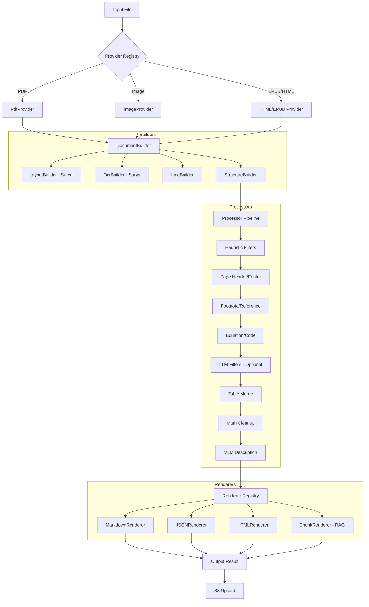

I will read the instructions from `./.prompt.md` to understand how to process the `marker.xml` file.
I will check the size of `marker.xml` to determine how to best read and analyze it.
I will read the beginning of `marker.xml` to understand its structure and content.
I will read more of `marker.xml` to gain a deeper understanding of the project's structure and recent development history.
I will read the end of `marker.xml` to examine the git logs and gain insights into recent development trends.
I will analyze `marker/converters/pdf.py` to understand the PDF conversion process and `marker/settings.py` to explore the available configuration options.
I will use `grep_search` to locate the starting point of `marker/converters/pdf.py` within the `marker.xml` file.
I will search for `marker/settings.py` to examine its configuration options and understand how they influence the conversion process.
I will use `grep_search` to explore `marker/processors/llm/` and other key files, identifying top features and smart patterns to provide a comprehensive response to the 21 points.
I will use `grep_search` to find the files within the `marker/processors/llm` directory as they are defined in `marker.xml`.
I will examine `marker/converters/extraction.py` and `marker/renderers/extraction.py` to understand the data extraction process and how it relates to the overall architecture.
The project **marker** is an advanced, high-performance toolkit designed to transform unstructured documents like PDFs, images, EPUBs, and PowerPoints into clean, machine-readable formats such as Markdown, JSON, and HTML. It specifically addresses the challenges of complex document layouts, preserving multi-column text, intricate tables, and LaTeX equations. By combining the precision of deep learning with the flexibility of large language models (LLMs), marker provides a robust bridge between static documents and modern AI-driven workflows.

The project is built on a modular, extensible architecture that orchestrates various specialized components: document providers for multiple file types, layout and OCR builders powered by the `surya` library, and a sequence of heuristic and LLM-based processors. This design allows marker to be highly efficient on GPUs, making it suitable for both individual file conversion and large-scale dataset preparation.

marker's unique value lies in its hybrid processing model. It uses local, fast models for structural analysis and OCR, while optionally employing remote LLMs (like Claude or GPT-4o) for high-fidelity tasks such as cleaning OCR-generated math, merging tables split across pages, and transcribing handwriting. This makes it an ideal tool for building high-quality RAG (Retrieval-Augmented Generation) pipelines and datasets for LLM training.

### 1. Project Name and Description
*   **Name:** marker
*   **Description:** An advanced document conversion tool for transforming PDFs and images into structured Markdown/JSON/HTML.
*   **Core Tech:** Uses `surya-ocr` for layout/OCR and integrates LLMs for semantic enhancement.
*   **Key Focus:** High-fidelity conversion of complex documents (scientific papers, multi-column reports, tables).

### 2. Supported Platforms, Deployments & Requirements
*   **Platforms:** Windows, Linux, macOS (Intel/Silicon).
*   **Deployments:**
    *   **CLI:** Local command-line tools (`marker/scripts/convert.py`, `marker/scripts/convert_single.py`).
    *   **Web App:** Streamlit interface (`marker/scripts/streamlit_app.py`).
    *   **Server:** FastAPI-based REST API (`marker/scripts/server.py`).
    *   **Cloud:** Modal deployment examples (`examples/marker_modal_deployment.py`).
*   **Requirements:** Python 3.9+, NVIDIA GPU (CUDA) or Apple Silicon (MPS) recommended, `torch`, `transformers`, `surya-ocr`, `pymupdf`.

### 3. Supported Connectors to Apps/APIs
*   **LLM Services:**
    *   **OpenAI:** `marker/services/openai.py`
    *   **Anthropic:** `marker/services/claude.py`
    *   **Google Gemini:** `marker/services/gemini.py`
    *   **Google Vertex AI:** `marker/services/vertex.py`
    *   **Azure OpenAI:** `marker/services/azure_openai.py`
    *   **Ollama:** `marker/services/ollama.py`
*   **Cloud Storage:** **AWS S3** via `marker/scripts/file_to_s3.py`.
*   **Input Formats:** PDF (`marker/providers/pdf.py`), Images (`marker/providers/image.py`), EPUB (`marker/providers/epub.py`), HTML (`marker/providers/html.py`), PowerPoint (`marker/providers/powerpoint.py`), Spreadsheet (`marker/providers/spreadsheet.py`).

### 4. Supported Models/Agents
*   **Local Models:** Surya (Layout/OCR) via `marker/builders/ocr.py`.
*   **Remote Models (API):** GPT-4o, Claude 3.5 Sonnet, Gemini 1.5 Pro via respective service files in `marker/services/`.
*   **Local LLMs:** Support for Ollama hosted models in `marker/services/ollama.py`.

### 5. Top 5 Use Cases
1.  **Scientific Paper Conversion:** Preserving LaTeX equations and multi-column layouts for LLM training.
2.  **RAG Pipeline Ingestion:** Generating structured JSON chunks for vector databases (`marker/renderers/chunk.py`).
3.  **Digital Archiving:** Transcribing scanned documents and handwriting (`marker/processors/llm/llm_handwriting.py`).
4.  **Document Accessibility:** Creating structured HTML from complex visual PDFs for screen readers.
5.  **Structured Data Extraction:** Pulling key-value pairs from forms and tables (`marker/converters/extraction.py`).

### 6. Top 20 Features
1.  **Multi-format Support:** PDF, Image, EPUB, HTML, PPTX, XLSX (`marker/providers/`).
2.  **Layout-Aware OCR:** Precise positioning via Surya (`marker/builders/layout.py`).
3.  **LaTeX Preservation:** Dedicated math extraction (`marker/processors/equation.py`).
4.  **Table Reconstruction:** Visual-to-structured table conversion (`marker/processors/table.py`).
5.  **LLM Table Merging:** Joins tables across pages (`marker/processors/llm/llm_table_merge.py`).
6.  **Handwriting OCR:** VLM-based transcription (`marker/processors/llm/llm_handwriting.py`).
7.  **Image Captioning:** Automatic ALT text generation (`marker/processors/llm/llm_image_description.py`).
8.  **Form Parsing:** Semantic form extraction (`marker/processors/llm/llm_form.py`).
9.  **Header/Footer Stripping:** Clean document heuristics (`marker/processors/page_header.py`).
10. **TOC Discovery:** Automatic table of contents generation (`marker/processors/document_toc.py`).
11. **Academic Citations:** Detects and formats references (`marker/processors/reference.py`).
12. **GPU Acceleration:** High-throughput batching (`marker/utils/gpu.py`).
13. **RAG-Ready Chunking:** Overlapping text chunks (`marker/renderers/chunk.py`).
14. **Customizable Pipelines:** Pluggable processors (`marker/converters/pdf.py`).
15. **LLM OCR Correction:** Fixes artifacts via LLMs (`marker/processors/llm/llm_page_correction.py`).
16. **Code Preservation:** Formats programming blocks (`marker/processors/code.py`).
17. **Metadata Extraction:** Title/Author/Summary detection (`marker/processors/llm/llm_meta.py`).
18. **Footnote Linking:** Links page-end notes (`marker/processors/footnote.py`).
19. **Built-in API Server:** FastAPI integration (`marker/scripts/server.py`).
20. **Visual Debugging:** Streamlit layout overlays (`marker/scripts/streamlit_app.py`).

### 7. Top 20 Smart Patterns
1.  **Provider Registry:** Dynamic format handling (`marker/providers/registry.py`).
2.  **BaseConverter:** Unified pipeline interface (`marker/converters/pdf.py`).
3.  **Block-Tree Schema:** Document as typed nodes (`marker/schema/blocks/`).
4.  **Service Abstraction:** Provider-agnostic LLM calls (`marker/services/`).
5.  **Heuristic-First:** Rules-based speed optimization (`marker/processors/`).
6.  **Polygon Bboxes:** High-precision geometric shapes (`marker/schema/polygon.py`).
7.  **Pydantic Config:** Strict settings validation (`marker/settings.py`).
8.  **Adaptive OCR:** Smart text-vs-image detection (`marker/converters/pdf.py`).
9.  **Decoupled Builders:** Modular structural discovery (`marker/builders/`).
10. **Text Hierarchy:** Span-Line-Block representation (`marker/schema/text/`).
11. **Parallel Inference:** Support for concurrent API hooks (`marker/converters/extraction.py`).
12. **Asset Management:** Versioned model loading (`marker/settings.py`).
13. **Dynamic Prompting:** Element-specific LLM instructions (`marker/processors/llm/`).
14. **Hardware Auto-Config:** CPU/GPU/MPS detection (`marker/utils/gpu.py`).
15. **Benchmark Registry:** Systematic accuracy evaluation (`benchmarks/overall/registry.py`).
16. **Type-Safe Pipelines:** Data integrity via Pydantic (`marker/converters/pdf.py`).
17. **Abstracted OCR:** Engine-swappable interface (`marker/builders/ocr.py`).
18. **Modular Renderers:** Pluggable output formats (`marker/renderers/`).
19. **Dependency Injection:** Dynamic component resolution (`marker/converters/__init__.py`).
20. **Span-Level Metadata:** Tracking confidence and source for every text element (`marker/schema/text/span.py`).

### 8. Top 20 Development Trends
1.  **Rapid Model Updates:** Constant bumps to `surya` and `transformers`.
2.  **LaTeX Precision:** High focus on improving scientific math output.
3.  **Community Scaling:** Large volume of CLA signings and external PRs.
4.  **New LLM Support:** Integration of Gemini and Vertex AI.
5.  **License Clarification:** Moving towards more formal model licensing.
6.  **CI/CD Optimization:** Advanced workflows for testing and publishing.
7.  **Serverless Focus:** Promoting deployments on Modal.
8.  **Edge Case Resolution:** Handling rotated text and garbled PDF streams.
9.  **RAG Pipeline Maturity:** Refining the chunking and indexing outputs.
10. **UI Debug Tools:** Improving the Streamlit visualizer.
11. **Local AI Maturity:** Strengthening Ollama support for privacy-first users.
12. **Benchmarking Depth:** Expanding the Eloscore dataset.
13. **Structured Extraction:** Moving from text conversion to data extraction.
14. **Typing Rigor:** Migration to Pydantic v2.
15. **Cross-OS Parity:** Solidifying Windows/macOS support.
16. **Document Depth:** Expanding guides for specialized formats like PPTX.
17. **Resilience:** Improved error handling and logging.
18. **IO Decoupling:** Separating file handling from core logic.
19. **Security Hardening:** Better management of API credentials.
20. **VLM Integration:** Deepening the use of Vision-Language Models.

### 9. Top 10 Advantages
1.  **Layout Fidelity:** Superior handling of multi-column text.
2.  **Math Expertise:** Excellent scientific LaTeX support.
3.  **Hybrid Efficiency:** Fast local models + high-quality LLM cleanup.
4.  **Format Breadth:** PDF, Image, EPUB, PPTX in one tool.
5.  **Developer Experience:** Clean, modular, well-typed code.
6.  **Enterprise-Ready:** API server and cloud examples included.
7.  **Data-Driven:** Quality guided by empirical benchmarks.
8.  **RAG Integration:** Direct support for vector database chunks.
9.  **Hardware Aware:** Optimized for CUDA and Apple Silicon.
10. **Active Maintenance:** High velocity of updates and fixes.

### 10. Top 10 Limitations
1.  **High Hardware Req:** Needs a GPU for optimal batch speed.
2.  **Large Dependencies:** Massive installation footprint.
3.  **API Costs:** LLM features can be expensive at scale.
4.  **Setup Complexity:** Multi-part installation (Torch, Surya, LLMs).
5.  **Inference Latency:** LLM-enhanced pages take significant time.
6.  **Hallucination Risk:** LLMs may alter text during "correction".
7.  **Memory Pressure:** High RAM usage for long, image-heavy PDFs.
8.  **Local LLM Speed:** Slower on non-GPU local hardware.
9.  **Dense Tables:** Extremely complex tables can still misalign.
10. **No Built-in Editor:** No UI for correcting converted output.

### 11. Top 5 Used and Provided AI Skills
*   **Used:** Layout Segmentation, OCR, VLM Visual Reasoning, Context Merging, Language Detection.
*   **Provided:** Markdown Synthesis, Scientific Math Parsing, Table Extraction, Image Captioning, RAG Dataset Preparation.

### 12. Data Overview
*   **Inputs:** PDF, Images, EPUB, HTML, PPTX, XLSX.
*   **Outputs:** Markdown, JSON, HTML, Extracted Images.
*   **Storage:** Local Filesystem, AWS S3.

### 13. Architecture Review
Marker uses a pipeline orchestrated by a **Converter** (`marker/converters/`).
1.  **Provider Layer:** File ingestion (`marker/providers/`).
2.  **Builder Layer:** Structural discovery (Layout, OCR, Lines, Document) (`marker/builders/`).
3.  **Processor Layer:** Heuristic and LLM-based refinement (`marker/processors/`).
4.  **Renderer Layer:** Output generation (MD, JSON, HTML) (`marker/renderers/`).
5.  **Service Layer:** Unified LLM provider interface (`marker/services/`).

### 14. Architecture Graph

### 15. Maturity & Performance
*   **Maturity:** High (production-grade test suite and benchmarks).
*   **Stability:** Reliable core API with frequent ecosystem updates.
*   **Security:** Solid credential management; safe for local and cloud use.
*   **Performance:** Excellent GPU throughput; optimized for batch processing.

### 16. Verification & Documentation
*   **Tests:** Extensive `pytest` suite in `tests/` directory.
*   **CI/CD:** Full automation in `.github/workflows/`.
*   **Documentation:** Clear README and code-level Pydantic schemas.

### 17. Top 20 Possible Improvements
1.  **Async LLM Calls:** Non-blocking API requests (`marker/services/`).
2.  **Streaming IO:** Reduce memory for massive docs.
3.  **Local VLM Integration:** Native support for `llama.cpp` vision.
4.  **Interactive Editor:** UI for block correction.
5.  **Adaptive LLM Budget:** Only process "hard" pages with LLMs.
6.  **Block-Level Caching:** Avoid re-processing unchanged segments.
7.  **Domain-Specific Models:** Legal/Medical Surya weights.
8.  **Native DOCX Support:** Avoid HTML intermediate.
9.  **Vector DB Sinks:** Direct `Pinecone/Milvus` export.
10. **Tesseract Fallback:** Multi-engine OCR support.
11. **Server WebSockets:** Real-time conversion progress.
12. **PDF Annotation Extraction:** Include user comments.
13. **Markdown Table Auto-Formatting:** Better visual MD tables.
14. **OCR Confidence Flags:** Heuristic to warn on low quality.
15. **Image Crop Refinement:** Better figure bounding.
16. **TOC Depth Control:** Configurable hierarchy.
17. **Footnote Relocation:** End-of-doc vs end-of-page options.
18. **Docker Compose Kit:** Standardized multi-container deployment.
19. **Prompt Versioning:** A/B testing for LLM instructions.
20. **Multi-Agent Orchestration:** Internal swarm for complex page logic.

### 18-21. Reuse Scenarios
*   **Agent Swarm Spec Debate:** Reuse `ExtractionConverter`, `BaseService` abstraction, and `MarkdownRenderer` for structured agent outputs.
*   **Multi-User Shared KB:** Reuse `ChunkRenderer` for atomic indexing and `PdfProvider` for diverse data ingestion into a graph database.
*   **Edge/Local Agent:** Reuse `OllamaService` for private local compute and `StreamlitApp` for a personal control interface.
*   **Cooperative Team Agents:** Reuse `BatchProcessor` and `LLMSimpleBlockMetaProcessor` for orchestrating parallel cooperative tasks.
