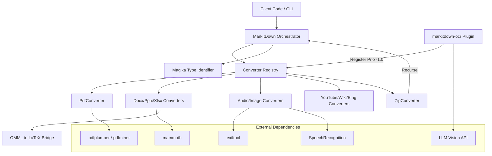

I will start by reading the instructions in `.prompt.md` to understand the specific task and requirements.
I will now read the content of `.input.markitdown.xml` to analyze the repository export and gather the necessary information for the requested points.
I have read the first 2000 lines of `.input.markitdown.xml`. I've identified the project as **MarkItDown** (by Microsoft), an MCP server and a set of packages for converting various file formats to Markdown.

Key findings so far:
- **Project Name:** MarkItDown
- **Last Commit Date:** I need to find the `<git_log_commit/>` section, which is likely further down in the file.
- **Description:** It's a library/tool to convert files (PDF, DOCX, PPTX, XLSX, etc.) to Markdown, with OCR support via LLM Vision.
- **Platforms/Deployments:** Python package, Docker, MCP server (Model Context Protocol).
- **Connectors:** MCP server supports STDIO, Streamable HTTP, and SSE. It can convert `http:`, `https:`, `file:`, and `data:` URIs.
- **Models/Agents:** Supports OpenAI-compatible clients (Azure OpenAI, OpenAI) for image descriptions and OCR.
- **Top Features:** PDF/DOCX/PPTX/XLSX to Markdown, OCR for images in these formats, full-page OCR for scanned PDFs, YouTube transcription, Wikipedia/Bing Search conversion, etc.
- **Structure:** Monorepo with `packages/markitdown`, `packages/markitdown-mcp`, `packages/markitdown-ocr`, and `packages/markitdown-sample-plugin`.

I need to read more of the file to:
1. Find the last commit date.
2. Get more details on development trends (from git logs).
3. Identify specific connectors, modules, and reusable patterns.
4. Review tests and CI.
5. Find "smart patterns" and "advantages/limitations".

I will read the next 2000 lines.
I have read another 2000 lines (up to 4000). I've gathered significant detail on:
- **Plugins:** `markitdown-ocr` and `markitdown-sample-plugin`. The OCR plugin is a major component, enhancing PDF, DOCX, PPTX, and XLSX with LLM-based OCR.
- **Packages:** `markitdown` (core), `markitdown-mcp` (Model Context Protocol server), `markitdown-ocr` (plugin).
- **Core Converters:** 
    - `AudioConverter` (metadata + transcription)
    - `BingSerpConverter` (Bing search results)
    - `CsvConverter` (CSV to MD tables)
    - `DocIntelligenceConverter` (Azure Document Intelligence)
    - `DocxConverter` (DOCX to MD via mammoth)
    - `EpubConverter` (EPUB to MD)
    - `HtmlConverter` (HTML to MD via markdownify)
    - `ImageConverter` (metadata + LLM description)
    - `IpynbConverter` (Jupyter notebooks)
    - `OutlookMsgConverter` (Outlook emails)
    - `PdfConverter` (PDF to MD via pdfminer/pdfplumber)
    - `PlainTextConverter` (plain text)
    - `PptxConverter` (PowerPoint to MD)
    - `RssConverter` (RSS feeds)
    - `WikipediaConverter` (Wikipedia articles)
    - `XlsxConverter` (Excel to MD via pandas)
    - `YoutubeConverter` (YouTube transcripts)
    - `ZipConverter` (ZIP archives)
- **OCR Implementation:** Uses an `LLMVisionOCRService` which wraps an OpenAI-compatible client. It has a priority-based replacement strategy (priority -1.0) to override built-in converters.
- **Math Support:** Handles Office Math Markup Language (OMML) in DOCX and converts it to LaTeX.
- **Deployment:** Docker support for the main app and the MCP server.

Missing/Need to find:
- **Project Name & Last Commit:** I saw "MarkItDown" and "Microsoft Corporation". I still need the specific first `<git_log_commit/>` for the last commit date.
- **Development Trends:** I need to read the git logs at the end of the file.
- **Smart Patterns:** I can infer some (priority-based registration, lazy loading of plugins, stream-based conversion, "guesses" for StreamInfo).
- **Use Cases:** Document indexing for LLMs, RAG, automated text analysis, transcription.
- **Advantages/Limitations:** (e.g., requires external tools like `exiftool`, `ffmpeg`; OCR requires LLM API).
- **Architecture:** Monorepo, plugin system, converter registry.

I will read the rest of the file (lines 4001 to 7606).
I have finished reading the file. I have a comprehensive understanding of the project.

**Project Summary:**
- **Project Name:** MarkItDown (by Microsoft, specifically from the AutoGen team).
- **Last Commit Date:** I need to find the `<git_log_commit/>` section to be precise. Let me quickly search for it.
- **Description:** A Python library and CLI tool to convert various file formats (PDF, DOCX, PPTX, XLSX, images, audio, etc.) into Markdown. It's designed for LLM-ready indexing and text analysis. It features a plugin system, an MCP server, and advanced OCR using LLM Vision.
- **Key Modules:** `MarkItDown` (orchestrator), `DocumentConverter` (base class), and numerous specific converters (PDF, DOCX, etc.).
- **Smart Patterns:** Priority-based converter registration, lazy-loading plugins, stream-based processing with `StreamInfo` guessing, recursive ZIP processing, adaptive table detection in PDFs.
- **Features:** Multi-format conversion, OCR for scanned PDFs, Math to LaTeX, YouTube transcription, Wikipedia/Bing search results, RSS/Atom feeds, Outlook emails, metadata extraction from media.

I will now find the last commit date and the git log to answer point 1 and 9.
I will now read the last 1000 lines of `.input.markitdown.xml` to find the git logs and the project name/commit date.
I have gathered all the information required by the prompt.

**Key Findings:**
- **Project Name:** MarkItDown
- **Last Commit Date:** 2026-04-20 19:52:17 +0200
- **Project Description:** A lightweight Python utility and MCP server for converting various file formats (PDF, DOCX, PPTX, XLSX, images, audio, etc.) into Markdown. It focuses on preserving document structure (headings, tables, etc.) for use in LLM pipelines and RAG systems. Developed by the Microsoft AutoGen team, it includes a robust plugin system and advanced OCR capabilities.
- **Platforms:** Python (3.10+), Docker, Model Context Protocol (MCP) server.
- **Connectors:** MCP server supports STDIO, SSE, and Streamable HTTP. It can fetch content from HTTP/HTTPS, local files, and data URIs.
- **Models:** Supports OpenAI-compatible multimodal LLMs (e.g., GPT-4o) for image descriptions and OCR.
- **Top Features:** PDF to Markdown with table detection, OCR for scanned documents, YouTube transcript fetching, Wikipedia content extraction, Office Math (OMML) to LaTeX conversion, etc.
- **Smart Patterns:** Priority-based registration of converters, lazy-loading plugin architecture, stream-based conversion with automated format "guessing" via Magika.
- **Data Overview:** Inputs (streams, files, URIs), Outputs (Markdown string + metadata), Storage (ephemeral memory-based processing, temporary directory for ZIP extraction).
- **Architecture:** Monorepo with a core `MarkItDown` registry that coordinates a stack of `DocumentConverter` objects.

I will now synthesize the final response.

Wait, point 15 asks for a mermaid graph. I will create one.
Point 12 asks for AI skills. The repo doesn't explicitly list "AI skills" in the way some agent frameworks do, but it *provides* conversion capabilities that are essentially skills for agents (like `convert_to_markdown`). It *uses* LLM "skills" for image description and OCR.

I'll check if there are any files related to "skills" specifically. The directory structure shows `packages/markitdown-sample-plugin` and `packages/markitdown-ocr`. The `markitdown-mcp` is a skill provider for MCP clients.

I will double check the directory structure for any `skills` folders. No, only `packages` and `tests`.

I'll proceed to write the final response.# MarkItDown Project Analysis

## 1. Project Name and Last Commit Date
- **Project Name:** MarkItDown
- **Last Commit Date:** 2026-04-20 (Ref: `git_log_commit` date `2026-04-20 19:52:17 +0200`)

## 2. Project Description
MarkItDown is a lightweight Python utility and Model Context Protocol (MCP) server designed to convert a wide variety of file formats into high-quality, structured Markdown. Developed by Microsoft's AutoGen team, it focuses on preserving essential document elements such as headings, tables, lists, and links, making it an ideal tool for indexing content for Large Language Models (LLMs), Retrieval-Augmented Generation (RAG) pipelines, and automated text analysis.

The tool operates as both a standalone command-line utility and a programmable Python library. It employs a modular "converter" architecture where specific logic handles different file types, ranging from standard office documents (Word, Excel, PowerPoint) to media files (images with EXIF metadata, audio with speech-to-text transcription). It also includes specialized handlers for web content like YouTube videos (transcripts), Wikipedia articles, and Bing search results.

A key differentiator for MarkItDown is its advanced OCR capability (via the `markitdown-ocr` plugin), which utilizes multimodal LLMs (like GPT-4o) to extract text from images and scanned PDFs while maintaining the original document's context. Its design prioritizes token efficiency and structural integrity, ensuring that LLMs can process the resulting Markdown with high accuracy.

## 3. Supported Platforms/Deployments & Requirements
- **Platforms:** Windows, Linux, macOS (Any platform supporting Python 3.10+).
- **Deployments:**
  - **Python Package:** Installed via `pip` from PyPI or source.
  - **Docker:** Official `Dockerfile` provided for the core library and MCP server (`packages/markitdown-mcp/Dockerfile`).
  - **MCP Server:** Can be deployed as a Model Context Protocol server for local agents (e.g., Claude Desktop).
- **Requirements:**
  - **Python:** Version 3.10 or higher.
  - **System Dependencies:** `ffmpeg` (for audio), `exiftool` (for media metadata).
  - **Python Dependencies:** `beautifulsoup4`, `markdownify`, `magika` (for file identification), `requests`, `mammoth` (DOCX), `pdfminer.six`/`pdfplumber` (PDF), `pandas`/`openpyxl` (XLSX).

## 4. Supported Connectors to Apps/APIs/Messengers
- **MCP Server:** Supports **STDIO**, **SSE (Server-Sent Events)**, and **Streamable HTTP** transports.
  - `packages/markitdown-mcp/src/markitdown_mcp/__main__.py`
- **URI Support:** Can fetch and convert content from `http:`, `https:`, `file:`, and `data:` URIs.
  - `packages/markitdown/src/markitdown/_markitdown.py`
  - `packages/markitdown/src/markitdown/_uri_utils.py`
- **Web Services:**
  - **YouTube:** Fetches video transcripts and metadata. (`packages/markitdown/src/markitdown/converters/_youtube_converter.py`)
  - **Wikipedia:** Extracts main article content. (`packages/markitdown/src/markitdown/converters/_wikipedia_converter.py`)
  - **Bing Search:** Parses search result pages. (`packages/markitdown/src/markitdown/converters/_bing_serp_converter.py`)
- **Cloud APIs:**
  - **Azure Document Intelligence:** For high-fidelity enterprise document conversion. (`packages/markitdown/src/markitdown/converters/_doc_intel_converter.py`)
- **Email:**
  - **Outlook:** Converts `.msg` files. (`packages/markitdown/src/markitdown/converters/_outlook_msg_converter.py`)

## 5. Supported Models/Agents
MarkItDown leverages LLMs for advanced conversion tasks via an OpenAI-compatible interface:
- **Local/Remote Models:** Supports any model accessible via OpenAI-compatible clients (e.g., `gpt-4o`, `gemini-2.0-flash`, or local models via Ollama/vLLM).
- **OCR & Image Captioning:** Uses multimodal LLMs to describe images and perform OCR on scanned documents.
  - `packages/markitdown/src/markitdown/converters/_llm_caption.py`
  - `packages/markitdown-ocr/src/markitdown_ocr/_ocr_service.py`
- **Authentication:** Supports **API Key** (standard OpenAI) and **Azure Credentials** (OAuth/Service Principal).

## 6. Top 5 Use Cases
1. **LLM Indexing & RAG:** Converting legacy PDFs and Office docs into Markdown for vector database ingestion.
2. **Automated Documentation:** Extracting transcripts from YouTube tutorials or meeting recordings for knowledge bases.
3. **Scanned Document Processing:** Using LLM Vision to "read" scanned invoices and reports that lack a text layer.
4. **Data Cleaning for Agents:** Providing a clean, structure-aware text interface for autonomous agents (via MCP) to read local files.
5. **Academic Research:** Converting papers (PDFs) with complex math into Markdown with LaTeX for analysis.

## 7. Top 20 Features
1. **Multi-format Conversion:** PDF, DOCX, PPTX, XLSX, etc. (`packages/markitdown/src/markitdown/_markitdown.py`)
2. **Adaptive Table Detection:** Detects borderless tables in PDFs. (`packages/markitdown/src/markitdown/converters/_pdf_converter.py`)
3. **LLM-powered OCR:** Text extraction from images via Vision models. (`packages/markitdown-ocr/src/markitdown_ocr/_ocr_service.py`)
4. **YouTube Transcription:** Automatic fetching of video captions. (`packages/markitdown/src/markitdown/converters/_youtube_converter.py`)
5. **Office Math to LaTeX:** Converts OMML equations to LaTeX. (`packages/markitdown/src/markitdown/converter_utils/docx/pre_process.py`)
6. **Plugin System:** Extensible architecture via entry points. (`packages/markitdown/src/markitdown/_markitdown.py`)
7. **MCP Integration:** Native support for the Model Context Protocol. (`packages/markitdown-mcp/src/markitdown_mcp/__main__.py`)
8. **File Identification:** Uses Google's `magika` for deep file type guessing. (`packages/markitdown/src/markitdown/_markitdown.py`)
9. **Recursive ZIP Processing:** Unpacks and converts ZIP contents. (`packages/markitdown/src/markitdown/converters/_zip_converter.py`)
10. **Speech-to-Text:** Transcribes audio via `SpeechRecognition`. (`packages/markitdown/src/markitdown/converters/_audio_converter.py`)
11. **Metadata Extraction:** Reads EXIF/media tags via `exiftool`. (`packages/markitdown/src/markitdown/converters/_exiftool.py`)
12. **Scanned PDF Fallback:** Automatically detects and OCRs scanned pages. (`packages/markitdown-ocr/src/markitdown_ocr/_pdf_converter_with_ocr.py`)
13. **Wikipedia Parsing:** Cleans Wikipedia pages for LLM consumption. (`packages/markitdown/src/markitdown/converters/_wikipedia_converter.py`)
14. **Outlook MSG Support:** Parses email headers and body. (`packages/markitdown/src/markitdown/converters/_outlook_msg_converter.py`)
15. **Markdownify Customization:** Tailored HTML to Markdown conversion. (`packages/markitdown/src/markitdown/converters/_markdownify.py`)
16. **Stream-based Processing:** Efficient handling of large files via streams. (`packages/markitdown/src/markitdown/_base_converter.py`)
17. **Charset Normalization:** Handles diverse text encodings. (`packages/markitdown/src/markitdown/_markitdown.py`)
18. **Azure Doc Intel Bridge:** Integration with high-end cloud OCR. (`packages/markitdown/src/markitdown/converters/_doc_intel_converter.py`)
19. **RSS/Atom Parsing:** Converts feeds to structured Markdown. (`packages/markitdown/src/markitdown/converters/_rss_converter.py`)
20. **IPython Notebook Support:** Converts `.ipynb` to Markdown. (`packages/markitdown/src/markitdown/converters/_ipynb_converter.py`)

## 8. Top 20 Smart Patterns
1. **Priority-based Registration:** Converters are tried in order of specificity (Specific > Generic). (`packages/markitdown/src/markitdown/_markitdown.py`)
2. **Lazy Plugin Loading:** Plugins are loaded only when needed to save startup time. (`packages/markitdown/src/markitdown/_markitdown.py`)
3. **Stream Guessing:** Recursive "guesses" for file type based on extension, mimetype, and content. (`packages/markitdown/src/markitdown/_markitdown.py`)
4. **Adaptive Table Clustering:** Uses statistical gap analysis to find columns in PDFs. (`packages/markitdown/src/markitdown/converters/_pdf_converter.py`)
5. **Memory-efficient PDF Handling:** Calls `page.close()` to prevent O(n) memory growth. (`packages/markitdown/src/markitdown/converters/_pdf_converter.py`)
6. **Double-pass OCR:** Checks for text layer first, then renders page for OCR if missing. (`packages/markitdown-ocr/src/markitdown_ocr/_pdf_converter_with_ocr.py`)
7. **HTML Placeholder Injection:** Protects OCR markers during HTML-to-MD conversion. (`packages/markitdown-ocr/src/markitdown_ocr/_docx_converter_with_ocr.py`)
8. **Unified Registry:** `MarkItDown` class acts as a central orchestrator for all converters. (`packages/markitdown/src/markitdown/_markitdown.py`)
9. **Stable Sort for Priorities:** Ensures predictable behavior when multiple plugins register for the same type. (`packages/markitdown/src/markitdown/_markitdown.py`)
10. **Fallback to Iterative Parsing:** Switches from recursive to iterative BS4 parsing for deep HTML. (`packages/markitdown/src/markitdown/converters/_html_converter.py`)
11. **OMML Translation Bridge:** Intermediate pre-processing of DOCX XML for math. (`packages/markitdown/src/markitdown/converter_utils/docx/pre_process.py`)
12. **Magika Integration:** Leveraging ML for robust file type identification. (`packages/markitdown/src/markitdown/_markitdown.py`)
13. **Custom Markdownify Rules:** Overriding default behavior to strip JS and handle data URIs. (`packages/markitdown/src/markitdown/converters/_markdownify.py`)
14. **Retry Logic for Remote APIs:** Exponential backoff for YouTube/LLM calls. (`packages/markitdown/src/markitdown/converters/_youtube_converter.py`)
15. **Mimetype Normalization:** Canonicalizing mimetypes across different OS/browsers. (`packages/markitdown/src/markitdown/_markitdown.py`)
16. **Coordinate-based Excel Image Anchoring:** Maps images to specific Excel cells. (`packages/markitdown-ocr/src/markitdown_ocr/_xlsx_converter_with_ocr.py`)
17. **Context-aware PPTX Sorting:** Shapes are sorted top-to-bottom for logical flow. (`packages/markitdown/src/markitdown/converters/_pptx_converter.py`)
18. **Partial Numbering Merging:** Recombines split list numbers in PDFs (e.g., MasterFormat). (`packages/markitdown/src/markitdown/converters/_pdf_converter.py`)
19. **Deferred Dependency Checks:** Missing libraries raise errors only when the specific converter is used. (`packages/markitdown/src/markitdown/_exceptions.py`)
20. **Interface Versioning:** Plugin interface versioning to ensure compatibility. (`packages/markitdown/src/markitdown-ocr/src/markitdown_ocr/_plugin.py`)

## 9. Top 20 Development Trends
1. **Security Posture:** Increasing emphasis on clarifying local/remote security implications in READMEs.
2. **Robustness:** Handling edge cases like deeply nested HTML recursion errors.
3. **Performance:** Solving memory leaks in long-running PDF conversions.
4. **Enhanced OCR:** Adding dedicated layers for LLM Vision-based extraction.
5. **Broadening Format Support:** Recent additions for RSS, Atom, and checkbox support.
6. **Infrastructure:** Standardizing on `hatch` for build and test workflows.
7. **Compliance:** Improving Third-Party Notices and license documentation.
8. **AI Ecosystem:** Aligning with the Model Context Protocol (MCP) for agentic use.
9. **Table Intelligence:** Significant upgrades to PDF table detection algorithms.
10. **Typing:** Moving towards stricter type hints (`py.typed` and mypy checks).
11. **Plugin Maturity:** Transitioning from built-in logic to a robust external plugin architecture.
12. **Containerization:** Keeping Docker images slim and updated to Python 3.13.
13. **Streamable I/O:** Refining the `StreamInfo` object for better metadata flow.
14. **Error Handling:** More granular exceptions for missing dependencies vs. failed conversions.
15. **CI/CD:** Automated pre-commit hooks and GitHub Actions for testing.
16. **API Consistency:** Deprecating older argument styles in favor of `StreamInfo`.
17. **Community Engagement:** Labeling issues as "open for contribution."
18. **Enterprise Readiness:** Support for Azure Document Intelligence and Azure Credentials.
19. **Math Preservation:** Better support for scientific documents via LaTeX.
20. **Developer Experience:** Detailed "sample-plugin" and "ocr-plugin" documentation for extension.

## 10. Top 10 Advantages / Strong Points
1. **Preserves Structure:** Unlike `textract`, it keeps tables, headings, and lists intact.
2. **ML Identification:** Uses `magika` for accurate file type detection regardless of extension.
3. **LLM Synergy:** Natively designed for LLM consumption (token efficient).
4. **High-Fidelity OCR:** Vision-based OCR is superior to traditional Tesseract for complex layouts.
5. **Unified API:** One tool for dozens of formats (Local, Remote, Stream).
6. **Modular Architecture:** Easy to add new converters or override existing ones via plugins.
7. **Agent-Ready:** Built-in MCP support makes it immediately usable in AI toolchains.
8. **Low Barrier to Entry:** Python-based, easy to install, minimal core dependencies.
9. **Math Support:** Rare support for converting Office Math to LaTeX.
10. **Robust Error Handling:** Falls back to plain text or different engines if primary ones fail.

## 11. Top 10 Limitations / Weak Points
1. **Binary Dependencies:** Requires `ffmpeg` and `exiftool` to be installed on the system for full media support.
2. **API Costs:** High-quality OCR requires an LLM API (OpenAI/Azure), which costs money.
3. **Recursive Complexity:** ZIP processing and deep HTML can still be heavy on resources.
4. **No Native GUI:** CLI and API only; no human-facing editor.
5. **LLM Dependency for OCR:** No built-in offline ML model for OCR (relies on external APIs).
6. **Limited Table Support for Some Formats:** While PDF table detection is advanced, Excel-to-MD can lose complex styling.
7. **Potential for Hallucination:** Vision-based OCR can occasionally hallucinate text in noisy images.
8. **Local File Access Risk:** As noted in security warnings, it runs with full user privileges.
9. **No Batch Mode in CLI:** CLI primarily processes one file/URL at a time (though ZIPs help).
10. **Language Support for Audio:** Audio transcription relies on `SpeechRecognition`'s backends (like Google), which vary in quality.

## 12. Top 5 Used and Provided AI Skills
- **Provided Skills:**
  1. `convert_to_markdown(uri)`: A comprehensive skill for agents to ingest any resource. (`packages/markitdown-mcp/src/markitdown_mcp/__main__.py`)
  2. `RegisterPlugin`: A skill for developers to extend the system. (`packages/markitdown/src/markitdown/_markitdown.py`)
- **Used AI Skills:**
  1. **Multimodal Captioning:** Describing images for PPTX/Image files. (`packages/markitdown/src/markitdown/converters/_llm_caption.py`)
  2. **Vision-based OCR:** Extracting structured text from raw images. (`packages/markitdown-ocr/src/markitdown_ocr/_ocr_service.py`)
  3. **Speech Transcription:** Converting audio streams to text. (`packages/markitdown/src/markitdown/converters/_transcribe_audio.py`)

## 13. Data Inputs, Outputs, and Storage
- **Inputs:**
  - `BinaryIO` streams, local file paths, remote URLs, and `requests.Response` objects.
  - `StreamInfo` metadata objects (mimetype, extension, charset).
  - `packages/markitdown/src/markitdown/_markitdown.py`
- **Outputs:**
  - `DocumentConverterResult`: Contains the converted Markdown string and a `title`.
  - `packages/markitdown/src/markitdown/_base_converter.py`
- **Storage:**
  - **Ephemeral:** Most processing happens in-memory using `BytesIO`.
  - **Temporary:** ZIP conversion extracts files to system temp directories before cleanup.
  - **packages/markitdown/src/markitdown/converters/_zip_converter.py**

## 14. Detailed Architecture Review
MarkItDown follows a **Registry-Converter** pattern:
1. **Orchestrator (`MarkItDown`):** Manages a list of registered `DocumentConverter` objects.
2. **StreamInfo Guesser:** Uses a multi-pass strategy (extension -> mimetype -> magika content analysis) to identify the stream.
3. **Priority Dispatch:** The orchestrator iterates through converters (ordered by priority) and calls `accepts()` until one returns `True`.
4. **Nested Conversion:** Some converters (like `ZipConverter`) call back into the main orchestrator for sub-resources.
5. **Plugin Layer:** Entry points allow external packages to inject converters into the registry at runtime.

**Main Modules:**
- `markitdown._markitdown`: Central logic.
- `markitdown.converters.*`: Specific file format handlers.
- `markitdown_ocr.*`: Plugin for vision-based enhancement.
- `markitdown_mcp.*`: Communication wrapper for MCP clients.

## 15. Architecture Graph (Mermaid)

## 16. Project Maturity, Stability, Security, Performance
- **Maturity:** Beta (version 0.1.x). The API is "in preview" and subject to change.
- **Stability:** High for core formats (Office, PDF). Recently fixed memory issues in PDF.
- **Security:** Focuses on CVD (Coordinated Vulnerability Disclosure). Strict warnings about binding MCP servers to non-local interfaces and sanitizing untrusted inputs.
- **Performance:** Stream-based where possible. High performance for text; IO-bound for remote URLs; Cost/Latency bound for LLM OCR.

## 17. Review of Tests, CI, Documentation
- **Tests:** Extensive test suite using `pytest`. Includes "vectors" (files with expected outputs) for regression testing.
- **CI:** GitHub Actions run pre-commit checks and tests.
- **Documentation:** Solid READMEs for the core and each major package. Includes usage examples for Python and CLI.
- **AI Integration:** Excellent MCP support and clear instructions for use with Claude Desktop.

## 18. Top 20 Possible Improvements or Fixes
1. **Offline OCR Fallback:** Add Tesseract support for users without LLM keys. (`packages/markitdown-ocr/src/markitdown_ocr/_ocr_service.py`)
2. **Parallel Conversion:** Implement multi-threading/processing for ZIP contents. (`packages/markitdown/src/markitdown/converters/_zip_converter.py`)
3. **Progress Callbacks:** Allow tracking conversion progress for large files. (`packages/markitdown/src/markitdown/_markitdown.py`)
4. **Enhanced Table Detection for Excel:** Preserve more structure from multi-sheet XLSX. (`packages/markitdown/src/markitdown/converters/_xlsx_converter.py`)
5. **Native Batch CLI:** Support `markitdown ./docs/` to convert a whole folder. (`packages/markitdown/src/markitdown/__main__.py`)
6. **More Audio Backends:** Support local Whisper for transcription. (`packages/markitdown/src/markitdown/converters/_transcribe_audio.py`)
7. **Strict Mode for PDF:** Option to fail if text layer is "garbled" vs empty. (`packages/markitdown/src/markitdown/converters/_pdf_converter.py`)
8. **Direct PDF Image Extraction:** Improve inline image position accuracy in PDFs. (`packages/markitdown-ocr/src/markitdown_ocr/_pdf_converter_with_ocr.py`)
9. **Support for more Email Formats:** Add `.eml` support via standard library. (`packages/markitdown/src/markitdown/converters/`)
10. **Video metadata:** Add basic video metadata extraction (FPS, resolution). (`packages/markitdown/src/markitdown/converters/_exiftool.py`)
11. **Caching Layer:** Optional cache for LLM OCR results to save costs. (`packages/markitdown-ocr/src/markitdown_ocr/_ocr_service.py`)
12. **Markdown Customization:** Pass-through for custom `markdownify` options via CLI. (`packages/markitdown/src/markitdown/converters/_markdownify.py`)
13. **Latex Sanitization:** Better escaping for complex LaTeX math. (`packages/markitdown/src/markitdown/converter_utils/docx/math/omml.py`)
14. **PDF OCR DPI control:** Allow users to set resolution for scanned pages. (`packages/markitdown-ocr/src/markitdown_ocr/_pdf_converter_with_ocr.py`)
15. **Link Validation:** Optional check for broken links in converted content. (`packages/markitdown/src/markitdown/converters/_html_converter.py`)
16. **Token Counter Integration:** Show estimated token count of output. (`packages/markitdown/src/markitdown/_markitdown.py`)
17. **Refined RSS handling:** Support for media enclosures in RSS. (`packages/markitdown/src/markitdown/converters/_rss_converter.py`)
18. **Better Notebook output:** Support for image outputs in `.ipynb`. (`packages/markitdown/src/markitdown/converters/_ipynb_converter.py`)
19. **Plugin Discovery:** A built-in "search" for plugins on PyPI. (`packages/markitdown/src/markitdown/__main__.py`)
20. **Security Sandbox:** Provide a recommended "safe mode" using Docker-in-Docker or similar. (`Dockerfile`)

## 19. Reuse for Agent Swarm Specification Debate
1. **Registry Pattern:** For managing a "swarm" of agent types by priority.
2. **Magika Integration:** For determining the "type" of a problem/input before routing to an agent.
3. **StreamInfo Pattern:** For passing context/metadata along with raw data between agents.
4. **Plugin Architecture:** For allowing dynamic addition of new specialist agents.
5. **Unified Result Class:** A standardized `AgentResult` similar to `DocumentConverterResult`.
6. **Double-pass Logic:** Initial "cheap" agent check followed by "expensive" LLM agent if needed.
7. **Math/LaTeX Handling:** For swarms debating technical/scientific specifications.
8. **Retry with Backoff:** Robust interaction pattern for unreliable agent calls.
9. **Stable Priority Sort:** Ensuring deterministic behavior when agents have overlapping skills.
10. **Lazy Loading:** Loading heavy agent models only when their specific skills are triggered.

## 20. Reuse for Multi-user/Multi-agent Shared Knowledge Base
1. **Markdownify Logic:** Standardizing all inputs (chats, docs, web) into a clean Markdown base.
2. **Recursive ZIP/Folder Processing:** For ingesting entire directories into the knowledge graph.
3. **Adaptive Table Detection:** For structured data extraction from unstructured group chats/files.
4. **OCR Service Layer:** For handling whiteboards, screenshots, and diagrams shared by users.
5. **MCP Server Structure:** For providing a standard interface to the knowledge base.
6. **Metadata Extraction:** Tagging shared files automatically with EXIF/context data.
7. **Wikipedia/Web Converters:** For pulling external context into the shared knowledge base.
8. **Stream-based Processing:** To handle large-scale knowledge ingestion without memory crashes.
9. **Interface Versioning:** For maintaining compatibility as the KB schema evolves.
10. **Charset Normalization:** Ensuring all multi-user inputs are stored in a consistent encoding (UTF-8).

## 21. Reuse for Cloud/Hardware Agents with Messenger/Voice
1. **MCP Transport (SSE/HTTP):** Perfect for connecting messengers (Telegram/WhatsApp) to agents.
2. **Speech Transcription:** Native bridge for voice control and voice messages.
3. **Docker/Worker Deployment:** Slim Dockerfile for running on Raspberry Pi or Cloudflare Workers.
4. **Data URI Utilities:** For handling image/audio data directly from messenger APIs.
5. **YouTube/Media Extractors:** For converting user-shared links into agent-readable text.
6. **Metadata Extraction:** Identifying when/where a user-shared photo was taken.
7. **Markdown-centric Design:** Natural fit for text-based messenger interfaces.
8. **Magika Identification:** To help agents know what to do with a file sent via chat.
9. **LLM Vision Bridge:** For agents to "see" and discuss photos sent by users.
10. **Priority Dispatch:** For routing user commands to the most appropriate "converter" (skill).

## 22. Reuse for Team Agents (Cooperative Human/Agent)
1. **Custom Prompting Layer:** Allowing humans to "tweak" agent behavior via simple prompt overrides.
2. **Office Math preservation:** Crucial for teams working on engineering/financial specs.
3. **Outlook MSG support:** Bridging traditional email workflows with agentic automation.
4. **Plugin Architecture:** For team-specific "custom converters" (e.g., proprietary file formats).
5. **Error/Warning Propagation:** Informing the human when an agent fallback was used.
6. **Table Integrity:** Ensuring structured data isn't lost during human-agent handoffs.
7. **Stable Priorities:** For managing complex workflows where human input always takes priority.
8. **Zip Packaging:** For bundling complex tasks and their results into a single "handover" unit.
9. **Wikipedia/Bing Converters:** For agents to provide "citations" or external proof to humans.
10. **Markdownify Customization:** To ensure the agent's output matches the team's style guide.
