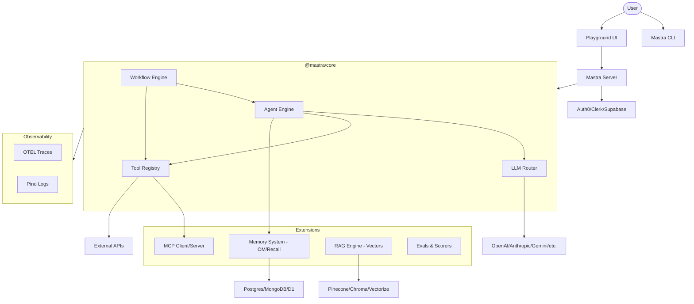

I will read the instructions in `.prompt.md` to understand the task.
I will read the `.input.mastra.xml` file to gather information for the analysis.
I will search for the `<git_log_commit>` tag in `.input.mastra.xml` to find the project name and the last commit date.
I will search for the `<git_log_commit>` tag in the `.input.mastra.xml` file.
I will search for the `<git_log_commit>` tag in the `.input.mastra.xml` file.
I will search for the `<git_log_commit>` tag in the `.input.mastra.xml` file.
I will read the first git log commit and the root `package.json` from `.input.mastra.xml`.
I will search for the root `package.json` and the `README.md` to get the project name and description.
I will read the root `package.json` file.
I will search for the root `README.md` file to get the project description.
I will read the `README.md` file.
I will search for connectors, models, and features in the codebase.
I will search for the string `providers` in the `packages/core` directory of the `.input.mastra.xml` file.
I will search for the list of supported providers in `packages/core/src/llm/model/provider-registry.ts` and check the `integrations/` directory for supported applications and APIs.
I will search for the string `providers = [` in the `packages/core` directory of the `.input.mastra.xml` file.
I will read the `packages/core/src/llm/model/provider-registry.ts` file from the `.input.mastra.xml` file.
I will read the `packages/core/src/llm/model/provider-registry.ts` file.
I will search for the `packages/core/src/llm/model/provider-registry.json` file in the `.input.mastra.xml` file.
I will read the `packages/core/src/llm/model/provider-registry.json` file.
I will read the `packages/core/src/llm/model/provider-registry.json` file.
I will search for the `integrations/` directory or `packages/integrations` in the `.input.mastra.xml` file to identify supported applications and APIs.
I will check `packages/mcp` and `packages/core/src/tools` for connectors and integrations.
I will check `packages/mcp/src/server.ts` for MCP connectors.
I will check `packages/core/src/memory` for memory patterns.
I will check `packages/core/src/evals` for scorers and then proceed to build the mermaid graph and analyze the code for improvements and reuse cases.
# Project Analysis: Mastra

## 1. Project Name and Last Commit Date
- **Project Name:** Mastra (found as `mastra-turbo` in root `package.json`)
- **Last Commit Date:** 2026-04-16 04:59:42 +0000

## 2. Description
Mantra is a comprehensive open-source framework for building AI-powered applications and agents using a modern TypeScript stack. It is designed to bridge the gap between early-stage prototyping and production-ready AI products, offering a unified set of tools for orchestrating LLMs, managing memory, and executing complex workflows.

The framework provides a robust infrastructure for autonomous agents that can reason about goals and utilize tools, alongside a graph-based workflow engine for deterministic multi-step processes. It emphasizes type safety and developer experience, integrating seamlessly with popular frameworks like React, Next.js, and Node.js, while remaining deployable to various environments including serverless platforms.

With built-in features for human-in-the-loop interactions, extensive model routing to over 40 providers, and integrated evaluation and observability suites, Mastra ensures that AI applications are not only easy to build but also reliable and measurable in production. It follows a dual-license model, keeping the core framework open under Apache 2.0 while offering specialized enterprise features.

## 3. Supported Platforms/Deployments + Requirements
- **Platforms/Deployments:**
  - **Serverless/Edge:** Cloudflare Workers, Vercel, Netlify.
  - **Backend Frameworks:** Node.js (Express, Fastify, Hono, Koa).
  - **Frontend Frameworks:** React, Next.js.
- **Requirements:**
  - **Node.js:** Modern version (recommended >= 18.x or 20.x).
  - **Package Manager:** `pnpm` (>= 10.18.0 as per `package.json`).
  - **Language:** TypeScript/JavaScript.

## 4. Supported Connectors to Apps/APIs/Messengers
- **Model Context Protocol (MCP):** Acts as both an MCP Client and Server, allowing connection to any MCP-compatible tool or resource.
- **Integrations:**
  - **OpenCode:** Plugin for observational memory in coding sessions (`integrations/opencode/src/index.ts`).
  - **Auth Providers:** Auth0, Better-Auth, Clerk, Firebase, Okta, Supabase, WorkOS (`auth/` directory).
  - **Storage/Databases:** PostgreSQL, LibSQL, Cloudflare D1, Convex, DynamoDB, Lance, MongoDB, MSSQL, Upstash (`packages/core/src/storage/`).
  - **Vector Databases:** Astra, Chroma, Couchbase, DuckDB, Elasticsearch, OpenSearch, PG, Pinecone, Qdrant, Turbopuffer, Upstash, Vectorize (`packages/core/src/vector/`).

## 5. Supported Models/Agents
- **Local/Remote Models:** Supports 40+ providers via a unified interface.
- **Key Providers:**
  - **OpenAI:** GPT-4o, GPT-5 series, etc. (`packages/core/src/llm/model/provider-registry.json`).
  - **Anthropic:** Claude 3.5 series (Sonnet, Opus, Haiku) (`packages/core/src/llm/model/gateways/base.ts`).
  - **Google:** Gemini series via Vertex AI or Google AI SDK (`packages/core/src/llm/model/embedding-router.ts`).
  - **DeepSeek:** DeepSeek V3, Reasoner (`packages/core/src/llm/model/provider-registry.json`).
  - **Meta:** Llama 3.1/3.3 via multiple gateways like Groq, TogetherAI, OpenRouter.
  - **Mistral/Mixtral:** Via Mistral AI or multiple gateways.
  - **Others:** Grok (XAI), Alibaba (Qwen), MiniMax, Cohere, Perplexity.
- **Authentication:** API Key, Bearer Token, OAuth 2.0 (`packages/mcp/src/server/oauth-middleware.ts`).

## 6. Top 5 Use Cases and Workflows
1. **AI Recruiter:** Scans resumes, matches against job descriptions using agents, and summarizes candidates.
2. **Chef/Recipe Assistant:** Uses tools to fetch ingredients, suggests recipes based on dietary restrictions, and provides step-by-step guidance.
3. **Code Review Bot:** Analyzes PRs, identifies bugs or style issues using LLMs, and posts comments to GitHub.
4. **Research Assistant:** Searches the web (via tools), synthesizes information, and creates detailed reports.
5. **Stock Market Analyst:** Fetches real-time stock data, analyzes trends, and provides investment insights using specialized tools.

## 7. Top 20 Features
1. **Model Routing:** Unified interface for 40+ LLM providers (`packages/core/src/llm/model/router.ts`).
2. **Autonomous Agents:** Goal-oriented agents with internal reasoning loops (`packages/core/src/agent/`).
3. **Graph-based Workflows:** Complex orchestration with `.then()`, `.branch()`, `.parallel()` (`packages/core/src/workflows/`).
4. **Human-in-the-loop:** Suspend and resume execution for human approval (`packages/core/src/tools/hitl.md`).
5. **Observational Memory (OM):** Compresses history into structured observations (`packages/memory/src/processors/observational-memory/`).
6. **Semantic Recall:** Embedding-based retrieval for long-term memory (`packages/memory/src/index.ts`).
7. **Working Memory:** Short-term task-specific context (`packages/memory/src/tools/working-memory.ts`).
8. **MCP Client/Server:** Full support for Model Context Protocol (`packages/mcp/`).
9. **Evaluation Framework (Evals):** Built-in scorers for quality measurement (`packages/evals/`).
10. **Observability:** OTEL-based tracing and logging (`observability/`).
11. **Tool Approval:** Mid-execution human validation for sensitive tool calls (`packages/core/src/tools/hitl.md`).
12. **Document RAG:** End-to-end RAG with chunking and vector storage (`packages/core/src/vector/`).
13. **Server Adapters:** Ready-to-use adapters for Hono, Express, etc. (`server-adapters/`).
14. **Deployment Engine:** Automated deployment to Vercel/Netlify/Cloudflare (`deployers/`).
15. **Structured Output:** Enforces JSON schemas on LLM responses (`packages/core/src/llm/index.ts`).
16. **Voice Integration:** Speech-to-text and text-to-speech support (`packages/core/src/voice/`).
17. **Step Time Travel:** Ability to restart or resume workflows from any step (`packages/core/src/workflows/`).
18. **Prompt Management:** Versioned and parameterized prompts.
19. **Playground UI:** Interactive web UI for testing agents/workflows (`packages/playground-ui/`).
20. **Security Middleware:** Built-in auth and RBAC integration (`packages/mcp/src/server/oauth-middleware.ts`).

## 8. Top 20 Smart Patterns
1. **Observer-Reflector Architecture:** Used in OM to extract and condense information (`integrations/opencode/src/index.ts`).
2. **Gateway Pattern:** Unified access to multiple LLM and cloud providers (`packages/core/src/llm/model/gateways/`).
3. **Human-in-the-Loop Interruption:** Pattern for pausing execution for user input (`packages/core/src/tools/hitl.md`).
4. **Adapter Pattern for Servers:** Abstracts different Node.js server frameworks (`server-adapters/`).
5. **Provider Registry:** Dynamic loading and discovery of LLM models (`packages/core/src/llm/model/provider-registry.ts`).
6. **Time Travel Execution:** State management for workflow resumes (`packages/core/src/workflows/`).
7. **Semantic Filtering:** Filtering observations based on relevance to current task (`packages/memory/src/processors/observational-memory/`).
8. **Schema Compatibility Layer:** Normalizing tool schemas for different LLMs (`packages/core/src/tools/tool-builder/`).
9. **Atomic Write Pattern:** Preventing corruption in shared registry files (`packages/core/src/llm/model/provider-registry.ts`).
10. **Elicitation Loop:** Interactive feedback during tool execution in MCP (`packages/mcp/src/client/actions/elicitation.ts`).
11. **Buffered Observation:** Accumulating context before triggering LLM-based summary.
12. **Anchor ID Correlation:** Linking memory items to specific conversation turns (`packages/memory/src/processors/observational-memory/anchor-ids.ts`).
13. **Model Routing Fallbacks:** Automatic fallback between model versions/providers.
14. **Composite Storage:** Combining different DBs for metadata and binary data.
15. **Middleware-based Observability:** Injecting tracing into LLM calls automatically.
16. **Tool Approval UI Injection:** Patterns for injecting approval UI into streams.
17. **Workspace Skill Activation:** Dynamically loading tools based on workspace context (`mastracode/src/agents/workspace.ts`).
18. **Delta-based State Updates:** Minimizing state transfer in workflows.
19. **Introspection-based Auth:** Dynamic token validation for MCP servers (`packages/mcp/src/server/oauth-middleware.ts`).
20. **Retry with Exponential Backoff:** Handling rate limits across 40+ providers.

## 9. Top 20 Development Trends
1. **MCP 1.0 Adoption:** Rapid integration of Model Context Protocol.
2. **Observational Memory Refinement:** Shifting towards more efficient compression.
3. **Human-in-the-Loop Maturation:** Adding V2/VNext resume APIs.
4. **Enhanced Type Safety:** Moving towards Zod v4 and better-typed tool results.
5. **Cross-Model Schema Normalization:** Automating schema adjustments for Haiku/Sonnet/GPT-4o differences.
6. **Serverless Optimization:** Reducing cold starts for Cloudflare/Vercel.
7. **Multi-Agent Orchestration:** Moving from single agents to supervisor-worker patterns.
8. **Built-in Evals in CI:** Automating agent testing.
9. **Voice/Realtime Support:** Integration with OpenAI Realtime and Gemini Live.
10. **Better Auth Integration:** First-class support for Better-Auth and Clerk.
11. **Observability via OTEL:** Standardizing tracing across the platform.
12. **Dynamic Tool Loading:** Loading tools from remote MCP servers at runtime.
13. **Unified Model Registry:** Centralizing model metadata across 40+ providers.
14. **Memory "Time Travel":** Cloning threads and history for experimentation.
15. **Structured Output Enforcement:** Rigorous use of JSON schemas.
16. **Coding Agent Optimization:** Specific prompts and tools for `mastracode`.
17. **Cloudflare D1/Vectorize Support:** Deep integration with Cloudflare stack.
18. **Reduced Bundle Size:** Moving to subpath exports.
19. **Elicitation in Tools:** Allowing tools to ask users for more info.
20. **Performance Monitoring:** Tracking token usage and cost per run.

## 10. Top 10 Advantages
1. **Modern TypeScript Stack:** Full type safety and modern DX.
2. **Provider Agnostic:** Easy switching between OpenAI, Anthropic, Gemini, etc.
3. **Production Ready:** Built-in evals, tracing, and logging.
4. **Flexible Memory:** Unique Observational Memory architecture.
5. **MCP Support:** Future-proof integration via industry standard.
6. **Comprehensive Storage Support:** Works with almost any database.
7. **Graph Workflows:** Provides better control than simple chains.
8. **Human-in-the-Loop:** First-class support for real-world business processes.
9. **Large Ecosystem:** 40+ model providers and multiple deployment targets.
10. **Active Community:** Fast-paced development and clear roadmap.

## 11. Top 10 Limitations
1. **Dual Licensing:** Enterprise features require a separate license.
2. **Complexity:** Learning curve for graph-based workflows vs. simple prompts.
3. **Evolving APIs:** Frequent updates in alpha/beta stages.
4. **Resource Intensive:** Observational memory requires additional LLM calls.
5. **Node.js Dependency:** Limited support for other runtimes (e.g., Python).
6. **Documentation Gaps:** Some advanced features lack deep documentation.
7. **Tool Normalization:** Manual tuning still needed for some provider-specific schemas.
8. **Large Repository:** Monorepo structure can be overwhelming for new contributors.
9. **Cloud Dependency:** Many features rely on remote LLM providers.
10. **Memory Overhead:** Storing long histories and observations increases DB costs.

## 12. Top 5 Used and Provided AI Skills
- **Used Skills:**
  1. `react-best-practices` (`.claude/skills/react-best-practices/`)
  2. `tailwind-best-practices` (`.claude/skills/tailwind-best-practices/`)
  3. `e2e-tests-studio` (`.claude/skills/e2e-tests-studio/`)
  4. `mastra-docs` (`.claude/skills/mastra-docs/`)
  5. `ralph-plan` (`.claude/skills/ralph-plan/`)
- **Provided Skills:**
  1. `mastra-smoke-test` (`.claude/skills/mastra-smoke-test/`)
  2. `smoke-test` (`.claude/skills/smoke-test/`)
  3. `mastracode` coding logic (`mastracode/src/agents/coding.ts`)
  4. `evals` scorers (`packages/evals/src/scorers/`)
  5. `rag` retrieval logic (`packages/core/src/vector/`)

## 13. Data Inputs, Outputs, and Storage Overview
- **Inputs:** User queries, Tool definitions, MCP resources, Documents (PDF, MD, etc.), Database records.
- **Outputs:** Structured JSON (LLM), Markdown text, Tool call results, Traces (OTEL), Observational summaries.
- **Storage:**
  - **Relational:** PostgreSQL, MySQL (via MSSQL/Postgres adapters), SQLite (LibSQL, D1).
  - **NoSQL:** MongoDB, DynamoDB.
  - **Vector:** Pinecone, Chroma, Qdrant, etc.
  - **State:** Redis (via Upstash), InMemory.
- **Source References:** `packages/core/src/storage/`, `packages/core/src/vector/`.

## 14. Detailed Architecture Review
1. **Core Orchestrator (`@mastra/core`):** Manages Agents, Workflows, and Tools.
2. **LLM Gateway (`packages/core/src/llm/`):** Routes requests to 40+ providers.
3. **Memory System (`packages/memory/`):** Implements OM, Working Memory, and Recall.
4. **Workflow Engine (`packages/core/src/workflows/`):** Executes graph-based steps.
5. **Tool Framework (`packages/core/src/tools/`):** Dynamic tool creation and approval.
6. **MCP Bridge (`packages/mcp/`):** Connects to external tool servers.
7. **RAG Engine (`packages/core/src/vector/`):** Handles embeddings and vector search.
8. **Evaluation Suite (`packages/evals/`):** Runs quality tests on agent outputs.
9. **Observability Stack (`observability/`):** Standardizes tracing and logging.
10. **Server Adapters (`server-adapters/`):** Bridges to Hono, Express, etc.
11. **Deployer Hub (`deployers/`):** Manages cloud deployments.
12. **Auth Layer (`auth/`):** Integrates multiple authentication providers.
13. **Playground (`packages/playground/`):** Developer UI for testing.
14. **Agent Builder (`packages/agent-builder/`):** High-level factory for agents.
15. **Schema Compatibility (`packages/schema-compat/`):** Normalizes Zod/JSON schemas.
16. **Voice Engine (`packages/core/src/voice/`):** STT and TTS integrations.
17. **Feature Flags (`packages/core/src/features/`):** Manages enterprise/core features.
18. **Logger (`packages/core/src/logger/`):** Pino-based logging.
19. **CLI (`packages/cli/`):** Scaffolding and project management.
20. **MastraCode (`mastracode/`):** Specialized IDE-like agent environment.

## 15. Architecture Mermaid Graph

## 16. Project Maturity, Stability, Security, Performance
- **Maturity:** Late Beta/Early Production. Version 0.1.x but very high feature density and backing (Y Combinator W25).
- **Stability:** Core APIs are becoming stable, but frequent updates in high-level packages (OM, MCP).
- **Security:** Good practices (secrets management, auth middleware, atomic writes). committed to security finding disclosure.
- **Performance:** Optimized for TypeScript. Serverless focus ensures low cold starts. OM introduces some latency for background compression.

## 17. Tests, CI, Documentation, Skills Review
- **Tests:** Extensive Vitest suite covering unit, integration, and E2E tests. High coverage in core packages.
- **CI Pipelines:** GitHub Actions for linting, testing, major version checks, and automated releases.
- **Documentation:** Well-structured Docusaurus site (`docs/`), comprehensive guides, and built-in "Build with AI" prompt.
- **AI Skills:** Heavily used in-house for development (coding standards, testing). Provided to users via specialized agents.

## 18. Possible Improvements or Fixes
1. **Unify `zod` versions:** I see `zod/v3` and `zod/v4` usage; unifying would reduce bundle size.
2. **Expand MCP Providers:** More pre-built MCP servers for common apps (Slack, Jira).
3. **Local LLM optimization:** Better support for local runtimes like Ollama without complex setup.
4. **Workflow Visualizer:** Export workflow graphs to Mermaid automatically in CLI.
5. **OM Cost Control:** More granular control over when observer/reflector runs to save tokens.
6. **Unified Auth Schema:** Standardize RBAC across all 10+ auth providers.
7. **Python SDK:** Huge demand for non-JS runtimes.
8. **More RAG Templates:** Pre-built RAG pipelines for specific data types (legal, medical).
9. **Better Error Recovery:** More resilient "Time Travel" for failed workflow steps.
10. **Integrated Playground in Docs:** Live testing of agents directly in documentation.
11. **Mobile SDK:** React Native support for agent interactions.
12. **Agent Swarm Logic:** Standardize communication protocols between multiple agents.
13. **Cost Estimation Tool:** Real-time cost prediction for complex workflows.
14. **Sensitive Data Masking:** Automated PII masking in traces/logs.
15. **Auto-generated Tests:** Using agents to generate Vitest cases for new tools.
16. **Better Schema Mapping:** Automated conversion of API docs to Zod schemas.
17. **Offline Mode Expansion:** More robust registry for air-gapped environments.
18. **GraphQL Support:** Exposing agents via GraphQL.
19. **Native Desktop App:** MastraCode as a standalone app.
20. **Benchmarking Suite:** Comparing agent performance across different LLM providers.

## 19. Reuse for Agent Swarm (Debates, Graph KB)
1. **Agent Supervisor Pattern:** From `packages/core/src/agent/` for managing debate participants.
2. **Workflow Branching:** `packages/core/src/workflows/` for handling parallel implementation plans.
3. **Observational Memory:** `packages/memory/` for distilling debate results into a shared context.
4. **Graph RAG Tools:** `docs/src/content/en/docs/rag/graph-rag.mdx` for knowledge-based implementation plans.
5. **Evals Scorers:** Using built-in scorers to "review" and select the best solution.
6. **Structured Output:** Ensuring all agents communicate in a standard format.
7. **MCP Resource Sharing:** Exposing the knowledge graph as an MCP resource.
8. **Semantic Recall:** Retrieving similar past debates/solutions.
9. **Step Time Travel:** Backtracking to a previous debate state if a path fails.
10. **MastraCode Subagents:** Reusing `audit-tests` and `plan` logic for implementation verification.

## 20. Reuse for Multi-User/Multi-Agent Shared KB
1. **Thread-based Isolation:** From `packages/core/src/memory/` to separate user contexts.
2. **Semantic Recall (Global):** Shared vector space for collective knowledge.
3. **Observational Memory (Shared):** Distilling all user/agent interactions into a common fact base.
4. **Composite Storage:** Combining private user data (Postgres) with shared knowledge (VectorDB).
5. **Human-in-the-Loop:** Collaborative approval workflows for KB updates.
6. **Auth/RBAC:** Managing access permissions to shared skills/knowledge (`auth/`).
7. **MCP Server:** Exposing the shared KB to external systems.
8. **Workspace Skill Management:** Dynamically providing skills based on user roles.
9. **Log Aggregation:** Monitoring multi-user activity via OTEL.
10. **Delta-based Sync:** For real-time shared markdown/skill editing.

## 21. Reuse for Hardware/Cloud/Messenger/Voice
1. **Cloudflare Deployer:** `deployers/cloudflare/` for edge deployment.
2. **Server Adapters:** `server-adapters/` for Hono (ideal for Cloudflare Workers).
3. **Voice Engine:** `packages/core/src/voice/` for speech control.
4. **MCP Stdio Transport:** For running agents on local hardware and exposing them.
5. **Harness API:** `packages/core/src/harness/` for cross-platform agent execution.
6. **Mastra Client JS:** `client-sdks/client-js/` for web/mobile apps.
7. **Agent Browser:** `browser/agent-browser/` for agents navigating the web.
8. **SSE/Streamable HTTP:** For real-time updates in messengers/web.
9. **OAuth Middleware:** For secure messenger integrations (WhatsApp/Teams).
10. **Vector Visualize:** Tools for visualizing the knowledge graph in the web app.

## 22. Reuse for Team Agents (Cooperative Workflows)
1. **Supervisor Agent Pattern:** Coordinating human and agent tasks.
2. **Human-in-the-Loop (VNext):** Sophisticated resume/approval logic.
3. **Workflow State Management:** Shared state for long-running team processes.
4. **Observational Memory (Team-wide):** Capturing team decisions and context.
5. **Tool Delegation:** Logic for agents to delegate tasks back to humans.
6. **Collaborative Planning:** Reusing `ralph-plan` skill for team goal setting.
7. **Audit Trails:** Tracking every agent/human action via Tracing.
8. **Skill Sharing:** Distributing custom tools across a team workspace.
9. **Review Statuses:** Explicit handling of task completion/verification.
10. **Elicitation Loop:** Agents asking team members for missing info/context.
